# Technical Design — Noter Core (backend)

<!-- toc -->

- [1. Architecture Overview](#1-architecture-overview)
  - [1.1 Architectural Vision](#11-architectural-vision)
  - [1.2 Architecture Drivers](#12-architecture-drivers)
  - [1.3 Architecture Layers](#13-architecture-layers)
- [2. Principles & Constraints](#2-principles--constraints)
  - [2.1 Design Principles](#21-design-principles)
  - [2.2 Constraints](#22-constraints)
- [3. Technical Architecture](#3-technical-architecture)
  - [3.1 Domain Model](#31-domain-model)
  - [3.2 Component Model](#32-component-model)
  - [3.3 API Contracts](#33-api-contracts)
  - [3.4 Internal Dependencies](#34-internal-dependencies)
  - [3.5 External Dependencies](#35-external-dependencies)
  - [3.6 Interactions & Sequences](#36-interactions--sequences)
  - [3.7 Database schemas & tables](#37-database-schemas--tables)
  - [3.8 Deployment Topology](#38-deployment-topology)
- [4. Additional context](#4-additional-context)
  - [4.1 Contract governance and the UI-first plan](#41-contract-governance-and-the-ui-first-plan)
  - [4.2 Design decisions](#42-design-decisions)
  - [4.3 Open questions](#43-open-questions)
  - [4.4 Risks, technical debt and quality approach](#44-risks-technical-debt-and-quality-approach)
  - [4.5 Terms](#45-terms)
  - [4.6 Checklist dispositions](#46-checklist-dispositions)
- [5. Traceability](#5-traceability)

<!-- /toc -->

- [ ] `p1` - **ID**: `cpt-noter-design-core`

## 1. Architecture Overview

### 1.1 Architectural Vision

This document designs everything behind the UI of Noter: the Rust core inside the Tauri app, the Swift engine sidecar that owns audio and on-device ML, noter-mcp (the tool server the LLM runtimes call), and the four contracts that join them. The UI is designed in `docs/DESIGN.md`; PRD Part B is the technical intent this design makes concrete. Where this document and PRD Part B differ, section 4.2 says why; the PRD was synced with this design on 17 Oct 2026.

**History.** v0.4 (17 Oct 2026) applies the owner decisions and resolutions of the five-role review in `docs/REVIEW-2026-10-17-design-core.md`; the contract crate, the fake core, the PRD and DESIGN.md were changed to match on the same day. The same day, the quality-gate harness of ADR-0003 (`docs/HARNESS.md`) was folded into 3.4, 3.8, 4.1, 4.4 and 5.

Development is UI-first, so the contract between the UI and the core is the first deliverable, not a by-product. It is written once, as Rust types in one crate (`crates/noter-protocol`), and everything else is generated from it: the TypeScript bindings the UI imports, a manifest that lists every command, event, Channel and error code, JSON Schemas for the engine protocol, the noter-mcp tools and the LLM skill outputs, and a typed fixture world. A fake core in the UI repository answers the contract from those fixtures today, so screens are built and tested against the same types the real core will implement (`cpt-noter-interface-core-ipc`, ADR-0001). Each surface is marked **frozen** (the UI can treat it as final) or **draft** (the copilot, the council and Performance, which may change at their milestone gates).

The core is one process with one writer. It owns every record, runs the call lifecycle, supervises the engine, streams the live transcript and cards, routes every model call and every tool result a cloud run receives through one gate that writes the audit log, and keeps the change log that makes every job and every user action undoable. The engine never touches the network and never writes the database; the LLM runtimes never touch audio and reach the library only through noter-mcp, which is a client of the core, runs only on this Mac and never opens a network port. These three boundaries are the privacy and reliability story of the product (PRD › Product principles 1 and 6), and the component model in 3.2 is drawn along them.

#### How to read this document

| You want | Go to |
| --- | --- |
| The exact command, event and stream names the UI can call | 3.3, `cpt-noter-interface-core-ipc`, and `contracts/ipc.manifest.json` |
| Which error code means which UI state | 3.3, Error codes |
| What each core module owns | 3.2 |
| How a call flows through the system | 3.6 |
| Tables and how they changed from the PRD | 3.7 |
| How the contract may change, and what the UI can build today | 4.1 |
| Decisions taken here and the owner decisions of 17 Oct, with reasons | 4.2 |

### 1.2 Architecture Drivers

Requirements that significantly influence architecture decisions.

**ADRs**: `cpt-noter-adr-0001-contract-source-of-truth`, `cpt-noter-adr-0002-ipc-conventions`, `cpt-noter-adr-0003-harness-and-quality-gates`. Earlier architecture decisions are rows of PRD › Decision log; this design builds on them and does not repeat them.

The PRD has no requirement IDs, so the first column names the PRD section, as in `docs/DESIGN.md`.

#### Functional Drivers

| Requirement | Design Response |
|-------------|------------------|
| UI-first development (owner request, 17 Oct) | One contract crate, generated bindings, a fake core and frozen or draft stability per command. `cpt-noter-component-core-protocol`, `cpt-noter-interface-core-ipc`, 4.1 |
| PRD › Feature specification › 1. Capture | A single capture state machine with detection, notices (call end, new meeting, nothing heard, second source), Continue Recording, resume after a quit or crash and the back-to-back split, all owned by the session manager; the engine only reports facts. A start is never refused for setup state or permissions (owner decision O1). `cpt-noter-component-core-session`, `cpt-noter-component-core-engine-supervisor`, `cpt-noter-component-engine` |
| PRD › Feature specification › 2. Live transcript | Engine segments are persisted when confirmed and fanned out by the stream hub with sequence numbers; snapshot, then stream. `cpt-noter-component-core-stream-hub`, `cpt-noter-component-core-transcript` |
| PRD › Live copilot and Role council | A copilot loop per live call (signals, topic tracker, one tick in flight, fused or parallel council, merge and rank) that emits cards on a Channel. `cpt-noter-component-core-copilot`, `cpt-noter-component-core-llm-router` |
| PRD › Feature specification › 4. Post-call outputs | A post-call pipeline that writes sections in order from the live transcript, keeps every version and the user's edit, and regenerates with a diff after the archive pass. `cpt-noter-component-core-postcall`, `cpt-noter-component-core-items` |
| PRD › Feature specification › 5. Library and search; Search and cross-meeting memory | One retrieval function behind search, Ask, copilot context and the pre-call brief; Ask streams answers with citations. `cpt-noter-component-core-retrieval` |
| PRD › Feature specification › 6. Integrations | v1: export of a call, a section or a selection as a folder (Markdown, SRT, JSON and the audio while it is kept) through the save panel, and Copy for Slack or Jira, both done by the core. v1.x calendar, Jira, Confluence and Slack integrations arrive as knowledge sources and evidence jobs, through the same egress gate. `cpt-noter-component-core-items`, `cpt-noter-component-core-native`, `cpt-noter-component-core-knowledge`, `cpt-noter-component-core-jobs` |
| PRD › Feature specification › 7. Knowledge sources | Folder watcher and indexed MCP sync into the same index, with privacy class and scope applied before any model sees a chunk. `cpt-noter-component-core-knowledge` |
| PRD › Feature specification › 8. Role council; LLM orchestration | Agents are rows; the router builds fused or per-agent sessions from them over three adapters and five runtime choices. `cpt-noter-component-core-llm-router`, `cpt-noter-component-core-credentials` |
| PRD › Feature specification › 9. Handoff | Prompt generation on demand, launch-path detection and launch, all in the core; the UI only shows the path. `cpt-noter-component-core-handoff` |
| PRD › Feature specification › 10. Self-maintenance | A scheduler that runs maintenance, the archive pass and regeneration only outside a live call (the previous call's post-call analysis runs at low priority during one, owner decision D2), jobs in batches of at most 200 rows, evidence collection with the auto-close rule for accepted items, a nightly retention job. `cpt-noter-component-core-jobs` |
| PRD › Feature specification › 11. History and change log | Every write goes through the change log, which undoes and redoes any change or batch whose rows were not edited later, at any time, and turns proposals into changes. `cpt-noter-component-core-changelog` |
| PRD › Feature specification › 12. Performance | Every stage records its timing; nightly roll-ups; the Performance read model. `cpt-noter-component-core-metrics` |
| PRD › Feature specification › 13. Today dashboard | A Today read model that ranks items by the ranking setting (default: owed to people on today's calls, then due date, then age; owner decision D3); EventKit read only after the user allowed it. `cpt-noter-component-core-items`, `cpt-noter-component-core-native` |
| PRD › Feature specification › 14. Settings; Security › Credentials | Typed settings replaced per section with a revision; API keys in the Keychain; own accounts held by the CLIs. `cpt-noter-component-core-settings`, `cpt-noter-component-core-credentials` |
| PRD › Live copilot › Surfaces | Panels, the tray, hotkeys, notifications (through `UNUserNotificationCenter`), displays and announcements are driven by the core, so they work while no WebView has focus. `cpt-noter-component-core-native` |
| DESIGN.md › Core bridge and Window store | Commands scoped per window; events carry whole state with a `version`; streams carry `seq` and are acknowledged; every error is typed. `cpt-noter-component-core-ipc-host`, `cpt-noter-interface-core-ipc` |

#### NFR Allocation

This table maps non-functional requirements from PRD to specific design/architecture responses, demonstrating how quality attributes are realized.

| NFR ID | NFR Summary | Allocated To | Design Response | Verification Approach |
|--------|-------------|--------------|-----------------|----------------------|
| PRD › Live copilot › Latency budget | Answer card p50 5 s, p95 9 s after the triggering utterance; late cards dropped | `cpt-noter-component-core-copilot`, `cpt-noter-component-core-stream-hub`, `cpt-noter-component-core-llm-router` | Warm sessions, deltas only, no tools live, speculative start on hypothesis questions, partial display (first line streamed as `CardEvent::Added`), the degrade rule of each path applied before the first line is emitted (12 s drop for answers; solicited cards never dropped); the stream hub never batches cards | Stage timings per tick in `metrics` (`tick_id`, `llm_run_id`); the UI reports `card_shown`, and the core stamps it for cards shown only in the menu bar, while hidden for presenting, or when a queued card is released; Performance compares each stage with its budget |
| PRD › Success metrics › Live | Hypothesis lag ≤ 2 s, confirmed lag ≤ 4 s (provisional) | `cpt-noter-component-engine`, `cpt-noter-component-core-stream-hub` | Engine emits hypotheses about once a second; the core forwards a hypothesis without touching the database and publishes a confirmed segment once its batch commits (batches ≤ 250 ms) | Lag measured from engine timestamps; golden-set replay through the engine's file mode |
| PRD › Success metrics › Capture (release blocker) | 99 % of calls recorded end to end without dropouts | `cpt-noter-component-engine`, `cpt-noter-component-core-engine-supervisor`, `cpt-noter-component-core-session` | The capture ring is a memory-mapped file in the App Group container; after an engine crash the supervisor restarts it in capture-first mode (taps before models) and resumes from the ring's write position, with an expected gap of at most 2 s; a call cut by a quit or crash can be resumed; a capture is never stopped by a failure elsewhere. A dropout is a gap with reason `interrupted`, `engine_restart`, `device_changed` or `stalled` longer than 2 s | Gaps and `metrics.dropout_ms` rolled up per call; engine-kill and quit drills; release gate |
| PRD › Success metrics › Privacy (release blocker) | 0 bytes of audio leave the Mac; 0 cloud requests without a log entry | `cpt-noter-component-core-privacy`, `cpt-noter-component-core-mcp`, `cpt-noter-component-core-llm-router`, `cpt-noter-component-engine` | The engine has no network entitlement. Every outbound request from the core goes through one egress gate in `noter-llm` that writes `audit_log` before sending: one row per run (the packet) and one per noter-mcp tool result of a cloud run (`kind = tool_result`), which the socket handler redacts first. Every CLI run is locked down (its own MCP config, a tool allow-list without WebFetch, WebSearch and Bash, no user settings, nonessential traffic off), so it reaches only the provider host of its runtime. Destinations that need no row (update feed, model downloads, CLI install, OAuth and sign-in pages) are a fixed host list in `contracts/egress-hosts.json` | Network-monitor test on a macOS runner (4.4): every proxy line to a provider host matches a run row by time window and run-id header, and every other host is on the allow-list; a CI test that no user hook, plugin or MCP server starts in a run; a unit test that the router cannot reach an adapter except through the gate |
| PRD › Success metrics › Post-call | Outputs ready ≤ 2 min cloud, ≤ 10 min local, after a 60-minute call | `cpt-noter-component-core-postcall`, `cpt-noter-component-core-jobs` | Sections written in order from the live transcript, each emitted as it validates (`outputs:progress`); the post-call job is not blocked by a following live call (owner decision D2); role reviews last and in the background on the local path | Local telemetry per call |
| PRD › Success metrics › Post-call, Handoff, Speakers, Dashboard, Maintenance | Action items accepted without edit ≥ 80 %; handoff prompts used without editing ≥ 60 %; speaker attribution ≥ 90 %; ticks that stay done ≥ 95 %; evidence closures that were right ≥ 95 %; corrections undone ≤ 5 % | `cpt-noter-component-core-metrics`, `cpt-noter-component-core-changelog`, `cpt-noter-component-core-handoff` | Correction rates come from the change log (speaker renames, item edits on accept, reopens, undone corrections); `handoff_open` and `handoff_copy` record the `prompt_versions.id` used and whether the prompt was edited | Performance read model over `changes`, `prompt_versions` and `metrics` |
| PRD › Success metrics › Copilot, Council | Cards rated useful or used ≥ 30 % (≥ 25 % per agent); unhelpful ≤ 10 %; merged ≤ 15 % | `cpt-noter-component-core-copilot`, `cpt-noter-component-core-metrics` | A card is `used` when the user's mic transcript matches its question or answer within 2 minutes; thresholds tuned from ratings; `AgentStats.useful_share` over the last 20 calls | `cards` outcomes, ratings and the merge log |
| PRD › Success metrics › Search, Knowledge | Correct citation ≥ 85 % for calls and documents | `cpt-noter-component-core-retrieval` | One retrieval function; every citation validated against known segment and chunk ids; citation acceptance recorded | The 50-question and 20-document question sets in CI |
| PRD › Success metrics › Maintenance | Recovery from a corrupted database ≤ 10 min, no lost calls | `cpt-noter-component-core-storage`, `cpt-noter-component-core-jobs` | Quick check at start, full check nightly, verified backups, re-import from per-call files, index rebuild with keyword-only fallback | Corruption drill on a copy of the database in CI |
| PRD › Success metrics › Performance | 100 % of copilot ticks with a complete stage timeline | `cpt-noter-component-core-metrics`, `cpt-noter-component-core-copilot` | Every stage row carries `tick_id` and `llm_run_id`; `card_shown` is stamped by the core when the UI cannot paint it | A check over `metrics` per call |
| PRD › Success metrics › Footprint | Extra memory ≤ 4 GB (≤ 8 GB with the local 8B); no sustained thermal throttling | `cpt-noter-component-engine`, `cpt-noter-component-core-stream-hub`, `cpt-noter-component-core-metrics` | Bulky payloads by file, bounded queues, `stream_ack` with a subscription ended as `lagged` at 2 000 unacknowledged messages instead of buffering without limit | Memory, CPU and thermal state sampled every 10 s during capture into `metrics`; Activity Monitor and powermetrics on a 90-minute call |
| PRD › Success metrics › Council | Model cost of a 60-minute call ≤ $1 at the default budget | `cpt-noter-component-core-llm-router`, `cpt-noter-component-core-copilot` | Per-call budget, `--max-budget-usd` per run, fused mode live, session reset every 15 ticks, `copilot:status` budget state | `llm_runs` cost per call, for API-key runs (own-account runs report no cost) |
| PRD › Live copilot › Surfaces › Menu bar | Every quick action takes effect within a second; no dialog after setup | `cpt-noter-component-core-native`, `cpt-noter-component-core-session` | Menu items and hotkeys call the same core functions as UI commands, in process, without a WebView round trip (`Caller::Native`) | XCUITest per menu item and hotkey on the macOS runner, against the built app; plus a core test per action, called as `Caller::Native`; the manual checklist in `docs/HARNESS.md` only for look and system dialogs |
| DESIGN.md › Core owns the state | A window that reloads or crashes shows the same call, cards, pins and marks | `cpt-noter-component-core-stream-hub`, `cpt-noter-interface-core-ipc` | Snapshot, then stream, with `last_seq`; the transport buffers Channel messages until the snapshot resolves; events carry whole state with a `version` | Contract smoke test; a WebView-kill test during a recorded replay |

Capacity and cost: at about 4.2 KB per chunk at 1024 dimensions, `chunk_vec` grows by about 350 MB a year at 2 hours of calls a day. It has no partition key, because sqlite-vec preallocates storage per partition and a partition per call would cost several times that (3.7). The core keeps the copilot to one tick in flight per call, at most one live call, and a cost cap per call. No server, CDN or network hop exists; the UI reaches the core over in-process Tauri IPC.

### 1.3 Architecture Layers

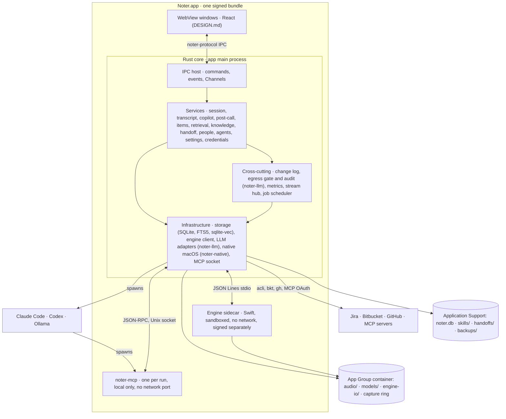

The UI calls only the IPC host. Services hold the product logic and never talk to macOS, processes or files directly; they go through infrastructure modules that each own one external boundary. The cross-cutting modules are used by every service: no service writes a record without the change log, sends text out without the egress gate, or publishes to the UI without the stream hub or the event emitter. The egress gate is cross-cutting in role but lives in crate `noter-llm` beside the adapters it guards (3.4).

- [ ] `p1` - **ID**: `cpt-noter-tech-core-stack`

| Layer | Responsibility | Technology |
|-------|---------------|------------|
| Presentation | Not in this design: WebView windows (DESIGN.md). The native menu bar, notifications, panels and announcements are built by the core | Tauri 2 tray, menu, global-shortcut and dialog plugins; tauri-nspanel pinned to a commit; `UNUserNotificationCenter`, SMAppService and AppKit through objc2 in `noter-native` |
| Application | The IPC host and the services: one Rust library crate `noter-core` that implements `CoreApi`, plus feature crates (copilot, retrieval, knowledge, handoff, jobs) | Rust 2021, tokio, tauri 2 (only in `apps/desktop/src-tauri`) |
| Domain | Records, view models and their invariants; the contract types | `noter-protocol` (serde, specta, schemars); `noter-db` row types |
| Infrastructure | SQLite single writer, engine client, LLM adapters and the egress gate, Keychain, EventKit, Launch Services, FSEvents, MCP client and the noter-mcp socket | rusqlite with FTS5 and sqlite-vec, refinery, `tokio::process`, security-framework, objc2, notify, rmcp |

**Technology risks.**

- specta 2 is a release candidate; its exporter API changes between RCs. It is pinned exactly and only `noter-protocol` uses it (ADR-0001).
- sqlite-vec is pre-1.0; vectors live as canonical BLOBs on the rows, so the vec tables are rebuildable (PRD).
- Claude Code and Codex change flags between releases; each adapter pins a tested version range and refuses unknown majors (PRD › LLM orchestration).
- Per-turn structured output in a long-lived Claude Code session is undocumented; `emit_card` on noter-mcp is the fallback (PRD › Open decisions).
- Own-account Claude Code runs cannot use `--bare`, which ignores a subscription login, so every run is locked down by explicit flags instead (3.2 LLM router); a CI test proves no user hook, plugin or MCP server starts.
- tauri-nspanel has no stable release; it is pinned to a commit.
- How the Claude plan of an own account is detected is not verified; an M3 spike decides it (Q8).

## 2. Principles & Constraints

### 2.1 Design Principles

PRD › Product principles outrank these design principles: when a design principle conflicts with a PRD principle, the PRD principle wins. Among themselves they are listed in priority order; when two conflict, the one listed first wins.

#### The contract comes first and is one artefact

- [ ] `p1` - **ID**: `cpt-noter-principle-core-contract-first`

Every boundary (UI ↔ core, core ↔ engine, runtime ↔ noter-mcp, core ↔ skill output) is a set of types in `noter-protocol`, and every other representation is generated from them. A change to a boundary is a change to that crate, reviewed by both sides, regenerated and checked in CI. No side hand-writes a type the other side owns.

**ADRs**: `cpt-noter-adr-0001-contract-source-of-truth`

#### One writer, one log

- [ ] `p1` - **ID**: `cpt-noter-principle-core-single-writer`

The core is the only process that writes the database, and every write that a user, a job or a model makes is a change-log row in the same transaction, with actor, before, after, reason and evidence. Undo is the change log played backwards; there is no second history.

**ADRs**: PRD › Decision log (core is the only SQLite writer; change log with undo).

#### Nothing leaves without the gate

- [ ] `p1` - **ID**: `cpt-noter-principle-core-egress-gate`

Every request that carries user text off the Mac goes through one egress gate in the core, which applies the privacy mode and the sensitive flag, redacts, writes the audit row and only then lets the adapter send. Adapters have no other way to reach the network. Tool results noter-mcp returns to a run on a cloud runtime pass the same gate: noter-mcp runs only on this Mac, never opens a network port, and its socket handler is part of the gate (owner decision O2). Every CLI run is locked down so that it can reach only its provider host. Audio and voice profiles have no path to the gate at all.

**ADRs**: PRD › Security, privacy and permissions.

#### Degrade, never block capture

- [ ] `p1` - **ID**: `cpt-noter-principle-core-degrade`

Capture and transcription keep running whatever else fails. Noter never refuses or gates a start on setup state, audio permissions or the self-test (owner decision O1): a silent channel is a degraded state, not a reason to refuse. Each failure becomes a typed degraded state that the UI shows where the function lives, and a rule that recovers or falls back to local. A late result is dropped, not shown.

**ADRs**: PRD › Live copilot loop › Degraded states.

#### Snapshot, then stream; whole state in events

- [ ] `p1` - **ID**: `cpt-noter-principle-core-snapshot-stream`

A subscriber first gets everything up to a sequence number, then only what comes after it. Low-rate events carry the whole current state of what they describe, never a delta, so a window that missed one is never wrong for long; each carries a `version`, so a late event never overwrites a newer state.

**ADRs**: `cpt-noter-adr-0002-ipc-conventions`

#### Intent in, records out

- [ ] `p2` - **ID**: `cpt-noter-principle-core-intent-commands`

A command carries the user's intent as wanted state (never a toggle) and the revision it was based on; it returns the changed, view-ready record and, when undoable, the change ID. One list command returns one list for one view.

**ADRs**: `cpt-noter-adr-0002-ipc-conventions`

#### Every seam has a fake

- [ ] `p2` - **ID**: `cpt-noter-principle-core-fakes`

Each boundary can be replaced in tests: the fake core for the UI, the engine's file mode and a scripted engine for the core, a scripted runtime for the router, and fixture databases for retrieval. Parallel development depends on it. The conformance suite that the fake core passes is the one the real core must pass (through `noter-core-harness`, docs/HARNESS.md).

**ADRs**: `cpt-noter-adr-0001-contract-source-of-truth`, `cpt-noter-adr-0003-harness-and-quality-gates`

### 2.2 Constraints

Platform, data residency and licensing constraints come from the PRD; this design adds none of its own except the contract tooling.

#### macOS 14.4 or later, Apple Silicon only

- [ ] `p1` - **ID**: `cpt-noter-constraint-core-macos`

**Type**: Platform. Core Audio process taps and their permission arrive in 14.4; CoreML models are converted for Apple Silicon only. The core may call AppKit, EventKit, Security and Launch Services directly.

**Source**: PRD › Audio capture on macOS; PRD › Repository layout.

#### Tauri 2, Rust core, Swift engine

- [ ] `p1` - **ID**: `cpt-noter-constraint-core-stack`

**Type**: Technology. The core is Rust inside the Tauri 2 app process; audio and on-device ML are in a Swift sidecar spoken to over JSON Lines on stdio; the UI is React in WebViews.

**Source**: PRD › Decision log (Tauri 2 with a React UI and a Swift engine sidecar).

#### The engine is sandboxed and offline

- [ ] `p1` - **ID**: `cpt-noter-constraint-core-engine-offline`

**Type**: Security. The engine runs in the App Sandbox with audio input and no network entitlement, so audio cannot leave through it. It shares the App Group container `<TEAMID>.ai.noter` with the app for audio, models, bulky payloads and the capture ring, and it is signed in the Swift build with its own entitlements. If week one shows the sandboxed child does not get the System Audio Recording prompt attributed to Noter, the sandbox is dropped and the CI network-monitor test becomes the guarantee (PRD › Open decisions; Q4).

**Source**: PRD › Audio capture › Entitlements and signing; review resolutions R21, R22.

#### API keys are the default credential

- [ ] `p1` - **ID**: `cpt-noter-constraint-core-api-keys`

**Type**: Legal and licensing. Automated tasks run on an Anthropic or Codex API key by default; the user's own Claude or ChatGPT account is a separate sign-in done by the unmodified CLI, held by the CLI, and used only where the user chose it per agent. Noter never stores those tokens.

**Source**: PRD › LLM orchestration; PRD › Decision log (PM-58).

#### Local-first data

- [ ] `p1` - **ID**: `cpt-noter-constraint-core-local-data`

**Type**: Data residency. One SQLite file under Application Support and per-call files in the App Group container, 0600, FileVault at rest; no server, no telemetry endpoint; encryption with a Keychain key for voice profiles and cluster centroids.

**Source**: PRD › Data model and storage; PRD › Security, privacy and permissions.

#### Copilot and council behind a flag

- [ ] `p1` - **ID**: `cpt-noter-constraint-core-copilot-flag`

**Type**: Scope. Full v1 kept (owner decision 17 Oct); the copilot ships behind a flag until the M4 latency gate. Its contract surface is therefore **draft** until that gate, and every call surface works with the flag off.

**Source**: PRD › Roadmap and milestones; PRD › Decision log (17 Oct); DESIGN.md `cpt-noter-constraint-copilot-flag`.

#### Small team, parallel tracks

- [ ] `p2` - **ID**: `cpt-noter-constraint-core-small-team`

**Type**: Resource. One part-time core builder and a frontend team working in parallel, with most code written by coding agents in lanes behind one gate, `just gate` (ADR-0003). The design prefers one library crate with clear modules over many processes, and generated artefacts over hand-kept duplicates.

**Source**: PRD › Risks (the "never ships" row); owner request for UI-first development; ADR-0003.

#### Contract tooling pinned

- [ ] `p2` - **ID**: `cpt-noter-constraint-core-contract-tooling`

**Type**: Technology. specta `2.0.0-rc.25`, specta-typescript and specta-serde `0.0.12`, schemars 1. The contract crate has no Tauri dependency, so it builds and exports on any machine, CI included.

**Source**: ADR-0001.

## 3. Technical Architecture

### 3.1 Domain Model

**Technology**: Rust structs and enums. Two families: view models the UI receives (`noter-protocol`, exported to TypeScript), and row types the database stores (`noter-db`, planned). A view model is a join of rows prepared for one view; the UI never sees a row type.

**Location**: [crates/noter-protocol/src/model/](../crates/noter-protocol/src/model/) for view models and command arguments; [crates/noter-protocol/src/common.rs](../crates/noter-protocol/src/common.rs) for identifiers and value types; tables in 3.7.

**Core Entities**:

| Entity | Description | Schema |
|--------|-------------|--------|
| Call | One captured call and its lifecycle | [model/library.rs](../crates/noter-protocol/src/model/library.rs) `CallRow`, `CallDetail`; [model/capture.rs](../crates/noter-protocol/src/model/capture.rs) `CaptureState`; table `calls` |
| Segment | One transcript line, live or archive pass | [model/transcript.rs](../crates/noter-protocol/src/model/transcript.rs) `SegmentView`; table `segments` |
| Speaker | A diarization cluster in a call, mapped to a person or unnamed | `SpeakerView`, `SpeakerLabel`; table `speakers` |
| Person | Someone who has been on a call; optional voice profile | [model/people.rs](../crates/noter-protocol/src/model/people.rs) `PersonRow`, `PersonPage`; tables `people`, `voice_profiles`, `call_participants` |
| Item | Decision, action item, open question or risk, with status, review state and evidence | [model/items.rs](../crates/noter-protocol/src/model/items.rs) `ItemView`, `ItemDetail`, `EvidenceView`; tables `items`, `item_spans`, `evidence` |
| Card | A copilot card and its outcome | [model/copilot.rs](../crates/noter-protocol/src/model/copilot.rs) `CardView`, `CopilotStatus`; table `cards` |
| Summary | A generated text section or role review, every version kept | [model/outputs.rs](../crates/noter-protocol/src/model/outputs.rs) `OutputSection`, `VersionMeta`; tables `summaries`, `summary_versions` |
| Handoff | An item's handoff prompt, target, repository and launch | [model/handoff.rs](../crates/noter-protocol/src/model/handoff.rs) `HandoffView`; tables `items` (handoff fields), `prompt_versions` |
| Topic | A thread of items across calls | [model/library.rs](../crates/noter-protocol/src/model/library.rs) `TopicRow`, `TopicThread`; table `topics` |
| Ask thread | Questions and cited answers | `AskThread`, `AskAnswer`, `Citation`; tables `ask_threads`, `ask_turns` |
| Agent | A council role with runtime, model, effort, tools, call types | [model/agents.rs](../crates/noter-protocol/src/model/agents.rs) `AgentView`; table `agents` |
| Credentials | API key status, own accounts, local runtime | [model/accounts.rs](../crates/noter-protocol/src/model/accounts.rs) `AccountsView`; Keychain; table `settings` (account binding only) |
| Source | Knowledge source and its documents | [model/knowledge.rs](../crates/noter-protocol/src/model/knowledge.rs) `SourceRow`; tables `sources`, `documents`, `doc_chunks`, `sync_runs` |
| Change | One change-log entry or proposal; undone and redone by `UndoTarget` (a change or a batch) | [model/history.rs](../crates/noter-protocol/src/model/history.rs) `ChangeRow`, `ProposalRow`; table `changes` |
| Job run | One run of a maintenance or pipeline job | [model/jobs.rs](../crates/noter-protocol/src/model/jobs.rs) `JobRunRow`; tables `jobs`, `job_runs` |
| Metric | Stage timings and roll-ups | [model/performance.rs](../crates/noter-protocol/src/model/performance.rs); tables `metrics`, `metric_rollups` |
| Audit entry | One thing that left the Mac | [model/settings.rs](../crates/noter-protocol/src/model/settings.rs) `AuditEntry`; table `audit_log` |
| Settings | Typed settings per pane, with a revision | [model/settings.rs](../crates/noter-protocol/src/model/settings.rs) `Settings`, `SettingsSection`; table `settings` |
| Setup | First-run steps, models, permissions, self-test; never a start gate (owner decision O1) | [model/setup.rs](../crates/noter-protocol/src/model/setup.rs) `SetupStatus` |
| Error | The one error type and its closed list of codes | [error.rs](../crates/noter-protocol/src/error.rs) `CoreError`, `ErrorCode` |

**Relationships**:

- Call → Segment, Speaker, Mark, Gap: a call owns its transcript; confirmed segments never change position; the archive pass replaces live segments and keeps a 7-day copy of the live ones. A gap with reason `interrupted`, `engine_restart`, `device_changed` or `stalled` longer than 2 s is a dropout and counts in `metrics.dropout_ms`.
- Segment → Speaker → Person: one speaker per segment; a speaker maps to at most one person; naming applies to the whole call unless limited to one line.
- Call → Item → Evidence span: items come from one call and point to time spans there, resolved to segments at read time (REVIEW › B5); evidence rows from Jira, Bitbucket, GitHub or later calls can close an accepted item; a suggested item gets at most a proposal.
- Card → Agent; Card → Item: a card is raised by one agent and may list merged agents; pinning a card creates an accepted item.
- Call → Summary → Version: one summary per call and kind, one role review per agent, every version kept beside the user's edit.
- Item → Topic: at most one topic per item; topics collect items across calls; merges keep the target's name and record the other as an alias.
- Any record → Change: every write is a change row; a batch groups the rows of one job run or one propagation; a proposal is a change with status `proposed`.
- Agent → Runtime choice → Account or key: an agent is runnable only while its credential is available; otherwise it is paused with a one-step fix.
- Agent → Call type: an agent switches itself off for a call type when 80 % or more of its cards were dismissed over the last 10 calls of that type; the switch is logged in History, undoable and announced once on the Agents page (owner decision D4).

**State machines** (owned by the core; the UI renders the state it is sent):

| Machine | States | Transitions that matter to the contract |
| --- | --- | --- |
| Capture (`CapturePhase`) | idle → starting → recording ⇄ paused → stopping → stopped → idle | Detailed below. A notice (call ended, new meeting, nothing heard) never changes the phase by itself |
| Item status × review | status: open, done, handed_off, carried, closed_by_evidence, answered_in_call; review: suggested, accepted, rejected | Detailed below |
| Card (`CardState`) | queued → streaming → shown ⇄ held → pinned · dismissed · expired | Detailed below |
| Outputs section | pending → writing → ready · empty · failed | `failed` → writing on the local rewrite or a regeneration; ready → writing on regeneration after the archive pass or `outputs_regenerate`, which keeps the user's edit and records a diff; Continue Recording re-queues the post-call job, and sections already written are regenerated with edits kept |
| Account (`AccountStatus`) | not_signed_in → signing_in → signed_in → signed_out_by_provider | signing_in → not_signed_in on cancel, on the 5-minute timeout or when the plan is not eligible; signed_in → not_signed_in on sign-out, which moves agents to the matching key or pauses them; signed_out_by_provider → signing_in when the user signs in again, or → not_signed_in on sign-out |
| Change | applied · proposed → applied · rejected; applied ⇄ undone | `change_undo` restores `before` for every row not edited later; `change_redo` takes the same `UndoTarget` (change or batch) at any time and writes new change rows; neither has a time window. A partial undo or redo succeeds with `UndoResult.skipped_edited_later`; `edited_later` when every row was edited later, `already_undone`, `not_undone` and `not_undoable` for the wrong state |
| Job run | queued → running ⇄ paused → succeeded · failed · cancelled | While a call is live, maintenance jobs, the archive pass and regeneration pause or wait; the post-call analysis of the previous call runs at low priority (owner decision D2); `job_cancel` cancels a queued or running run |

**Capture transitions.**

| From | Trigger | To | Notes |
| --- | --- | --- | --- |
| idle or stopped | `capture_start` | starting → recording | Refused only for `already_recording`, `disk_full` (`detail.needed_mb`) and `model_missing`. From `stopped` it closes the stopped call's Continue window. If macOS has not asked for a permission yet, the first capture triggers the prompt; if access is off, capture runs and `MicrophoneOff` or `SystemAudioSilent` names the silent channel (O1) |
| recording | `capture_set_paused(true)` | paused | Pause stops both streams; a `paused` gap |
| paused | `capture_set_paused(false)` | recording | Resuming a stopped call is refused with `not_recording` |
| recording or paused | `capture_stop`, Stop Now, the call-ended countdown | stopping → stopped | The call goes to the post-call pipeline; `continue_until` is now + 5 minutes |
| recording | `capture_discard` after the nothing-heard notice | stopping → idle | The recording is discarded; streams end with `discarded`; no post-call job |
| stopped | `capture_continue` before `continue_until` | recording | Same call, a `continued` gap; the queued or running post-call job is cancelled and re-queued after the next stop |
| stopped | `continue_until` passes, or another capture starts | idle | |
| idle | `capture_resume_interrupted` while the `RecordingInterruptedByQuit` banner shows | recording | Same call, an `interrupted` gap; allowed until the banner is dismissed (`banner_dismiss`) or another capture starts |
| recording | Engine crash | recording | The supervisor restarts the engine in capture-first mode and resumes from the ring; an `engine_restart` gap; if it cannot restart, phase `failed` |
| recording | Engine cannot be restarted | failed | Nothing is recorded and the call is not ended; `CaptureFailed` and NT-3 |
| failed | **Try Again** (`capture_resume_interrupted`) | recording | Same call, an `engine_restart` gap |
| failed | `capture_stop` | stopped | The call ends at the last audio; Continue Recording is offered as after any stop |
| recording | `NewMeeting` notice answered or expired | recording | **Start as New Call** (the default, also applied at `expires_at`, 60 s) splits at the notice's `detected_at`; the saved call is offered Continue for 5 minutes. **Keep in This Call** keeps one call |

Notices: `CallEnded` stops at `stops_at` unless kept; while the notice is held (`capture_hold_notice`) `stops_at` is `null`, and on release the 10 s countdown starts again. While hidden for presenting, `CallSeemsEnded` stops after 10 minutes instead, and a new meeting shows as one menu bar line whose start item maps to `capture_answer_new_meeting(start_as_new_call)`. `NothingHeard` is answered by `capture_keep_recording` (resets the 5-minute timer) or `capture_discard`. A second audio source is answered by `capture_keep_source` (not shown again for that app in this call) or `capture_exclude_source`.

**Item status × review.**

| From | Trigger | To | Review state |
| --- | --- | --- | --- |
| open | Tick (`item_set_done(true)`) | done | A suggested item becomes accepted |
| open | Handoff opened or copied | handed_off | A suggested item becomes accepted |
| handed_off | "Did the handoff land?" answered `landed`, or closing evidence | done or closed_by_evidence | accepted |
| handed_off | Answered `done_another_way` | done | Noted as done another way |
| handed_off | Answered `keep_open` (or Esc) | handed_off | Asked again at the next call with the same people |
| open, accepted | Jira Done or a merged PR with the linked key, dated after the item | closed_by_evidence | Accepted items only; a suggested item gets at most a proposal |
| open | A call with the same people starts and the item is offered | carried | Suggested items are offered marked "Not reviewed" |
| carried | That call ends | open | Unless it was closed in the call |
| open (open question) | Answered in a call | answered_in_call | Logged; **Reopen** returns it |
| done, handed_off, closed_by_evidence, answered_in_call | `item_reopen` (main window or call screen) | open | Unchanged |
| any | `item_review` | unchanged | suggested → accepted or rejected; rejected → suggested by restore; a rejected suggestion is never suggested again in a regeneration (DESIGN.md D75) |

**Card transitions.**

| From | Trigger | To | Notes |
| --- | --- | --- | --- |
| (new) | Candidate validated while a card in the stack is held | queued | Released in rank order when nothing is held; the core stamps `card_shown` at release |
| (new) or queued | First line ready | streaming | `CardEvent::Added`. The path's degrade rule applies before this: an answer whose trigger is older than 12 s is dropped (`dropped_late`); solicited cards are never dropped |
| streaming | Body and provenance complete | shown | The 12 s check applies before the first line; once the first line is shown the card is completed |
| streaming | Dropped late before its first line was painted | removed | `CardEvent::Removed` |
| shown | Hover, focus or expand (`card_set_held(true)`) | held | Held cards never expire; card keys still work |
| held | `card_set_held(false)` | shown | |
| shown or held | `card_pin`, card key | pinned | Creates an accepted item; `KeyFeedback { outcome: pinned }` for a key |
| shown or held | `card_dismiss`, card key | dismissed | `KeyFeedback { outcome: dismissed }`; a key with no card gives `KeyFeedback { outcome: no_card }` |
| shown | 90 s without being held, or a topic change | expired | `CardEvent::Expired { reason: timeout · topic_changed }` |
| pinned | `card_unpin` | shown | The pinned item is removed through the change log |
| pinned or dismissed | `card_undo_last` within 30 s | shown | After 30 s, `undo_expired` |

Numbers 1–3 are stable while a card is visible.

**Invariants** the core guarantees and the UI relies on:

- A record the UI receives is complete for its view; the UI never joins.
- Every editable record carries `rev`; an edit with a stale `rev` is refused with `conflict`.
- Every undoable mutation returns its `change_id`; every change is logged in the same transaction as the write.
- Stream messages of one subscription have consecutive `seq` numbers starting after the snapshot's `last_seq`.
- Every whole-state payload carries a `version`, monotonic per payload kind; the same counter stamps the matching command results and snapshot slices.
- No view model contains a secret; keys are reported as status only.
- Transcript, document and model text are plain strings; Markdown fields are Markdown without raw HTML.

### 3.2 Component Model

The core is one Rust library (`noter-core`) composed of services, plus feature crates and three separate binaries (the app, noter-mcp, the engine). Components below are listed from the UI boundary inward.

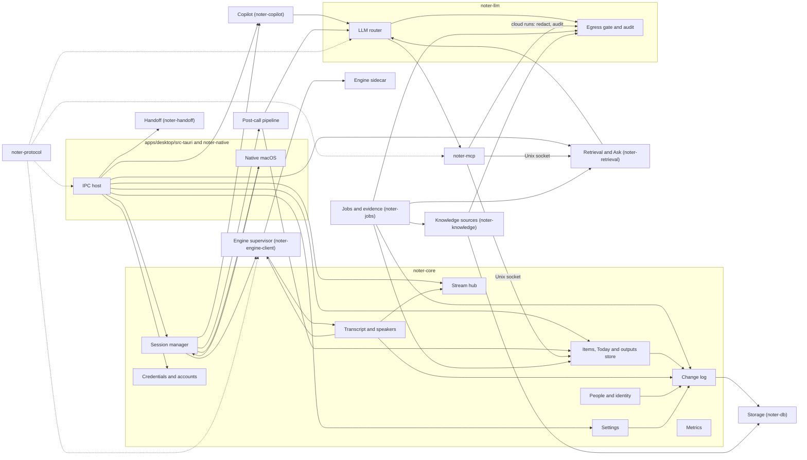

#### Contract crate — noter-protocol

- [ ] `p1` - **ID**: `cpt-noter-component-core-protocol`

##### Why this component exists

Parallel UI and core development needs one place where the contract is defined, checked and generated, which neither team can drift from (ADR-0001).

##### Responsibility scope

Owns the types and declarations of all four interfaces in 3.3: IPC commands (with argument, result and Channel types, group, stability and window scope), events, error codes, the engine stdio protocol, the noter-mcp tools and socket, the LLM skill output schemas, and the typed fixture world. Generates `bindings.ts` (including the generated transport and `DEFAULT_RETRYABLE`), `contracts/*.json` and the fixtures through `noter-contract-export`, and carries the contract tests: names, stability per name, window scopes, and `#[serde(default)]` on every `Option` field of an argument type. Holds the egress allow-list `contracts/egress-hosts.json`. Declares the `CoreApi` trait the core implements.

##### Responsibility boundaries

No I/O, no logic, no Tauri dependency, no database types. It never contains behaviour that a test of the core would need to cover; the rules it encodes are shapes, names and scopes.

##### Related components (by ID)

- `cpt-noter-component-core-ipc-host` — implements its `CoreApi` and enforces its window scopes
- `cpt-noter-component-core-engine-supervisor` — speaks its engine protocol
- `cpt-noter-component-core-mcp` — serves its tool schemas
- `cpt-noter-component-core-llm-router` — validates model output against its skill schemas

#### IPC host

- [ ] `p1` - **ID**: `cpt-noter-component-core-ipc-host`

##### Why this component exists

The UI must reach the core through one narrow, typed door that also enforces which window may do what (DESIGN.md PM-08).

##### Responsibility scope

Lives in `apps/desktop/src-tauri`. Registers one `#[tauri::command]` per entry of `COMMANDS`, each taking `args: serde_json::Value` (and `channel` for subscribing commands), so it can build `CommandCtx` with `caller: Caller::Window { label }` and check the label against the command's scope before typed deserialization; a parse failure becomes `invalid_input`. Adapts a Tauri Channel into the contract's `Sink`; calls `CoreApi` on a concrete type (the trait is not dyn-safe); serializes `CoreError` as the rejection. Emits events with the names in `event_names`. `build.rs` generates `AppManifest::commands` and one capability per window from the manifest, so Tauri's own check and the scope check allow the same commands; the generated transport maps Tauri's denial string to `window_not_allowed`. Tells the stream hub when a webview loads a page or is destroyed. A test with `tauri::test::mock_builder` asserts that the registered handler list equals `COMMANDS` and that every command called from every window gets its answer or `window_not_allowed`. Native callers (menu, menu bar, hotkey, notification) reach `CoreApi` in process with `Caller::Native { surface }`; they skip the scope check and are recorded as the actor surface.

##### Responsibility boundaries

No product logic and no state. It does not retry, cache or reshape results. It never forwards a request to the engine, the database or a runtime directly.

##### Related components (by ID)

- `cpt-noter-component-core-protocol` — implements its contract
- `cpt-noter-component-core-stream-hub` — hands it Channel sinks
- `cpt-noter-component-core-native` — shares the app handle for events and windows

#### Session manager

- [ ] `p1` - **ID**: `cpt-noter-component-core-session`

##### Why this component exists

Capture is the release-blocking function, and its rules (detection, notices, Continue Recording, the back-to-back split, pause semantics, the sensitive flag) must live in one state machine that every surface (UI, menu, hotkeys) drives the same way.

##### Responsibility scope

Owns `CaptureState` and `CallDetection` and the capture transitions of 3.1. Turns engine facts (`call_detected`, `call_audio_released`, `silence`, `audio_source_added`, `system_audio_silent`) and calendar facts into notices with their timers: record prompt 15 s; call ended after 20 s of released audio, then a 10 s countdown that stops while the notice is held (`capture_hold_notice`) and starts again on release, or 10 minutes while hidden for presenting; nothing heard after 5 minutes, reset by **Keep Recording**; new meeting from the next calendar event or the meeting app, applying Start as New Call after 60 s unanswered; Continue Recording for 5 minutes after any stop. Creates the call row, starts and stops the engine session through the supervisor, applies pause by stopping both streams, starts the copilot loop when the flag is on, and hands a stopped call to the post-call pipeline; Continue Recording cancels that call's queued or running post-call job and re-queues it after the next stop. Resumes a call cut by a quit or crash (`capture_resume_interrupted`) with an `interrupted` gap.

A start is refused only while a capture runs (`already_recording`), below 500 MB free (`disk_full` with `detail.needed_mb`) or when the live model is not downloaded (`model_missing`). Setup state, audio permissions and the self-test never gate a start (owner decision O1): if macOS has not asked yet, the first capture triggers the system prompt; if access is off, capture runs and `MicrophoneOff` or `SystemAudioSilent` says which channel is silent. When the disk fills during a call it stops writing audio first (`CaptureState.audio_writing: false`) and keeps the transcript. Call detection runs only when `GeneralSettings.offer_to_record` is on and the self-test has passed; until then `SetupIncomplete` keeps it off.

Decides when notifications go out and the native component delivers them: everything is held while recording and while hidden for presenting, then released one per call after it ends. NT-3 (system audio silent, microphone off, or capture failed) is sent at once unless Noter is hidden for presenting (then only the menu bar icon shows it) or a call surface is visible. No notification is sent for the call the frontmost main window shows (`window_report_view`). Emits `capture:state`, `capture:detected` and the capture rows of `degraded:changed`, each with its `version`.

##### Responsibility boundaries

Does not decode audio, decide speakers or write segments. Does not place windows; it asks the native component to show the record prompt or the call window. Never stops or refuses a capture because another component failed or setup is unfinished.

##### Related components (by ID)

- `cpt-noter-component-core-engine-supervisor` — starts, pauses and stops engine sessions; receives detection and silence facts
- `cpt-noter-component-core-copilot` — starts and stops the loop per call
- `cpt-noter-component-core-postcall` — receives stopped calls
- `cpt-noter-component-core-native` — record prompt, call window, menu bar, notification delivery
- `cpt-noter-component-core-jobs` — cancels and re-queues the post-call job on Continue Recording
- `cpt-noter-component-core-changelog` — logs starts, stops, sensitive changes

#### Engine supervisor

- [ ] `p1` - **ID**: `cpt-noter-component-core-engine-supervisor`

##### Why this component exists

The engine is a separate, sandboxed process that can crash, lag or change protocol; the core needs one place that owns its life and its wire format.

##### Responsibility scope

Crate `noter-engine-client`, with no Tauri dependency. Spawns the sidecar (`noter-engine`) with `tokio::process` (not the Tauri shell plugin, so no window has a shell permission) and passes it the App Group container; checks `ready.protocol_version`, writes `EngineCommandLine`s, reads `EngineEventLine`s on a dedicated task, detects `seq` gaps. Restarts a dead engine in capture-first mode (taps open before models load) and resumes from the capture ring's write position; the expected gap is at most 2 s per restart, reported as a `GapView` with reason `engine_restart` and counted as a dropout. When the engine cannot be restarted, raises `CaptureFailed { call_id, since }` for the session manager. Correlates `ack` and `error` with command ids. Translates engine facts into degraded states: `transcription_stalled` after 10 s without segments while audio flows; `system_audio_silent { confidence }` when the system channel carries exact digital zeros, since the System Audio Recording permission cannot be queried and is inferred. Sends replay requests (`play`, `stop_playback`) for the transcript component, because the engine plays replay audio (owner decision D6). Offers request/response helpers for embeddings and speaker embeddings used by retrieval and identity. Supports the engine's file mode for tests and the golden set.

##### Responsibility boundaries

Does not interpret segments beyond routing them; does not persist. Never gives the engine a network path or a database path; every path it sends is relative to the App Group container.

##### Related components (by ID)

- `cpt-noter-component-engine` — supervises
- `cpt-noter-component-core-transcript` — delivers segments and speaker turns
- `cpt-noter-component-core-session` — delivers capture facts and `CaptureFailed`
- `cpt-noter-component-core-retrieval` — serves embedding requests

#### Stream hub

- [ ] `p1` - **ID**: `cpt-noter-component-core-stream-hub`

##### Why this component exists

Several windows subscribe to the same live data, can reload at any moment and must never lose or double a message (DESIGN.md › Window store, Reload and replay).

##### Responsibility scope

Keeps, per live call, a sequence counter and a bounded replay buffer for each stream kind (transcript, cards, levels), and per subscription the `Sink` and the last acknowledged `seq`. A subscribe call takes a consistent snapshot from the owning service and the current `seq` under one lock, so the Channel starts at `last_seq + 1`; snapshot reads use the writer connection under the hub lock. Confirmed segments are published only after their batch commits (batches of at most 250 ms), so a reload never misses a committed segment and the confirmed-lag budget holds. Coalesces levels to at most one message per 100 ms. Expects `stream_ack` every 100 messages or 1 s and ends a subscription with `ended { reason: lagged }` at 2 000 unacknowledged messages; the UI resubscribes. Ends every subscription of a webview when it loads a page or is destroyed, and ends streams with a reason on stop, discard, unsubscribe and shutdown. Stamps the `version` of whole-state events and of the matching snapshot slices. Also serves one-off streams (Ask answers, self-test).

##### Responsibility boundaries

Holds no records beyond the replay buffer; the snapshot comes from the services. Does not batch or delay cards. Message order between a Channel and the `invoke` that opened it is restored by the generated transport, not here (3.3).

##### Related components (by ID)

- `cpt-noter-component-core-ipc-host` — receives sinks from it
- `cpt-noter-component-core-transcript`, `cpt-noter-component-core-copilot`, `cpt-noter-component-core-retrieval` — publish through it

#### Transcript and speakers

- [ ] `p1` - **ID**: `cpt-noter-component-core-transcript`

##### Why this component exists

The transcript is primary data: it must be persisted exactly once, corrected only through logged changes, and survive the archive pass without breaking evidence.

##### Responsibility scope

Assigns segment ids and persists confirmed segments (with the normalised shadow text for FTS) in batches; forwards hypotheses without persisting them. Maps engine speaker labels to `speakers` rows, applies renames (whole call or one line), term fixes (and glossary additions), and post-call naming. Matches clusters to opted-in voice profiles (cosine > 0.75 with a margin) and to calendar attendees; keeps per-speaker language priors. Reconciles live and archive labels by time overlap, keeping the user's corrections as must-link and cannot-link constraints for the offline clustering. Writes `transcript.jsonl` at call end and after every edit batch. Serves `transcript_subscribe` snapshots and `transcript_span` previews; after the archive pass it sends `speakers_updated` with `relabelled_by_archive` for the "Transcript upgraded" banner. Decides replay and asks the engine to play it through the supervisor (the engine owns the files and is already excluded from the tap; the tap also excludes the app PID; owner decision D6). During capture it allows replay only on headphones with own sounds excluded: a detected speaker route always refuses (`replay_needs_headphones`), because the meeting app captures the microphone itself and would send the replay to the call (owner decision 17 Oct); an unidentified route (`output_route_unknown`) is allowed only for output devices the user marked as headphones (`AudioOutputSettings.headphones_devices`). Reports why playback stopped in `PlaybackState.stopped_reason` (`ended`, `user`, `output_switched_to_speakers`, `capture_started`).

##### Responsibility boundaries

Does not decode audio or run diarization (engine). Voice-profile embeddings are encrypted by the people component; this one only compares.

##### Related components (by ID)

- `cpt-noter-component-core-engine-supervisor` — source of segments; replay requests
- `cpt-noter-component-core-stream-hub` — publishes the transcript stream
- `cpt-noter-component-core-people` — persons and voice profiles
- `cpt-noter-component-core-changelog` — every correction

#### Copilot loop

- [ ] `p2` - **ID**: `cpt-noter-component-core-copilot`

##### Why this component exists

The live copilot and its council are the most latency-sensitive and most expensive part of Noter; they need their own loop with budgets, drop rules and measurements (PRD › Live copilot loop).

##### Responsibility scope

One tokio task per live call (crate `noter-copilot`). Starts each call with an initial context: the shared carry-forward query (open accepted items from the last two calls with the same people, suggested ones marked "Not reviewed") and Today's items for the people present. Runs cheap signals on every confirmed segment (and on hypotheses for questions), the topic tracker every 20–30 s, and at most one LLM tick in flight, coalescing triggers. Builds the packet (delta, topic facts, shown cards, trigger; screen-context chips are v1.x and empty in v1) and sends it through the router in fused or parallel mode per call type.

Validates candidates against `skills::CouncilTickOutput`, drops below 0.6 confidence and duplicates of cards shown in the last 10 minutes, merges near-duplicates (embedding similarity > 0.85, first agent keeps the badge), and ranks cited cards first and unverified ones last. Applies the degrade rule of each path before the first line is emitted: an answer whose trigger is older than 12 s is dropped; Context falls back to the raw past decision; Catch-up shows the last confirmed segments while waiting; Ask is skipped if the topic moved. Solicited cards (Catch Me Up, Ask About This Call) are never dropped by the 12 s rule, and once a card's first line is shown the card is completed. Applies the 45 s rate limit, numbers visible cards 1–3, queues new cards while the stack is held, expires a shown card after 90 s or on a topic change (`CardEvent::Expired { reason }`), undoes the last card action within 30 s, and answers every card key with `CardEvent::KeyFeedback`. Marks a card `used` when the user's mic transcript matches its question or answer within 2 minutes; the thresholds are tuned from ratings. Stamps `card_shown` itself for cards shown only in the menu bar, while hidden for presenting, or released from the queue. Records feedback per agent and call type (`AgentStats.useful_share` over the last 20 calls). Tracks the per-call budget and the agents' runtime state; switches to local on auth failure. Emits on the cards stream and `copilot:status`.

##### Responsibility boundaries

Never calls tools live (facts are retrieved before the tick). Never writes items except through pin and unpin, which go through the items component. Off entirely when the flag is off or the call is sensitive without a local model. Does not switch agents off for a call type; the post-call pipeline does (owner decision D4). `context_chip_set` returns `feature_disabled` in v1.

##### Related components (by ID)

- `cpt-noter-component-core-llm-router` — runs ticks
- `cpt-noter-component-core-retrieval` — topic facts
- `cpt-noter-component-core-stream-hub` — publishes cards
- `cpt-noter-component-core-items` — pins, unpins and the carry-forward query
- `cpt-noter-component-core-metrics` — stage timings per tick

#### LLM router

- [ ] `p1` - **ID**: `cpt-noter-component-core-llm-router`

##### Why this component exists

Every model call has to pick a runtime by task, privacy and availability, honour budgets, validate output against the app-owned schema and be logged, whatever runtime runs it (PRD › LLM orchestration).

##### Responsibility scope

Crate `noter-llm`, which also holds the egress gate (`cpt-noter-component-core-privacy`). One `LlmRuntime` interface (`cpt-noter-interface-llm-runtime`) with adapters for Claude Code (API key or own account), Codex (API key or own account) and Ollama. Applies the routing policy table of the PRD, the agent registry and the per-task runtime settings; checks CLI versions at startup; keeps warm streaming sessions for live ticks and resets them every 15 ticks; validates output against the skill schema, retries once with the failure explained, then falls back to the simpler schema; logs every run in `llm_runs`, with cost for API-key runs. Every request passes the egress gate first.

Spawns every run in an empty Noter-owned working directory and locks it down, own-account runs included (`--bare` cannot use a subscription login):

- Claude Code: `--strict-mcp-config --mcp-config run/mcp/<run_id>.json --tools <allow-list without WebFetch, WebSearch and Bash> --setting-sources ""` and `CLAUDE_CODE_DISABLE_NONESSENTIAL_TRAFFIC=1`.
- Codex: an isolated `CODEX_HOME` with no user `config.toml`, and `--sandbox read-only`.
- `run/mcp/<run_id>.json` names noter-mcp with a per-run token and is deleted after the run. The user's own live MCP sources are never added to it. In Cloud allowed, and only for post-call runs and Ask, noter-mcp relays their tools as `live_<source>_<tool>`: it starts each server with its own transport and credentials and writes a `lookup` audit row through the core before forwarding a call (owner decision D1).

A CI test proves that no user hook, plugin or MCP server starts in a run.

##### Responsibility boundaries

Does not hold credentials (asks the credentials component for an API key at spawn time; own accounts are the CLI's). Does not build packets (callers do) and does not decide what to show.

##### Related components (by ID)

- `cpt-noter-component-core-privacy` — every outbound request; same crate
- `cpt-noter-component-core-credentials` — keys and account availability
- `cpt-noter-component-core-mcp` — configured for runs that may use tools
- `cpt-noter-component-core-metrics` — run timings and cost

#### Post-call pipeline

- [ ] `p1` - **ID**: `cpt-noter-component-core-postcall`

##### Why this component exists

Outputs must be ready within two minutes from the live transcript, then improve after the archive pass without losing anything the user edited (PRD › Feature specification › 4).

##### Responsibility scope

A `PostCall` job per stopped call, at low priority after live ASR and not blocked by a following live call (owner decision D2): chunk and embed the live transcript; run the call type's analysis skill (`skills::PostCallOutput`) and write sections in PRD order, each emitted as `outputs:progress` when it validates; extracted items arrive `suggested`, pinned items `accepted`; resolve owners to people; attach items to topics; run role reviews (parallel council mode by default) last; write `items.json` and `summary.md`. After the engine's offline pass (an `ArchivePass` job, which waits while a call is live), replace live segments, re-chunk, and regenerate with a three-way merge that keeps user edits and records a diff. Handles `outputs_regenerate` with another runtime, model or skill (refused with `job_blocked` during capture), and the local rewrite of a failed section. Hands the outputs-ready or failed notification to the session manager, which releases it by its hold rule. After each call, switches an agent off for that call type when 80 % or more of its cards were dismissed over the last 10 calls of the type; the switch is a logged, undoable change, announced once on the Agents page (owner decision D4).

##### Responsibility boundaries

Does not render Markdown for sharing (items and outputs store), does not schedule itself (jobs). Talk time and other behaviour metrics are computed only for calls recorded after they were switched on; past calls are not back-computed (owner decision D5).

##### Related components (by ID)

- `cpt-noter-component-core-llm-router` — analysis and reviews
- `cpt-noter-component-core-items` — writes items and summaries
- `cpt-noter-component-core-retrieval` — chunks, embeddings, topics
- `cpt-noter-component-core-engine-supervisor` — offline pass
- `cpt-noter-component-core-jobs` — runs it as a job
- `cpt-noter-component-core-session` — releases its notification

#### Items, outputs and Today

- [ ] `p1` - **ID**: `cpt-noter-component-core-items`

##### Why this component exists

Items, their review and evidence, and the output sections are the records the user acts on most; they need one owner for rules such as "a tick on a suggested item accepts it" and "a rejected suggestion never returns".

##### Responsibility scope

Item lifecycle and review (the status × review table in 3.1), edits with `rev`, creation from pins and by hand, removal on unpin. The carry-forward query, shared by Today and the copilot's initial context: open accepted items from the last two calls with the same people, suggested ones marked "Not reviewed"; items offered in a live call are `carried` until it ends. The "did the handoff land?" answer (`landed`, `done_another_way`, `keep_open`, with the item's `rev`), questions answered in a call (`answered_in_call`), evidence views and reopen, from the main window or the call screen. Output sections and versions, edits, share formatting for Slack, Jira and Markdown: the core writes these rich formats to the clipboard and reports unreviewed items in scope; the UI may write plain text itself (Copy with Citations, Copy Code, Copy Link, Copy as Prompt). Export of a call, a section or a selection to a folder through the save panel. The Today read model: calendar events from EventKit (only after the user allowed access; a failed read is `calendar_unavailable`), items ranked by `TodaySettings.ranking` (default `owed_to_todays_people`: owed to people on today's calls, then due date, then age; alternative `due_then_owed_to_you`; owner decision D3), review counts and waiting proposals. Emits `entity:changed` for items and calls.

##### Responsibility boundaries

Does not collect evidence (jobs) or generate prompts (handoff). Calendar access is requested only by `permission_request`.

##### Related components (by ID)

- `cpt-noter-component-core-changelog` — every write
- `cpt-noter-component-core-native` — EventKit, clipboard, save panel
- `cpt-noter-component-core-handoff` — handoff status
- `cpt-noter-component-core-retrieval` — item embeddings and topics
- `cpt-noter-component-core-copilot` — reads the carry-forward query for its initial context

#### Retrieval and Ask

- [ ] `p1` - **ID**: `cpt-noter-component-core-retrieval`

##### Why this component exists

Search, Ask, the copilot's context and the pre-call brief must share one retrieval function so one evaluation set covers all four (PRD › Search).

##### Responsibility scope

Crate `noter-retrieval`. Chunking along segment boundaries with call headers; embeddings through the engine; hybrid retrieval (FTS5 over normalised shadow text plus sqlite-vec, fused with RRF k = 60), filtered in SQL by people, call type, dates, language, sources, privacy class and scope; items ranked ahead of raw chunks; strong or weak marked on every hit. Search results sectioned for the UI, with keyword-only mode while indexes rebuild. Ask: scope presets, threads and turns, the answer streamed with citations, "not found" when nothing is cited, sensitive sources skipped for cloud runtimes. Topics: attach, name, merge suggestions, keep separate.

##### Responsibility boundaries

Does not index documents itself (knowledge), does not call models except through the router.

##### Related components (by ID)

- `cpt-noter-component-core-storage` — FTS5 and vec tables
- `cpt-noter-component-core-engine-supervisor` — embeddings
- `cpt-noter-component-core-llm-router` — answers
- `cpt-noter-component-core-mcp` — serves its read tools

#### Knowledge sources

- [ ] `p2` - **ID**: `cpt-noter-component-core-knowledge`

##### Why this component exists

Documents become first-class evidence only if they are indexed into the same store with the same privacy rules (PRD › Feature specification › 7).

##### Responsibility scope

Crate `noter-knowledge`. Folder sources through a security-scoped bookmark and FSEvents; text extraction for Markdown, text, PDF, Word, HTML and code; heading chunking; indexed MCP sources with the server's OAuth flow (token in the Keychain), resource listing or seed-query crawl, content-hash change detection; removal in one transaction. Sync runs are jobs with `sync_runs` rows and source status.

##### Responsibility boundaries

Live MCP sources are not indexed. In Cloud allowed only, post-call runs and Ask reach them through noter-mcp's relay (`live_<source>_<tool>`), which logs every lookup (`kind = lookup`) before forwarding it; the CLI never gets them in its own MCP config, and live ticks never call them (owner decision D1).

##### Related components (by ID)

- `cpt-noter-component-core-retrieval` — shares chunks and vectors
- `cpt-noter-component-core-credentials` — OAuth tokens
- `cpt-noter-component-core-jobs` — schedules syncs

#### Handoff launcher

- [ ] `p1` - **ID**: `cpt-noter-component-core-handoff`

##### Why this component exists

Opening a prompt in Claude Code or Codex needs Launch Services, Apple Events and file writes the UI must not do (PRD › Feature specification › 9).

##### Responsibility scope

Crate `noter-handoff`. Generates prompts on demand through the router (`skills::HandoffPromptOutput`): `handoff_generate` returns `HandoffView` in state `generating` at once and finishes through `entity:changed`, and `handoff_cancel` stops it. Caches prompts with versions and the user's edit, resolves the repository from the mappings, detects which URL handlers exist and whether Automation was denied, writes `handoffs/<item>.md`, and launches in the PRD's order with the terminal fallback. Records the handoff on the item; opening or copying it accepts a suggested item. `handoff_open` and `handoff_copy` record the `prompt_versions.id` used and whether the prompt was edited, for the Handoff metric. Also opens performance improvement briefs.

##### Responsibility boundaries

Never runs anything in the target repository; the prompt is pre-filled, not sent.

##### Related components (by ID)

- `cpt-noter-component-core-items` — item status
- `cpt-noter-component-core-llm-router` — prompt generation
- `cpt-noter-component-core-native` — Launch Services, Apple Events

#### People and identity

- [ ] `p1` - **ID**: `cpt-noter-component-core-people`

##### Why this component exists

Person pages, naming, merges and opt-in voice profiles touch biometric data and must be deletable in one action (PRD › Diarization and speaker identity).

##### Responsibility scope

People rows, aliases, merges (with a change batch), deletion that unnames speakers everywhere, Person page read model, unnamed-speaker queue with suggestions. Voice profiles only for opted-in people: several centroids per person, decay after 90 days unused, encrypted with a Keychain-held key, never exported.

##### Responsibility boundaries

Talk-time and silence metrics are computed only when behaviour metrics are on, from the moment they were switched on; past calls are not back-computed (owner decision D5).

##### Related components (by ID)

- `cpt-noter-component-core-transcript` — speakers and matching
- `cpt-noter-component-core-changelog` — renames, merges, deletions

#### Change log and proposals

- [ ] `p1` - **ID**: `cpt-noter-component-core-changelog`

##### Why this component exists

Self-maintaining jobs are acceptable only if every change they make can be read and undone (PRD › Feature specification › 11).

##### Responsibility scope

A write API every service uses: a mutation and its `changes` row commit in one transaction; batches get a `batch_id` and a delta blob for bulk edits. Undo (`change_undo`) restores `before` for each row not edited later and reports how many were skipped (`UndoResult.skipped_edited_later`). Redo (`change_redo` with the same `UndoTarget`, a change or a batch) works at any time on an undone change or batch whose rows were not edited later and writes new change rows; there is no redo token and no time window. Wrong states are refused with `already_undone`, `not_undone` or `not_undoable`, and `edited_later` when every row was edited later. Proposals are changes with status `proposed`; accepting applies them as one batch, rejecting records it, "Always for this term" writes the glossary rule. History and Activity read models; export to Markdown or JSON. Emits `proposals:counts`.

##### Responsibility boundaries

The log is append-only; a change to a change is a new row. Irreversible deletes are logged but not undoable.

##### Related components (by ID)

- `cpt-noter-component-core-storage` — same transaction
- every service — writes through it

#### Jobs and evidence

- [ ] `p1` - **ID**: `cpt-noter-component-core-jobs`

##### Why this component exists

Background work must never disturb a live call and must be visible and controllable (PRD › Maintenance jobs).

##### Responsibility scope

Crate `noter-jobs`. A scheduler with triggers (startup, after a call, hourly, nightly window, on source change, on demand), priorities and the battery rule. While a call is live, maintenance jobs, the archive pass (`ArchivePass`) and regeneration pause or wait; the previous call's post-call analysis (`PostCall`) keeps running at low priority after live ASR (owner decision D2). `job_run_now` is refused with `job_blocked` while a call is live, except for a post-call job; `job_cancel` cancels a queued or running run. Jobs: app and model updates, integrity check and repair, index rebuild, re-derive, term and people reconciliation (propose-only in v1), evidence collection through `acli`, `bkt`, `gh` and later calls with the auto-close rule (accepted items only; a suggested item gets at most a proposal; an unreachable tracker is `tracker_unreachable` on the run), source sync, metrics roll-up, backup, nightly retention, plus pipeline jobs (post-call, archive pass, model download, CLI install). Batches of at most 200 rows that yield during calls. Emits `jobs:progress`.

Retention (`Retention`, nightly) deletes audio past `audio_retention_until` (logged, not undoable), live segments 7 days after the archive pass, and `metrics` rows after 365 days. A changed retention setting applies to existing calls from the next run; the Settings row says how many calls' audio the next run deletes.

##### Responsibility boundaries

Never modifies primary data except through the change log. Never stores tokens for `acli`, `bkt` or `gh`; runs them under the user's logins.

##### Related components (by ID)

- `cpt-noter-component-core-changelog` — proposals and applied changes
- `cpt-noter-component-core-privacy` — evidence lookups are egress
- `cpt-noter-component-core-postcall`, `cpt-noter-component-core-knowledge` — run as jobs

#### Egress gate, redaction and audit

- [ ] `p1` - **ID**: `cpt-noter-component-core-privacy`

##### Why this component exists

"0 cloud requests without a log entry" is a release blocker; it holds only if there is exactly one way out (PRD › Security).

##### Responsibility scope

Lives in crate `noter-llm` beside the adapters it guards. Decides per request whether it may go to a cloud runtime (privacy mode, sensitive call, source privacy class), applies redaction (local model plus regex; optional stable pseudonyms mapped back on return), writes the `audit_log` row with bytes, payload hash and redaction map before the request is released, and exposes the audit read model for the Privacy pane.

The audit unit is one row per run (the packet, `kind = run`) plus one row per noter-mcp tool result of a cloud run (`kind = tool_result`, linked to the run's row by `llm_run_id`). The core's noter-mcp socket handler is part of the gate: for a run on a cloud runtime it redacts every tool result with the run's map and pseudonyms and writes its row before the result is returned (owner decision O2). A run's CLI is expected to reach only the provider host of its runtime. Destinations that need no row (update feed, model downloads, CLI install, OAuth and sign-in pages) have a fixed host list in `contracts/egress-hosts.json`. Live MCP lookups are off unless the privacy mode is Cloud allowed; then noter-mcp relays them and writes each `lookup` row before forwarding, and the network monitor accepts a configured MCP server's hosts only when a `lookup` row matches (owner decision D1). Evidence lookups and indexed MCP syncs pass the same gate (`kind = lookup`).

##### Responsibility boundaries

Does not choose runtimes (router). Holds no text in logs.

##### Related components (by ID)

- `cpt-noter-component-core-llm-router`, `cpt-noter-component-core-jobs`, `cpt-noter-component-core-knowledge` — callers
- `cpt-noter-component-core-mcp` — its tool results for cloud runs pass the gate

#### Credentials and accounts

- [ ] `p1` - **ID**: `cpt-noter-component-core-credentials`

##### Why this component exists

Keys, own accounts and the local runtime decide which agents can run; their rules (personal use, plan check, sign-out fallback) are legal constraints, not UI details.

##### Responsibility scope

Stores and verifies API keys in the Keychain and never returns them. Detects and installs Claude Code, Codex and Ollama. Runs the own-account sign-in through the CLI (prepare, browser sign-in with a one-time code and a 5-minute timeout, plan check, test request; how the Claude plan is detected is decided by an M3 spike, Q8), reuses an existing CLI sign-in, binds agents with Undo, signs out with fallback to the matching key, and watches for provider-ended sessions. Emits `accounts:changed` and `signin:progress`.

##### Responsibility boundaries

Never reads or stores a Claude or ChatGPT token; only asks the CLI which account and plan are signed in.

##### Related components (by ID)

- `cpt-noter-component-core-llm-router` — availability per runtime
- `cpt-noter-component-core-native` — Keychain, browser

#### Settings

- [ ] `p1` - **ID**: `cpt-noter-component-core-settings`

##### Why this component exists

Settings are read by every component and written from two windows; they need one typed owner with a revision.

##### Responsibility scope

Typed sections with defaults and migrations, replaced whole per section with `rev`. Hotkeys: registration, conflict detection and `hotkeys_reset`; `HotkeyAction::MuteCopilot` (⌃⌥⌘K, Unmute while muted); card keys as one setting, `CardKeySettings { enabled, modifiers }` (pin = modifiers + 1–3, dismiss = modifiers + ⇧ + 1–3). `GeneralSettings.launch_at_login` (SMAppService) and `offer_to_record`; `AudioOutputSettings.headphones_devices`; `TodaySettings.ranking`; retention, with the count of calls whose audio the next retention run deletes. Repositories, glossary (with `rev`), ignored apps, storage location (as a job, only if the engine ships unsandboxed, Q4). Emits `settings:changed` and `hotkeys:changed`.

##### Responsibility boundaries

Credentials are not settings; only the account binding (which account, plan, never a token) is stored here.

##### Related components (by ID)

- `cpt-noter-component-core-native` — hotkey registration
- `cpt-noter-component-core-changelog` — setting changes

#### Metrics

- [ ] `p2` - **ID**: `cpt-noter-component-core-metrics`

##### Why this component exists

The Performance page and the release gates need every stage measured the same way (PRD › Feature specification › 12).

##### Responsibility scope

Records stage timings per tick (`tick_id`, `llm_run_id`), capture reliability (gaps and `dropout_ms` per call), model usage per call and per agent, and cost for API-key runs. Accepts `card_shown` from the UI; the copilot stamps it for cards the UI could not paint. Lag is measured from engine timestamps. Samples memory, CPU and thermal state every 10 s during capture. Computes correction rates (speaker renames, items edited on accept, reopens, undone corrections), citation and proposal acceptance, and the share of handoff prompts used unedited from the change log and `prompt_versions`. Nightly roll-ups into p50 and p95; the Performance read model with near and over thresholds from settings; the improvement brief through the handoff launcher. Rows older than 365 days are deleted by the retention job.

##### Responsibility boundaries

Nothing leaves the Mac; no transcript text in metrics.

##### Related components (by ID)

- `cpt-noter-component-core-copilot`, `cpt-noter-component-core-llm-router`, `cpt-noter-component-engine` — sources
- `cpt-noter-component-core-changelog` — correction rates
- `cpt-noter-component-core-handoff` — brief launch, prompt use

#### Native macOS

- [ ] `p1` - **ID**: `cpt-noter-component-core-native`

##### Why this component exists

Panels, the menu bar, hotkeys, notifications, displays, permissions, EventKit, Keychain, Launch Services and announcements must work while no WebView has focus and must never steal focus from the call app.

##### Responsibility scope

In `apps/desktop/src-tauri` and the `noter-native` crate (objc2 bindings). Converts the call window and the record prompt to non-activating, content-protected NSPanels (tauri-nspanel, pinned to a commit); places windows by display identity with AppKit frames; switches the call window's layout on display changes; hides every surface for presenting, and while hidden shows a new meeting only as a menu bar line whose start item answers `capture_answer_new_meeting(start_as_new_call)`; builds the tray menu and title. Registers the app hotkeys at launch and keeps them registered; registers card keys only while capture runs, the copilot is on, not muted and not hidden for presenting (`CardKeysState`). Posts native accessibility announcements. Delivers notifications through `UNUserNotificationCenter` (not `tauri-plugin-notification`): asks for authorization, reads the settings into `EnvironmentState.notifications: NotificationAuth` (`not_determined`, `denied`, `authorized`), sets a `threadIdentifier` per call and `userInfo` = `NavTarget`, and turns a click into `nav:request`; when to send is the session manager's rule. Registers the login item with SMAppService. Shows open and save panels for commands that need them; asks for permissions only from the commands that request them; runs the Screen Share Test in the core process; reads EventKit; reports displays, output route, the current output device, permissions and notification authorization in `env:changed`; handles `nav:request` routing. Menu, menu bar, hotkey and notification actions call `CoreApi` with `Caller::Native { surface }`.

##### Responsibility boundaries

No product rules: the session manager decides when the prompt shows; this component shows it.

##### Related components (by ID)

- `cpt-noter-component-core-session` — menu items and hotkeys call it
- `cpt-noter-component-core-ipc-host` — shares the app handle

#### Storage

- [ ] `p1` - **ID**: `cpt-noter-component-core-storage`

##### Why this component exists

One file, one writer, one transaction for a call and its index; recoverable from per-call files (PRD › Data model and storage).

##### Responsibility scope

Crate `noter-db`. A single writer task that owns the read-write connection (WAL, busy timeout, incremental auto-vacuum, nightly checkpoint) and a small pool of read-only connections for read models; stream snapshots read through the writer connection under the hub lock. Numbered migrations (refinery); FTS5 external-content tables over normalised text plus a trigram index; sqlite-vec tables: `chunk_vec` without a partition key (`call_id` and `started_at` as metadata columns), `doc_vec` partitioned by privacy class as the PRD says; backups through the SQLite backup API verified with `quick_check`; integrity checks and re-import from `transcript.jsonl`, `items.json`, `summary.md`.

##### Responsibility boundaries

No business rules; services own those. No other process opens the database.

##### Related components (by ID)

- `cpt-noter-component-core-changelog` — same transaction API
- `cpt-noter-component-core-jobs` — integrity, rebuild, backup

#### noter-mcp

- [ ] `p1` - **ID**: `cpt-noter-component-core-mcp`

##### Why this component exists

Agents must look things up in the library themselves without ever holding a database connection (PRD › LLM orchestration › noter-mcp).

##### Responsibility scope

A small Rust binary started by Claude Code or Codex as a stdio child for one run, from the Noter-written `run/mcp/<run_id>.json`. Runs only locally and is never exposed to the network: it never opens a TCP port and talks to the core only over the Unix socket with the per-run token (owner decision O2). Serves the tools of `cpt-noter-interface-mcp-tools` over MCP stdio and forwards each call as JSON-RPC over the socket. The core answers from retrieval and the items store, applying the run's privacy context (a cloud run never receives sensitive sources or calls). Because the socket handler runs inside the core's trust boundary, it is part of the egress gate: for a run on a cloud runtime, every tool result is redacted with the run's map and pseudonyms and gets an `audit_log` row before it is returned. Write tools only stage proposals or pins; `emit_card` delivers a validated card.

##### Responsibility boundaries

No database, no network port, no state between calls.

##### Related components (by ID)

- `cpt-noter-component-core-retrieval`, `cpt-noter-component-core-items` — answer its calls
- `cpt-noter-component-core-llm-router` — configures it per run
- `cpt-noter-component-core-privacy` — redacts and audits its results for cloud runs

#### Engine sidecar

- [ ] `p1` - **ID**: `cpt-noter-component-engine`

##### Why this component exists

Core Audio taps, CoreML and the Neural Engine are reachable properly only from Swift (PRD › Architecture overview).

##### Responsibility scope

Swift 6 executable, sandboxed, signed in the Swift build with its own entitlements and Info.plist. Call detection listeners; the global tap (excluding the engine's and the app's PIDs) and microphone on one clock; the capture ring in a memory-mapped file in the App Group container, so a restart resumes from its write position; AAC-LC writers; VAD, per-utterance language ID, Noter's streaming decode loop on WhisperKit (or Parakeet), the hallucination and term filters; streaming and offline diarization; speaker and text embeddings; the offline pass; the self-test, which requires non-zero buffers on both channels; exact-digital-zero detection on the system channel (`system_audio_silent`); replay playback (owner decision D6). After a crash it opens the taps before loading models. Speaks `cpt-noter-interface-engine-stdio`; runs in file mode for tests.

##### Responsibility boundaries

No network, no database, no knowledge of people or items. It reads and writes only inside the App Group container. It reports facts; the core decides.

##### Related components (by ID)

- `cpt-noter-component-core-engine-supervisor` — its only peer

### 3.3 API Contracts

Four contracts, all defined in `crates/noter-protocol`. The first is the one the UI-first plan depends on and is described in full below; the others are listed at the level of their operations, with the schemas generated into `contracts/`.

#### UI ↔ core IPC

- [ ] `p1` - **ID**: `cpt-noter-interface-core-ipc`

- **Contracts**: realises `cpt-noter-interface-ui-core-ipc` (DESIGN.md 3.3) with exact names; decisions in `cpt-noter-adr-0001-contract-source-of-truth` and `cpt-noter-adr-0002-ipc-conventions`
- **Technology**: Tauri 2 IPC: commands (request and response), Channels (ordered streams bound to one command), events (broadcast). TypeScript bindings generated by specta.
- **Location**: [crates/noter-protocol/src/ipc/mod.rs](../crates/noter-protocol/src/ipc/mod.rs) (the registry), [crates/noter-protocol/src/model/](../crates/noter-protocol/src/model/) (types), [contracts/ipc.manifest.json](../contracts/ipc.manifest.json) (generated manifest), [apps/desktop/src/core/bindings.ts](../apps/desktop/src/core/bindings.ts) (generated client), [apps/desktop/src/core/fake/](../apps/desktop/src/core/fake/) (fake core)

**Wire conventions** (ADR-0002):

| Rule | What it means for both sides |
| --- | --- |
| One `args` object | Every command is invoked as `invoke(name, { args })`; subscribing commands as `invoke(name, { args, channel })`. Commands without input take `NoArgs` (`{}`) |
| Result or `CoreError` | A command resolves to its result type or rejects with `CoreError { code, message, retryable, detail }`. The generated client turns both into `Result<T>` and never throws |
| Wanted state | Setters carry the target state (`paused: true`, `done: false`), never a toggle; repeating a command is harmless |
| Revisions | Every editable record has `rev`; every edit sends it; a stale one gets `conflict` with `detail.current_rev` |
| Undo handle | Every undoable mutation returns `change_id` (or a batch id); the UI's **Undo** calls `change_undo` with it |
| Snapshot, then stream | A subscribing command returns a snapshot with `last_seq`; the Channel then delivers `seq = last_seq + 1, + 2, …`. A gap or `ended { lagged }` means resubscribe |
| Channel order | Channel messages and command results travel on different transports and are not ordered relative to each other. The generated transport buffers a Channel's messages until the subscribing `invoke` resolves, then drops `seq ≤ last_seq` and delivers the rest in order |
| Acknowledgement | The UI sends `stream_ack { subscription_id, seq }` every 100 messages or 1 s; at 2 000 unacknowledged messages the hub ends the subscription with `ended { lagged }`. Every subscription of a webview ends when it loads a page or is destroyed |
| Whole-state events | `degraded:changed`, `banners:changed`, `capture:state`, `settings:changed`, `accounts:changed` and the rest carry the full current state and a `version: u64`, monotonic per payload kind. The matching command results and snapshot slices carry the same version; the UI keeps the highest |
| `entity:changed` | Any record changed by anyone (a job, another window, a model run) is broadcast whole; windows that show it replace it by id |
| Names and shapes | JSON `snake_case`; tagged unions use `"type"`; window labels are kebab-case (`call-screen`); IDs are opaque prefixed strings; times are epoch ms (`TimestampMs`) or call-relative ms (`OffsetMs`); dates `YYYY-MM-DD`; a language is `"en"`, `"ru"`, `"de"` or `{ "code": "fr" }` for any other (`Lang::Other`) |
| Text | Transcript, document and model text are plain strings; `*_md` fields are Markdown without raw HTML |
| Window scope | Each command lists the windows allowed to call it; the core refuses others with `window_not_allowed`. Tauri capabilities and `AppManifest::commands` are generated from the same list; Tauri's own denial reaches the UI as `window_not_allowed`, and arguments that do not parse as `invalid_input` |
| Caller | `CommandCtx.caller` is `Caller::Window { label }` for a WebView or `Caller::Native { surface: menu · menu_bar · hotkey · notification }`; native callers skip the scope check and are recorded as the actor surface |
| Optional arguments | Every `Option` field of an argument type has `#[serde(default)]`, so the UI may omit it; a contract test checks this |
| Native panels | Commands that need a file choice (`calls_export`, `history_export`, `audit_export`, `perf_brief` when exporting, `source_add_folder`, `repo_upsert` without a path) show the system panel from the core; a cancel returns `cancelled` |
| Clipboard | The core writes rich formats (`share_copy`, `handoff_copy`); the UI may write plain text itself (Copy with Citations, Copy Code, Copy Link, Copy as Prompt) |

**Stability.** **Frozen** surfaces change only additively in a minor version (a new optional field, a new command, a new enum variant the UI can ignore); anything else needs a major version both sides sign off. **Draft** surfaces (Copilot, Agents, Performance, `storage_move`, `copilot:status`) may change in any minor version until their milestone gate (4.1). Every command, event and Channel has its stability in the table and in the manifest.

**Endpoints Overview** — generated from `contracts/ipc.manifest.json` (172 commands, 20 events). "Path" is the command or event name. Windows: M main, C call screen, R record prompt, S settings, F first run.

| Method | Path | Description | Stability |
|--------|------|-------------|-----------|
| Command | `app_snapshot` | App. Everything app-level a window renders from. Called on open, reload and after a crash. `NoArgs → AppSnapshot`. Windows: MCRSF. | frozen |
| Command | `stream_unsubscribe` | App. Ends any Channel subscription (transcript, cards, levels, ask, self-test). `UnsubscribeArgs → Ack`. Windows: MCRSF. | frozen |
| Command | `log_ui` | App. UI errors to the local log, never with transcript text. `UiLogArgs → Ack`. Windows: MCRSF. | frozen |
| Command | `stream_ack` | App. Acknowledge Channel messages every 100 messages or 1 s; at 2 000 unacknowledged messages the subscription ends with `lagged`. `StreamAckArgs → Ack`. Windows: MCRSF. | frozen |
| Command | `banner_dismiss` | App. Dismiss an app banner, such as Noter quit during a recording (which also ends the offer to resume). `BannerDismissArgs → BannerSet`. Windows: M. | frozen |
| Command | `capture_start` | Capture control. Start capture (Record, Record as Sensitive, hotkey, menu, Today). Never refused for setup state, permissions or the self-test; refused only with `already_recording`, `disk_full` or `model_missing`. While `stopped` it closes that call's Continue window. `CaptureStartArgs → CaptureState`. Windows: RCM. | frozen |
| Command | `capture_stop` | Capture control. Stop now. The call window shows its closing state; Continue Recording is offered for 5 minutes. `CallIdArgs → CaptureState`. Windows: CM. | frozen |
| Command | `capture_set_paused` | Capture control. Pause or resume (wanted state). Pause drops audio entirely; resuming a stopped call is refused with `not_recording`. `CapturePauseArgs → CaptureState`. Windows: CM. | frozen |
| Command | `capture_mark_moment` | Capture control. Mark a moment. `MarkMomentArgs → MarkView`. Windows: C. | frozen |
| Command | `capture_answer_call_end` | Capture control. Answer the call-ended notice: Keep Recording or Stop Now. `CallEndAnswerArgs → CaptureState`. Windows: CR. | frozen |
| Command | `capture_hold_notice` | Capture control. Hold the call-ended countdown while the pointer or focus is on the notice ("Paused while you're here"); while held `stops_at` is `null`, on release the 10 s countdown starts again. `NoticeHoldArgs → CaptureState`. Windows: CR. | frozen |
| Command | `capture_keep_recording` | Capture control. Keep Recording on the nothing-heard notice; resets the 5-minute timer. `CallIdArgs → CaptureState`. Windows: C. | frozen |
| Command | `capture_keep_source` | Capture control. Keep on the second-audio-source banner; the banner is not shown again for that app in this call. `KeepSourceArgs → CaptureState`. Windows: C. | frozen |
| Command | `capture_continue` | Capture control. Continue Recording after any stop, within 5 minutes; appends with a gap row and re-queues the call's post-call job. `CallIdArgs → CaptureState`. Windows: CRM. | frozen |
| Command | `capture_resume_interrupted` | Capture control. Resume Recording after a quit or crash (an `interrupted` gap, while the `RecordingInterruptedByQuit` banner is shown), or **Try Again** after the engine stopped (phase `failed`, an `engine_restart` gap); continues the same call. `CallIdArgs → CaptureState`. Windows: MC. | frozen |
| Command | `capture_answer_new_meeting` | Capture control. Answer the new-meeting notice: Start as New Call (the default, also applied when the notice expires after 60 s; splits at `detected_at`) or Keep in This Call. `NewMeetingAnswerArgs → CaptureState`. Windows: CR. | frozen |
| Command | `capture_discard` | Capture control. Discard Recording (nothing heard), after the inline confirmation. `CallIdArgs → CaptureState`. Windows: C. | frozen |
| Command | `capture_set_sensitive` | Capture control. Make This Call Sensitive (during capture), or change it from Call info afterwards; turning it off during capture is refused with `invalid_input`. `SensitiveArgs → CaptureState`. Windows: CM. | frozen |
| Command | `capture_exclude_source` | Capture control. Exclude a second audio source from the tap. `ExcludeSourceArgs → CaptureState`. Windows: C. | frozen |
| Command | `capture_dismiss_detection` | Capture control. Not Now, × or timed out on the record prompt. `DismissDetectionArgs → Ack`. Windows: R. | frozen |
| Command | `capture_ignore_app` | Capture control. Don't Ask for <app>… from the prompt's pull-down. `IgnoreAppArgs → Ack`. Windows: R. | frozen |
| Command + Channel | `transcript_subscribe` | Transcript corrections, transcript stream and audio. Snapshot of a call's transcript, then the live stream for a live call. `TranscriptSubscribeArgs → TranscriptSnapshot; Channel `TranscriptMsg``. Windows: CM. | frozen |
| Command + Channel | `levels_subscribe` | Transcript corrections, transcript stream and audio. Microphone and system levels, at most every 100 ms. `SubscribeLevelsArgs → SubscriptionHandle; Channel `LevelsMsg``. Windows: CMSF. | frozen |
| Command | `transcript_rename_speaker` | Transcript corrections, transcript stream and audio. Rename a speaker for the whole call or one line. `RenameSpeakerArgs → SpeakerMutation`. Windows: CM. | frozen |
| Command | `transcript_fix_term` | Transcript corrections, transcript stream and audio. Fix a term; optionally add it to the glossary. `FixTermArgs → FixTermResult`. Windows: CM. | frozen |
| Command | `transcript_name_speakers` | Transcript corrections, transcript stream and audio. Name the speakers after the call (speaker naming panel), skip allowed. `NameSpeakersArgs → SpeakerMutation`. Windows: M. | frozen |
| Command | `transcript_span` | Transcript corrections, transcript stream and audio. Segments of an evidence span, for the popover and the span preview. `SpanArgs → SpanPreview`. Windows: CM. | frozen |
| Command | `audio_play` | Transcript corrections, transcript stream and audio. Replay: the engine plays the audio (no media in the WebView). During capture only on headphones: detected speakers always refuse; an unidentified output is allowed only if the user marked the device as headphones. `PlayAudioArgs → PlaybackState`. Windows: CM. | frozen |
| Command | `audio_stop` | Transcript corrections, transcript stream and audio. `NoArgs → PlaybackState`. Windows: CM. | frozen |
| Command | `audio_delete` | Transcript corrections, transcript stream and audio. Delete the audio of calls (irreversible; native alert first). `DeleteAudioArgs → DeleteAudioResult`. Windows: M. | frozen |
| Command | `audio_delete_older` | Transcript corrections, transcript stream and audio. Delete Old Audio… sheet. `DeleteOldAudioArgs → DeleteAudioResult`. Windows: M. | frozen |
| Command + Channel | `cards_subscribe` | Copilot. Visible and earlier cards, pinned items and status, then the card stream. `CardsSubscribeArgs → CardsSnapshot; Channel `CardMsg``. Windows: C. | draft |
| Command | `card_pin` | Copilot. `CardArgs → CardMutation`. Windows: C. | draft |
| Command | `card_unpin` | Copilot. Unpin a pinned card; its item is removed through the change log. `CardArgs → CardMutation`. Windows: C. | draft |
| Command | `card_dismiss` | Copilot. `CardArgs → CardMutation`. Windows: C. | draft |
| Command | `card_undo_last` | Copilot. Undo the last card action within 30 s (⌃⌥⌘Z equivalent from the panel); later it is refused with `undo_expired`. `CallIdArgs → CardMutation`. Windows: C. | draft |
| Command | `card_set_held` | Copilot. Hovered, focused or expanded: the core never expires a held card. `CardHeldArgs → Ack`. Windows: C. | draft |
| Command | `card_rate` | Copilot. `CardRateArgs → CardMutation`. Windows: CM. | draft |
| Command | `card_shown` | Copilot. The UI reports when a card was painted (completes the latency measurement). `CardShownArgs → Ack`. Windows: C. | draft |
| Command | `copilot_catch_up` | Copilot. Catch Me Up: a solicited catch-up card arrives on the card stream. `CallIdArgs → Ack`. Windows: C. | draft |
| Command | `copilot_ask_about_call` | Copilot. Ask About This Call…: the answer arrives as a solicited card. `AskAboutCallArgs → Ack`. Windows: C. | draft |
| Command | `copilot_mute` | Copilot. `MuteArgs → CopilotStatus`. Windows: CM. | draft |
| Command | `copilot_mute_agent` | Copilot. `AgentMuteArgs → CopilotStatus`. Windows: C. | draft |
| Command | `copilot_raise_budget` | Copilot. `RaiseBudgetArgs → CopilotStatus`. Windows: C. | draft |
| Command | `context_chip_set` | Copilot. v1.x screen context chips; returns `feature_disabled` in v1. `ContextChipArgs → ContextChipView`. Windows: C. | draft |
| Command | `items_list` | Items. `ItemsListArgs → Page<ItemView>`. Windows: M. | frozen |
| Command | `item_get` | Items. Item inspector. `ItemIdArgs → ItemDetail`. Windows: MC. | frozen |
| Command | `item_set_done` | Items. Tick or untick (wanted state). A tick on a suggested item accepts it. `ItemDoneArgs → ItemMutation`. Windows: MC. | frozen |
| Command | `item_review` | Items. `ItemReviewArgs → ItemMutation`. Windows: M. | frozen |
| Command | `items_review_all` | Items. `ReviewAllArgs → ItemsBatchResult`. Windows: M. | frozen |
| Command | `item_edit` | Items. `ItemEditArgs → ItemMutation`. Windows: MC. | frozen |
| Command | `item_reopen` | Items. `ItemReopenArgs → ItemMutation`. Windows: MC. | frozen |
| Command | `item_create` | Items. `ItemCreateArgs → ItemMutation`. Windows: MC. | frozen |
| Command | `item_answer_handoff_landed` | Items. Answer the carry-forward "did the handoff land?": **Yes, Landed**, **Done Another Way** or **Keep Open**, with the item's `rev`. `HandoffLandedArgs → ItemMutation`. Windows: MC. | frozen |
| Command | `today_get` | Today. Items ranked by `TodaySettings.ranking`; a failed calendar read is `calendar_unavailable`. `NoArgs → TodayView`. Windows: M. | frozen |
| Command | `outputs_get` | Outputs and sharing. `CallIdArgs → CallOutputs`. Windows: M. | frozen |
| Command | `output_edit` | Outputs and sharing. `OutputEditArgs → OutputMutation`. Windows: M. | frozen |
| Command | `outputs_regenerate` | Outputs and sharing. Regenerate sections with another runtime, model or skill; edits are kept and diffed; refused with `job_blocked` during capture. `RegenerateArgs → JobAccepted`. Windows: M. | frozen |
| Command | `output_versions` | Outputs and sharing. `SummaryIdArgs → VersionList`. Windows: M. | frozen |
| Command | `output_version_get` | Outputs and sharing. `VersionGetArgs → VersionBody`. Windows: M. | frozen |
| Command | `share_copy` | Outputs and sharing. Copy for Slack, Copy for Jira, Copy as Markdown (the core writes these rich formats to the clipboard). `ShareCopyArgs → ShareResult`. Windows: M. | frozen |
| Command | `calls_export` | Outputs and sharing. Export… a call, a section or a selection as a folder of Markdown, SRT, JSON and audio; the core shows the save panel. `ExportCallsArgs → ExportResult`. Windows: M. | frozen |
| Command | `handoff_get` | Handoff. `ItemIdArgs → HandoffView`. Windows: M. | frozen |
| Command | `handoff_generate` | Handoff. Generate on demand (cached); returns `HandoffView` in state `generating` at once and finishes through `entity:changed`; `regenerate` forces a new version. `HandoffGenerateArgs → HandoffView`. Windows: M. | frozen |
| Command | `handoff_cancel` | Handoff. Stop a prompt that is being generated. `ItemIdArgs → HandoffView`. Windows: M. | frozen |
| Command | `handoff_edit` | Handoff. `HandoffEditArgs → HandoffView`. Windows: M. | frozen |
| Command | `handoff_set_target` | Handoff. `HandoffTargetArgs → HandoffView`. Windows: M. | frozen |
| Command | `handoff_open` | Handoff. Open in Claude Code or Codex through the launch path the drawer showed; accepts a suggested item and records the prompt version used and whether it was edited. `ItemIdArgs → HandoffOpenResult`. Windows: M. | frozen |
| Command | `handoff_copy` | Handoff. Copy the prompt; accepts a suggested item and records the prompt version used and whether it was edited. `ItemIdArgs → HandoffCopyResult`. Windows: M. | frozen |
| Command | `calls_list` | Library and Ask. `CallsListArgs → Page<CallRow>`. Windows: M. | frozen |
| Command | `call_get` | Library and Ask. `CallIdArgs → CallDetail`. Windows: MC. | frozen |
| Command | `call_update` | Library and Ask. `CallUpdateArgs → CallMutation`. Windows: M. | frozen |
| Command | `call_tags_set` | Library and Ask. `TagsSetArgs → TagsSetResult`. Windows: M. | frozen |
| Command | `tags_list` | Library and Ask. `NoArgs → TagList`. Windows: M. | frozen |
| Command | `calls_delete` | Library and Ask. Delete calls for good (native alert first). `CallsDeleteArgs → DeleteResult`. Windows: M. | frozen |
| Command | `call_types_list` | Library and Ask. `NoArgs → CallTypeList`. Windows: MCS. | frozen |
| Command | `search` | Library and Ask. Hybrid search, sectioned, each hit strong or weak. `SearchArgs → SearchResults`. Windows: M. | frozen |
| Command + Channel | `ask_start` | Library and Ask. Ask with a scope; the answer streams with citations. `AskStartArgs → AskHandle; Channel `AskMsg``. Windows: M. | frozen |
| Command | `ask_stop` | Library and Ask. `AskTurnArgs → Ack`. Windows: M. | frozen |
| Command | `ask_threads_list` | Library and Ask. `NoArgs → AskThreadList`. Windows: M. | frozen |
| Command | `ask_thread_get` | Library and Ask. `AskThreadArgs → AskThread`. Windows: M. | frozen |
| Command | `ask_thread_delete` | Library and Ask. `AskThreadArgs → Ack`. Windows: M. | frozen |
| Command | `ask_scope_presets` | Library and Ask. `NoArgs → ScopePresetList`. Windows: M. | frozen |
| Command | `topics_list` | Library and Ask. `NoArgs → TopicList`. Windows: M. | frozen |
| Command | `topic_get` | Library and Ask. `TopicIdArgs → TopicThread`. Windows: M. | frozen |
| Command | `topic_rename` | Library and Ask. `TopicRenameArgs → TopicMutation`. Windows: M. | frozen |
| Command | `topics_merge` | Library and Ask. `TopicMergeArgs → TopicMutation`. Windows: M. | frozen |
| Command | `topics_keep_separate` | Library and Ask. Keep Separate: never suggest this merge again. `TopicPairArgs → Ack`. Windows: M. | frozen |
| Command | `history_list` | History and undo. `HistoryListArgs → Page<ChangeRow>`. Windows: M. | frozen |
| Command | `change_undo` | History and undo. Undo a change or a batch (`UndoTarget`); rows edited later are skipped and counted. `UndoArgs → UndoResult`. Windows: MC. | frozen |
| Command | `change_redo` | History and undo. Redo an undone change or batch at any time, unless every row was edited later; writes new change rows. `RedoArgs → UndoResult`. Windows: MC. | frozen |
| Command | `proposals_list` | History and undo. `ProposalsListArgs → Page<ProposalRow>`. Windows: M. | frozen |
| Command | `proposal_decide` | History and undo. Accept or reject with the target's `rev`; a stale one gets `conflict` ("The item changed since"). `ProposalDecideArgs → ProposalOutcome`. Windows: M. | frozen |
| Command | `proposal_always_for_term` | History and undo. `AlwaysForTermArgs → GlossaryTerm`. Windows: M. | frozen |
| Command | `history_export` | History and undo. Export Log… for one call or a period (Markdown or JSON); the core shows the save panel. `HistoryExportArgs → ExportResult`. Windows: M. | frozen |
| Command | `activity_get` | History and undo. `ActivityArgs → ActivityView`. Windows: M. | frozen |
| Command | `people_list` | People. `PeopleListArgs → PeopleList`. Windows: MC. | frozen |
| Command | `person_get` | People. `PersonIdArgs → PersonPage`. Windows: M. | frozen |
| Command | `person_create` | People. `PersonCreateArgs → PersonMutation`. Windows: MC. | frozen |
| Command | `person_update` | People. `PersonUpdateArgs → PersonMutation`. Windows: M. | frozen |
| Command | `people_merge` | People. `PeopleMergeArgs → PersonMutation`. Windows: M. | frozen |
| Command | `person_delete` | People. Unnames their speakers everywhere and deletes the voice profile. `PersonIdArgs → DeleteResult`. Windows: M. | frozen |
| Command | `voice_profile_create` | People. `VoiceProfileArgs → VoiceProfileView`. Windows: M. | frozen |
| Command | `voice_profile_delete` | People. `PersonIdArgs → VoiceProfileView`. Windows: M. | frozen |
| Command | `agents_get` | Agents. `NoArgs → AgentsView`. Windows: MSF. | draft |
| Command | `agent_create` | Agents. `AgentCreateArgs → AgentMutation`. Windows: M. | draft |
| Command | `agent_update` | Agents. Edit an agent, including its runtime choice (PM-58). Takes effect at the next tick. `AgentUpdateArgs → AgentMutation`. Windows: M. | draft |
| Command | `agents_reorder` | Agents. `AgentsReorderArgs → AgentsView`. Windows: M. | draft |
| Command | `agent_remove` | Agents. Only added agents; built-in ones can be disabled, not removed. `AgentIdArgs → DeleteResult`. Windows: M. | draft |
| Command | `agent_skill_get` | Agents. `AgentIdArgs → AgentSkill`. Windows: M. | draft |
| Command | `agent_skill_save` | Agents. `AgentSkillSaveArgs → AgentSkill`. Windows: M. | draft |
| Command | `agent_skill_reset` | Agents. `AgentIdArgs → AgentSkill`. Windows: M. | draft |
| Command | `council_set_mode` | Agents. `CouncilModeArgs → AgentsView`. Windows: M. | draft |
| Command | `settings_get` | Settings and credentials. `NoArgs → Settings`. Windows: MSF. | frozen |
| Command | `settings_update` | Settings and credentials. Replace one section (wanted state). `SettingsUpdateArgs → Settings`. Windows: SF. | frozen |
| Command | `settings_unignore_app` | Settings and credentials. `AppIdArgs → Settings`. Windows: S. | frozen |
| Command | `storage_move` | Settings and credentials. Available only if the engine ships unsandboxed (Q4). `StorageMoveArgs → JobAccepted`. Windows: S. | draft |
| Command | `hotkeys_list` | Settings and credentials. `NoArgs → HotkeyList`. Windows: S. | frozen |
| Command | `hotkey_set` | Settings and credentials. `HotkeySetArgs → HotkeyList`. Windows: S. | frozen |
| Command | `hotkeys_reset` | Settings and credentials. Restore the default hotkeys and card keys. `NoArgs → HotkeyList`. Windows: S. | frozen |
| Command | `repos_list` | Settings and credentials. `NoArgs → RepoList`. Windows: SM. | frozen |
| Command | `repo_upsert` | Settings and credentials. Add Mapping… from the handoff drawer opens the sheet in the main window. `RepoUpsertArgs → RepoList`. Windows: SM. | frozen |
| Command | `repo_remove` | Settings and credentials. `RepoIdArgs → RepoList`. Windows: S. | frozen |
| Command | `glossary_list` | Settings and credentials. `NoArgs → GlossaryList`. Windows: SM. | frozen |
| Command | `glossary_upsert` | Settings and credentials. `GlossaryUpsertArgs → GlossaryList`. Windows: SM. | frozen |
| Command | `glossary_remove` | Settings and credentials. `GlossaryIdArgs → GlossaryList`. Windows: S. | frozen |
| Command | `audit_list` | Settings and credentials. Privacy pane: what left this Mac, in plain words. `AuditListArgs → Page<AuditEntry>`. Windows: S. | frozen |
| Command | `audit_export` | Settings and credentials. `AuditExportArgs → ExportResult`. Windows: S. | frozen |
| Command | `share_test_run` | Settings and credentials. Screen Share Test…, run by the core, with the optional capture test (refused during a call). `ShareTestArgs → ShareTestResult`. Windows: S. | frozen |
| Command | `update_install` | Settings and credentials. Install a downloaded update now (restarts Noter). `NoArgs → Ack`. Windows: SM. | frozen |
| Command | `accounts_get` | Settings and credentials. `NoArgs → AccountsView`. Windows: MSF. | frozen |
| Command | `api_key_set` | Settings and credentials. Store or replace a key: verified, then kept in the Keychain; never returned. `ApiKeySetArgs → AccountsView`. Windows: SF. | frozen |
| Command | `api_key_remove` | Settings and credentials. `KeyProviderArgs → AccountsView`. Windows: S. | frozen |
| Command | `account_signin_prepare` | Settings and credentials. Sign-in sheet step 1 (Prepare): is the CLI installed, is it already signed in. `AccountProviderArgs → SignInPrepare`. Windows: MSF. | frozen |
| Command | `cli_install` | Settings and credentials. Install Claude Code, Codex or Ollama (progress on `jobs:progress`). `CliInstallArgs → JobAccepted`. Windows: MSF. | frozen |
| Command | `account_signin_start` | Settings and credentials. Step 2 (Sign in): the CLI opens the browser; progress on `signin:progress`. `SignInStartArgs → SignInSession`. Windows: MSF. | frozen |
| Command | `account_signin_cancel` | Settings and credentials. `SignInSessionArgs → AccountsView`. Windows: MSF. | frozen |
| Command | `account_use_existing` | Settings and credentials. Use This Account: bind the sign-in the CLI already has on this Mac. `AccountProviderArgs → AccountsView`. Windows: MSF. | frozen |
| Command | `account_bind_agents` | Settings and credentials. Step 4 (Use): switch agents to the account, with Undo. `AccountBindArgs → AccountBindResult`. Windows: MSF. | frozen |
| Command | `account_test` | Settings and credentials. `AccountProviderArgs → AccountTestResult`. Windows: SFM. | frozen |
| Command | `account_sign_out` | Settings and credentials. Sign out in Noter (agents fall back to the API key or pause); optionally in the CLI too. `SignOutArgs → AccountsView`. Windows: SFM. | frozen |
| Command | `sources_list` | Settings and credentials. `NoArgs → SourceList`. Windows: S. | frozen |
| Command | `source_add_folder` | Settings and credentials. `SourceAddFolderArgs → SourceRow`. Windows: S. | frozen |
| Command | `source_add_mcp` | Settings and credentials. `SourceAddMcpArgs → SourceRow`. Windows: S. | frozen |
| Command | `source_update` | Settings and credentials. `SourceUpdateArgs → SourceRow`. Windows: S. | frozen |
| Command | `source_reindex` | Settings and credentials. `SourceIdArgs → SourceRow`. Windows: SM. | frozen |
| Command | `source_remove` | Settings and credentials. `SourceIdArgs → DeleteResult`. Windows: S. | frozen |
| Command | `source_revoke_token` | Settings and credentials. `SourceIdArgs → SourceRow`. Windows: S. | frozen |
| Command | `jobs_list` | Settings and credentials. `NoArgs → JobList`. Windows: SM. | frozen |
| Command | `job_run_now` | Settings and credentials. Run now (refused with `job_blocked` while a call is live). `JobIdArgs → JobAccepted`. Windows: SM. | frozen |
| Command | `job_cancel` | Settings and credentials. Cancel a queued or running run. `JobIdArgs → JobList`. Windows: SM. | frozen |
| Command | `job_update` | Settings and credentials. `JobUpdateArgs → JobList`. Windows: S. | frozen |
| Command | `perf_overview` | Performance. `PerfOverviewArgs → PerfOverview`. Windows: M. | draft |
| Command | `perf_call` | Performance. `CallIdArgs → CallPerf`. Windows: M. | draft |
| Command | `perf_brief` | Performance. Export the improvement brief or open it in Claude Code or Codex. `BriefArgs → BriefResult`. Windows: M. | draft |
| Command | `setup_status` | First run and permissions. `NoArgs → SetupStatus`. Windows: MCRSF. | frozen |
| Command | `models_download` | First run and permissions. `ModelsDownloadArgs → SetupStatus`. Windows: FS. | frozen |
| Command | `permission_request` | First run and permissions. Ask for a permission at the step that needs it (never mid-call). `PermissionArgs → PermissionRow`. Windows: FSM. | frozen |
| Command + Channel | `self_test_run` | First run and permissions. Self-test: levels and a live line stream until passed or failed (10 s). `SelfTestArgs → SubscriptionHandle; Channel `SelfTestMsg``. Windows: FSM. | frozen |
| Command | `setup_set_call_display` | First run and permissions. `CallDisplayArgs → SetupStatus`. Windows: FS. | frozen |
| Command | `setup_set_audio_storage` | First run and permissions. `AudioStorageArgs → SetupStatus`. Windows: F. | frozen |
| Command | `setup_set_step` | First run and permissions. `StepArgs → SetupStatus`. Windows: F. | frozen |
| Command | `window_show_call` | Windows. Open Call Screen: shows without focus; a second request makes it key (PM-40). `NoArgs → CallWindowState`. Windows: MRC. | frozen |
| Command | `window_hide_call` | Windows. `NoArgs → CallWindowState`. Windows: C. | frozen |
| Command | `window_call_state` | Windows. `NoArgs → CallWindowState`. Windows: CM. | frozen |
| Command | `window_set_call_layout` | Windows. `CallLayoutArgs → CallWindowState`. Windows: CM. | frozen |
| Command | `window_set_collapsed` | Windows. `CollapseArgs → CallWindowState`. Windows: C. | frozen |
| Command | `app_set_hidden_for_presenting` | Windows. Hide for Presenting (wanted state). `HiddenArgs → PresentingState`. Windows: CM. | frozen |
| Command | `window_navigate` | Windows. Show Noter / Open in Noter at a place (main window or Settings window). `NavigateArgs → Ack`. Windows: MCRSF. | frozen |
| Command | `window_announce` | Windows. Native announcement for a panel that is not key (D55). `AnnounceArgs → Ack`. Windows: CR. | frozen |
| Command | `window_report_view` | Windows. The main window reports which call it shows (or none), so no notification is sent for that call while it is frontmost. `ViewReportArgs → Ack`. Windows: M. | frozen |
| Command | `open_external` | Windows. Open a URL, a document citation, a System Settings pane or a Finder location. `OpenExternalArgs → Ack`. Windows: MCSF. | frozen |
| Event | `capture:state` | The capture state machine, whole, on every change. Payload `CaptureState`. | frozen |
| Event | `capture:detected` | The record prompt's detection appeared, changed or went away. Payload `DetectionChanged`. | frozen |
| Event | `copilot:status` | Copilot status for every window (menu bar mirrors are native). Payload `CopilotStatus`. | draft |
| Event | `degraded:changed` | Full current set of degraded states. Payload `DegradedSet`. | frozen |
| Event | `banners:changed` | Full current set of app banners. Payload `BannerSet`. | frozen |
| Event | `entity:changed` | A record changed for any reason; replace it by id. Payload `EntityChanged`. | frozen |
| Event | `outputs:progress` | A post-call output section changed state. Payload `OutputsProgress`. | frozen |
| Event | `jobs:progress` | A job run started, progressed or finished. Payload `JobProgress`. | frozen |
| Event | `proposals:counts` | Sidebar counts for Activity. Payload `ProposalCounts`. | frozen |
| Event | `setup:changed` | Payload `SetupStatus`. | frozen |
| Event | `env:changed` | Displays, output route and device, permissions, notification authorization, online, update, disk. Payload `EnvironmentState`. | frozen |
| Event | `settings:changed` | Payload `Settings`. | frozen |
| Event | `privacy:changed` | Payload `PrivacyStatus`. | frozen |
| Event | `accounts:changed` | Payload `AccountsView`. | frozen |
| Event | `signin:progress` | Payload `SignInProgress`. | frozen |
| Event | `hotkeys:changed` | Payload `HotkeyList`. | frozen |
| Event | `playback:state` | Payload `PlaybackState`. | frozen |
| Event | `window:call` | Payload `CallWindowState`. | frozen |
| Event | `app:presenting` | Payload `PresentingState`. | frozen |
| Event | `nav:request` | The core asks the main or Settings window to navigate (notification click, menu). Payload `NavTarget`. | frozen |

Every whole-state event payload has a `version`. `entity:changed`, `outputs:progress`, `jobs:progress`, `signin:progress` and `nav:request` are not whole-state events: they describe one record, one step or one request.

**Channels.** Five commands open a Channel. Every message carries `seq`; all message types except `LevelsMsg` carry an `event` union, while `LevelsMsg` is one flat levels sample. The UI acknowledges every Channel with `stream_ack`.

| Command | Message | Events in order | Ends with |
| --- | --- | --- | --- |
| `transcript_subscribe` | `TranscriptMsg` | `hypothesis` (replace the channel's grey line), `confirmed` (append; removes the hypothesis), `segments_updated` (replace by id after a correction), `speakers_updated` (labels changed, `relabelled_by_archive` for the "Transcript upgraded" banner), `gap`, `mark` | `ended { call_stopped · discarded · unsubscribed · lagged · shutdown }` |
| `levels_subscribe` | `LevelsMsg` | One message at most every 100 ms, with no event union | `stream_unsubscribe` |
| `cards_subscribe` (draft) | `CardMsg` | `added` (first line), `updated` (body, provenance, number, state), `removed`, `merged`, `dropped_late`, `expired { reason: timeout · topic_changed }`, `key_feedback { key, outcome: pinned · dismissed · no_card, card_id }`, `status` | `ended` |
| `ask_start` | `AskMsg` | `started`, `delta`…, `citation`…, `done` or `failed` | `ended` |
| `self_test_run` | `SelfTestMsg` | `stream_arrived` per channel, `levels`, `line`, then `passed` or `failed { reason }` | `ended` |

**Error codes.** The closed list in `ErrorCode` (66 codes) maps to the named states of the UI design. A code not listed here is a contract break. Retryable by default, as the generated `DEFAULT_RETRYABLE` says: `internal`, `not_ready`, `offline`, `engine_unavailable`, `search_failed`, `source_sync_failed`, `keychain_locked`, `change_log_unreadable`, `calendar_unavailable`, `tracker_unreachable`.

| Code | UI state it shows (DESIGN.md States tables) | Raised by |
| --- | --- | --- |
| `not_found` | Section-level "no longer exists"; Ask "Cited source deleted" | any `*_get`, mutations |
| `conflict` | Activity "Item changed since"; rows reload the record and show it | every edit with `rev`, including `proposal_decide` and `item_answer_handoff_landed` |
| `invalid_input` | The sheet's "Invalid input" inline error; `rule: no_modifier` → "Shortcut without a modifier" | forms, `hotkey_set`, `call_tags_set`, `capture_set_sensitive(false)` during capture; the IPC host for arguments that do not parse |
| `window_not_allowed` | Never shown; a bug, logged | IPC host, including Tauri's own capability denial |
| `feature_disabled` | "Copilot flag off" | copilot commands; `context_chip_set` in v1 |
| `not_ready` | The region's loading state, then **Try Again** | any, during startup |
| `not_implemented` | Section-level error; only in development builds, for a command the fake core or the early core does not answer yet | fake core, early core |
| `internal` | Section-level error with **Try Again** | any |
| `permission_missing` | First run "Permission missing" (never raised by `capture_start`, O1) | `self_test_run` |
| `permission_denied` | "Microphone denied", "Calendar access denied", "Screen Recording needed for the test" | `permission_request`, `share_test_run` |
| `disk_full` | Record prompt "Disk below 500 MB" with `detail.needed_mb`; first run "Not enough disk space" | `capture_start`, `models_download` |
| `offline` | "No connection" (first run, sign-in sheet) | `models_download`, `account_signin_start`, `cli_install` |
| `checksum_failed` | "Checksum failed" | `models_download` |
| `model_missing` | "Speech model not downloaded" with the download step | `capture_start`, `self_test_run` |
| `already_recording` | Today "Live call" (offer **Open Call Screen**) | `capture_start` |
| `not_recording` | None; the window refreshes `capture:state` | capture commands, including resuming a stopped call |
| `notice_expired` | None; the notice is gone | `capture_answer_*`, `capture_hold_notice`, `capture_keep_*`, `capture_resume_interrupted` after the banner is gone |
| `continue_window_closed` | **Continue Recording** disappears | `capture_continue` |
| `engine_unavailable` | "Not recording · engine stopped" (with the `CaptureFailed` degraded state) | capture commands |
| `detection_expired` | "Closed unanswered" | `capture_start` from the prompt |
| `audio_deleted` | "Audio deleted by retention, at an evidence link"; "Audio no longer kept" | `audio_play`, `calls_export` |
| `replay_needs_headphones` | "Recording on speakers" | `audio_play` during capture |
| `own_sounds_not_excluded` | "Noter's own sounds not excluded" | `audio_play` during capture |
| `output_route_unknown` | "Output not identified" (marking the device as headphones in Settings lifts it) | `audio_play` during capture |
| `transcript_upgraded` | "Transcript upgraded" | `transcript_span` |
| `no_such_card` | "No card with that number" (a card key gets `KeyFeedback { outcome: no_card }` instead) | `card_pin`, `card_dismiss`, `card_unpin` |
| `card_gone` | None; the card left the stack ("Card too late" is a stream event) | card commands |
| `budget_paused` | "Budget near the cap, then reached" | copilot commands |
| `copilot_off` | "Sensitive call", "Copilot muted" | copilot commands |
| `outputs_not_ready` | "Nothing to share yet"; "Outputs being written" | `share_copy`, `calls_export` |
| `unreviewed_in_scope` | "Unreviewed items in the scope" | `share_copy` with `include_unreviewed: false` |
| `repo_not_mapped` | "No repository mapped" (drawer offers **Add Mapping…**) | `handoff_open` |
| `repo_path_missing` | "No repository mapped" with the missing path | `handoff_open` |
| `no_link_handler` | "No link handler" | `handoff_open` |
| `automation_denied` | "Automation denied" | `handoff_open`, `perf_brief` |
| `prompt_not_ready` | "Handoff prompt being written or failed" | `handoff_open`, `handoff_copy` |
| `calendar_unavailable` | Today "Couldn't read today's calendar" with **Try Again** | `today_get` |
| `index_rebuilding` | "Keyword-only search", "Keyword-only index" | `search`, `ask_start` |
| `search_failed` | "Search failed" | `search` |
| `answer_stopped` | Ask keeps the partial answer as stopped | `ask_start` stream |
| `undo_expired` | The card undo is gone after 30 s | `card_undo_last` |
| `already_undone` | None; History refreshes the row | `change_undo` |
| `not_undone` | None; History refreshes the row | `change_redo` |
| `not_undoable` | "Can't be undone" (irreversible deletes, retention) | `change_undo` |
| `edited_later` | "Every change was edited later" (a partial undo or redo succeeds with `skipped_edited_later`) | `change_undo`, `change_redo` |
| `proposal_not_applicable` | "Couldn't apply" | `proposal_decide` |
| `change_log_unreadable` | "Change log unreadable" | `history_list`, `activity_get` |
| `job_blocked` | "Job running, or a call is live" | `job_run_now`, `outputs_regenerate` during capture (the post-call analysis itself is never blocked) |
| `evidence_tool_missing` | "Evidence tool missing" | `job_run_now` |
| `tracker_unreachable` | "Evidence check failed: Jira not reachable" with **Try Again** | evidence runs (`job_runs.error_code`), `job_run_now` |
| `runtime_unavailable` | Agents "Runtime unavailable" (with `detail.fix`: "…, account can fix it"); Ask "Claude Code unreachable" | `agent_update`, `ask_start`, `outputs_regenerate` |
| `key_rejected` | "Key rejected" | `api_key_set` |
| `keychain_locked` | "Keychain locked" | key and account commands |
| `cli_missing` | "Tool not installed" | `account_signin_*` |
| `cli_version_unsupported` | "Tool not installed" with the version line | `account_signin_*`, runtime availability |
| `sign_in_cancelled` | "Cancelled in the browser" | `signin:progress` |
| `sign_in_timed_out` | "Sign-in timed out" | `signin:progress` |
| `plan_not_eligible` | "No paid plan" | `signin:progress` |
| `account_signed_out` | "Session ended by the provider"; Agents "Account session ended" | runtime calls |
| `personal_use_not_confirmed` | The Claude sheet stays on Prepare with the confirmation unchecked | `account_signin_start` |
| `source_sync_failed` | "Source sync failed" | `source_reindex` |
| `source_sign_in_expired` | "Sign-in expired" | `source_reindex` |
| `hotkey_conflict` | "Card key used by another app"; the hotkey row's conflict | `hotkey_set` |
| `hotkey_reserved` | "Shortcut used by VoiceOver" | `hotkey_set` |
| `storage_in_cloud_folder` | "Storage folder in iCloud or Dropbox" | `storage_move` |
| `cancelled` | None; the user closed the panel | commands that show a panel |

Degraded states are not errors: they arrive in `degraded:changed` as typed `DegradedState` values: second audio source, budget paused, switched to local, transcription stalled, microphone off, system audio silent (with a confidence that access is off), capture failed ("Not recording · engine stopped" with **Try Again**), device changed, archive pending, disk low (under 2 GB, never a rejection) or full (audio writing stops, the transcript continues), agent paused, keyword-only search, no assistant, setup incomplete (only call detection is off), copilot off, hotkey not registered, calendar access denied. They cover every row of PRD › Live copilot loop › Degraded states plus the app-wide conditions; nothing heard is a capture notice (`CaptureNotice::NothingHeard`), not a degraded state.

**Request and response shapes.** Complete shapes are the Rust types at the locations above and their generated TypeScript; this document does not repeat them (kit rule INT-DESIGN-NO-001).

**Authentication and authorization.** Not applicable as user authentication: Noter has one user, the macOS user. Least privilege applies as window scoping (above) and as credential handling in `cpt-noter-component-core-credentials`.

**Versioning.** `CONTRACT_VERSION` (`major.minor`) is in `app_snapshot`; the UI and core ship in one bundle, so a mismatch only happens in the development loop, where the bridge refuses a major mismatch. Rules in 4.1. The contract is at 2.0 and the engine protocol at 2.0: the 17 Oct review changed frozen surfaces before any core was built, so both took a major version.

#### Core ↔ engine stdio protocol

- [ ] `p1` - **ID**: `cpt-noter-interface-engine-stdio`

- **Contracts**: PRD › Repository layout › Engine protocol, made exact
- **Technology**: JSON Lines over stdin and stdout; JSON Schema generated for the Swift `Codable` types
- **Location**: [crates/noter-protocol/src/engine.rs](../crates/noter-protocol/src/engine.rs), [contracts/engine.schema.json](../contracts/engine.schema.json)

Lines: `EngineCommandLine { id, cmd }` from the core, `EngineEventLine { seq, at, event }` from the engine; `ENGINE_PROTOCOL_VERSION` 2.0 is checked on `ready`.

**Paths.** Every path in `engine.rs` is relative to the App Group container `<TEAMID>.ai.noter`, which the app and the engine share. It holds `audio/`, `models/`, `engine-io/` (bulky payloads exchanged by file) and the capture ring, a memory-mapped file. After a crash the supervisor restarts the engine with `resume_from_ms`; the engine opens the taps before loading models and resumes from the ring's write position.

| Method | Path | Description | Stability |
|--------|------|-------------|-----------|
| Command | `ping`, `shutdown` | Liveness and orderly exit | stable |
| Command | `start_session` | Session directory, store audio or not, devices, excluded bundles and processes (the engine's and the app's PIDs are always excluded), languages, backend, glossary, speaker priors, enrolled embeddings, resume offset | stable |
| Command | `pause`, `resume`, `stop` | Pause stops both streams; stop flushes and writes `timeline.json` | stable |
| Command | `set_glossary`, `set_languages`, `exclude_process` | Live changes | stable |
| Command | `offline_pass` | Large v3 and VBx with the user's corrections as constraints; result to a file | stable |
| Command | `speaker_embedding`, `embed_texts` | WeSpeaker and bge-m3; one query inline, batches by file | stable |
| Command | `set_detection` | Detection listeners on or off (off until the self-test passes) | stable |
| Command | `self_test`, `play`, `stop_playback` | First-run test (passes only with non-zero buffers on both channels) and replay; the engine plays replay audio (owner decision D6) | stable |
| Event | `ready`, `ack`, `error`, `pong` | Protocol handshake and command results | stable |
| Event | `call_detected`, `call_audio_released`, `audio_source_added` | Facts the session manager turns into notices | stable |
| Event | `session_started`, `device_changed`, `system_audio_silent`, `session_stopped` | Session lifecycle and gaps. `system_audio_silent { confidence }` reports exact digital zeros on the system channel; the System Audio Recording permission cannot be queried, so it is inferred | stable |
| Event | `segment`, `speaker_turn`, `levels`, `no_segments`, `silence` | Live transcript; only `levels` and stale hypotheses may be dropped | stable |
| Event | `offline_progress`, `offline_done`, `offline_failed`, `speaker_embedding_done`, `embeddings` | Asynchronous results | stable |
| Event | `self_test_stream`, `self_test_line`, `self_test_result`, `playback_position` | Self-test and replay | stable |

#### noter-mcp tools and socket

- [ ] `p1` - **ID**: `cpt-noter-interface-mcp-tools`

- **Contracts**: PRD › LLM orchestration › noter-mcp
- **Technology**: MCP over stdio to the CLI; JSON-RPC 2.0 over a Unix socket (`$APP_SUPPORT/run/core.sock`, 0600) to the core, with a per-run token from `NOTER_MCP_TOKEN`. Local only: noter-mcp never opens a TCP port (owner decision O2)
- **Location**: [crates/noter-protocol/src/mcp.rs](../crates/noter-protocol/src/mcp.rs), [contracts/mcp-tools.schema.json](../contracts/mcp-tools.schema.json)

| Method | Path | Description | Stability |
|--------|------|-------------|-----------|
| Tool | `search_calls` | Hybrid search over calls with filters; hits carry segment ids to cite | stable |
| Tool | `search_documents` | Indexed document chunks; sensitive sources never returned to a cloud run | stable |
| Tool | `get_transcript_span` | Lines of a span with segment ids | stable |
| Tool | `get_person` | By id, name or alias; open items | stable |
| Tool | `get_decisions`, `get_open_items` | Items by topic, query, people, owner | stable |
| Tool | `get_screen_context` | v1.x chips of a call; empty in v1 | unstable |
| Tool | `pin_item`, `propose_correction` | Stage a pin or a proposal; nothing changes until the user acts | stable |
| Tool | `emit_card` | Deliver a validated card in a long-lived session (fallback for per-turn structured output) | unstable |
| JSON-RPC | `<tool name>` on the socket | `CoreSocketRequest { id, method, context, params }` → `CoreSocketResponse`; error codes −32602, −32001, −32002, −32603. For a run on a cloud runtime, each result is redacted and gets an `audit_log` row (`kind = tool_result`) before it is returned | stable |

#### LLM skill outputs

- [ ] `p1` - **ID**: `cpt-noter-interface-skill-outputs`

- **Contracts**: PRD › LLM orchestration › Skills, not prompts; Context packet
- **Technology**: JSON Schema given to `claude -p --json-schema`, `codex exec --output-schema` and Ollama `format`
- **Location**: [crates/noter-protocol/src/skills.rs](../crates/noter-protocol/src/skills.rs), [contracts/skills/](../contracts/skills/)

| Method | Path | Description | Stability |
|--------|------|-------------|-----------|
| Schema | `council-tick` | `CouncilTickOutput`: cards tagged by agent, with evidence ids, source kind, confidence and reason | unstable |
| Schema | `post-call` | `PostCallOutput`: summary, decisions, action items, open questions, risks, per participant, extras | stable |
| Schema | `role-review` | `RoleReviewOutput`: five sentences per agent with evidence | unstable |
| Schema | `handoff` | `HandoffPromptOutput`: goal, context, constraints, acceptance, links, repo, guardrails | stable |
| Schema | `ask-answer` | `AskAnswerOutput`: answer with [n] markers and citations; `found: false` instead of a guess | stable |
| Schema | `reconcile` | `ReconcileJudgementOutput`: yes, no or unsure with evidence, for low-confidence jobs | stable |

#### LLM runtime interface (internal)

- [ ] `p2` - **ID**: `cpt-noter-interface-llm-runtime`

- **Contracts**: PRD › LLM orchestration › Adapters
- **Technology**: Rust trait inside `noter-llm`
- **Location**: planned `crates/noter-llm/src/runtime.rs`

| Method | Path | Description | Stability |
|--------|------|-------------|-----------|
| Trait method | `availability` | Per runtime choice: available, reason, models | unstable |
| Trait method | `run_once` | Skill, packet, schema, effort, budget cap, tools allowed → validated JSON, usage, cost, session id | unstable |
| Trait method | `open_session`, `send_turn`, `close_session` | Warm streaming session for live ticks; reset after 15 turns | unstable |
| Trait method | `resume` | Follow-up in a recorded session (post-call questions) | unstable |

### 3.4 Internal Dependencies

Repository layout extends PRD › Repository layout with three crates (`noter-protocol`, `noter-core`, `noter-engine-client`), one binding crate (`noter-native`) and one test binary (`noter-core-harness`, built in M0); `noter-context` stays for v1.x. The graph below matches the layers of 1.3 and the component diagram of 3.2.

| Dependency Module | Interface Used | Purpose |
|-------------------|----------------|----------|
| `noter-protocol` | Types, `CoreApi`, manifests | Contract for every other crate, the UI and the engine |
| `noter-db` | Writer task and read pool APIs, change-log transaction | Persistence; used by `noter-core`, `noter-retrieval`, `noter-knowledge`, `noter-jobs` |
| `noter-engine-client` | `cpt-noter-interface-engine-stdio` | Engine supervision; spawns the engine with `tokio::process`, no Tauri dependency; used by `noter-core` |
| `noter-llm` | `cpt-noter-interface-llm-runtime`, the egress gate (`cpt-noter-component-core-privacy`) | Model calls and every outbound request; used by `noter-copilot`, `noter-core` (post-call, noter-mcp socket handler), `noter-handoff`, `noter-retrieval` (Ask), `noter-knowledge` and `noter-jobs` |
| `noter-retrieval` | Retrieval function, Ask service | Search, Ask, copilot facts, noter-mcp read tools |
| `noter-knowledge` | Source services | Document indexing |
| `noter-copilot` | Loop per call | Live cards |
| `noter-handoff` | Launcher | Handoffs and briefs |
| `noter-jobs` | Scheduler, jobs | Maintenance, evidence, pipelines |
| `noter-core` | `CoreApi` implementation | Composes the services and serves the noter-mcp socket; the only service crate `src-tauri` calls |
| `noter-native` | objc2 bindings | `UNUserNotificationCenter`, AppKit panels, EventKit, SMAppService; used by `src-tauri` |
| `noter-mcp` (binary) | `cpt-noter-interface-mcp-tools` | Tool server for the CLIs, local only |
| `noter-core-harness` (test binary) | `CoreApi` over JSON Lines on stdio | Runs the real core without Tauri, with a fixture database, a scripted engine and a scripted runtime, for the conformance suite and the UI end-to-end flows; not shipped (`docs/HARNESS.md`) |

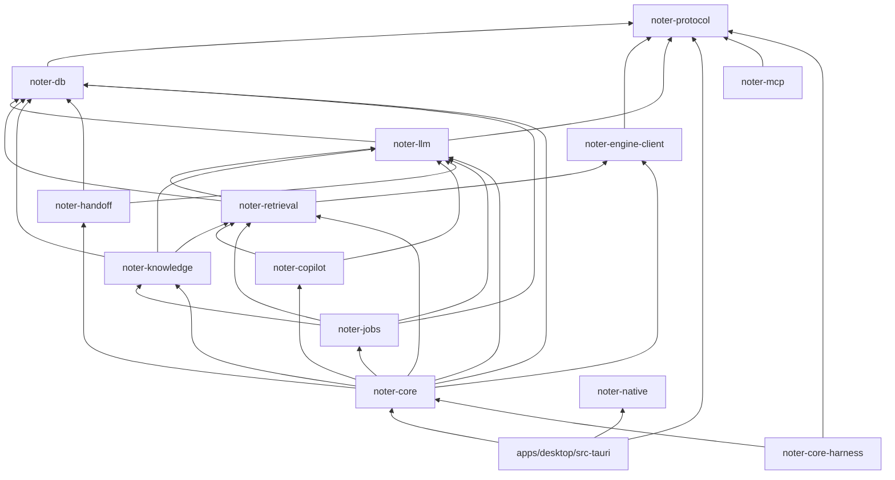

**Dependency Rules** (per project conventions):

- No circular dependencies; the graph above is the allowed set. The architecture check (`scripts/harness/arch_check.py`, `just arch`, part of `just gate-fast`) fails a change that breaks the rules below it can see: only `noter-db` depends on SQLite crates, only `noter-llm` on network crates, only `src-tauri` on Tauri, and `noter-protocol` only on serde, serde_json, specta and schemars.
- Only `apps/desktop/src-tauri` depends on Tauri; only `noter-protocol` depends on specta. `noter-engine-client` spawns the engine with `tokio::process`, not the Tauri shell plugin, so no window gets a shell permission.
- Only the infrastructure modules talk to external systems: `noter-engine-client` (engine), `noter-llm` (CLIs and Ollama), `noter-jobs` (`acli`, `bkt`, `gh`), `noter-knowledge` (MCP servers, files), `src-tauri`/`noter-native` (macOS).
- Every outbound request carrying user text passes the egress gate in `noter-llm`; jobs and knowledge call the gate, not the network, and the noter-mcp socket handler in `noter-core` passes every tool result of a cloud run through it.
- `noter-mcp` depends only on `noter-protocol`; it reaches data through the socket and opens no network port.
- SDK modules and a propagated `SecurityContext` are not applicable: one process, one user. The equivalent is the per-run `McpRunContext` (privacy context) that noter-mcp requests carry.

### 3.5 External Dependencies

#### macOS services

| Dependency Module | Interface Used | Purpose |
|-------------------|---------------|---------|
| Core Audio, AVFoundation, CoreML, Vision, ScreenCaptureKit | Engine only | Capture, ASR, diarization, embeddings, OCR (v1.x) |
| TCC permission prompts | Engine (audio), core (Calendar, Notifications, Screen Recording, Automation) | Asked only at the step that needs them; capture never waits for them (O1): if audio access was never asked, the first capture triggers the prompt. System Audio Recording cannot be queried; it is inferred from non-zero buffers in the self-test and from exact digital zeros during capture |
| AppKit panels and screens | tauri-nspanel (pinned to a commit), objc2 | Non-activating, content-protected panels; placement by display identity |
| Status item, menus, global shortcuts, dialogs | Tauri plugins | Menu bar, hotkeys, open and save panels |
| User notifications | `UNUserNotificationCenter` through objc2 in `noter-native` | Authorization request and state, `threadIdentifier` per call, `userInfo` = `NavTarget`, click delegate → `nav:request`. Not `tauri-plugin-notification`, which on macOS cannot prompt, always reports granted and has no click callback |
| EventKit | objc2; `NSCalendarsFullAccessUsageDescription` and the calendars entitlement (3.8) | Today and new-meeting detection |
| Login items | SMAppService through objc2 | Launch at login |
| Keychain (Security framework) | security-framework crate | API keys, OAuth tokens of indexed MCP sources, the voice-profile key |
| Launch Services, Apple Events | objc2, osascript | Handoff URL schemes and terminal fallback |
| FSEvents, security-scoped bookmarks | notify crate, objc2 | Folder sources |
| Accessibility | NSAccessibility post-notification | Announcements for panels that are not key |

#### Model runtimes

| Dependency Module | Interface Used | Purpose |
|-------------------|---------------|---------|
| Claude Code CLI | `claude -p` headless, stream-json sessions, `--json-schema`; lockdown flags `--strict-mcp-config`, `--mcp-config`, `--tools`, `--setting-sources ""` and `CLAUDE_CODE_DISABLE_NONESSENTIAL_TRAFFIC=1` | Default runtime (API key) and own Claude account |
| Codex CLI | `codex exec --json --output-schema --sandbox read-only`, `exec resume`, an isolated `CODEX_HOME` | Alternative runtime (API key) and own ChatGPT account |
| Ollama | HTTP `/api/chat` on localhost with `format` | Local fallback, sensitive calls, signals classifier |

#### Evidence and knowledge sources

| Dependency Module | Interface Used | Purpose |
|-------------------|---------------|---------|
| Jira | `acli jira workitem view --json` under the user's login | Status-category Done on a linked key |
| Bitbucket | `bkt pr list --state MERGED --json` | Merged pull requests carrying a linked key |
| GitHub | `gh search prs --merged` | Same |
| MCP servers (indexed) | MCP client with OAuth in the core | Document sync |
| Update and model hosting | tauri-plugin-updater (signed manifest), pinned model URLs with checksums; hosts listed in `contracts/egress-hosts.json` | App and model updates |

**Dependency Rules** (per project conventions):

- Version ranges of `claude`, `codex`, `acli`, `bkt`, `gh` and Ollama are pinned and checked at startup; an unknown major is reported as `cli_version_unsupported`, never guessed around.
- A missing or signed-out tool degrades to "not configured" or "no evidence found", never to a guess; an unreachable tracker is `tracker_unreachable` on the run.
- SLAs and circuit breakers: each adapter has a timeout per task type (live tick 8 s per agent, Ask 60 s, post-call 10 min) and a breaker that switches to local after two consecutive failures within a call (PRD › Degraded states).

### 3.6 Interactions & Sequences

Each sequence names the PRD job it serves; actors are the primary user of PRD › Problem, users and jobs to be done.

#### Open a window: snapshot, then stream

**ID**: `cpt-noter-seq-core-window-open`

**Use cases**: DESIGN.md › Reload and replay; PM-46 (window back after a crash)

**Actors**: Primary user

```mermaid
sequenceDiagram
    participant W as Call window (WebView)
    participant T as Generated transport
    participant H as IPC host
    participant C as noter-core
    participant S as Stream hub
    W->>H: app_snapshot {}
    H->>C: scope check (Caller::Window call-screen), CoreApi::app_snapshot
    C-->>W: AppSnapshot (capture, copilot, degraded, accounts, prefs; each slice with its version)
    W->>H: transcript_subscribe {call_id} + Channel
    H->>S: register sink
    S->>C: snapshot under the hub lock, seq = 42
    S-->>T: TranscriptMsg seq 43 (confirmed), before the invoke resolves
    Note over T: buffers seq 43 until the snapshot arrives
    C-->>T: TranscriptSnapshot {segments, hypotheses, last_seq: 42}
    T-->>W: snapshot, then seq 43 (drops seq ≤ 42)
    S-->>W: TranscriptMsg seq 44 (hypothesis)
    W->>H: stream_ack {subscription_id, seq: 44} (every 100 messages or 1 s)
    W->>H: cards_subscribe {call_id} + Channel
    C-->>W: CardsSnapshot {visible, earlier, pinned, status}
```

**Description**: Every window, on open, reload or after a WebView crash, asks for the app snapshot and then subscribes to what it shows. Channel messages and the `invoke` result are not ordered relative to each other, so the generated transport holds early messages until the snapshot resolves and drops any with `seq ≤ last_seq`. The window shows the same transcript, cards, pins and marks with nothing lost or doubled, and acknowledges what it received.

#### Record a detected call

**ID**: `cpt-noter-seq-core-record-detected-call`

**Use cases**: PRD › Feature specification › 1. Capture; DESIGN.md `cpt-noter-seq-record-prompt-start-recording`

**Actors**: Primary user

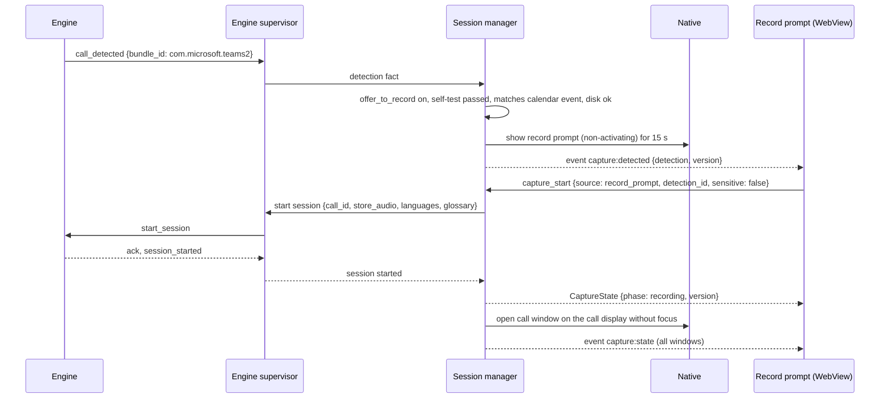

**Description**: The engine reports a meeting app playing audio while holding the microphone; the session manager decides whether to prompt (detection runs only with Offer to record on and the self-test passed), starts capture on Record through the supervisor and opens the call window without taking focus. Below 500 MB, or without the live model, the prompt shows `blocked: disk_full` or `model_missing` with a dimmed **Record**. Setup state and audio permissions never block a start (O1); a manual start from the menu, a hotkey or Today goes the same way from `capture_start`.

#### Live transcript and a copilot tick

**ID**: `cpt-noter-seq-core-live-tick`

**Use cases**: PRD › Feature specification › 2 and 3; PRD › Live copilot loop

**Actors**: Primary user

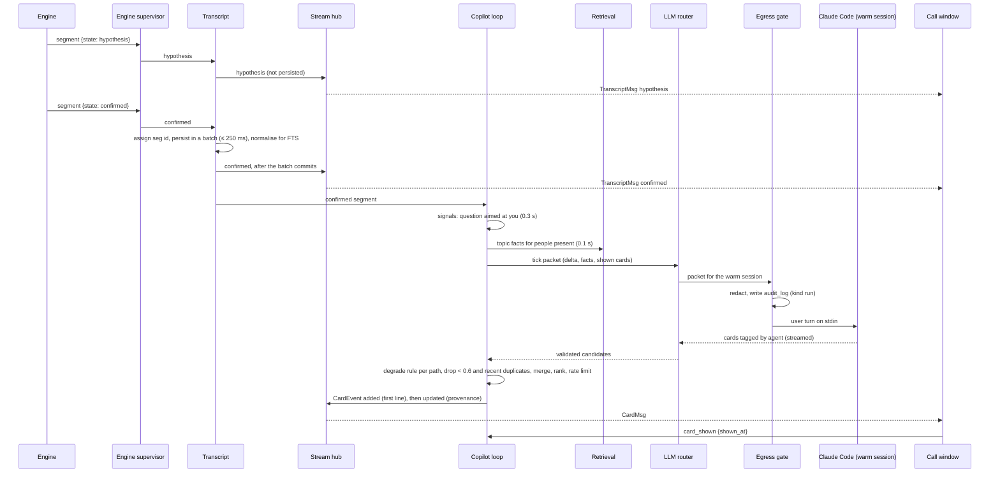

**Description**: Hypotheses go straight to the window; confirmed segments are persisted, published once their batch commits, and trigger the cheap signals; one tick runs through the router and the egress gate to the warm session, and validated cards stream back as soon as their first line exists. The UI reports when each card was painted, completing the latency measurement; the core stamps it for cards the UI cannot paint.

#### Stop at call end and write the outputs

**ID**: `cpt-noter-seq-core-call-end-outputs`

**Use cases**: PRD › Feature specification › 1 (call end) and 4; DESIGN.md `cpt-noter-seq-call-screen-stop-at-call-end`, `cpt-noter-seq-call-page-review-outputs`

**Actors**: Primary user

```mermaid
sequenceDiagram
    participant E as Engine
    participant Sup as Engine supervisor
    participant Ses as Session manager
    participant W as Call window
    participant J as Jobs
    participant PC as Post-call pipeline
    participant L as LLM router
    participant I as Items and outputs
    participant N as Native
    participant M as Main window
    E->>Sup: call_audio_released
    Sup->>Ses: audio released (20 s elapsed)
    Ses-->>W: capture:state notice call_ended {stops_at: +10 s}
    Note over W: Keep Recording, Stop Now, or held while hovered (capture_hold_notice, stops_at null)
    Ses->>Sup: stop
    Sup->>E: stop
    E-->>Sup: session_stopped {timeline, mic, sys}
    Sup-->>Ses: session stopped
    Ses-->>W: capture:state {phase: stopped, continue_until: +5 min}
    Ses->>J: queue PostCall job (low priority; runs even if the next call starts)
    J->>PC: run
    PC->>L: post-call skill on the live transcript
    loop each section in order
        L-->>PC: section validated
        PC->>I: write section, suggested items
        I-->>M: outputs:progress {section, ready}
    end
    PC->>Ses: outputs ready
    Ses->>N: release held notification "Summary ready" (no live call)
    J->>PC: ArchivePass job, when no call is live
    PC->>Sup: offline_pass (low priority)
    Sup->>E: offline_pass
    E-->>Sup: offline_done
    Sup-->>PC: archive result
    PC->>I: replace live segments, regenerate with edits kept, diff
    I-->>M: entity:changed, outputs:progress
```

**Description**: The session manager turns the engine's "audio released" fact, relayed by the supervisor, into the call-ended notice, stops, keeps Continue Recording open for five minutes, and queues the post-call job, which runs even if the next call has started (D2). The pipeline writes sections one by one from the live transcript; the session manager releases the notification when no call is live. The archive pass runs as its own job once no call is live and regenerates the outputs without losing edits.

#### Review an item and undo it

**ID**: `cpt-noter-seq-core-review-undo`

**Use cases**: PRD › Feature specification › 4 (review) and 11; DESIGN.md `cpt-noter-seq-call-page-review-suggested-items`

**Actors**: Primary user

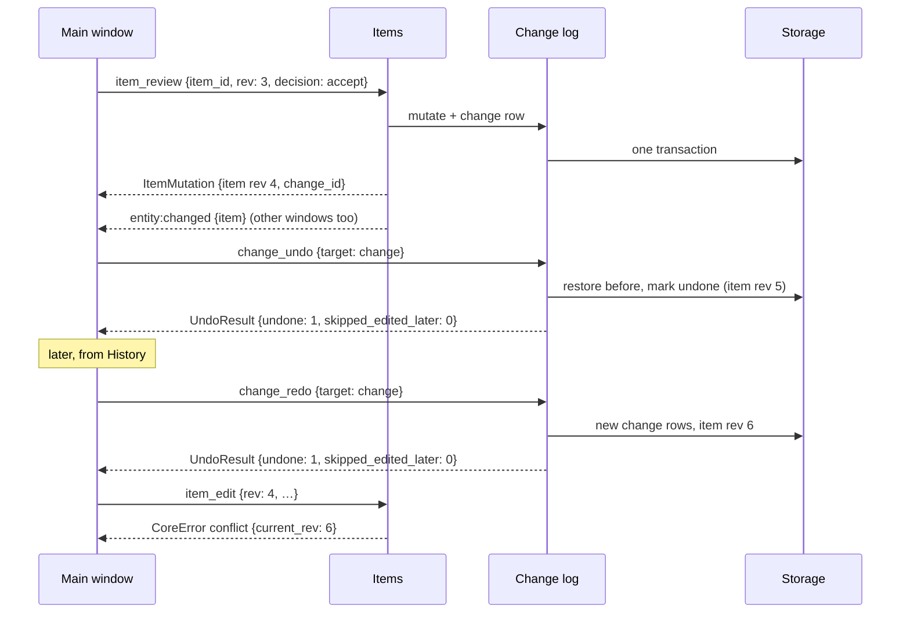

**Description**: Every mutation sends the revision it saw and gets back the new record with a change id; undo replays the change log backwards, and redo works at any later time on an undone change whose rows were not edited since, writing new change rows; a stale revision is refused with `conflict`, which the UI shows as "Item changed since".

#### Ask the library with citations

**ID**: `cpt-noter-seq-core-ask`

**Use cases**: PRD › Search and cross-meeting memory › Ask mode; DESIGN.md `cpt-noter-seq-ask-cited-answer`

**Actors**: Primary user

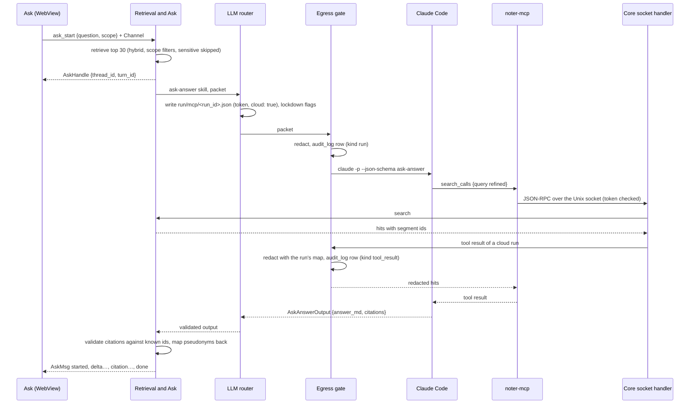

**Description**: Ask retrieves first, sends the packet through the router and the egress gate, lets the agent refine through noter-mcp, whose results are redacted and audited before they reach a cloud runtime, validates that every citation points to a known segment or chunk, and streams the answer; an answer without citations is sent as `found: false`.

#### Hand off an action item

**ID**: `cpt-noter-seq-core-handoff`

**Use cases**: PRD › Feature specification › 9; DESIGN.md `cpt-noter-seq-call-page-hand-off-item`

**Actors**: Primary user

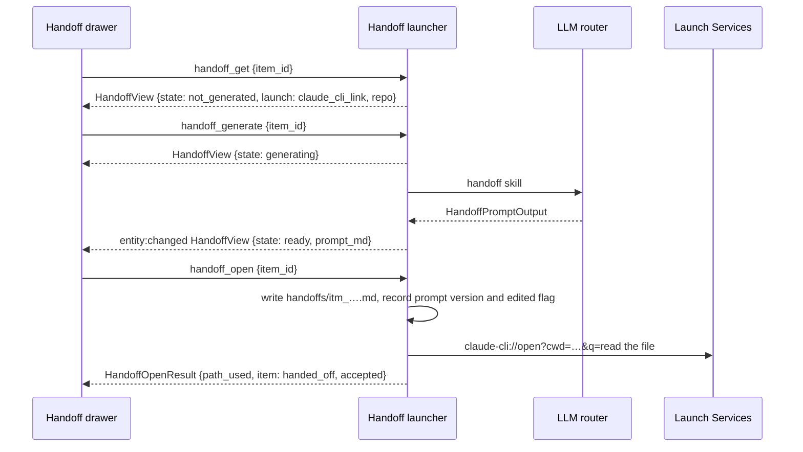

**Description**: The drawer learns the launch path before anything runs; the prompt is generated on demand without blocking the drawer (`handoff_cancel` stops it), written to a file and opened pre-filled, not sent. Opening or copying accepts a suggested item and records which prompt version was used and whether it was edited.

#### Close an item on evidence

**ID**: `cpt-noter-seq-core-evidence-close`

**Use cases**: PRD › Feature specification › 10; DESIGN.md `cpt-noter-seq-activity-review-proposals`

**Actors**: Primary user (reviews afterwards)

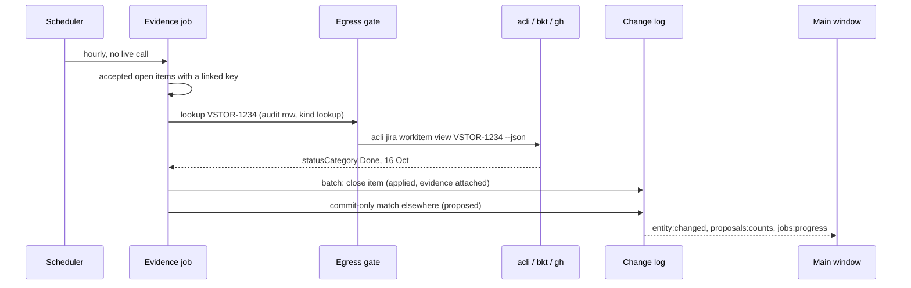

**Description**: Only a Done transition or a merged pull request carrying a linked key, dated after the item, closes an accepted item; a suggested item and everything weaker become a proposal. An unreachable tracker ends the run with `tracker_unreachable`. Every closure is a logged, undoable change and shows up in the next call's carry-forward.

#### Sign in with your own account

**ID**: `cpt-noter-seq-core-account-signin`

**Use cases**: PRD › LLM orchestration › Own accounts; DESIGN.md `cpt-noter-seq-settings-sign-in-account`

**Actors**: Primary user

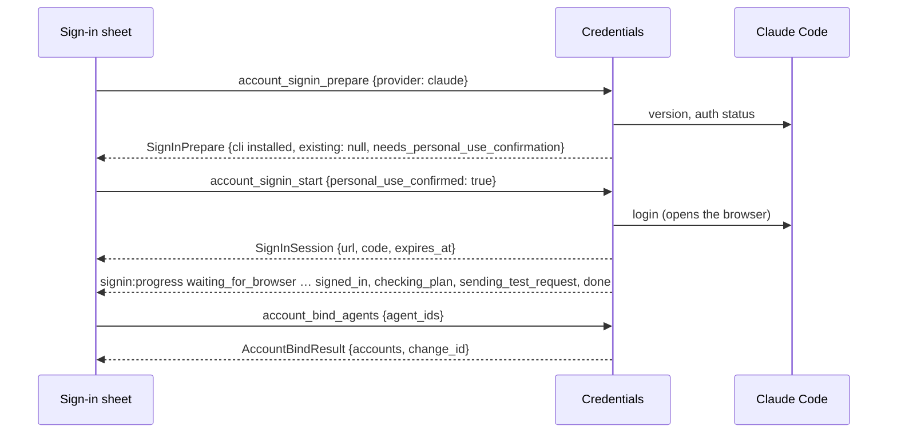

**Description**: The CLI does the sign-in and keeps the token; the core only drives the steps, checks the plan with a test request and binds agents with Undo. How the Claude plan is read from the CLI is decided by an M3 spike (Q8).

#### Recover from a corrupted database

**ID**: `cpt-noter-seq-core-db-recovery`

**Use cases**: PRD › Feature specification › 10 (database health); PRD › Success metrics › Maintenance

**Actors**: Primary user (sees the banner)

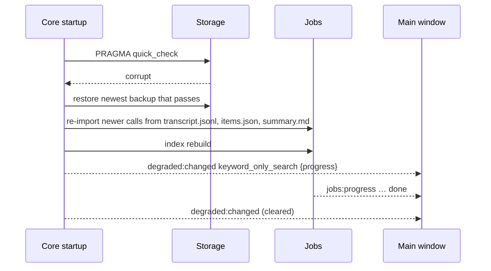

**Description**: The app starts on the newest good backup, re-imports anything newer from the per-call files, and serves keyword-only search with a progress bar until the indexes are rebuilt.

### 3.7 Database schemas & tables

One SQLite file in WAL mode, written only by the core's writer task (PRD › Data model and storage). This section lists the tables with their key columns and what changed from the PRD's table list; tables the PRD describes fully and this design leaves unchanged apart from `rev` (`item_vec`, `doc_vec`, `documents`, `doc_chunks`, `sync_runs`, `context_items`, `repositories`, `metric_rollups`, `glossary`) are referenced, not repeated. Column types are SQLite storage classes; exact DDL lives in the numbered migrations of `noter-db`.

- [ ] `p1` - **ID**: `cpt-noter-db-core-library`

**Changes from PRD › Data model, in one place**: a `rev` column on every editable table (optimistic concurrency, ADR-0002); junction tables instead of JSON arrays for call tags, person aliases and topic aliases (REVIEW › B10); new tables `marks`, `gaps`, `summary_versions`, `prompt_versions`, `suppressions`, `ask_threads`, `ask_turns`, `council_modes`, `speaker_constraints`; typed error codes in `job_runs`; `glossary` gains `rev`; `chunk_vec` has no partition key, with `call_id` and `started_at` as metadata columns; `metrics` gains `tick_id`, `llm_run_id` and `dropout_ms`; `audit_log` gains `kind` and `llm_run_id`; `speakers.pass` is `live` or `archive`; `items.status` gains `closed_by_evidence` and `answered_in_call`; `changes` gains `redo_of`. Partitioning, replication and sharding are not applicable to a single local file; hot and cold tiers are the audio retention rule and the 7-day live-segment copy.

#### Table: calls

**ID**: `cpt-noter-dbtable-calls`

One row per captured call. Change from the PRD: adds `rev`, `outputs_status`, `archive_status`, `audio_deleted`, `audio_not_stored`, `mode_used`; tags JSON replaced by `call_tags`.

**Schema**:

| Column | Type | Description |
|--------|------|-------------|
| id | TEXT | `call_` ULID |
| rev | INTEGER | Row version for `conflict` checks |
| started_at / ended_at | INTEGER | Epoch ms |
| title | TEXT | From the calendar event or the meeting app |
| call_type | TEXT | Call type id (skill directory) |
| platform | TEXT | Teams, Zoom, Meet, browser |
| calendar_event_id | TEXT NULL | EventKit id |
| privacy_class | TEXT | `normal` or `sensitive` |
| status | TEXT | `recording`, `paused`, `processing`, `ready`, `failed` |
| outputs_status / archive_status | TEXT | Pipeline states |
| audio_retention_until | INTEGER NULL | Null when kept forever or never stored |
| audio_deleted | INTEGER | 0/1 |
| audio_not_stored | INTEGER | 0/1, Never store audio |
| mode_used | TEXT | Effective privacy mode |

**PK**: id

**Constraints**: status and privacy_class CHECK-constrained to their enums

**Additional info**: Index on started_at; tags moved to `call_tags`

**Example**:

| Row (key columns in order, abridged) |
|------|
| call_01JA… · 3 · 1792137600000 · Planning: VHI 8.0 drawer redesign · planning · ready |

#### Table: call_tags

**ID**: `cpt-noter-dbtable-call-tags`

Free-text call tags (D90). Change from the PRD: new: junction table instead of a JSON array (REVIEW › B10).

**Schema**:

| Column | Type | Description |
|--------|------|-------------|
| call_id | TEXT | FK calls |
| tag | TEXT | 1–32 characters |
| tag_norm | TEXT | Lower-cased for uniqueness |

**PK**: (call_id, tag_norm)

**Constraints**: FK cascade on call delete

**Additional info**: Index on tag_norm for the Tags filter

**Example**:

| Row (key columns in order, abridged) |
|------|
| call_01JA… · vhi-8.0 · vhi-8.0 |

#### Table: people

**ID**: `cpt-noter-dbtable-people`

Everyone who has been on a call. Change from the PRD: adds `rev`, `short_name`, `is_you`; aliases JSON replaced by `person_aliases`.

**Schema**:

| Column | Type | Description |
|--------|------|-------------|
| id | TEXT | `per_` ULID |
| rev | INTEGER | Row version |
| display_name / short_name | TEXT | Names as shown |
| email, role, org, notes | TEXT NULL | Details |
| is_you | INTEGER | Exactly one row is 1 |
| voice_profile_optin, optin_date | INTEGER | Opt-in per person |

**PK**: id

**Constraints**: Partial unique index on is_you = 1

**Additional info**: Aliases in `person_aliases` (person_id, alias, alias_norm)

**Example**:

| Row (key columns in order, abridged) |
|------|
| per_anna · 2 · Anna Kuznetsova · Anna K. · 0 · 1 |

#### Table: call_participants

**ID**: `cpt-noter-dbtable-call-participants`

Who was on which call. Change from the PRD: drops `speaker_label` and `channel`, which live on `speakers`; `talk_time_ms` is filled only for calls recorded after behaviour metrics were switched on (owner decision D5).

**Schema**:

| Column | Type | Description |
|--------|------|-------------|
| call_id | TEXT | FK calls |
| person_id | TEXT | FK people |
| talk_time_ms | INTEGER NULL | Computed only when behaviour metrics are on, never back-computed |

**PK**: (call_id, person_id)

**Constraints**: FK cascade on call delete; person delete unlinks

**Additional info**: Filled from calendar attendees and named speakers

**Example**:

| Row (key columns in order, abridged) |
|------|
| call_01JA… · per_anna · NULL |

#### Table: speakers

**ID**: `cpt-noter-dbtable-speakers`

Diarization clusters per call and their mapping to people. Change from the PRD: adds `n`, `channel`, `named_by`; `pass` is `live` or `archive` (PRD: `offline`), the same words as `segments.pass`.

**Schema**:

| Column | Type | Description |
|--------|------|-------------|
| id | TEXT | `spk_` ULID |
| call_id | TEXT | FK calls |
| label | TEXT | Engine label, `you`, `guest_your_side` |
| n | INTEGER | Unnamed number, "Speaker 2" |
| channel | TEXT | `mic` or `sys` |
| person_id | TEXT NULL | FK people |
| named_by | TEXT NULL | `you`, `voice_profile`, `calendar` |
| centroid | BLOB | Encrypted with the Keychain key |
| pass | TEXT | `live` or `archive` |

**PK**: id

**Constraints**: Unique (call_id, label, pass)

**Additional info**: Must-link and cannot-link constraints from user corrections in `speaker_constraints`

**Example**:

| Row (key columns in order, abridged) |
|------|
| spk_3 · call_01JA… · spk_3 · 3 · sys · NULL · NULL · ‹encrypted› · live |

#### Table: voice_profiles

**ID**: `cpt-noter-dbtable-voice-profiles`

Voice centroids for opted-in people.

**Schema**:

| Column | Type | Description |
|--------|------|-------------|
| id | TEXT | ULID |
| person_id | TEXT | FK people |
| embedding | BLOB | 256-d, encrypted |
| device_hint | TEXT NULL | AirPods, laptop, room |
| sample_count | INTEGER | Samples merged |
| last_used_at | INTEGER | Decay after 90 days |

**PK**: id

**Constraints**: FK cascade on person delete or profile delete

**Additional info**: Never exported or synced

**Example**:

| Row (key columns in order, abridged) |
|------|
| vp_1 · per_anna · ‹encrypted› · AirPods · 14 · 1792… |

#### Table: segments

**ID**: `cpt-noter-dbtable-segments`

The transcript, one row per confirmed ASR segment. Change from the PRD: adds `corrections`.

**Schema**:

| Column | Type | Description |
|--------|------|-------------|
| id | TEXT | `seg_` ULID assigned by the core |
| call_id | TEXT | FK calls |
| speaker_id | TEXT | FK speakers |
| channel | TEXT | `mic` or `sys` |
| t0_ms / t1_ms | INTEGER | Call-relative |
| text | TEXT | As decoded and corrected |
| text_norm | TEXT | NFKC, ё→е, ß→ss, lower-cased, stemmed; indexed by FTS5 |
| lang, lang_p | TEXT, REAL | Per utterance |
| avg_logprob, no_speech_p | REAL | Engine metrics |
| pass | TEXT | `live` or `archive` |
| words_path | TEXT NULL | File with word timings |
| corrections | TEXT | JSON list of corrected ranges and originals |

**PK**: id

**Constraints**: Index (call_id, pass, t0_ms)

**Additional info**: Live rows kept 7 days after the archive pass, then deleted by the nightly retention job in a logged batch

**Example**:

| Row (key columns in order, abridged) |
|------|
| seg_… · call_01JA… · spk_anna · sys · 1198000 · 1204000 · Я сделаю drawer redesign до пятницы · ru · archive |

#### Table: marks

**ID**: `cpt-noter-dbtable-marks`

Moments the user marked during a call. Change from the PRD: new; PRD kept marks only in `timeline.json`.

**Schema**:

| Column | Type | Description |
|--------|------|-------------|
| id | TEXT | `mrk_` ULID |
| call_id | TEXT | FK calls |
| at_ms | INTEGER | Call-relative |
| note | TEXT NULL | Optional |

**PK**: id

**Constraints**: FK cascade

**Additional info**: Shown as mark rows in the transcript

**Example**:

| Row (key columns in order, abridged) |
|------|
| mrk_1 · call_01JA… · 1260000 · NULL |

#### Table: gaps

**ID**: `cpt-noter-dbtable-gaps`

Audio gaps: pause, device change, silent system audio, engine restart, stall, quit or crash, continued recording. Change from the PRD: new.

**Schema**:

| Column | Type | Description |
|--------|------|-------------|
| call_id | TEXT | FK calls |
| t0_ms / t1_ms | INTEGER | Call-relative |
| reason | TEXT | `GapReason`; `interrupted`, `engine_restart`, `device_changed` or `stalled` longer than 2 s is a dropout, summed into `metrics.dropout_ms` |

**PK**: (call_id, t0_ms)

**Constraints**: FK cascade

**Additional info**: Mirrors `timeline.json` for queries and the transcript's gap rows

**Example**:

| Row (key columns in order, abridged) |
|------|
| call_01JA… · 1330000 · 1360000 · paused |

#### Table: chunks

**ID**: `cpt-noter-dbtable-chunks`

Retrieval units built from segments; canonical embedding. Change from the PRD: `chunk_vec` is no longer partitioned by `call_id`.

**Schema**:

| Column | Type | Description |
|--------|------|-------------|
| id | TEXT | `chk_` ULID |
| call_id | TEXT | FK calls |
| t0_ms / t1_ms | INTEGER | Span |
| text, text_norm | TEXT | Speaker-prefixed lines with a call header |
| token_count | INTEGER | 200–300 |
| embedding | BLOB | float32[1024], bge-m3 |

**PK**: id

**Constraints**: FK cascade

**Additional info**: `chunk_vec` (sqlite-vec vec0, no partition key; `call_id` and `started_at` as metadata columns) is rebuilt from `embedding`; about 4.2 KB per chunk at 1024 dimensions, about 350 MB a year at 2 hours of calls a day

**Example**:

| Row (key columns in order, abridged) |
|------|
| chk_… · call_01JA… · 1180000 · 1420000 · ‹text› · 264 · ‹4 KB› |

#### Table: items

**ID**: `cpt-noter-dbtable-items`

Decisions, action items, open questions, risks. Change from the PRD: adds `rev`, `lang`, `generated_text`, `carried_from_call_id`; `status` gains `closed_by_evidence` and `answered_in_call`; `created_by` gains `pin`; `done_by_hand_at` becomes `done_at`; `handoff_prompt_path` moves to `prompt_versions`.

**Schema**:

| Column | Type | Description |
|--------|------|-------------|
| id | TEXT | `itm_` ULID |
| rev | INTEGER | Row version |
| call_id | TEXT | FK calls |
| kind | TEXT | Enum |
| text, lang | TEXT | As generated or edited |
| generated_text | TEXT NULL | For the edit diff on accept |
| owner_person_id | TEXT NULL | FK people |
| due_date | TEXT NULL | YYYY-MM-DD |
| status | TEXT | `open`, `done`, `carried`, `handed_off`, `closed_by_evidence`, `answered_in_call` |
| review_state | TEXT | `suggested`, `accepted`, `rejected` |
| created_by | TEXT | `llm`, `user`, `pin` |
| topic_id | TEXT NULL | FK topics |
| is_engineering | INTEGER | 0/1 |
| linked_issue_key | TEXT NULL | Jira key |
| handoff_target, handoff_cwd, handed_off_at | TEXT/INTEGER NULL | Last handoff |
| closed_by_evidence_id | TEXT NULL | FK evidence |
| done_at | INTEGER NULL | Epoch ms |
| carried_from_call_id | TEXT NULL | FK calls |

**PK**: id

**Constraints**: Enums CHECK-constrained

**Additional info**: FTS5 over text_norm; `item_vec` vec0 rebuilt from an embedding column

**Example**:

| Row (key columns in order, abridged) |
|------|
| itm_spec · 4 · call_01JA… · action_item · Drawer redesign spec by Friday · per_anna · 2026-10-17 · open · accepted · llm |

#### Table: item_spans

**ID**: `cpt-noter-dbtable-item-spans`

Evidence for items as time spans.

**Schema**:

| Column | Type | Description |
|--------|------|-------------|
| item_id | TEXT | FK items |
| call_id | TEXT | FK calls |
| channel | TEXT NULL | Both when null |
| t0_ms / t1_ms | INTEGER | Span |

**PK**: (item_id, call_id, t0_ms)

**Constraints**: FK cascade

**Additional info**: Resolved to segments at read time

**Example**:

| Row (key columns in order, abridged) |
|------|
| itm_spec · call_01JA… · NULL · 1198000 · 1210000 |

#### Table: evidence

**ID**: `cpt-noter-dbtable-evidence`

Closing or supporting evidence for items. Change from the PRD: adds `closed_item`.

**Schema**:

| Column | Type | Description |
|--------|------|-------------|
| id | TEXT | `evd_` ULID |
| item_id | TEXT | FK items |
| source | TEXT | `jira`, `bitbucket`, `github`, `call` |
| ref | TEXT | Key, PR URL or span |
| summary | TEXT | Plain words |
| confidence | TEXT | high, medium, low |
| dated_at, collected_at | INTEGER | Epoch ms |
| closed_item | INTEGER | 0/1 |

**PK**: id

**Constraints**: FK cascade

**Additional info**: Every auto-closure has one row with `closed_item = 1`

**Example**:

| Row (key columns in order, abridged) |
|------|
| evd_1 · itm_token · jira · VSTOR-9790 · moved to Done · high · 1792… · 1 |

#### Table: summaries

**ID**: `cpt-noter-dbtable-summaries`

One generated text section per call and kind, and one role review per agent. Change from the PRD: versions split out into `summary_versions` (with `version`, `lang`, `body_md`, `skill_version`, `llm_run_id` and `edited_body_md`); adds `rev`, `current_version_id`, `regenerated_with_edits`.

**Schema**:

| Column | Type | Description |
|--------|------|-------------|
| id | TEXT | `sum_` ULID |
| rev | INTEGER | Row version |
| call_id | TEXT | FK calls |
| kind | TEXT | Section kind |
| agent_id | TEXT NULL | FK agents, for role reviews |
| current_version_id | TEXT | FK summary_versions |
| user_edited | INTEGER | 0/1 |
| regenerated_with_edits | INTEGER | 0/1 |

**PK**: id

**Constraints**: Unique (call_id, kind, agent_id)

**Additional info**: FTS5 over the current body

**Example**:

| Row (key columns in order, abridged) |
|------|
| sum_backend · 2 · call_backend · summary · NULL · ver_2 · 0 |

#### Table: summary_versions

**ID**: `cpt-noter-dbtable-summary-versions`

Every generated version and the user's edit. Change from the PRD: new.

**Schema**:

| Column | Type | Description |
|--------|------|-------------|
| id | TEXT | `ver_` ULID |
| summary_id | TEXT | FK summaries |
| n | INTEGER | 1, 2, … |
| kind | TEXT | `generated` or `user_edit` |
| body_md | TEXT | Markdown, no raw HTML |
| lang | TEXT | Language |
| skill_version, llm_run_id | TEXT NULL | Provenance |
| from_pass | TEXT | `live` or `archive` |
| created_at | INTEGER | Epoch ms |

**PK**: id

**Constraints**: Unique (summary_id, n)

**Additional info**: Any two versions can be compared; the UI computes the diff

**Example**:

| Row (key columns in order, abridged) |
|------|
| ver_2 · sum_backend · 2 · generated · ‹md› · en · 1.0.0 · llm_… · archive |

#### Table: prompt_versions

**ID**: `cpt-noter-dbtable-prompt-versions`

Handoff prompts and improvement briefs, every version and the user's edit. Change from the PRD: new: replaces `items.handoff_prompt_path`.

**Schema**:

| Column | Type | Description |
|--------|------|-------------|
| id | TEXT | `ver_` ULID |
| item_id | TEXT NULL | FK items (null for briefs) |
| n | INTEGER | Version number |
| kind | TEXT | `generated` or `user_edit` |
| output_json | TEXT | The skill's structured output |
| body_md | TEXT | Rendered Markdown |
| file_path | TEXT | handoffs/<id>.md |

**PK**: id

**Constraints**: Unique (item_id, n)

**Additional info**: Generated on demand and cached

**Example**:

| Row (key columns in order, abridged) |
|------|
| ver_9 · itm_virt · 1 · generated · ‹json› · ‹md› · handoffs/itm_virt.md |

#### Table: topics

**ID**: `cpt-noter-dbtable-topics`

Threads across calls. Change from the PRD: adds `rev`; aliases in `topic_aliases`.

**Schema**:

| Column | Type | Description |
|--------|------|-------------|
| id | TEXT | `top_` ULID |
| rev | INTEGER | Row version |
| name | TEXT | Shown name |
| centroid | BLOB | Embedding centroid |
| first_seen, last_seen | INTEGER | Epoch ms |

**PK**: id

**Constraints**: —

**Additional info**: Aliases in `topic_aliases`; merge suggestions computed, Keep Separate stored in `suppressions`

**Example**:

| Row (key columns in order, abridged) |
|------|
| top_drawer · 1 · Drawer redesign · ‹blob› · 1789… · 1792… |

#### Table: suppressions

**ID**: `cpt-noter-dbtable-suppressions`

Things the user said never to suggest again. Change from the PRD: new.

**Schema**:

| Column | Type | Description |
|--------|------|-------------|
| kind | TEXT | `topic_merge`, `person_merge`, `rejected_item`, `term` |
| key | TEXT | Canonical key of the pair or the rejected text |
| created_at | INTEGER | Epoch ms |

**PK**: (kind, key)

**Constraints**: —

**Additional info**: Read by topic suggestions, reconciliation and regeneration (DESIGN.md D75)

**Example**:

| Row (key columns in order, abridged) |
|------|
| topic_merge · top_notif\|top_ws · 1792… |

#### Table: cards

**ID**: `cpt-noter-dbtable-cards`

Every copilot card and what happened to it. Change from the PRD: `text` splits into `title` and `body`; `evidence_spans` becomes `provenance`; `feedback` becomes `rating`; adds `created_at`, `outcome`, `expiry_reason`, `tick_id`.

**Schema**:

| Column | Type | Description |
|--------|------|-------------|
| id | TEXT | `card_` ULID |
| call_id | TEXT | FK calls |
| agent_id | TEXT | FK agents |
| kind | TEXT | Card kind |
| title, body | TEXT | Text |
| provenance | TEXT | JSON `Provenance` |
| merged_agents | TEXT | JSON list |
| created_at, shown_at, expired_at | INTEGER NULL | Epoch ms; shown_at from `card_shown`, or stamped by the core for menu-bar-only, hidden or queued cards |
| outcome | TEXT NULL | pinned, dismissed, expired, dropped_late |
| expiry_reason | TEXT NULL | `timeout` or `topic_changed` |
| rating, used | TEXT/INTEGER NULL | Feedback; `used` set when the user's mic transcript matches the card within 2 minutes |
| llm_run_id, tick_id | TEXT | Provenance and timing |

**PK**: id

**Constraints**: FK cascade on call delete

**Additional info**: Feeds Performance and per-agent hit rates

**Example**:

| Row (key columns in order, abridged) |
|------|
| card_2 · call_01JA… · agt_pm · ask · Who owns…? · this_call · 1792… · NULL |

#### Table: agents

**ID**: `cpt-noter-dbtable-agents`

The council registry. Change from the PRD: adds `rev`, `badge`, `switched_off_call_types`; `order` is named `ord`.

**Schema**:

| Column | Type | Description |
|--------|------|-------------|
| id | TEXT | `agt_` ULID or built-in slug |
| rev | INTEGER | Row version |
| name, badge | TEXT | Shown |
| builtin | INTEGER | Cannot be removed |
| skill_path | TEXT | skills/roles/<role>/SKILL.md |
| runtime | TEXT | Runtime choice |
| model, effort | TEXT | Per runtime |
| tools, call_types | TEXT | JSON lists |
| budget_share | INTEGER | Percent |
| enabled, ord | INTEGER | Order is the ranking tie-break |
| switched_off_call_types | TEXT | JSON: call type, time and change id of each self-switch-off (80 % or more dismissed over the last 10 calls of the type, owner decision D4) |

**PK**: id

**Constraints**: Sum of budget shares ≤ 100 % checked on write

**Additional info**: Council mode per call type in `council_modes` (call_type, live, post_call)

**Example**:

| Row (key columns in order, abridged) |
|------|
| agt_pm · 1 · Product manager · 1 · skills/roles/pm/SKILL.md · claude_api_key · claude-haiku · low |

#### Table: ask_threads

**ID**: `cpt-noter-dbtable-ask-threads`

Ask threads. Change from the PRD: new.

**Schema**:

| Column | Type | Description |
|--------|------|-------------|
| id | TEXT | `ask_` ULID |
| title | TEXT | First question |
| scope | TEXT | JSON `AskScope` |
| updated_at | INTEGER | Epoch ms |

**PK**: id

**Constraints**: —

**Additional info**: Turns in `ask_turns` (id, thread_id, question, answer_md, citations JSON, found, runtime, llm_run_id, asked_at)

**Example**:

| Row (key columns in order, abridged) |
|------|
| ask_1 · What did we decide about websockets? · {…} · 1792… |

#### Table: sources

**ID**: `cpt-noter-dbtable-sources`

Knowledge sources; documents and chunks as in the PRD. Change from the PRD: adds `rev`, `bookmark`; `path_or_server` is named `location`.

**Schema**:

| Column | Type | Description |
|--------|------|-------------|
| id | TEXT | `src_` ULID |
| rev | INTEGER | Row version |
| kind, mode | TEXT | folder or mcp; live or indexed |
| name, location | TEXT | Shown |
| bookmark | BLOB NULL | Security-scoped bookmark for folders |
| schedule | TEXT NULL | Sync schedule |
| privacy_class, scope | TEXT | Applied before retrieval |
| token_ref | TEXT NULL | Keychain item name, never the token |
| status, last_sync_at | TEXT/INTEGER | Status |

**PK**: id

**Constraints**: Removing a source deletes documents, doc_chunks and doc_vec rows in one transaction

**Additional info**: `documents`, `doc_chunks`, `doc_vec`, `sync_runs` as in PRD › Data model

**Example**:

| Row (key columns in order, abridged) |
|------|
| src_specs · 1 · folder · indexed · Frontend specs · ~/Documents/specs · normal |

#### Table: changes

**ID**: `cpt-noter-dbtable-changes`

The change log; proposals are rows with status `proposed`. Change from the PRD: adds `summary`, `proposal_kind`, `undoable`, `redo_of`; actor `user` is written `you`.

**Schema**:

| Column | Type | Description |
|--------|------|-------------|
| id | TEXT | `chg_` ULID |
| ts | INTEGER | Epoch ms |
| actor | TEXT | `you`, `job:<id>`, `llm_run:<id>` |
| entity_type, entity_id | TEXT | Target |
| field, before, after | TEXT NULL | Single changes |
| delta | BLOB NULL | Bulk edits of a batch |
| summary, reason | TEXT | Plain words |
| evidence_ids | TEXT | JSON list |
| confidence | TEXT NULL | Level |
| status | TEXT | applied, proposed, rejected, undone |
| batch_id | TEXT NULL | `bat_` id |
| proposal_kind | TEXT NULL | For proposals |
| undoable | INTEGER | 0 for irreversible deletes and retention |
| redo_of | TEXT NULL | For rows written by a redo: the undone row they re-apply |

**PK**: id

**Constraints**: Append-only: updates only to `status`

**Additional info**: Indexes on (entity_type, entity_id, ts), batch_id, status. Redo has no token and no time window: it writes new rows with `redo_of`, and the undone rows keep their status

**Example**:

| Row (key columns in order, abridged) |
|------|
| chg_1 · 1792… · job:job_evidence · item · itm_token · status · open · closed_by_evidence · applied |

#### Table: jobs

**ID**: `cpt-noter-dbtable-jobs`

Maintenance jobs and their settings; runs in `job_runs`. Change from the PRD: `name` becomes `kind` (including `post_call`, `archive_pass`, `regeneration` and `retention`); `job_runs.error` becomes a typed `error_code` (such as `tracker_unreachable`); adds `progress`.

**Schema**:

| Column | Type | Description |
|--------|------|-------------|
| id | TEXT | `job_` id |
| kind | TEXT | Job kind |
| trigger, schedule | TEXT | When it runs |
| enabled, allow_on_battery | INTEGER | Settings |
| last_run_at | INTEGER NULL | Epoch ms |

**PK**: id

**Constraints**: —

**Additional info**: `job_runs` (id, job_id, started_at, finished_at, status, counts JSON, error_code, progress)

**Example**:

| Row (key columns in order, abridged) |
|------|
| job_evidence · evidence_collection · hourly · 1 · 0 |

#### Table: llm_runs

**ID**: `cpt-noter-dbtable-llm-runs`

Every model call. Change from the PRD: adds `runtime_choice`, `call_id`, `first_token_ms`, `retried`.

**Schema**:

| Column | Type | Description |
|--------|------|-------------|
| id | TEXT | `llm_` ULID |
| adapter, runtime_choice, model | TEXT | Who ran it |
| skill, skill_version | TEXT | What ran |
| agent_id, call_id | TEXT NULL | Context |
| prompt_hash | TEXT | Never the prompt |
| tokens_in, tokens_out | INTEGER | Usage |
| cost_usd | REAL NULL | Null on own accounts; the cost metric counts API-key runs only |
| duration_ms, first_token_ms | INTEGER | Timing |
| schema_ok, retried | INTEGER | Validation |
| session_id | TEXT NULL | CLI session |

**PK**: id

**Constraints**: —

**Additional info**: No transcript text, ever

**Example**:

| Row (key columns in order, abridged) |
|------|
| llm_… · claude_code · claude_api_key · claude-haiku · council · 1.0.0 · NULL · call_01JA… · ‹hash› · 2310 · 180 · 0.004 |

#### Table: audit_log

**ID**: `cpt-noter-dbtable-audit-log`

Everything that left the Mac. Change from the PRD: `event` becomes `kind` and `what`; `adapter` becomes `runtime_choice`; adds `destination`, `call_id`, `llm_run_id`.

**Schema**:

| Column | Type | Description |
|--------|------|-------------|
| id | TEXT | `aud_` ULID |
| ts | INTEGER | Written before the request is sent |
| kind | TEXT | `run` (the packet of one model run), `tool_result` (one noter-mcp result of a cloud run) or `lookup` (evidence lookup, source sync, live MCP query) |
| what | TEXT | What left, as the Privacy pane names it (`AuditWhat`) |
| destination | TEXT | Host or tool |
| runtime_choice | TEXT NULL | Runtime |
| call_id | TEXT NULL | Context |
| llm_run_id | TEXT NULL | FK llm_runs; links a run's tool results to its row and to the proxy log |
| bytes_out | INTEGER | Size |
| payload_hash | TEXT | Never the payload |
| redaction_map_id | TEXT NULL | Placeholders used, never originals |

**PK**: id

**Constraints**: Append-only

**Additional info**: Exported from the Privacy pane; the network-monitor test matches every proxy line to a provider host against these rows

**Example**:

| Row (key columns in order, abridged) |
|------|
| aud_1 · 1792… · run · transcript_delta · api.anthropic.com · claude_api_key · call_01JA… · llm_… · 1843 |

#### Table: metrics

**ID**: `cpt-noter-dbtable-metrics`

Per-call and per-stage measurements for the Performance page and the release gates. Change from the PRD: adds `tick_id`, `llm_run_id`, `dropout_ms`.

**Schema**:

| Column | Type | Description |
|--------|------|-------------|
| id | TEXT | ULID |
| ts | INTEGER | Epoch ms |
| call_id | TEXT NULL | FK calls |
| name, stage, component | TEXT | What was measured, such as `card_shown`, `handoff_used` or `memory_mb` |
| value, unit | REAL, TEXT | The measurement |
| agent_id | TEXT NULL | FK agents |
| tick_id | TEXT NULL | Copilot tick; every stage of one tick shares it |
| llm_run_id | TEXT NULL | FK llm_runs |
| dropout_ms | INTEGER NULL | On the per-call capture row: total dropout time |

**PK**: id

**Constraints**: —

**Additional info**: No transcript text. Memory, CPU and thermal state are sampled every 10 s during capture; `handoff_used` rows carry the `prompt_versions.id` and whether the prompt was edited. Rows older than 365 days are deleted by the retention job; `metric_rollups` as in the PRD

**Example**:

| Row (key columns in order, abridged) |
|------|
| met_… · 1792… · call_01JA… · card_shown · copilot · ui · 5400 · ms · agt_pm · tick_… · llm_… · NULL |

#### Table: settings

**ID**: `cpt-noter-dbtable-settings`

Typed settings sections and the account binding.

**Schema**:

| Column | Type | Description |
|--------|------|-------------|
| key | TEXT | Section name, plus `rev` and `account.claude` / `account.chatgpt` |
| value | TEXT | JSON of the section type |

**PK**: key

**Constraints**: Writes guarded by the settings `rev`

**Additional info**: Account binding holds email and plan, never a token

**Example**:

| Row (key columns in order, abridged) |
|------|
| privacy · {"mode":"cloud_redacted",…} |


### 3.8 Deployment Topology

Everything runs on the user's Mac; nothing is deployed to a server.

- [ ] `p2` - **ID**: `cpt-noter-topology-core-processes`

| Process | Started by | Lifetime | Talks to | Sandbox and entitlements |
| --- | --- | --- | --- | --- |
| Noter (app main process: Rust core and the IPC host) | The user; login item optional (SMAppService) | App lifetime | WebViews (Tauri IPC), engine (stdio), runtimes (spawn, stdio), noter-mcp (Unix socket), Ollama (HTTP localhost), `acli`/`bkt`/`gh` (spawn), MCP servers (HTTPS through the egress gate) | Hardened runtime; Apple Events; calendars (`com.apple.security.personal-information.calendars`); App Group `<TEAMID>.ai.noter`. Usage strings written by hand in Info.plist for microphone, system audio, Apple Events and calendars (`NSCalendarsFullAccessUsageDescription`) |
| WebView windows | The core | Per window | The core only | No remote content; CSP blocks network |
| noter-engine (Swift) | The core, with `tokio::process` from `noter-engine-client` | Restarted by the supervisor on exit, capture first | The core over stdio only; files only in the App Group container | App Sandbox, audio input, App Group `<TEAMID>.ai.noter`, no network. Signed in the Swift build with its own entitlements and Info.plist |
| claude, codex | The router, per task or per live session | One task, or one call for warm sessions | Only their runtime's provider host over HTTPS; noter-mcp over stdio | The user's install, version-checked; empty Noter-owned working directory; lockdown flags, and an isolated `CODEX_HOME` for Codex |
| noter-mcp | The CLI, as a stdio child, from `run/mcp/<run_id>.json` | One run | The CLI (stdio), the core (Unix socket with a per-run token); never a TCP port | Same signing identity as the app |
| ollama | The user (detected) | Independent daemon | The core over localhost | Not Noter's |

**Files**, all 0600:

- Application Support (`~/Library/Application Support/Noter/`), the core's alone: `noter.db` (+ `-wal`, `-shm`), `skills/`, `handoffs/`, `backups/`, `logs/`, `run/core.sock`, `run/mcp/<run_id>.json` (per-run MCP config with the token, deleted after the run).
- App Group container `<TEAMID>.ai.noter` (`~/Library/Group Containers/`), shared by the app and the sandboxed engine: `audio/<call_id>/` (`mic.m4a`, `sys.m4a`, `timeline.json`, `transcript.jsonl`, `items.json`, `summary.md`), `models/`, `engine-io/` and the capture ring. `storage_move` can move it to a user folder only if the engine ships unsandboxed (Q4).

**Build and release**: one notarised DMG signed by one Developer ID; until the owner has a Developer ID, release builds are ad-hoc signed and not notarised, and signing switches on once the secrets are added (owner, 17 Oct 2026; `docs/DELIVERY.md`). release-please cuts versioned GitHub releases from the Conventional Commit titles on `main`, with the contracts bundle, an SBOM and build provenance. The engine is signed in the Swift build with its own entitlements and Info.plist and shipped through `bundle.macOS.files`, which copies it without re-signing; an `externalBin` would be re-signed with the app's entitlements. noter-mcp is signed with the app's identity. CI runs `codesign -d --entitlements` on the app and the engine and checks the built Info.plist usage strings and entitlements against every `PermissionKind`. `tauri-plugin-updater` with a signed manifest; tauri-nspanel pinned to a commit. CI runs every gate on Linux (the contract crate and its exporter included); the engine and the Tauri host are tested on a hosted macOS runner once they exist, and wall-clock performance and the real-app flows run on the self-hosted Apple Silicon runner, since 18 Oct 2026 the development MacBook Pro (`docs/HARNESS.md`, `docs/DEVELOPMENT.md`).

## 4. Additional context

### 4.1 Contract governance and the UI-first plan

**Source of truth.** `crates/noter-protocol`. Generated files (`apps/desktop/src/core/bindings.ts`, `contracts/**`) are committed and never edited by hand. ADR-0001 records why.

**Stability tiers.**

| Tier | Surfaces now | May change | How |
| --- | --- | --- | --- |
| Frozen | App, Capture control, Transcript, Items, Today, Outputs and sharing, Handoff, Library and Ask, History and undo, People, Settings and credentials (except `storage_move`), First run and permissions, Windows; all events except `copilot:status` | Only additively in a minor version (new optional field, new command, new enum variant the UI can ignore); anything else is a major version | PR to `noter-protocol` approved by one core and one UI owner |
| Draft | Copilot (14 commands including the cards Channel, and `copilot:status`), Agents (9), Performance (3), `storage_move` | Any change in a minor version | PR approved by the side that needs it; the other side is notified in the PR |

A draft surface becomes frozen at its milestone gate: Copilot and Agents when the M4 latency gate passes, Performance at M5. Additive rules for the UI: unknown enum values render as the neutral state; unknown fields are ignored; optional fields may be absent or `null`.

**Change process.** 1) Change the Rust types and the registry in `noter-protocol` (the `contract` lane). 2) Run `just contract-regen`; generated files are never edited by hand, and the lane guard blocks such edits. 3) Update the fake handlers and the conformance suite if a frozen surface changed. 4) Bump `CONTRACT_VERSION` minor (additive) or major (breaking). 5) Place every new command in `harness/milestones.toml`. 6) One PR, one core and one UI review, green on `just gate`. The contract changes before either side's implementation does.

**CI gates.** All of them run inside `just gate`, the fast ones also in `just gate-fast`; CI reports them as one required status check, `gate`, on `main` (ADR-0003).

| Gate | Checks | Fails when |
| --- | --- | --- |
| Contract export check | `noter-contract-export --check` (`just contract`) | Generated files differ from the types |
| Contract tests | `cargo test -p noter-protocol` | Duplicate names, a group without commands, a scope rule broken (call window may not delete), stability wrong for a name (draft groups, `storage_move` and `copilot:status` checked by name), an `Option` field of an argument type without `#[serde(default)]`, error list incomplete, fixtures do not round-trip |
| UI typecheck and smoke | `tsc` and `contract.smoke.ts` against the fake | The UI or the fake no longer matches the bindings; snapshot-then-stream (including a Channel message sent before the snapshot resolves), window scoping or error typing broken |
| Handler parity (from M0) | A test in `src-tauri` with `tauri::test::mock_builder`: the registered command list equals `COMMANDS`, `AppManifest::commands` and each window's capability allow exactly its commands, and every command called from every window gets its answer or `window_not_allowed` | A command is missing, extra or wrongly scoped in the real core |
| Fixture parity (from M1) | Fixtures are seeded as database rows; the fake world is generated by running the real read models over them with an injected clock; the test lists the fields it compares | Real and fake disagree on a frozen read model |
| Signing and permissions (from M0) | `codesign -d --entitlements` on the app and the engine; the built Info.plist usage strings and entitlements against every `PermissionKind` | An entitlement or usage string is missing, or the engine was re-signed with the app's entitlements |
| Run lockdown (from the first CLI adapter) | A run of each adapter on a machine with a user hook, plugin and MCP server configured | Any of them starts in a Noter run |
| Network monitor (release gate) | The test in 4.4 | A provider request without a matching run row, or a host outside `contracts/egress-hosts.json` |
| Conformance (fake now, real core from M0) | `pnpm test:conformance` with `NOTER_CORE=fake`, then `NOTER_CORE=stdio` against `noter-core-harness` | Window scope, typed errors, snapshot-then-stream or revision rules differ between the core and the contract |
| Quality bars (ADR-0003) | `just gate`: unit line coverage ≥ 80 % per side (Rust, UI) and on changed lines; E2E ≥ 60 % of the frozen commands and of the DESIGN.md stories delivered by the current milestone, exercised against the real core, XCUITest runs against the built app included (runs against the fake do not count); screenshots ≥ 98 % per-pixel match in the pinned Linux Playwright container, native surfaces excluded; performance ≤ 10 % instruction-count regression per scenario and ≥ 60 % scenario coverage, wall clock measured nightly on the self-hosted Mac runner; architecture checks; `cfs validate`; every pull request also needs `hygiene`, CodeQL and the delivering agent's self-review (`review`) | Any bar in `harness/harness.toml` is missed, or a PR loosens one without the owner's label (docs/HARNESS.md) |
| Native UI tests (`just native`, from M1) | XCUITest drives the built app on the macOS runner: the menu bar extra and its menu, tray glyphs, the non-activating panels (call window, floating panel, record prompt), notifications, global hotkeys and card keys; each test names the story it covers | A native surface does not do what DESIGN.md says |
| Trace coverage (`just trace`, in `just gate-fast` and `just gate`) | Design IDs of the kinds component, interface, seq and dbtable (FEATURE flow, algo, state and dod later) that have an `@cpt-*` marker in code; config in `[gates.trace]` of `harness/harness.toml` | An ID covered on `main` loses its marker, or coverage over `main`'s ID set drops; design IDs added ahead of code do not fail it |

**What the UI can build now, against the fake core.** Every frozen group. The fake answers commands with realistic data and rejects a command it has no handler for with `not_implemented`; `contract.smoke.ts` prints how many of the 172 commands it answers. The fake follows the core's behaviour rules, not only its shapes: `capture_set_paused(false)` on a stopped call is refused, `job_run_now` is blocked while a call is live (except post-call), `capture_set_sensitive(false)` is refused during capture, and redo works. Stories steer it with `failNext(command, code)` (retryable as the generated `DEFAULT_RETRYABLE` says), with `fake.push(channel message)` on an open Channel, and with `setWorld`, which emits the matching events; every error, empty and degraded state in DESIGN.md can be produced this way. The fake sends its first Channel message before the snapshot resolves, to exercise the transport's buffering.

**Implementation order.** The order in which the core replaces fake answers with real ones, group by group, is set by PRD › Roadmap and milestones; `harness/milestones.toml` places every command and story in its milestone for the E2E coverage gate (ADR-0003), and the decomposition of this design into work items follows it. It is not repeated here.

**Integration checkpoints.** From M0, every PR runs the conformance suite against the fake and against the real core through `noter-core-harness`, and the UI's end-to-end flows against the real core with the same fixtures (4.4 says how); only real-core runs count toward the E2E bar. When a milestone gate passes, `[milestone].current` in `harness/harness.toml` moves forward and the E2E and performance coverage gates start counting what that milestone delivers. A difference between the fake and the real core is a contract bug and is fixed in `noter-protocol` first.

### 4.2 Design decisions

Decisions this design takes beyond the PRD, each with a one-line reason. Decisions with real alternatives have ADRs.

| # | Decision | Reason |
| --- | --- | --- |
| C1 | The contract is Rust types in a Tauri-free crate, with TypeScript generated by specta and the command client generated by our exporter (ADR-0001) | Builds anywhere, CI included; the UI gets types before the core exists |
| C2 | Commands take one `args` object; results or `CoreError`; Channels for streams; whole-state events (ADR-0002) | One shape to learn; nothing stale after a missed event |
| C3 | Optimistic concurrency with `rev` on every editable record | The UI design's "Item changed since" state needs a mechanism; jobs and two windows can edit the same item |
| C4 | Every undoable mutation returns `change_id` | The UI's **Undo** must not guess which change to undo |
| C5 | Audio plays natively: the core decides, the engine plays (owner decision D6) | No media in the WebView (DESIGN.md NFR Allocation, Footprint); the engine owns the files and is already excluded from the tap, which also excludes the app PID |
| C6 | The core shows open and save panels and writes rich clipboard formats; the UI may write plain text | File access stays in the core; the UI never handles paths it did not get from the core |
| C7 | Version diffs are computed in the UI from two bodies | The diff view is presentation; the core returns the versions |
| C8 | Settings are replaced per section, not patched per field | Typed, wanted state, one revision |
| C9 | Call types are data (`call_types_list`), not an enum | Skills per call type are user-editable directories |
| C10 | The call window's label is `call-screen` | Matches PRD › Live copilot loop (`call-screen` window) |
| C11 | A new crate `noter-core` implements `CoreApi`; `src-tauri` stays thin | The core is testable without Tauri, a UI or audio hardware (PRD › Why this split) |
| C12 | One egress gate in `noter-llm` for runtimes, noter-mcp tool results of cloud runs, evidence lookups and MCP syncs; every CLI run locked down | The audit-log release blocker holds only with one way out |
| C13 | Channels are acknowledged with `stream_ack`; a subscription with 2 000 unacknowledged messages is ended with `lagged` | `Channel::send` has no acknowledgement, so the core cannot otherwise see lag; bounded memory; the UI resubscribes with a fresh snapshot |
| C14 | noter-mcp authenticates to the core with a per-run token and carries a privacy context | A cloud run must never receive sensitive sources, and no other process may use the socket |
| C15 | Summary and prompt versions move to their own tables | Every version kept with provenance, as the PRD asks, without growing the parent rows |
| C16 | Fixtures are written in Rust and exported as JSON, and seeded as database rows for fixture parity | The fake core cannot drift from the contract or from the real read models |
| C17 | Whole-state payloads carry a monotonic `version`; the generated transport buffers Channel messages until the snapshot resolves | Events, Channels and command results are not ordered relative to each other |
| C18 | The engine and the app share an App Group container; the engine is signed separately and spawned with `tokio::process` | A sandboxed engine can reach only a shared container, and the Tauri bundler would re-sign an `externalBin` with the app's entitlements |
| C19 | Notifications through `UNUserNotificationCenter` in `noter-native` | The Tauri notification plugin cannot prompt, reports granted on macOS and has no click callback |
| C20 | Redo by `UndoTarget` at any time, no redo token | **Redo** on a History row must work long after the undo strip is gone |

**Owner decisions of 17 October.** Taken on the review in `docs/REVIEW-2026-10-17-design-core.md` and recorded in PRD › Decision log.

| # | Decision | Where it lands |
| --- | --- | --- |
| O1 | Permissions are granted by default; no consent is required. Noter never refuses or gates a start on setup state, audio permissions or the self-test, and no start control reads **Finish Setup…**. If macOS has not asked yet, the first capture triggers the prompt; if access is off, capture runs and a degraded state names the silent channel. An unfinished self-test only keeps automatic call detection off | Session manager, 3.1 capture transitions, error table |
| O2 | noter-mcp runs only locally and is never exposed to the network: a stdio child of the CLI for one run, talking to the core only over the Unix socket with a per-run token, never opening a TCP port. Its socket handler is part of the egress gate: for a cloud run every tool result is redacted and audited before it is returned | noter-mcp, egress gate |
| D1 | Live MCP lookups (the user's own MCP sources) are off unless the privacy mode is Cloud allowed; then they run only after calls and in Ask, relayed and logged by noter-mcp | LLM router, egress gate, knowledge sources |
| D2 | The previous call's post-call analysis runs during a live call at low priority; only the archive pass, regeneration and maintenance jobs wait for the call to end | Post-call pipeline, jobs |
| D3 | Today ranking default is the PRD order: owed to people on today's calls, then due date, then age; Settings › General › Today › **Ranking** offers "Due date, then owed to you" | Items and Today, settings |
| D4 | An agent switches itself off for a call type when 80 % or more of its cards were dismissed over the last 10 calls of that type; logged in History, undoable, announced once on the Agents page | Post-call pipeline, `agents` table |
| D5 | Behaviour metrics (talk time) are computed from the moment they are switched on; past calls are not back-computed | People, post-call pipeline, `call_participants` |
| D6 | The engine plays replay audio; the core asks it to play, and the tap excludes both the engine PID and the app PID | Transcript, engine, C5 |

### 4.3 Open questions

Questions this design could not settle alone. Q1, Q2 and Q5 were answered by the owner on 17 October and are backported to the PRD (Decision log); Q3, Q4, Q6, Q7 and Q8 stay open.

| # | Question | For | Blocks |
| --- | --- | --- | --- |
| Q1 | PRD scope cut: full v1 or the Review's MVP? **Decided 17 Oct: full v1.** The contract keeps the full Copilot and Agents groups; they stay draft until the M4 gate | Owner | Nothing (decided) |
| Q2 | Replay during capture on speakers with echo cancellation on? **Decided 17 Oct: no, headphones only.** Noter has no speakers mode or echo cancellation, and even with one, it would clean only Noter's recording; the meeting app's own microphone path would still carry the replay to the call (`replay_needs_headphones`) | Owner | Nothing (decided) |
| Q3 | Does the per-turn `structured_output` arrive in a long-lived Claude Code session (M1 prototype)? If not, `emit_card` on noter-mcp becomes the live path, and its stability changes to stable | Core | Copilot latency path |
| Q4 | Week one: does the sandboxed engine get the System Audio Recording prompt attributed to Noter? If not, the engine runs unsandboxed and the CI network test is the guarantee | Core | Engine entitlements; whether `storage_move` ships |
| Q5 | Where do call types come from in v1? **Decided 17 Oct: the built-in list plus skill folders the user adds.** `CallTypeInfo` carries `builtin` and `skill_path` | Owner | Nothing (decided) |
| Q6 | Should the UI or the core compute version diffs for very long summaries? This design says the UI (C7); revisit if diffs of role reviews become slow | UI | Nothing now |
| Q7 | Should capture run in its own minimal process, apart from the ML models? The capture ring in a memory-mapped file and the capture-first restart keep a crash gap at about 2 s; the M1 week-one test (engine kills during capture) decides whether that holds the 99 % no-dropout target | Core | Engine process layout; no contract change |
| Q8 | How is the plan of an own Claude account detected from the CLI (Pro or Max)? Not verified; an M3 spike decides it, and the plan check falls back to the test request | Core | `plan_not_eligible` accuracy only |

### 4.4 Risks, technical debt and quality approach

**Risks.**

| Risk | Impact | Mitigation |
| --- | --- | --- |
| specta RC changes its exporter between versions | Generated bindings break on upgrade | Exact pin; only `noter-protocol` uses it; the exporter is ours and small |
| The fake core diverges in behaviour, not shape | UI built on behaviour the core does not have | Behaviour rules are written into this design and the contract docs; the fake world is generated through the real read models (fixture parity from M1); the conformance suite runs the same assertions against the fake and the real core on every PR from M0 |
| Draft surfaces churn late (council) | UI rework in M4 | Copilot screens built against `CardView` and `CopilotStatus`, which are already used by fixtures; council-only fields isolated in `AgentsView` |
| Engine protocol drift between Rust and Swift | Silent drops or crashes | Generated JSON Schema → Swift Codable; protocol version on `ready`; golden-set replay through file mode in CI |
| Too many commands for one builder | Slow core progress | Groups map to milestones; draft groups wait for their gate; the fake keeps the UI moving |
| A CLI run reaches the network around the gate (built-in tools, user hooks, telemetry) | An unaudited cloud request, a release blocker | Lockdown flags per run, the run-lockdown CI test, the network-monitor release gate |
| An engine crash loses audio | The 99 % capture target is missed | Capture ring in a memory-mapped file, capture-first restart, dropouts measured per call; Q7 |

**Technical debt.** The command client is generated by our exporter rather than by tauri-specta, because the contract crate has no Tauri dependency; removed when tauri-specta can export from a Tauri-free crate. Commands the fake core does not answer yet reject with `not_implemented`; `contract.smoke.ts` prints the count.

**Quality approach.**

- Unit: per crate and per UI component, at least 80 % line coverage per side (Rust, UI) and on the lines a PR changes; the state machines (capture, item status × review, card, outputs, account, change, job) get table-driven tests from the tables in 3.1.
- Contract: the CI gates in 4.1, including stability per name, `#[serde(default)]` on optional argument fields and handler parity from every window through `tauri::test::mock_builder`.
- Integration: `noter-core` against a scripted engine (file mode) and a scripted runtime that replays recorded CLI output; fixture databases from the golden set; fixture parity, where fixtures are seeded as rows and the fake world is generated through the real read models with an injected clock.
- End to end: the conformance suite and the UI flows against the real core through `noter-core-harness` (Playwright, WebKit) with a recorded engine stream; each E2E test names the story ID it covers, and at least 60 % of the frozen commands and of the DESIGN.md stories the current milestone delivers must be exercised this way, the five critical stories of DESIGN.md 3.6 among them. The real-app flows run on the Mac runner through the WebdriverIO embedded driver from M1, because `tauri-driver` does not support WKWebView (ADR-0003). Native surfaces (menu bar, tray, panels, notifications, hotkeys, card keys) are tested by XCUITest on the macOS runner, with the manual checklist in `docs/HARNESS.md` only for look (Liquid Glass materials) and system dialogs; these runs count toward the E2E bar like the real-core runs, and the core actions behind them are also covered by core tests as `Caller::Native`.
- Screenshots: every DESIGN.md screen and state, rendered with the fake core in the pinned Linux Playwright container, matches its baseline in at least 98 % of pixels; a changed baseline needs the owner's label.
- Gates: the bars, how each is measured and where it is enforced are in ADR-0003 and docs/HARNESS.md; `just gate` is the exit criteria of every FEATURE and of every PR, and `just gate-fast` stays green while an agent works.
- Traceability: FULL for this design; `cfs validate` checks the `@cpt-*` markers in code against its IDs, and `just trace` fails a PR that lowers trace coverage (4.1).
- Reliability: engine kill during capture (gap at most 2 s, counted as a dropout), quit and resume, WebView kill during a call, database corruption drill, disk-full drill.
- Privacy: the network-monitor test, a release gate. It runs on a macOS runner with the engine in file mode, the real CLIs with CI secrets, a recording proxy and the checked-in `contracts/egress-hosts.json`, with per-process attribution from `nettop` or `NEFilterDataProvider` logs. Every proxy line to a provider host must match a run row by time window and run-id header, and every other host must be on the allow-list. Also a test that no adapter is reachable except through the egress gate, and the run-lockdown test.
- Performance: stage timings recorded for every tick; lag measured from engine timestamps in golden-set replay. In CI, each scenario in `harness/perf.toml` may be at most 10 % worse than the base branch in instruction counts, and at least 60 % of the registry entries due by the current milestone must have a scenario; wall clock and latency are measured nightly on the self-hosted Mac runner (the development MacBook Pro since 18 Oct 2026).

**Observability.** Local only: `logs/` (structured, no transcript text), `metrics`, `llm_runs`, `audit_log`, `job_runs`; the Performance page is the dashboard. No telemetry endpoint exists.

### 4.5 Terms

| Term | Meaning |
| --- | --- |
| Contract | The types and declarations in `noter-protocol` and everything generated from them |
| Frozen, draft | Stability tiers of a contract surface (4.1) |
| Channel | A Tauri Channel bound to one command call, delivering ordered messages with `seq` |
| Snapshot, then stream | Subscribe returns state up to `last_seq`; the Channel delivers after it |
| Fake core | The in-memory `Transport` in `apps/desktop/src/core/fake/` |
| Egress gate | The one path for user text leaving the Mac, in `noter-llm`, which writes the audit log first; it also covers noter-mcp tool results of cloud runs |
| Warm session | A long-lived streaming Claude Code process used for live ticks |
| Fused, parallel | Council modes: one request for all agents, or one session per agent |
| Archive pass | The offline Large v3 pass that replaces the live transcript |
| Wanted state | A command carries the target value, never a toggle |
| State version | The monotonic `version` on a whole-state payload; the UI keeps the highest |
| Caller | Who invoked a command: a window by label, or a native surface (menu, menu bar, hotkey, notification) |
| Dropout | A gap with reason `interrupted`, `engine_restart`, `device_changed` or `stalled` longer than 2 s |
| App Group container | `<TEAMID>.ai.noter`, the folder the app and the sandboxed engine share for audio, models, `engine-io/` and the capture ring |
| Lockdown flags | The per-run CLI flags and environment that keep a run to its own MCP config, an allow-listed tool set and its provider host |
| Carry-forward | Open accepted items from the last two calls with the same people, plus suggested ones marked "Not reviewed", shown on Today and in the copilot's initial context |

### 4.6 Checklist dispositions

Items of the DESIGN checklist that do not apply, with the reason; everything else is addressed in the sections above.

| Checklist area | Disposition |
| --- | --- |
| Authentication, sessions, SSO, MFA | Not applicable: single-user desktop app; credentials for providers are in 3.2 Credentials |
| Authorization matrix, multi-tenancy | Not applicable: one user; window scoping is the least-privilege rule |
| Horizontal scaling, sharding, replication, CDN | Not applicable: local single-process app with one SQLite file |
| Infrastructure as code, cloud deployment | Not applicable: no servers; build and signing in 3.8 |
| SLOs as service levels | Replaced by PRD › Success metrics allocated in 1.2 |
| Compliance (GDPR, works council) | Product-level, owned by the PRD; the design keeps audio and voice profiles local, behaviour metrics off by default, and every outbound byte audited |
| Event sourcing, dead-letter queues | Not applicable; the change log is an audit trail with undo, not an event store |

## 5. Traceability

- **PRD**: [PRD.md](./PRD.md) — Part B is the technical intent this design makes exact
- **UI design**: [DESIGN.md](./DESIGN.md) — `cpt-noter-interface-ui-core-ipc` is realised by `cpt-noter-interface-core-ipc`
- **ADRs**: [ADR/](./ADR/) — `cpt-noter-adr-0001-contract-source-of-truth`, `cpt-noter-adr-0002-ipc-conventions`, `cpt-noter-adr-0003-harness-and-quality-gates`
- **Review**: [REVIEW-2026-10-17-design-core.md](./REVIEW-2026-10-17-design-core.md) — the owner decisions and resolutions v0.4 applies
- **Contract**: [crates/noter-protocol](../crates/noter-protocol/), [contracts/](../contracts/), [apps/desktop/src/core](../apps/desktop/src/core/)
- **Features**: [DECOMPOSITION-core.md](DECOMPOSITION-core.md) splits this design into 31 features by milestone (M0 to M5); each has a FEATURE spec in [features/core/](features/core/) that references the component, interface and sequence IDs of this document
- **Code**: traceability is FULL. `@cpt-*` markers in `crates/` and `apps/desktop/src` are validated against the IDs of this document by `cfs validate`, and `just trace` keeps the share of component, interface, seq and dbtable IDs with a marker from going down
- **Harness**: [HARNESS.md](./HARNESS.md), `harness/milestones.toml` (which milestone delivers each command and story), `harness/perf.toml` and the native UI tests in `apps/desktop/tests/native` (XCUITest)

**UI operation groups → contract groups** (DESIGN.md 3.3, every row covered):

| DESIGN.md 3.3 group | Contract group | Commands | Stability |
| --- | --- | --- | --- |
| Capture control | `capture_control` | 16 | frozen |
| Copilot | `copilot` | 14, incl. the cards Channel | draft |
| Transcript corrections | `transcript` | 10, incl. the transcript and levels Channels | frozen |
| Items | `items`, `today` | 9 + 1 | frozen |
| Outputs and sharing | `outputs_and_sharing` | 7 | frozen |
| Handoff | `handoff` | 7 | frozen |
| Library and Ask | `library_and_ask` | 19, incl. the Ask Channel | frozen |
| History and undo | `history_and_undo` | 8 | frozen |
| People | `people` | 8 | frozen |
| Agents | `agents` | 9 | draft |
| Settings and credentials | `settings_and_credentials` | 39 | frozen (except `storage_move`) |
| Performance | `performance` | 3 | draft |
| First run and permissions | `first_run_and_permissions` | 7, incl. the self-test Channel | frozen |
| Windows | `windows` | 10 | frozen |
| (Core bridge needs) | `app` | 5 | frozen |
| Channels: Transcript stream, Levels, Cards | `transcript_subscribe`, `levels_subscribe`, `cards_subscribe` | 3 | frozen, frozen, draft |
| Events: Call state, Degraded state, Outputs, Jobs and proposals, Environment | `capture:*`, `degraded:changed`, `banners:changed`, `outputs:progress`, `jobs:progress`, `proposals:counts`, `env:changed`, `settings:changed`, `accounts:changed`, `signin:progress`, `hotkeys:changed`, `privacy:changed`, `window:call`, `app:presenting`, `playback:state`, `entity:changed`, `nav:request`, `setup:changed`, `copilot:status` | 20 | frozen except `copilot:status` |

**PRD Part B sections → components**: Architecture overview → 1.3, 3.8; Audio capture → `cpt-noter-component-engine`, `cpt-noter-component-core-session`; Transcription pipeline → engine, `cpt-noter-component-core-transcript`; Diarization and speaker identity → engine, transcript, `cpt-noter-component-core-people`; LLM orchestration → `cpt-noter-component-core-llm-router`, `cpt-noter-component-core-mcp`, `cpt-noter-component-core-privacy`; Live copilot loop → `cpt-noter-component-core-copilot`, `cpt-noter-component-core-native`; Data model → 3.7, `cpt-noter-component-core-storage`; Search → `cpt-noter-component-core-retrieval`; Maintenance and history → `cpt-noter-component-core-jobs`, `cpt-noter-component-core-changelog`; Security → `cpt-noter-component-core-privacy`, `cpt-noter-component-core-credentials`; Repository layout → 3.4.
