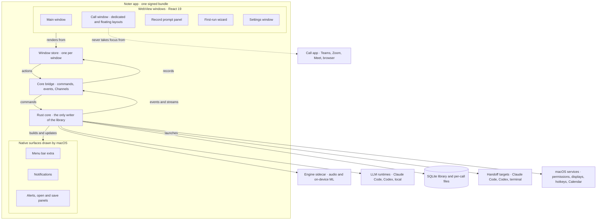
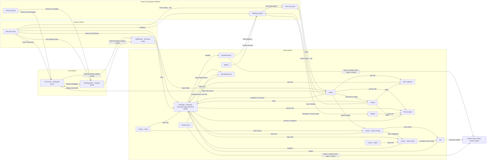
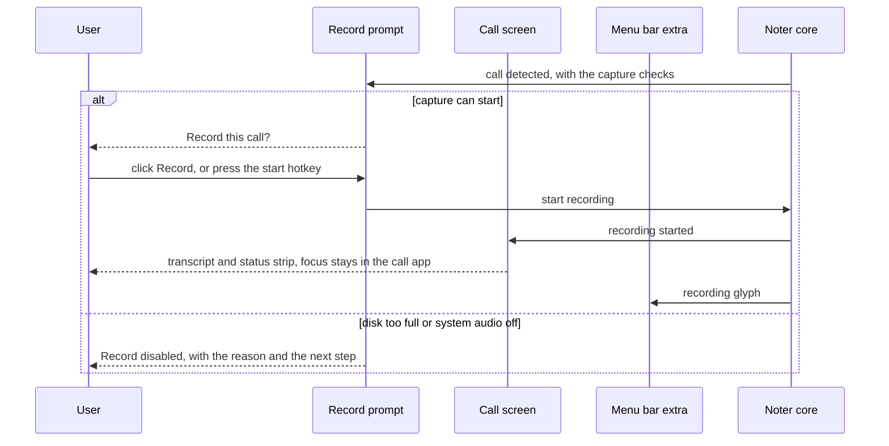
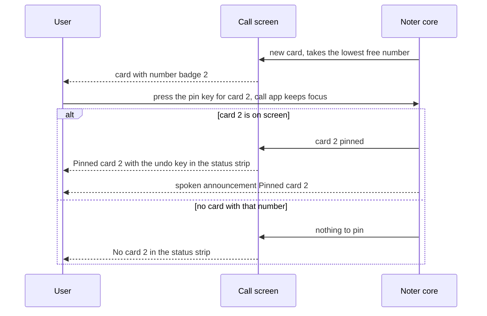
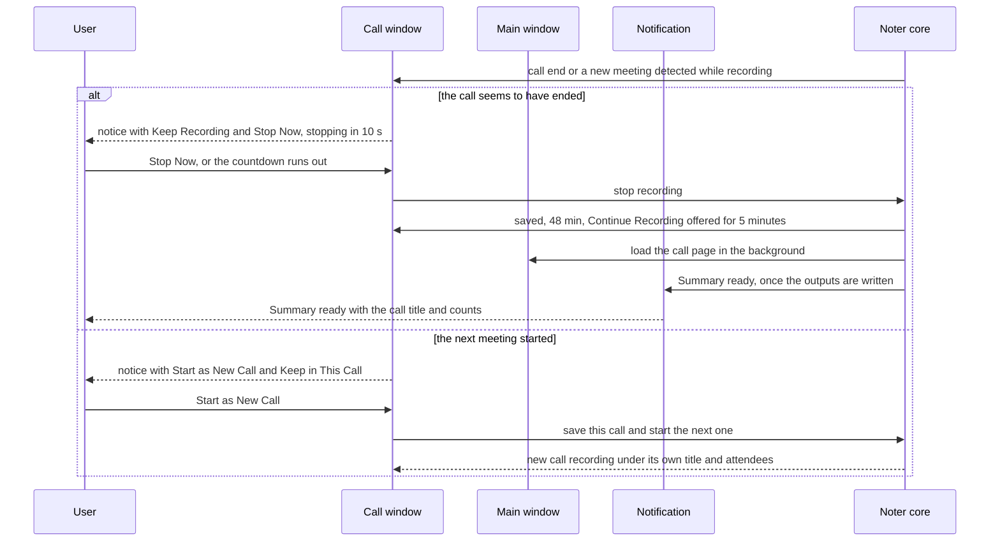
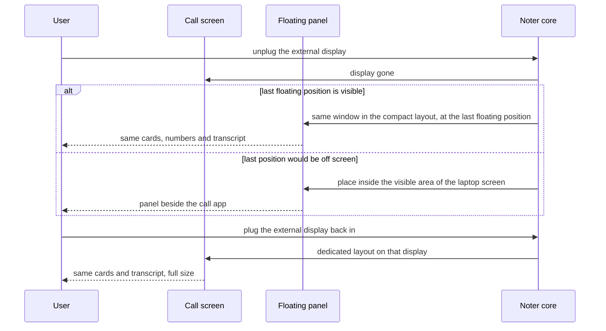
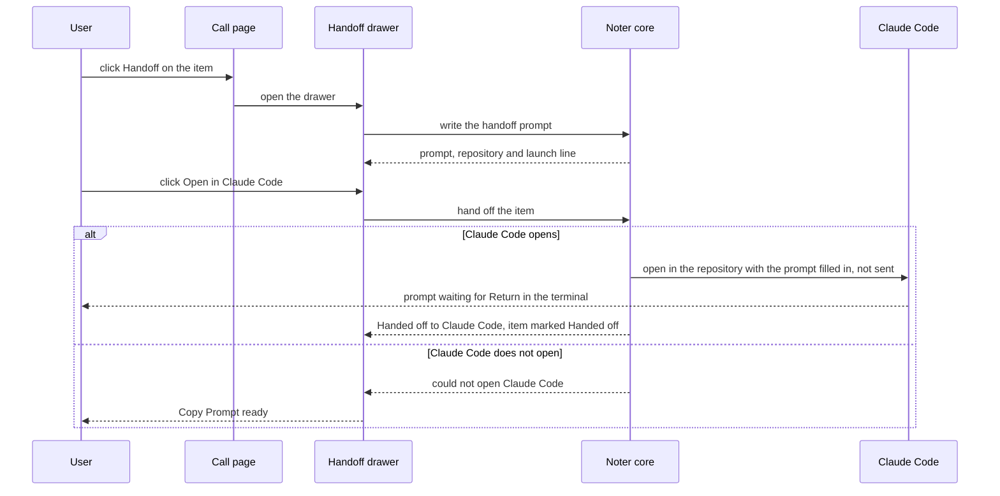
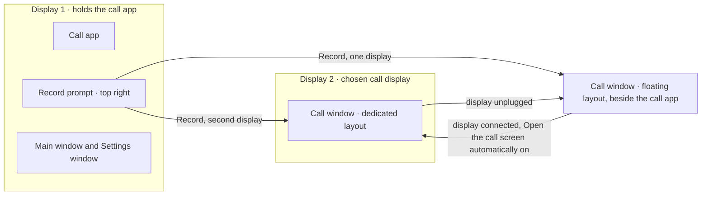

# Technical Design — Noter UI


<!-- toc -->

- [1. Architecture Overview](#1-architecture-overview)
  - [1.1 Architectural Vision](#11-architectural-vision)
  - [1.2 Architecture Drivers](#12-architecture-drivers)
  - [1.3 Architecture Layers](#13-architecture-layers)
- [2. Principles & Constraints](#2-principles--constraints)
  - [2.1 Design Principles](#21-design-principles)
  - [2.2 Constraints](#22-constraints)
- [3. Technical Architecture](#3-technical-architecture)
  - [3.1 Domain Model](#31-domain-model)
  - [3.2 Component Model](#32-component-model)
  - [3.3 API Contracts](#33-api-contracts)
  - [3.4 Internal Dependencies](#34-internal-dependencies)
  - [3.5 External Dependencies](#35-external-dependencies)
  - [3.6 Interactions & Sequences](#36-interactions--sequences)
  - [3.7 Database schemas & tables](#37-database-schemas--tables)
  - [3.8 Deployment Topology](#38-deployment-topology)
- [4. Additional context](#4-additional-context)
  - [4.1 UX decision log](#41-ux-decision-log)
  - [4.2 Accepted consequences and assumptions](#42-accepted-consequences-and-assumptions)
  - [4.3 Known technical debt, risks and quality approach](#43-known-technical-debt-risks-and-quality-approach)
  - [4.4 Terms](#44-terms)
  - [4.5 Checklist dispositions](#45-checklist-dispositions)
- [5. Traceability](#5-traceability)
  - [5.1 PRD coverage](#51-prd-coverage)
  - [5.2 Review findings coverage](#52-review-findings-coverage)
  - [5.3 UI prototype](#53-ui-prototype)

<!-- /toc -->

- [ ] `p1` - **ID**: `cpt-noter-design-ui`

## 1. Architecture Overview

### 1.1 Architectural Vision

This document designs the user interface of Noter, the macOS app that records online calls, transcribes them on the Mac and turns them into summaries, decisions and action items (PRD › Summary). It covers every v1 surface: the main window and its pages, the call window in its two layouts, the record prompt, the menu bar extra, the Settings window, the first-run wizard, notifications, and the dialogs, sheets and popovers. It does not cover the inside of the Rust core, the audio engine or the large language model (LLM) runtimes; PRD Part B owns those. Items that belong to v1.x appear only where they shape a v1 layout, and they are marked "(v1.x)".

The UI is a thin, honest view of the core. The core owns every record, and each window renders what the core sends and changes data only through core commands (`cpt-noter-principle-core-owns-state`). Live data arrives as ordered streams and everything else as events (`cpt-noter-interface-ui-core-ipc`). The call screen and the floating panel are one non-activating window with two layouts, so a display change never loses the call and the call app never loses focus (`cpt-noter-constraint-one-call-window`, `cpt-noter-principle-never-steal-focus`). In-call actions use global hotkeys, including card keys that work while the call app keeps focus (decision D70 in 4.1). Every failure has a visible state where the affected function lives (`cpt-noter-principle-degrade-visibly`). The look follows the macOS 27 design language (Liquid Glass) and the macOS Human Interface Guidelines (HIG), with keyboard-first operation, dark mode, Reduce motion, WCAG 2.2 AA whenever macOS Increase Contrast is on, and layouts that take long German strings and Cyrillic (`cpt-noter-principle-accessible-multilingual`, PM-57). The clickable prototype in `docs/prototype/clickable/` is the UI prototype of record; this document describes what it shows (PM-59). Section 4.1 records each UX decision with a one-line reason.

**How to read this document.** The owner asked for three things, and each has one home. First, what is on each screen, how it is placed and how its elements reference each other: section 3.2, the entries whose IDs contain `component-screen-` (and the two window shells, `component-shell-`), each with regions, a wireframe, an element table, size behaviour and where its empty, loading and error states appear. Second, every component, including the reusable complex ones: section 3.2, the entries whose IDs contain `component-ui-` (and the non-visual app layer, `component-app-`), each with anatomy, variants, states, keyboard and VoiceOver behaviour and where it is used. Third, the user stories for each screen: section 3.6, written as user paths for the normal case and for the empty and error cases. The index tables at the top of 3.2 and 3.6 list every entry.

| You want | Go to |
| --- | --- |
| The layout of a screen | 3.2, index table A, then the screen entry |
| A reusable component | 3.2, index table B, then the component entry |
| Which components a screen uses | 3.2, index table C |
| The user paths for a screen | 3.6, story index |
| Why something is designed this way | 4.1, UX decision log |
| How the checklist is met, or why an item does not apply | 4.5, checklist dispositions |
| Where a PRD requirement lands | 5.1, PRD coverage |

### 1.2 Architecture Drivers

Requirements that significantly influence architecture decisions.

**ADRs**: `cpt-noter-adr-0001-contract-source-of-truth` and `cpt-noter-adr-0002-ipc-conventions` (the contract the core bridge and the generated types follow), `cpt-noter-adr-0003-harness-and-quality-gates` (how the UI is tested and gated). Other architecture decisions are recorded in PRD › Decision log, and UI decisions in section 4.1 of this document.

The PRD has no requirement IDs, so the first column of each table names the PRD section and item instead.

#### Functional Drivers

| Requirement | Design Response |
|-------------|------------------|
| PRD › Feature specification › 1. Capture | Capture starts with **Record** alone, or with ⌃⌥⌘R, the menu bar or Today, and no start control waits for setup or permissions: only a disk below 500 MB or a missing speech model keeps **Record** dimmed (PM-30, PM-60); informing the participants is the user's own responsibility, outside the app (PM-56); **Record as Sensitive** for calls that are not in the calendar (PM-41); capture notices for call end, silence and a new meeting that starts during capture (PM-39); **Continue Recording** for 5 minutes after any stop (PM-43); recording state on every call surface. `cpt-noter-component-screen-record-prompt`, `cpt-noter-component-ui-record-prompt`, `cpt-noter-component-ui-capture-notice`, `cpt-noter-component-ui-recording-indicator`, `cpt-noter-component-ui-call-status-strip` |
| PRD › Feature specification › 2. Live transcript | A virtualised transcript with confirmed and hypothesis rows; speaker, time and language on every segment, with **Guest (your side)** for another voice on the user's microphone and both candidate speakers on a crosstalk row; rename and term fix in place, with the original wording of a corrected term in its help tag; replay after the call, and during it only on headphones. `cpt-noter-component-ui-transcript-view`, `cpt-noter-component-ui-transcript-segment-row`, `cpt-noter-component-ui-speaker-label`, `cpt-noter-component-ui-language-tag`, `cpt-noter-component-ui-term-fix-popover`, `cpt-noter-component-ui-playback-bar` |
| PRD › Feature specification › 3. Live copilot, and PRD › Live copilot | A stack of at most three numbered cards with provenance and agent badges; global card keys; **Catch Me Up** and **Ask About This Call…**; carry-forward cards that ask whether a handoff landed or let the owner object to an evidence closure; a listening state and copilot banners. `cpt-noter-component-screen-call-screen`, `cpt-noter-component-screen-floating-panel`, `cpt-noter-component-ui-copilot-card-stack`, `cpt-noter-component-ui-copilot-card`, `cpt-noter-component-ui-agent-badge`, `cpt-noter-component-ui-provenance-chip`, `cpt-noter-component-ui-context-chip` |
| PRD › Feature specification › 4. Post-call outputs | A Call page with sections in PRD order, a review step for suggested items, edits kept on regeneration with a diff, speaker naming and one-action sharing. `cpt-noter-component-screen-call-page`, `cpt-noter-component-ui-output-section`, `cpt-noter-component-ui-action-item-row`, `cpt-noter-component-ui-output-item-row`, `cpt-noter-component-ui-speaker-naming-panel`, `cpt-noter-component-ui-share-menu`, `cpt-noter-component-ui-version-switcher`, `cpt-noter-component-ui-diff-view` |
| PRD › Feature specification › 5. Library and search | A sortable Calls table with filters by person, date, call type, tag, language and open items; free-text call tags edited in Call info and on selected calls (D90, D91, PM-50); sectioned search results across languages, with weak matches marked (D97, D98); topic threads with rename and merge (D94, D95); Ask with citations; and People with Person pages. `cpt-noter-component-screen-library`, `cpt-noter-component-screen-ask`, `cpt-noter-component-screen-people`, `cpt-noter-component-ui-call-row`, `cpt-noter-component-ui-filter-bar`, `cpt-noter-component-ui-search-result-row`, `cpt-noter-component-ui-cited-answer`, `cpt-noter-component-ui-topic-chip` |
| PRD › Feature specification › 6. Integrations | v1: **Copy for Slack**, **Copy for Jira**, **Copy as Markdown** and **Export…** in one share menu with a visible scope. The v1.x pushes to Jira, Confluence and Slack through Model Context Protocol (MCP) servers are outside this design. `cpt-noter-component-ui-share-menu` |
| PRD › Feature specification › 7. Knowledge sources | One home in Settings › Knowledge Sources with status, sync, privacy class and scope; document results and citations in search and Ask; sync failures in Activity. `cpt-noter-component-screen-settings`, `cpt-noter-component-ui-status-row`, `cpt-noter-component-ui-search-result-row`, `cpt-noter-component-ui-cited-answer` |
| PRD › Feature specification › 8. Role council | The Agents screen with the agent list, the editor with its skill view and a **Runtime** pop-up that offers the Anthropic or Codex API key, the user's own Claude or ChatGPT account and the local model (PM-58), and the council mode table; agent badges on cards; role reviews on the Call page. `cpt-noter-component-screen-agents`, `cpt-noter-component-ui-agent-list-row`, `cpt-noter-component-ui-agent-editor`, `cpt-noter-component-ui-council-mode-table`, `cpt-noter-component-ui-agent-badge` |
| PRD › Feature specification › 9. Handoff to Claude Code and Codex | A handoff drawer on engineering items with an editable prompt, target, repository, launch-path line and one primary button; **Copy Prompt** as the default button for items owned by someone else (PM-48). `cpt-noter-component-ui-handoff-drawer`, `cpt-noter-component-ui-prompt-editor` |
| PRD › Feature specification › 10. Self-maintenance | Proposals on Today and in Activity; jobs in Settings › Maintenance; items closed by evidence with **Reopen**; a keyword-only notice during index rebuilds. `cpt-noter-component-screen-activity`, `cpt-noter-component-ui-proposal-row`, `cpt-noter-component-ui-status-row`, `cpt-noter-component-ui-inline-banner` |
| PRD › Feature specification › 11. History and change log | History in the Call page, with **Export Log…** for that call, in the Person page and in the Item inspector; the Activity day log with batches and **Export Log…** for a period; an undo strip with **Redo**. `cpt-noter-component-ui-history-timeline`, `cpt-noter-component-ui-change-row`, `cpt-noter-component-ui-undo-strip`, `cpt-noter-component-ui-item-inspector` |
| PRD › Feature specification › 12. Performance and continuous improvement | Target tiles and stage budgets taken from the PRD (PM-52), a stage timeline, a bottleneck list, a per-call drill-down and the improvement brief, which opens in Claude Code or Codex. `cpt-noter-component-screen-performance`, `cpt-noter-component-ui-metric-tile`, `cpt-noter-component-ui-stage-timeline`, `cpt-noter-component-ui-bottleneck-row` |
| PRD › Feature specification › 13. Today dashboard | Call cards in calendar order with ranked items (owed to people on today's calls first, then due date, then age, PM-63), ticks with **Undo**, a review line for suggested items, proposals waiting, and Calendar access on request. `cpt-noter-component-screen-today`, `cpt-noter-component-ui-upcoming-call-card`, `cpt-noter-component-ui-action-item-row` |
| PRD › Feature specification › 14. Settings | A separate Settings window with 11 panes, including Privacy, Repositories, Knowledge Sources, Maintenance and Hotkeys; **Models & Runtimes** holds the API keys and, separately, **Your Claude account** and **Your ChatGPT account** with a full sign-in sheet (PM-58). `cpt-noter-component-screen-settings`, `cpt-noter-component-ui-credential-row`, `cpt-noter-component-ui-hotkey-recorder`, `cpt-noter-component-ui-display-picker` |
| PRD › Live copilot › Surfaces | One call window with dedicated and floating layouts, opened at capture start while **Open the call screen automatically** is on; the share warning in both layouts (D50, PM-49); the menu bar extra; the first-run wizard; screen-context chips (v1.x) only where they shape the v1 layout. `cpt-noter-component-shell-call-window`, `cpt-noter-component-screen-menu-bar`, `cpt-noter-component-ui-status-item`, `cpt-noter-component-screen-first-run`, `cpt-noter-component-ui-context-chip` |
| PRD › Live copilot loop › Degraded states | Every row has a named place and named words: capture notices, transcript and copilot banners, menu bar info lines, and a notification when no Noter surface is visible. `cpt-noter-component-ui-inline-banner`, `cpt-noter-component-ui-capture-notice`, `cpt-noter-component-ui-status-item`, `cpt-noter-component-screen-notifications` |
| PRD › Product principles | Each principle in 2.1 names the product principle it serves. |

#### NFR Allocation

This table maps non-functional requirements from PRD to specific design/architecture responses, demonstrating how quality attributes are realized.

| NFR ID | NFR Summary | Allocated To | Design Response | Verification Approach |
|--------|-------------|--------------|-----------------|----------------------|
| PRD › Live copilot › Latency budget | A card appears within 5–6 s at p50 (the median) and 8–10 s at p95 (the time 95 % of cards stay within) after the triggering utterance; a late card is dropped | `cpt-noter-component-ui-copilot-card-stack`, `cpt-noter-component-app-core-bridge` | The stack renders a card as soon as the stream delivers it and shows its first line before the source line (partial display); the UI never batches cards or adds a delay | Each card reports the time it was actually shown; the Performance stage timeline compares each stage with its budget in the table of where the time goes in PRD › Live copilot loop |
| PRD › Success metrics › Live | Hypothesis text lags speech by at most 2 s and confirmed text by at most 4 s | `cpt-noter-component-ui-transcript-view`, `cpt-noter-component-app-window-store` | The transcript stream is buffered and drawn every 100 ms in a virtualised list with follow-output and **Jump to Live** (REVIEW › F6) | Engine timestamps against shown times; a 90-minute recorded stream replayed into the UI |
| PRD › Live copilot › Surfaces › Menu bar | Every quick action takes effect within a second and never opens a dialog after setup | `cpt-noter-component-screen-menu-bar`, `cpt-noter-component-ui-status-item` | The native menu calls the same core commands as the hotkeys; no menu item opens a window except **Open Noter**, **Open Call Screen**, **Open Last Summary**, **Finish Setup…** (a link to the first-run window, never in place of **Start Recording**) and **Settings…** | XCUITest per menu item and hotkey on the macOS runner, against the built app; plus a core test per action, called as `Caller::Native` (DESIGN-core 4.4); the manual checklist in `docs/HARNESS.md` only for look and system dialogs |
| PRD › Success metrics › Post-call | Outputs are ready within 2 minutes on the cloud path and 10 minutes on the local path | `cpt-noter-component-screen-call-page`, `cpt-noter-component-ui-output-section` | Sections appear one by one as each is validated, with progress text; the transcript is readable at once | Local app telemetry (PRD) |
| PRD › Success metrics › Footprint | Extra memory during a call stays within 4 GB without a local LLM and 8 GB with it | `cpt-noter-component-ui-transcript-view`, `cpt-noter-component-ui-copilot-card-stack`, `cpt-noter-component-app-window-store` | Virtualised lists, at most three live cards, a collapsed list of earlier cards, and no media in the WebView | Activity Monitor during a 90-minute call (PRD) |
| PRD › Success metrics › Privacy | No audio bytes leave the Mac; no cloud request goes without a log entry | `cpt-noter-constraint-local-only-ui`, `cpt-noter-component-app-core-bridge` | The WebView loads no remote content and makes no network requests; untrusted text renders as text only (PM-08) | The CI network-monitor test (PRD) covers the app process with the UI running |
| PRD › Live copilot › Surfaces | The call window is hidden from screen shares that honour exclusion | `cpt-noter-component-shell-call-window`, `cpt-noter-component-screen-record-prompt` | Content protection on the call window and the record prompt; **Hide for Presenting** for whole-display shares (D84, PM-51); the share caveat on the call screen (D50) and in the floating panel (PM-49); notifications held while a call is being recorded (PM-44) | **Screen Share Test…** in Settings › Privacy, with its optional capture test (D96), plus a manual share check before each release |
| Owner acceptance criterion AC5, and PRD › Live copilot › Guardrails | WCAG 2.2 AA (colour contrast under macOS Increase Contrast, PM-57), VoiceOver, keyboard-first, dark mode, Reduce motion | `cpt-noter-constraint-accessibility-baseline`, `cpt-noter-component-ui-primitives` | Apple system colours by default and AA-checked colour tokens in light and dark under Increase Contrast; focus rings never hidden; targets at least 24 by 24 pt; polite card announcements and an unannounced transcript | An automated contrast check of the Increase Contrast token columns; a VoiceOver pass and a keyboard-only pass on every screen |
| Owner acceptance criterion AC5, and REVIEW › F12 | German strings about 30 % longer and Cyrillic render on every screen | `cpt-noter-constraint-three-languages` | No fixed-width text containers except table columns; buttons never truncate; plural rules; a language attribute on every content block | A pseudo-localisation run (+40 %, Cyrillic) and a German string pass on every screen |
| PRD › Success metrics › Dashboard | Items ticked by hand stay done in at least 95 % of cases | `cpt-noter-component-ui-action-item-row`, `cpt-noter-component-screen-today` | A tick is one action with **Undo**; ticked items gather in **Done today** | The change log (PRD) |
| PRD › Success metrics › Post-call and Handoff | At least 80 % of action items accepted without edit; at least 60 % of handoff prompts used without editing | `cpt-noter-component-ui-output-section`, `cpt-noter-component-ui-action-item-row`, `cpt-noter-component-ui-handoff-drawer` | Every extracted item arrives **Suggested** and is accepted, edited or rejected explicitly (D73); the drawer marks an edited prompt | The edit diff on accept and at **Open** or **Copy** (PRD) |
| PRD › Success metrics › Copilot | At least 30 % of cards rated useful or used; at most 10 % rated unhelpful | `cpt-noter-component-ui-copilot-card` | Pin, dismiss, thumbs and expiry are recorded per card and per agent | The feedback store (PRD) |

Every target in this table, and every target the Performance screen shows, comes from PRD › Success metrics and quality bars, PRD › Live copilot › Latency budget or PRD › Live copilot › Surfaces, and every stage budget comes from the table of where the time goes in PRD › Live copilot loop. This design sets no target of its own (PM-52).

Transcription accuracy, speaker attribution, council usefulness per agent, search citation quality and maintenance accuracy are allocated to the core and the engine (PRD › Success metrics and quality bars). The UI's part in them is to make each correction one action and to show provenance, so that a wrong result is easy to spot and fix.

CDN, edge computing and network-hop concerns are not applicable because the UI loads every asset from the app bundle and reaches the core over local inter-process communication (IPC) inside the app, never over a network.

### 1.3 Architecture Layers



The diagram shows the UI in its context. Each WebView window has its own store, which the core bridge fills from the core's events and streams. User actions go back through the bridge as core commands. The UI has no path to the engine, the LLM runtimes, the database or the network. The menu bar extra, notifications and alerts are drawn by macOS; the core builds them, and this document designs their content. The layer table below (`cpt-noter-tech-ui-stack`) names the technology of each layer, within the platform and technology constraints `cpt-noter-constraint-macos-apple-silicon` and `cpt-noter-constraint-tauri-webview`.

- [ ] `p1` - **ID**: `cpt-noter-tech-ui-stack`

| Layer | Responsibility | Technology |
|-------|---------------|------------|
| Presentation | Screens, window shells and reusable components; WebView content for windows and panels; native content for the menu bar extra, notifications and alerts | React 19, TypeScript, Tailwind, the system font stack; Liquid Glass materials drawn with CSS backdrop filters, opaque under Reduce transparency and Increase Contrast (PM-57); Tauri tray, menu, notification and dialog plugins for native surfaces (PRD › Architecture overview) |
| Application | One window store per window, navigation inside the main window, command dispatch, stream buffering, the hide-for-presenting state | Zustand stores (PRD › Architecture overview); a virtualised list for long streams (REVIEW › F6) |
| Domain | Read-only view models of the core's records (section 3.1), generated from the core's types | TypeScript types generated from the core's Rust types (PM-09) |
| Infrastructure | The core bridge: Tauri commands, events and Channels; panel conversion and placement done by the core | Tauri 2 IPC, tauri-nspanel pinned to a git revision, tauri-plugin-global-shortcut (PRD › Live copilot loop › Surfaces) |

**Technology risks.**

- tauri-nspanel is pinned to a git revision, not a release; a Tauri upgrade can break the panel conversion. Mitigation: the call window and the record prompt are tested on every Tauri upgrade.
- Tauri's logical window positions are wrong on mixed-scale displays (REVIEW › F2). Mitigation: the core places windows with AppKit frames and remembers displays by identity; the UI never positions windows itself.
- WebKit live regions in a window that is not key are not reliably spoken. Mitigation: announcements from the call window and the record prompt are posted natively by the core (D55); verified in M4.
- A WebView that renders a three-hour transcript can grow in memory. Mitigation: virtualised lists and a bounded card stack (NFR Allocation).
- The 12- or 24-hour preference cannot be read from the WebView. Mitigation: the core passes it with the settings.
- `backdrop-filter` blur on large surfaces costs GPU time in WebKit. Mitigation: materials are used only on the sidebar, toolbar control groups, menus, popovers, alerts and the floating panel, never on scrolling content, and become opaque under Reduce transparency.

## 2. Principles & Constraints

### 2.1 Design Principles

The principles are listed in priority order: when two conflict, the one listed first wins. Each names its source; no ADR decides a UI principle, so the **Source** line takes the place of the template's ADR references.

**ADRs**: Not applicable because no ADR decides a UI principle; each principle names its PRD source instead.

#### Privacy and recording state stay visible

- [x] `p1` - **ID**: `cpt-noter-principle-privacy-visible`

Every call surface shows whether Noter is recording and where text may go right now (cloud, cloud with redaction, local only). When the state changes, the surface changes with it and says so in words, never in colour alone. What left the Mac is listed in plain words on the Privacy pane.

**Source**: PRD › Product principles › 1; PRD › Live copilot › Guardrails; PRD › Security, privacy and permissions.

#### Never take focus from the call

- [x] `p1` - **ID**: `cpt-noter-principle-never-steal-focus`

The record prompt, the call window and its notices never make Noter the active app and never take keyboard focus from the call app. A click on them acts without moving focus, and every in-call action also has a global hotkey. ⌃⌥⌘N and **Open Call Screen** show the call window without taking focus. Only an explicit **Open in Noter**, typing into a field of the call window, or a second ⌃⌥⌘N while the call window is visible gives Noter focus (PM-40).

**Source**: PRD › Product principles › 2; PRD › Feature specification › 1. Capture; PRD › Live copilot loop › Surfaces; D93, PM-40.

#### Degrade visibly, never block

- [x] `p1` - **ID**: `cpt-noter-principle-degrade-visibly`

Every failure has a visible state where the affected function lives, and that state names the next action. Capture, reading and search keep working while something is degraded. Without a network every screen still works: actions that need the cloud fall back to the local model and say so with **Switched to local**. No region is ever blank: an empty or loading region says what will appear there and how to get it.

**Source**: PRD › Product principles › 6; PRD › Live copilot loop › Degraded states.

#### Accessible in every language

- [x] `p1` - **ID**: `cpt-noter-principle-accessible-multilingual`

Every control works with the keyboard and VoiceOver, meets the WCAG 2.2 AA target size, and respects Reduce motion and Increase Contrast. The default appearance uses Apple's macOS system colours; when the user turns on Increase Contrast in macOS, every text and control colour switches to values checked against WCAG 2.2 AA (4.5:1 for text, 3:1 for control outlines and focus), so AA contrast is met in that mode (owner decision, PM-57). Layouts take German text about 30 % longer and Cyrillic without truncating labels. When this principle conflicts with a quieter or more native look, accessibility wins, except for the default colours, which follow Apple's system colours.

**Source**: owner acceptance criterion AC5 (approved 2026-10-16, contrast clause revised 2026-10-17 by PM-57); PRD › Live copilot › Guardrails; REVIEW › F12.

#### Evidence one click away

- [ ] `p1` - **ID**: `cpt-noter-principle-evidence-one-click`

Every generated fact (a card, decision, action item, answer or closure) shows where it came from, and one click or Return opens that source. A claim without a source is labelled **Model guess · unverified** and never looks like a fact. An answer without citations says so and does not guess.

**Source**: PRD › Product principles › 5; PRD › Feature specification › 4. Post-call outputs; PRD › Live copilot › Guardrails.

#### The core owns the state

- [x] `p1` - **ID**: `cpt-noter-principle-core-owns-state`

The UI shows only what the core has sent and changes data only through core commands. It stores nothing of its own beyond in-memory view state, such as scroll position or an expanded row. A window can therefore reload, or reopen after a crash, and show the same call, cards, pins and marks.

**Source**: PRD › Architecture overview ("the UI never holds state the core does not have").

#### Keyboard first

- [x] `p1` - **ID**: `cpt-noter-principle-keyboard-first`

Every action can be reached and done with the keyboard. Lists use arrow keys, and single-key actions are matched by physical key so that Russian and German layouts work. Every in-app shortcut also appears in a menu, and in-call actions use global hotkeys so that the call app keeps focus.

**Source**: PRD › Maintenance jobs, evidence collection and history › History UI ("keyboard first"); D51, D54, D70.

#### Undo over confirmation

- [x] `p2` - **ID**: `cpt-noter-principle-undo-over-confirm`

Reversible actions (tick, accept, reject, regenerate, propagate, pin, dismiss) apply at once and offer **Undo**; they never ask first. Only irreversible actions ask, in a native alert that says what is lost: deleting a call, a person, a voice profile or audio, removing a source or an agent, revoking a token, quitting while recording, and signing out of your Claude or ChatGPT account (PM-58).

**Source**: PRD › Feature specification › 11. History and change log; D37, PM-22.

#### Quiet call surfaces

- [x] `p1` - **ID**: `cpt-noter-principle-quiet-surface`

In-call surfaces show at most three cards, make no sound, and move only with a short slide that Reduce motion removes. Agent badges are monochrome, and the recording dot never pulses. A suggestion that would arrive after the topic has moved on is not shown at all.

**Source**: PRD › Product principles › 3; PRD › Live copilot › Guardrails.

#### Native macOS look and behaviour

- [x] `p2` - **ID**: `cpt-noter-principle-native-macos`

Noter follows the macOS 27 design language and the HIG: the system font; an edge-to-edge sidebar in Liquid Glass with colour-tinted icons; a unified toolbar whose controls sit in glass capsule groups; capsule push buttons; settings in their own window; Liquid Glass materials for the sidebar, toolbar controls, menus, popovers, alerts and floating panels; concentric corner radii; Apple's system colours with the user's accent colour (system blue by default); and the system light or dark appearance. Buttons and menu items use title case; everything else uses sentence case. A control drawn in the WebView behaves like its AppKit counterpart. The WebView-drawn surfaces keep this look on every supported macOS version; native surfaces (the menu bar menu, alerts drawn by macOS, notifications, open and save panels) look like the macOS the user runs.

**Source**: PRD › UI prototype; D14, D58, D60, PM-03, PM-57 (Apple Design Resources › macOS 27 UI Kit).

### 2.2 Constraints

Each constraint names its type and source. Legacy integration constraints are not applicable because Noter is a new product: the UI replaces no existing system and reads no legacy data format.

**ADRs**: Not applicable because no ADR sets a UI constraint; each constraint names its PRD source instead.

#### macOS 14.4 or later on Apple Silicon

- [x] `p1` - **ID**: `cpt-noter-constraint-macos-apple-silicon`

**Type**: Platform. Noter runs on macOS 14.4 or later, on Apple Silicon only, because the Core Audio process tap and its permission prompt arrive in 14.4. The UI relies on the WebKit of those macOS versions and needs no Intel or older-system fallback.

**Source**: PRD › Audio capture on macOS; PRD › Repository layout, build, packaging and developer workflow.

#### Tauri 2 with a React WebView

- [x] `p1` - **ID**: `cpt-noter-constraint-tauri-webview`

**Type**: Technology and licensing. The UI is React 19 with TypeScript inside Tauri 2 windows, rendered by WebKit. Native surfaces (the menu bar extra, notifications, alerts, open and save panels) come through Tauri plugins and can do only what those plugins expose. The panel plugin tauri-nspanel is pinned to a git revision.

**Source**: PRD › Architecture overview; PRD › Live copilot loop › Surfaces; PRD › Decision log (Tauri 2 with a React UI).

#### One call window with two layouts

- [x] `p1` - **ID**: `cpt-noter-constraint-one-call-window`

**Type**: Technology. The call screen and the floating panel are one window and one React tree with two layouts; a display change switches the layout, never the window. PRD › Repository layout and PRD › Live copilot loop both describe one call window with two layouts.

**Source**: PRD › Live copilot loop › Surfaces; REVIEW › F4; D1.

#### Non-activating panels

- [x] `p1` - **ID**: `cpt-noter-constraint-non-activating-panels`

**Type**: Platform. The call window and the record prompt are NSPanels: macOS panel windows that float above other windows without making Noter the active app. They become key (the window that receives keystrokes) only while the user types in them or after a second ⌃⌥⌘N (PM-40), so panel-local shortcuts work only then, and app-menu shortcuts never reach them.

**Source**: PRD › Live copilot loop › Surfaces; REVIEW › F1, F5; D53, D93, PM-40.

#### Screen-share exclusion has limits

- [x] `p1` - **ID**: `cpt-noter-constraint-share-exclusion-limits`

**Type**: Platform. Content protection hides the call window and the record prompt only from shares that honour it (Teams, Meet, Zoom with window filtering), never from a whole-display capture. The UI must state that limit where it matters, in the call screen header and in the floating panel (PM-49), and offer **Screen Share Test…** (D96) and **Hide for Presenting** (D84, PM-51).

**Source**: PRD › Live copilot › Surfaces; REVIEW › F1; D50, D84, D96, PM-49.

#### Monochrome menu bar icons

- [x] `p1` - **ID**: `cpt-noter-constraint-menu-bar-template-icons`

**Type**: Platform. The menu bar extra shows four monochrome template glyphs (idle, recording, paused, copilot muted) and a native text menu; it cannot show red or custom views. Its optional title is capped at 24 characters and is off by default.

**Source**: PRD › Live copilot › Surfaces › Menu bar; REVIEW › F8; D3, D10.

#### No dialog after setup

- [x] `p1` - **ID**: `cpt-noter-constraint-no-dialog-after-setup`

**Type**: Product. Quick actions in the menu bar and on call surfaces take effect within a second and never open a dialog after first run. Permission prompts appear only in the first-run wizard, after a button the user pressed for that purpose, or, when macOS has never asked, at the first capture, which macOS itself triggers. No start control ever reads **Finish Setup…**: **Record** and **Start Recording** start capture whatever the setup state, and a missing permission shows as a degraded state during capture (PM-30, PM-60).

**Source**: PRD › Live copilot › Surfaces › Menu bar and First run; PM-30, PM-60.

#### Behaviour metrics off by default

- [ ] `p2` - **ID**: `cpt-noter-constraint-behaviour-metrics-off`

**Type**: Product. Talk-time share and "who was silent" are behaviour data about colleagues. Their rows do not exist anywhere in the UI unless the user switches them on in Settings › Privacy, and they count only calls recorded from that moment; earlier calls are never computed back (PM-65).

**Source**: PRD › Feature specification › 5. Library and search; REVIEW › P4; D47, PM-65.

#### Local-only UI

- [x] `p1` - **ID**: `cpt-noter-constraint-local-only-ui`

**Type**: Data residency. Audio, voice profiles and embeddings never leave the Mac. The WebView loads no remote content and makes no network requests; transcripts, documents and model output render as text only; each window gets only the core commands it needs (PM-08).

**Source**: PRD › Product principles › 1; PRD › Security, privacy and permissions.

#### Three content languages, English interface

- [x] `p1` - **ID**: `cpt-noter-constraint-three-languages`

**Type**: Language. Transcripts, summaries, cards and search are English, Russian and German, often mixed in one call, and every content block carries its own language. The interface itself is English in v1 and built ready for translation: no string concatenation, plural rules for counts, and layouts that take German text about 30 % longer and Cyrillic (PM-02).

**Source**: PRD › Summary; PRD › Feature specification › 2; REVIEW › F12.

#### Accessibility baseline

- [x] `p1` - **ID**: `cpt-noter-constraint-accessibility-baseline`

**Type**: Quality. Every surface works with VoiceOver, the keyboard alone, Reduce motion, Increase Contrast and dark mode, and meets WCAG 2.2 AA target sizes and focus visibility. Colour contrast meets WCAG 2.2 AA when macOS Increase Contrast is on; the default appearance uses Apple's system colours, some of which are below 4.5:1 for secondary text (PM-57). New card titles are announced politely; the transcript is a log that is not announced.

**Source**: owner acceptance criterion AC5 (approved 2026-10-16, contrast clause revised by PM-57 on 2026-10-17); PRD › Live copilot › Guardrails.

#### Small team

- [x] `p2` - **ID**: `cpt-noter-constraint-small-team`

**Type**: Resource. The PRD plans v1 for one part-time builder and names that as a high risk. The UI therefore uses one set of primitives and a fixed list of reusable components, prefers native controls, and applies one collapse order to every screen.

**Source**: PRD › Risks, assumptions and open decisions.

#### Copilot behind a flag

- [x] `p1` - **ID**: `cpt-noter-constraint-copilot-flag`

**Type**: Scope. Full v1 is kept (owner decision, 17 Oct); the copilot ships behind a flag until the M4 latency gate. Every call surface therefore has a layout without the council column, and a single-agent variant for a council of one (PM-01, D9, PM-67).

**Source**: PRD › Risks, assumptions and open decisions; PRD › Roadmap and milestones; REVIEW › Decisions left to the owner.

#### Notifications without buttons

- [x] `p2` - **ID**: `cpt-noter-constraint-notification-limits`

**Type**: Platform. macOS notifications sent through the Tauri plugin carry no action buttons. Notifications therefore only inform and open a page; every decision happens inside Noter. While a call is being recorded they wait, and they arrive one per call when capture stops (PM-44).

**Source**: REVIEW › F5; D67, PM-44.

## 3. Technical Architecture

### 3.1 Domain Model

**Technology**: TypeScript types generated from the core's Rust types (PM-09). The UI never defines record shapes of its own; it reads the records below as view models.

**Location**: planned beside the core bridge under `apps/desktop/src/` (PRD › Repository layout, build, packaging and developer workflow). The types are generated, not edited by hand. Links to machine-readable schemas are not applicable yet because the repository holds no code; PRD › Data model and storage is the authority, and the UI's types mirror it.

**Core Entities**:

| Entity | Description | Schema |
|--------|-------------|--------|
| Call | One captured call: title, type, tags, platform, time, length, privacy class, status, audio retention | PRD › Data model and storage › `calls`, with free-text tags (PM-50) |
| Segment | One transcript line: speaker, channel, start and end time, text, language, confidence, archive or live pass | PRD › Data model and storage › `segments` |
| Speaker | A diarization cluster in one call (the speech the engine attributes to one voice), mapped to a person or shown as an unnamed speaker such as **Speaker 2** | PRD › Data model and storage › `speakers` |
| Person | Someone who has been on a call: name, aliases, email, role, organisation, notes, voice-profile opt-in | PRD › Data model and storage › `people`, `call_participants`, `voice_profiles` |
| Item | A decision, action item, open question or risk: owner, due date, status, review state, linked issue, engineering flag, handoff record | PRD › Data model and storage › `items` |
| Evidence span | The transcript time span an item, card or answer rests on | PRD › Data model and storage › `item_spans` |
| Evidence | Closing or supporting evidence for an item from Jira, Bitbucket, GitHub or a later call | PRD › Data model and storage › `evidence` |
| Card | A copilot card: kind, agent, merged agents, text, provenance, shown time, outcome | PRD › Data model and storage › `cards` |
| Agent | A council role: name, skill, runtime choice, model, effort, tools, call types, budget share, order, enabled | PRD › Data model and storage › `agents` |
| Account | The user's own Claude or ChatGPT account, bound through Claude Code or Codex: provider, account email, plan, status, the CLI path; the sign-in token stays with the CLI in the Keychain and is never held by Noter (PM-58) | PRD › Data model and storage › `settings` (account binding); PRD › Security, privacy and permissions |
| Summary | A generated document per call and kind, with role reviews per agent; every version kept beside the user's edit | PRD › Data model and storage › `summaries` |
| Topic | A thread of items across calls | PRD › Data model and storage › `topics` |
| Source | A knowledge source: kind, mode, schedule, privacy class, scope, status | PRD › Data model and storage › `sources`, `documents`, `sync_runs` |
| Change | One entry of the change log, single or batch; a proposal is a change with status proposed | PRD › Data model and storage › `changes` |
| Job run | One run of a maintenance job with status, counts and error | PRD › Data model and storage › `jobs`, `job_runs` |
| Metric | A per-call, per-stage measurement and its nightly roll-up | PRD › Data model and storage › `metrics`, `metric_rollups` |
| Model run | One model call with runtime, tokens, cost and duration | PRD › Data model and storage › `llm_runs` |
| Audit entry | One thing that left the Mac, in plain words | PRD › Data model and storage › `audit_log` |
| Repository mapping | A Jira project or component mapped to a local folder and a default tool | PRD › Data model and storage › `repositories` |
| Glossary term | A term with Latin, Cyrillic and spoken variants | PRD › Data model and storage › `glossary` |
| Calendar event | An upcoming call read from the macOS Calendar by the core | PRD › Feature specification › 13 (EventKit, no table) |
| Context item (v1.x) | Screen context read during a call | PRD › Data model and storage › `context_items` |
| Setting | One user setting | PRD › Data model and storage › `settings` |

**Value objects**:

- Speaker label: **Anna K.**, **Speaker 2**, **You** or **Guest (your side)**, or both candidate speakers on a crosstalk row.
- Provenance: this call with time, a past call with date and time, Jira, a document section, a live lookup, or **Model guess · unverified**.
- Privacy mode: **Cloud**, **Cloud, redacted**, **Local only**, **Sensitive · local** or **Switched to local**.
- Privacy class: **Normal** or **Sensitive**.
- Item review state: **Suggested**, accepted or rejected.
- Item status: open, done, carried, handed off or closed by evidence.
- Card kind: **Ask**, **Answer**, **Context**, **Pin** or **Catch-up**.
- Card number: 1, 2 or 3 while the card is visible.
- Language tag: EN, RU or DE.
- Call tag: free text of 1 to 32 characters, unique ignoring case (D90).
- Match strength of a search result or citation: strong or weak (D97, D98).
- Time span, confidence, output route (headphones, speakers, not identified) and the hidden-for-presenting state.
- Runtime choice: **Claude Code · Anthropic API key**, **Claude Code · your Claude account**, **Codex · Codex API key**, **Codex · your ChatGPT account** or **Local model · Ollama** (PM-58).
- Account status: **Not signed in**, signing in (**Finishing in your browser…**), **Signed in**, or **Signed out by Claude** / **Signed out by ChatGPT** when the provider ends the session (PM-58).

**Relationships**:

- Call → Segment: a call has many segments in time order; confirmed segments never change position.
- Segment → Speaker → Person: each segment has one speaker; a speaker maps to at most one person, and naming applies to the whole call unless the user limits it to one line.
- Call → Item: items come from one call; each item points to evidence spans in that call and may gain evidence from later calls or from Jira, Bitbucket and GitHub.
- Item → Topic: an item belongs to at most one topic; a topic collects items across calls.
- Card → Agent: a card is raised by one agent and lists the agents merged into it; a pinned card becomes an item.
- Call → Summary: a call has summaries per kind and one role review per enabled agent, each with all generated versions and the user's edit.
- Change → any record: a change points to the record it changed; a batch groups changes; undoing a batch undoes every change in it.
- Source → Citation: documents of a source appear as citations and search results with their section.
- Calendar event → Call: an upcoming event is matched to the call recorded during it.

- Agent → Runtime choice → Account: an agent runs on one runtime choice; a choice that uses an account is available only while that account is signed in, and an agent whose choice is unavailable is shown as paused with a one-step fix (PM-58).

**Invariants** the UI keeps:

- Confirmed text never moves or changes once shown; only the hypothesis line changes (PRD › Feature specification › 2).
- At most three cards are visible; a hovered, focused or expanded card is never removed; a visible card keeps its number (PRD › Live copilot › Guardrails; D71).
- Every card, item and answer shows its provenance; an answer without citations is shown as not found (PRD › Search and cross-meeting memory › Ask mode).
- User edits survive regeneration, and a rejected suggestion is never suggested again (PRD › Feature specification › 4; D75).
- Every user change can be undone from History, except irreversible deletes (PRD › Feature specification › 11; PM-22).
- The UI shows only records the core has sent (`cpt-noter-principle-core-owns-state`).
- Noter never stores an account password or token; it asks Claude Code or Codex which account is signed in (PM-58).

### 3.2 Component Model

**Reading note.** This section answers the owner's first two questions. It has four kinds of entry, in this order: the two window shells, the non-visual app layer, the 16 screens, and the components (one inventory entry for the 26 primitives, then the 56 complex components). Every entry uses the four required sub-headings. Shell and screen entries then add **Layout** and **States**; component entries add **Anatomy and variants** and **Keyboard and VoiceOver**. Regions use the codes of the UX design: a screen code, "R" and a number, so `TD-R3` is region 3 of Today. Elements are named exactly as the interface shows them, in bold.

**Composition and flow.** A shell holds screens; a screen holds regions; a region holds components; a component is built from primitives. Screens use components and the window store, never other screens. Components never use screens: a component that opens another surface raises a navigation request, and the shell carries it out, so its Related bullets say "through the shell". Data flows one way: the core sends records, events and streams to the core bridge, the bridge writes them into the window store, and screens render from the store. Actions flow back: a screen calls the bridge, the bridge calls a core command, and the core sends the changed record back. Control moves between surfaces through the triggers in the screen map below.



The screen map shows every surface and the trigger that moves the user between them. Inside the main window, the sidebar selects a section and push navigation moves from a list to its detail; one Back and Forward history covers all sections (D17).

**Index table A — shells, app layer and screens.** "Part" names the writing part that fills the entry.

| Entry | ID | Window or host | Drawn by | PRD source | Part |
| --- | --- | --- | --- | --- | --- |
| Shell — Main window | `cpt-noter-component-shell-main-window` | Main window | WebView, with the native app menu | PRD › Architecture overview | shells-app |
| Shell — Call window | `cpt-noter-component-shell-call-window` | Call window, a non-activating panel | WebView inside a native panel | PRD › Live copilot loop › Surfaces | shells-app |
| App layer — Core bridge | `cpt-noter-component-app-core-bridge` | Every WebView window | Non-visual | PRD › Architecture overview | shells-app |
| App layer — Window store | `cpt-noter-component-app-window-store` | Every WebView window | Non-visual | PRD › Architecture overview | shells-app |
| Screen — First-run wizard | `cpt-noter-component-screen-first-run` | First-run window | WebView | PRD › Live copilot › Surfaces › First run | screens-a |
| Screen — Record prompt | `cpt-noter-component-screen-record-prompt` | Record prompt panel | WebView inside a native panel | PRD › Feature specification › 1. Capture | screens-a |
| Screen — Today | `cpt-noter-component-screen-today` | Main window | WebView | PRD › Feature specification › 13. Today dashboard | screens-a |
| Screen — Call screen | `cpt-noter-component-screen-call-screen` | Call window, dedicated layout | WebView inside a native panel | PRD › Live copilot › Surfaces | screens-a |
| Screen — Floating panel | `cpt-noter-component-screen-floating-panel` | Call window, compact layout | WebView inside a native panel | PRD › Live copilot › Surfaces | screens-a |
| Screen — Menu bar extra | `cpt-noter-component-screen-menu-bar` | Menu bar status item and menu | Native | PRD › Live copilot › Surfaces › Menu bar | screens-a |
| Screen — Call page | `cpt-noter-component-screen-call-page` | Main window, with the Handoff drawer and the Item inspector | WebView | PRD › Feature specification › 4, 9 and 11 | screens-a |
| Screen — Notifications | `cpt-noter-component-screen-notifications` | macOS Notification Centre | Native | REVIEW › F5; PRD › Search and cross-meeting memory › Pre-call brief (v1.x) | screens-a |
| Screen — Dialogs, sheets and popovers | `cpt-noter-component-screen-dialogs` | Alerts over their window; sheets and popovers inside it | Native alerts; WebView sheets and popovers | PRD › Security, privacy and permissions › Deletion; D37 | screens-a |
| Screen — Library | `cpt-noter-component-screen-library` | Main window: Calls, Search results, Topics, Topic thread | WebView | PRD › Feature specification › 5. Library and search | screens-b |
| Screen — Ask | `cpt-noter-component-screen-ask` | Main window | WebView | PRD › Search and cross-meeting memory › Ask mode | screens-b |
| Screen — People and Person page | `cpt-noter-component-screen-people` | Main window | WebView | PRD › Feature specification › 5, Person pages | screens-b |
| Screen — Activity | `cpt-noter-component-screen-activity` | Main window | WebView | PRD › Feature specification › 11; PRD › Maintenance jobs, evidence collection and history › History UI | screens-b |
| Screen — Agents | `cpt-noter-component-screen-agents` | Main window | WebView | PRD › Feature specification › 8. Role council | screens-b |
| Screen — Settings window | `cpt-noter-component-screen-settings` | Settings window | WebView | PRD › Feature specification › 14, 7 and 10; PRD › Security, privacy and permissions | screens-b |
| Screen — Performance | `cpt-noter-component-screen-performance` | Main window, with Call performance | WebView | PRD › Feature specification › 12 | screens-b |

**Index table B — components.** Row 0 is the inventory of the 26 primitives; rows 1 to 56 are the complex components in the UX order, which is also the entry order.

| # | Component | ID | Family | Part |
| --- | --- | --- | --- | --- |
| 0 | Primitives inventory | `cpt-noter-component-ui-primitives` | Primitives | components-a |
| 1 | Record prompt | `cpt-noter-component-ui-record-prompt` | Capture and live call | components-a |
| 2 | Capture notice | `cpt-noter-component-ui-capture-notice` | Capture and live call | components-a |
| 3 | Recording indicator | `cpt-noter-component-ui-recording-indicator` | Capture and live call | components-a |
| 4 | Mode indicator | `cpt-noter-component-ui-mode-indicator` | Capture and live call | components-a |
| 5 | Call status strip | `cpt-noter-component-ui-call-status-strip` | Capture and live call | components-a |
| 6 | Collapsed call strip | `cpt-noter-component-ui-collapsed-call-strip` | Capture and live call | components-a |
| 7 | Status item | `cpt-noter-component-ui-status-item` | Capture and live call | components-a |
| 8 | Transcript view | `cpt-noter-component-ui-transcript-view` | Capture and live call | components-a |
| 9 | Transcript segment row | `cpt-noter-component-ui-transcript-segment-row` | Capture and live call | components-a |
| 10 | Speaker label | `cpt-noter-component-ui-speaker-label` | Capture and live call | components-a |
| 11 | Language tag | `cpt-noter-component-ui-language-tag` | Capture and live call | components-a |
| 12 | Term fix popover | `cpt-noter-component-ui-term-fix-popover` | Capture and live call | components-a |
| 13 | Playback bar | `cpt-noter-component-ui-playback-bar` | Capture and live call | components-a |
| 14 | Copilot card stack | `cpt-noter-component-ui-copilot-card-stack` | Capture and live call | components-a |
| 15 | Copilot card | `cpt-noter-component-ui-copilot-card` | Capture and live call | components-a |
| 16 | Agent badge | `cpt-noter-component-ui-agent-badge` | Capture and live call | components-a |
| 17 | Provenance chip | `cpt-noter-component-ui-provenance-chip` | Capture and live call | components-a |
| 18 | Context chip | `cpt-noter-component-ui-context-chip` | Capture and live call | components-a |
| 19 | Output section | `cpt-noter-component-ui-output-section` | Post-call outputs and items | components-a |
| 20 | Action item row | `cpt-noter-component-ui-action-item-row` | Post-call outputs and items | components-a |
| 21 | Output item row | `cpt-noter-component-ui-output-item-row` | Post-call outputs and items | components-a |
| 22 | Speaker naming panel | `cpt-noter-component-ui-speaker-naming-panel` | Post-call outputs and items | components-a |
| 23 | Share menu | `cpt-noter-component-ui-share-menu` | Post-call outputs and items | components-a |
| 24 | Handoff drawer | `cpt-noter-component-ui-handoff-drawer` | Post-call outputs and items | components-a |
| 25 | Prompt editor | `cpt-noter-component-ui-prompt-editor` | Post-call outputs and items | components-a |
| 26 | Version switcher | `cpt-noter-component-ui-version-switcher` | Post-call outputs and items | components-a |
| 27 | Diff view | `cpt-noter-component-ui-diff-view` | Post-call outputs and items | components-a |
| 28 | Item inspector | `cpt-noter-component-ui-item-inspector` | Post-call outputs and items | components-a |
| 29 | Upcoming call card | `cpt-noter-component-ui-upcoming-call-card` | Today, library and people | components-b |
| 30 | Call row | `cpt-noter-component-ui-call-row` | Today, library and people | components-b |
| 31 | Filter bar | `cpt-noter-component-ui-filter-bar` | Today, library and people | components-b |
| 32 | Search result row | `cpt-noter-component-ui-search-result-row` | Today, library and people | components-b |
| 33 | Cited answer | `cpt-noter-component-ui-cited-answer` | Today, library and people | components-b |
| 34 | Person chip | `cpt-noter-component-ui-person-chip` | Today, library and people | components-b |
| 35 | Person picker | `cpt-noter-component-ui-person-picker` | Today, library and people | components-b |
| 36 | Topic chip | `cpt-noter-component-ui-topic-chip` | Today, library and people | components-b |
| 37 | Proposal row | `cpt-noter-component-ui-proposal-row` | Changes, maintenance and settings | components-b |
| 38 | Undo strip | `cpt-noter-component-ui-undo-strip` | Changes, maintenance and settings | components-b |
| 39 | Change row | `cpt-noter-component-ui-change-row` | Changes, maintenance and settings | components-b |
| 40 | History timeline | `cpt-noter-component-ui-history-timeline` | Changes, maintenance and settings | components-b |
| 41 | Status row | `cpt-noter-component-ui-status-row` | Changes, maintenance and settings | components-b |
| 42 | Credential row | `cpt-noter-component-ui-credential-row` | Changes, maintenance and settings | components-b |
| 43 | Agent list row | `cpt-noter-component-ui-agent-list-row` | Agents | components-b |
| 44 | Agent editor | `cpt-noter-component-ui-agent-editor` | Agents | components-b |
| 45 | Council mode table | `cpt-noter-component-ui-council-mode-table` | Agents | components-b |
| 46 | Metric tile | `cpt-noter-component-ui-metric-tile` | Performance | components-b |
| 47 | Stage timeline | `cpt-noter-component-ui-stage-timeline` | Performance | components-b |
| 48 | Bottleneck row | `cpt-noter-component-ui-bottleneck-row` | Performance | components-b |
| 49 | Wizard stepper | `cpt-noter-component-ui-wizard-stepper` | Setup | components-b |
| 50 | Permission check row | `cpt-noter-component-ui-permission-check-row` | Setup | components-b |
| 51 | Self-test panel | `cpt-noter-component-ui-self-test-panel` | Setup | components-b |
| 52 | Display picker | `cpt-noter-component-ui-display-picker` | Setup | components-b |
| 53 | Hotkey recorder | `cpt-noter-component-ui-hotkey-recorder` | Setup | components-b |
| 54 | Empty state | `cpt-noter-component-ui-empty-state` | Feedback | components-b |
| 55 | Inline banner | `cpt-noter-component-ui-inline-banner` | Feedback | components-b |
| 56 | Inline status | `cpt-noter-component-ui-inline-status` | Feedback | components-b |

**Index table C — components per screen.** Every screen also uses `cpt-noter-component-ui-primitives`, except where noted.

| Screen | Components it uses |
| --- | --- |
| Shell — Main window | `cpt-noter-component-ui-recording-indicator` (live call row), `cpt-noter-component-ui-mode-indicator` (sidebar footer), `cpt-noter-component-ui-inline-banner` (banner slot), `cpt-noter-component-ui-item-inspector` and `cpt-noter-component-ui-handoff-drawer` (inspector slot) |
| Shell — Call window | `cpt-noter-component-ui-capture-notice` (notice slot), `cpt-noter-component-ui-inline-banner`, `cpt-noter-component-ui-inline-status` |
| First-run wizard | `cpt-noter-component-ui-wizard-stepper`, `cpt-noter-component-ui-permission-check-row`, `cpt-noter-component-ui-self-test-panel`, `cpt-noter-component-ui-display-picker`, `cpt-noter-component-ui-credential-row` (API keys and the account-login rows, PM-58), `cpt-noter-component-ui-inline-banner` |
| Record prompt | `cpt-noter-component-ui-record-prompt` |
| Today | `cpt-noter-component-ui-upcoming-call-card`, `cpt-noter-component-ui-action-item-row`, `cpt-noter-component-ui-output-item-row`, `cpt-noter-component-ui-proposal-row`, `cpt-noter-component-ui-undo-strip`, `cpt-noter-component-ui-person-chip`, `cpt-noter-component-ui-provenance-chip`, `cpt-noter-component-ui-recording-indicator`, `cpt-noter-component-ui-item-inspector`, `cpt-noter-component-ui-handoff-drawer`, `cpt-noter-component-ui-self-test-panel`, `cpt-noter-component-ui-inline-banner`, `cpt-noter-component-ui-empty-state`, `cpt-noter-component-ui-inline-status` |
| Call screen | `cpt-noter-component-ui-capture-notice`, `cpt-noter-component-ui-recording-indicator`, `cpt-noter-component-ui-mode-indicator`, `cpt-noter-component-ui-call-status-strip`, `cpt-noter-component-ui-transcript-view`, `cpt-noter-component-ui-transcript-segment-row`, `cpt-noter-component-ui-speaker-label`, `cpt-noter-component-ui-language-tag`, `cpt-noter-component-ui-term-fix-popover`, `cpt-noter-component-ui-playback-bar`, `cpt-noter-component-ui-copilot-card-stack`, `cpt-noter-component-ui-copilot-card`, `cpt-noter-component-ui-agent-badge`, `cpt-noter-component-ui-provenance-chip`, `cpt-noter-component-ui-context-chip`, `cpt-noter-component-ui-person-chip`, `cpt-noter-component-ui-person-picker`, `cpt-noter-component-ui-inline-banner`, `cpt-noter-component-ui-inline-status` |
| Floating panel | `cpt-noter-component-ui-capture-notice`, `cpt-noter-component-ui-collapsed-call-strip`, `cpt-noter-component-ui-recording-indicator`, `cpt-noter-component-ui-mode-indicator`, `cpt-noter-component-ui-call-status-strip`, `cpt-noter-component-ui-transcript-view`, `cpt-noter-component-ui-transcript-segment-row`, `cpt-noter-component-ui-speaker-label` and `cpt-noter-component-ui-language-tag` (tail rows), `cpt-noter-component-ui-playback-bar`, `cpt-noter-component-ui-copilot-card-stack`, `cpt-noter-component-ui-copilot-card`, `cpt-noter-component-ui-agent-badge`, `cpt-noter-component-ui-provenance-chip`, `cpt-noter-component-ui-inline-banner`, `cpt-noter-component-ui-inline-status` |
| Menu bar extra | `cpt-noter-component-ui-status-item`, `cpt-noter-component-ui-mode-indicator` (info line, text only); native menu items only, no WebView primitives |
| Call page | `cpt-noter-component-ui-output-section`, `cpt-noter-component-ui-action-item-row`, `cpt-noter-component-ui-output-item-row`, `cpt-noter-component-ui-speaker-naming-panel`, `cpt-noter-component-ui-share-menu`, `cpt-noter-component-ui-handoff-drawer`, `cpt-noter-component-ui-prompt-editor`, `cpt-noter-component-ui-version-switcher`, `cpt-noter-component-ui-diff-view`, `cpt-noter-component-ui-item-inspector`, `cpt-noter-component-ui-transcript-view`, `cpt-noter-component-ui-transcript-segment-row`, `cpt-noter-component-ui-speaker-label`, `cpt-noter-component-ui-language-tag`, `cpt-noter-component-ui-term-fix-popover`, `cpt-noter-component-ui-playback-bar`, `cpt-noter-component-ui-copilot-card`, `cpt-noter-component-ui-agent-badge`, `cpt-noter-component-ui-provenance-chip`, `cpt-noter-component-ui-person-chip`, `cpt-noter-component-ui-person-picker`, `cpt-noter-component-ui-topic-chip`, `cpt-noter-component-ui-mode-indicator`, `cpt-noter-component-ui-history-timeline`, `cpt-noter-component-ui-change-row`, `cpt-noter-component-ui-undo-strip`, `cpt-noter-component-ui-inline-banner`, `cpt-noter-component-ui-inline-status`, `cpt-noter-component-ui-empty-state` |
| Notifications | None: native macOS notifications; the entry defines their content only |
| Dialogs, sheets and popovers | `cpt-noter-component-ui-self-test-panel`, `cpt-noter-component-ui-person-picker`, `cpt-noter-component-ui-term-fix-popover`, `cpt-noter-component-ui-share-menu` (Export sheet), `cpt-noter-component-ui-agent-badge` (agents to switch in the account sign-in sheet, PM-58), `cpt-noter-component-ui-inline-status`, `cpt-noter-component-ui-inline-banner` |
| Library | `cpt-noter-component-ui-call-row`, `cpt-noter-component-ui-filter-bar`, `cpt-noter-component-ui-search-result-row`, `cpt-noter-component-ui-output-item-row`, `cpt-noter-component-ui-action-item-row`, `cpt-noter-component-ui-topic-chip`, `cpt-noter-component-ui-person-chip`, `cpt-noter-component-ui-language-tag`, `cpt-noter-component-ui-playback-bar`, `cpt-noter-component-ui-item-inspector`, `cpt-noter-component-ui-share-menu`, `cpt-noter-component-ui-provenance-chip`, `cpt-noter-component-ui-undo-strip`, `cpt-noter-component-ui-empty-state`, `cpt-noter-component-ui-inline-banner` |
| Ask | `cpt-noter-component-ui-cited-answer`, `cpt-noter-component-ui-playback-bar`, `cpt-noter-component-ui-mode-indicator`, `cpt-noter-component-ui-language-tag`, `cpt-noter-component-ui-person-chip`, `cpt-noter-component-ui-provenance-chip`, `cpt-noter-component-ui-inline-banner`, `cpt-noter-component-ui-empty-state`, `cpt-noter-component-ui-inline-status` |
| People and Person page | `cpt-noter-component-ui-person-chip`, `cpt-noter-component-ui-person-picker`, `cpt-noter-component-ui-speaker-label`, `cpt-noter-component-ui-action-item-row`, `cpt-noter-component-ui-topic-chip`, `cpt-noter-component-ui-call-row`, `cpt-noter-component-ui-history-timeline`, `cpt-noter-component-ui-change-row`, `cpt-noter-component-ui-undo-strip`, `cpt-noter-component-ui-item-inspector`, `cpt-noter-component-ui-handoff-drawer`, `cpt-noter-component-ui-diff-view`, `cpt-noter-component-ui-empty-state` |
| Activity | `cpt-noter-component-ui-undo-strip`, `cpt-noter-component-ui-status-row`, `cpt-noter-component-ui-proposal-row`, `cpt-noter-component-ui-change-row`, `cpt-noter-component-ui-diff-view`, `cpt-noter-component-ui-item-inspector`, `cpt-noter-component-ui-inline-banner`, `cpt-noter-component-ui-empty-state` |
| Agents | `cpt-noter-component-ui-agent-list-row`, `cpt-noter-component-ui-agent-editor`, `cpt-noter-component-ui-council-mode-table`, `cpt-noter-component-ui-agent-badge`, `cpt-noter-component-ui-prompt-editor`, `cpt-noter-component-ui-version-switcher`, `cpt-noter-component-ui-diff-view`, `cpt-noter-component-ui-inline-banner` |
| Settings window | `cpt-noter-component-ui-status-row`, `cpt-noter-component-ui-credential-row`, `cpt-noter-component-ui-mode-indicator` (Privacy), `cpt-noter-component-ui-display-picker`, `cpt-noter-component-ui-hotkey-recorder`, `cpt-noter-component-ui-self-test-panel`, `cpt-noter-component-ui-permission-check-row`, `cpt-noter-component-ui-inline-banner`, `cpt-noter-component-ui-inline-status`, `cpt-noter-component-ui-empty-state` |
| Performance | `cpt-noter-component-ui-metric-tile`, `cpt-noter-component-ui-stage-timeline`, `cpt-noter-component-ui-bottleneck-row`, `cpt-noter-component-ui-prompt-editor` (brief preview, read-only), `cpt-noter-component-ui-empty-state`, `cpt-noter-component-ui-inline-banner`, `cpt-noter-component-ui-inline-status` |

#### Shell — Main window

- [x] `p1` - **ID**: `cpt-noter-component-shell-main-window`

##### Why this component exists

The main window is the standard macOS window that holds every page outside the call: Today, Ask, the Library, People, Activity, Agents, Performance and the Call page (PRD › Architecture overview, UI row; `cpt-noter-constraint-macos-apple-silicon`). One frame gives all of them the same sidebar, toolbar, history, banner slot and inspector slot, so the user learns navigation once and every app-level state has one place to appear. Nothing in the frame is v1.x.

##### Responsibility scope

- Shows the sidebar (MW-R2): the live-call row while capturing, eight section items in three groups with their badges, and a status footer that names the privacy mode.
- Shows the toolbar (MW-R1): **Back** and **Forward**, the page title and subtitle, the page's own view switch and actions, and the search field.
- Shows one app-level state at a time in the banner slot (MW-R5), the most severe first (D35).
- Hosts the selected page in the content area (MW-R3) and one trailing inspector in MW-R4: Call info, the Item inspector or the Handoff drawer (D18).
- Keeps one Back and Forward history across all sections; each section remembers its last location (D17).
- Applies the content-width classes and the one collapse order to every page (UX B.0).
- Owns the app menu and the main-window keyboard map, so every in-app shortcut also sits in a menu (D51).

##### Responsibility boundaries

- Does not draw page content; each screen entry owns its regions and its states.
- Does not decide what is degraded; the core sends each state, and the shell orders waiting banners by variant: error, warning, degraded, then info.
- Does not place itself on a display; the core sets and remembers the frame (`cpt-noter-topology-ui-windows`).
- Does not hold Settings, the first-run wizard or the call surfaces; they are separate windows (`cpt-noter-component-screen-settings`, `cpt-noter-component-screen-first-run`, `cpt-noter-component-shell-call-window`).
- Does not take focus when the core loads a call page in the background after an automatic stop (D81).

##### Related components (by ID)

- `cpt-noter-component-screen-today` — contains
- `cpt-noter-component-screen-ask` — contains
- `cpt-noter-component-screen-library` — contains
- `cpt-noter-component-screen-people` — contains
- `cpt-noter-component-screen-activity` — contains
- `cpt-noter-component-screen-agents` — contains
- `cpt-noter-component-screen-performance` — contains
- `cpt-noter-component-screen-call-page` — contains
- `cpt-noter-component-ui-recording-indicator` — uses
- `cpt-noter-component-ui-mode-indicator` — uses
- `cpt-noter-component-ui-inline-banner` — uses
- `cpt-noter-component-ui-item-inspector` — uses
- `cpt-noter-component-ui-handoff-drawer` — uses
- `cpt-noter-component-ui-primitives` — uses
- `cpt-noter-component-shell-call-window` — opens
- `cpt-noter-component-screen-settings` — opens
- `cpt-noter-component-screen-dialogs` — opens
- `cpt-noter-component-screen-menu-bar` — is opened by
- `cpt-noter-component-shell-call-window` — is opened by
- `cpt-noter-component-app-window-store` — receives data from
- `cpt-noter-component-app-core-bridge` — sends actions through

##### Layout

**Regions**

| Region | Size and position | Elements | References |
| --- | --- | --- | --- |
| MW-R1 Toolbar | 56 pt high, full width to the right of the sidebar, in the content colour with a hairline divider under it | **Back** and **Forward** together in one glass capsule, page title and subtitle, optional view switch as a glass segmented control, page actions as glass capsule buttons (a primary action in accent fill), search field of 240 to 360 pt in a glass capsule (`cpt-noter-component-ui-primitives`); the sidebar toggle sits in the sidebar header, or in the toolbar while the sidebar is hidden | Unified toolbar (macOS 27, PM-57); Narrow overflow » |
| MW-R2 Sidebar | 220 pt wide, resizable from 180 to 320 pt at the split divider, edge to edge and full height under the traffic lights, in Liquid Glass (opaque under Reduce transparency and Increase Contrast) | Header with the traffic lights and the sidebar toggle; source list with the live-call row as a red-tinted capsule (`cpt-noter-component-ui-recording-indicator`), section items with accent-coloured icons and badges, the selected item as a rounded row; status footer (`cpt-noter-component-ui-mode-indicator`) | UX A.2; D13, D16, D69; PM-57 |
| MW-R5 Banner slot | Full content width, directly under the toolbar | One `cpt-noter-component-ui-inline-banner`; **+2 More** when several wait | D35 |
| MW-R3 Content | Fills the rest; padding 24 pt left and right and 20 pt on top; reading columns at most 760 pt | The page of the selected section | The screen entries |
| MW-R4 Inspector slot | Trailing; 280 pt for Call info, 320 pt for `cpt-noter-component-ui-item-inspector`, 400 pt for `cpt-noter-component-ui-handoff-drawer` | One at a time; × or Esc closes it | D18, D19, D20 |

**Wireframe**

```text
┌───────────────────────┬────────────────────────────────────────────────────────────────────────────────────────┐
│ ● ● ●   [◧]           │ MW-R1  [‹] [›]  Calls  212 calls · 148 hours              [Export…]  [⌕ Search calls ] │
│                       ├────────────────────────────────────────────────────────────────────────────────────────┤
│ MW-R2                 │ MW-R5 ⚠ Searching by keyword only while the index rebuilds · 64 %  ▓▓▓▓▓░░░  [+2 More] │
│ ● Planning · 23:14    ├──────────────────────────────────────────────────────────────┬─────────────────────────┤
│ Today                 │ MW-R3 content                                                │ MW-R4 inspector slot    │
│ Ask                   │                                                              │ Call info · 280         │
│ Library               │                                                              │ Item inspector · 320    │
│   Calls          ◌    │                                                              │ Handoff drawer · 400    │
│   People              │                                                              │ one at a time       [×] │
│   Topics              │                                                              │                         │
│ Workspace             │                                                              │                         │
│   Activity     3  ⚠   │                                                              │                         │
│   Agents              │                                                              │                         │
│   Performance         │                                                              │                         │
│                       │                                                              │                         │
│ ◐ Idle · API key ·    │                                                              │                         │
│   local fallback ready│                                                              │                         │
└───────────────────────┴──────────────────────────────────────────────────────────────┴─────────────────────────┘
```

Group headers are drawn in sentence case and never in capitals (D69).

**Elements**

| Element | Component | References |
| --- | --- | --- |
| Live-call row **● Planning · 23:14** | `cpt-noter-component-ui-recording-indicator` in the source list | Shows the call window without making it key, as ⌃⌥⌘N does (PM-40); the sidebar selection stays where it was (D13) |
| **Today** | Source-list item (`cpt-noter-component-ui-primitives`) | `cpt-noter-component-screen-today`; ⌘1 |
| **Ask** | Source-list item | `cpt-noter-component-screen-ask`; ⌘2 |
| **Calls** under **Library** | Source-list item; a small progress glyph while any call's outputs are being written | `cpt-noter-component-screen-library`, Calls; ⌘3 |
| **People** under **Library** | Source-list item | `cpt-noter-component-screen-people`; ⌘4 |
| **Topics** under **Library** | Source-list item | `cpt-noter-component-screen-library`, Topics; ⌘5 |
| **Activity** under **Workspace** | Source-list item; count of proposals waiting; warning glyph when a job, a source sync or an evidence source failed | `cpt-noter-component-screen-activity`; ⌘6; VoiceOver reads **Activity, 3 waiting, 1 problem** |
| **Agents** under **Workspace** | Source-list item; warning glyph when an enabled agent's runtime is unavailable | `cpt-noter-component-screen-agents`; ⌘7 |
| **Performance** under **Workspace** | Source-list item; warning glyph when a release-blocker metric (capture, privacy) is off target | `cpt-noter-component-screen-performance`; ⌘8 |
| Status footer **Idle · API key · local fallback ready**, **Recording · Planning**, **Local only**, **Switched to local**, **No assistant** | `cpt-noter-component-ui-mode-indicator` | Opens Settings › Models & Runtimes (`cpt-noter-component-screen-settings`) |
| Sidebar toggle | Icon button, help tag **Hide Sidebar** or **Show Sidebar** | ⌃⌘S |
| **Back** and **Forward** | Icon buttons, disabled at the ends of the history | ⌘[ and ⌘]; one history for all sections (D17) |
| Search field | Search field with tokens (`cpt-noter-component-ui-primitives`) | Return opens Library › Search results; ⌘F focuses it |
| **+2 More** | `cpt-noter-component-ui-inline-banner` | Lists the other waiting banners, most severe first |
| Inspector close × | Icon button | Closes MW-R4; focus returns to the control that opened it |

**App menu**

The app menu is native and belongs to the main window and the Settings window whenever Noter is the active app (D51). Every item shows its shortcut.

- **Noter**: **About Noter**, **Settings…** ⌘,, **Run Setup Again…**, **Hide Noter**, **Quit Noter** ⌘Q.
- **File**: **New Question** ⌘N, **Export…** ⌘E, **Delete…** ⌘⌫.
- **Edit**: **Undo** and **Redo** (the last change-log action when no text field has focus), **Cut**, **Copy**, **Paste**, **Copy for Slack** ⌘⇧C, **Copy for Jira** ⌥⌘C, **Copy as Markdown** ⌥⇧⌘C, **Accept Item**, **Accept All Suggestions**, **Reject Item**, **Find** ⌘F.
- **View**: **Hide Sidebar** or **Show Sidebar** ⌃⌘S, **Show Inspector** ⌥⌘I, **Today** ⌘1 to **Performance** ⌘8, **Actual Size** ⌘0, **Zoom In** ⌘+, **Zoom Out** ⌘−.
- **Call**: **Start Recording** or **Stop Recording** ⌃⌥⌘R, **Pause** or **Resume** ⌃⌥⌘P, **Mark Moment** ⌃⌥⌘M, **Catch Me Up** ⌃⌥⌘C, **Ask About This Call…** ⌃⌥⌘A, **Open Call Screen** ⌃⌥⌘N, **Use Floating Panel**, **Mute Copilot ▸**, **Hide for Presenting** ⌃⌥⌘0. These items call the same core commands as the hotkeys. **Start Recording** always starts capture, whatever the setup state (PM-60).
- **Window** and **Help**: the standard macOS menus.

**Size behaviour**

- Default 1280 × 820 pt, minimum 900 × 600 pt; corner radius 26 pt, concentric with the toolbar capsules (PM-57); the core remembers the frame and its display.
- Content width is the window minus the sidebar and a docked inspector: Wide is 1100 pt or more, Medium 760 to 1099 pt, Narrow below 760 pt.
- One collapse order on every page:
  - first, the inspector stops docking and overlays the content from the trailing edge;
  - then multi-column grids become one column;
  - then low-priority table columns hide, as each screen names them;
  - last, below a window width of 900 pt or at a text zoom of 175 % or more, the sidebar collapses and opens as an overlay from the leading edge.
- Narrow: toolbar items overflow into a » menu from the trailing side; **Back**, the page title and the page's primary action never overflow; the search field becomes a search icon button.
- Zoom (⌘+, ⌘−, ⌘0) reflows content up to 200 % without horizontal scrolling (WCAG 1.4.4, 1.4.10; D57).
- When the window's display is unplugged, macOS moves the window to a remaining display and the core keeps it inside that display's visible frame.
- German text about 30 % longer and Cyrillic: sidebar items, group headers and toolbar buttons never truncate, and the sidebar can widen to 320 pt; page titles that hold user content, such as a call title or a person's name, tail-truncate with the full text in a help tag and for VoiceOver.

**Keyboard**

| Key | Action | Where it works |
| --- | --- | --- |
| ⌘1 to ⌘8 | **Today**, **Ask**, **Calls**, **People**, **Topics**, **Activity**, **Agents**, **Performance** | Window |
| ⌘[ and ⌘] | Back and Forward | Window |
| ⌃⌘S | Hide or show the sidebar | Window |
| ⌥⌘I | Show or hide the page's default inspector | Window |
| ⌘I | Item inspector for the focused item row | Window |
| ⌘F | Focus the search field, or find in the transcript on the Call page | Window |
| ⌘N | New question in Ask | Window |
| ⌘E | **Export…** for the call or the selection | Window |
| ⌘⇧C, ⌥⌘C, ⌥⇧⌘C | **Copy for Slack**, **Copy for Jira**, **Copy as Markdown** | Window, Call page |
| ⌘⌫ | Delete the selection, after an alert | Window |
| ⌘Z and ⇧⌘Z | Undo and redo the last change-log action; text undo while a field has focus | Window |
| ⌘, | Open the Settings window | Window |
| ⌘0, ⌘+, ⌘− | Actual size, zoom in, zoom out | Window |
| Esc | Close a popover, then the inspector or drawer; clear the search field | Window |
| ⌘W | Close the window; Noter keeps running in the menu bar | Window |
| ⌘Q | Quit; an alert asks first while recording | Window |
| ⌃⌥⌘ plus a letter, ⌃⌥⌘0 | The global hotkeys of `cpt-noter-component-shell-call-window` | Global |

**Focus order**: MW-R2 → MW-R1, leading to trailing → MW-R5 actions → MW-R3 regions in reading order → MW-R4; after navigation focus moves to the page heading, and closing a popover, sheet or inspector returns focus to the control that opened it.

##### States

| State | Region | What the user sees | Source | Story |
| --- | --- | --- | --- | --- |
| App-level banner | MW-R5 | One banner, for example **Call detection is off until the audio self-test passes** · **Run Audio Self-Test…** · **Finish Setup…**; others wait behind **+2 More** | UX B.0; D35, D64 | `cpt-noter-seq-first-run-complete-setup` (Empty — Self-test skipped) |
| Calendar access denied | MW-R5 on Today | **Calendar access is off** · **Open System Settings…** | PM-18 | `cpt-noter-seq-today-review-before-call` (Error — Calendar access denied) |
| Keyword-only search | MW-R5; on Search results and Ask the line moves into the page's info line so it shows once | **Searching by keyword only while the index rebuilds · 64 %** with a progress bar | PRD › Feature specification › 10 | `cpt-noter-seq-library-search-calls` (Error — Index rebuilding) |
| Switched to local | MW-R2 footer | **Switched to local** with the mode glyph | PRD › Live copilot loop › Degraded states | `cpt-noter-seq-call-screen-read-copilot-state` (Error — Switched to local) |
| No assistant | MW-R2 footer | **No assistant** in the warning colour; recording and transcription still work | PRD › Product principles › 6 | `cpt-noter-seq-first-run-connect-assistant` (Empty — No key and no local runtime) |
| Capturing | MW-R2, top | Live-call row with the recording dot, call title and elapsed time; the paused glyph and **Paused** while paused | D13 | `cpt-noter-seq-agents-tune-council` (Other — During a live call) |
| Outputs being written | MW-R2, **Calls** | Progress glyph beside **Calls** | UX A.2 | Transient; no path |
| Proposals waiting or a job failed | MW-R2, **Activity** | Count badge **3** and a warning glyph | UX A.2 | `cpt-noter-seq-activity-review-proposals` (Happy path), `cpt-noter-seq-activity-review-proposals` (Error — Job failed) |
| Call page loaded in the background | MW-R3 | After a stop the call's page loads without taking focus | D81 | `cpt-noter-seq-call-screen-stop-at-call-end` (Happy path) |
| Hidden for presenting | Whole window | The window is hidden; any show action restores it exactly as it was | D84 | `cpt-noter-seq-call-screen-hide-for-presenting` (Happy path) |
| Update ready | MW-R5 | **Version 1.2 installs on next launch** · **Restart Now** | PRD › Feature specification › 10 | `cpt-noter-seq-settings-check-privacy` (Other — Install an update) |
| Reopened after Noter quit during a recording | MW-R3 on Today, MW-R5 | The main window opens on Today with **Noter quit during “Planning: VHI 8.0 drawer redesign” · saved up to 00:47:12** · **Open Call** · **Resume Recording** and a close × | PM-46 | `cpt-noter-seq-today-review-before-call` (Error — Noter quit during a recording) |
| Window reloaded | MW-R3 | The same page, with skeleton rows after 300 ms until the snapshot arrives | DESIGN 3.3, Reload and replay | Transient; no path |

#### Shell — Call window

- [x] `p1` - **ID**: `cpt-noter-component-shell-call-window`

##### Why this component exists

The call screen and the floating panel are one Tauri window converted to a non-activating NSPanel, with one React tree and one store for both layouts (PRD › Live copilot loop › Surfaces; REVIEW › F4; D1; `cpt-noter-constraint-tauri-webview`). This shell owns what both layouts share: the panel's focus and share-protection behaviour, its placement on displays, the layout switch, the notice slot, the closing state and how keys reach it. Nothing in this shell is v1.x.

##### Responsibility scope

- Shows the call in one of two layouts: the dedicated layout (`cpt-noter-component-screen-call-screen`) on the chosen call display, or the floating layout (`cpt-noter-component-screen-floating-panel`) beside the call app, which can collapse to a 56-pt strip.
- Switches the layout when a display connects or is unplugged and keeps cards, held cards, pins, marks and the transcript position (D1).
- Holds the notice slot at the top of the window, CS-R0 in the dedicated layout and FP-R0 in the floating one, for decisions about the recording, including a new meeting that starts while recording (D77, PM-39).
- Holds the banner slots CS-R3 and CS-R4d, and FP-R3 in the floating layout, for informational and degraded states.
- Lets keys reach the call: panel-local keys only while the panel is key, global hotkeys at all times, and card keys while capture runs with the copilot on, not muted and Noter not hidden (D53, D70, PM-67).
- Shows a closing state for 10 s after any stop, with **Continue Recording** for 5 minutes, then closes (D80, PM-43).
- Hides with every other Noter surface for presenting, and comes back exactly as it was after hiding or after a crash of its window (D84, PM-46).

##### Responsibility boundaries

- Does not place itself: the core sets the frame from the chosen display's visible frame, remembers the display by identity and applies the Spaces behaviour (PRD › Live copilot loop › Surfaces; REVIEW › F2).
- Does not register keys: the core registers the global hotkeys and card keys and reports any conflict (D70).
- Does not activate Noter: only **Open in Noter** brings the main window forward (D2, `cpt-noter-principle-never-steal-focus`).
- Does not show alerts or sheets: risky actions confirm inline, and capture decisions use the notice slot (D38, D77).
- Does not decide that a call ended or that a new meeting started; it shows the notice for the event the core sends (PM-16, PM-39).
- Does not draw the regions of each layout; the two screen entries own them.

##### Related components (by ID)

- `cpt-noter-component-screen-call-screen` — contains
- `cpt-noter-component-screen-floating-panel` — contains
- `cpt-noter-component-ui-capture-notice` — uses
- `cpt-noter-component-ui-inline-banner` — uses
- `cpt-noter-component-ui-inline-status` — uses
- `cpt-noter-component-ui-primitives` — uses
- `cpt-noter-component-screen-record-prompt` — is opened by
- `cpt-noter-component-screen-menu-bar` — is opened by
- `cpt-noter-component-shell-main-window` — opens
- `cpt-noter-component-screen-settings` — opens
- `cpt-noter-component-app-window-store` — receives data from
- `cpt-noter-component-app-core-bridge` — sends actions through

##### Layout

**Regions**

| Region | Size and position | Elements | References |
| --- | --- | --- | --- |
| Dedicated frame | Fills the visible frame of the chosen call display; borderless | Dedicated layout, CS-R1 to CS-R5 and CS-R2b (`cpt-noter-component-screen-call-screen`) | D7; `cpt-noter-topology-ui-windows` |
| Floating frame | 340 to 600 pt wide; default height the smaller of 760 pt and 60 % of the visible height, minimum 300 pt; 20-pt corners and the Liquid Glass panel material (PM-57); FP-R1 is the drag area | Floating layout, FP-R1 to FP-R6 (`cpt-noter-component-screen-floating-panel`) | D8, D82 |
| Collapsed strip | 56 pt high, at least 300 pt wide, default the expanded width; the snapped edge stays fixed | FP-C1 to FP-C3 | D83 |
| CS-R0 and FP-R0 Notice slot | Full width at the top; height fits the content; in the floating layout it takes the place of FP-R2 and FP-R3, and a collapsed strip expands for it | `cpt-noter-component-ui-capture-notice` | D77, D80, PM-39 |
| CS-R3, CS-R4d and FP-R3 Banner slots | Top of the transcript, above the card stack, and under the floating mode line | `cpt-noter-component-ui-inline-banner` | PRD › Live copilot loop › Degraded states |
| Closing state | The whole window for 10 s after any stop | `cpt-noter-component-ui-capture-notice` in its stopped-by-you or stopped-automatically variant, with the line **The panel closes in 10 s. Continue Recording works for 5 minutes, also from the menu bar.** under it | D80, PM-43, PM-59 |

**Wireframe**

Dedicated layout, with the call-ended notice in the notice slot:

```text
┌─ Call window · dedicated layout · fills the visible frame of the chosen display ──────────────────────────────┐
│ CS-R0 ⓘ The call seems to have ended                                          [Keep Recording]  [Stop Now]    │
│       Microsoft Teams stopped using audio and the microphone 20 s ago. Stopping in 10 s.                      │
│       ▓▓▓▓▓▓▓▓▓▓▓▓▓▓▓▓▓▓▓▓▓▓▓▓▓▓▓▓▓▓▓▓▓▓░░░░░░░░                                                              │
├─ CS-R1 header ─────────────────────────────────────────────┬─ CS-R4a council header ──────────────────────────┤
│ CS-R3 transcript banner slot                               │ CS-R4d copilot banner slot                       │
│ CS-R2 transcript                                           │ CS-R4c cards 1 to 3                              │
│                                                            │ CS-R4e in context                                │
│ CS-R2b playback bar, headphones only                       │                                                  │
├─ CS-R5 status strip ───────────────────────────────────────┴──────────────────────────────────────────────────┤
└───────────────────────────────────────────────────────────────────────────────────────────────────────────────┘
```

Floating layout with the new-meeting notice, and the collapsed strip:

```text
┌ FP-R1 ● Planning: VHI 8.0…  00:23:12 ┐    ┌ FP-C1 ● 00:21:08 │ FP-C2 [2] Ask: Who owns the acc… │ 3 │ FP-C3 [⌄] ┐
│       [⊘] [⤢] [⌃] [×]                │    └─────────────────────────────────────────────────────────────────────┘
│ FP-R0 A new meeting may have         │     56 high; keeps the snapped edge
│       started: 1:1 with Anna K.      │
│       [Start as New Call]            │
│       [Keep in This Call]            │
│ FP-R4 cards, scrolling inside        │
│ FP-R6 footer                         │
└──────────────────────────────────────┘
```

Closing state after a manual and after an automatic stop:

```text
┌ Closing state · 10 s, then the panel closes ───────────────────────────────────┐
│ After a manual stop                                                            │
│ ✓ Saved · 48 min · Summary in about 2 minutes                                  │
│                               [Continue Recording]  [Open in Noter]  [Close]   │
│ The panel closes in 10 s. Continue Recording works for 5 minutes, also from    │
│ the menu bar.                                                                  │
├────────────────────────────────────────────────────────────────────────────────┤
│ After an automatic stop                                                        │
│ ✓ Stopped at 11:02 · the call had ended · 48 min saved                         │
│                                        [Continue Recording]  [Open in Noter]   │
│ The panel closes in 10 s. Continue Recording works for 5 minutes, also from    │
│ the menu bar.                                                                  │
└────────────────────────────────────────────────────────────────────────────────┘
```

**Elements**

| Element | Component | References |
| --- | --- | --- |
| **The call seems to have ended** with **Keep Recording** (default button) and **Stop Now** | `cpt-noter-component-ui-capture-notice`, call-ended variant | **Keep Recording** dismisses it until the next 20 s without call audio, and not again after a second keep; **Stop Now** stops and shows the closing state; hover or focus pauses the countdown and shows **Paused while you're here** (PM-16, D80) |
| **A new meeting may have started: 1:1 with Anna K.**, the line **Microsoft Teams joined a new meeting at 14:30.**, **Start as New Call** (default button) and **Keep in This Call** | `cpt-noter-component-ui-capture-notice`, new-meeting variant | Shown while recording when the next calendar event starts or the meeting app's meeting changes; **Start as New Call** saves this call and starts the next one with its own title, attendees and outputs; **Keep in This Call** keeps one recording; unanswered for 60 s, **Start as New Call** applies; while the window is hidden the notice shows at the record prompt's position, and while Noter is hidden for presenting it is a menu bar line instead (PM-39, PM-67) |
| **Nothing heard yet** with two level meters (**You**, **Others**), **Discard Recording** and **Keep Recording** | `cpt-noter-component-ui-capture-notice`, nothing-heard variant | **Discard Recording** opens the inline second step **Discard this recording? This can't be undone.** · **Discard** · **Back** (D38); **Keep Recording** closes the notice (PM-59) |
| Countdown bar | `cpt-noter-component-ui-capture-notice` | Drains over 10 s; absent under Reduce motion, where only the seconds text changes |
| **Continue Recording** | Push button in both closing states | Works for 5 minutes after any stop, manual or automatic, also from the menu bar; appends to the same call with a gap row **Stopped 11:02–11:04** (PM-43) |
| **Open in Noter** | Primary push button in both closing states, and an item of the ⋯ menu while recording | Activates the main window at the Call page (D2, D81, PM-59) |
| **Close** | Push button in the closing state after a manual stop, which reads **Saved · 48 min · Summary in about 2 minutes** | Closes the panel at once |
| **Hide for Presenting**, eye-slash icon, help tag **Hide Noter for Presenting** ⌃⌥⌘0 | Icon button in CS-R1 and FP-R1 | Hides every Noter surface (D84) |
| ⋯ with **Make This Call Sensitive**, **Open in Noter**, and **Use Floating Panel** (dedicated layout) or **Open Call Screen on Display 2** (floating layout) | Pull-down button in CS-R1 and FP-R1 (`cpt-noter-component-ui-primitives`) | **Make This Call Sensitive** marks the call sensitive from that moment, with the line **From now on, nothing from this call leaves this Mac.** in the status strip; the mode reads **Sensitive · local**, and the item is disabled once the call is sensitive (PM-41); the layout items switch the layout by hand (PM-59) |
| Share-protection glyph ◈ | Icon in CS-R1 and FP-R1 | Help tag **Hidden from Teams, Meet and window-filtered Zoom shares. Share a window, not a display.** (D50, PM-49) |
| **Move to Display 2** | Icon button in FP-R1, shown only while a second display exists | Switches to the dedicated layout on that display |
| **Collapse Panel** ⌃ | Icon button in FP-R1 | Collapses the floating layout to the 56-pt strip; **Expand Panel** ⌄ in FP-C3 opens it again (D83, PM-59) |
| **Hide** × | Icon button in FP-R1 | Hides the panel to the menu bar; ⌃⌥⌘N or **Open Call Screen** brings it back without making it key (PM-40) |
| Hotkey feedback, for example **No card 3** | `cpt-noter-component-ui-inline-status` in CS-R5 or FP-R6, plus a native announcement | Feedback for a global key that cannot act as pressed (D71, D72) |

**Panel behaviour**

- The panel is non-activating (`cpt-noter-constraint-non-activating-panels`): a click acts without moving focus from the call app. ⌃⌥⌘N and **Open Call Screen** show the window without making it key (PM-40). It becomes key only while the user types in one of its fields, or on a second ⌃⌥⌘N while it is visible. Esc with no popover open gives focus back to the call app.
- Content protection is on: the window is hidden from Teams, Meet and window-filtered Zoom shares, never from a whole-display capture (`cpt-noter-constraint-share-exclusion-limits`). The caveat glyph sits in CS-R1 and FP-R1, and the floating layout shows a one-time line about whole-screen shares (PM-49).
- The dedicated layout joins all Spaces, stays put and sits beside full-screen apps; it never uses native full screen. The floating layout sits at the floating window level and joins all Spaces.
- The floating layout snaps within 12 pt to screen edges and to the main window's trailing edge; its position and collapsed state are remembered per display (D8, D83).
- While the panel is key the menu bar still belongs to the call app, so app-menu shortcuts never reach it; the panel handles its own keys (D53).
- Popovers stay inside the panel, for example the span preview (D30); nothing opens over the call app.

**Layout switch**

- One toggle, **Open the call screen automatically** (on by default), decides two things: whether the call window opens when capture starts, and whether it moves to a display that connects during the call. First run and Settings › Call Screen & Menu Bar show the same toggle.
- At capture start, with the toggle on, a second display connected and **Layout** set to **Automatic**, the dedicated layout opens on the chosen display, by default the display without the call app. With one display, or with **Always floating**, the floating layout opens beside the call app. With the toggle off, the window stays hidden; the menu bar shows the recording, and ⌃⌥⌘N or **Open Call Screen** shows the window.
- When a display connects during the call, the window switches to the dedicated layout if **Open the call screen automatically** is on.
- When the call display is unplugged, the window switches to the floating layout at its last floating position on the remaining display, inside that display's visible frame. Nothing is lost.
- By hand: **Use Floating Panel** in the menu bar extra, the Call menu and the ⋯ menu of CS-R1; **Move to Display 2** in FP-R1 and **Open Call Screen on Display 2** in the ⋯ menu of FP-R1 (PM-59).

**Size behaviour**

- Dedicated layout: fills the visible frame; text scales from 85 to 150 % per display (D7, D57). Floating layout: its height decides how many cards show, and it never grows when a card arrives (D82). The screen entries give the detail.
- The notice title wraps to two lines and the actions wrap under the body; in the floating layout the buttons stack and the notice scrolls when needed.
- German text about 30 % longer: buttons never truncate and the notice body wraps; the call title tail-truncates with the full title in a help tag and for VoiceOver. Cyrillic uses the system font.
- On a display change the core places the window inside the visible frame of the remaining display; it never lands off screen.

**Keyboard**

| Key | Action | Where it works |
| --- | --- | --- |
| ⌃⌥⌘R | Start or stop recording; during the call-ended countdown, stop now | Global |
| ⌃⌥⌘P | Pause or resume | Global |
| ⌃⌥⌘M, ⌃⌥⌘C, ⌃⌥⌘A | Mark a moment, catch up, ask about this call (opens the ask field and makes the panel key) | Global |
| ⌃⌥⌘N | Show the call window without making it key; press again to use its keys, with focus on the notice when one shows (PM-40) | Global |
| ⌃⌥⌘K | Mute the copilot for 10 minutes; pressed again while muted, unmutes | Global |
| ⌃⌥⌘0 | Hide for presenting, and show Noter again | Global |
| ⌃⌥⌘1 to ⌃⌥⌘3, ⌃⌥⌘Z | Pin card 1, 2 or 3, and undo the last card action within 30 s; registered only while capture runs, the copilot is on and not muted, and Noter is not hidden | Global |
| ⌃⌥⌘⇧1 to ⌃⌥⌘⇧3 | Dismiss card 1, 2 or 3; registered only while Settings › Hotkeys › **Dismiss with keys** is on, which is off by default, and under the same conditions as the pin keys | Global |
| ⌘1 to ⌘3, ⌘⇧1 to ⌘⇧3, ⌘Z | Pin, dismiss and undo, whatever **Dismiss with keys** says | Panel-local |
| ↑ and ↓, Return | Move between cards, expand the focused card | Panel-local |
| ⌘J | Jump to live | Panel-local |
| ⌘+, ⌘−, ⌘0 | Text size, remembered per display | Panel-local |
| Return, Esc on a notice | Run the default button, where the notice has one; give focus back to the call app without deciding | Panel-local |

**Focus order**: not key, no focus and clicks act in place → ⌃⌥⌘N shows the window, and a second ⌃⌥⌘N makes it key, with focus on CS-R0 or FP-R0 when a notice shows, otherwise on the layout's first control → the layout's own order in its screen entry → Esc gives focus back to the call app.

##### States

| State | Region | What the user sees | Source | Story |
| --- | --- | --- | --- | --- |
| Not key | Whole window | Clicks act; keys go to the call app; the legend reads **Pin** ⌃⌥⌘ + **number**, and adds **Dismiss** ⌃⌥⌘⇧ + **number** while **Dismiss with keys** is on | D53, D70 | `cpt-noter-seq-call-screen-pin-card` (Happy path) |
| Shown by ⌃⌥⌘N | Whole window | The window appears in its layout while the call app keeps focus; a second ⌃⌥⌘N makes it key | PM-40 | `cpt-noter-seq-floating-panel-hide-and-reopen` (Happy path) |
| Key while typing | Whole window | The legend reads **Pin** ⌘ + **number** · **Dismiss** ⌘⇧ + **number** | D53, D93 | `cpt-noter-seq-call-screen-name-speaker` (Empty — No matching person) |
| Card key taken | CS-R5 or FP-R6 | **Card key** ⌃⌥⌘3 **is used by another app** · **Change…**, which opens Settings › Hotkeys; the legend lists only the keys that work | D70 | `cpt-noter-seq-call-screen-pin-card` (Error — Card key used by another app) |
| Card keys released | CS-R4a, CS-R4c, FP-R2, FP-R4 | Number badges and the legend disappear while muted, hidden or with the copilot off | D70 | `cpt-noter-seq-menu-bar-mute-copilot` (Error — Card keys stop while muted) |
| Call ended, countdown | CS-R0, FP-R0 | **The call seems to have ended** · **Stopping in 10 s**; **Paused while you're here** on hover or focus | PM-16, D80 | `cpt-noter-seq-call-screen-stop-at-call-end` (Happy path) |
| New meeting | CS-R0, FP-R0; at the record prompt's position while the window is hidden | **A new meeting may have started: 1:1 with Anna K.** · **Start as New Call** · **Keep in This Call**; after **Start as New Call**, the new call's title, the clock at **00:00:12**, the transcript's waiting state, and **Saved “Planning: VHI 8.0 drawer redesign” · started “1:1 with Anna K.”** in the status strip | PM-39, PM-59 | `cpt-noter-seq-call-screen-stop-at-call-end` (Error — Next meeting starts straight away) |
| Nothing heard yet | CS-R0, FP-R0 | **Nothing heard yet** with two level meters, **Discard Recording** and **Keep Recording**; then **Discard this recording? This can't be undone.** · **Discard** · **Back**; after **Discard**, the window closes and nothing is kept | PRD › Live copilot loop › Degraded states; PM-59 | `cpt-noter-seq-call-screen-recover-capture` (Empty — Nothing heard yet) |
| Closing after a manual stop | Whole window | **Saved · 48 min · Summary in about 2 minutes** · **Continue Recording** · **Open in Noter** (default) · **Close**, and **The panel closes in 10 s. Continue Recording works for 5 minutes, also from the menu bar.**; the status strip drops its buttons and the indicator reads **Stopped** | UX B.4; PM-43, PM-59 | `cpt-noter-seq-call-screen-stop-at-call-end` (Happy path), `cpt-noter-seq-call-screen-stop-at-call-end` (Error — Stopped by mistake) |
| Closing after an automatic stop | Whole window | **Stopped at 11:02 · the call had ended · 48 min saved** · **Continue Recording** · **Open in Noter** (default), and the same closing line | D80, PM-59 | `cpt-noter-seq-call-screen-stop-at-call-end` (Empty — No answer to the notice) |
| Display unplugged | Whole window | Switches to the floating layout with everything kept | D1 | `cpt-noter-seq-floating-panel-display-unplugged` (Happy path) |
| Display connected again | Whole window | Switches back to the dedicated layout when **Open the call screen automatically** is on | D1 | `cpt-noter-seq-floating-panel-display-unplugged` (Empty — Display connected again) |
| Panel would land off screen | Floating frame | Placed inside the visible frame of the remaining display | REVIEW › F2 | `cpt-noter-seq-floating-panel-display-unplugged` (Error — Panel would land off screen) |
| Chosen display not connected | Whole window | Opens floating; the display picker shows **LG UltraFine (not connected)** | PRD › Live copilot › Surfaces | `cpt-noter-seq-floating-panel-display-unplugged` (Error — Chosen display not connected) |
| Notice while collapsed | Collapsed strip | The strip expands for the notice and collapses after the choice | D83 | `cpt-noter-seq-floating-panel-collapse-strip` (Error — Capture notice while collapsed) |
| Hidden by the user | Whole window | Hidden to the menu bar; capture continues; a call-ended or new-meeting notice shows at the record prompt's position | D80, PM-39 | `cpt-noter-seq-floating-panel-hide-and-reopen` (Happy path), `cpt-noter-seq-call-screen-stop-at-call-end` (Error — Call window hidden) |
| Hidden for presenting | Whole window | Hidden with every Noter surface; no countdown at call end; any show action restores it | D84 | `cpt-noter-seq-call-screen-hide-for-presenting` (Happy path), `cpt-noter-seq-call-screen-stop-at-call-end` (Error — Hidden for presenting) |
| Not recording · engine stopped | CS-R3, FP-R3; CS-R5 | Error banner **Not recording · engine stopped** · **Try Again** when the audio engine could not be restarted; the indicator reads **Not recording**; **Try Again** continues the same call with a gap row; NT-3 is sent when the window is hidden | PM-67 | `cpt-noter-seq-call-screen-recover-capture` (Error — Engine stopped) |
| Reopened after a UI crash | Whole window | The window disappears while the menu bar icon keeps its recording form; ⌃⌥⌘N brings it back with the same transcript, cards, pins and marks; capture never stopped | PM-46; `cpt-noter-principle-core-owns-state` | `cpt-noter-seq-floating-panel-hide-and-reopen` (Error — Panel closed by a crash) |

#### App layer — Core bridge

- [x] `p1` - **ID**: `cpt-noter-component-app-core-bridge`

##### Why this component exists

The UI reaches the Rust core only through Tauri 2 IPC: commands for actions, events for low-rate changes and Channels for ordered streams (PRD › Architecture overview; `cpt-noter-tech-ui-stack`; `cpt-noter-interface-ui-core-ipc`). One module per window makes these calls, so that typed errors become named states in one place, each window calls only the commands it needs (PM-08), and tests can replace the core with a fake (DESIGN 4.3, Testability).

##### Responsibility scope

**Owns**

- Every command call, event subscription and Channel subscription of its window.
- The map from each typed error, and from each reason a stream ends, to a named state of the screen that sent the command (DESIGN 3.3, Error handling).
- The window's command scope (PM-08), in the table below.
- Requests to the core to post native announcements for panels that are not key, the record prompt and the call window (D55).
- The seam for test fakes: a fake bridge serves recorded event streams.

**Inputs and outputs**

| Direction | Operation groups (DESIGN 3.3) | What the bridge does with them |
| --- | --- | --- |
| Commands, out | Capture control, Copilot, Transcript corrections, Items, Outputs and sharing, Handoff, Library and Ask, History and undo, People, Agents, Settings and credentials, Performance, First run and permissions, Windows | Sends the user's intent; writes the returned record into the window store, or turns the typed error into a named state |
| Channels, in | Transcript stream, Levels, Cards | Passes each message, in order, to the store's stream buffer |
| Events, in | Call state, Degraded state, Outputs, Jobs and proposals, Environment | Writes each change into the matching store slice |
| Announcements, out | Native announcement requests | The core posts them for the record prompt and the call window (D55) |

| Window | Operation groups it may call |
| --- | --- |
| Record prompt | Capture control (start, start as sensitive; keep recording or stop now in the call-ended variant; start as a new call or keep in this call in the new-meeting variant); Windows (dismiss, open the **Delete Old Audio…** sheet in the main window); Settings and credentials only to add the detected app to **Apps Noter doesn't ask about** |
| Call window | Capture control (including **Make This Call Sensitive**, **Start as New Call** and **Continue Recording**), Copilot, Transcript corrections, Items (the pinned items), People (the New person form), Windows; never deleting calls, storing keys or changing settings |
| Main window | Every group except storing, replacing or removing a key and the first-run downloads |
| Settings window | Settings and credentials, First run and permissions (self-test, call display, permission requests), Windows |
| First-run window | First run and permissions, and Settings and credentials for keys, the own Claude and ChatGPT account sign-ins (PM-58), privacy mode and audio storage |

**Rules**

- Only the bridge calls the core; screens and components call the bridge (DESIGN 3.4).
- A command sends the wanted state, never a toggle, so a repeated click is harmless.
- The bridge never retries by itself; a state offers **Try Again** where retrying makes sense.
- Global hotkeys, card keys, menu bar items and app-menu items run in the core, which then sends the changed state as an event; the bridge does not listen for keys (PRD › Live copilot loop › Surfaces; D70).
- Transcript, document and model text pass through as plain strings and are never turned into markup (PM-08).
- An error the map does not name shows the page's section-level error with **Try Again**; the core writes it to the local log without transcript text (DESIGN 4.3, Observability).
- Types are generated from the core's types (PM-09).

##### Responsibility boundaries

- Does not keep state; the window store does.
- Does not decide how a state looks; each screen's States table does.
- Does not place windows, register hotkeys, build native menus or send notifications; the core does.
- Does not reach the engine, the LLM runtimes, noter-mcp, the network or the database (DESIGN 3.4).

##### Related components (by ID)

- `cpt-noter-component-app-window-store` — uses
- `cpt-noter-component-shell-main-window` — used by
- `cpt-noter-component-shell-call-window` — used by
- `cpt-noter-component-screen-first-run` — used by
- `cpt-noter-component-screen-record-prompt` — used by
- `cpt-noter-component-screen-today` — used by
- `cpt-noter-component-screen-call-screen` — used by
- `cpt-noter-component-screen-floating-panel` — used by
- `cpt-noter-component-screen-call-page` — used by
- `cpt-noter-component-screen-dialogs` — used by
- `cpt-noter-component-screen-library` — used by
- `cpt-noter-component-screen-ask` — used by
- `cpt-noter-component-screen-people` — used by
- `cpt-noter-component-screen-activity` — used by
- `cpt-noter-component-screen-agents` — used by
- `cpt-noter-component-screen-settings` — used by
- `cpt-noter-component-screen-performance` — used by

#### App layer — Window store

- [x] `p1` - **ID**: `cpt-noter-component-app-window-store`

##### Why this component exists

Each WebView window renders from an in-memory copy of the records the core sent, so the UI never holds state the core does not have (PRD › Architecture overview; `cpt-noter-principle-core-owns-state`). Live streams arrive faster than the interface should redraw, so the store buffers them and draws every 100 ms (REVIEW › F6, synced into the PRD on 17 Oct). It also carries the hide-for-presenting state that every window needs (D84, PM-28).

##### Responsibility scope

**Owns**

- One store per window: the main window, the call window (both layouts share one store), the record prompt, the Settings window and the first-run window.
- One slice per entity of DESIGN 3.1 that the window shows, keyed by the record's identity, such as calls, segments, people, items and cards.
- A buffer for the three Channels (transcript stream, levels, cards), flushed into the slices every 100 ms.
- View state: the selected section, the Back and Forward history, scroll positions, expanded rows, the open inspector, and controls that wait for a response.
- A copy of the app-level states the core sends to every window: hidden for presenting, the privacy mode, degraded states, the card-key registration result, and the status of the user's own Claude and ChatGPT accounts with each agent's runtime choice (PM-58).

**Inputs and outputs**

- In: records, events and stream messages from `cpt-noter-component-app-core-bridge`, and a snapshot of what the window shows whenever it opens, reloads or comes back after a crash.
- Out: read-only views that screens and components render from. The store sends nothing to the core; actions go through the bridge.

**Rules**

- Snapshot, then stream: on open, reload or crash recovery the store asks for a snapshot and then subscribes; messages already in the snapshot are ignored, so nothing is lost or doubled, and a call window that comes back after a crash shows the same transcript, cards, pins and marks (DESIGN 3.3, Reload and replay; PM-46).
- Confirmed segments are appended and never move; only the hypothesis line is replaced (DESIGN 3.1, Invariants).
- No optimistic writes: a control shows its waiting state until the core sends the changed record.
- No persistent browser storage: nothing goes to local storage, IndexedDB or cookies; after a reload, view state starts from defaults and records come back from the core.
- Bounded memory: at most three visible cards, earlier cards as a collapsed list, and the transcript in a virtualised list (DESIGN 1.2, NFR Allocation).
- Hide for presenting: the core owns the state and hides the windows; each store keeps a copy, so the call window drops its card badges and key legend, and each window comes back exactly as it was (D84).
- Card numbers, expiry and ranking come from the core, which acts on the card keys; the store keeps them as sent (D70, D71).

##### Responsibility boundaries

- Does not call the core; the bridge does.
- Does not persist anything; the core does.
- Does not share records between windows; each window has its own store, filled by its own bridge.

##### Related components (by ID)

- `cpt-noter-component-app-core-bridge` — used by
- `cpt-noter-component-shell-main-window` — used by
- `cpt-noter-component-shell-call-window` — used by
- `cpt-noter-component-screen-first-run` — used by
- `cpt-noter-component-screen-record-prompt` — used by
- `cpt-noter-component-screen-today` — used by
- `cpt-noter-component-screen-call-screen` — used by
- `cpt-noter-component-screen-floating-panel` — used by
- `cpt-noter-component-screen-call-page` — used by
- `cpt-noter-component-screen-dialogs` — used by
- `cpt-noter-component-screen-library` — used by
- `cpt-noter-component-screen-ask` — used by
- `cpt-noter-component-screen-people` — used by
- `cpt-noter-component-screen-activity` — used by
- `cpt-noter-component-screen-agents` — used by
- `cpt-noter-component-screen-settings` — used by
- `cpt-noter-component-screen-performance` — used by

#### Screen — First-run wizard

- [x] `p1` - **ID**: `cpt-noter-component-screen-first-run`

##### Why this component exists

The first-run wizard gets the Mac ready before the first real call, so that no permission prompt appears during a meeting unless the wizard was skipped; then macOS's own prompt appears at the first capture, and the recording does not wait for it (PRD › Live copilot › Surfaces › First run; PM-60). It runs in six steps: Welcome, Models, Permissions with the audio self-test, Call display, Audio storage, and Assistants (D64, D65, D66). Call detection stays off until the self-test passes; a manual start works at any point, before, during or after the wizard, whatever it says about permissions (PM-30, PM-60). Nothing on this screen is v1.x.

##### Responsibility scope

- Shows the six steps and the user's progress, with done, current, skipped and error marks.
- Lets the user start the model downloads and carry on with the other steps while they run (D64).
- Lets the user grant Microphone and System Audio Recording and prove with the self-test that both audio streams arrive and that Noter's own sounds stay out (PM-19, D66, D99).
- Lets the user choose the display for the call screen, remembered by display identity.
- Lets the user choose how long audio is kept, or that audio is never stored (D65).
- Lets the user add an API key, sign in with their own Claude account or ChatGPT account (two separate sign-ins, PM-58), find a local runtime and choose the privacy mode, or finish without an assistant.
- Opens Today in the main window on **Finish**.

##### Responsibility boundaries

- Does not download, test or store anything itself; the core downloads the models, runs the self-test and puts keys in the Keychain (PRD › Repository layout, build, packaging and developer workflow › Models).
- Does not run an account sign-in itself: **Sign In with Claude…** and **Sign In with ChatGPT…** open the sign-in sheet of `cpt-noter-component-screen-dialogs` over the wizard, and the Claude Code or Codex command-line tool keeps the account token in the Keychain (PM-58).
- Does not switch call detection on; the core does that once the self-test has passed (PRD › Live copilot › Surfaces › First run).
- Does not ask for Calendar, Notifications, Files and Folders or Automation; each is asked later, from the button that needs it, Accessibility is never asked in v1, and Screen Recording is asked only by the Screen Share Test in Settings (PRD › Security, privacy and permissions; D63, D68, D96).
- Keeps no settings of its own; every choice is a setting that the Settings window shows and can change later.

##### Related components (by ID)

- `cpt-noter-component-ui-wizard-stepper` — uses (FR-R1)
- `cpt-noter-component-ui-permission-check-row` — uses (Permissions step)
- `cpt-noter-component-ui-self-test-panel` — uses (Permissions step)
- `cpt-noter-component-ui-display-picker` — uses (Call display step)
- `cpt-noter-component-ui-credential-row` — uses (Assistants step, in its field form for the two API keys and its account-login form for the two accounts, PM-58)
- `cpt-noter-component-screen-dialogs` — opens (the account sign-in sheet, PM-58)
- `cpt-noter-component-ui-inline-banner` — uses (step errors in FR-R2)
- `cpt-noter-component-ui-primitives` — uses
- `cpt-noter-component-app-window-store` — receives data from
- `cpt-noter-component-app-core-bridge` — sends actions through
- `cpt-noter-component-screen-today` — navigates to (**Finish**)
- `cpt-noter-component-screen-settings` — is opened by (**Run Setup Again…** in Settings › General)
- `cpt-noter-component-screen-menu-bar` — is opened by (**Finish Setup…** link in MB-R2)
- `cpt-noter-component-screen-today` — is opened by (**Finish Setup…** in the TD-R2 setup banner, PM-60)
- `cpt-noter-component-shell-main-window` — is opened by (**Run Setup Again…** in the app menu)

##### Layout

**Regions**

| Region | Size and position | Elements | References |
| --- | --- | --- | --- |
| FR-R1 Stepper | 210 wide, leading edge, full height | Heading **Set up Noter**; `cpt-noter-component-ui-wizard-stepper` with six steps; note **Everything here runs on this Mac. Nothing leaves it until you connect an assistant in step 6.** | PRD › Live copilot › Surfaces › First run |
| FR-R2 Step content | Fills the rest of the window above FR-R3; scrolls when the text is longer than the window | Step title (Title 1, 22 pt), one explaining paragraph, the step's controls (see Elements), `cpt-noter-component-ui-inline-banner` for step errors | D64, D65, D66 |
| FR-R3 Footer | 52 high, under FR-R2 | Environment line (macOS version · capture backend); **Skip for Now** on skippable steps; **Back**, dimmed on step 1; **Continue** (primary), which reads **Finish** on step 6 | D59, D64 |

**Wireframe** — step 3, Permissions, at the default size:

```text
┌─ ● ● ● ─────────────────────┬───────────────────────────────────────────────────────────────────────────┐
│ FR-R1                       │ FR-R2                                                                     │
│ Set up Noter                │ Microphone and system audio                                               │
│                             │ Noter captures your voice from the microphone and the other               │
│ ✓ Welcome                   │ participants from whatever app plays them.                                │
│ ✓ Models                    │                                                                           │
│ 3 Permissions               │ ✓ Microphone · MacBook Pro Microphone · granted        ▂▃▅▆▃▂ Hearing you │
│ 4 Call display              │ ! System audio recording · not allowed yet        [Open System Settings…] │
│ 5 Audio storage             │   How to allow it: System Settings › Privacy & Security › …               │
│ 6 Assistants                │ ┌─ Self-test ──────────────────────────────────────────────────────────┐  │
│                             │ │ You     ▂▃▅▆▅▃▂▁▁▁          Others  ▁▁▁▁▁▁▁▁▁▁                       │  │
│                             │ │ Waiting for the speech model · 62 %                                  │  │
│ Everything here runs on     │ │ [Play Test Clip]  Or play any sound in another app        [Run Test] │  │
│ this Mac. Nothing leaves it │ └──────────────────────────────────────────────────────────────────────┘  │
│ until you connect an        │                                                                           │
│ assistant in step 6.        │                                                                           │
│                             ├─ FR-R3 ───────────────────────────────────────────────────────────────────┤
│                             │ macOS 15 · Core Audio process tap        [Skip for Now] [Back] [Continue] │
└─────────────────────────────┴───────────────────────────────────────────────────────────────────────────┘
```

**Elements**

| Element | Component | References |
| --- | --- | --- |
| Steps **Welcome**, **Models**, **Permissions**, **Call display**, **Audio storage**, **Assistants** | `cpt-noter-component-ui-wizard-stepper` | A done step can be clicked to go back to it |
| **Welcome to Noter** (large title), the paragraph **Noter records your online calls, transcribes them on this Mac and turns them into summaries, decisions and action items. Setup takes a few minutes; the models download while you carry on.** and three lines with icons: **English, Russian and German, also mixed in one call**, **Audio and transcripts stay on this Mac**, **Two permissions, both asked in step 3** | `cpt-noter-component-ui-primitives` | Step 1 (PM-59) |
| Model bundle rows in a card: **Speech model · WhisperKit Large v3 Turbo** · 1.5 GB, **Speaker model** · 0.1 GB, **Search model** · 0.4 GB, each with a progress bar and its percentage or **Ready**; footer **About 2 GB** with **Pause** or **Resume** | `cpt-noter-component-ui-primitives` (progress) | Step 2, paragraph **Noter downloads its speech, speaker and search models once. You can continue while they download.**; **Continue** is enabled at once, and the downloads go on in the background (D64); a bundle that fails its check reads **Check failed** with **Try Again** on its row (PM-59) |
| **Microphone** row, why line **Records your side of the call.**, with **Allow…** | `cpt-noter-component-ui-permission-check-row` | Brings up the macOS prompt **“Noter” would like to access the microphone.** with **Don't Allow** and **Allow**; after a denial the row reads **Microphone · not allowed** with **Open System Settings…** |
| **System audio recording** row, why line **Records the other participants from the call app.**, with **Open System Settings…** and the how-to line **How to allow it: System Settings › Privacy & Security › Screen & System Audio Recording › System Audio Recording Only › turn on Noter.** | `cpt-noter-component-ui-permission-check-row` | Opens the System Settings pane; the row shows **Checking…** and checks again when Noter becomes active |
| Self-test: **You** and **Others** meters, live transcript line, **Play Test Clip**, **Run Test**, the progress lines **Listening for the clip…** and **Checking that Noter's own sounds stay out…**, four result lines | `cpt-noter-component-ui-self-test-panel` | Waits for the speech model; **Self-test passed** needs the first three result lines, and lets the core switch call detection on (PM-19, D99) |
| Display picture and list, **Open the call screen automatically** with the hint **When this is on, the call window opens as recording starts, and moves to a display that connects during the call.** | `cpt-noter-component-ui-display-picker` | Step 4, paragraph **Choose where the call screen opens. Noter remembers the display, not its position, so it finds it again after you reconnect.**; the chosen display becomes Settings › Call Screen & Menu Bar › **Call screen display**, and the toggle is the same **Open the call screen automatically** there |
| **Keep audio for 30 days** (note **Lets you replay recent calls and correct transcripts**), **7 days**, **90 days**, **Forever**, **Never store audio** (note **Replay and the archive pass are not available**); hint **You can change this later in Settings › Privacy › Audio retention.** | `cpt-noter-component-ui-primitives` (radio group) | Step 5, **Audio storage**, paragraph **Transcripts, summaries and items are always kept. Choose how long the audio itself stays on this Mac.**; becomes Settings › Privacy › **Audio retention** (D65) |
| Paragraph **Summaries, cards and answers come from an assistant. Add an API key, sign in with your own Claude or ChatGPT account, use a local model, or combine them. Keys go to the Keychain.** | — | Step 6 (PM-58) |
| **Anthropic API key** and **Codex API key**, each a secure field with **Verify** | `cpt-noter-component-ui-credential-row` (field form) | Step 6, in one card; after **Verify** the field shows **••••••••  Stored in the Keychain** with **Remove** |
| Under **Or use your own account**: **Your Claude account** with **Use your Claude Pro or Max plan through Claude Code. Personal use only.** and **Sign In with Claude…**; **Your ChatGPT account** with **Use your ChatGPT plan through Codex.** and **Sign In with ChatGPT…** | `cpt-noter-component-ui-credential-row` (account-login) | Step 6, in a second card (PM-58); each button opens the sign-in sheet in `cpt-noter-component-screen-dialogs`; a signed-in row shows **Signed in**, the email, plan and **through Claude Code** or **through Codex**, with **Test** and **Sign Out…**, the same rows as Settings › Models & Agents |
| **Local runtime** line: **Ollama detected**, **Installing Ollama…** with a spinner, or **none found** with **Install Ollama…** and **Not Now** | `cpt-noter-component-ui-primitives` | Step 6; **Install Ollama…** starts the one-line install the PRD describes |
| **Privacy mode**: **Cloud with redaction** (note **Names and PII are replaced before anything leaves this Mac**), **Cloud allowed**, **Local only** (note **Everything stays on this Mac**) | `cpt-noter-component-ui-primitives` (radio group) | Step 6; the same setting as Settings › Privacy |
| **Skip for Now** | `cpt-noter-component-ui-primitives` (push button) | Steps 3 and 4; leaves call detection off and puts the self-test banner on Today (D64) |
| **Back**, **Continue**, **Finish** | `cpt-noter-component-ui-primitives` (push button) | **Continue** is the default button; **Finish** opens `cpt-noter-component-screen-today` |

**Size behaviour**

- Default 760×560, centred, with a fixed width; the height grows to 640 when German text needs it, and FR-R2 scrolls past that. The window has the 26-pt window radius and no title bar; FR-R1 is a glass sidebar with the traffic lights at its top, and the footer buttons are regular capsule buttons, 24 pt high (PM-57).
- The window has one width, so the Wide, Medium and Narrow content widths do not apply.
- On a display change the window stays where macOS places it; the Call display step redraws its picture when a display is added or removed.
- German text about 30 % longer: titles and paragraphs wrap, buttons never truncate, and the footer stacks its buttons when they do not fit side by side.
- Cyrillic: device and display names show as macOS reports them, in any script.
- Closing the window mid-setup leaves Noter running in the menu bar; opening it again resumes at the same step.

**Focus order**: FR-R1 done steps → FR-R2 step title (focused when each step opens) → step controls in reading order → **Skip for Now** → **Back** → **Continue**; Return activates **Continue** when it is enabled.

##### States

| State | Region | What the user sees | Source | Story |
| --- | --- | --- | --- | --- |
| Models downloading | FR-R2, step 2 | Progress per bundle and **About 2 GB**, with **Pause**; **Continue** is enabled | D64 | `cpt-noter-seq-first-run-download-models` (Happy path) |
| No connection | FR-R2, step 2 | **Waiting for a connection — downloads resume automatically** | PRD › Live copilot › Surfaces › First run | `cpt-noter-seq-first-run-download-models` (Error — No connection) |
| Not enough disk space | FR-R2, step 2 | Error banner **Needs 2.1 GB, 1.4 GB free** with **Try Again** | PRD › Live copilot loop › Degraded states | `cpt-noter-seq-first-run-download-models` (Error — Not enough disk space) |
| Checksum failed | FR-R2, the bundle row; FR-R1 | **Check failed** and **Try Again** on the row, with its progress bar stopped; once the user moves on, **Models** shows the error glyph in the stepper | PRD › Security, privacy and permissions › Supply chain | `cpt-noter-seq-first-run-download-models` (Error — Download failed its check) |
| Speech model not ready | FR-R2, self-test | **Waiting for the speech model · 62 %**; **Run Test** waits | D64 | `cpt-noter-seq-first-run-download-models` (Error — Speech model not downloaded yet) |
| Permission not asked | FR-R2, **Microphone** row | **Allow…** | PRD › Security, privacy and permissions | `cpt-noter-seq-first-run-complete-setup` (Happy path) |
| Microphone denied | FR-R2, **Microphone** row | **Microphone · not allowed** with **Open System Settings…**; **Hearing you** beside the meter once Noter is allowed | PRD › Security, privacy and permissions | `cpt-noter-seq-first-run-complete-setup` (Error — Microphone not allowed) |
| Permission missing | FR-R2, **System audio recording** row | **System audio recording · not allowed yet** with **Open System Settings…** and the how-to line | PRD › Security, privacy and permissions | `cpt-noter-seq-first-run-complete-setup` (Error — System audio not allowed) |
| Back from System Settings | FR-R2, the permission row | A small spinner and **Checking…** while Noter reads the permission again, then **Granted**; the self-test's **System audio recording is not allowed yet.** line goes away | PM-59 | `cpt-noter-seq-first-run-complete-setup` (Error — System audio not allowed) |
| Self-test passed | FR-R2, self-test | **Self-test passed** above **System audio arrives**, **Your microphone arrives**, **Both streams line up** and **Noter's own sounds stay out of the recording**, announced politely | D66, D99 | `cpt-noter-seq-first-run-complete-setup` (Happy path) |
| One stream silent | FR-R2, self-test | **We hear your microphone but not system audio. Play any sound in another app and try again.** | D66 | `cpt-noter-seq-first-run-complete-setup` (Error — Self-test hears only one stream) |
| Self-test timed out | FR-R2, self-test | Nothing arrived within 10 s: **The test didn't finish. Check that sound is playing, then try again.** with **Run Test** enabled; the self-test never gates anything | D66; HoD decision D-14 | none of its own: `cpt-noter-seq-first-run-complete-setup` has no timed-out path |
| Self-test skipped | FR-R1, then Today TD-R2 | Step 3 marked skipped with a dash, read as **Skipped**; after **Finish**, Today shows **Call detection is off until the audio self-test passes** · **Run Audio Self-Test…** · **Finish Setup…**; **Record** works as always | D64, PM-30, PM-60 | `cpt-noter-seq-first-run-complete-setup` (Empty — Self-test skipped) |
| Remaining steps | FR-R2, steps 4 to 6 | **Call display** with the display without the call app chosen and **Open the call screen automatically** on; **Audio storage** with **Keep audio for 30 days**; **Assistants** | D64, D65 | `cpt-noter-seq-first-run-complete-setup` (Other — Finish the remaining steps) |
| One display | FR-R2, step 4 | A picture of the floating panel and a line about the floating layout | PRD › Live copilot › Surfaces | `cpt-noter-seq-first-run-complete-setup` (Other — Finish the remaining steps) |
| Key rejected | FR-R2, step 6 | Error under the field: **Anthropic rejected this key (invalid key)** | PRD › Security, privacy and permissions › Credentials | `cpt-noter-seq-first-run-connect-assistant` (Error — API key rejected) |
| Assistants · sign in with your account | FR-R2, step 6 | **Your Claude account** and **Your ChatGPT account** rows, **Not signed in**; after the sign-in sheet the row reads **Signed in** with the email and plan, and **Finish** counts it as a connected assistant | PM-58 | `cpt-noter-seq-first-run-connect-assistant` (Other — Sign in with your own account) |
| Installing a local runtime | FR-R2, step 6 | **Local runtime:** **Installing Ollama…** with a spinner, then **Ollama detected**; the warning below goes away | PRD › Live copilot › Surfaces › First run | `cpt-noter-seq-first-run-connect-assistant` (Happy path) |
| No key and no local runtime | FR-R2, step 6 | Warning **Without an assistant Noter still records and transcribes; summaries wait until one is connected.**, shown while no key is stored, no account is signed in and no local runtime is found | PRD › Product principles › 6 | `cpt-noter-seq-first-run-connect-assistant` (Empty — No key and no local runtime) |
| Setup left unfinished | Menu bar, MB-R2; Today, TD-R2 | **Setup incomplete · call detection off** with the **Finish Setup…** link, which opens this window where setup stopped; **Start Recording** and **Record** work as always | D64, PM-30, PM-60 | `cpt-noter-seq-menu-bar-check-state` (Error — Setup incomplete) |
| Audio access not granted yet | Menu bar, MB-R3; Today, TD-R1; then the call window | **Start Recording** and **Record** stay; the first capture brings up the macOS prompt if macOS never asked; a capture without microphone access shows **Microphone off**, one without system audio **System audio silent** | PM-60 | `cpt-noter-seq-record-prompt-record-after-missed-prompt` (Error — Audio access not granted yet) |

#### Screen — Record prompt

- [x] `p1` - **ID**: `cpt-noter-component-screen-record-prompt`

##### Why this component exists

The record prompt lets the user start capture with one click or the start hotkey while the call app keeps focus (PRD › Feature specification › 1. Capture; REVIEW › F5). **Record** starts capture straight away, and **Record as Sensitive** starts it for a call that must not leave this Mac (PM-41, PM-56). The same panel, at the same position, carries the call-ended and new-meeting notices when the call window is hidden (D80, PM-39). Automatic recording and its “recording started” variant are v1.x and not shown (PM-14).

##### Responsibility scope

- Shows the detected app or the matching calendar event, and the start hotkey.
- Lets the user start capture with **Record** or ⌃⌥⌘R, start it as a sensitive call with **Record as Sensitive**, or let the prompt go with **Not Now**, × or the 15-second timeout, which pauses while the pointer or focus is on it (D5).
- Lets the user stop the prompt for an app that opens the microphone outside calls, with **Don't Ask for Microsoft Teams…** or **Don't Ask for Safari…**, named after the detected app, in the **Not Now** pull-down, confirmed inline for any app (PM-55, PM-59).
- Shows why capture cannot start: too little disk space, with **Delete Old Audio…**. A known problem that does not stop capture, such as system audio access turned off, is a warning line above an enabled **Record** (PM-60).
- Opens the call window after a start: the call screen when a second display is connected, the floating panel otherwise.
- Shows the call-ended notice with **Keep Recording** and **Stop Now**, and the new-meeting notice with **Start as New Call** and **Keep in This Call**, at the prompt's position while the call window is hidden (D80, PM-39).
- Posts a native announcement when it appears, so that VoiceOver users hear it without focus moving (D55).

##### Responsibility boundaries

- Does not detect calls or decide when to appear; the core shows it only while setup is complete, nothing is recording and Noter is not hidden for presenting (PRD › Live copilot › Surfaces › First run; D84).
- Does not place itself; the core puts it at the top right of the main display, moves it under the meeting toolbar when the call app's window covers that corner, and uses the display without the call app when there are two (D4, PM-45).
- Does not take keyboard focus; the start hotkey is the keyboard path (`cpt-noter-principle-never-steal-focus`).
- Does not tell the people on the call that it is recorded; that is the user's own task outside the app (PM-56).
- Does not set the call type or mark a running call as sensitive; the call window's ⋯ › **Make This Call Sensitive**, the Today card's ⋯ menu and the Call page do that (PM-41).
- Does not keep the list of apps it does not ask about; Settings › General › **Apps Noter doesn't ask about** holds it, with **Remove**.
- Does not start recording on its own (PM-14).

##### Related components (by ID)

- `cpt-noter-component-ui-record-prompt` — uses (RP-R1 and RP-R3, and the call-ended variant)
- `cpt-noter-component-ui-primitives` — uses
- `cpt-noter-component-app-window-store` — receives data from
- `cpt-noter-component-app-core-bridge` — sends actions through
- `cpt-noter-component-screen-call-screen` — opens (**Record**, second display connected)
- `cpt-noter-component-screen-floating-panel` — opens (**Record**, one display)
- `cpt-noter-component-screen-dialogs` — opens (the **Delete Old Audio…** sheet in the main window)

##### Layout

**Regions**

| Region | Size and position | Elements | References |
| --- | --- | --- | --- |
| RP Panel | 360 wide, up to 440; height fits the content, about 100 to 124; top right of the main display, 12 under the menu bar and 12 from the right edge; 72 lower, under the meeting toolbar, when the call app's window reaches that corner; with two displays, on the display without the call app | `cpt-noter-component-ui-record-prompt` in a non-activating, content-protected panel at the floating level, with the glass panel material and the 20-pt panel radius (PM-57) | D2, D4, PM-45 (to verify with Microsoft Teams on the owner's setup), PM-57, `cpt-noter-topology-ui-windows` |
| RP-R1 Source | Top of the panel | App icon (decorative), title **Record this call?**, subtitle **Microsoft Teams is using the microphone** or the matching event's title and platform (**Planning: VHI 8.0 drawer redesign · Microsoft Teams**), close × | PRD › Feature specification › 1. Capture |
| RP-R3 Actions | Bottom row, under RP-R1 | **Not Now** (secondary pull-down), **Record as Sensitive** (secondary), then, at the trailing end, **Record** (primary) with key cap ⌃⌥⌘R; regular capsule buttons, 24 pt high (PM-57) | D59, PM-41, PM-57 |

In the call-ended variant RP-R1 holds the title **The call seems to have ended**, its body and a thin countdown bar, and RP-R3 holds **Stop Now** and **Keep Recording** (primary). In the new-meeting variant RP-R1 holds **A new meeting may have started: 1:1 with Anna K.** with the subtitle **Planning: VHI 8.0 drawer redesign is still recording.**, and RP-R3 holds **Keep in This Call** and **Start as New Call** (primary), with no countdown (PM-39, PM-59).

**Wireframe** — the default prompt and the call-ended variant; the panel sits 72 lower when the call app's window covers the corner:

```text
menu bar ─────────────────────────────────────────────────────────────────────────── top right of the main display
┌─ RP-R1 ───────────────────────────────────────────────┐     ┌─ RP-R1 · call-ended variant ───────────────┐
│ [app] Record this call?                             × │     │ The call seems to have ended               │
│       Microsoft Teams is using the microphone         │     │ Microsoft Teams stopped using audio and    │
├─ RP-R3 ───────────────────────────────────────────────┤     │ the microphone 20 s ago. Stopping in 10 s. │
│ [Not Now ▾]   [Record as Sensitive]   [Record]  ⌃⌥⌘R  │     │ ▬▬▬▬▬▬▬▬▬▬▬▬▬▬▬▬▬▬▬▬▬▬▬▬▬▬▬▬               │
└───────────────────────────────────────────────────────┘     │                                            │
                                                              ├─ RP-R3 ────────────────────────────────────┤
                                                              │ [Stop Now]                [Keep Recording] │
                                                              └────────────────────────────────────────────┘
```

**Elements**

| Element | Component | References |
| --- | --- | --- |
| **Record** | `cpt-noter-component-ui-record-prompt` | Starts capture (PM-56); opens `cpt-noter-component-screen-call-screen` or `cpt-noter-component-screen-floating-panel`; the prompt closes |
| **Record as Sensitive** | `cpt-noter-component-ui-record-prompt` | Starts the same capture with the call marked sensitive, so nothing from it leaves this Mac; the call screen shows **Sensitive · local** in the council header (PM-41) |
| Key cap ⌃⌥⌘R | `cpt-noter-component-ui-record-prompt` | The start hotkey acts on the prompt while the call app keeps focus |
| **Not Now** and × | `cpt-noter-component-ui-record-prompt` | Close the prompt for this call; the menu bar offers **Call Detected · Start Recording** while the call runs. Clicking **Not Now** opens its pull-down: **Not Now**, a separator, **Don't Ask for Microsoft Teams…** |
| **Don't Ask for Safari…** in the **Not Now** pull-down | `cpt-noter-component-ui-record-prompt` | Named after the detected app; for any app it first replaces RP-R3 with an inline confirmation, **Microsoft Teams won't be offered for recording again.**, or for a browser **Calls in Safari, such as Google Meet, won't be offered for recording either.**, with **Back** and **Don't Ask** (primary) (PM-55, PM-59); then no more prompts for that app, which is listed in Settings › General › **Apps Noter doesn't ask about** with **Remove** |
| **Delete Old Audio…** | `cpt-noter-component-ui-record-prompt` (disk low) | Opens the sheet **Delete audio older than 30 days? Frees 6.2 GB. Transcripts and summaries stay.** in the main window (`cpt-noter-component-screen-dialogs`); after **Delete Audio**, the menu bar's **Call Detected · Start Recording** starts the call |
| **Open System Settings…** | `cpt-noter-component-ui-primitives` (push button) | A secondary button beside **Record**, which stays the primary button, when system audio access is off; opens the macOS privacy pane; macOS then asks **“Noter” needs to quit and reopen to record system audio.** with **Later** and **Quit & Reopen**, a prompt that is macOS's own (PM-30, PM-60) |
| **Keep Recording** | `cpt-noter-component-ui-record-prompt` (call-ended variant) | Default button; the notice comes back after the next 20 s of silence, and not again in this call after a second **Keep Recording** (D80) |
| **Stop Now** | `cpt-noter-component-ui-record-prompt` (call-ended variant) | Stops capture; the main window loads the Call page without taking focus (D81) |
| Countdown in the body | `cpt-noter-component-ui-record-prompt` (call-ended variant) | **Stopping in 10 s** counts down once a second; hover or focus pauses it and shows **Paused while you're here** |
| **Start as New Call** and **Keep in This Call** | `cpt-noter-component-ui-record-prompt` (new-meeting variant) | **Start as New Call** is the default: it saves this call and starts the next as a call of its own, so that each call keeps its own title, attendees and outputs; **Keep in This Call** keeps one recording (PM-39) |

**Size behaviour**

- 360 wide, growing up to 440 for longer German strings; the height fits the content, about 100 to 124.
- At the top right of the main display, where macOS shows its own banners (D4). When the call app's window reaches that corner, the prompt sits 72 lower, under the meeting toolbar; with two displays it appears on the display without the call app (PM-45).
- After a display change it sits at the same corner of the display that is now the main one.
- The Wide, Medium and Narrow content widths do not apply.
- German text about 30 % longer: buttons never truncate and wrap onto a second row, with **Record** last, when they do not fit at 440; the subtitle wraps; an event title truncates at the end, with the full title in a help tag and for VoiceOver.
- Cyrillic: event titles keep their script and their language attribute.
- Reduce motion: the prompt appears and leaves without movement, and the countdown bar is not drawn; otherwise it fades out in 200 ms.

**Focus order**: never key; with VoiceOver window navigation, RP-R1 title → subtitle → **Not Now** → **Record as Sensitive** → **Record** → ×; in the inline confirmation, its line → **Back** → **Don't Ask**; in the call-ended variant, title → body → **Stop Now** → **Keep Recording**; in the new-meeting variant, title → **Keep in This Call** → **Start as New Call**.

##### States

| State | Region | What the user sees | Source | Story |
| --- | --- | --- | --- | --- |
| Call detected | RP-R1, RP-R3 | **Record this call?** with **Microsoft Teams is using the microphone**, and **Record** with ⌃⌥⌘R | PRD › Feature specification › 1. Capture; PM-56 | `cpt-noter-seq-record-prompt-start-recording` (Happy path) |
| Matched calendar event | RP-R1 | **Record this call?** with the event's title and platform in place of the app line: **Planning: VHI 8.0 drawer redesign · Microsoft Teams** | PRD › Feature specification › 1. Capture; PM-59 | `cpt-noter-seq-record-prompt-start-recording` (Happy path) |
| Recorded as sensitive | RP-R3; then the call screen, CS-R4a | **Record as Sensitive**; then **Sensitive · local** in the council header | PM-41 | `cpt-noter-seq-record-prompt-start-recording` (Other — Vendor call recorded as sensitive) |
| Not a call | RP-R3 | **Not Now** pull-down with **Not Now** and **Don't Ask for Safari…**; the browser line **Calls in Safari, such as Google Meet, won't be offered for recording either.** with **Back** and **Don't Ask**; then no prompt for Safari, which Settings › General lists under **Apps Noter doesn't ask about** with **Remove** | PM-55, PM-59 | `cpt-noter-seq-record-prompt-start-recording` (Other — Not a call) |
| Disk below 500 MB | RP-R3 | A warning line **Not enough disk space to record (420 MB free)** above **Not Now**, **Delete Old Audio…** and a dimmed **Record** | PRD › Live copilot loop › Degraded states | `cpt-noter-seq-record-prompt-start-recording` (Error — Not enough disk space) |
| System audio access off | RP-R3 | A warning line **System audio access is off · only your side will be recorded** above **Not Now**, **Open System Settings…** and **Record** (primary); **Record** starts capture, and the call window shows **System audio silent**; after the switch in System Settings, macOS's own prompt **“Noter” needs to quit and reopen to record system audio.** with **Later** and **Quit & Reopen** | PRD › Live copilot loop › Degraded states; PM-30, PM-60 | `cpt-noter-seq-record-prompt-start-recording` (Error — System audio access is off) |
| Closed unanswered | Menu bar, MB-R2 | The prompt closes after 15 s; the menu offers **Call Detected · Start Recording** for as long as the call runs | D5 | `cpt-noter-seq-record-prompt-record-after-missed-prompt` (Empty — Prompt closed unanswered) |
| Setup incomplete | None; menu bar, MB-R2 | No prompt, because call detection is off; the menu shows **Setup incomplete · call detection off** with the **Finish Setup…** link, and **Start Recording** works as always | D64, PM-30, PM-60 | `cpt-noter-seq-record-prompt-record-after-missed-prompt` (Error — Setup incomplete) |
| Hidden for presenting | None; menu bar, MB-R2 | No prompt; the menu offers **Call Detected · Start Recording** | D84 | `cpt-noter-seq-record-prompt-record-after-missed-prompt` (Empty — Hidden for presenting) |
| Call ended, call window hidden | Whole panel | The call-ended variant at the prompt's position | D80 | `cpt-noter-seq-call-screen-stop-at-call-end` (Error — Call window hidden) |
| New meeting, call window hidden | Whole panel | The new-meeting variant at the prompt's position, with **Start as New Call** and **Keep in This Call** | PM-39 | `cpt-noter-seq-call-screen-stop-at-call-end` (Error — Next meeting starts straight away) |
| Stopped from the call-ended variant | Menu bar, MB-R3 | The panel closes; **Continue Recording** stays in the menu for 5 minutes | D80 | `cpt-noter-seq-call-screen-stop-at-call-end` (Error — Call window hidden) |
| Automatic recording (v1.x) | None | Not in v1: the prompt always appears | PM-14 | `cpt-noter-seq-record-prompt-start-recording` (Happy path) |

#### Screen — Today

- [ ] `p2` - **ID**: `cpt-noter-component-screen-today`

##### Why this component exists

Today is the first screen after launch: what matters before today's and this week's calls, with the action items the user can tick off by hand (PRD › Feature specification › 13. Today dashboard). Items from recent calls arrive **Suggested** until the user reviews them, and a review line counts what still waits (PM-20, D73). **Record Automatically** in the card menu and the pre-call brief are v1.x and not shown (PM-14).

##### Responsibility scope

- Shows one card per calendar call of today in time order, each with its attendees, the open items and questions involving them and the previous call's summary line.
- Shows this week's calls, items due this week without a call, proposals waiting for a decision, and the items done today.
- Shows the review line TD-R8 while suggested items or unnamed speakers wait, with one link per call.
- Lets the user tick an item done, undo the tick, and open its evidence, its Item inspector or its handoff, all from the keyboard.
- Lets the user accept or reject up to three proposals in place, and start capture with **Record**.
- Asks for Calendar access only when the user presses **Allow Calendar Access** (PM-18, PM-34).
- Opens the call window for the call being recorded, a recording interrupted by a quit (PM-46), and Library search results from the search field.

##### Responsibility boundaries

- Does not rank items; the core ranks them (PRD › Feature specification › 13. Today dashboard).
- Does not read the calendar; the core reads the macOS Calendar and sends the events.
- Does not edit an item's text, owner or due date; the Item inspector does (D20).
- Does not run the review of suggested items; the TD-R8 links open the Call page, where the review happens (D73).
- Does not show more than three proposals; **Show All in Activity** opens Activity for the rest.

##### Related components (by ID)

- `cpt-noter-component-shell-main-window` — is contained by (MW-R3; TD-R2 sits in the banner slot MW-R5)
- `cpt-noter-component-ui-upcoming-call-card` — uses (TD-R3, TD-R4)
- `cpt-noter-component-ui-action-item-row` — uses (compact rows in TD-R3 to TD-R5 and TD-R7)
- `cpt-noter-component-ui-output-item-row` — uses (question rows in TD-R3)
- `cpt-noter-component-ui-proposal-row` — uses (TD-R6)
- `cpt-noter-component-ui-undo-strip` — uses (above TD-R6)
- `cpt-noter-component-ui-person-chip` — uses (attendees and owners)
- `cpt-noter-component-ui-provenance-chip` — uses (evidence links and **Last time:**)
- `cpt-noter-component-ui-recording-indicator` — uses (TD-R1 and the live card)
- `cpt-noter-component-ui-item-inspector` — uses (MW-R4, as an overlay)
- `cpt-noter-component-ui-handoff-drawer` — uses (MW-R4, as an overlay)
- `cpt-noter-component-ui-self-test-panel` — uses (in the sheet opened from TD-R2)
- `cpt-noter-component-ui-inline-banner` — uses (TD-R2)
- `cpt-noter-component-ui-empty-state` — uses (TD-R3, TD-R5)
- `cpt-noter-component-ui-inline-status` — uses (row feedback)
- `cpt-noter-component-ui-primitives` — uses
- `cpt-noter-component-app-window-store` — receives data from
- `cpt-noter-component-app-core-bridge` — sends actions through
- `cpt-noter-component-screen-call-screen` — opens (**Open Call Screen** and the recording button, in either layout)
- `cpt-noter-component-screen-call-page` — navigates to (evidence, **Last time:**, TD-R8 links, **Open Call**)
- `cpt-noter-component-screen-people` — navigates to (person chips)
- `cpt-noter-component-screen-activity` — navigates to (**Show All in Activity**)
- `cpt-noter-component-screen-library` — navigates to (search field, Return)
- `cpt-noter-component-screen-dialogs` — opens (the self-test sheet from **Run Audio Self-Test…**)
- `cpt-noter-component-screen-first-run` — opens (**Finish Setup…** in the TD-R2 setup banner, PM-60)

##### Layout

**Regions**

| Region | Size and position | Elements | References |
| --- | --- | --- | --- |
| TD-R1 Toolbar | MW-R1, 56 high, the unified toolbar with glass capsule groups | Title **Today**, subtitle with the long date (**Thursday 16 October**); search field with the placeholder **Search calls, people, documents**; **Record** with a record icon and the help tag **Start recording (⌃⌥⌘R)**, in every setup state, which becomes a `cpt-noter-component-ui-recording-indicator` button **● 23:14** while capturing | D13, PM-30, PM-57, PM-60 |
| TD-R2 Banner | MW-R5, full content width | One `cpt-noter-component-ui-inline-banner` at a time, highest severity first, the rest behind **+2 More** | D35 |
| TD-R8 Review line | Full width above TD-R3, only while something waits | **To review: 7 suggested items from 2 calls · 2 unnamed speakers** and one link per call | D73 |
| TD-R3 Today | Full width, at most 1180 | Header **Today · 3 calls**; one `cpt-noter-component-ui-upcoming-call-card` per event, the next call expanded and the later ones collapsed to one line (time, title, **2 open items** or **Nothing open**); an expanded card's header shows the time, title, attendees and platform, with nested compact `cpt-noter-component-ui-action-item-row` and `cpt-noter-component-ui-output-item-row`, at most 5 rows, then **Show 4 More** | PRD › Feature specification › 13. Today dashboard; PM-59 |
| TD-R4 This week | Wide: left column; Medium and Narrow: after TD-R6 | Header **This week**; compact event rows (day, title, counts, or a **Local only** tag for a sensitive call) with a disclosure that shows the same nested items | PRD › Feature specification › 13. Today dashboard |
| TD-R5 Due this week, no call | Wide: left column, under TD-R4 | Header **Due this week, no call**; `cpt-noter-component-ui-action-item-row` list, or the line **Nothing due without a call** | PRD › Feature specification › 13. Today dashboard; PM-59 |
| TD-R6 Proposals waiting | Wide: right column | Header **Proposals waiting · 3**; up to three `cpt-noter-component-ui-proposal-row`, or the line **Nothing waiting. Noter asks before it changes older records.**; **Show All in Activity**; a `cpt-noter-component-ui-undo-strip` above the list after a decision | PRD › Feature specification › 10. Self-maintenance; PM-59 |
| TD-R7 Done today | Under TD-R5 | Collapsed disclosure **Done today · 2** listing the items ticked today, each with **Undo**, or **Nothing ticked today** | D42, PM-59 |

**Wireframe** — Wide, with the self-test banner and the review line showing:

```text
┌─ TD-R1 ────────────────────────────────────────────────────────────────────────────────────────────────────────────┐
│ Today   Thursday 16 October                                       [⌕ Search calls, people, documents]   [● Record] │
├─ TD-R2 ────────────────────────────────────────────────────────────────────────────────────────────────────────────┤
│ ! Call detection is off until the audio self-test passes                                    [Run Audio Self-Test…] │
├─ TD-R8 ────────────────────────────────────────────────────────────────────────────────────────────────────────────┤
│ To review: 7 suggested items from 2 calls · 2 unnamed speakers                                                     │
│    Planning: VHI 8.0 drawer redesign ›     Backend sync ›                                                          │
├─ TD-R3 ────────────────────────────────────────────────────────────────────────────────────────────────────────────┤
│ Today · 3 calls                                                                                                    │
│ ┌ 10:00  Planning: VHI 8.0 drawer redesign · (Anna K.) (Pavel) (Dmitri S.) · Teams ──────────────────────── [⋯] ┐  │
│ │ Last time: estimates parked, empty state has no owner ↗                                                       │  │
│ │ ☐ (Anna K.) Drawer redesign spec by Friday · owed to you · 1:1 on 9 Oct ↗                                 (i) │  │
│ │ ☐ (Dmitri S.) Replay buffer for websocket reconnects · VSTOR-9912 · Suggested                             (i) │  │
│ │ ☐ (You) Decide on virtualised table for 10k rows · due today · Handed off · awaiting PR         [Handoff] (i) │  │
│ │ ? Which notification service for the drawer? · parked on 2 Oct ↗                                              │  │
│ └───────────────────────────────────────────────────────────────────────────────────────────────────────────────┘  │
│ ▸ 14:30  1:1 with Anna K. · 2 open items        ▸ 16:00  Backend sync · Nothing open                               │
├─ TD-R4 This week ───────────────────────────────────────┬─ TD-R6 Proposals waiting · 3 ────────────────────────────┤
│   Tue  Cross-team QA sync · 2 items owed ▸              │ Close “virtualised table…” · PR #448 merged              │
│   Fri  Vendor call · Local only ▸                       │                                       [Reject]  [Accept] │
│ TD-R5  Due this week, no call                           │ Apply term “ostor” to 14 transcripts                     │
│   ☐ (Pavel) Migration plan VSTOR-9841 · Thu             │                                       [Reject]  [Accept] │
│ TD-R7  ▸ Done today · 2                                 │ Show All in Activity                                     │
└─────────────────────────────────────────────────────────┴──────────────────────────────────────────────────────────┘
```

**Elements**

| Element | Component | References |
| --- | --- | --- |
| **Record** | `cpt-noter-component-ui-primitives` (push button) | Starts capture (PM-56); while capturing it becomes the recording button that shows the call window. It never reads **Finish Setup…** and never waits for setup or permissions; it is dimmed only while the disk has less than 500 MB free or the speech model is not downloaded yet, with the reason in its help tag (PM-30, PM-60) |
| Search field | `cpt-noter-component-ui-primitives` (search field) | Return opens Library search results |
| **Run Audio Self-Test…** and **Finish Setup…** | `cpt-noter-component-ui-inline-banner` | **Run Audio Self-Test…** opens the self-test sheet with `cpt-noter-component-ui-self-test-panel`; the **Finish Setup…** link, shown while setup is incomplete, opens the first-run window where setup stopped (PM-60) |
| **Open Call**, **Resume Recording** and × | `cpt-noter-component-ui-inline-banner` | After Noter quit during a recording: **Open Call** opens that Call page at **Transcript**; **Resume Recording** (primary) continues the same call in the call window, with the lost minutes as a gap row; × dismisses the banner and ends the offer, as does starting another capture (PM-46, PM-67) |
| **Allow Calendar Access** | `cpt-noter-component-ui-empty-state` | The macOS prompt **“Noter” would like to access your calendars.** follows the click, with **Don't Allow** and **Allow Full Access** (PM-18, PM-59) |
| **Open System Settings…** | `cpt-noter-component-ui-inline-banner` | Opens the Calendar privacy pane of System Settings |
| TD-R8 call links such as **Planning: VHI 8.0 drawer redesign ›** | `cpt-noter-component-ui-primitives` (link) | Opens that call's Call page with **Start Review** applied |
| Card ⋯ | `cpt-noter-component-ui-upcoming-call-card` | **Call Type ▸**, **Mark as Sensitive**, **Show Previous Call**; **Mark as Sensitive** adds the **Local only** tag after the attendees, and choosing it again removes it (PM-59) |
| Card disclosure and **Collapse** | `cpt-noter-component-ui-upcoming-call-card` | A collapsed card expands from its line; an expanded later card has a **Collapse** icon button in its header (PM-59) |
| **Open Call Screen** | `cpt-noter-component-ui-upcoming-call-card` | Only on the card of the call being recorded, with key cap ⌃⌥⌘N; brings the call window forward |
| Attendee and owner chips | `cpt-noter-component-ui-person-chip` | Person page › **Overview** |
| **Last time:** link and evidence links ↗ | `cpt-noter-component-ui-provenance-chip` | The previous call's **Summary**; Call page › **Transcript** at the span |
| Row checkbox | `cpt-noter-component-ui-action-item-row` | Space ticks; ticking a suggested item accepts it and marks it done (D73) |
| (i) | `cpt-noter-component-ui-action-item-row` | Item inspector in MW-R4 (⌘I) |
| **Handoff** on engineering rows | `cpt-noter-component-ui-action-item-row` | Handoff drawer as an overlay in MW-R4 |
| **Show 4 More** | `cpt-noter-component-ui-upcoming-call-card` | Expands the card in place |
| **Accept** and **Reject** | `cpt-noter-component-ui-proposal-row` | A and R on the focused row; the undo strip appears above TD-R6 |
| **Show All in Activity** | `cpt-noter-component-ui-primitives` (link) | Activity, with the proposal row focused and expanded |
| **Done today · 2** and **Undo** | `cpt-noter-component-ui-action-item-row` | **Undo** unticks the item, and it goes back to its place (D42) |

**Size behaviour**

- Today lives in the main window: default 1280×820, minimum 900×600 (`cpt-noter-component-shell-main-window`).
- Wide: TD-R8 and TD-R3 run across the content (TD-R3 at most 1180), then a two-column grid with TD-R4, TD-R5 and TD-R7 on the left and TD-R6 on the right.
- Medium and Narrow: one column in the order TD-R8, TD-R3, TD-R5, TD-R6, TD-R4, TD-R7; the Item inspector and the Handoff drawer overlay the content from the trailing edge.
- Narrow: attendee chips turn into text, **Anna K., Pavel +1**.
- A display change does not change the page; the main window keeps its frame.
- German text about 30 % longer: buttons never truncate; item text and call titles truncate at the end, with the full text in a help tag and for VoiceOver; dates use the locale's short forms.
- Cyrillic: names and items keep their own script, and each item carries its language attribute.

**Focus order**: search field → **Record** → TD-R2 banner action → TD-R8 links → TD-R3 card 1 (⋯, **Open Call Screen**) → its rows (↑ and ↓ between rows, Space ticks, Return opens the evidence, ⌘I opens the Item inspector) → next card → TD-R4 → TD-R5 → TD-R6 (A accepts, R rejects) → TD-R7.

##### States

| State | Region | What the user sees | Source | Story |
| --- | --- | --- | --- | --- |
| First use, nothing recorded | TD-R5; TD-R3 cards | Empty state **Nothing open yet** · **Items from your calls appear here. Noter offers to record when a call starts.**; cards read **Nothing open**; no review line | PRD › Feature specification › 13. Today dashboard |
| Nothing due, nothing waiting, nothing ticked | TD-R5; TD-R6; TD-R7 | One secondary line each: **Nothing due without a call**, **Nothing waiting. Noter asks before it changes older records.**, **Nothing ticked today** | PM-59 | `cpt-noter-seq-today-tick-item` (Empty — Nothing open yet) |
|  Marked as sensitive | TD-R3 card | **Local only** tag with a lock after the attendees | PM-41, PM-59 | `cpt-noter-seq-today-review-before-call` (Happy path); `cpt-noter-seq-today-tick-item` (Empty — Nothing open yet) |
| Calendar not asked yet | TD-R3 | Empty state **See today's calls here** · **Noter reads your macOS Calendar to line up open items before each call.** · **Allow Calendar Access**; the header reads **Today** without a count, and TD-R4 is not shown | D63, PM-18, PM-34, PM-59 | `cpt-noter-seq-today-review-before-call` (Empty — Calendar not allowed yet) |
| Calendar access denied | TD-R2; TD-R3 | **Calendar access is off** · **Open System Settings…**; TD-R3 and TD-R4 give way to TD-R5 and TD-R6 | D63 | `cpt-noter-seq-today-review-before-call` (Error — Calendar access denied) |
| No calls today | TD-R3 | One secondary line, **No calls today**; the other regions stay | PRD › Feature specification › 13. Today dashboard | `cpt-noter-seq-today-review-before-call` (Empty — No calls today) |
| Loading | TD-R3 | Two skeleton cards when the calendar read takes longer than 300 ms | `cpt-noter-principle-degrade-visibly` | Transient; no path |
| Calendar read failed | TD-R3 | One error line **Couldn't read today's calendar.** with **Try Again** in place of the call cards; **Try Again** shows the loading cards, then the calls | D35, PM-59 | `cpt-noter-seq-today-review-before-call` (Error — Calendar read failed) |
| Self-test not passed | TD-R2 | **Call detection is off until the audio self-test passes** · **Run Audio Self-Test…** · **Finish Setup…** (a link); **Record** works as always | D64, PM-60 | `cpt-noter-seq-first-run-complete-setup` (Empty — Self-test skipped) |
| Speech model not downloaded yet | TD-R1 | **Record** dimmed, with the help tag **Waiting for the speech model · 62 %**; the only start blocker besides a full disk | PM-60 | `cpt-noter-seq-first-run-download-models` (Error — Speech model not downloaded yet) |
| Not recording · engine stopped | TD-R2; TD-R1 | Error banner **Not recording · engine stopped** · **Try Again** for the call being recorded when the audio engine could not be restarted; **Record** comes back in TD-R1; **Try Again** starts capture again in the same call | PM-67 | `cpt-noter-seq-call-screen-recover-capture` (Error — Engine stopped) |
| Noter quit during a recording | TD-R2 | **Noter quit during “Planning: VHI 8.0 drawer redesign” · saved up to 00:47:12** · **Open Call** · **Resume Recording** · ×; **Resume Recording** until the banner is dismissed or another capture starts | PM-46, PM-67 | `cpt-noter-seq-today-review-before-call` (Error — Noter quit during a recording) |
| Suggested items waiting | TD-R8; rows | The review line, and the **Suggested** tag on rows | D73 | `cpt-noter-seq-call-page-review-suggested-items` (Happy path) |
| Nothing to review | TD-R8 | The line is not shown | D73 | `cpt-noter-seq-call-page-review-suggested-items` (Empty — Nothing to review) |
| Ticked | The row, then TD-R7 | Strike-through and **Done · Undo** for 10 s; a suggested item reads **Accepted and done · Undo** | D42, D73 | `cpt-noter-seq-today-tick-item` (Happy path) |
| Open handoff | Under the row | **Did the handoff land?** · **Yes, Landed** · **Done Another Way** · **Keep Open**; Esc keeps it open | D40 | `cpt-noter-seq-today-tick-item` (Error — Item has an open handoff) |
| Ticked by mistake | The row; TD-R7 | **Undo** on the row, or later in **Done today · 2** | D42 | `cpt-noter-seq-today-tick-item` (Error — Ticked by mistake) |
| Live call | TD-R3 | Its card moves to the top with a recording indicator and **Open Call Screen**; a call with no calendar match gets the card **Recording · Microsoft Teams · 00:12:40** | D13 | `cpt-noter-seq-today-review-before-call` (Other — Return to a live call) |
| Evidence check failed | The row | **Evidence check failed: Jira not reachable** | PRD › Feature specification › 10. Self-maintenance | `cpt-noter-seq-activity-review-proposals` (Error — Job failed) |

#### Screen — Call screen

- [x] `p1` - **ID**: `cpt-noter-component-screen-call-screen`

##### Why this component exists

The call screen is the dedicated layout of the call window on a second display. It shows the live transcript on the left, at most three copilot cards on the right, and the call's state and controls in one strip, all without taking focus from the call app (PRD › Live copilot › Surfaces; PRD › Feature specification › 2. Live transcript and 3. Live copilot). Every in-call action also has a global hotkey, and the card keys pin or dismiss a card while the call app keeps focus (D70). Screen-context chips in CS-R4e are v1.x; in v1 the region lists past calls, carried-forward items and document sections.

##### Responsibility scope

- Shows the live transcript with speaker, time and language on every line, the hypothesis line last, gap, mark and device-change rows, and **Jump to Live** after the user scrolls up.
- Shows the recording state, clock, budget and pinned count in the status strip, with **Mark Moment**, **Catch Me Up**, **Pause** and **Stop Recording**.
- Shows at most three numbered cards with type, agent badge, age and provenance, the listening line before the first card, and what the council reads.
- Shows decisions about the recording (call end, new meeting, stopped, nothing heard) in the notice slot CS-R0, and degraded states in the transcript and copilot banners.
- Lets the user pin cards and undo with ⌃⌥⌘1–3 and ⌃⌥⌘Z while the call app keeps focus, dismiss with ⌃⌥⌘⇧1–3 while **Dismiss with keys** is on, and use ⌘1–3, ⌘⇧1–3 and ⌘Z while the panel is key (D53, D70).
- Lets the user rename a speaker, fix a term, ask about the call, mute the copilot or one agent, make the call sensitive, and replay a line on headphones (D85, PM-41).
- Lets the user hide every Noter surface for presenting with **Hide for Presenting** or ⌃⌥⌘0 (D84, PM-51).

##### Responsibility boundaries

- Does not choose its display or switch layouts; the core places the call window, and the shell switches to the floating layout on a display change (`cpt-noter-component-shell-call-window`).
- Does not decide which cards appear, when they expire or which number they take; the core sends cards with their numbers, and the stack only holds a card that is hovered, focused or expanded (PRD › Live copilot › Guardrails; D71).
- Does not show alerts or sheets; risky actions use the two-step inline confirm in CS-R0 (D38).
- Does not act on the call itself: it never types, speaks or ends the call (D12).

##### Related components (by ID)

- `cpt-noter-component-shell-call-window` — is contained by (dedicated layout)
- `cpt-noter-component-screen-floating-panel` — shares a window with
- `cpt-noter-component-ui-capture-notice` — uses (CS-R0)
- `cpt-noter-component-ui-recording-indicator` — uses (CS-R1, CS-R5)
- `cpt-noter-component-ui-mode-indicator` — uses (CS-R4a)
- `cpt-noter-component-ui-call-status-strip` — uses (CS-R5)
- `cpt-noter-component-ui-transcript-view` — uses (CS-R2, live variant)
- `cpt-noter-component-ui-transcript-segment-row` — uses (CS-R2)
- `cpt-noter-component-ui-speaker-label` — uses (CS-R1 chips, CS-R2 rows)
- `cpt-noter-component-ui-language-tag` — uses (CS-R1, CS-R2)
- `cpt-noter-component-ui-term-fix-popover` — uses (CS-R2, while the panel is key)
- `cpt-noter-component-ui-playback-bar` — uses (CS-R2b, live-headphones variant)
- `cpt-noter-component-ui-copilot-card-stack` — uses (CS-R4c)
- `cpt-noter-component-ui-copilot-card` — uses (CS-R4c and **Earlier cards**)
- `cpt-noter-component-ui-agent-badge` — uses (card headers)
- `cpt-noter-component-ui-provenance-chip` — uses (cards, span preview)
- `cpt-noter-component-ui-context-chip` — uses (CS-R4e)
- `cpt-noter-component-ui-person-chip` — uses (CS-R1)
- `cpt-noter-component-ui-person-picker` — uses (speaker rename popover)
- `cpt-noter-component-ui-inline-banner` — uses (CS-R3, CS-R4d)
- `cpt-noter-component-ui-inline-status` — uses (CS-R5 feedback)
- `cpt-noter-component-ui-primitives` — uses
- `cpt-noter-component-app-window-store` — receives data from
- `cpt-noter-component-app-core-bridge` — sends actions through
- `cpt-noter-component-screen-call-page` — navigates to (**Open in Noter**)
- `cpt-noter-component-screen-settings` — opens (**Change…** on a card-key conflict, Settings › Hotkeys)
- `cpt-noter-component-screen-dialogs` — opens (inline confirmations, popovers and the **Delete Old Audio…** sheet)

##### Layout

**Regions**

| Region | Size and position | Elements | References |
| --- | --- | --- | --- |
| CS-R0 Notice slot | Full width at the top, only while a decision about the recording is open; pushes the columns down | `cpt-noter-component-ui-capture-notice` | D77 |
| CS-R1 Transcript header | 64 high, over CS-R2 | Recording indicator; call title (Title 2, 17 pt); `cpt-noter-component-ui-person-chip` per participant, with **You** and unnamed **Speaker 3**; language tags; latency text; share-protection glyph; **Hide for Presenting** icon button; ⋯ menu with **Make This Call Sensitive**, **Open in Noter** and **Use Floating Panel** | D50, D84, PM-41, PM-59 |
| CS-R3 Transcript banner | Top of CS-R2, optional | `cpt-noter-component-ui-inline-banner` | PRD › Live copilot loop › Degraded states |
| CS-R2 Transcript | Fills the left column | `cpt-noter-component-ui-transcript-view` with `cpt-noter-component-ui-transcript-segment-row` (time 56, speaker 120, text 15/22, language tag); hypothesis row last; gap and mark rows; **Jump to Live** at the bottom centre | PRD › Feature specification › 2. Live transcript; REVIEW › F6 |
| CS-R2b Playback bar | 40 high at the bottom of CS-R2, only while replaying on headphones | `cpt-noter-component-ui-playback-bar`, live-headphones variant | D85, PM-25 |
| CS-R4a Council header | 64 high, top of the right column | Title **Council · 6 agents** (**Copilot** with one agent); `cpt-noter-component-ui-mode-indicator`; key legend; **Ask…**; **Mute** pull-down | D9, D70 |
| CS-R4b Ask field | Under CS-R4a, hidden until **Ask…** or ⌃⌥⌘A | One-line field with the placeholder **Ask about this call…** | D34 |
| CS-R4d Copilot banner | Above the stack, optional | `cpt-noter-component-ui-inline-banner` | PRD › Live copilot loop › Degraded states |
| CS-R4c Card stack | Body of the right column | `cpt-noter-component-ui-copilot-card-stack` with up to three `cpt-noter-component-ui-copilot-card`, newest on top, each with its number badge; held-cards pill; listening line | D26, D71 |
| CS-R4e In context | Bottom of the right column | **In context:** with a `cpt-noter-component-ui-context-chip` list; **Earlier cards (7)** disclosure, collapsed; expanded, each earlier card is a read-only card with its outcome tag and **Pin** | D27, PM-59 |
| CS-R5 Status strip | 60 high, full width at the bottom | `cpt-noter-component-ui-call-status-strip` | D12, D72 |

**Wireframe** — a 1920-wide second display while recording, no decision open:

```text
┌─ CS-R0 notice slot · only while a decision about the recording is open ────────────────────────────────────────────┐
├─ CS-R1 ────────────────────────────────────────────────────────────┬─ CS-R4a ──────────────────────────────────────┤
│ ● Planning: VHI 8.0 drawer redesign                    ◈  [ø]  [⋯] │ Council · 6 agents          ◐ Cloud, redacted │
│   (Anna K.) (Pavel) (Speaker 3) (You)                 EN · RU · DE │ Pin ⌃⌥⌘ + number                              │
│   Hypothesis 1.4 s · confirmed 3.1 s                               │                              [Ask…]  [Mute ▾] │
├─ CS-R3 transcript banner (optional) ───────────────────────────────┼─ CS-R4d copilot banner (optional) ────────────┤
│ CS-R2                                                              │ CS-R4c                           1 new card ▴ │
│ 00:19:40  Pavel      The empty state for the drawer is still…   EN │ ┌ Architect · Context · now ──────────── 1 ┐  │
│ 00:19:58  Anna K.    Я сделаю drawer redesign до пятницы.       RU │ │ On 2 Oct you and Dmitri S. agreed that   │  │
│ 00:20:21  You        We parked that two weeks ago.              EN │ │ drawer events go through the             │  │
│ 00:20:35  Speaker 3  Fast, ja. Der Kanal ist da, aber…          DE │ │ notification service.                    │  │
│ ⚑ Marked 00:21:00                                                  │ │ ⌁ Backend sync · 2 Oct · 00:41:10        │  │
│           Pavel      I think we should ask the backend team…       │ │ [Pin]  [Dismiss]                         │  │
│                                                                    │ └──────────────────────────────────────────┘  │
│                                                                    │ ┌ PM + Designer · Ask · 45 s ─────────── 2 ┐  │
│                  [↓ Jump to Live · 12 new lines]                   │ │ Who owns the acceptance criteria for     │  │
│                                                                    │ │ the reconnect handling?                  │  │
│                                                                    │ └──────────────────────────────────────────┘  │
├─ CS-R2b playback bar (replaying on headphones only) ───────────────┤ CS-R4e In context: (Planning · 2 Oct)         │
│ [▶]  Replaying while recording · headphones 00:19:58  Anna K.  [×] │ (Drawer spec §3)     ▸ Earlier cards (7)      │
├─ CS-R5 ────────────────────────────────────────────────────────────┴───────────────────────────────────────────────┤
│ 00:21:08  ● Recording  Budget $0.31 of $1.00  [2 Pinned]   [Mark Moment ⌃⌥⌘M] [Catch Me Up ⌃⌥⌘C] [Pause ⌃⌥⌘P]  [Stop Recording ⌃⌥⌘R] │
└────────────────────────────────────────────────────────────────────────────────────────────────────────────────────┘
```

**Elements**

| Element | Component | References |
| --- | --- | --- |
| **Discard Recording**, **Keep Recording** | `cpt-noter-component-ui-capture-notice` (nothing heard) | Neither is a default button; **Discard Recording** turns into the inline confirm **Discard this recording? This can't be undone.** · **Discard** · **Back** (`cpt-noter-component-screen-dialogs`); **Keep Recording** closes the notice (PM-59) |
| **Keep Recording**, **Stop Now** | `cpt-noter-component-ui-capture-notice` (call ended) | **Keep Recording** is the default; a second ⌃⌥⌘N makes the notice key and Return keeps recording; ⌃⌥⌘R stops (D80, PM-40) |
| **Start as New Call**, **Keep in This Call** | `cpt-noter-component-ui-capture-notice` (new meeting) | **Start as New Call** is the default: it saves this call and starts the next with its own title, attendees and outputs, so the header reads **1:1 with Anna K.**, the clock restarts at **00:00:12**, the transcript waits for speech, and the strip shows **Saved “Planning: VHI 8.0 drawer redesign” · started “1:1 with Anna K.”**; **Keep in This Call** keeps one recording (PM-39, PM-59) |
| **Continue Recording**, **Open in Noter**, **Close** | `cpt-noter-component-ui-capture-notice` (stopped automatically, stopped by you) | **Continue Recording** works for 5 minutes after any stop, appends to the same call with a gap row; **Open in Noter** is the default and opens the Call page; **Close** appears after a manual stop (D80, PM-43, PM-59) |
| Participant chips **Anna K.**, **Speaker 3**, **You** | `cpt-noter-component-ui-person-chip`, `cpt-noter-component-ui-speaker-label` | Opens the rename popover with `cpt-noter-component-ui-person-picker`, whose New person form stays inside the popover; the panel is key while the user types (D33, D89, D92, D93) |
| Share-protection glyph ◈ | `cpt-noter-component-ui-primitives` (icon) | Help tag **Hidden from Teams, Meet and window-filtered Zoom shares. Share a window, not a display.** (D50) |
| **Hide for Presenting** (eye-slash, ø) | `cpt-noter-component-ui-primitives` (icon button) | Help tag **Hide Noter for Presenting** ⌃⌥⌘0; hides every Noter surface (D84) |
| ⋯ **Make This Call Sensitive**, **Open in Noter**, **Use Floating Panel** | `cpt-noter-component-ui-primitives` (pull-down button) | **Make This Call Sensitive** shows **From now on, nothing from this call leaves this Mac.** in CS-R5; the mode reads **Sensitive · local**, the copilot runs on the local model or stops, and the item is disabled from then on (PM-41); **Open in Noter** opens the Call page; **Use Floating Panel** switches the layout (PM-59) |
| **Hypothesis 1.4 s · confirmed 3.1 s** | `cpt-noter-component-ui-primitives` (text) | Shown only while Settings › Call Screen & Menu Bar › **Show latency** is on; warning colour and icon when over budget |
| Transcript rows and **Jump to Live · 12 new lines** | `cpt-noter-component-ui-transcript-view` | The pill appears after the user scrolls up; ⌘J jumps while the panel is key |
| **Crosstalk** rows, **Guest (your side)**, corrected words | `cpt-noter-component-ui-transcript-segment-row`, `cpt-noter-component-ui-speaker-label` | Overlapping speech carries the **Crosstalk** tag with both candidate speakers, **Anna K. / Speaker 3**; another voice on the microphone reads **Guest (your side)**; a corrected term shows the original wording in its help tag (PRD › Diarization and speaker identity; PRD › Transcription pipeline) |
| Play control on a row | `cpt-noter-component-ui-transcript-segment-row` | On headphones opens CS-R2b; otherwise disabled, with the reason in its help tag (D85) |
| **Fix Term…** on selected text, and a click on a corrected term | `cpt-noter-component-ui-term-fix-popover` | Corrects the term and adds it to the glossary; CS-R5 confirms **Fixed “notification service” · added to the glossary** (PM-59) |
| **Ask…** and **Ask about this call…** | `cpt-noter-component-ui-primitives` (text field) | Return sends; the answer arrives as a solicited Answer card on top (D34); Esc closes the field |
| **Mute** pull-down | `cpt-noter-component-ui-primitives` (pull-down button) | **Mute Copilot for 10 Minutes** ⌃⌥⌘K (**Unmute Copilot** while muted), **Mute Copilot for This Call**, **Mute Copilot for All Planning Calls**, then an **Agents** group with one checkmark item per enabled agent such as **Architect**; unticking an agent shows **Architect muted for this call** in CS-R5; mirrors the menu bar (D11, PM-21, PM-59) |
| Key legend **Pin** ⌃⌥⌘ + **number** | `cpt-noter-component-ui-copilot-card-stack` | Adds **Dismiss** ⌃⌥⌘⇧ + **number** while Settings › Hotkeys › **Dismiss with keys** is on; reads **Pin** ⌘ + **number** · **Dismiss** ⌘⇧ + **number** while the panel is key; lists only keys that registered (D70) |
| Number badges **1**, **2**, **3** | `cpt-noter-component-ui-copilot-card` | Help tag **Pin** ⌃⌥⌘2, plus **Dismiss** ⌃⌥⌘⇧2 while dismiss keys are on; a card keeps its number while visible (D71) |
| Carry-forward card | `cpt-noter-component-ui-copilot-card` (carry-forward) | In the next call with the same people: **Did the handoff land?** with **Yes, Landed** and **Keep Open**, or **Closed: PR #448 merged on 14 Oct** with **Reopen**, so the owner can object (PRD › Feature specification › 9; PRD › Maintenance jobs, evidence collection and history) |
| **Pin** and **Dismiss** | `cpt-noter-component-ui-copilot-card` | The card leaves the stack; **Pin** raises **2 Pinned**; feedback in CS-R5 (D72); a Pin card offers **Pin as Action Item**, and a Catch-up card offers **Dismiss** only (PM-59) |
| Card body | `cpt-noter-component-ui-copilot-card` | A click or Return expands the card: the source quote, **Why now:**, the merged agents, thumbs up and down, and **Copy** on Answer cards (PM-59) |
| Agent badge menu | `cpt-noter-component-ui-agent-badge` (interactive) | **Mute Architect for This Call** and **Open Agent Settings** (PM-59) |
| Provenance **⌁ Backend sync · 2 Oct · 00:41:10** | `cpt-noter-component-ui-provenance-chip` | Opens a span preview popover inside the panel, with **Open in Noter** (D30) |
| **1 new card ▴** | `cpt-noter-component-ui-copilot-card-stack` | Shown while the stack is hovered or key; a click inserts the waiting cards (D26) |
| Context chips, ⋯ **Pin** and **Drop from Context** | `cpt-noter-component-ui-context-chip` | Changes what the council reads |
| **Earlier cards (7)** | `cpt-noter-component-ui-copilot-card-stack` | Expired and dismissed cards, where **Pin** still works (D27) |
| **2 Pinned** | `cpt-noter-component-ui-call-status-strip` | Popover **2 pinned** listing each pinned item with **Edit** and **Unpin**, and the line **Pinned items reach the Call page as accepted action items.** (PM-59) |
| **Mark Moment** ⌃⌥⌘M | `cpt-noter-component-ui-call-status-strip` | Adds a mark row; inline status **Marked 00:21:08** |
| **Catch Me Up** ⌃⌥⌘C | `cpt-noter-component-ui-call-status-strip` | A Catch-up card on top of the stack (D34) |
| **Pause** and **Resume** ⌃⌥⌘P | `cpt-noter-component-ui-call-status-strip` | Pause drops audio; a gap row appears on resume |
| **Stop Recording** ⌃⌥⌘R | `cpt-noter-component-ui-call-status-strip` | Ends capture and shows the closing state with **Continue Recording**; sits 16 pt away from **Pause** so a slip does not end the recording (PM-43) |
| **Delete Old Audio…** in the disk warning | `cpt-noter-component-ui-inline-banner` | Opens the sheet **Delete audio older than 30 days? Frees 6.2 GB. Transcripts and summaries stay.** in the main window (`cpt-noter-component-screen-dialogs`); recording goes on |

**Size behaviour**

- Fills the visible frame of the chosen display; never native full screen (D7).
- The right column takes 34 % of the display width, clamped to 420–720 (640 at 1920); on displays narrower than 1280 the speaker column narrows to 96.
- Portrait displays stack the cards on top (up to half the height), the transcript below and the strip at the bottom.
- The Wide, Medium and Narrow content widths belong to the main window; the call screen follows its display.
- ⌘+, ⌘− and ⌘0, while the panel is key, scale the text from 85 to 150 %, remembered per display (D57).
- Display unplugged: the same window switches to the floating layout and keeps cards, held cards, pins and the transcript position (D1).
- Copilot flag off: CS-R4 is absent, the transcript fills the width, and CS-R5 drops the budget, **2 Pinned** and **Catch Me Up** (D9).
- German text about 30 % longer:
  - buttons never truncate;
  - when the strip runs short, the budget text moves into the **2 Pinned** popover first, then **Mark Moment** and **Catch Me Up** become icon buttons with help tags;
  - notice titles wrap to two lines, and their actions wrap under the body;
  - names truncate at the speaker column with a help tag.
- Cyrillic and mixed lines: each transcript row and each card carries its own language attribute, so hyphenation and the VoiceOver voice follow it.

**Focus order** (only while the panel is key): CS-R0 actions → CS-R1 (participant chips, **Hide for Presenting**, ⋯) → CS-R4a (**Ask…**, **Mute**) → cards top to bottom (body → **Pin** → **Dismiss**) → held pill → CS-R4e chips → **Earlier cards** → CS-R2 (arrow and page keys scroll) → CS-R2b → CS-R5 buttons; Esc closes the topmost popover and, with none open, gives focus back to the call app.

##### States

| State | Region | What the user sees | Source | Story |
| --- | --- | --- | --- | --- |
| Waiting for speech | CS-R2 | **You** and **Others** level meters and **Waiting for speech…** | PRD › Live copilot loop › Degraded states | `cpt-noter-seq-call-screen-recover-capture` (Empty — Nothing heard yet) |
| No card yet | CS-R4c | **Listening. Cards appear when there is something worth asking** with the mode | PRD › Live copilot › Guardrails | `cpt-noter-seq-call-screen-read-copilot-state` (Empty — No card yet) |
| Card too late | CS-R4c | Nothing new: the late card is dropped and never shown, and the listening line or the current cards stay | PRD › Live copilot › Latency budget | `cpt-noter-seq-call-screen-read-copilot-state` (Error — Card too late) |
| Cards held | CS-R4c | **1 new card ▴** while the stack is hovered or key; a click inserts the card with the lowest free number | D26, PM-59 | `cpt-noter-seq-call-screen-pin-card` (Happy path) |
| Pinned by key | CS-R5 | **Pinned card 2: Anna delivers the drawer redesign… · Undo** ⌃⌥⌘Z for 3 s, and the announcement **Pinned card 2** | D72 | `cpt-noter-seq-call-screen-pin-card` (Happy path) |
| Card key taken | CS-R5; CS-R4a | Once: **Card key** ⌃⌥⌘3 **is used by another app** · **Change…**; the legend lists only the keys that work | D70 | `cpt-noter-seq-call-screen-pin-card` (Error — Card key used by another app) |
| No card with that number | CS-R5 | **No card 3** for 2 s | D71 | `cpt-noter-seq-call-screen-pin-card` (Empty — No card with that number) |
| Catch-up being written | CS-R4c | The Catch-up card shows the last confirmed lines and **Writing catch-up…** | PRD › Live copilot › Latency budget | `cpt-noter-seq-call-screen-catch-up` (Error — Catch-up still being written) |
| Asked about the call | CS-R4b; CS-R4c | A solicited Answer card on top, showing the question first | D34 | `cpt-noter-seq-call-screen-catch-up` (Other — Ask about this call) |
| Switched to local | CS-R4d; CS-R4a | **Switched to local · trying Claude again in 10 min**; the mode indicator reads **Switched to local** | PRD › Live copilot loop › Degraded states | `cpt-noter-seq-call-screen-read-copilot-state` (Error — Switched to local) |
| Budget near the cap, then reached | CS-R5; CS-R4d | Warning text **Budget $0.92 of $1.00**; then **Copilot paused: budget** · **Raise Cap to $2** | PRD › Live copilot loop › Degraded states | `cpt-noter-seq-call-screen-read-copilot-state` (Error — Copilot paused by budget) |
| Sensitive call | CS-R4a; CS-R4d; CS-R4c | **Sensitive · local**; with no local model, **Copilot off for this sensitive call (no local model)** in the banner and in place of the listening line | PRD › Live copilot › Guardrails; PM-59 | `cpt-noter-seq-call-screen-read-copilot-state` (Error — Copilot off for a sensitive call) |
| Made sensitive during the call | CS-R1 ⋯; CS-R4a; CS-R5 | **From now on, nothing from this call leaves this Mac.** in CS-R5; the mode changes to **Sensitive · local** | PM-41 | `cpt-noter-seq-call-screen-read-copilot-state` (Other — Make the call sensitive during the call) |
| Copilot muted | CS-R4d; CS-R4c | **Copilot muted for 10 min** · **Unmute**; number badges and the legend disappear, and the card keys are released | D11, D70 | `cpt-noter-seq-menu-bar-mute-copilot` (Error — Card keys stop while muted) |
| System audio silent | CS-R3; CS-R1; CS-R2 | **System audio silent** · **Open System Settings…**, also when system audio access was never granted; the indicator reads **Recording · mic only**; gap row **System audio silent 00:30:02–00:30:40** | PRD › Live copilot loop › Degraded states; PM-60 | `cpt-noter-seq-call-screen-recover-capture` (Error — System audio silent) |
| Microphone off | CS-R3; CS-R1; CS-R5 | **Microphone off** · **Open System Settings…** when microphone access is off; capture of the other side goes on and the indicator reads **Recording · no mic** | PM-60 | `cpt-noter-seq-call-screen-recover-capture` (Error — Microphone off) |
| Not recording · engine stopped | CS-R3; CS-R5 | **Not recording · engine stopped** · **Try Again**; the indicator reads **Not recording**; the transcript keeps what was confirmed | PM-67 | `cpt-noter-seq-call-screen-recover-capture` (Error — Engine stopped) |
| Transcription stalled | CS-R3 | **Transcription stalled · restarting** | PRD › Live copilot loop › Degraded states | `cpt-noter-seq-call-screen-recover-capture` (Error — Transcription stalled) |
| Nothing heard yet | CS-R0; CS-R2; CS-R4c | Capture notice **Nothing heard yet** with the **You** and **Others** meters, **Discard Recording** and **Keep Recording**; the transcript shows **Waiting for speech…** and the stack its listening line | PRD › Live copilot loop › Degraded states; D77, PM-59 | `cpt-noter-seq-call-screen-recover-capture` (Empty — Nothing heard yet) |
| Disk nearly full | CS-R3 | Warning **2 GB free on this Mac. Recording continues.** with **Delete Old Audio…** | PRD › Live copilot loop › Degraded states; PM-59 | `cpt-noter-seq-call-screen-recover-capture` (Error — Disk nearly full) |
| Second audio source | CS-R3 | **Slack is also playing audio** · **Exclude Slack** · **Keep** | PRD › Live copilot loop › Degraded states | `cpt-noter-seq-call-screen-recover-capture` (Happy path) |
| Device changed | CS-R2 | Marker row **Microphone changed · 2 s lost** | PRD › Audio capture on macOS | `cpt-noter-seq-call-screen-recover-capture` (Error — Headphones connected) |
| No matching person | Rename popover | **No one called “Lena”** · **New Person “Lena”…**, then the New person form with **Name**, **Email**, **Role** and **Create and Name** | D89, D92 | `cpt-noter-seq-call-screen-name-speaker` (Empty — No matching person) |
| Call seems to have ended | CS-R0 | **The call seems to have ended** · **Microsoft Teams stopped using audio and the microphone 20 s ago. Stopping in 10 s.** · **Keep Recording** · **Stop Now**; **Paused while you're here** on hover or focus | D80, PM-16 | `cpt-noter-seq-call-screen-stop-at-call-end` (Happy path) |
| New meeting | CS-R0; CS-R1; CS-R5 | **A new meeting may have started: 1:1 with Anna K.** · **Start as New Call** · **Keep in This Call**; after **Start as New Call**, **1:1 with Anna K.** in the header, the clock at **00:00:12**, **Waiting for speech…** in CS-R2 and **Saved “Planning: VHI 8.0 drawer redesign” · started “1:1 with Anna K.”** in the strip | PM-39, PM-59 | `cpt-noter-seq-call-screen-stop-at-call-end` (Error — Next meeting starts straight away) |
| Stopped automatically | CS-R0; CS-R5 | **Stopped at 11:02 · the call had ended · 48 min saved** with **Continue Recording** and **Open in Noter** (default) for 10 s, then the panel closes | D80, D81, PM-59 | `cpt-noter-seq-call-screen-stop-at-call-end` (Empty — No answer to the notice) |
| Stopped by the user | Whole window | Closing state **Saved · 48 min · Summary in about 2 minutes** with **Continue Recording**, **Open in Noter** (default) and **Close** for 10 s, then the panel closes; after **Continue Recording**, a gap row **Stopped 00:48:00–00:48:40** in the transcript | PRD › Feature specification › 4. Post-call outputs; PM-43 | `cpt-noter-seq-call-screen-stop-at-call-end` (Happy path), `cpt-noter-seq-call-screen-stop-at-call-end` (Error — Stopped by mistake) |
| Paused | CS-R5; CS-R2 | **Resume** becomes the primary button; the indicator reads **Paused**; on resume, gap row **Paused 00:21:08–00:23:40** | PRD › Feature specification › 1. Capture | `cpt-noter-seq-menu-bar-control-recording` (Happy path) |
| Replaying on headphones | CS-R2b | **Replaying while recording · headphones** | D85 | `cpt-noter-seq-call-screen-replay-line` (Happy path) |
| Recording on speakers | CS-R2 | Play control disabled; help tag **Replay is off while recording on speakers: the call would hear it. Use headphones, or replay after the call.** | D85, PM-25 | `cpt-noter-seq-call-screen-replay-line` (Error — Recording on speakers) |
| Output switches to speakers | CS-R2b | Replay stops at once, also on a device marked as headphones once macOS reports speakers; **Replay stopped: output switched to speakers** for 3 s | D85, PM-67 | `cpt-noter-seq-call-screen-replay-line` (Error — Output switches to speakers) |
| Output not identified | CS-R2 | Play control disabled; **Noter can't tell whether this output is headphones. Mark it as headphones in Settings › Audio & Transcription to replay while recording.** | D85, PM-67 | `cpt-noter-seq-call-screen-replay-line` (Error — Output not identified) |
| Noter's own sounds not excluded | CS-R2 | Play control disabled; **Replay would be recorded. Turn on Exclude Noter's own sounds in Settings › Audio & Transcription.** | D85, D99 | `cpt-noter-seq-call-screen-replay-line` (Error — Noter's own sounds not excluded) |
| Hidden for presenting | Whole window | Nothing on screen; capture, transcript and copilot keep running; the menu bar glyph carries the eye-slash mark | D84, PM-28 | `cpt-noter-seq-call-screen-hide-for-presenting` (Happy path) |
| Copilot flag off | CS-R4; CS-R5 | No council column; the transcript fills the screen; CS-R5 has no budget, **Pinned** or **Catch Me Up** | D9 | `cpt-noter-seq-call-screen-read-copilot-state` (Empty — No card yet) |
| Single-agent copilot | CS-R4a; CS-R4c | The header reads **Copilot**, and cards carry no agent badge | D9, PM-01 | `cpt-noter-seq-call-screen-read-copilot-state` (Empty — No card yet) |
| Screen context (v1.x) | CS-R4e | No screen chips in v1 | PM-01 | `cpt-noter-seq-call-screen-read-copilot-state` (Empty — No card yet) |

#### Screen — Floating panel

- [x] `p1` - **ID**: `cpt-noter-component-screen-floating-panel`

##### Why this component exists

The floating panel is the compact layout of the call window beside the call app, used when only one display is connected or when the user chooses it; it is the same window and the same content as the call screen (PRD › Live copilot › Surfaces; D1). Its height follows the display so that it fits a 13-inch laptop screen (D82), and it collapses to a one-line strip beside a full-screen call app (D83). Nothing on this screen is v1.x.

##### Responsibility scope

- Shows the recording dot, title, clock, the share-protection glyph, mode, the newest cards with their number badges, and the transcript tail when there is room; the first time it opens, a line about whole-screen shares (PM-49).
- Shows as many cards as its height allows and never grows when a card arrives (D82).
- Shows capture notices, including the new-meeting notice, in FP-R0 in place of FP-R2 and FP-R3, and expands the collapsed strip for them (D77, D83, PM-39).
- Lets the user collapse the panel to the strip FP-C1 to FP-C3 and expand it again (D83).
- Lets the user move it, snap it to screen edges and to the main window, and move the call to a second display (D8).
- Lets the user hide it to the menu bar with **Hide**, or hide every surface with **Hide for Presenting** (D84).
- Lets the user mark, catch up, pause, stop and ask from the footer, and make the call sensitive from the header's ⋯, with the same keys as the call screen (PM-41).

##### Responsibility boundaries

- Does not place itself after a display change; the core puts it inside the visible frame of the remaining display, and the shell switches layouts (`cpt-noter-component-shell-call-window`).
- Does not show the In context chips of CS-R4e; they belong to the dedicated layout.
- Does not keep a state of its own; it shows what the call screen would show, from the same store (D1).
- Does not take focus while the user drags it.

##### Related components (by ID)

- `cpt-noter-component-shell-call-window` — is contained by (floating layout)
- `cpt-noter-component-screen-call-screen` — shares a window with
- `cpt-noter-component-ui-capture-notice` — uses (FP-R0)
- `cpt-noter-component-ui-collapsed-call-strip` — uses (FP-C1 to FP-C3)
- `cpt-noter-component-ui-recording-indicator` — uses (FP-R1, FP-C1)
- `cpt-noter-component-ui-mode-indicator` — uses (FP-R2, FP-C1)
- `cpt-noter-component-ui-call-status-strip` — uses (FP-R6, compact variant)
- `cpt-noter-component-ui-transcript-view` — uses (FP-R5, tail variant)
- `cpt-noter-component-ui-transcript-segment-row` — uses (FP-R5)
- `cpt-noter-component-ui-speaker-label` — uses (FP-R5 tail rows)
- `cpt-noter-component-ui-language-tag` — uses (FP-R5 tail rows)
- `cpt-noter-component-ui-playback-bar` — uses (FP-R5, while replaying on headphones)
- `cpt-noter-component-ui-copilot-card-stack` — uses (FP-R4, compact variant)
- `cpt-noter-component-ui-copilot-card` — uses (FP-R4; peek variant in FP-C2)
- `cpt-noter-component-ui-agent-badge` — uses (card headers)
- `cpt-noter-component-ui-provenance-chip` — uses (cards)
- `cpt-noter-component-ui-inline-banner` — uses (FP-R3)
- `cpt-noter-component-ui-inline-status` — uses (FP-R6 feedback)
- `cpt-noter-component-ui-primitives` — uses
- `cpt-noter-component-app-window-store` — receives data from
- `cpt-noter-component-app-core-bridge` — sends actions through
- `cpt-noter-component-screen-menu-bar` — is opened by (**Use Floating Panel**, **Open Call Screen**)
- `cpt-noter-component-screen-notifications` — is opened by (NT-3 click)
- `cpt-noter-component-screen-call-page` — navigates to (**Open in Noter**)

##### Layout

**Regions**

| Region | Size and position | Elements | References |
| --- | --- | --- | --- |
| FP-R0 Notice slot | Top, full width, only while a decision is open; takes the place of FP-R2 and FP-R3; its buttons stack and it scrolls when needed | `cpt-noter-component-ui-capture-notice` | D77 |
| FP-R1 Header | 44 high; the drag area | Recording dot, title (tail-truncated), clock, share-protection glyph ◈, **Move to Display 2** (only with a second display), **Hide for Presenting**, ⋯ with **Make This Call Sensitive**, **Open in Noter** and **Open Call Screen on Display 2**, **Collapse**, **Hide** × | D8, D83, D84, PM-41, PM-49, PM-59 |
| FP-R2 Mode line | 28 high | **Council** and `cpt-noter-component-ui-mode-indicator`; key legend; **Mute** pull-down (icon), whose menu also holds **Show Transcript** | D70 |
| FP-R3 Banner | Optional, under FP-R2 | `cpt-noter-component-ui-inline-banner`, compact, with the messages of CS-R3 and CS-R4d; the first time the floating layout opens, the info line **Hidden from window shares only. Before sharing your whole screen, press** ⌃⌥⌘0. · **Got It** | PRD › Live copilot loop › Degraded states; PM-49 |
| FP-R4 Cards | Fills the middle | The ask field **Ask about this call…** on top while it is open; `cpt-noter-component-ui-copilot-card-stack` with compact cards (13/19) and number badges; **1 more** when more cards exist than fit | D82, PM-59 |
| FP-R5 Transcript tail | 2 to 4 lines (12/17), at heights of 680 and up or with **Show Transcript** | `cpt-noter-component-ui-transcript-view`, tail variant: time, `cpt-noter-component-ui-speaker-label`, text and `cpt-noter-component-ui-language-tag`; the playback bar takes its place while replaying on headphones | D82, D85, D92 |
| FP-R6 Footer | 44 high | **Mark Moment**, **Catch Me Up**, ⋯ (**Pause** or **Resume**, **Stop Recording**, **Ask…**), budget text; card-key feedback | D72 |
| FP-C1 State | Collapsed strip, leading | Recording dot and clock (`cpt-noter-component-ui-recording-indicator`), mode glyph | D83 |
| FP-C2 Newest card | Collapsed strip, middle | The newest card's number badge, type label and first line, tail-truncated; **Pin** and **Dismiss** icon buttons on hover or focus; the listening line when there is no card | D83, PM-59 |
| FP-C3 Controls | Collapsed strip, trailing | Card count badge **3**, **Expand** | D83 |

**Wireframe** — about 550 high on a 13-inch screen, the first time the floating layout opens, with **Show Transcript** on, and the collapsed strip:

```text
┌─ FP-R1 ──────────────────────────────────────────────────┐
│ ● Planning: VHI 8.0…  00:21:08  ◈  [ø] [⋯] [˄] [×]       │
├─ FP-R2 ──────────────────────────────────────────────────┤
│ Council   ◐ Cloud, redacted                     [Mute ▾] │
│ Pin ⌃⌥⌘ + number                                         │
├─ FP-R3 · first open only ────────────────────────────────┤
│ ⓘ Hidden from window shares only. Before sharing your    │
│   whole screen, press ⌃⌥⌘0.                     [Got It] │
├─ FP-R4 ──────────────────────────────────────────────────┤
│ ┌ Architect · Context · now ────────────────────── 1 ┐   │
│ │ On 2 Oct you and Dmitri S. agreed that drawer      │   │
│ │ events go through the notification service.        │   │
│ │ ⌁ Backend sync · 2 Oct             [Pin] [Dismiss] │   │
│ └────────────────────────────────────────────────────┘   │
│ ┌ PM + Designer · Ask · 45 s ───────────────────── 2 ┐   │
│ │ Who owns the acceptance criteria for the           │   │
│ │ reconnect handling?                                │   │
│ └────────────────────────────────────────────────────┘   │
│ 1 more                                                   │
├─ FP-R5 tail (680 high and up, or Show Transcript) ───────┤
│ 00:21:02  Anna K.  Then the drawer has to sho…        EN │
├─ FP-R6 ──────────────────────────────────────────────────┤
│ [Mark Moment]  [Catch Me Up]  [⋯]          $0.31 / $1.00 │
└──────────────────────────────────────────────────────────┘

Collapsed strip, 56 high:
┌─ FP-C1 ──────────┬─ FP-C2 ──────────────────────────────────────────────────────────────┬─ FP-C3 ────┐
│ ● 00:21:08   ◐   │ 2   Ask: Who owns the acceptance criteria for the reconnec…          │ 3   [˅]    │
└──────────────────┴──────────────────────────────────────────────────────────────────────┴────────────┘
```

**Elements**

| Element | Component | References |
| --- | --- | --- |
| Share-protection glyph ◈ | `cpt-noter-component-ui-primitives` (icon) | The call screen's help tag **Hidden from Teams, Meet and window-filtered Zoom shares. Share a window, not a display.** (D50, PM-49) |
| **Hidden from window shares only. Before sharing your whole screen, press** ⌃⌥⌘0. · **Got It** | `cpt-noter-component-ui-inline-banner` (info) | Shown in FP-R3 the first time the floating layout opens; **Got It** removes it for later calls, while the glyph and its help tag stay (PM-49) |
| **Move to Display 2** | `cpt-noter-component-ui-primitives` (icon button) | Only when a second display exists; moves the call to the call screen there |
| **Hide for Presenting** (eye-slash, ø) | `cpt-noter-component-ui-primitives` (icon button) | Help tag **Hide Noter for Presenting** ⌃⌥⌘0 (D84) |
| ⋯ **Make This Call Sensitive**, **Open in Noter**, **Open Call Screen on Display 2** | `cpt-noter-component-ui-primitives` (pull-down button) | As on the call screen: **From now on, nothing from this call leaves this Mac.** (PM-41); **Open Call Screen on Display 2** switches to the dedicated layout (PM-59) |
| **Collapse** (˄) | `cpt-noter-component-ui-primitives` (icon button) | Help tag **Collapse Panel**; a double-click on the header does the same (D83) |
| **Hide** (×) | `cpt-noter-component-ui-primitives` (icon button) | Hides the panel to the menu bar; **Open Call Screen** or ⌃⌥⌘N brings it back without making it key (PM-40) |
| **Mute** pull-down | `cpt-noter-component-ui-primitives` (pull-down button, icon) | The call screen's mute items plus **Show Transcript**, a checkmark item that reads **Hide Transcript** while the tail shows (D11, PM-59) |
| Key legend **Pin** ⌃⌥⌘ + **number** | `cpt-noter-component-ui-copilot-card-stack` | Adds **Dismiss** ⌃⌥⌘⇧ + **number** while **Dismiss with keys** is on, and then takes a second line when the panel is narrower than the legend |
| Number badges, **Pin**, **Dismiss** | `cpt-noter-component-ui-copilot-card` | The same card keys as the call screen (D70) |
| **1 more** | `cpt-noter-component-ui-copilot-card-stack` | Shows the remaining cards; the stack then scrolls inside the panel (PM-59) |
| Tail rows | `cpt-noter-component-ui-transcript-segment-row` (tail), `cpt-noter-component-ui-speaker-label`, `cpt-noter-component-ui-language-tag` | Show the same speaker label and language tag as the call screen; the label opens the rename popover while the panel is key (D92) |
| **Mark Moment** and **Catch Me Up** | `cpt-noter-component-ui-call-status-strip` (compact) | As on the call screen; **Mark Moment** becomes an icon button with that help tag only when German text runs short; a Catch-up card expands a collapsed strip for a while |
| ⋯ **Pause**, **Resume**, **Stop Recording**, **Ask…** | `cpt-noter-component-ui-call-status-strip` (compact) | **Ask…** opens the ask field over the cards |
| Budget **$0.31 / $1.00** | `cpt-noter-component-ui-call-status-strip` (compact) | Warning colour and a warning icon near the cap |
| **Expand** (˅) | `cpt-noter-component-ui-collapsed-call-strip` | Help tag **Expand Panel**; a double-click on the strip or ⌃⌥⌘N does the same |
| FP-C2 card line | `cpt-noter-component-ui-copilot-card` (peek) | Full text in the help tag; hover or focus shows **Pin** and **Dismiss** icon buttons; the card keys act on every card, shown or not (PM-59) |

**Size behaviour**

- Default width 420, resizable from 340 to 600; default height the smaller of 760 and 60 % of the display's visible height (about 550 on a 13-inch screen), minimum 300 (D82).
- The panel's height decides what it shows: below 380, one card with the header and footer; 380 to 599, two cards; 600 and up, three cards; 680 and up, three cards and the transcript tail.
- Collapsed: 56 high, minimum width 300, by default as wide as the expanded panel; the state is remembered per display (D83).
- It snaps within 12 to screen edges and to the main window's trailing edge; the snapped edge stays fixed when it collapses or expands, and the strip never lands on the call app's controls (D8, D83).
- Position and collapsed state are remembered per display; a connected display moves the call to the call screen when **Open the call screen automatically** is on.
- The Wide, Medium and Narrow content widths do not apply.
- German text about 30 % longer: buttons never truncate; the title truncates with the full title in a help tag; in the strip the type label and clock never truncate and the card text gives way first; the listening line wraps to two lines.
- Cyrillic: card text and transcript lines carry their own language attribute.

**Focus order**: FP-R0 actions → FP-R1 (**Move to Display 2**, **Hide for Presenting**, ⋯, **Collapse**, **Hide**) → FP-R2 **Mute** → FP-R3 **Got It** → cards (body → **Pin** → **Dismiss**) → FP-R5 → FP-R6 (**Mark Moment**, **Catch Me Up**, ⋯); collapsed, the strip (Return or Space expands) → card actions → **Expand**.

##### States

| State | Region | What the user sees | Source | Story |
| --- | --- | --- | --- | --- |
| No card yet | FP-R4 | **Listening. Cards appear when there is something worth asking**, wrapped to two lines | PRD › Live copilot › Guardrails | `cpt-noter-seq-call-screen-read-copilot-state` (Empty — No card yet) |
| Display unplugged | Whole panel | The same call in the floating layout at the last floating position, with cards, held cards, pins and transcript position kept | D1 | `cpt-noter-seq-floating-panel-display-unplugged` (Happy path) |
| Display connected again | Whole panel | The call moves to the call screen when **Open the call screen automatically** is on | D1 | `cpt-noter-seq-floating-panel-display-unplugged` (Empty — Display connected again) |
| Panel would land off screen | Whole panel | The panel is placed inside the visible frame of the remaining display | PRD › Live copilot loop › Surfaces | `cpt-noter-seq-floating-panel-display-unplugged` (Error — Panel would land off screen) |
| Chosen display not connected | Whole panel | The call opens in the floating layout beside the call app; Settings shows the display as **LG UltraFine (not connected)** | PRD › Live copilot › Surfaces | `cpt-noter-seq-floating-panel-display-unplugged` (Error — Chosen display not connected) |
| Collapsed | FP-C1 to FP-C3 | One line with state, clock, mode glyph, the newest card and the card count; with no card, **Listening. Cards appear when there is something worth asking** | D83, PM-59 | `cpt-noter-seq-floating-panel-collapse-strip` (Happy path) |
| Capture notice while collapsed | FP-R0 | The strip expands for the notice and collapses again after the choice | D83 | `cpt-noter-seq-floating-panel-collapse-strip` (Error — Capture notice while collapsed) |
| Catch-up or solicited answer while collapsed | Whole panel | The panel expands for the card and collapses again after **Dismiss** | D83 | `cpt-noter-seq-floating-panel-collapse-strip` (Happy path) |
| Copilot muted | FP-C2; FP-R3 | **Copilot muted** in place of the card line; expanded, **Copilot muted for 10 min** · **Unmute** | D11, D83 | `cpt-noter-seq-floating-panel-collapse-strip` (Empty — Copilot muted while collapsed) |
| Paused | FP-C1; FP-R6 | The strip clock reads **Paused 3 min**; ⋯ offers **Resume** | D83 | `cpt-noter-seq-menu-bar-control-recording` (Happy path) |
| Copilot flag off | FP-R2; FP-R4; FP-C2 | No mode line or cards; the transcript tail fills the panel, and the strip has no card area | D9 | `cpt-noter-seq-floating-panel-collapse-strip` (Happy path) |
| Degraded | FP-R3 | Compact copies of the CS-R3 and CS-R4d banners, such as **System audio silent** · **Open System Settings…**, **Microphone off** · **Open System Settings…** or **Not recording · engine stopped** · **Try Again** | PRD › Live copilot loop › Degraded states | `cpt-noter-seq-floating-panel-hide-and-reopen` (Error — Capture problem while hidden) |
| Share warning, first open | FP-R3; FP-R1 | **Hidden from window shares only. Before sharing your whole screen, press** ⌃⌥⌘0. · **Got It**; the share-protection glyph and its help tag stay in FP-R1 | PM-49 | `cpt-noter-seq-call-screen-hide-for-presenting` (Other — Share warning in the floating panel) |
| New meeting | FP-R0 | **A new meeting may have started: 1:1 with Anna K.** with **Start as New Call** and **Keep in This Call**, stacked | PM-39 | `cpt-noter-seq-call-screen-stop-at-call-end` (Error — Next meeting starts straight away) |
| Hidden with **Hide** | None | Nothing on screen; the menu bar keeps the state, and **Open Call Screen** or ⌃⌥⌘N reopens the panel while the call app keeps focus | D84, PM-40 | `cpt-noter-seq-floating-panel-hide-and-reopen` (Happy path) |
| Capture problem while hidden | Notification | NT-3 **System audio silent** · **Recording continues with your microphone.** (or **Microphone off**, or **Not recording · engine stopped**); none while hidden for presenting | D67, PM-67 | `cpt-noter-seq-floating-panel-hide-and-reopen` (Error — Capture problem while hidden) |
| Closed by a crash | Whole panel | The panel disappears while the menu bar icon keeps its recording form; ⌃⌥⌘N brings it back with the same transcript, cards, pins and marks | PM-46 | `cpt-noter-seq-floating-panel-hide-and-reopen` (Error — Panel closed by a crash) |
| Hidden for presenting | None | Nothing on screen; the card keys are released | D84 | `cpt-noter-seq-call-screen-hide-for-presenting` (Happy path) |

#### Screen — Menu bar extra

- [x] `p1` - **ID**: `cpt-noter-component-screen-menu-bar`

##### Why this component exists

The menu bar extra is the one place the user checks whether Noter is recording, and the control used when no other Noter surface is on screen (PRD › Live copilot › Surfaces › Menu bar). It is a native status item with monochrome glyphs and a native menu whose actions take effect within a second and open no dialog after setup (D3, `cpt-noter-constraint-no-dialog-after-setup`). The “auto-record on” note on the next-call line is v1.x and not shown (PM-14).

##### Responsibility scope

- Shows the state glyph (idle, recording, paused, copilot muted), each with an eye-slash form while Noter is hidden for presenting, and an optional title (D10, D84).
- Shows info lines: the state, the call, people and languages, the mode, and one degraded line when something is reduced.
- Lets the user start, stop, pause, resume and mark, catch up, ask about the call and mute the copilot, each item with its hotkey.
- Lets the user open the call screen, switch to the floating panel, open the last summary, hide or show Noter, and open the main window or Settings.
- Shows the decisions the call window shows while it is hidden: call end, and **Continue Recording** for 5 minutes after any stop (D80, PM-43).
- Shows the next calendar call.
- Offers **Call Detected · Start Recording** after a missed or suppressed record prompt.

##### Responsibility boundaries

- Draws no custom views; the header is a set of disabled menu items, and the menu and its submenu take the system's glass menu material (D3, PM-57).
- Shows no colour; the system's orange microphone indicator carries it (`cpt-noter-constraint-menu-bar-template-icons`).
- Opens no window except through **Open Noter**, **Open Call Screen**, **Open Last Summary**, **Settings…** and the **Finish Setup…** link, and no dialog except the alert for quitting while recording (D37).
- Holds no state; the core builds the menu and updates it while it is open (PRD › Live copilot loop › Surfaces).

##### Related components (by ID)

- `cpt-noter-component-ui-status-item` — uses (MB-R1 to MB-R7)
- `cpt-noter-component-ui-mode-indicator` — uses (MB-R2, text only)
- `cpt-noter-component-screen-call-screen` — opens (**Open Call Screen**)
- `cpt-noter-component-screen-floating-panel` — opens (**Use Floating Panel**)
- `cpt-noter-component-screen-call-page` — navigates to (**Open Last Summary**)
- `cpt-noter-component-screen-today` — navigates to (**Open Noter**)
- `cpt-noter-component-screen-settings` — opens (**Settings…**)
- `cpt-noter-component-screen-first-run` — opens (**Finish Setup…** link)
- `cpt-noter-component-screen-dialogs` — opens (the quit alert)

##### Layout

**Regions**

| Region | Size and position | Elements | References |
| --- | --- | --- | --- |
| MB-R1 Status item | Noter's slot in the menu bar of every display | Template glyph; optional title from Settings › Call Screen & Menu Bar › **Menu bar title**: **None** (default), **Elapsed Time** or **Newest Card** (24 characters, card type first, **Ask: owner for drawer?**) | D10 |
| MB-R2 Info lines | Top of the menu, disabled items | State line; call and time; people, languages and mode; one degraded line; **Call Detected · Start Recording** as the one enabled item here when it applies | D3 |
| MB-R3 Capture | Under MB-R2 | **Start Recording** or **Stop Recording** ⌃⌥⌘R, whatever the setup state; **Try Again** while capture failed; **Pause** or **Resume** ⌃⌥⌘P; **Keep Recording** and **Stop Now** while the call-ended notice is open; **Continue Recording** for 5 minutes after any stop | PRD › Feature specification › 1. Capture; PM-30, PM-43, PM-60 |
| MB-R4 Copilot | Under MB-R3, while recording | **Mark Moment** ⌃⌥⌘M, **Catch Me Up** ⌃⌥⌘C, **Ask About This Call…** ⌃⌥⌘A, **Unmute** while the copilot is muted, **Mute Copilot ▸** | D11, PM-59 |
| MB-R5 Surfaces | Under MB-R4 | **Open Call Screen** ⌃⌥⌘N, **Use Floating Panel**, **Open Last Summary — Design review · 09:30**, **Hide for Presenting** ⌃⌥⌘0 | D84 |
| MB-R6 Next call | Disabled line | **Next: Stand-up 11:00** | PM-14 |
| MB-R7 App | Bottom of the menu | **Open Noter**, **Settings…** ⌘,, **Quit Noter** ⌘Q | D51 |

**Wireframe** — the menu while idle and while recording (separators carry the region codes):

```text
MB-R1  idle glyph, no title (None)                    MB-R1  recording glyph, no title (None)
┌─ MB-R2 ────────────────────────────────────────┐    ┌─ MB-R2 ────────────────────────────────────────────────────────┐
│ Noter — Not recording                          │    │ Recording · Planning: VHI 8.0 drawer redesign · 23:14          │
│ Next: Stand-up 11:00                           │    │ 4 speakers · EN / RU · Cloud, redacted                         │
├─ MB-R3 ────────────────────────────────────────┤    │ Switched to local                         (only when degraded) │
│ Start Recording                           ⌃⌥⌘R │    ├─ MB-R3 ────────────────────────────────────────────────────────┤
├─ MB-R5 ────────────────────────────────────────┤    │ Stop Recording                                            ⌃⌥⌘R │
│ Open Last Summary — Design review · 09:30      │    │ Pause                                                     ⌃⌥⌘P │
│ Hide for Presenting                       ⌃⌥⌘0 │    ├─ MB-R4 ────────────────────────────────────────────────────────┤
├─ MB-R7 ────────────────────────────────────────┤    │ Mark Moment                                               ⌃⌥⌘M │
│ Open Noter                                     │    │ Catch Me Up                                               ⌃⌥⌘C │
│ Settings…                                   ⌘, │    │ Ask About This Call…                                      ⌃⌥⌘A │
│ Quit Noter                                  ⌘Q │    │ Mute Copilot                                                 ▸ │
└────────────────────────────────────────────────┘    ├─ MB-R5 ────────────────────────────────────────────────────────┤
                                                      │ Open Call Screen                                          ⌃⌥⌘N │
                                                      │ ✓ Use Floating Panel                                           │
                                                      │ Open Last Summary — Design review · 09:30                      │
                                                      │ Hide for Presenting                                       ⌃⌥⌘0 │
                                                      ├─ MB-R6 ────────────────────────────────────────────────────────┤
                                                      │ Next: Stand-up 11:00                                           │
                                                      ├─ MB-R7 ────────────────────────────────────────────────────────┤
                                                      │ Open Noter                                                     │
                                                      │ Settings…                                                   ⌘, │
                                                      │ Quit Noter                                                  ⌘Q │
                                                      └────────────────────────────────────────────────────────────────┘
```

**Elements**

| Element | Component | References |
| --- | --- | --- |
| **Start Recording** and **Stop Recording** ⌃⌥⌘R | `cpt-noter-component-ui-status-item` | Starting opens the call window; works whatever the setup state, before the self-test passes and before audio access is granted, and is dimmed only below 500 MB free or without the speech model (PM-30, PM-60) |
| **Call Detected · Start Recording** | `cpt-noter-component-ui-status-item` | Under the first info line while a call is detected and not recorded; starts capture like **Record** |
| **Pause** and **Resume** ⌃⌥⌘P | `cpt-noter-component-ui-status-item` | Pause drops audio entirely (PRD › Feature specification › 1. Capture) |
| **Mark Moment** ⌃⌥⌘M | `cpt-noter-component-ui-status-item` | Adds a mark row; nothing opens |
| **Catch Me Up** ⌃⌥⌘C | `cpt-noter-component-ui-status-item` | A Catch-up card on top of the stack (D34) |
| **Ask About This Call…** ⌃⌥⌘A | `cpt-noter-component-ui-status-item` | Opens the ask field CS-R4b in the call window, not a new window |
| **Mute Copilot ▸** | `cpt-noter-component-ui-status-item` | **For 10 Minutes** ⌃⌥⌘K, **For This Call**, **For All Planning Calls**, with ✓ on the active one; **Unmute** at the end of the submenu while muted (D11) |
| **Unmute** | `cpt-noter-component-ui-status-item` | While the copilot is muted, also directly in MB-R4 above **Mute Copilot ▸**, so unmuting takes one choice (PM-59) |
| **Open Call Screen** ⌃⌥⌘N | `cpt-noter-component-ui-status-item` | Shows the call window in its layout without making it key, so the call app keeps focus (PM-40); ends hidden mode |
| **Use Floating Panel** | `cpt-noter-component-ui-status-item` | Checkmark item; switches the call window's layout |
| **Open Last Summary — Design review · 09:30** | `cpt-noter-component-ui-status-item` | Call page › **Summary** in the main window |
| **Hide for Presenting** and **Show Noter** ⌃⌥⌘0 | `cpt-noter-component-ui-status-item` | One toggle; the label follows the state (D84) |
| **Open Noter** | `cpt-noter-component-ui-status-item` | The main window; ends hidden mode |
| **Settings…** ⌘, | `cpt-noter-component-ui-status-item` | The Settings window |
| **Finish Setup…** | `cpt-noter-component-ui-status-item` | A link under **Setup incomplete · call detection off** in MB-R2, never in place of **Start Recording**; the first-run wizard at the step where setup stopped (PM-60) |
| **Quit Noter** ⌘Q | `cpt-noter-component-ui-status-item` | While recording, the quit alert in `cpt-noter-component-screen-dialogs`: **Noter is recording “Planning: VHI 8.0 drawer redesign”**, **Quitting stops the recording. The transcript so far is kept.**, with **Cancel** (default) and **Stop and Quit**; when idle, Noter quits at once |
| **Keep Recording** and **Stop Now** | `cpt-noter-component-ui-status-item` | At the top of MB-R3 while the call-ended notice is open (D80) |
| **Continue Recording** | `cpt-noter-component-ui-status-item` | For 5 minutes after any stop, manual or automatic, under the closing line **Saved · 48 min · Summary in about 2 minutes** or **Stopped at 11:02 · the call had ended · 48 min saved**; appends to the same call (D80, PM-43) |

**Size behaviour**

- macOS sets the menu's width from its longest item; info lines are tail-truncated by the system menu.
- The title is capped at 24 characters, never animates and is cleared while hidden for presenting.
- The status item appears in the menu bar of every display, so a display change does not affect it.
- The Wide, Medium and Narrow content widths do not apply.
- German text about 30 % longer: the native menu widens; item labels never truncate; call titles in info lines truncate at the end.
- Cyrillic: call titles and names in info lines show in their own script.

**Focus order**: ⌃F8 or VO-M M reaches the status item → ↑ and ↓ move through MB-R2 to MB-R7 in order (VoiceOver reads disabled info lines as dimmed) → → opens a submenu → Return chooses → Esc closes.

##### States

| State | Region | What the user sees | Source | Story |
| --- | --- | --- | --- | --- |
| Idle | MB-R1; MB-R2 | Idle glyph; **Noter — Not recording** | D3 | `cpt-noter-seq-menu-bar-check-state` (Empty — Not recording) |
| Recording | MB-R1; MB-R2 | Recording glyph; **Recording · Planning: VHI 8.0 drawer redesign · 23:14**, updating while the menu is open, and **4 speakers · EN / RU · Cloud, redacted**; VoiceOver label **Noter, recording, 23 minutes** | PRD › Live copilot › Surfaces › Menu bar | `cpt-noter-seq-menu-bar-check-state` (Happy path) |
| Paused for 5 minutes | MB-R1; MB-R2 | Paused glyph; **Paused for 5 min** | PRD › Feature specification › 1. Capture | `cpt-noter-seq-menu-bar-control-recording` (Error — Paused for 5 minutes) |
| Quit while recording | MB-R7 | The quit alert | D37 | `cpt-noter-seq-menu-bar-control-recording` (Error — Quit while recording) |
| Switched to local | MB-R2 | **Switched to local** | PRD › Live copilot loop › Degraded states | `cpt-noter-seq-menu-bar-check-state` (Error — Switched to local) |
| Setup incomplete | MB-R2 | **Setup incomplete · call detection off** with the **Finish Setup…** link; **Start Recording** works as always | D64, PM-30, PM-60 | `cpt-noter-seq-menu-bar-check-state` (Error — Setup incomplete) |
| Audio access not granted yet | MB-R3 | **Start Recording** as always; the capture runs and the menu shows **Microphone off** or **System audio silent** as its degraded line | PM-60 | `cpt-noter-seq-record-prompt-record-after-missed-prompt` (Error — Audio access not granted yet) |
| Copilot muted | MB-R1; MB-R4 | Copilot-muted glyph; **Unmute** in MB-R4, and ✓ on the active option with **Unmute** in the submenu | D11, PM-21, PM-59 | `cpt-noter-seq-menu-bar-mute-copilot` (Happy path) |
| Card keys released while muted | MB-R4 | The card keys stop working until **Unmute** | D70 | `cpt-noter-seq-menu-bar-mute-copilot` (Error — Card keys stop while muted) |
| Call detected, not recorded | MB-R2 | **Call Detected · Start Recording** | D5 | `cpt-noter-seq-record-prompt-record-after-missed-prompt` (Empty — Prompt closed unanswered) |
| Call seems to have ended | MB-R2; MB-R3 | **Call seems to have ended · stopping in 8 s**, updating while open; **Keep Recording** and **Stop Now** | D80 | `cpt-noter-seq-call-screen-stop-at-call-end` (Happy path) |
| Hidden for presenting | MB-R1; MB-R2; MB-R5 | Glyph with the eye-slash mark and no title; while recording, **Hidden for presenting** under the recording lines; **Show Noter**; while not recording, a detected call adds **Call Detected · Start Recording**, which starts capture without showing anything; VoiceOver label **Noter, recording, hidden for presenting, 23 minutes** | D84, PM-59 | `cpt-noter-seq-call-screen-hide-for-presenting` (Happy path) |
| Call ended while hidden | MB-R2 | **Call seems to have ended**, with no countdown; after 10 minutes, **Stopped at 11:12 · the call had ended** | D80 | `cpt-noter-seq-call-screen-stop-at-call-end` (Error — Hidden for presenting) |
| New meeting while hidden | MB-R2; MB-R3 | **A new meeting may have started: 1:1 with Anna K.**; **Start as New Call** and **Keep in This Call** in MB-R3; unanswered for 60 s, **Start as New Call** applies | PM-39, PM-67 | `cpt-noter-seq-menu-bar-check-state` (Other — New meeting while hidden) |
| Capture problem, no surface visible | MB-R2 | Degraded line **System audio silent** or **Microphone off**, announced assertively; the only place it shows while Noter is hidden for presenting | PRD › Live copilot loop › Degraded states; PM-60 | `cpt-noter-seq-floating-panel-hide-and-reopen` (Error — Capture problem while hidden) |
| Not recording · engine stopped | MB-R1; MB-R2; MB-R3 | Idle glyph; degraded line **Not recording · engine stopped** and **Try Again** in MB-R3, which starts capture again in the same call | PM-67 | `cpt-noter-seq-call-screen-recover-capture` (Error — Engine stopped) |
| Hotkey not registered | MB-R3 to MB-R5 | The item shows no key | D52 | `cpt-noter-seq-call-screen-pin-card` (Error — Card key used by another app) |

#### Screen — Call page

- [x] `p1` - **ID**: `cpt-noter-component-screen-call-page`

##### Why this component exists

The Call page is where the user confirms and shares what came out of a call within minutes of hanging up: the summary, decisions, action items and open questions, each linked to its evidence (PRD › Feature specification › 4. Post-call outputs). Extracted items arrive **Suggested** and are reviewed here (PM-20, D73), unnamed speakers are named in one step (PM-27, D88), and **Share** copies or exports in one action (PM-26, D86). The Handoff drawer turns an engineering item into a prompt for Claude Code or Codex (PRD › Feature specification › 9. Handoff to Claude Code and Codex), and the Item inspector shows one item's details and History (PRD › Feature specification › 11. History and change log). The page follows the clickable prototype of record (PM-59) and the macOS 27 look (PM-57). Nothing on this page is v1.x.

##### Responsibility scope

- Shows the outputs in PRD order, each section with its meta line, versions and **Edit**, as soon as each one is written.
- Lets the user accept, edit or reject each suggested item, or accept all, by mouse or with A, E, R and ⇧A (D73).
- Lets the user name every unnamed speaker in one step each in PC-R9 (D88).
- Lets the user copy the whole call, a section, a selection or one row for Slack, Jira or Markdown, or export it, from **Share** (D86).
- Shows the transcript with replay, speaker rename, **Fix Term…** and archive changes; the role reviews and the call's cards; and the call's History, with **Export Log…** for this call (PRD › Feature specification › 11).
- Opens the Handoff drawer for an engineering item and the Item inspector for any item, in the inspector slot (D18).
- Shows call facts in Call info: participants, the call's tags, the privacy mode and what left the Mac, audio retention and processing (D90).

##### Responsibility boundaries

- Does not write or regenerate outputs; the core does, keeping the user's edits and reviewed items (PRD › Feature specification › 4. Post-call outputs; D75).
- Does not launch Claude Code or Codex; the core does, through the launch path the drawer names (PRD › Feature specification › 9. Handoff to Claude Code and Codex).
- Does not close items by evidence; the core's jobs do, on accepted items only (PM-17, D76).
- Does not delete anything without a native alert; **Delete Call…** and **Delete Audio Now…** open the alerts in `cpt-noter-component-screen-dialogs` (D37, PM-22).
- Does not show talk time; that row exists only when switched on in Settings (D47).

##### Related components (by ID)

- `cpt-noter-component-shell-main-window` — is contained by (MW-R3, with PC-R2 in MW-R5 and PC-R4 in MW-R4)
- `cpt-noter-component-ui-output-section` — uses (PC-R3, PC-R7)
- `cpt-noter-component-ui-action-item-row` — uses (PC-R3, full variant)
- `cpt-noter-component-ui-output-item-row` — uses (PC-R3)
- `cpt-noter-component-ui-speaker-naming-panel` — uses (PC-R9)
- `cpt-noter-component-ui-share-menu` — uses (PC-R1, section headers, rows, II-R1)
- `cpt-noter-component-ui-handoff-drawer` — uses (PC-R4, HD-R1 to HD-R7)
- `cpt-noter-component-ui-prompt-editor` — uses (HD-R4)
- `cpt-noter-component-ui-version-switcher` — uses (sections, HD-R4, PC-R7)
- `cpt-noter-component-ui-diff-view` — uses (**Show Diff**, archive changes, **Diff**)
- `cpt-noter-component-ui-item-inspector` — uses (PC-R4, II-R1 and II-R2)
- `cpt-noter-component-ui-transcript-view` — uses (PC-R5, stored variant)
- `cpt-noter-component-ui-transcript-segment-row` — uses (PC-R5)
- `cpt-noter-component-ui-speaker-label` — uses (PC-R5, Call info)
- `cpt-noter-component-ui-language-tag` — uses (PC-R5, Call info)
- `cpt-noter-component-ui-term-fix-popover` — uses (PC-R5)
- `cpt-noter-component-ui-playback-bar` — uses (PC-R6)
- `cpt-noter-component-ui-copilot-card` — uses (PC-R7, read-only compact cards)
- `cpt-noter-component-ui-agent-badge` — uses (PC-R7)
- `cpt-noter-component-ui-provenance-chip` — uses (timestamps and evidence links)
- `cpt-noter-component-ui-person-chip` — uses (owners, participants)
- `cpt-noter-component-ui-person-picker` — uses (PC-R9, owner fields)
- `cpt-noter-component-ui-topic-chip` — uses (item rows)
- `cpt-noter-component-ui-mode-indicator` — uses (Call info privacy)
- `cpt-noter-component-ui-history-timeline` — uses (PC-R8, II History)
- `cpt-noter-component-ui-change-row` — uses (PC-R8)
- `cpt-noter-component-ui-undo-strip` — uses (after **Accept All** and naming)
- `cpt-noter-component-ui-inline-banner` — uses (PC-R2, section errors)
- `cpt-noter-component-ui-inline-status` — uses (**Copied for Slack**, **Copied**)
- `cpt-noter-component-ui-empty-state` — uses (empty sections, empty History)
- `cpt-noter-component-ui-primitives` — uses
- `cpt-noter-component-app-window-store` — receives data from
- `cpt-noter-component-app-core-bridge` — sends actions through
- `cpt-noter-component-screen-people` — navigates to (person chips)
- `cpt-noter-component-screen-library` — navigates to (topic chips open the Topic thread)
- `cpt-noter-component-screen-performance` — navigates to (**Show Performance**)
- `cpt-noter-component-screen-settings` — opens (**What left this Mac**)
- `cpt-noter-component-screen-dialogs` — opens (**Delete Call…**, **Delete Audio Now…**, **Regenerate Outputs…**, **Export…**, **Export Log…**, **Add Mapping…**, the due-date popover)
- `cpt-noter-component-screen-notifications` — is opened by (NT-1 and NT-2 clicks)
- `cpt-noter-component-screen-menu-bar` — is opened by (**Open Last Summary**)

##### Layout

**Regions**

| Region | Size and position | Elements | References |
| --- | --- | --- | --- |
| PC-R1 Toolbar | MW-R1, 56 high, unified glass toolbar | Back; title and subtitle (date, time, length, people); view control **Summary** · **Transcript** · **Agent Reviews** · **History**; **Share** pull-down (share glyph, **Share** and a chevron); ⋯ More; inspector toggle | D86, PM-57 |
| PC-R2 Banner | MW-R5 | One `cpt-noter-component-ui-inline-banner` at a time | D35 |
| PC-R9 Naming panel | First block of **Summary** and **Transcript**, above PC-R3 or PC-R5, while any speaker is unnamed | `cpt-noter-component-ui-speaker-naming-panel` | D88 |
| PC-R3 Reading column | At most 760, left-aligned in the content | `cpt-noter-component-ui-output-section` per output, in PRD order, with `cpt-noter-component-ui-action-item-row` and `cpt-noter-component-ui-output-item-row` | PRD › Feature specification › 4. Post-call outputs |
| PC-R4 Inspector slot | MW-R4, trailing: 280, 320 or 400 | Call info (280, the default in Wide, with its **Tags** row after **Call**), `cpt-noter-component-ui-item-inspector` (320) or `cpt-noter-component-ui-handoff-drawer` (400), one at a time | D18, D90 |
| PC-R5 Transcript view | Replaces PC-R3, at most 960 | `cpt-noter-component-ui-transcript-view` with a find bar, rows with a play control, speaker rename, **Fix Term…**, **Show Archive Changes** | PRD › Feature specification › 2. Live transcript |
| PC-R6 Playback bar | 44 high at the bottom of the content, from the first play | `cpt-noter-component-ui-playback-bar` | D85 |
| PC-R7 Agent Reviews view | Replaces PC-R3 | One `cpt-noter-component-ui-output-section` per enabled agent with `cpt-noter-component-ui-agent-badge`, the meta line (runtime, model, skill and version, time), its review, versions and the thumbs **Useful** and **Not useful**; then **Cards from this call** with read-only compact cards and their outcome (**Pinned**, **Dismissed**, **Expired**) | PRD › Feature specification › 8. Role council |
| PC-R8 History view | Replaces PC-R3 | `cpt-noter-component-ui-history-timeline` with the actor filter, the **All jobs** pop-up, **Diff** and **Undo** on each entry, batches with **Show 43 changes**, and **Export Log…** for this call | PRD › Feature specification › 11. History and change log |
| HD-R1 to HD-R7 | In PC-R4, 400 wide | Handoff header, target, repository, prompt, launch line, handoff record, footer | PRD › Feature specification › 9. Handoff to Claude Code and Codex |
| II-R1 and II-R2 | In PC-R4, 320 wide | Kind tag, share icon and ×; **Details** · **History** | D20 |

**Wireframe** — Wide, **Summary** view with the Handoff drawer open:

```text
┌─ PC-R1 ────────────────────────────────────────────────────────────────────────────────────────────────────────────┐
│ ‹ ›  Planning: VHI 8.0 drawer redesign · Today 10:00 · 48 min · Anna K., Pavel, Dmitri S., You                     │
│      [Summary · Transcript · Agent Reviews · History]                                      [⇪ Share ▾]   [⋯]   [◨] │
├─ PC-R2 ────────────────────────────────────────────────────────────────────────────────────────────────────────────┤
│ ⓘ 7 suggested items to review before sharing                                         [Start Review]   [Accept All] │
├─ PC-R9, then PC-R3 reading column (max 760) ────────────────┬─ PC-R4 · HD-R1 Handoff drawer (400) ─────────────────┤
│ Name speakers · 3 not named                       [Hide ▴]  │ Handoff · Virtualise the 10k-row table           [×] │
│   Speaker 2  “Fast, ja. Der Kanal ist da…” [▶ Play Sample]  │ Edited                                  [Regenerate] │
│              [Name…         ▾]  (Dmitri S.)  (Oleg M.)      │ HD-R2  Target [Claude Code · Codex]                  │
│              14 lines                       [Name]  [Skip]  │ HD-R3  Repository [~/projects/vhi-frontend ▾]        │
│ Summary · English · Claude Code · 1 min 40 s after the call │ HD-R4  handoffs/item-2041.md  Edited  [v2 ▾]  [Diff] │
│   The drawer redesign for VHI 8.0 is agreed in scope, but…  │ ┌──────────────────────────────────────────────────┐ │
│   [Edit]  [v2 ▾]  [Regenerate ▾]  [Copy]                    │ │ # Virtualise the 10k-row table in the drawer list│ │
│ Decisions · 2                                               │ │ Goal: the drawer list scrolls 10k rows smoothly. │ │
│   Drawer events go through the notification service.        │ └──────────────────────────────────────────────────┘ │
│   (Dmitri S.) 00:23:40 ↗ · reaffirms Backend sync, 2 Oct    │ HD-R5  Opens Claude Code in your usual terminal      │
│ Action items · 4 · 3 to review          [Accept All]  [⇪]   │        with the prompt filled in; nothing is sent    │
│   ☐ (Anna K.) Drawer redesign spec · Fri 17 Oct · Suggested │        until you press Return.                       │
│                                 [Accept]  [Edit]  [Reject]  │                                                      │
│   ☐ (You) Virtualise the 10k-row table      [Handoff]  (i)  │                                                      │
│   ☐ (Dmitri S.) Replay buffer · VSTOR-9912 · Suggested      │ HD-R7           [Copy Prompt]  [Open in Claude Code] │
│ Open questions · 2                                          │                                                      │
│   carried to the next call with these people                │                                                      │
│ Per participant   ▸ Anna K.  ▸ Pavel  ▸ Dmitri S.  ▸ You    │                                                      │
│ Marked moments · 1                                          │                                                      │
└─────────────────────────────────────────────────────────────┴──────────────────────────────────────────────────────┘
```

**Elements**

| Element | Component | References |
| --- | --- | --- |
| **Summary** · **Transcript** · **Agent Reviews** · **History** | `cpt-noter-component-ui-primitives` (segmented control) | Switches between PC-R3, PC-R5, PC-R7 and PC-R8; a pop-up button in Narrow |
| **Share** | `cpt-noter-component-ui-share-menu` (toolbar) | First, disabled line with the scope (**Whole call** or **2 selected items**), then any info lines; **Copy for Slack** ⌘⇧C, **Copy for Jira** ⌥⌘C, **Copy as Markdown** ⌥⇧⌘C, **Export…** ⌘E, which opens the Export sheet; the button then reads **Copied for Slack**, **Copied for Jira** or **Copied as Markdown** for 2 s |
| ⋯ More | `cpt-noter-component-ui-primitives` (menu) | **Rename…**, **Call Type ▸**, **Mark as Sensitive** (a checked **Sensitive** once on), **Regenerate Outputs…** (sheet); separator; **Show Performance** (Performance › Call performance), **Show in Finder**; separator; **Delete Call…** ⌘⌫ (alert, destructive) |
| Inspector toggle ⌥⌘I | `cpt-noter-component-ui-primitives` (icon button, pressed while open) | Shows or hides Call info in PC-R4; help tag **Hide Inspector (⌥⌘I)** or **Show Inspector (⌥⌘I)**; hiding also closes the Item inspector or Handoff drawer |
| **Start Review** and **Accept All** in PC-R2 | `cpt-noter-component-ui-inline-banner` | **Start Review** moves focus to the first suggested row; **Accept All** accepts every section's suggested items as one batch, with an undo strip |
| **Show Diff** | `cpt-noter-component-ui-inline-banner`, `cpt-noter-component-ui-output-section` | Opens `cpt-noter-component-ui-diff-view` for the archive pass or the regeneration |
| **Notify Me When Summaries Are Ready** | `cpt-noter-component-ui-inline-banner` | **Get a notification when a summary is ready.**; only after the first recorded call; the macOS notification prompt follows the click (D68) |
| **Read Transcript** | `cpt-noter-component-ui-inline-banner` | In **Writing the outputs · the transcript is ready to read** while sections are written; switches to **Transcript** (PM-59) |
| **Regenerate with Claude Code…** | `cpt-noter-component-ui-inline-banner` | In **Summary written by the local model**; opens the Regenerate Outputs sheet (PM-59) |
| **Name…** field, suggestion chips, **Name**, **Skip**, **Play Sample**, **Hide ▴** | `cpt-noter-component-ui-speaker-naming-panel`, `cpt-noter-component-ui-person-picker` | One step updates labels, owners, **Per participant** and the prose; **Also update the voice profile** appears for people with an opted-in profile; **New Person…** opens the New person form in the same popover, confirmed with **Create and Name** (D92) |
| **Edit**, version switcher **v2 ▾**, **Regenerate ▾**, **Copy** | `cpt-noter-component-ui-output-section`, `cpt-noter-component-ui-version-switcher` | On **Summary** only. ⌘Return saves an edit and Esc cancels (D41), and the saved text becomes **Your Edit · 11:20** with the **Edited** badge; the versions are **v1 · Claude Code · 10:47**, **v2 · Claude Code · 10:49** and **Compare…**, which shows the diff in the section; **Regenerate ▾** offers **With Current Settings** and **With a Different Model…** (the Regenerate Outputs sheet); **Copy** copies the summary and reads **Copied** (PM-59) |
| Section share icon (help tag **Share Action Items**) | `cpt-noter-component-ui-share-menu` (section) | Scope line **Action items** |
| Section **Accept All** (⇧A) | `cpt-noter-component-ui-output-section` | Accepts the section's suggested items; undo strip **Accepted 3 action items · Undo** |
| **Accept** (A), **Edit** (E), **Reject** (R) | `cpt-noter-component-ui-action-item-row`, `cpt-noter-component-ui-output-item-row` | **Accept** leaves **Accepted** for 4 s; on an action item **Edit** opens inline fields (text, **Owner** pop-up, **Due**, **Engineering**, **Cancel**, **Save**) and saving leaves **Saved and accepted**; on a decision or question **Edit** opens the Item inspector; **Reject** leaves **Rejected · Undo**, then the row joins **Rejected (1)** with **Restore** (PM-59) |
| Row checkbox | `cpt-noter-component-ui-action-item-row` | Ticking a suggested item accepts it and marks it done: **Accepted and done · Undo** |
| Timestamps and evidence links ↗ | `cpt-noter-component-ui-provenance-chip` | PC-R5 at the span, highlighted for 3 s, focus on its first line |
| Person chips and topic chips | `cpt-noter-component-ui-person-chip`, `cpt-noter-component-ui-topic-chip` | Person page › **Overview**; Library › Topic thread |
| **Handoff** | `cpt-noter-component-ui-action-item-row` | Engineering items only; opens the Handoff drawer in PC-R4 with focus on its target control (D46) |
| (i) and ⌘I | `cpt-noter-component-ui-action-item-row` | Opens the Item inspector in PC-R4 |
| **Add Action Item** | `cpt-noter-component-ui-output-section` | Shown when **Action items** is empty; opens the field **What needs doing, and who does it?** with **Add**; the item is added accepted, owned by the user |
| Call info sections **Participants**, **Call**, **Tags**, **Privacy**, **Audio**, **Processing**, with × | `cpt-noter-component-ui-person-chip`, `cpt-noter-component-ui-mode-indicator`, `cpt-noter-component-ui-primitives` | **Participants**: person chips, then unnamed-speaker chips that open **Name…**; **Call**: **Type** pop-up, **App**, **When**, **Length**, **Languages**; **Privacy**: the mode indicator, a **Sensitive** switch and **What left this Mac: 3 requests · 41 KB**, which opens Settings › Privacy filtered to this call; **Audio**: **Kept until 15 Nov** and **Delete Audio Now…** (alert), or **Audio deleted on 15 Nov · transcript kept**; **Processing**: **Claude Code · summary 1 min 40 s after the call · $0.31** and **Show Performance** (PM-59) |
| Call info › **Tags** token field with **Add tag…** | `cpt-noter-component-ui-primitives` (search field, token variant) | Return or a comma adds a tag (at most 32 characters, no duplicates), × or ⌫ at the start removes one; suggestions come only from tags in use; the inline status **Added “release”** or **Removed “release”** with **Undo** stays for 10 s; each change is a user change in History with **Undo** (D90, PM-50) |
| Transcript header: **Transcript**, language tags, **48 min · audio kept until 15 Nov**, **Play from Start** (then **Stop**), **Show Archive Changes** (then **Hide Archive Changes**) | `cpt-noter-component-ui-transcript-view`, `cpt-noter-component-ui-language-tag`, `cpt-noter-component-ui-diff-view` | **Play from Start** opens PC-R6; **Show Archive Changes** shows the archive pass's diff above the rows, headed **archive pass, 41 words and 2 speaker labels in the whole call** (PM-59) |
| Find bar ⌘F, row play control, **Fix Term…** | `cpt-noter-component-ui-transcript-view`, `cpt-noter-component-ui-term-fix-popover` | Space plays the focused line; clicking text selects it (PM-25) |
| **Crosstalk** rows, **Guest (your side)**, corrected words | `cpt-noter-component-ui-transcript-segment-row`, `cpt-noter-component-ui-speaker-label` | As on the call screen: both candidate speakers on a crosstalk row, **Guest (your side)** for another voice on the microphone, and the original wording in a corrected term's help tag (PRD › Diarization and speaker identity; PRD › Transcription pipeline) |
| Playback bar | `cpt-noter-component-ui-playback-bar` | −5 s, +5 s, scrubber, **1×**, **1.5×**, **2×**, × |
| Agent Reviews thumbs **Useful** and **Not useful**, and **Cards from this call** | `cpt-noter-component-ui-output-section`, `cpt-noter-component-ui-copilot-card` | Each thumb is a toggle; a second click clears it. Feeds the learning loop (PRD › Live copilot › Learning loop) |
| History filters **All** · **You** · **Jobs** · **Models** and **All jobs**, **Diff**, **Undo**, **Export Log…** | `cpt-noter-component-ui-history-timeline`, `cpt-noter-component-ui-change-row` | Undoing a batch undoes every change in it; **Export Log…** opens the Export Log sheet for this call, in Markdown or JSON (`cpt-noter-component-screen-dialogs`; PRD › Feature specification › 11) |
| HD-R1 **Edited**, **Local model**, **Regenerate**, × | `cpt-noter-component-ui-handoff-drawer` | **Regenerate** writes the prompt again; **Diff** sits in the prompt editor's header and shows the prompt against the generated version (PM-59) |
| HD-R2 **Claude Code** · **Codex** | `cpt-noter-component-ui-handoff-drawer` | Defaults to the repository mapping's default tool |
| HD-R3 repository pop-up and **Add Mapping…** | `cpt-noter-component-ui-handoff-drawer` | **Add Mapping…**, the pop-up's last option, opens the **Add Mapping** sheet with **From the Handoff drawer** and the project key filled in (PM-59) |
| HD-R4 prompt, versions **Generated v1 · 10:52**, **Generated v2 · 10:56**, **Your Edit**, and **Diff** | `cpt-noter-component-ui-prompt-editor`, `cpt-noter-component-ui-version-switcher` | Editing the prompt does not edit the item |
| HD-R5 launch line **Opens Claude Code in your usual terminal with the prompt filled in; nothing is sent until you press Return.** | `cpt-noter-component-ui-handoff-drawer` | The link scheme appears only in its help tag; it is also the description of the open button for VoiceOver |
| HD-R7 **Copy Prompt** and **Open in Claude Code** or **Open in Codex** | `cpt-noter-component-ui-handoff-drawer` | ⌘Return runs the default button, which sits on the right: **Open in Claude Code** or **Open in Codex** for the user's own items (after **Copy Prompt**), **Copy Prompt** when the owner is someone else (after the open button) (PM-48, PM-59); the open button's help tag is **Opens through claude-cli://open · no Automation prompt**; for a suggested item, the line **Opening or copying accepts this suggested item.** sits above them (D74); after a launch HD-R6 reads **Handed off to Claude Code · 16 Oct 10:58 · ~/projects/vhi-frontend** |
| II **Details** · **History**, text, **Owner**, **Due**, **Status**, **Linked issue**, **Engineering** with **Handoff**, **Suggested** with **Accept** and **Reject**, **Evidence**, **Reopen**, **Save** | `cpt-noter-component-ui-item-inspector`, `cpt-noter-component-ui-person-picker` | **Due** has a calendar button for the due-date popover; **Status** offers **Open**, **Done**, **Carried**, **Handed Off**, **Closed**; **Linked issue** helper **Closes automatically when VSTOR-1234 moves to Done or a merged pull request carries it**; **Save** confirms with **Saved**; a new owner is added with the New person form and **Create and Assign** (D92) |

**Size behaviour**

- Wide: the reading column and the inspector sit side by side, with Call info docked by default.
- Medium: the inspector, Item inspector or Handoff drawer overlays the content from the trailing edge; Esc closes it.
- Narrow: the view control becomes a pop-up button, **Per participant** collapses fully, and toolbar items overflow into » while Back, the title and **Share** stay.
- The Transcript view is at most 960 wide; a display change does not change the page.
- German text about 30 % longer: buttons never truncate; the drawer's launch line wraps to three lines and its footer buttons stack; suggestion chips wrap to a second line; call titles truncate with the full title in a help tag and for VoiceOver.
- Cyrillic and mixed calls: each section, quote and transcript row carries its own language attribute; names show in their own script.

**Focus order**: PC-R1 (Back, view control, **Share**, ⋯, inspector toggle) → PC-R2 banner actions → PC-R9 rows (field → chips → **Name** → **Skip**) → sections in order (section actions, then rows) → PC-R6 when open → PC-R4 (in the drawer: target → repository → prompt → footer); closing the drawer returns focus to the **Handoff** that opened it.

##### States

| State | Region | What the user sees | Source | Story |
| --- | --- | --- | --- | --- |
| Outputs being written | PC-R2; PC-R3 | Banner **Writing the outputs · the transcript is ready to read** · **Read Transcript**; a skeleton per section with **Writing summary… 1 min 10 s**, and **Waiting for the summary** on the sections after it, which fill in order; on the local runtime **Writing with the local model · up to 10 min · role reviews follow in the background**; no review banner yet; the transcript is readable at once | PRD › Success metrics and quality bars | `cpt-noter-seq-call-page-review-outputs` (Empty — Outputs still being written) |
| A section failed | PC-R3, that section | **Couldn't write the action items (Claude Code timed out)** · **Try Again** · **Use Local Model**; the other sections stay usable; after **Use Local Model**, the notice **Written by the local model after Claude Code timed out** | `cpt-noter-principle-degrade-visibly` | `cpt-noter-seq-call-page-review-outputs` (Error — A section failed) |
| Written by the local model | PC-R2 | Degraded banner **Summary written by the local model** · **Regenerate with Claude Code…** | PRD › Product principles › 6 | `cpt-noter-seq-call-page-review-outputs` (Error — Written by the local model) |
| Empty section | PC-R3 | **No decisions in this call**, **No action items in this call**, **No open questions in this call**; an empty **Action items** offers **Add Action Item** and its inline field; **Risks** is left out when there are none | PRD › Feature specification › 4. Post-call outputs | `cpt-noter-seq-call-page-review-outputs` (Empty — Nothing in a section) |
| Regenerated with edits | Section meta line | **Regenerated · your 2 edits kept · Show Diff** | D41 | `cpt-noter-seq-call-page-review-outputs` (Error — Written by the local model) |
| Suggested items waiting | PC-R2; section headers | **7 suggested items to review before sharing** · **Start Review** · **Accept All**; **Action items · 4 · 3 to review** | D73, PM-20 | `cpt-noter-seq-call-page-review-suggested-items` (Happy path) |
| Rejected by mistake | The row | **Rejected · Undo** for 10 s, then **Rejected (1)** with **Restore** | D73 | `cpt-noter-seq-call-page-review-suggested-items` (Error — Rejected by mistake) |
| Nothing to review | PC-R2 | No review banner and no “to review” count | D73 | `cpt-noter-seq-call-page-review-suggested-items` (Empty — Nothing to review) |
| Regenerated after review | Section meta line | **1 item not suggested again because you rejected it** | D75 | `cpt-noter-seq-call-page-review-suggested-items` (Error — Regenerated after review) |
| Unnamed speakers | PC-R9 | **Name speakers · 3 not named**; after **Hide ▴**, **3 speakers not named · Show** | D88 | `cpt-noter-seq-call-page-name-speakers` (Happy path) |
| Speaker named | PC-R9; meta line | **Named Speaker 2 as Dmitri S. · 14 lines, 2 action items updated · Undo**; when none are left, **All speakers named · Undo**; meta **Names updated · Regenerate for better wording** | D88 | `cpt-noter-seq-call-page-name-speakers` (Happy path) |
| Speaker skipped | PC-R9 | The row moves into **Skipped (1)** and the count drops | D88 | `cpt-noter-seq-call-page-name-speakers` (Empty — Speaker skipped) |
| Audio no longer kept | PC-R9; PC-R5 | No **Play Sample** and no play controls; the Transcript header reads **Audio deleted on 15 Nov (kept 30 days) · transcript kept** or **Audio not stored for this call** | D85 | `cpt-noter-seq-call-page-name-speakers` (Empty — Audio no longer kept) |
| Audio deleted by retention, at an evidence link | PC-R5 | The span opens without playback; the header names the deletion date | D85 | `cpt-noter-seq-call-page-check-evidence` (Error — Audio deleted by retention) |
| Transcript upgraded | PC-R2 | **Transcript upgraded · the archive pass changed 41 words and 2 speaker labels; summary regenerated** · **Show Diff** | PRD › Feature specification › 4. Post-call outputs | `cpt-noter-seq-call-page-check-evidence` (Error — Transcript upgraded by the archive pass) |
| Archive transcript pending | PC-R2 | **Archive transcript pending** | PRD › Live copilot loop › Degraded states | `cpt-noter-seq-call-page-check-evidence` (Error — Archive transcript pending) |
| Nothing to share yet | **Share** menu | Copy items disabled; info line **Nothing to share yet: outputs are being written** | D86 | `cpt-noter-seq-call-page-share-outputs` (Empty — Nothing to share yet) |
| Unreviewed items in the scope | **Share** menu | Info line **Includes 3 suggested items not reviewed yet**; rejected items are never included | D86 | `cpt-noter-seq-call-page-share-outputs` (Error — Suggested items not reviewed) |
| Copied or exported | PC-R1 | **Copied for Slack** for 2 s, announced politely; **Exported to Downloads/Planning 16 Oct** with **Show in Finder** | D36, D87 | `cpt-noter-seq-call-page-share-outputs` (Happy path), `cpt-noter-seq-call-page-share-outputs` (Other — Export to a folder) |
| Sensitive call | PC-R2; **Share** menu; HD | **Sensitive call · processed on this Mac only**; menu line **Sensitive call · copying puts the text on your clipboard**, and copies confirm with **Copied**; drawer line **This call is sensitive. The prompt reaches a cloud model when you press Return in the terminal.** | PRD › Security, privacy and permissions | `cpt-noter-seq-call-page-share-outputs` (Other — Share a sensitive call) |
| First recorded call | PC-R2 | **Get a notification when a summary is ready.** · **Notify Me When Summaries Are Ready** | D68, PM-23 | `cpt-noter-seq-notifications-allow-notifications` (Happy path) |
| Opened from a notification | Whole page | The **Summary** view of that call | D81 | `cpt-noter-seq-notifications-open-outputs` (Happy path) |
| Handoff prompt being written or failed | HD-R4 | **Writing the handoff prompt…** with **Cancel**; on failure **Couldn't write the prompt** · **Try Again** | PRD › Feature specification › 9. Handoff to Claude Code and Codex | `cpt-noter-seq-call-page-hand-off-item` (Happy path), `cpt-noter-seq-call-page-hand-off-item` (Error — Prompt not written) |
| Handed off | HD-R6; HD-R7 | **Opened in iTerm · item marked Handed off** and the handoff record; the row tag **Handed off · awaiting PR** | PRD › Feature specification › 9. Handoff to Claude Code and Codex | `cpt-noter-seq-call-page-hand-off-item` (Happy path) |
| No link handler | HD-R5 | **No Claude Code link handler found. Noter will open iTerm and run claude in ~/projects/vhi-frontend; macOS asks once to allow Automation.** | REVIEW › F3 | `cpt-noter-seq-call-page-hand-off-item` (Error — No Claude Code link handler) |
| Automation denied | HD-R7 | **Couldn't open Claude Code · use Copy Prompt** | PRD › Security, privacy and permissions | `cpt-noter-seq-call-page-hand-off-item` (Error — Automation denied) |
| No repository mapped | HD-R3; HD-R7 | **No repository mapped for VSTOR · Add Mapping…**; the primary button is disabled with that reason, and **Copy Prompt** stays enabled | PRD › Feature specification › 9. Handoff to Claude Code and Codex | `cpt-noter-seq-call-page-hand-off-item` (Error — No repository mapped) |
| Item owned by someone else | HD-R7 | **Copy Prompt** is the default button (⌘Return) on the right, with **Open in Claude Code** to its left; **Copy Prompt** copies the prompt as Markdown, with the inline status **Copied** for 2 s | PRD › Feature specification › 9. Handoff to Claude Code and Codex; PM-48 | `cpt-noter-seq-call-page-hand-off-item` (Empty — Item owned by someone else) |
| Loading the stored transcript | PC-R5 | Skeleton rows when the read takes longer than 300 ms | `cpt-noter-principle-degrade-visibly` | Transient; no path |
| No changes yet | PC-R8 | **No changes yet** | PRD › Feature specification › 11. History and change log | `cpt-noter-seq-call-page-review-outputs` (Empty — No changes yet) |
| Tags | PC-R4 Call info | **Tags** with **Add tag…**; tokens such as **release** with × | D90, PM-50 | `cpt-noter-seq-library-filter-calls` (Empty — No tags yet) |
| Summary edited | PC-R3, **Summary** | **Edited** badge; **Your Edit · 11:20** in the version switcher | D41 | `cpt-noter-seq-call-page-review-outputs` (Happy path) |
| Comparing versions | PC-R3, **Summary** | The diff view **v1 → Your Edit** in place of the prose, until **Compare…** is chosen again | PM-59 | `cpt-noter-seq-call-page-review-outputs` (Other — Compare versions) |
| Regenerating | PC-R3, **Summary** | Meta line **Regenerating…**; the old text stays readable | D41 | `cpt-noter-seq-call-page-review-outputs` (Other — Regenerate with a different model) |
| Item accepted | The row | **Accepted** for 4 s in place of the review buttons; after an inline edit, **Saved and accepted** | D73, PM-59 | `cpt-noter-seq-call-page-review-suggested-items` (Happy path) |
| Tag added or removed | PC-R4 Call info | **Added “release”** or **Removed “release”** with **Undo** for 10 s | D90, PM-59 | `cpt-noter-seq-library-filter-calls` (Empty — No tags yet) |
| Audio deleted from Call info | PC-R4 Call info | After **Delete Audio** in the alert, **Audio deleted on 15 Nov · transcript kept** in **Audio** | PM-22 | `cpt-noter-seq-call-page-name-speakers` (Empty — Audio no longer kept) |
#### Screen — Notifications

- [x] `p2` - **ID**: `cpt-noter-component-screen-notifications`

##### Why this component exists

Notifications tell the user that outputs are ready or failed, or that capture has a problem while no Noter surface is visible, without interrupting the next call (REVIEW › F5; PRD › Security, privacy and permissions). They are native macOS notifications without action buttons (`cpt-noter-constraint-notification-limits`), so this entry defines their content and when each one is sent. The pre-call brief NT-4 is v1.x (PRD › Search and cross-meeting memory › Pre-call brief).

##### Responsibility scope

- Sends NT-1 **Summary ready** when a call's outputs are written, and NT-2 **Couldn't write the summary** when they fail.
- Sends NT-3 when capture has a problem and no Noter surface is visible.
- Opens the matching place on click: the Call page, or the call window for NT-3.
- Carries titles and counts only, groups each call's notifications in one thread, and makes no sound by default (D67).
- Waits while a call is being recorded, and delivers what was held, one per call, when capture stops; NT-3 is not held, because it reports the capture itself, and is sent at once (PM-44, PM-67).
- Waits while Noter is hidden for presenting, and delivers what was held, combined per call, when Noter is shown again; NT-3 is not sent then at all, and the menu bar's degraded line shows the problem instead (D84, PM-67).
- Starts only after the user allows notifications from the Call page of the first recorded call (D68).

##### Responsibility boundaries

- Carries no action buttons, transcript quotes or names of what was said (D67).
- Does not ask for the permission at first run or during a call; the Call page asks (D68, PM-23).
- Is never the only place for a state: the Call page and the menu bar show ready, failed and capture states too, so Noter works fully with notifications denied; Settings › General then says **Notifications are off for Noter** (PM-31).
- Is not sent for the call the frontmost main window shows, or for NT-3, while a call surface is visible.

##### Related components (by ID)

- `cpt-noter-component-screen-call-page` — navigates to (NT-1 and NT-2 clicks)
- `cpt-noter-component-screen-call-screen` — opens (NT-3 click, dedicated layout)
- `cpt-noter-component-screen-floating-panel` — opens (NT-3 click, floating layout)
- `cpt-noter-component-screen-today` — navigates to (NT-4 click, v1.x)

##### Layout

**Regions**

| Region | Size and position | Elements | References |
| --- | --- | --- | --- |
| NT banner | Drawn by macOS in Notification Centre, top right of the active display | Noter's app icon, title, one body line; no buttons; one thread per call | D67, `cpt-noter-constraint-notification-limits` |

**Wireframe** — NT-1 as macOS draws it:

```text
┌─ NT-1 · drawn by macOS ────────────────────────────────────┐
│ [Noter]  Summary ready                                 now │
│          Planning: VHI 8.0 drawer redesign ·               │
│          4 action items, 2 decisions                       │
└────────────────────────────────────────────────────────────┘
```

**Elements**

| Element | Component | References |
| --- | --- | --- |
| NT-1 **Summary ready** | native control (notification) | Sent when the outputs are written, cloud or local, also after an automatic stop (D81); body **Planning: VHI 8.0 drawer redesign · 4 action items, 2 decisions**; a click opens the main window at Call page › **Summary**; not sent while the main window is frontmost on that call; held while another call is being recorded (PM-44) |
| NT-2 **Couldn't write the summary** | native control (notification) | Sent when the outputs fail; body **Planning: VHI 8.0 drawer redesign · open the call to try again**; a click opens the Call page; not sent while the main window is frontmost on that call |
| NT-3 **System audio silent**, **Microphone off** or **Not recording · engine stopped** | native control (notification) | Sent at once when capture has a problem and no call surface is visible; bodies **Recording continues with your microphone.**, **Recording continues with the other side only.** and **Open the call window to try again.**; a click shows the call window; not sent while a call surface is visible or Noter is hidden for presenting (PM-60, PM-67) |
| NT-4 **In 5 min: 1:1 with Anna K.** (v1.x) | native control (notification) | Five minutes before a calendar call; body **3 open items · last time: conference budget**; a click opens Today with that call expanded |
| **Notify Me When Summaries Are Ready** | `cpt-noter-component-ui-inline-banner` on the Call page | An info banner **Get a notification when a summary is ready.** with this button and a close ×; the button brings up the macOS prompt **“Noter” would like to send you notifications.** with **Don't Allow** and **Allow** (D68, PM-59) |

**Size behaviour**

- macOS draws and sizes the banner and truncates long titles and bodies; Noter keeps titles to a few words and the body to one line.
- The banner appears on the display macOS chooses, so a display change does not affect it; the Wide, Medium and Narrow content widths do not apply.
- German text about 30 % longer: titles stay short enough to fit; counts go through plural rules (**1 action item**, **4 action items**), never string concatenation.
- Cyrillic: call titles show in their own script.

**Focus order**: owned by macOS; VoiceOver reads the title and then the body when the banner appears; in Notification Centre the user reaches the thread with VO keys and opens a notification with VO-Space.

##### States

| State | Region | What the user sees | Source | Story |
| --- | --- | --- | --- | --- |
| Permission not asked yet | Call page, PC-R2 | The info banner **Get a notification when a summary is ready.** with **Notify Me When Summaries Are Ready** and a close ×, after the first recorded call; no notification is sent before it | D68, PM-59 | `cpt-noter-seq-notifications-allow-notifications` (Happy path) |
| Permission denied | Settings window, General; menu bar, MB-R5 | No notification after the next call; the menu bar offers **Open Last Summary — Design review · 09:30**, the Call page still loads without taking focus, and Settings › General shows **Notifications are off for Noter** · **Open System Settings…** | D68, PM-31 | `cpt-noter-seq-notifications-allow-notifications` (Error — Notifications not allowed), `cpt-noter-seq-notifications-allow-notifications` (Other — Turn notifications on later) |
| Outputs ready | NT banner | NT-1 | D67 | `cpt-noter-seq-notifications-open-outputs` (Happy path) |
| Outputs failed | NT banner | NT-2; the Call page shows the failed section with **Try Again** | D67 | `cpt-noter-seq-notifications-open-outputs` (Error — Outputs failed) |
| Main window already shows the call | None | No notification; the page announces **Summary ready** politely | D67 | `cpt-noter-seq-notifications-open-outputs` (Empty — Main window already shows the call) |
| Capture problem, call window hidden | NT banner | NT-3 at once, never held; the menu bar shows the same degraded line | D67, PM-67 | `cpt-noter-seq-floating-panel-hide-and-reopen` (Error — Capture problem while hidden) |
| Hidden for presenting | None, then NT banner | Nothing while hidden, not even NT-3, which only the menu bar's degraded line shows; on **Show Noter** the held notifications arrive, combined per call | D84, PM-67 | `cpt-noter-seq-call-screen-hide-for-presenting` (Error — Notification while hidden) |
| Next call already recording | None, then NT banner | The previous call's outputs are written during the call (PM-62), but no **Summary ready** arrives while a call records; after the stop, the held notifications arrive, one per call | PM-44, PM-62 | `cpt-noter-seq-notifications-open-outputs` (Empty — Next call already recording) |
| Several calls in a row | NT banner | One thread per call, each with its own title | D67 | `cpt-noter-seq-notifications-open-outputs` (Empty — Next call already recording) |
| Pre-call brief (v1.x) | None | Not sent in v1 | PM-01 | `cpt-noter-seq-today-review-before-call` (Happy path) |

#### Screen — Dialogs, sheets and popovers

- [x] `p2` - **ID**: `cpt-noter-component-screen-dialogs`

##### Why this component exists

Some actions need the user's decision before anything can go on: an irreversible delete, quitting while recording, or details entered in a sheet (D37). This entry lists every native alert, sheet and popover with its title, message and buttons, plus the inline confirmations of the call window, which never shows an alert (D38). Deletes are final in v1, with no grace period (PM-22; PRD › Security, privacy and permissions › Deletion). Signing in with the user's own Claude or ChatGPT account is a sheet per account, and signing out is an alert (PM-58). Dialogs follow the macOS 27 look: glass sheets with a 22-pt radius and left-aligned alerts with side-by-side buttons (PM-57). Nothing here is v1.x.

##### Responsibility scope

- Shows a native alert for each irreversible action, saying what is lost and that it cannot be undone; the safe button is the default unless the table says otherwise.
- Shows window-modal sheets, 480 to 640 wide, for forms: voice profile, regeneration, export, the change log, mappings, keys, the sign-in with the user's own Claude account or ChatGPT account (PM-58), sources, the self-test, the screen share test, person details, merges and deleting old audio.
- Shows popovers anchored to their control, closed by Esc or a click outside, with focus back on the control that opened them, including the New person form, topic rename and tag adding (D90, D92, D94).
- Shows the two-step inline confirm for discarding a recording in the call window (D38).
- Hands file choices to the system open and save panels.

##### Responsibility boundaries

- Never asks before a reversible action; ticks, accepts, rejects, regenerations, merges, a reset to the built-in skill and propagations apply at once and offer **Undo** (`cpt-noter-principle-undo-over-confirm`, D95).
- Never shows an alert or a sheet in the call window (D38).
- Does not carry out the action; the core deletes, removes or stores after the confirming button.
- Does not ask for macOS permissions; those come from the step or button that needs them.

##### Related components (by ID)

- `cpt-noter-component-ui-self-test-panel` — uses (**Run Audio Self-Test…** sheet)
- `cpt-noter-component-ui-person-picker` — uses (speaker rename and owner popovers)
- `cpt-noter-component-ui-term-fix-popover` — uses (**Fix Term…** popover)
- `cpt-noter-component-ui-share-menu` — uses (the Export sheet opened from **Export…**)
- `cpt-noter-component-ui-inline-status` — uses (results inside sheets)
- `cpt-noter-component-ui-inline-banner` — uses (sheet errors)
- `cpt-noter-component-ui-primitives` — uses (alert, sheet, popover)
- `cpt-noter-component-app-window-store` — receives data from
- `cpt-noter-component-app-core-bridge` — sends actions through
- `cpt-noter-component-shell-main-window` — is contained by (sheets and popovers of the main window)
- `cpt-noter-component-shell-call-window` — is contained by (inline confirmations and popovers of the call window)
- `cpt-noter-component-screen-call-page` — is opened by
- `cpt-noter-component-screen-library` — is opened by
- `cpt-noter-component-screen-people` — is opened by
- `cpt-noter-component-screen-activity` — is opened by (**Export Log…**)
- `cpt-noter-component-screen-agents` — is opened by
- `cpt-noter-component-screen-settings` — is opened by
- `cpt-noter-component-screen-performance` — is opened by (**Export Improvement Brief…**)
- `cpt-noter-component-screen-today` — is opened by (**Run Audio Self-Test…**)
- `cpt-noter-component-screen-call-screen` — is opened by (inline confirm, popovers and **Delete Old Audio…**)
- `cpt-noter-component-screen-record-prompt` — is opened by (**Delete Old Audio…**)
- `cpt-noter-component-screen-menu-bar` — is opened by (quit alert)

##### Layout

**Regions**

| Region | Size and position | Elements | References |
| --- | --- | --- | --- |
| AL Alert | Native; attached to its window as a sheet where the dialog plugin allows, app-modal otherwise | App icon at the top left, title and message left-aligned, an optional checkbox, buttons side by side at the bottom right with the default on the right; they stack only when a label does not fit; destructive style only here and in danger rows | D37, D59, PM-57 |
| SH Sheet | 480 to 640 wide, attached under the toolbar of the main window or the Settings window; glass, 22-pt radius; height fits the content | Heading (the trigger's label without its ellipsis), an optional subtitle line, content, footer with **Cancel** and one primary button on the right; a sheet with more actions keeps **Cancel** at the leading edge | D37, PM-57 |
| PO Popover | 280 to 360 wide, anchored to its control with an arrow | The popover's content; no footer unless it applies changes | D30, D33 |
| CS-R0 and FP-R0 inline confirm | Inside the capture notice of the call window | The question line and two buttons | D38 |

**Wireframe** — an alert and a sheet over the main window, then the inline confirm in the call window:

```text
┌─ AL · native alert ────────────────────────────┐    ┌─ SH · sheet, 480 wide ─────────────────────────────────────┐
│ [Noter icon]                                   │    │ Set Up Voice Profile                                       │
│ Delete “Planning: VHI 8.0 drawer redesign”?    │    │ Anna Kuznetsova                                            │
│ This removes its audio, transcript, summary,   │    │ A voice profile is encrypted, stays on this Mac and        │
│ items and cards. You can't undo this.          │    │ can be deleted at any time.                                │
│                                                │    │                                                            │
│                          [Delete]   [Cancel]   │    │                                 [Cancel]  [Create Profile] │
└────────────────────────────────────────────────┘    └────────────────────────────────────────────────────────────┘

┌─ CS-R0 · capture notice, nothing heard ──────────────────────────────────────────────────────────────────────────┐
│ Nothing heard yet                                                                                                │
│ You     ▁▁▁▁▁▁▁▁▁▁          Others  ▁▁▁▁▁▁▁▁▁▁                                                                   │
│ [Discard Recording]                                                                                              │
├─ after Discard Recording: the inline confirm ────────────────────────────────────────────────────────────────────┤
│ Discard this recording? This can't be undone.                                                 [Discard]   [Back] │
└──────────────────────────────────────────────────────────────────────────────────────────────────────────────────┘
```

**Elements**

| Element | Component | References |
| --- | --- | --- |
| **Quit Noter** while recording | native control (alert) | **Noter is recording “Planning: VHI 8.0 drawer redesign”** · **Quitting stops the recording. The transcript so far is kept.** · **Cancel** (default) · **Stop and Quit**; from the menu bar or ⌘Q |
| **Delete Call…** | native control (alert) | **Delete “Planning: VHI 8.0 drawer redesign”?** · **This removes its audio, transcript, summary, items and cards. You can't undo this.** · **Cancel** (default) · **Delete** (destructive); from the Call page ⋯ and the Calls list |
| **Delete…** with several calls | native control (alert) | **Delete 3 calls?** · the same message, with plural rules · **Cancel** · **Delete 3 Calls** (destructive); from the Calls list |
| **Delete Person…** | native control (alert) | **Delete Anna K.?** · **Their name is removed from every call; the speakers become unnamed again. Their voice profile is deleted. This can't be undone.** · **Cancel** (default) · **Delete** (destructive); from the Person page ⋯ and the People row context menu; afterwards the People list shows |
| **Delete Profile…** | native control (alert) | **Delete Anna K.'s voice profile?** · **Noter stops recognising this voice in new calls. Names already given in past calls stay.** · **Cancel** (default) · **Delete Profile** (destructive); from the Person page (D48) |
| **Delete Audio Now…** | native control (alert) | **Delete the audio of this call?** · **The transcript, summary and items stay. Replay stops working for this call. You can't undo this.** · **Cancel** · **Delete Audio** (destructive); from Call info |
| **Delete Old Audio…** | sheet, `cpt-noter-component-ui-primitives` | **Delete audio older than 30 days? Frees 6.2 GB. Transcripts and summaries stay.** · **Cancel** · **Delete Audio** (destructive); over the main window, from the record prompt's disk state and the call screen's disk warning; recording goes on |
| **Remove Source…** | native control (alert) | **Remove “Confluence · DEV space”?** · **Its 1,180 indexed pages leave search and answers. Nothing in Confluence changes.** · **Cancel** · **Remove** (destructive); from Settings › Knowledge Sources |
| **Revoke Token…** | native control (alert) | **Revoke Noter's access to Confluence?** · **Syncing stops until you sign in again.** · **Cancel** · **Revoke**; from the source details sheet |
| **Remove Agent…** | native control (alert) | **Remove “Security reviewer”?** · **Its skill file moves to the Trash. Past cards and reviews keep its name.** · **Cancel** · **Remove** (destructive); from the agent editor |
| **Sign In…** on **Your Claude account** or **Your ChatGPT account** | sheet, 520 wide, variants **sign-in-claude** and **sign-in-chatgpt** | Brand glyph, title **Sign in with your Claude account** (or **ChatGPT account**), the subtitle saying what changes (**Noter runs Claude Code with your Claude Pro or Max plan instead of the Anthropic API key. Requests count against your plan's usage limits.**; for ChatGPT, Codex with a Plus, Pro, Business or Enterprise plan instead of a Codex API key), and a four-step indicator **Prepare** · **Sign in** · **Check** · **Use**. The steps are below this table. From Settings › Models & Runtimes, the agent editor's **Runtime** pop-up and the first-run **Assistants** step (PM-58) |
| **Sign Out…** on an account row | native control (alert) | **Sign out of your Claude account in Noter?** · names the agents that switch back to the API key (**Product manager switches back to the Anthropic API key.**, adding **which isn't set, so they pause** when there is no key), then **Claude Code stays signed in for your own terminal use.** · checkbox **Also sign out of Claude Code on this Mac**, off · **Cancel** · **Sign Out** (default); the same for the ChatGPT account and Codex (PM-58) |
| **Set Up Voice Profile…** | sheet, `cpt-noter-component-ui-primitives` | The person's full name as the subtitle; explanation **A voice profile is encrypted, stays on this Mac and can be deleted at any time.** and **Noter builds it from the lines already named as Anna K. in 31 calls.**; **Cancel** · **Create Profile**, then **Voice profile created for Anna K.**; a profile is only ever created by this explicit step for one person (D48; PRD › Feature specification › 2); from the Person page |
| **Edit Details…** | sheet, 520 wide, `cpt-noter-component-ui-primitives` | Title **Edit details**; **Name**, **Also known as**, **Email**, **Role** and **Organisation** side by side, **Notes**; once the name changes, the checkbox **Keep “Pavel” as an alias**, ticked, appears under it; **Cancel** · **Save**; from the Person page ⋯ and the People row context menu (D94) |
| **Merge With…** for a person, and **Merge 2 People…** | sheet, 540 wide, `cpt-noter-component-ui-person-picker` (merge variant, shown as a field) | Title **Merge Anna K. with another entry** and **Use this when one person has two entries. Their calls, items and names move to the person you keep.**; **Keep** (**Choose a person…**; the person being merged is not offered); once a person is chosen, the list **What moves to Anna Kuznetsova**: the calls and their speaker labels, the items the person owns, their names as aliases and the voice profile; **Cancel** · **Merge**, disabled until a person is chosen. The kept person keeps their name. No alert, because the merge is one batch with **Undo** (D95) |
| **Merge With…** for a topic | sheet, 520 wide, `cpt-noter-component-ui-primitives` | Title **Merge “Websocket notifications” into “Notification service”?** and **The items move to “Notification service”, and “Websocket notifications” becomes one of its names. You can undo this in History.**; pop-up **Merge into**, set to the suggested topic, which changes the title; the list **What moves · 3 items from 4 calls** with each item's kind and text; **Cancel** · **Merge**; from the Topic thread ⋯, the Topics context menu, the merge banner's **Merge** and the rename popover's **Merge Instead** (D95) |
| **Regenerate Outputs…** | sheet, 520 wide, `cpt-noter-component-ui-primitives` | **Runtime and model** pop-up (**Claude Code · Sonnet**, **Claude Code · Opus**, **Codex · gpt-5-codex**, **Local model · Qwen3 14B**), **Skill** pop-up (**summary.md v3 (built-in)** and the user's skills), **Sections** checkboxes **Summary**, **Decisions, action items and open questions** (both on) and **Role reviews** (off), line **Your edits are kept and shown as a diff.**; **Cancel** · **Regenerate**; afterwards the summary meta reads **Regenerating…** and then **Regenerated · your 2 edits kept · Show Diff**; from the Call page ⋯, **Regenerate ▾ › With a Different Model…** and the local-model banner's **Regenerate with Claude Code…** (PM-59) |
| **Export…** | sheet, 480 wide, `cpt-noter-component-ui-share-menu` | Subtitle **Scope: Whole call** (or the section or selection); checkboxes **Summary and items** (on), **Transcript**, **Audio** (only while audio is kept); line **Writes a folder with Markdown files, the transcript as SRT and JSON, and the audio while it is kept.**; **Cancel** · **Export…**, which opens the system save panel (**Save As** **Planning 16 Oct**, **Where** **Downloads**) and writes the PRD's export folder (D87, PRD › Data model and storage › Export and portability) |
| **Export Improvement Brief…** | sheet, 640 wide, `cpt-noter-component-ui-primitives` | **Period** pop-up, **Metrics** checkboxes (**Card latency**, **Retrieval stage**, **Model stage**), read-only Markdown preview in the prompt editor; footer **Cancel** at the leading edge, then **Copy as Prompt**, **Save as Markdown…**, **Open in Codex** and **Open in Claude Code** (primary); from Performance (PRD › Feature specification › 12) |
| **Export Log…** | sheet, 480 wide, `cpt-noter-component-ui-primitives` | Subtitle **Changes of** the scope; **Period** pop-up (**Today**, **Last 7 days**, **Last 30 days**, **Custom…**; only **Whole call** for one call); **Format** radio group **Markdown** (**One line per change, for reading**) or **JSON** (**Every field, for scripts**); **Cancel** · **Export…**, then **Exported log to Downloads/Noter log 16 Oct.md**; from Activity for a period, and from a call's **History** view for that call (PRD › Feature specification › 11) |
| **Screen Share Test…** | sheet, 640 wide, in the Settings window | The table **What a share would show**; **Run Capture Test** with **On your screen** and **What the share sees**; one result row per surface; the limits line; **Done** (default); the rows are described in `cpt-noter-component-screen-settings` (D96) |
| **Add MCP Server…** and source details | sheet, 560 wide, `cpt-noter-component-ui-primitives` | **Server** pop-up, **Mode** **Live** (**Looked up after calls and in Ask; nothing is copied. Runs only in Cloud allowed, and each lookup is logged in Privacy**, PM-68) or **Indexed** (**Copied into the local index; sign-in opens in your browser**), **Schedule**, **Privacy class** with the note **Sensitive sources are answered by the local model only**, **Scope**; **Cancel** · **Add Source**; details add **Re-index**, **Revoke Token…**, **Remove Source…**; from Settings › Knowledge Sources |
| **Add Mapping…** and **Edit Mapping** | sheet, 520 wide, `cpt-noter-component-ui-primitives` | **Jira project or component**, **Folder** with **Choose…** (system open panel), **Default tool** segmented **Claude Code** · **Codex**; **Cancel** · **Add Mapping**; from Settings › Repositories and the Handoff drawer, where the subtitle reads **From the Handoff drawer** and the key is filled in |
| **Add…** and **Replace…** for an API key | sheet, 480 wide, `cpt-noter-component-ui-primitives` | Title **Replace Anthropic API Key** (or **Add …**); secure field with the note **Paste works; the key goes to the Keychain only**; **Verify** checks the key and stores it in the Keychain in one step (`api_key_set`), replacing the old key at that moment, then shows **Verified · Claude Code can use this key**; **Cancel** · **Save**, enabled once verified: **Save** closes the sheet without sending the key again, **Cancel** before **Verify** leaves the old key unchanged and after a successful **Verify** only closes (HoD decision D-3); afterwards the row shows **••••••••  Stored in the Keychain**; from Settings › Models & Runtimes and the sign-in sheet's **Use an API Key Instead** |
| **Run Audio Self-Test…** | sheet, 560 wide, `cpt-noter-component-ui-self-test-panel` | Subtitle **Plays a short clip and listens to your microphone and system audio. Any sound playing in another app also works.**; the self-test with **Play Test Clip**, **Run Test** and the four result lines (D99); **Cancel** · **Done**; from Settings › Audio & Transcription and **Run Audio Self-Test…** on Today |
| Speaker label, owner chip | popover, `cpt-noter-component-ui-person-picker` | Rename: **Whole call** or **Only this line**, **Also update the voice profile**, **New Person…** (D33) |
| New person form | popover, `cpt-noter-component-ui-person-picker` | Replaces the picker's list in the same popover: **Name**, **Email**, **Role**; **Back** and **Create and Name**, **Create and Assign** or **Create**; never a sheet, so it works in the call window (D92, D93) |
| **Rename…** for a topic | popover, `cpt-noter-component-ui-primitives` | The name field filled in and **Rename** (default); a clash shows **A topic called “Notification service” already exists.** with **Merge Instead** (D94) |
| **Add Tag…** | popover, 300 wide, `cpt-noter-component-ui-primitives` | Title **Add tag to 3 calls**, the tag field with **Add tag…**, and the line **In use: release · backend · installer · infra**; Return adds and closes with **Tagged 3 calls “release”**; from the Calls list context menu (D90) |
| **Fix Term…** | popover, `cpt-noter-component-ui-term-fix-popover` | **Correct term**, **Language**, **Add to glossary**, **Fix** |
| Due date field | popover, 280 wide, `cpt-noter-component-ui-primitives` | Month title (**October 2026**) and a calendar grid starting on Monday, today marked and the current due day selected; a click sets **Due** (such as **Fri 17 Oct**) and closes; from the calendar button of the Item inspector's **Due** field |
| **2 Pinned** | popover, `cpt-noter-component-ui-primitives` | Pinned items with **Unpin** and **Edit**, in the call window |
| Evidence link in the call window | popover, `cpt-noter-component-ui-primitives` | Span preview with quote, speaker and time, and **Open in Noter** (D30) |
| Mode indicator | popover, `cpt-noter-component-ui-primitives` | **Cloud with redaction: names and PII are replaced before anything leaves this Mac** · **Open Privacy Settings**; in the call window it adds **Make This Call Sensitive**, and on the Call page **Mark as Sensitive** (PM-41) |
| **Discard Recording** (nothing heard) | inline confirm, `cpt-noter-component-ui-primitives` | **Discard this recording? This can't be undone.** · **Discard** · **Back** (D38) |

**Sign-in sheet steps** (variants **sign-in-claude** and **sign-in-chatgpt**; the step is the sheet's state; PM-58). Noter never sees the password: Claude Code or Codex owns the sign-in and keeps it in the Keychain, and Noter only asks it which account is signed in.

| Step | What the sheet shows | Footer |
| --- | --- | --- |
| **Prepare** | The tool check: **Claude Code found** with its path, or **Claude Code isn't installed** · **Noter signs in through Claude Code. Installing it takes about a minute.** · **Install Claude Code** (then **Installing Claude Code…** with progress). When the tool is already signed in on this Mac, a radio group **Use mikhail@example.com** (**Claude Code is already signed in to this Claude Max account on this Mac. No browser needed.**) or **Sign in with another account** (**Opens your browser.**). Three facts: **Noter never sees your password. Claude Code keeps the sign-in in your Keychain; Noter only asks it which account is signed in.** · **You choose which agents and tasks use it. Everything else keeps its current runtime.** · **Your privacy mode still applies: with Cloud, redacted, names and PII are replaced before anything is sent.** Claude only: checkbox **I'll use my Claude account only for my own work** and the fine print **Claude plans are for personal use. Heavy automated use may be throttled. For a team rollout, use an API key.** | **Cancel** · **Continue in Browser** (primary, disabled until the tool is found and, for Claude, the checkbox is ticked), or **Use This Account** when the existing sign-in is chosen, which skips **Sign in** |
| **Sign in** | Title **Finish signing in in your browser**; **Noter opened claude.ai in your default browser. Sign in there and allow Claude Code. This sheet moves on by itself.**; **Waiting for your browser…** with the time left (**4:52 left**, 5 minutes in all); **If the page asks for a code**, the code and **Copy Code**; links **Open the Page Again** and **Copy Link** | **Cancel** · **Waiting…** (disabled) |
| **Check** | Title **Checking your account**; three lines, each a spinner then a tick: **Signed in as mikhail@example.com**, **Claude Max plan**, **Claude Code answered in 1.8 s** | **Cancel** · **Checking…** (busy, disabled) |
| **Use** | Title **Connected to your Claude account**; the account and plan with **Claude Code uses this account for anything you point at it. Nothing changes until you do.**; **Switch these agents to your Claude account?** with one checkbox per agent that runs on Claude Code, showing its current runtime (**now Claude Code · Anthropic API key · not connected**); agents whose runtime is not connected are ticked; or **No agent runs on Claude Code yet. You can pick your Claude account for any agent in Agents.**; checkbox **Offer your Claude account first when adding an agent** | **Not Now** · **Use for 2 Agents** (primary; **Done** when none is ticked). Closing shows **2 agents now use it** (or **Connected**) on the account row and the undo strip **Switched 2 agents to your Claude account · Undo** |
| Error | The step indicator marks the failed step; an inline banner: **You cancelled in the browser** · **Nothing changed. You can try again whenever you like.**; **The sign-in timed out** · **The browser didn't confirm within 5 minutes. Open claude.ai again and finish there.**; **mikhail.personal@example.com has no Claude Pro or Max plan** · **Claude Code can only run on a paid plan. Sign in with another account, or keep using the Anthropic API key.**; **Couldn't reach claude.ai** · **Check your connection and try again. Recording and transcription keep working.** | **Cancel** · **Try Again**, **Open the Page Again**, or **Use Another Account** with **Use an API Key Instead** (opens the API key sheet) |

The ChatGPT sheet is the same with **ChatGPT account**, **Codex**, **chatgpt.com**, the plans **Plus, Pro, Business or Enterprise** and the **Codex API key**, and without the personal-use checkbox.

**Size behaviour**

- Alerts take the native size; their text wraps, and their side-by-side buttons stack when a label does not fit, so long German labels never truncate (PM-57).
- Sheets are 480 to 640 wide and as tall as their content, up to the window; their labels move above the controls when the sheet is narrower than 600, and footer buttons stack when they do not fit side by side.
- Popovers are 280 to 360 wide and grow in height; inside the call window they stay within the panel.
- The Wide, Medium and Narrow content widths do not change dialogs; a display change moves them with their window.
- German text about 30 % longer and Cyrillic: titles and messages wrap; names keep their script; counts go through plural rules (**Delete 3 calls?**, **Delete 3 Calls**).
- Reduce motion: sheets and popovers appear in place without sliding.

**Focus order**: alert, default button focused → Tab through the checkbox, if any, and the buttons → Esc chooses **Cancel**; sheet, first field → controls in reading order → **Cancel** → primary button, with focus kept inside until it closes and Return as the default button (⌘Return with a multi-line field); popover, its first control → its last control → Esc returns focus to the anchor; inline confirm, **Discard** → **Back**, with no default button.

##### States

| State | Region | What the user sees | Source | Story |
| --- | --- | --- | --- | --- |
| Delete asked | AL | The alert with **Cancel** as the default button | D37, PM-22 | `cpt-noter-seq-dialogs-delete-call` (Happy path) |
| Return pressed by habit | AL | Return chooses **Cancel**; nothing is deleted | D37 | `cpt-noter-seq-dialogs-delete-call` (Error — Return pressed by habit) |
| Several calls selected | AL | **Delete 3 calls?** with **Delete 3 Calls** | PM-22 | `cpt-noter-seq-dialogs-delete-call` (Other — Several calls selected) |
| Voice profile set up | SH | **Set Up Voice Profile** with the explanation, **Cancel** and **Create Profile** | D48 | `cpt-noter-seq-dialogs-set-up-voice-profile` (Happy path) |
| Profile deleted | AL | **Delete Anna K.'s voice profile?** | D48 | `cpt-noter-seq-dialogs-set-up-voice-profile` (Other — Delete the profile) |
| Quit while recording | AL | **Noter is recording “Planning: VHI 8.0 drawer redesign”** with **Cancel** as the default | D37 | `cpt-noter-seq-menu-bar-control-recording` (Error — Quit while recording) |
| Sheet busy | SH | The primary button shows a spinner and keeps its label; the fields stay readable | D37 | Transient; no path |
| Invalid input | SH | Focus moves to the first invalid field, with its message under it, such as **Anthropic rejected this key (invalid key)** | D51 | `cpt-noter-seq-settings-replace-api-key` (Error — Key rejected) |
| Keychain locked | SH; ST-R3 | **Keychain is locked** | PRD › Security, privacy and permissions › Credentials | `cpt-noter-seq-settings-replace-api-key` (Error — Keychain locked) |
| Exporting | SH; then PC-R1 | The Export sheet, then the save panel, then **Exported to Downloads/Planning 16 Oct** with **Show in Finder** | D87 | `cpt-noter-seq-call-page-share-outputs` (Other — Export to a folder) |
| Remove source asked | AL | **Remove “Confluence · DEV space”?** | PRD › Feature specification › 7. Knowledge sources | `cpt-noter-seq-settings-add-knowledge-source` (Other — Remove the source) |
| Old audio deleted | SH | **Delete audio older than 30 days? Frees 6.2 GB. Transcripts and summaries stay.** · **Delete Audio** | PRD › Live copilot loop › Degraded states | `cpt-noter-seq-record-prompt-start-recording` (Error — Not enough disk space), `cpt-noter-seq-call-screen-recover-capture` (Error — Disk nearly full) |
| Mapping added from a handoff | SH | **Add Mapping…** with the project key filled in | PRD › Feature specification › 9. Handoff to Claude Code and Codex | `cpt-noter-seq-call-page-hand-off-item` (Error — No repository mapped) |
| Self-test from Today | SH | The self-test sheet | D64 | `cpt-noter-seq-first-run-complete-setup` (Empty — Self-test skipped) |
| Person details edited | SH | **Edit Details…** with **Keep “Pavel” as an alias** ticked after the name changed | D94 | `cpt-noter-seq-people-name-unnamed-speaker` (Other — Rename a person) |
| People merged | SH | **Merge Anna K. with another entry** with Anna Kuznetsova under **Keep** and the list **What moves to Anna Kuznetsova** | D95 | `cpt-noter-seq-people-name-unnamed-speaker` (Other — Merge two entries for one person) |
| Topics merged | SH | **Merge “Websocket notifications” into “Notification service”?** with **Merge into** and the list **What moves · 3 items from 4 calls** | D95 | `cpt-noter-seq-library-follow-topic` (Error — Merge suggested) |
| Screen share test | SH, in the Settings window | **What a share would show**; after **Run Capture Test**, **On your screen** and **What the share sees** | D96 | `cpt-noter-seq-settings-check-privacy` (Other — Screen share test) |
| Inline discard asked | CS-R0 or FP-R0 | **Discard this recording? This can't be undone.** · **Discard** · **Back**, after **Discard Recording** in the nothing-heard notice | D38 | `cpt-noter-seq-call-screen-recover-capture` (Empty — Nothing heard yet) |
| Rename popover open | PO | The person picker; Esc closes and returns focus to the label | D33, D89 | `cpt-noter-seq-call-screen-name-speaker` (Happy path) |
| New person form | PO | **Name**, **Email**, **Role** and **Create and Name** inside the rename popover | D92 | `cpt-noter-seq-call-screen-name-speaker` (Empty — No matching person) |
| Topic rename | PO | The name field with **Rename** | D94 | `cpt-noter-seq-library-follow-topic` (Other — Rename a topic) |
| Tags added to several calls | PO | **Add Tag…** popover with **Add tag…** | D90 | `cpt-noter-seq-library-filter-calls` (Other — Tag several calls at once) |
| Span preview open | PO, in the call window | Quote, speaker and time, with **Open in Noter** | D30 | `cpt-noter-seq-call-screen-catch-up` (Happy path) |
| Sign-in prepared | SH | **Sign in with your Claude account** at **Prepare**: tool found, the facts and, for Claude, the personal-use checkbox; **Continue in Browser** | PM-58 | `cpt-noter-seq-settings-sign-in-account` (Happy path) |
| Tool not installed | SH | **Claude Code isn't installed** with **Install Claude Code**; **Continue in Browser** disabled until it is found | PM-58 | `cpt-noter-seq-settings-sign-in-account` (Error — Codex not installed) |
| Already signed in on this Mac | SH | **Use mikhail@example.com** chosen; **Use This Account** goes straight to **Check** | PM-58 | `cpt-noter-seq-settings-sign-in-account` (Other — Claude Code already signed in) |
| Waiting for the browser | SH | **Finish signing in in your browser** with the countdown, the code and **Waiting…** | PM-58 | `cpt-noter-seq-settings-sign-in-account` (Happy path) |
| Checking the account | SH | **Checking your account** with three lines ticking in turn | PM-58 | `cpt-noter-seq-settings-sign-in-account` (Happy path) |
| Choosing agents | SH | **Connected to your Claude account** with **Switch these agents to your Claude account?**; agents that are down are ticked | PM-58 | `cpt-noter-seq-settings-sign-in-account` (Happy path) |
| Cancelled in the browser | SH | **You cancelled in the browser** · **Try Again** | PM-58 | `cpt-noter-seq-settings-sign-in-account` (Error — Cancelled in the browser) |
| Sign-in timed out | SH | **The sign-in timed out** · **Open the Page Again** | PM-58 | `cpt-noter-seq-settings-sign-in-account` (Error — Sign-in timed out) |
| No paid plan | SH | **… has no Claude Pro or Max plan** · **Use Another Account** · **Use an API Key Instead** | PM-58 | `cpt-noter-seq-settings-sign-in-account` (Error — No paid plan) |
| No connection | SH | **Couldn't reach claude.ai** · **Try Again** | PM-58 | `cpt-noter-seq-settings-sign-in-account` (Error — No connection) |
| Sign out asked | AL | **Sign out of your Claude account in Noter?** with the agents that switch back, **Also sign out of Claude Code on this Mac** and **Sign Out**; afterwards the row reads **Signed out** | PM-58 | `cpt-noter-seq-settings-sign-in-account` (Other — Sign out) |
| Regenerating with other settings | SH | **Regenerate Outputs** with the runtime, skill and sections; **Regenerate** busy, then the summary's **Regenerating…** | PM-59 | `cpt-noter-seq-call-page-review-outputs` (Other — Regenerate with a different model) |
| Export log | SH | **Export Log** with **Period** and **Format**; **Exported log to Downloads/Noter log 16 Oct.md** | PM-59 | `cpt-noter-seq-call-page-review-outputs` (Other — Export the call's change log) |
| Due date picked | PO | The calendar; a click sets **Due** and closes | PM-59 | `cpt-noter-seq-call-page-check-evidence` (Other — Edit an item in the Item inspector) |
| Call deleted | AL; then Library | After **Delete**, the Library's **Calls** list | PM-22, PM-59 | `cpt-noter-seq-dialogs-delete-call` (Happy path) |

#### Screen — Library

- [x] `p2` - **ID**: `cpt-noter-component-screen-library`

##### Why this component exists

The Library is where the user finds a call, a quote or a decision in any of the three languages, and follows one subject across months (PRD › Feature specification › 5. Library and search; PRD › Search and cross-meeting memory). It holds four main-window pages: Calls with its Search results, and Topics with one Topic thread. Nothing on these pages is v1.x.

##### Responsibility scope

- Shows every recorded call in a sortable table, newest first in month groups, with participants, languages, tags, type, length, open items and a status cell (LC).
- Lets the user narrow the calls with the filter bar, including **Tags ▾**, or with tokens in the search field such as **Tag: release**; both edit one filter state (D22, D91).
- Shows search results in sections: a topic suggestion, **Items**, **Transcripts** grouped by call, **Documents**, then **Ask Instead** (D23); weak results carry a tag, and a warning says when every result is weak (D97).
- Plays a matched span in place and opens its call at that span (`cpt-noter-principle-evidence-one-click`).
- Lists topics and shows one topic's decisions, open questions and action items across calls in date order (LT, TH).
- Lets the user tag, export or delete the selected calls (D21, D86, D90).
- Shows topic merge suggestions, and renames or merges a topic only when the user chooses to (D94, D95).

##### Responsibility boundaries

- Does not match or rank: the core's hybrid search applies the filters, folds ё to е and ß to ss, ranks items ahead of transcript chunks and marks each result strong or weak (PRD › Search and cross-meeting memory; D97).
- Does not form or merge topics by itself; the core suggests merges and never merges by itself (PRD › Search and cross-meeting memory › Topics).
- Does not invent tags; tag suggestions come only from tags already in use (D90, PM-50).
- Does not show a call's outputs; opening a row pushes the Call page (`cpt-noter-component-screen-call-page`).
- Does not answer questions; **Ask Instead** and **Ask About This Thread** hand the query or the topic to Ask (`cpt-noter-component-screen-ask`).
- Does not confirm deletes or write exports; the native alert and the Export sheet do (`cpt-noter-component-screen-dialogs`).

##### Related components (by ID)

- `cpt-noter-component-shell-main-window` — is contained by
- `cpt-noter-component-ui-call-row` — uses
- `cpt-noter-component-ui-filter-bar` — uses
- `cpt-noter-component-ui-search-result-row` — uses
- `cpt-noter-component-ui-output-item-row` — uses
- `cpt-noter-component-ui-action-item-row` — uses
- `cpt-noter-component-ui-topic-chip` — uses
- `cpt-noter-component-ui-person-chip` — uses
- `cpt-noter-component-ui-language-tag` — uses
- `cpt-noter-component-ui-playback-bar` — uses
- `cpt-noter-component-ui-item-inspector` — uses
- `cpt-noter-component-ui-share-menu` — uses
- `cpt-noter-component-ui-provenance-chip` — uses
- `cpt-noter-component-ui-undo-strip` — uses
- `cpt-noter-component-ui-empty-state` — uses
- `cpt-noter-component-ui-inline-banner` — uses
- `cpt-noter-component-ui-primitives` — uses
- `cpt-noter-component-screen-call-page` — navigates to
- `cpt-noter-component-screen-ask` — navigates to
- `cpt-noter-component-screen-people` — navigates to
- `cpt-noter-component-screen-dialogs` — opens
- `cpt-noter-component-app-window-store` — receives data from
- `cpt-noter-component-app-core-bridge` — sends actions through

##### Layout

**Regions**

| Region | Size and position | Elements | References |
| --- | --- | --- | --- |
| LC-R1 Toolbar | MW-R1 | Title **Calls**, subtitle **212 calls · 148 hours · since 2 Sep**, or **8 calls match** while filters are set, followed by **· 3 selected** when more than one row is selected; **Export…** (`cpt-noter-component-ui-share-menu`, list variant); search field with tokens, 360 pt (`cpt-noter-component-ui-primitives`) | Typing a query switches the content to Search results (PM-59) |
| LC-R2 Filter bar | 36 pt high, under the toolbar | `cpt-noter-component-ui-filter-bar` | One filter state with the tokens (D22) |
| LC-R3 Table | Fills the content | `cpt-noter-component-ui-call-row` rows in a sortable table with the columns **When** (120 pt), **Call**, **Type** (120 pt), **Length** (80 pt), **Open** (60 pt), a status cell (200 pt) and a chevron (36 pt); `cpt-noter-component-ui-language-tag` and up to two tags, then **+1**, in the Call cell; `cpt-noter-component-ui-empty-state` when empty; `cpt-noter-component-ui-undo-strip` above the table after tagging | D21, D90, D91 |
| LS-R1 Toolbar and filter bar | As LC-R1 and LC-R2 | Title **Search results**, subtitle **12 results**; the query and its tokens; `cpt-noter-component-ui-filter-bar` | The same filter state |
| LS-R2 Info line | One line above the results | **Best matches · keyword and meaning**; the keyword-only line with a progress bar; the cross-language caption; the warning `cpt-noter-component-ui-inline-banner` when every result is weak; **Show How Noter Searched** at the end in every results state | PRD › Feature specification › 10; D97 |
| LS-R3 Topic suggestion | One row | `cpt-noter-component-ui-topic-chip` with counts; **Ask About This** | D23 |
| LS-R4 Items | Section | `cpt-noter-component-ui-output-item-row` and `cpt-noter-component-ui-action-item-row`, compact, with call, date and `cpt-noter-component-ui-provenance-chip` | Items rank ahead of chunks (PRD › Search and cross-meeting memory) |
| LS-R5 Transcripts | Section; content at most 960 pt | `cpt-noter-component-ui-search-result-row` under a `cpt-noter-component-ui-call-row` group header, up to 3 spans per call; in mixed results, the divider **Weaker matches** and the **Weak match** tag on the rows below it; `cpt-noter-component-ui-playback-bar`, 44 pt, at the bottom of the content while a span plays | D85, D97 |
| LS-R6 Documents | Section | `cpt-noter-component-ui-search-result-row`, document variant | PRD › Feature specification › 7 |
| LS-R7 Ask bridge | Last row | Link **Ask Instead: “websocket уведомления”** | D23 |
| LT-R1 Toolbar | MW-R1 | Title **Topics**, subtitle **14 topics**, search field **Search topics** that filters topics by name as the user types | — |
| LT-R2 Table | Fills the content | Sortable table: **Topic**, **Calls**, **Decisions**, **Open questions**, **Last discussed** and a chevron; a merge glyph on topics with a pending suggestion, with the help tag **Looks like the same subject as “Notification service”**; row context menu **Open**, **Rename…** and **Merge With…**; `cpt-noter-component-ui-undo-strip` above the table after a rename | PRD › Search and cross-meeting memory › Topics; D94, D95; PM-59 |
| TH-R1 Toolbar | MW-R1 | **Back**; topic name; subtitle **4 calls · 2 decisions · 1 open question · since 2 Sep**; **Ask About This Thread**; ⋯ with **Rename…** and **Merge With…** | — |
| TH-R2 Merge banner | Top of the thread | `cpt-noter-component-ui-inline-banner`, info; after a rename or a merge, `cpt-noter-component-ui-undo-strip` | Merges are suggested, never automatic (D95) |
| TH-R3 Timeline | At most 860 pt, month groups | `cpt-noter-component-ui-output-item-row` and `cpt-noter-component-ui-action-item-row` with kind tag, text, call link, `cpt-noter-component-ui-provenance-chip`, owner `cpt-noter-component-ui-person-chip` and status | PRD › Feature specification › 5 |
| TH-R4 Inspector | MW-R4, 320 pt | `cpt-noter-component-ui-item-inspector` for the selected entry; also on Search results | D18, D20 |

**Wireframe**

Calls:

```text
┌ LC-R1 [‹] [›]  Calls  212 calls · 148 hours · since 2 Sep             [Export…]  [⌕ (Anna ×) websocket…      ] ┐
│ LC-R2 [People ▾] [Type ▾] [Tags ▾] [Language ▾] [Date ▾] [Has Open Items]                              [Clear] │
├──────────────┬────────────────────────────────────────────────┬──────────┬────────┬──────┬─────────────────────┤
│ When ▾       │ Call                                           │ Type     │ Length │ Open │                     │
│ October                                                                                                        │
│ Today 10:00  │ Planning: VHI 8.0 drawer redesign              │ Planning │ 48 min │ 4    │ Writing summary…  › │
│              │ Anna, Pavel, Dmitri · EN RU DE · release       │          │        │      │                     │
│ 13 Oct 16:00 │ Vendor: monitoring SaaS demo  [Local only]     │ Vendor   │ 41 min │ 3    │ 2 speakers not n… › │
│ 9 Oct 14:30  │ 1:1 with Anna · RU EN                          │ 1:1      │ 32 min │ 2    │ ⌫ Audio deleted   › │
└──────────────┴────────────────────────────────────────────────┴──────────┴────────┴──────┴─────────────────────┘
```

Search results:

```text
┌ LS-R1 [‹] [›]  Search results  12 results                                      [⌕ websocket уведомления     ] ┐
│       [People ▾] [Type ▾] [Tags ▾] [Language ▾] [Date ▾] [Has Open Items]                             [Clear] │
│ LS-R2 Best matches · keyword and meaning · Russian query matched English transcripts too                      │
│       Show How Noter Searched                                                                                 │
│ LS-R3 (Websocket notifications · 4 calls · 2 decisions · 1 open question)                    [Ask About This] │
│ LS-R4 Items                                                                                                   │
│   Decision  Drawer events go through the notification service · Backend sync · 2 Oct · 00:41:10 ↗        (i)  │
│   Question  Who owns the acceptance criteria for the reconnect? · Planning · 16 Oct · 00:24:02 ↗         (i)  │
│ LS-R5 Transcripts                                                                                             │
│   Backend sync: websocket notifications · 2 Oct · Dmitri, Pavel, You · RU EN                                  │
│     Dmitri  00:41:10  Договорились: drawer слушает notification service…   RU               [▶]  ›            │
│     Pavel   00:43:52  …the websocket reconnect needs a replay buffer…       EN               [▶]  ›           │
│     +4 More in This Call                                                                                      │
│ LS-R6 Documents                                                                                               │
│   Drawer spec · Confluence · § 3 Event delivery · …events reach the drawer over the websocket… · indexed  ↗   │
│ LS-R7 Ask Instead: “websocket уведомления”                                                                    │
│ ┌ [▶] [−5 s] [+5 s]  ──●──────────  1×   Dmitri · 00:41:10                                              [×] ┐ │
│ └───────────────────────────────────────────────────────────────────────────────────────────────────────────┘ │
└───────────────────────────────────────────────────────────────────────────────────────────────────────────────┘
```

Topic thread:

```text
┌ TH-R1 [‹] [›]  Websocket notifications                                 [Ask About This Thread]  [⋯]  ┐
│       4 calls · 2 decisions · 1 open question · since 2 Sep                                          │
│ TH-R2 ⓘ Looks like the same subject as “Notification service”             [Merge]  [Keep Separate]   │
│ TH-R3 September                                                                                      │
│   Decision  Drawer events go through the notification service                                        │
│             Backend sync · 2 Sep · Cross-team · 00:41:10 ↗ · (Dmitri) · Open                         │
│ TH-R3 October                                                                                        │
│   Question  Who owns the acceptance criteria for the reconnect?                                      │
│             Planning · 16 Oct · 00:24:02 ↗ · (Pavel) · Open                                          │
│   Action    Replay buffer for websocket reconnects (VSTOR-9912)  Suggested                           │
│             Planning · 16 Oct · 00:31:15 ↗ · (Dmitri) · Due Fri 17 Oct                               │
└──────────────────────────────────────────────────────────────────────────────────────────────────────┘
```

**Elements**

| Element | Component | References |
| --- | --- | --- |
| Search field with tokens, placeholder **Search calls, people, documents** | `cpt-noter-component-ui-primitives` | Typing switches to Search results; a token also sets its filter pop-up; ⌫ at the start removes the last token; typing **#** opens the **Tags** group of suggestions, and a chosen tag becomes the token **Tag: release** (D91) |
| **People ▾**, **Type ▾**, **Tags ▾**, **Language ▾**, **Date ▾**, **Has Open Items**, **Clear** | `cpt-noter-component-ui-filter-bar` | **Date ▾** offers **Any Time**, **Last 7 Days**, **Last 30 Days**, **Custom…**; **Tags ▾** lists the tags in use with a checkbox each, or **No tags yet. Add tags in a call's Call info.**; a set filter shows its value, such as **Anna +1** or **release +1** (D91) |
| Call row | `cpt-noter-component-ui-call-row` | Click selects; Return, double-click or › pushes the Call page › **Summary**; ⌘-click and ⇧-click extend the selection |
| Tags on a row | `cpt-noter-component-ui-call-row` | Up to two neutral tags after the language tags, then **+1**; Narrow hides them, and VoiceOver still reads them (D91) |
| Status cell | `cpt-noter-component-ui-call-row` | **Writing summary…**, **Couldn't write the summary**, **Archive pending**, **2 speakers not named** (opens the Call page with the naming panel PC-R9, D88), audio-deleted glyph |
| **Local only** tag | `cpt-noter-component-ui-call-row` | Marks a sensitive call |
| **Export…** | `cpt-noter-component-ui-share-menu`, list variant | Enabled with a selection; without one it is disabled with the help tag **Select calls to export**; opens the Export sheet for the selected calls (`cpt-noter-component-screen-dialogs`); ⌘E (PM-59) |
| Row context menu **Open**, **Add Tag…**, **Remove Tag**, **Export…**, **Delete…** | Menu (`cpt-noter-component-ui-primitives`) | Right-click on an unselected row selects only that row first. **Open** pushes the Call page › **Summary**. **Add Tag…** opens the popover **Add tag to 3 calls** with the tag field (placeholder **Add tag…**), the line **In use: release, hotfix** and **Add Tag**; Return or a comma also adds; the undo strip reads **Tagged 3 calls “release” · Undo**. Under the **Remove Tag** header the menu lists the selection's tags, each removing that tag from the selected calls with **Removed “release” from 3 calls · Undo**; with no tags, **Remove Tag** is disabled (D90). **Export…** (⌘E) opens the Export sheet. **Delete…** (⌘⌫) opens the alert **Delete 3 calls?**, or **Delete “Planning: VHI 8.0 drawer redesign”?** for one call, with **Their audio, transcripts, summaries and items are deleted from this Mac. This can't be undone.** and **Delete** and **Cancel** (`cpt-noter-component-screen-dialogs`; PM-59) |
| Topic suggestion | `cpt-noter-component-ui-topic-chip` | Pushes the Topic thread |
| **Ask About This** | Push button | Opens Ask in a new thread with the topic as its scope and asks **What was decided and what is still open about Websocket notifications?** (PM-59) |
| Item row | `cpt-noter-component-ui-output-item-row`, `cpt-noter-component-ui-action-item-row` | Return opens the evidence; (i) or ⌘I opens the Item inspector in TH-R4; suggested items carry **Suggested** |
| Evidence time ↗ | `cpt-noter-component-ui-provenance-chip` | Call page › **Transcript** at the span, highlighted for 3 s |
| Transcript match | `cpt-noter-component-ui-search-result-row` | Space or ▶ plays the span in the playback bar; Return or › opens the Call page › **Transcript** at the span; announced politely as **12 results** when the search finishes |
| **+4 More in This Call** | Link | Shows the other matches of that call in place |
| **Weaker matches** and **Weak match** | `cpt-noter-component-ui-search-result-row` | In mixed results the divider row comes after the strong results, and each row below it carries the neutral tag (D97) |
| Weak-match warning with **Clear Filters**, **Search All Languages** and **Ask Instead** | `cpt-noter-component-ui-inline-banner`, warning | Only the actions that apply: **Clear Filters** with **2 filters active** when filters are set, **Search All Languages** only with a **Language** filter (D97) |
| **Show How Noter Searched** | Link with a popover (`cpt-noter-component-ui-primitives`) | The popover **How Noter searched** lists **Words searched: übergab-, schnittstell- (German stems)**, **Meaning search: on**, **Languages: all**, **Filters: Planning, last 30 days**, or **Filters: none** (D97; PM-59) |
| Document result ↗ | `cpt-noter-component-ui-search-result-row`, document variant | Opens the file in its default app or the page in the source system |
| **Ask Instead** | Link | Opens Ask in a new thread with the query asked |
| Topic row | Table row (`cpt-noter-component-ui-primitives`) | Click, Return or › pushes the Topic thread; the context menu holds **Open**, **Rename…** and **Merge With…** (PM-59) |
| **Ask About This Thread** | Push button | Opens Ask scoped to the thread's topic and asks the same question as **Ask About This** (PM-59) |
| **Rename…**, **Merge With…** | ⋯ menu and the topic row's context menu | **Rename…** opens the popover **Rename topic** with the name field and **Rename**; afterwards the undo strip reads **Renamed “Websocket notifications” to “Websocket events” · Undo**. A name that is already taken shows **A topic called “Notification service” already exists** under the field and offers **Merge Instead** beside **Rename** (D94). **Merge With…** opens the merge sheet **Merge “Websocket notifications” into “Notification service”?** with **The items move to “Notification service”, and “Websocket notifications” becomes one of its names. You can undo this in History.**, the pop-up **Merge into** (the suggested topic, or the first other topic), the list **What moves · 3 items from 4 calls** with each item's kind and text, and **Cancel** and **Merge** (`cpt-noter-component-screen-dialogs`, D95); both are user changes with **Undo** in History (PM-59) |
| **Merge**, **Keep Separate** | `cpt-noter-component-ui-inline-banner` actions | **Merge** opens the merge sheet with the suggested topic chosen; after the merge, Noter opens the thread of the topic kept, and the undo strip reads **Merged 3 items into “Notification service” · Undo** with the context **from “Websocket notifications”** (D95). **Keep Separate** removes the banner and the merge glyph, and the core does not suggest that merge again (PM-59) |
| Owner chip | `cpt-noter-component-ui-person-chip` | Person page (`cpt-noter-component-screen-people`) |
| **Delete Topic** | Push button | Removes a topic whose calls were all deleted |

**Size behaviour**

- Calls table: Medium hides **Length** and turns the status cell into an icon whose text is in a help tag and for VoiceOver; Narrow uses two-line rows (title, then when · type · length) and hides **Type** and the tags; column visibility is in the header context menu.
- Search results: content at most 960 pt; Narrow drops the people line from call group headers and shows one span per call with **+3 More in This Call**.
- Topic thread: at most 860 pt; the Item inspector docks in Wide and overlays from the trailing edge in Medium and Narrow (D18).
- German text about 30 % longer: the filter bar wraps to a second line before any label truncates, and buttons never truncate; call and document titles tail-truncate with the full text in a help tag and for VoiceOver.
- Cyrillic and German matches: quoted spans keep their language attribute, and the highlight lands on the original word even when the match came through stemming or ё/е folding.
- **Back** from a call returns to the same query, filters and scroll position (D17); window size and display changes follow `cpt-noter-component-shell-main-window`.

**Focus order**

- Calls: search field → LC-R2 pop-ups, **Tags ▾** included → **Clear** → LC-R3 rows (↑ and ↓, Return opens, ⌘⌫ deletes after an alert).
- Search results: search field (↓ moves into the results) → filter bar → LS-R2 actions and **Show How Noter Searched** → LS-R3 → LS-R4 → LS-R5 (↑ and ↓ across rows, Space plays, Return opens) → LS-R6 → LS-R7.
- Topics and Topic thread: LT-R1 search → LT-R2 rows; TH-R1 (**Back**, **Ask About This Thread**, ⋯) → TH-R2 actions → TH-R3 entries in date order (Return opens the evidence, ⌘I opens the inspector).

##### States

| State | Region | What the user sees | Source | Story |
| --- | --- | --- | --- | --- |
| No calls yet | LC-R3 | `cpt-noter-component-ui-empty-state` **No calls yet** · **Calls you record appear here with their summary, decisions and action items.**, plus **Run Audio Self-Test…** while the self-test has not passed | UX B.8 | `cpt-noter-seq-library-filter-calls` (Empty — No calls yet) |
| No calls match the filters | LC-R3 | **No calls match these filters** · **Clear Filters** | UX B.8 | `cpt-noter-seq-library-filter-calls` (Empty — No calls match the filters) |
| Several calls selected | LC-R1, LC-R3 | **Export…** is enabled; ⌘⌫ opens **Delete 3 calls?** | D21 | `cpt-noter-seq-dialogs-delete-call` (Other — Several calls selected) |
| No tags yet | LC-R2, **Tags ▾** | **No tags yet. Add tags in a call's Call info.** | D90, D91 | `cpt-noter-seq-library-filter-calls` (Empty — No tags yet) |
| Filtered by tag | LC-R2; LC-R3 | **Tags ▾** shows **release**; only tagged calls, each with **release** on its row | D91 | `cpt-noter-seq-library-filter-calls` (Empty — No tags yet) |
| Several calls tagged | LC-R3; LC-R1 | **Tagged 3 calls “release” · Undo** above the table; **release** on each row; **Tag: release** in the search field after **#** | D90, D91 | `cpt-noter-seq-library-filter-calls` (Other — Tag several calls at once) |
| Loading | LC-R3, LS-R4 to LS-R6, LT-R2, TH-R3 | Skeleton rows when a read takes longer than 300 ms | UX B.0 | Transient; no path |
| Outputs being written | LC-R3 status cell | Spinner and **Writing summary…** | UX B.8 | Transient; no path |
| Outputs failed | LC-R3 status cell | Error icon and **Couldn't write the summary** | UX B.16 | `cpt-noter-seq-notifications-open-outputs` (Error — Outputs failed) |
| Speakers not named | LC-R3 status cell | **2 speakers not named** | D88 | `cpt-noter-seq-call-page-name-speakers` (Happy path) |
| Archive pending | LC-R3 status cell | **Archive pending** | PRD › Live copilot loop › Degraded states | `cpt-noter-seq-call-page-check-evidence` (Error — Archive transcript pending) |
| Audio deleted | LC-R3 status cell, LS-R5 | Audio-deleted glyph with the help tag **Audio deleted on 15 Nov (kept 30 days)**; play buttons hidden | D85 | `cpt-noter-seq-call-page-check-evidence` (Error — Audio deleted by retention) |
| Keyword-only search | LS-R2 | **Searching by keyword only while the index rebuilds · 64 %** with a progress bar | PRD › Feature specification › 10 | `cpt-noter-seq-library-search-calls` (Error — Index rebuilding) |
| No matches | LS-R4 to LS-R6 | **No matches for “websocket”** · **2 filters active** · **Try fewer words** · **Clear Filters** · **Ask Instead**; the filter count and **Clear Filters** show only when filters are set | UX B.8; PM-59 | `cpt-noter-seq-library-search-calls` (Empty — No matches) |
| Only weak matches | LS-R2 | Warning banner **Only weak matches for “Übergabe der Schnittstelle”** · **None of these contain your words; they are close in meaning.** · **2 filters active** · **Clear Filters** · **Ask Instead**; VoiceOver announces **12 results, only weak matches** | D97 | `cpt-noter-seq-library-search-calls` (Error — Only weak matches) |
| Some matches weak | LS-R4 to LS-R6 | Strong results first, then the divider **Weaker matches**, with **Weak match** on each row below it | D97 | `cpt-noter-seq-library-search-calls` (Error — Only weak matches) |
| How Noter searched | LS-R2 popover | **Words searched: übergab-, schnittstell- (German stems)** and **Filters: Planning, last 30 days**; **Meaning search: off while the index rebuilds** during a rebuild | D97 | `cpt-noter-seq-library-search-calls` (Error — Only weak matches) |
| Search failed | LS-R2 | `cpt-noter-component-ui-inline-banner`, error: **Couldn't search your calls** · **Try Again** | UX B.8 | `cpt-noter-seq-library-search-calls` (Error — Search failed) |
| Cross-language match | LS-R2 | **Russian query matched English transcripts too** | UX B.8 | `cpt-noter-seq-library-search-calls` (Happy path) |
| No topics yet | LT-R2 | `cpt-noter-component-ui-empty-state` **No topics yet** · **Topics appear after a few calls, when decisions and questions come back to the same subject.** | UX B.8 | `cpt-noter-seq-library-follow-topic` (Empty — No topics yet) |
| No topic matches | LT-R2 | **No topics match “reconnect”** · **Clear Search** | UX B.0 | `cpt-noter-seq-library-follow-topic` (Other — Rename a topic) |
| Topic rename | LT-R2, TH-R1 | **Rename topic** popover with the name field filled in and **Rename**; the new name in the table, the thread and every topic chip, with **Renamed “Websocket notifications” to “Websocket events” · Undo**; a taken name shows **A topic called “Notification service” already exists** and **Merge Instead** | D94; PM-59 | `cpt-noter-seq-library-follow-topic` (Other — Rename a topic) |
| Merge suggested | TH-R2, LT-R2 | **Looks like the same subject as “Notification service”** · **Merge** · **Keep Separate**; a merge glyph on the topic row; **Merge** opens the merge sheet, and afterwards the kept topic's thread opens with **Merged 3 items into “Notification service” · Undo** | PRD › Search and cross-meeting memory › Topics; D95; PM-59 | `cpt-noter-seq-library-follow-topic` (Error — Merge suggested) |
| Nothing left in this topic | TH-R3 | **Nothing left in this topic** · **The calls behind this topic were deleted.** · **Delete Topic**, which returns to Topics | UX B.8; PM-59 | `cpt-noter-seq-library-follow-topic` (Empty — Nothing left in this topic) |

#### Screen — Ask

- [ ] `p2` - **ID**: `cpt-noter-component-screen-ask`

##### Why this component exists

Ask answers one question across all calls and documents with numbered citations, so the user can check each claim in one click and paste the answer into a status update (PRD › Search and cross-meeting memory › Ask mode). It is a split view of question history and one thread (D24). An answer without citations says so and never guesses; nothing on the page is v1.x.

##### Responsibility scope

- Lets the user ask in English, Russian or German, with a scope of people, call type, date and sources.
- Shows each answer as a cited answer with a meta line that says what it was answered from, and a warning when it rests only on weak matches (D98).
- Plays a cited span in place, opens the call at that span, and opens document citations in their own app.
- Lets the user ask follow-ups in the same thread and copy an answer with its citations (**Copy with Citations**).
- Shows which runtime answers and where text may go, and says when sensitive sources were left out (D49).
- Keeps recent questions grouped by date, to reopen or delete.
- Takes a thumbs-up or thumbs-down per answer, which feeds citation acceptance (PRD › Feature specification › 12).

##### Responsibility boundaries

- Does not search or write answers; the core sends the question and the top hits to Claude Code or the local model (PRD › Search and cross-meeting memory › Ask mode).
- Does not decide which sources may be read; the privacy class and scope of each knowledge source do, and sensitive sources go only to the local runtime (PRD › Feature specification › 7).
- Does not pin answers as decisions (D24).
- Does not manage sources; Settings › Knowledge Sources does (`cpt-noter-component-screen-settings`).

##### Related components (by ID)

- `cpt-noter-component-shell-main-window` — is contained by
- `cpt-noter-component-ui-cited-answer` — uses
- `cpt-noter-component-ui-playback-bar` — uses
- `cpt-noter-component-ui-mode-indicator` — uses
- `cpt-noter-component-ui-language-tag` — uses
- `cpt-noter-component-ui-person-chip` — uses
- `cpt-noter-component-ui-provenance-chip` — uses
- `cpt-noter-component-ui-inline-banner` — uses
- `cpt-noter-component-ui-empty-state` — uses
- `cpt-noter-component-ui-inline-status` — uses
- `cpt-noter-component-ui-primitives` — uses
- `cpt-noter-component-screen-call-page` — navigates to
- `cpt-noter-component-screen-people` — navigates to
- `cpt-noter-component-screen-library` — navigates to
- `cpt-noter-component-app-window-store` — receives data from
- `cpt-noter-component-app-core-bridge` — sends actions through

##### Layout

**Regions**

| Region | Size and position | Elements | References |
| --- | --- | --- | --- |
| AK-R1 Toolbar | MW-R1 | Title **Ask**, subtitle **Answering…** while an answer streams; **New Question** with a plus icon (⌘N); scope pop-up **All calls · all sources**; `cpt-noter-component-ui-mode-indicator` with the runtime and mode, **Claude Code · Cloud, redacted** or **Local model · Local only**; the main window's search field | The scope applies to the next question (PM-59) |
| AK-R2 Recent questions | 260 pt, leading pane of a split view, collapsible | Date-grouped list (**Today**, **Last week**); context menu **Copy Question**, **Delete** | Selecting a question shows its thread (D24) |
| AK-R3 Thread | Fills; at most 860 pt | Per turn: the question (Headline), `cpt-noter-component-ui-cited-answer`, meta line, **Copy with Citations**, thumbs, numbered citations with `cpt-noter-component-ui-provenance-chip`, `cpt-noter-component-ui-person-chip` and `cpt-noter-component-ui-language-tag`; `cpt-noter-component-ui-inline-banner` for errors and info lines | PRD › Search and cross-meeting memory › Ask mode |
| AK-R4 Composer | At the top of AK-R3 while the thread is empty; under the last answer after that | Multi-line field, placeholder **Ask about your calls and documents…**, then **Ask a follow-up…**; **Ask** (primary); **Stop** with the key cap ⌘. in its place while answering | D24; PM-59 |
| AK-R5 Playback bar | 44 pt, bottom of AK-R3, while a citation plays | `cpt-noter-component-ui-playback-bar` | D85 |

**Wireframe**

A thread with one answer:

```text
┌ AK-R1 [‹] [›]  Ask                [New Question]  [All calls · all sources ▾]  ◐ Claude Code · Cloud, redacted ┐
├ AK-R2 Recent ─────────┬ AK-R3 thread ──────────────────────────────────────────────────────────────────────────┤
│ Today                 │ What did we agree with backend about the websocket notifications, and what is open?    │
│  What did we agree…   │ On 2 October the backend sync agreed that the drawer listens to the notification       │
│  Open items for Anna  │ service ¹ … Still open: who owns the acceptance criteria ⁴ …                           │
│ Last week             │ Answered from 3 calls and 1 document · 2 lookups · 6.2 s · nothing from the model's    │
│  release-notes…       │ own knowledge                                                                          │
│                       │ [Copy with Citations]  [thumbs up] [thumbs down]                                       │
│                       │ Citations                                                                              │
│                       │ 1  Backend sync: websocket notifications · 2 Oct · (Dmitri) · 00:41:10  RU  [▶]        │
│                       │    “Договорились: drawer слушает notification service…”                                │
│                       │ 6  Drawer spec · Confluence · § 3 Event delivery ↗                                     │
│                       │ AK-R4 [ Ask a follow-up…                                                 ] [Ask]       │
│                       │ AK-R5 playback bar, while a citation plays                                             │
└───────────────────────┴────────────────────────────────────────────────────────────────────────────────────────┘
```

Before the first question:

```text
┌ AK-R3 ─────────────────────────────────────────────────────────────────────────────────┐
│ Ask anything about your calls and documents                                            │
│ AK-R4 [                                                                    ] [Ask]     │
│ [What did Anna commit to in the last three 1:1s?]                                      │
│ [What is still open from the planning call on 16 Oct?]                                 │
│ [What did we decide about the notification service?]                                   │
└────────────────────────────────────────────────────────────────────────────────────────┘
```

**Elements**

| Element | Component | References |
| --- | --- | --- |
| **New Question** | Push button | Starts an empty thread with focus in the composer; ⌘N and **File › New Question** |
| Scope pop-up **All calls · all sources** | Pop-up button (`cpt-noter-component-ui-primitives`) | One choice per scope, each a readable combination of people, call type, date, topic and sources: **All calls · all sources**, **All calls · no documents**, **Planning calls · last 30 days**, **Calls with Anna K.**, **Topic: Websocket notifications**; any choice other than **All calls · all sources** counts as narrowed (PM-59) |
| Mode **Claude Code · Cloud, redacted** | `cpt-noter-component-ui-mode-indicator` | Opens its details popover; never overflows the toolbar (D49) |
| Recent question | List row | Shows that thread in AK-R3; context menu **Copy Question**, **Delete** |
| Composer field, **Ask about your calls and documents…**, then **Ask a follow-up…** after the first answer | Multi-line text field | Return sends; ⇧Return adds a line |
| **Ask** | Push button, primary | Sends the question |
| **Stop** | Push button with the key cap ⌘. while answering | ⌘.; keeps what has arrived, and the meta line starts with **Stopped by you ·** (PM-59) |
| Arrival from Library | — | **Ask Instead** starts a new thread and asks the query; **Ask About This** and **Ask About This Thread** start a new thread with the scope **Topic: Websocket notifications** and ask **What was decided and what is still open about Websocket notifications?** (`cpt-noter-component-screen-library`; PM-59) |
| Suggested question | Push button, quiet | Asks that question; built from recent people and topics |
| Superscript ¹ | `cpt-noter-component-ui-cited-answer` | Hover or focus highlights the citation; Return moves focus to it |
| Citation title | `cpt-noter-component-ui-provenance-chip`, evidence link | Call page › **Transcript** at the span, highlighted for 3 s (`cpt-noter-component-screen-call-page`) |
| Citation speaker | `cpt-noter-component-ui-person-chip` | Person page (`cpt-noter-component-screen-people`) |
| ▶ on a citation | `cpt-noter-component-ui-playback-bar` | Plays the span in AK-R5; hidden when the audio is gone |
| Quote with **RU** | `cpt-noter-component-ui-language-tag` | The quote stays in its original language |
| Document citation ↗ | `cpt-noter-component-ui-cited-answer` | Opens the file or the page in the source system; live lookups read **live lookup at 14:32** |
| Citation of a suggested item | `cpt-noter-component-ui-cited-answer` | Adds **suggested, not reviewed** (D76) |
| Weak-evidence warning and **Weak match** on citations | `cpt-noter-component-ui-cited-answer`, `cpt-noter-component-ui-inline-banner` | **Based on weak matches. Check the citations before you rely on this answer.** above the answer; the meta line reads **Answered from 2 calls · weak matches only** (D98) |
| **Copy with Citations** | Push button with `cpt-noter-component-ui-inline-status` | Copies Markdown with dates and call names; **Copied** for 2 s |
| Thumbs up and thumbs down | Toggle icon buttons **Helpful** and **Not helpful** | Rate the answer; pressing the chosen one again clears the rating (PM-59) |
| **Search by Keyword**, **Widen Scope** | Push buttons in the not-found and weak-evidence states | **Search by Keyword** opens Library › Search results with the question (`cpt-noter-component-screen-library`); **Widen Scope**, shown when the scope is narrowed, sets **All calls · all sources** and asks again |
| **Ask Again** | Push button | Under an answer whose cited source was deleted; asks the same question again and cites only calls and documents that still exist |
| **Recent ▾** | Pop-up button | Takes the place of AK-R2 in Medium and Narrow |

**Size behaviour**

- Medium and Narrow collapse AK-R2 into the toolbar pop-up **Recent ▾**; the thread keeps at most 860 pt.
- Narrow: the scope pop-up moves into the toolbar's » menu first; the mode indicator stays visible (D49).
- German text about 30 % longer: buttons never truncate; the scope value tail-truncates with the full scope in the menu and in a help tag.
- Quotes keep their language attribute and the quotation marks of the interface language; citation titles tail-truncate with the full title in a help tag and for VoiceOver.
- Window size and display changes follow `cpt-noter-component-shell-main-window`.

**Focus order**: AK-R1 (**New Question**, scope, mode) → AK-R2 → AK-R3 turns in order (superscripts, **Copy with Citations**, thumbs, citations) → AK-R4; a new question starts with focus in AK-R4.

##### States

| State | Region | What the user sees | Source | Story |
| --- | --- | --- | --- | --- |
| First question | AK-R2, AK-R3, AK-R4 | **Ask anything about your calls and documents**, the composer with **Ask about your calls and documents…**, then three suggested questions; AK-R2 reads **Your questions appear here** | UX B.9; PM-59 | `cpt-noter-seq-ask-follow-up-and-copy` (Empty — First question) |
| Answering | AK-R1, AK-R3 | Subtitle **Answering…**; **Searching calls and documents…**, then **Reading 3 calls…**; the answer streams; citation buttons stay disabled until each resolves; **Stop** | UX B.9; PM-59 | `cpt-noter-seq-ask-cited-answer` (Happy path) |
| Answer ready | AK-R3 | Meta line **Answered from 3 calls and 1 document · 2 lookups · 6.2 s · nothing from the model's own knowledge**; polite announcement **Answer ready, 6 citations** | UX E.10 | `cpt-noter-seq-ask-cited-answer` (Happy path) |
| Not found | AK-R3 | **I could not find this in your calls.** · **Search by Keyword** · **Widen Scope**, shown only when the scope is narrowed | PRD › Search and cross-meeting memory › Ask mode; PM-59 | `cpt-noter-seq-ask-cited-answer` (Empty — Not found in your calls) |
| Claude Code unreachable | AK-R3 | `cpt-noter-component-ui-inline-banner`, error: **Couldn't reach Claude Code** · **Try Again** · **Answer with Local Model** | UX B.9 | `cpt-noter-seq-ask-cited-answer` (Error — Claude Code unreachable) |
| Answered locally | AK-R1, AK-R3 | Mode **Local model · Local only**; the meta line starts **Answered by the local model** | AU 2.8 | `cpt-noter-seq-ask-cited-answer` (Error — Claude Code unreachable) |
| Sensitive sources skipped | AK-R3 info line | **2 sensitive sources were not searched because this answer uses a cloud model** · **Use Local Model** | PRD › Feature specification › 7 | `cpt-noter-seq-ask-cited-answer` (Error — Sensitive sources skipped) |
| Keyword-only index | AK-R3 info line | **Searching by keyword only while the index rebuilds · 64 %** | PRD › Feature specification › 10 | `cpt-noter-seq-ask-cited-answer` (Error — Keyword-only index) |
| Only weak evidence | AK-R3 | **Based on weak matches. Check the citations before you rely on this answer.**; meta **Answered from 2 calls · weak matches only**; **Weak match** on each weak citation; **Widen Scope** and **Search by Keyword**; announced as **Answer ready, 2 citations, weak matches only** | D98 | `cpt-noter-seq-ask-cited-answer` (Error — Only weak evidence) |
| Cited source deleted | Citation row; under the answer | **Source deleted**; its play button and link are disabled; **Ask Again** under the answer | AU 2.8 | `cpt-noter-seq-ask-follow-up-and-copy` (Error — Cited source deleted) |
| Copied | **Copy with Citations** | **Copied** for 2 s, announced politely | D36 | `cpt-noter-seq-ask-follow-up-and-copy` (Happy path) |

#### Screen — People and Person page

- [ ] `p2` - **ID**: `cpt-noter-component-screen-people`

##### Why this component exists

The Person page puts on one page what a person owes the user, what they asked of the user and the topics the two keep returning to, so a 1:1 starts where the last one ended. It also holds that person's names, languages and voice profile (PRD › Feature specification › 5, Person pages; PRD › Feature specification › 2). The People list finds people and turns unnamed speakers into people (D16). Talk-time share appears only as a row that exists once switched on (D47); nothing here is v1.x.

##### Responsibility scope

- Shows the People list with a voice-profile column and an **Unnamed speakers** group (PL).
- Lets the user turn an unnamed speaker into a new or existing person in one step, with **Undo** (D89).
- Shows a person's open commitments, what they asked of the user, recurring topics and last calls (PE-R2 to PE-R6).
- Lets the user tick items done and open their evidence, the Item inspector and the calls.
- Lets the user create a voice profile for this person as an explicit step, and delete it again (D48).
- Shows the person's calls and the change history of their records with **Undo** (**Calls** and **History** views).
- Lets the user add a person with the New person form, edit their details, merge two entries for one person and delete a person (D92, D94, D95).

##### Responsibility boundaries

- Does not match voices or propagate names to past calls; the core applies opted-in profiles, and the reconcile-people job proposes the rest in Activity (PRD › Maintenance jobs, evidence collection and history).
- Does not keep a stored page; the page is a set of queries the core answers (PRD › Search and cross-meeting memory › People).
- Does not show talk-time share or “who was silent” unless the user switches them on in Settings › Privacy (D47).
- Does not confirm deletes or create a voice profile itself; the native alerts and the voice-profile sheet do (`cpt-noter-component-screen-dialogs`).

##### Related components (by ID)

- `cpt-noter-component-shell-main-window` — is contained by
- `cpt-noter-component-ui-person-chip` — uses
- `cpt-noter-component-ui-person-picker` — uses
- `cpt-noter-component-ui-speaker-label` — uses
- `cpt-noter-component-ui-action-item-row` — uses
- `cpt-noter-component-ui-topic-chip` — uses
- `cpt-noter-component-ui-call-row` — uses
- `cpt-noter-component-ui-history-timeline` — uses
- `cpt-noter-component-ui-change-row` — uses
- `cpt-noter-component-ui-undo-strip` — uses
- `cpt-noter-component-ui-item-inspector` — uses
- `cpt-noter-component-ui-handoff-drawer` — uses
- `cpt-noter-component-ui-diff-view` — uses
- `cpt-noter-component-ui-empty-state` — uses
- `cpt-noter-component-ui-primitives` — uses
- `cpt-noter-component-screen-call-page` — navigates to
- `cpt-noter-component-screen-library` — navigates to
- `cpt-noter-component-screen-dialogs` — opens
- `cpt-noter-component-screen-settings` — is opened by
- `cpt-noter-component-app-window-store` — receives data from
- `cpt-noter-component-app-core-bridge` — sends actions through

##### Layout

**Regions**

| Region | Size and position | Elements | References |
| --- | --- | --- | --- |
| PL-R1 Toolbar | MW-R1 | Title **People**, subtitle **48 people**; search field **Search people** that matches names and aliases as the user types; **Add Person** (+ icon button), which opens the New person form in a popover | D92; PM-59 |
| PL-R2 Table | Fills the content | Sortable table: **Name** (`cpt-noter-component-ui-person-chip` with initials), **Role · org**, **Their open items**, **You owe**, **Last call**, **Voice profile** (icon with the help tag **Voice profile on**); row context menu **Open**, **Edit Details…**, **Merge 2 People…** (enabled only when exactly two rows are selected) and **Delete Person…** | D62, D95; PM-59 |
| PL-R3 Unnamed speakers | Own group after PL-R2, headed **Unnamed speakers · 2**; not drawn when empty | Rows **Speaker 2 · 3 calls · last on 9 Oct** with a short quoted sample of what the speaker said, in its own language, and **Name…** (`cpt-noter-component-ui-speaker-label` popover with `cpt-noter-component-ui-person-picker`); `cpt-noter-component-ui-undo-strip` after naming | D16, D89; PM-59 |
| PE-R1 Toolbar | MW-R1 | **Back**; name; subtitle **Frontend · 31 calls since Sep · 1:1 weekly**; view switch **Overview** · **Calls** · **History**; ⋯ with **Edit Details…**, **Merge With…**, **Delete Person…** | — |
| PE-R2 Open commitments · n | Overview, first block | `cpt-noter-component-ui-action-item-row`, compact, owned by the person | PRD › Feature specification › 5 |
| PE-R3 Asked you · n open | Overview | `cpt-noter-component-ui-action-item-row`, compact, that the user owes them | D62 |
| PE-R4 Topics you keep returning to | Overview | `cpt-noter-component-ui-topic-chip` list with call counts | — |
| PE-R5 Identity | Overview, trailing column in Wide | **Voice profile**; **Names**; **Languages**; **Email** when known, selectable; the talk-time row only when switched on | PRD › Feature specification › 2; D47, D48; PM-59 |
| PE-R6 Last calls | Overview | Five compact `cpt-noter-component-ui-call-row`; **Show All** | — |
| Calls view | Replaces the Overview | `cpt-noter-component-ui-call-row` table of the person's calls | — |
| History view | Replaces the Overview | `cpt-noter-component-ui-history-timeline` with `cpt-noter-component-ui-change-row` entries and inline `cpt-noter-component-ui-diff-view` for text changes, filters **All** · **You** · **Jobs** · **Models** and a job pop-up; `cpt-noter-component-ui-undo-strip` above the timeline | PRD › Feature specification › 11 |
| PE inspector | MW-R4, 320 pt or 400 pt | `cpt-noter-component-ui-item-inspector` for the focused item (320), or `cpt-noter-component-ui-handoff-drawer` (400) for an engineering item's **Handoff** | D18, D20 |

**Wireframe**

People list:

```text
┌ PL-R1 [‹] [›]  People  48 people                            [⌕ Search people        ]  [+] ┐
├──────────────────┬──────────────────┬──────────────────┬─────────┬───────────┬─────────────┤
│ Name             │ Role · org       │ Their open items │ You owe │ Last call │ Voice       │
│ (AK) Anna K.     │ Frontend · VHI   │ 3                │ 1       │ Today     │ ◉           │
│ (DS) Dmitri S.   │ Backend · VHI    │ 2                │ 0       │ 2 Oct     │             │
│ (P)  Pavel       │ QA · VHP         │ 1                │ 2       │ Today     │             │
├──────────────────┴──────────────────┴──────────────────┴─────────┴───────────┴─────────────┤
│ PL-R3 Unnamed speakers · 2                                                                 │
│   Speaker 2 · 3 calls · last on 9 Oct                                             [Name…]  │
│   Speaker 4 · 1 call · last on 13 Oct                                             [Name…]  │
└────────────────────────────────────────────────────────────────────────────────────────────┘
```

Person page, Overview:

```text
┌ PE-R1 [‹] [›]  Anna K.  Frontend · 31 calls since Sep · 1:1 weekly   [Overview|Calls|History]  [⋯]   ┐
├─────────────────────────────────────────────────┬────────────────────────────────────────────────────┤
│ PE-R2 Open commitments · 3                      │ PE-R5 Identity                                     │
│  ☐ Drawer redesign spec · today 00:19:58 ↗ Fri  │  Voice profile  On since 3 Oct · 2 profiles        │
│  ☐ Empty state copy for the drawer  Suggested   │                 matched in 28 calls                │
│ PE-R3 Asked you · 1 open                        │                 [Delete Profile…]                  │
│  ☐ Answer on the conference budget · 9 Oct ↗    │  Names      Anna K., Аня                           │
│ PE-R4 Topics you keep returning to              │  Languages  Russian 71 % · English 26 %            │
│  (Drawer redesign · 6) (uikit migration · 4)    │             German 3 %                             │
│                                                 │ PE-R6 Last calls                                   │
│                                                 │  Today 10:00  Planning: VHI 8.0 drawer redesign  › │
│                                                 │  9 Oct 14:30  1:1 with Anna                      › │
│                                                 │  [Show All]                                        │
│                                                 │                                                    │
└─────────────────────────────────────────────────┴────────────────────────────────────────────────────┘
```

**Elements**

| Element | Component | References |
| --- | --- | --- |
| Search field | `cpt-noter-component-ui-primitives` | Filters PL-R2 and PL-R3; matching folds ё/е and uses aliases, so **Дима** finds Dmitri S. |
| **Add Person** | Icon button with a `cpt-noter-component-ui-person-picker` popover | Opens the New person form **New person**: **Name**, **Email**, **Role** and **Create**, disabled until there is a name; a name that exists shows **A person called “Lena” already exists: Lena K. (QA)** with **Use Lena K.** and **Create Anyway** (D92) |
| Person row | Table row with `cpt-noter-component-ui-person-chip` | Click selects and ⌘-click adds to the selection; Return, double-click or the name pushes the Person page › **Overview** (PM-59) |
| **Name…** on an unnamed speaker | `cpt-noter-component-ui-speaker-label`, `cpt-noter-component-ui-person-picker` | Opens the popover **Name Speaker 2** with the quoted sample, a name field (**Name…**) over up to five matching people, **No one called “Lena”** when none match and **New Person “Lena”…**, and the footnote **Names Speaker 2 in all 3 calls as one change you can undo.** Choosing a person names that speaker in every listed call as one batch; the undo strip reads **Named Speaker 2 as Dmitri S. in 3 calls** · **Undo**, with the context **3 calls · last on 9 Oct** (PM-59) |
| View switch **Overview** · **Calls** · **History** | Segmented control | Replaces the page content |
| **Edit Details…**, **Merge With…**, **Delete Person…** | ⋯ menu, also in the People row context menu | **Edit Details…** opens the sheet **Edit details** with **Name**, **Also known as**, **Email**, **Role**, **Organisation** and **Notes**, and **Cancel** and **Save**; once the name changes, the ticked checkbox **Keep “Pavel” as an alias** appears under it (D94). **Merge With…** opens the merge sheet **Merge Anna K. with another entry** with **Use this when one person has two entries. Their calls, items and names move to the person you keep.**, the field **Keep** (`cpt-noter-component-ui-person-picker`, merge variant, **Choose a person…**), then the list **What moves to Anna Kuznetsova**: the calls and their speaker labels, the items the person owns, their names as aliases and the voice profile; **Merge** stays disabled until a person is chosen (D95). **Delete Person…** opens the alert **Delete Anna K.?** with **Their name is removed from every call; the speakers become unnamed again. Their voice profile is deleted. This can't be undone.** and **Delete** and **Cancel**; after the delete the People list shows (`cpt-noter-component-screen-dialogs`; PM-59) |
| **Merge 2 People…** | Row context menu, exactly two rows selected | Opens the merge sheet with the second person chosen under **Keep**; afterwards the kept person's page opens with **Merged Anna K. into Anna Kuznetsova · Undo** (D95; PM-59) |
| Commitment row | `cpt-noter-component-ui-action-item-row`, compact | Space ticks with **Done** · **Undo**; Return opens the evidence on the Call page; ⌘I opens the Item inspector; **Handoff** on an engineering item opens the Handoff drawer in the inspector slot; suggested items carry **Suggested** and offer **Accept**, **Edit…** and **Reject** in the context menu |
| Topic chip | `cpt-noter-component-ui-topic-chip` | Library › Topic thread (`cpt-noter-component-screen-library`) |
| **Set Up Voice Profile…** | Push button | Opens the voice-profile sheet with **Cancel** and **Create Profile**; a profile exists only after this explicit step (`cpt-noter-component-screen-dialogs`, D48) |
| **Delete Profile…** | Push button, destructive | Alert **Delete Anna K.'s voice profile?** with **Noter stops recognising this voice in new calls. Names already given in past calls stay.** and **Delete Profile** and **Cancel**; afterwards the row reads **Off** with **Set Up Voice Profile…** (PM-59) |
| Last call row and **Show All** | `cpt-noter-component-ui-call-row`, compact; push button | The row pushes the Call page; **Show All** switches to **Calls** |
| History entry | `cpt-noter-component-ui-change-row` in `cpt-noter-component-ui-history-timeline` | **Undo** shows the undo strip above the timeline; **Open** opens the changed record; a text change shows its before and after inline (`cpt-noter-component-ui-diff-view`) |

**Size behaviour**

- Person page: Wide uses two columns at most 1180 pt (PE-R2, PE-R3, PE-R4 leading; PE-R5, PE-R6 trailing); Medium and Narrow use one column in the order PE-R2, PE-R3, PE-R5, PE-R4, PE-R6.
- People list: Medium hides **Role · org**; Narrow uses two-line rows (name, then last call).
- German text about 30 % longer: block headers and labels wrap; buttons never truncate; item text and call titles tail-truncate with the full text in a help tag and for VoiceOver.
- Names show in their own script, initials in the name's script (**АК** for a Cyrillic name); sorting follows the interface language's collation.
- Window size and display changes follow `cpt-noter-component-shell-main-window`.

**Focus order**

- People: search field → **Add Person** → PL-R2 rows (↑ and ↓, Return opens) → PL-R3 rows and their **Name…** buttons.
- Person page: PE-R1 (**Back**, view switch, ⋯) → PE-R2 rows → PE-R3 rows → PE-R4 chips → PE-R5 controls → PE-R6 rows → **Show All**.

##### States

| State | Region | What the user sees | Source | Story |
| --- | --- | --- | --- | --- |
| No people yet | PL-R2 | `cpt-noter-component-ui-empty-state` **No people yet** · **People appear when you record calls or add them.** · **Add Person**, which opens the New person form with **Create** | UX B.10; D92 | `cpt-noter-seq-people-prepare-one-on-one` (Empty — No people yet) |
| No match | PL-R2 | **No people match “Lena”** · **Clear Search** | UX B.10 | `cpt-noter-seq-people-name-unnamed-speaker` (Empty — New person) |
| Unnamed speakers waiting | PL-R3 | **Unnamed speakers · 2** with one row per speaker | D16 | `cpt-noter-seq-people-name-unnamed-speaker` (Happy path) |
| Speaker named | PL-R3 | **Named Speaker 2 as Dmitri S. in 3 calls** · **Undo** for 10 s | D89 | `cpt-noter-seq-people-name-unnamed-speaker` (Happy path) |
| New person | Person picker | **No one called “Lena”** · **New Person “Lena”…**, then the New person form **New person for Speaker 2** with **Name** filled in, **Email**, **Role** and **Create and Name** | D89, D92; PM-59 | `cpt-noter-seq-people-name-unnamed-speaker` (Empty — New person) |
| Wrong person chosen | PL-R3, History view | **Undo** on the strip, or on the History entry after it has gone | PRD › Feature specification › 11 | `cpt-noter-seq-people-name-unnamed-speaker` (Error — Wrong person chosen) |
| Loading | PE-R2 to PE-R6 | Skeleton rows after 300 ms | UX B.0 | Transient; no path |
| No calls with this person yet | PE-R2 to PE-R6 | **No calls with Anna K. yet** · **Their commitments, questions and topics appear after your first call together.** | UX B.10; PM-59 |
|  Empty blocks | PE-R2, PE-R3, PE-R4 | **Nothing open**, **Nothing they are waiting for**, **No recurring topics yet** in place of the empty block's rows | PM-59 | `cpt-noter-seq-people-prepare-one-on-one` (Happy path); `cpt-noter-seq-people-prepare-one-on-one` (Empty — No calls with this person yet) |
| Voice profile off | PE-R5 | **Off** · **Set Up Voice Profile…** | D48 | `cpt-noter-seq-dialogs-set-up-voice-profile` (Happy path) |
| Voice profile on | PE-R5 | **On since 3 Oct · 2 profiles matched in 28 calls** · **Delete Profile…** | UX B.10 | `cpt-noter-seq-dialogs-set-up-voice-profile` (Other — Delete the profile) |
| No history | History view | **No changes yet** · **Changes to Anna K.'s items, names and voice profile appear here, each with Undo.** | UX C.2; PM-59 | `cpt-noter-seq-people-prepare-one-on-one` (Empty — No calls with this person yet) |
| Details edited | PE-R1 sheet | **Edit Details…** with **Keep “Pavel” as an alias** ticked after the name changed; the new name on every label, chip and owner | D94 | `cpt-noter-seq-people-name-unnamed-speaker` (Other — Rename a person) |
| Two entries merged | PL-R2; Person page | **Merge 2 People…**, then the merge sheet; the kept person's page with **Merged Anna K. into Anna Kuznetsova · Undo** | D95; PM-59 | `cpt-noter-seq-people-name-unnamed-speaker` (Other — Merge two entries for one person) |

#### Screen — Activity

- [ ] `p2` - **ID**: `cpt-noter-component-screen-activity`

##### Why this component exists

Activity is where the user sees what Noter changed, decides what it proposes and undoes anything wrong, in about a minute (PRD › Feature specification › 11; PRD › Maintenance jobs, evidence collection and history › History UI). It is one quiet list with one action per row, keyboard first and without modal dialogs. Failed jobs, source syncs and evidence sources surface here too (D15); nothing on the page is v1.x.

##### Responsibility scope

- Shows failed jobs, failed source syncs and unreachable evidence sources under **Needs attention**, with **Try Again** and **Open Settings**.
- Shows proposals under **Waiting for you**, one row each, with **Accept**, **Reject** and **Always for This Term…** (PRD › Feature specification › 11).
- Expands a proposal or a batch in place with Return, to show every affected span before acting.
- Shows what changed in day groups, single changes and batches, with **Diff**, **Undo**, **Open** and **Redo**; an item closed by evidence is reopened with **Reopen** in the Item inspector (PM-59).
- Undoes a batch in one action and shows the undo strip **Undone 37 changes** · **Redo**, or **Undone 35 of 37 · 2 kept because you edited them later** · **Show** when the user changed some of those records later.
- Filters the list by actor: **All**, **Proposals**, **Jobs**, **Models**, **You**.
- Exports the change log for a period as Markdown or JSON (**Export Log…**).

##### Responsibility boundaries

- Does not run jobs or decide what to propose; the core's jobs do, and only a linked Jira key moved to Done or a merged pull request carrying it closes an item without asking (PM-17).
- Does not undo by itself; the core restores the earlier value and marks the change undone (PRD › Maintenance jobs, evidence collection and history › Change log).
- Does not configure jobs or sources; Settings › Maintenance and Settings › Knowledge Sources do (D15).
- Does not edit an item; **Open** shows an item's details in the Item inspector and opens a call or a person on its own page.
- Does not ask for confirmation; every decision here can be undone (`cpt-noter-principle-undo-over-confirm`).

##### Related components (by ID)

- `cpt-noter-component-shell-main-window` — is contained by
- `cpt-noter-component-ui-undo-strip` — uses
- `cpt-noter-component-ui-status-row` — uses
- `cpt-noter-component-ui-proposal-row` — uses
- `cpt-noter-component-ui-change-row` — uses
- `cpt-noter-component-ui-diff-view` — uses
- `cpt-noter-component-ui-item-inspector` — uses
- `cpt-noter-component-ui-inline-banner` — uses
- `cpt-noter-component-ui-empty-state` — uses
- `cpt-noter-component-ui-primitives` — uses
- `cpt-noter-component-screen-call-page` — navigates to
- `cpt-noter-component-screen-people` — navigates to
- `cpt-noter-component-screen-settings` — opens
- `cpt-noter-component-screen-dialogs` — opens
- `cpt-noter-component-app-window-store` — receives data from
- `cpt-noter-component-app-core-bridge` — sends actions through

##### Layout

**Regions**

| Region | Size and position | Elements | References |
| --- | --- | --- | --- |
| AC-R1 Toolbar | MW-R1 | Title **Activity**, subtitle **What Noter changed, proposes and waits for**; filter **All** · **Proposals** · **Jobs** · **Models** · **You** (segmented control); **Export Log…** | — |
| AC-R2 Undo strip | Sticky at the top of the list, after an undo or a decision | `cpt-noter-component-ui-undo-strip` | PRD › Feature specification › 11; D39 |
| AC-R3 Needs attention · n | First section, shown only when something failed | `cpt-noter-component-ui-status-row`, error variant | D15; drives the sidebar warning glyph |
| AC-R4 Waiting for you · n | Second section | Key legend; `cpt-noter-component-ui-proposal-row` list; `cpt-noter-component-ui-diff-view` in an expanded row | The count drives the sidebar badge and Today's proposals |
| AC-R5 Day groups | **Today**, **Yesterday**, then dates | `cpt-noter-component-ui-change-row`, single and batch; batches expand to diffs per record, 50 at a time, with `cpt-noter-component-ui-diff-view`; `cpt-noter-component-ui-empty-state` | PRD › Maintenance jobs, evidence collection and history |
| AC inspector | MW-R4, 320 pt | `cpt-noter-component-ui-item-inspector` for an item opened with **Open** | D18, D20 |

**Wireframe**

```text
┌ AC-R1 [‹] [›]  Activity  What Noter changed, proposes and waits for [All|Proposals|Jobs|Models|You] [Export Log…] ┐
│ AC-R2 Undone 37 changes · reconciliation batch from last night, term “shaman”                         [Redo]  [×] │
│ AC-R3 Needs attention · 1                                                                                         │
│   ⚠ Confluence DEV sync failed · token expired 02:14                                [Try Again] [Open Settings]   │
│ AC-R4 Waiting for you · 3        A Accept · R Reject · T Always for This Term · Return details                    │
│   10:52 job: evidence   Close “virtualised table for 10k rows” · PR #448 merged on 15 Oct  [Reject] [Accept]      │
│                         PR #448 carries VSTOR-1234 and was merged on 16 Oct · confidence 0.92                     │
│   02:14 job: reconcile  Apply term “ostor” to 14 older transcripts · 21 spans                                     │
│                                                          [Always for This Term…] [Reject] [Accept]                │
│ AC-R5 Today                                                                                                       │
│     10:50 job: offline pass  Planning call re-transcribed · 41 words changed · batch · 44     [Diff] [Undo]       │
│           ▸ Show 44 changes                                                                                       │
│     10:21 you  Pinned “Anna delivers the drawer redesign by Friday”                                 [Undo] [Open] │
│ AC-R5 Yesterday                                                                                                   │
│     23:40 job: evidence  Closed “Migration plan VSTOR-9841” · PR #431 merged on 14 Oct              [Undo] [Open] │
└───────────────────────────────────────────────────────────────────────────────────────────────────────────────────┘
```

**Elements**

| Element | Component | References |
| --- | --- | --- |
| Filter **All** · **Proposals** · **Jobs** · **Models** · **You** | Segmented control (`cpt-noter-component-ui-primitives`) | Filters AC-R3 to AC-R5 |
| **Export Log…** | Push button | Sheet with the period and the format, **Markdown** or **JSON**, then the save panel (`cpt-noter-component-screen-dialogs`) |
| Undo strip with **Redo** and × | `cpt-noter-component-ui-undo-strip` | Stays 10 s and pauses while hovered or focused; ⌘Z and ⇧⌘Z act on it (D39); after a partial undo it reads **Undone 35 of 37 · 2 kept because you edited them later** with **Show**, which opens the list **Kept because you edited them later · 2** above the sections, each record with the user's later edit, and **Close** |
| Failed-run row **Confluence DEV sync failed · token expired 02:14** | `cpt-noter-component-ui-status-row`, error | **Try Again** runs it again; **Open Settings** opens Settings › Knowledge Sources with the source selected, or Settings › Maintenance with the job selected |
| Key legend **A Accept · R Reject · T Always for This Term · Return details** | Text | Single keys match the physical key, so Russian and German layouts work (D54) |
| Proposal row | `cpt-noter-component-ui-proposal-row` | Time, actor (**job: evidence**), title, and the reason with its confidence (**· confidence 0.92**); **Accept** (A), **Reject** (R), **Always for This Term…** (T, term proposals only, opens the glossary rule **Glossary rule: always write ostor for “o-store”, “o store”, “O-Store”. New calls use it at once.** with **Save Rule** in the expanded row; saving accepts the proposal and shows **Saved the glossary rule for “ostor”**); Return or the disclosure expands the evidence and the affected spans |
| Affected spans | `cpt-noter-component-ui-diff-view` | Before and after for each span in an expanded row |
| Change row | `cpt-noter-component-ui-change-row` | **Undo** (U); **Open** shows a changed item in the Item inspector in MW-R4, and pushes the Call page or the Person page for a changed call or person |
| Batch row **batch · 44** | `cpt-noter-component-ui-change-row`, batch | The disclosure **Show 44 changes** (Return) expands it, 50 records at a time with **Show 50 More**; **Diff** shows the changes inline; **Undo** undoes every change in the batch |
| Model-run row | `cpt-noter-component-ui-change-row`, model run | Runtime, skill version and cost in its meta line |
| Closed-by-evidence row **Closed: PR #448 merged on 14 Oct** | `cpt-noter-component-ui-change-row` | **Undo** reopens the item; **Open** shows it in the Item inspector, where **Closed: PR #448 merged on 14 Oct** · **Reopen** also reopens it (PM-17, PM-59) |
| Undone row **Undone by you at 10:53** | `cpt-noter-component-ui-change-row`, undone | **Redo** applies it again |

**Size behaviour**

- One column at most 1100 pt.
- Narrow wraps the actor label above the text and moves row actions under it; German action labels move under the text in narrow rows as well.
- The undo strip is sticky, and the list reserves padding of its height so a focused row is never hidden under it (WCAG 2.4.11).
- Day groups and batches draw only the visible rows; record names tail-truncate with the full text in a help tag and for VoiceOver.
- Window size and display changes follow `cpt-noter-component-shell-main-window`.

**Focus order**: AC-R1 (filter, **Export Log…**) → AC-R2 → AC-R3 rows → AC-R4 rows → AC-R5, with one roving focus through all rows (↑ and ↓; Return expands; A, R, T and U act on the focused row); Tab leaves the list.

##### States

| State | Region | What the user sees | Source | Story |
| --- | --- | --- | --- | --- |
| Nothing has changed yet | AC-R5 | `cpt-noter-component-ui-empty-state` **Nothing has changed yet** · **Changes from your calls, jobs and models appear here, each with Undo.** | UX B.11 | `cpt-noter-seq-activity-undo-batch` (Empty — Nothing has changed yet) |
| Nothing waiting | AC-R4 | **Nothing waiting. Noter asks before it changes older records.** | UX B.11 | `cpt-noter-seq-activity-review-proposals` (Empty — Nothing waiting) |
| Filter shows nothing | AC-R5 | **No model changes in this period.**, worded for the chosen filter | UX B.11 | `cpt-noter-seq-activity-undo-batch` (Empty — Filter shows nothing) |
| Loading | AC-R3 to AC-R5 | Skeleton rows after 300 ms | UX B.0 | Transient; no path |
| Change log unreadable | AC-R5 | `cpt-noter-component-ui-inline-banner`, error: **Couldn't read the change log** · **Try Again** | UX B.11 | `cpt-noter-seq-activity-undo-batch` (Error — Change log unreadable) |
| Job or sync failed | AC-R3 | The failed-run row, such as **Evidence check failed: Jira not reachable**, with **Try Again** and **Open Settings**; a warning glyph on **Activity** in the sidebar | D15 | `cpt-noter-seq-activity-review-proposals` (Error — Job failed) |
| Applying | Proposal row | A small spinner on the row | UX C.2 | Transient; no path |
| Accepted or rejected | Proposal row | **Accepted** or **Rejected** · **Undo** for 10 s, then the row moves into the day log as **Accepted: …** or **Rejected: …**; polite announcement **Accepted. 14 transcripts updated. Undo available.** | UX C.2, E.10; PM-32 | `cpt-noter-seq-activity-review-proposals` (Happy path) |
| Couldn't apply | Proposal row | **Couldn't apply** · **Try Again** | UX C.2 | `cpt-noter-seq-activity-review-proposals` (Error — Couldn't apply) |
| Item changed since | Proposal row | **The item changed since** · **Dismiss** | UX C.2 | `cpt-noter-seq-activity-review-proposals` (Error — Item changed since) |
| Batch undone | AC-R2 | **Undone 37 changes · reconciliation batch from last night, term “shaman”** · **Redo** | PRD › Feature specification › 11 | `cpt-noter-seq-activity-undo-batch` (Happy path) |
| Some changes edited later | AC-R2 | **Undone 35 of 37 · 2 kept because you edited them later** · **Show**; **Show** opens **Kept because you edited them later · 2** with **Close** | PRD › Feature specification › 11 | `cpt-noter-seq-activity-undo-batch` (Error — Some changes edited later) |
| Undo strip gone | AC-R5 | **Undone by you at 10:53** · **Redo** on the batch row | D39 | `cpt-noter-seq-activity-undo-batch` (Error — Undo strip already gone) |
| Item closed by mistake | AC-R5; AC inspector | **Open** shows the item in the Item inspector with **Closed: PR #448 merged on 14 Oct** · **Reopen** | PM-17 | `cpt-noter-seq-activity-undo-batch` (Error — Item closed by mistake) |

#### Screen — Agents

- [ ] `p2` - **ID**: `cpt-noter-component-screen-agents`

##### Why this component exists

Agents keeps the council useful and affordable: which role agents run in which call types, how they run live and after the call, and what each one costs (PRD › Feature specification › 8. Role council; PRD › Live copilot › Role council). It is a split view with a pinned **Council** row and an editor with **Settings** and **Skill** views (D25). Nothing on the page is v1.x.

##### Responsibility scope

- Shows the council list: the **Council** row, then the **Built in** and **Added by you** groups, each agent with its switch, runtime, hit rate and warnings.
- Lets the user switch agents on or off and reorder them, since order breaks ties in ranking (PRD › Feature specification › 8).
- Lets the user add an agent from a template with **Add Agent** and remove an added agent with **Remove Agent…**.
- Lets the user edit every per-agent control in the **Settings** view.
- Lets the user read and edit the agent's skill file, with its versions and a diff against the built-in skill, in the **Skill** view.
- Shows the council mode per call type, live and after the call, and the budget per call (**Council** row).
- Says which settings apply live: in fused mode every agent shares the council's model and effort (DESIGN 4.2).
- Lets the user run each agent on an API key, on their own Claude account, on their own ChatGPT account or on the local model; with both accounts signed in, either can be chosen per agent (PM-58).

##### Responsibility boundaries

- Does not run agents or rank cards; the core's council does.
- Does not switch an agent off for a call type; the core does when 80 % or more of its cards there were dismissed over the last 10 calls of that type, logs it in History with **Undo**, and the row says so; the Agents page announces it once in AG-R0 (PRD › Feature specification › 8; PM-64).
- Does not compute hit rates; it shows the rates the core sends.
- Does not store keys, sign in to accounts or install runtimes; Settings › Models & Runtimes and the sign-in sheet do (`cpt-noter-component-screen-settings`, `cpt-noter-component-screen-dialogs`, PM-58).
- Does not show the cards of a call; the Call page's **Agent Reviews** view does (`cpt-noter-component-screen-call-page`).

##### Related components (by ID)

- `cpt-noter-component-shell-main-window` — is contained by
- `cpt-noter-component-ui-agent-list-row` — uses
- `cpt-noter-component-ui-agent-editor` — uses
- `cpt-noter-component-ui-council-mode-table` — uses
- `cpt-noter-component-ui-agent-badge` — uses
- `cpt-noter-component-ui-prompt-editor` — uses
- `cpt-noter-component-ui-version-switcher` — uses
- `cpt-noter-component-ui-diff-view` — uses
- `cpt-noter-component-ui-inline-banner` — uses
- `cpt-noter-component-ui-undo-strip` — uses
- `cpt-noter-component-ui-inline-status` — uses
- `cpt-noter-component-ui-primitives` — uses
- `cpt-noter-component-screen-settings` — opens
- `cpt-noter-component-screen-dialogs` — opens
- `cpt-noter-component-app-window-store` — receives data from
- `cpt-noter-component-app-core-bridge` — sends actions through

##### Layout

**Regions**

| Region | Size and position | Elements | References |
| --- | --- | --- | --- |
| AG-R1 Toolbar | MW-R1 | Title **Agents**, subtitle **7 agents · fused live, parallel after the call**; **Add Agent** pull-down: **Security Reviewer**, **QA**, **Customer**, **Finance**, separator, **Blank** | PRD › Feature specification › 8 |
| AG-R0 Undo strip | Top of the content, above the split view, after a runtime change | `cpt-noter-component-ui-undo-strip`, such as **Architect now runs on Claude Code · your Claude account** · **Undo**, or **Switched 2 agents to your Claude account** · **Undo** after the sign-in sheet (PM-58) | `cpt-noter-principle-undo-over-confirm` |
| AG-R2 List | 300 pt, leading pane of a split view | **Council** row with **Mode per call type**; while the council table filters the list, the line **Agents on Planning calls** · **Show All**; group **Built in** with the caption **Order breaks ties in ranking**; group **Added by you**, not drawn while empty; `cpt-noter-component-ui-agent-list-row` with `cpt-noter-component-ui-agent-badge` | D25 |
| AG-R3 Editor | Trailing pane, at most 760 pt | Header with name, **Built in** or **Added by you** tag, view switch **Settings** · **Skill** and **Remove Agent…**; **Settings** view: `cpt-noter-component-ui-agent-editor`; **Skill** view: `cpt-noter-component-ui-prompt-editor` on the skill file, `cpt-noter-component-ui-version-switcher`, `cpt-noter-component-ui-diff-view` against the built-in, **Reset to Built-In**; `cpt-noter-component-ui-inline-banner` at the top | D25, D45 |
| AG-R3 Council | Trailing pane, while the **Council** row is selected | Header **Council** · **Mode per call type, live and after the call**; `cpt-noter-component-ui-council-mode-table`; **Budget per call** currency field with **The copilot pauses at the cap and says so on the call screen.**; the line **In parallel mode a slow agent misses the tick, so the tick is never delayed.** | PRD › Feature specification › 8 |
| AG-R4 List footnote | Bottom of AG-R2 | **Percentages: cards rated useful or used over the last 20 calls. An agent switches itself off for a call type when 80 % of its cards there were dismissed over the last 10 calls.** | PRD › Feature specification › 8 |

**Wireframe**

Agent selected, **Settings** view:

```text
┌ AG-R1 [‹] [›]  Agents  7 agents · fused live, parallel after the call                         [Add Agent ▾]   ┐
├ AG-R2 ─────────────────────────────────┬ AG-R3 ───────────────────────────────────────────────────────────────┤
│ ⚙ Council  Mode per call type          │ Architect  Built in             [Settings|Skill]   [Remove Agent…]   │
│ Built in                               │ Name          [Architect                     ]                       │
│ Order breaks ties in ranking           │ Runtime       [Claude Code · Anthropic API key ▾]  Model [Sonnet ▾]  │
│                                        │               ⓘ You can also run agents on your own Claude account.  │
│                                        │                 Sign In with Claude…                                 │
│ ⠿ [on]  Product manager        31 %    │ Effort        [Low|Medium|High|Max]                                  │
│ ⠿ [on]  Designer               19 %    │ Budget share  ───●──────  [18] %                                     │
│ ⠿ [on]  Backend engineer       27 %    │ Tools         Parallel mode only; agents never call tools during a   │
│                                        │               live call.                                             │
│ ⠿ [on]  Frontend engineer      24 %    │               ☑ Noter library  ☑ Jira  ☐ Confluence source           │
│ ⠿ [on]  Teamlead               22 %    │ Runs on       ☐ 1:1  ☑ Planning  ☑ Cross-team  ☐ Interview           │
│ ⠿ [on]  Architect              38 %    │               ☑ Incident                                             │
│ Added by you                           │ Stance        Reads for boundaries, coupling, versioning…            │
│ ⠿ [off] Security reviewer No data yet  │                                                                      │
│   Claude Code · sonnet · low           │                                                                      │
│ AG-R4 Percentages: cards rated useful  │                                                                      │
│ or used over the last 20 calls. …      │                                                                      │
└────────────────────────────────────────┴──────────────────────────────────────────────────────────────────────┘
```

**Council** row selected:

```text
┌ AG-R3 Council  Mode per call type, live and after the call ───────────────────────────────────────┐
│ Call type     Live                    After the call      Agents                                  │
│ 1:1           [Fused ▾]               [Parallel ▾]        Teamlead, Product manager               │
│ Planning      [Fused ▾]               [Parallel ▾]        6 agents                                │
│ Incident      [Parallel ▾]  opt-in    [Parallel ▾]        Backend engineer, Architect, Teamlead   │
│ Budget per call  [$1.00]   The copilot pauses at the cap and says so on the call screen.          │
│ In parallel mode a slow agent misses the tick, so the tick is never delayed.                      │
└───────────────────────────────────────────────────────────────────────────────────────────────────┘
```

**Elements**

| Element | Component | References |
| --- | --- | --- |
| **Add Agent ▾** with **Security Reviewer**, **QA**, **Customer**, **Finance**, **Blank** | Pull-down button | The new agent arrives in **Added by you**, switched off, with **No data yet**, selected with its **Name** field focused; it runs on the Anthropic API key, or on the user's own account when **Offer your Claude account first when adding an agent** was ticked in the sign-in sheet (PM-58) |
| **Council** row | List row | Shows the council table in AG-R3 |
| Agent row | `cpt-noter-component-ui-agent-list-row` with `cpt-noter-component-ui-agent-badge` | Selects the agent; Space switches it; ⌥⌘↑ and ⌥⌘↓ or the drag handle reorder it, announced as **Moved Architect to position 3 of 7** |
| Hit rate **31 %** | Badge | Cards rated useful or used over the last 20 calls; hidden in Medium and still read by VoiceOver |
| **Codex key not set** with **Open Settings**, or with **Use Your ChatGPT Account** | `cpt-noter-component-ui-agent-list-row` warning | **Open Settings** opens Settings › Models & Runtimes; the quick fix switches the agent to the signed-in account that runs the same tool, with **Undo** in AG-R0 (PM-58) |
| **Switched itself off for 1:1 calls** with **Turn On** | `cpt-noter-component-ui-agent-list-row` warning | Turns the agent back on for that call type |
| View switch **Settings** · **Skill** | Segmented control | Switches AG-R3 |
| **Remove Agent…** | Push button | Alert **Remove “Security reviewer”?** · **Its skill file moves to the Trash. Past cards and reviews keep its name.** (`cpt-noter-component-screen-dialogs`); disabled for built-in agents with the help tag **Built-in agents can be disabled but not removed** |
| **Name**, **Runtime** with **Model**, **Effort** (**Low**, **Medium**, **High**, **Max**), **Budget share**, **Tools**, **Runs on**, **Stance** | `cpt-noter-component-ui-agent-editor` | A change applies within a minute; per-agent model, effort and tools apply in parallel mode and after the call (DESIGN 4.2); **Runtime** is a grouped pop-up: **Your accounts**, **API keys**, **On this Mac** (PM-58) |
| Skill text | `cpt-noter-component-ui-prompt-editor` | Edits the skill file in place (PRD › LLM orchestration) |
| Skill versions | `cpt-noter-component-ui-version-switcher` | Moves between the built-in version and the user's edits |
| Diff against the built-in | `cpt-noter-component-ui-diff-view` | Before and after |
| **Reset to Built-In** | Push button, built-in agents only | Applies at once, with no alert: the built-in skill returns, the user's edits stay as a version, and the editor banner reads **Architect skill reset to built-in** with **Undo** (`cpt-noter-principle-undo-over-confirm`) |
| **Live** and **After the call** pop-ups, agents summary | `cpt-noter-component-ui-council-mode-table` | **Fused** or **Parallel**; the live menu item reads **Parallel (opt-in)**, and the chosen value carries the **Opt-in** tag; clicking the summary filters the list, and clicking it again or **Show All** clears the filter |
| **Budget per call** | Currency field | **$1.00** by default; the copilot pauses at the cap (PRD › Live copilot loop) |

**Size behaviour**

- Medium narrows AG-R2 to 240 pt and hides the hit-rate badge, which VoiceOver still reads; Narrow turns the split view into push navigation from the list to the editor with **Back**.
- The editor form puts labels left and controls right; below a pane width of 600 pt, common in German, labels move above their controls.
- German text about 30 % longer: buttons and segment labels never truncate, and the effort control becomes a pop-up button when its labels do not fit; agent names tail-truncate with the full name in a help tag and for VoiceOver.
- Window size and display changes follow `cpt-noter-component-shell-main-window`.

**Focus order**: AG-R1 (**Add Agent**) → AG-R0 when shown → AG-R2 (↑ and ↓ select, Space switches, ⌥⌘↑ and ⌥⌘↓ reorder) → AG-R3 header (view switch, **Remove Agent…**) → form fields top to bottom.

##### States

| State | Region | What the user sees | Source | Story |
| --- | --- | --- | --- | --- |
| Loading | AG-R2 | Skeleton rows after 300 ms | UX B.0 | Transient; no path |
| New agent | AG-R2, AG-R3 | **No data yet** on the row; the agent is off; the **Name** field has focus | UX B.12 | `cpt-noter-seq-agents-add-agent` (Happy path) |
| Budget shares over 100 % | AG-R3, **Budget share** | **Shares add up to 112 %. Lower one to save.**; the field keeps the value and the message until fixed | UX B.12 | `cpt-noter-seq-agents-add-agent` (Error — Budget shares over 100 %) |
| Runtime unavailable | AG-R2 row, AG-R3 | **Codex key not set** with **Open Settings** on the row; the same reason under **Runtime** in the editor with **Open Settings** | UX B.12, C.2; PM-58 | `cpt-noter-seq-agents-add-agent` (Error — Runtime unavailable) |
| Runtime unavailable, account can fix it | AG-R2 row, AG-R3 | **Codex key not set** · **Use Your ChatGPT Account** on the row; in the editor **Use Your ChatGPT Account** and **Open Settings** | PM-58 | `cpt-noter-seq-agents-add-agent` (Other — Fix with your signed-in account) |
| Agent on an account | AG-R2 row, AG-R3 | Subtitle **Claude Code · your account · sonnet · medium**; under **Runtime**, **Uses mikhail@example.com, Claude Max plan. Counts against the plan’s usage limits; the per-call budget share doesn’t apply.** | PM-58 | `cpt-noter-seq-settings-sign-in-account` (Happy path) |
| Both accounts signed in | AG-R3 | Every runtime available in the pop-up; the line **Your Claude and ChatGPT accounts are connected. Pick either one above.** | PM-58 | `cpt-noter-seq-settings-sign-in-account` (Other — Add the second account) |
| Account session ended | AG-R2 rows | **Claude signed you out** · **Open Settings** on each agent that runs on that account; those agents pause until the user signs in again | PM-58 | `cpt-noter-seq-settings-sign-in-account` (Error — Session ended by Claude) |
| Runtime changed | AG-R0 | **Architect now runs on Claude Code · your Claude account** · **Undo** | PM-58 | `cpt-noter-seq-settings-sign-in-account` (Other — Choose the account for one agent) |
| Agent switched itself off | AG-R0; AG-R2 row | Once, the first time Agents opens afterwards: **Designer switched itself off for 1:1 calls** with the context **82 % of its cards in the last 10 1:1 calls were dismissed** · **Undo** in AG-R0; the row keeps **Switched itself off for 1:1 calls** · **Turn On**; after **Turn On** or **Undo**, **Turned on for 1:1 calls** under the list for 2.5 s; History has the change (PM-64) | PRD › Feature specification › 8 | `cpt-noter-seq-agents-tune-council` (Error — Agent switched itself off) |
| Skill file missing | AG-R3 banner | `cpt-noter-component-ui-inline-banner`, error: **The skill file is missing** · **Restore from Built-In** · **Choose File…** | UX B.12 | `cpt-noter-seq-agents-tune-council` (Error — Skill file missing) |
| During a live call | AG-R3 banner | **Changes apply within a minute** | UX B.12 | `cpt-noter-seq-agents-tune-council` (Other — During a live call) |
| Skill reset | AG-R3 banner | **Architect skill reset to built-in** · **Undo** | `cpt-noter-principle-undo-over-confirm` | `cpt-noter-seq-agents-tune-council` (Error — Skill file missing) |
| Built-in agent | AG-R3 header | **Built in** tag; **Remove Agent…** disabled with its help tag; **Reset to Built-In** in the **Skill** view | PRD › Feature specification › 8 | `cpt-noter-seq-agents-tune-council` (Error — Skill file missing) |

#### Screen — Settings window

- [x] `p2` - **ID**: `cpt-noter-component-screen-settings`

##### Why this component exists

Settings holds what the user sets once and the fix for anything that fails: keys and runtimes, privacy, audio, the call display, hotkeys, repositories, knowledge sources, maintenance, performance and updates (PRD › Feature specification › 14, 7 and 10; PRD › Security, privacy and permissions). It is a separate window opened with ⌘, with a pane list in the style of System Settings (D14, PM-24), and it is the only home of knowledge sources, maintenance jobs and the privacy audit log (D15, PM-10). Screen-context settings and the Microsoft 365 calendar are v1.x and have no pane in v1.

##### Responsibility scope

- Shows 11 panes in a fixed order, with a search field that filters settings by name.
- Applies each change at once, as macOS settings do; credentials are the exception and are saved in their own sheet, then never shown again (DESIGN 3.3).
- Shows proof of privacy: the privacy mode with the mode in force, audio retention with **Never store audio**, the Calendar permission, the behaviour-metrics switch, **What left this Mac** with export, and the **Screen Share Test…** (PRD › Security, privacy and permissions › Audit log; PM-34, D96).
- Lets the user add API keys, and sign in separately with their own Claude account and their own ChatGPT account, then choose the runtime for each task; every agent picks its own runtime in Agents (PM-58).
- Lets the user manage knowledge sources, repository mappings, maintenance jobs and evidence sources, each with its status and its fix.
- Lets the user set and test global hotkeys and card keys, with conflict warnings (D52, D70).
- Lets the user choose the call display, the layout, the call-screen text size and the menu bar title (D10).
- Opens at a pane and a row from deep links elsewhere in Noter.

##### Responsibility boundaries

- Does not store settings or secrets itself; the core writes settings and keeps keys in the Keychain (DESIGN 3.3).
- Does not hold the Claude or ChatGPT sign-in; Claude Code and Codex keep it in the Keychain, run the browser sign-in and report which account and plan are signed in, and Noter never sees the password or the token (PM-58).
- Does not register hotkeys or detect conflicts; the core test-registers the set when the Hotkeys pane opens and reports back (D70).
- Does not show the change log; **Show Activity** opens Activity (`cpt-noter-component-screen-activity`).
- Does not run first-run steps; **Run Setup Again…** opens the wizard (`cpt-noter-component-screen-first-run`).
- Does not manage voice profiles; **Manage on Person Pages** opens People (`cpt-noter-component-screen-people`, D48).
- Does not confirm irreversible actions itself; native alerts do (`cpt-noter-component-screen-dialogs`).

##### Related components (by ID)

- `cpt-noter-component-ui-status-row` — uses
- `cpt-noter-component-ui-credential-row` — uses
- `cpt-noter-component-ui-display-picker` — uses
- `cpt-noter-component-ui-hotkey-recorder` — uses
- `cpt-noter-component-ui-self-test-panel` — uses
- `cpt-noter-component-ui-permission-check-row` — uses
- `cpt-noter-component-ui-mode-indicator` — uses
- `cpt-noter-component-ui-inline-banner` — uses
- `cpt-noter-component-ui-inline-status` — uses
- `cpt-noter-component-ui-empty-state` — uses
- `cpt-noter-component-ui-primitives` — uses
- `cpt-noter-component-screen-first-run` — opens
- `cpt-noter-component-screen-dialogs` — opens
- `cpt-noter-component-screen-people` — navigates to
- `cpt-noter-component-screen-activity` — navigates to
- `cpt-noter-component-shell-main-window` — is opened by
- `cpt-noter-component-screen-menu-bar` — is opened by
- `cpt-noter-component-screen-call-page` — is opened by
- `cpt-noter-component-screen-activity` — is opened by
- `cpt-noter-component-screen-agents` — is opened by
- `cpt-noter-component-screen-performance` — is opened by
- `cpt-noter-component-shell-call-window` — is opened by
- `cpt-noter-component-app-window-store` — receives data from
- `cpt-noter-component-app-core-bridge` — sends actions through

##### Layout

**Regions**

| Region | Size and position | Elements | References |
| --- | --- | --- | --- |
| ST-R1 Pane list | 200 pt, leading, full height | Search field at the top that filters settings by name; 11 panes with icons, in this order: **General**, **Audio & Transcription**, **Models & Runtimes**, **Privacy**, **Call Screen & Menu Bar**, **Hotkeys**, **Repositories**, **Knowledge Sources**, **Maintenance**, **Performance**, **Updates** | D14 |
| ST-R3 Banner slot | Top of the pane, full pane width | One `cpt-noter-component-ui-inline-banner` for pane-level errors, such as **Keychain is locked** | D35 |
| ST-R2 Pane | Fills the rest; pane title (Title 3) above a grouped inset form at most 560 pt wide, scrolling | The controls of the selected pane, in the Elements table | UX B.13 |

**Wireframe**

The **Privacy** pane:

```text
┌ ● ● ●  Privacy ────────────────────────────────────────────────────────────────────────────────────────┐
│ ST-R1 [⌕ Search         ] │ ST-R3 banner slot, pane-level errors only                                  │
│ General                   │ ST-R2 Privacy                                                              │
│ Audio & Transcription     │ Privacy mode        ◉ Cloud with redaction            ◐ Cloud, redacted    │
│ Models & Runtimes         │                       Names and PII are replaced before anything leaves    │
│ Privacy                   │                       this Mac                                             │
│ Call Screen & Menu Bar    │                     ○ Cloud allowed · text goes as is                      │
│ Hotkeys                   │                     ○ Local only · every task runs on the local runtime    │
│ Repositories              │ Audio retention     [30 days ▾]  The next nightly run deletes the audio of │
│                           │                     2 calls.                                               │
│ Knowledge Sources         │ Calendar            ! not allowed yet          [Allow Calendar Access]     │
│ Maintenance               │ Show talk-time share and “who was silent”                       [off]      │
│ Performance               │ Voice profiles      2 people              [Manage on Person Pages]         │
│ Updates                   │ What left this Mac  [All calls ▾]                               [Export…]  │
│                           │  14:32  1.8 KB of transcript from the planning call went to Claude         │
│                           │  10:58  0.9 KB of summary text from the planning call went to Claude       │
│                           │                                                     [Screen Share Test…]   │
└───────────────────────────┴────────────────────────────────────────────────────────────────────────────┘
```

The **Models & Runtimes** pane, both accounts signed in (PM-58):

```text
┌ ST-R2 Models & Runtimes ───────────────────────────────────────────────────────────────────────────────┐
│ API keys                                                                                               │
│  Anthropic API key   ✓ Configured  ••••••••  Stored in the Keychain              [Replace…] [Remove…]  │
│                      Claude Code for the live copilot, summaries and Ask                               │
│  Codex API key       Not set   Codex for role reviews and handoffs; optional                [Add…]     │
│ Your own accounts                                                                                      │
│  ✦ Your Claude account   ✓ Signed in                                              [Test] [Sign Out…]   │
│    mikhail@example.com · Claude Max · through Claude Code                                              │
│    Used by 2 agents: Product manager, Architect                                                        │
│  ◌ Your ChatGPT account  ✓ Signed in                                              [Test] [Sign Out…]   │
│    No agent uses it yet. Choose it in Agents, or for a task below.                                     │
│  Add either account, or both. Noter never sees your password: Claude Code and Codex keep the sign-in   │
│  in your Keychain.                                                                                     │
│ Local runtime     ✓ Ollama detected · Qwen3 8B ready                                                   │
│ Runtime per task  Live copilot        [Claude Code · Anthropic API key ▾]                              │
│                   Post-call analysis  [Claude Code · Anthropic API key ▾]                              │
│                   Search answers      [Local model · Ollama ▾]                                         │
│ Spend this week   Claude Code $4.12 · Codex $1.06 · Local share 18 %            Show in Performance    │
└────────────────────────────────────────────────────────────────────────────────────────────────────────┘
```

The **Hotkeys** pane:

```text
┌ ST-R2 Hotkeys ───────────────────────────────────────────────────────────────────────┐
│ Start or stop recording        [⌃⌥⌘R]                                                │
│ Pause or resume                [⌃⌥⌘P]                                                │
│ Mark moment                    [⌃⌥⌘M]                                                │
│ Catch me up                    [⌃⌥⌘C]                                                │
│ Ask about this call            [⌃⌥⌘A]                                                │
│ Open call screen               [⌃⌥⌘N]                                                │
│ Mute copilot for 10 minutes    [⌃⌥⌘K]                                                │
│ Hide for presenting            [⌃⌥⌘0]                                                │
│ Card keys during calls                                                               │
│ Use card keys during calls     [on]                                                  │
│ Pin a card                     [⌃⌥⌘] + 1, 2 or 3                                     │
│                                ⚠ Card key ⌃⌥⌘3 is used by another app                │
│ Dismiss with keys              [off]                                                 │
│ Dismiss a card                 Pin keys + ⇧, only while Dismiss with keys is on      │
│ Undo last card action          [⌃⌥⌘Z]                                                │
│ Pin and undo stay on when dismiss keys are off.                 [Restore Defaults]   │
└──────────────────────────────────────────────────────────────────────────────────────┘
```

**Elements**

| Element | Component | References |
| --- | --- | --- |
| General › **Launch at login**, **Offer to record when a call starts** | Toggles | The second has the line **Noter always asks with the record prompt; it never records on its own.**, and stays disabled until the audio self-test passes, with **Needs a passed audio self-test** · **Run Audio Self-Test…** in place of that line; v1 never records without the record prompt (PM-14) |
| General › **Notifications are off for Noter** with **Open System Settings…** | Info line and push button | Shown only while macOS Notifications are off for Noter; nothing else changes, and the menu bar still offers **Open Last Summary** (PM-31) |
| General › **Apps Noter doesn't ask about** | List with **Remove** per app | Apps added with **Don't Ask for Safari…** in the record prompt's **Not Now** pull-down; **Remove** lets the prompt appear for that app again; with no app left the group reads **Noter offers to record calls in every app.** |
| General › **Summary language** | Pop-up: **English**, **Russian**, **German**, **Language of the call** | Its line reads **Applies to outputs written from now on.** |
| General › **Storage location** with **Change…** | Path and push button | System open panel; a folder in iCloud Drive or Dropbox gets the warning line **This folder is in iCloud Drive, so your recordings sync off this Mac. Choose a local folder.** (PRD › Feature specification › 14) |
| General › **Calendars shown**, **Horizon** (**Today** · **This Week**), **Ranking** | Checkbox list, segmented control, pop-up | In the group **Today**; **Ranking** offers **Owed to today's people, then due date** (default: items owed to people on today's calls first, then due date, then age) and **Due date, then owed to you** (PM-63); the Today dashboard (PRD › Feature specification › 13); the Calendar permission itself is on Privacy (PM-34) |
| General › **Run Setup Again…** | Push button | Opens the first-run wizard; its line reads **Opens the first-run wizard. Your library and settings stay.** |
| Audio & Transcription › **Microphone** | Pop-up with a level meter | — |
| Audio & Transcription › **Output devices**: one row per output device with the route Noter detects (**Headphones**, **Speakers** or **Not identified**), and **Treat as headphones** on each row that is not identified; **Exclude Noter's own sounds** | List with a checkbox per row, checkbox | Replay during capture is headphones-only: it needs a headphone route, detected or marked here, and the checkbox on. Marking a device lifts only **Not identified**; a device detected as speakers has no checkbox and never replays while recording. The footnote reads **Replay while recording works only on headphones. Speakers never replay while you record.** There is no speakers-with-echo-cancellation option (D85, PM-67) |
| Audio & Transcription › **Live transcription**, **Archive pass**, **Languages** | Pop-ups, checkboxes | **WhisperKit Large v3 Turbo**, **Parakeet TDT v3**, **WhisperKit Pro (licensed)**; **Large v3** or **Off**; **English**, **Russian**, **German**; apply from the next call |
| Audio & Transcription › **Glossary** | Table with + and − | **Term**, **Latin variants**, **Cyrillic variants**, **Spoken forms**; a new term leads to proposals in Activity (PRD › Feature specification › 10) |
| Audio & Transcription › **Microphone** and **System audio recording** permissions | `cpt-noter-component-ui-permission-check-row`, status only | **Open System Settings…** when denied |
| Audio & Transcription › **Run Audio Self-Test…** | Push button | Sheet with `cpt-noter-component-ui-self-test-panel` (`cpt-noter-component-screen-dialogs`); with **Exclude Noter's own sounds** on, the test also checks that Noter's own sounds stay out, which replay while recording needs (D99) |
| Audio & Transcription › **Models** | `cpt-noter-component-ui-status-row`, model | Size; **Downloaded**, **Updating** or **Previous version kept**; progress while downloading |
| Models & Runtimes › **API keys**: **Anthropic API key**, **Codex API key** | `cpt-noter-component-ui-credential-row`, row | Use lines **Claude Code for the live copilot, summaries and Ask** and **Codex for role reviews and handoffs; optional**; **Configured** with ••••••••  **Stored in the Keychain**, **Replace…**, **Remove…**; or **Not set** with **Add…**; the key sheet has a secure field that accepts paste, **Verify**, which stores the key once it is accepted, and **Save**, which closes the sheet (D-3; WCAG 3.3.8) |
| Models & Runtimes › **Your own accounts**: **Your Claude account**, **Your ChatGPT account** | `cpt-noter-component-ui-credential-row`, account login | Two separate rows; either, both or neither can be signed in. Signed out: **Sign In with Claude…** or **Sign In with ChatGPT…** opens the sign-in sheet (`cpt-noter-component-screen-dialogs`); signed in: the account, plan and tool, which agents use it, **Test** and **Sign Out…**; the group's footnote reads **Add either account, or both. Noter never sees your password: Claude Code and Codex keep the sign-in in your Keychain.** (PM-58) |
| Models & Runtimes › **Local runtime** | `cpt-noter-component-ui-status-row`, runtime | **Ollama detected · Qwen3 8B ready** with **Local fallback for every task**, or **Install Ollama…** |
| Models & Runtimes › **Runtime per task** | Table with a pop-up per row | **Live copilot**, **Post-call analysis** and **Search answers**; each pop-up lists the runtimes in the agent editor's order, **Claude Code · your Claude account**, **Codex · your ChatGPT account**, **Claude Code · Anthropic API key**, **Codex · Codex API key**, **Local model · Ollama**; a runtime that is not connected stays in the list, disabled, with **— not connected** (PM-58) |
| Models & Runtimes › **Spend this week** | Read-only figures per runtime, and the link **Show in Performance** | **Claude Code**, **Codex** and **Local share**; PRD › LLM orchestration › Cost and observability; the same figures as Performance › **Cost · 7 days**; runs on a signed-in account count against that plan's usage limits rather than a cost (PM-58) |
| Privacy › **Privacy mode** | Radio group with one consequence line per option, and `cpt-noter-component-ui-mode-indicator` showing the mode in force | **Cloud with redaction** (default), **Cloud allowed**, **Local only** (PRD › Security, privacy and permissions › Privacy modes) |
| Privacy › **Audio retention** | Pop-up with a line under it | **7 days**, **30 days**, **90 days**, **Forever**, **Never store audio**; a change applies to existing calls at the next nightly run, and the line says how many calls' audio that run deletes: **The next nightly run deletes the audio of 14 calls.**, or **No audio is due for deletion.** (PM-67) |
| Privacy › **Calendar** permission row | `cpt-noter-component-ui-permission-check-row` | **Allow Calendar Access**, the same button as on Today, brings up the macOS prompt; after a denial the row shows **Open System Settings…**; never asked automatically or during capture (PM-18, PM-34) |
| Privacy › **Show talk-time share and “who was silent”** | Toggle, off by default | Their rows exist only while it is on (D47); the footnote reads **Off by default. These rows don't exist anywhere until you turn this on. They count only calls from the moment you turn it on.** (PM-65) |
| Privacy › **Voice profiles** with **Manage on Person Pages** | Count and push button | Opens People in the main window, filtered to people with a voice profile |
| Privacy › **What left this Mac** | Table with a call filter and **Export…** | **Time**, **What**, **Size**, **Destination**; Call info on the Call page opens it filtered to that call |
| Privacy › **Screen Share Test…** | Push button and a sheet, 640 wide (`cpt-noter-component-screen-dialogs`) | The table **What a share would show**, one row per Noter surface and one column per share type, each cell **Hidden**, **Visible** or **May be visible**; **Run Capture Test**, which asks once for **Screen Recording · needed for this test only** · **Continue**, shows **On your screen** beside **What the share sees**, never saves the capture and lists one result row per surface (`cpt-noter-component-ui-status-row`); the limits line, which ends **Share a window, not a display, or press** ⌃⌥⌘0 **to hide Noter.**; **Done** (D50, D96) |
| Call Screen & Menu Bar › **Call screen display** | `cpt-noter-component-ui-display-picker` | Remembered by display identity; default **The display without the call app** |
| Call Screen & Menu Bar › **Layout**, **Open the call screen automatically**, **Show latency**, **Text size** | Pop-up, toggles, slider with a number field | **Automatic** or **Always floating**; **Open the call screen automatically**, on by default and the same toggle as in first run, decides whether the call window opens when capture starts and whether it moves to a display that connects during the call; text 85 to 150 % (D57); the switch rules are in `cpt-noter-component-shell-call-window` |
| Call Screen & Menu Bar › **Menu bar title**, **Quick actions** | Pop-up, checkbox list | **None** (default), **Elapsed Time**, **Newest Card** (D10); which items the menu bar extra shows |
| Hotkeys › one row per global hotkey | `cpt-noter-component-ui-hotkey-recorder` | Rows in sentence case, such as **Mark moment**, **Catch me up** and **Open call screen**; defaults as in the wireframe; a conflict line under the row; a note about VoiceOver keys while VoiceOver runs |
| Hotkeys › **Card keys during calls** | `cpt-noter-component-ui-hotkey-recorder`, modifier-set variant; toggles | **Use card keys during calls**, **Pin a card** with **+ 1, 2 or 3**, **Dismiss with keys** (off by default), **Dismiss a card** with **Pin keys + ⇧**, **Undo last card action**; pin and undo stay on when dismiss keys are off, and the call window's legend then reads **Pin** ⌃⌥⌘ + **number** (D70) |
| Hotkeys › **Restore Defaults** | Push button | Under **Card keys during calls**, beside the footnote **Pin and undo stay on when dismiss keys are off.**; restores every hotkey and checks the set again |
| Repositories › mapping table with + and − | Table with a **Default tool** pop-up | **Project or component**, **Local path**, **Default tool** (**Claude Code** or **Codex**); **Add Mapping…** and **Edit Mapping…** open sheets; the Handoff drawer's **Add Mapping…** opens this pane with the sheet open and the project key filled in |
| Repositories › launch line | Text | **Launch handlers found: claude-cli://, claude://, codex:// · terminal fallback: iTerm** |
| Knowledge Sources › source table with a + menu | `cpt-noter-component-ui-status-row`, source | **Add Folder…** (system open panel, then the source sheet), **Add MCP Server…** (sheet); each row has **Details…**; the tag shows the privacy class **Normal** or **Sensitive**, or the mode **Live** or **Indexed**; a Live source reads **Live lookups paused · they run only in Cloud allowed** while the privacy mode is stricter (PM-68); a new source shows its progress, such as **Indexing 9 of 24 files**; Activity's **Open Settings** selects the failed source; an expired sign-in offers **Sign In Again…** |
| Knowledge Sources › source sheet | Sheet, 520 pt (`cpt-noter-component-screen-dialogs`) | Title **Add Folder** with the path and file count, or the source name; **Mode** **Live** (**Read when asked; nothing is copied**) or **Indexed** (**Copied into the local index for fast search**); **Schedule** **On change**, **Every hour**, **Every 6 hours** or **Only by hand**; **Privacy class** **Normal** or **Sensitive**, with **Sensitive sources are answered by the local model only.**; **Scope**; for an existing source **Re-index**, **Revoke Token…** and **Remove Source…**, which open alerts; **Cancel** with **Add Source** or **Done** |
| Maintenance › **Nightly window**, **Allow on battery**, **Backups kept** | Time range, toggle, number field with a stepper from 1 to 30 | Defaults 02:00 to 05:00, off and 7 (PRD › Feature specification › 14) |
| Maintenance › **Jobs** | `cpt-noter-component-ui-status-row`, job | Switch, trigger, last run, counts, error, **Run Now** |
| Maintenance › **Evidence sources** | `cpt-noter-component-ui-status-row`, evidence | **Jira (acli)**, **Bitbucket (bkt)**, **GitHub (gh)**, **Later calls**, each **Detected** with its version or, for example, **Not configured · install bkt** with **Check Again**; the line **Closes automatically only for a linked key with a Done transition or a merged pull request; everything else is proposed** (PM-17) |
| Maintenance › **Show Activity** | Push button | Opens Activity in the main window |
| Performance › **Stages sampled**, **Keep metrics for**, **Bottleneck thresholds** | Checkbox list, pop-up, table with number fields | One checkbox per stage of the stage timeline; **90 days** or **1 year**; thresholds **Near** at **90** % and **Over** at **105** % of the budget by default; the footnote **The thresholds drive the Performance screen.** |
| Updates › version, **Channel**, **Install updates**, **Check Now** | Text, pop-up, radio group, push button | **Stable** or **Beta**; **Automatically on next launch** or **Ask me**; release notes link; **Check Now** reports **Noter is up to date** beside the button (`cpt-noter-component-ui-inline-status`) when nothing is new; model bundle status; when an update waits, **Version 1.2 installs on next launch** · **Restart Now**, the same line as the main window's banner |
| Feedback on a saved key | `cpt-noter-component-ui-inline-status` | **Saved** on the row for 2 s |

**Size behaviour**

- Default 820 × 620 pt, minimum 700 × 480 pt; the core remembers the frame; normal window level and no content protection (`cpt-noter-topology-ui-windows`).
- The pane list stays 200 pt; the form is at most 560 pt and scrolls; each pane remembers its scroll position.
- Forms are grouped inset sections with the label on the left (40 %) and the control on the right; below a pane width of 600 pt, common in German, labels move above their controls.
- German text about 30 % longer: buttons, toggles and option labels never truncate, and consequence lines wrap; paths, source names and table values tail-truncate with the full text in a help tag and for VoiceOver; narrow tables hide low-priority columns first (scope summary, document count, trigger).
- Hidden for presenting, the Settings window hides with the other surfaces and comes back as it was (D84); display changes follow the main window.

**Focus order**: ST-R1 search field → pane list (↑ and ↓ select, Tab moves into the pane) → ST-R3 actions → pane controls in reading order; ⌘[ and ⌘] are not used here.

##### States

| State | Region | What the user sees | Source | Story |
| --- | --- | --- | --- | --- |
| Key rejected | Models & Runtimes | **Rejected** · **Anthropic rejected this key (invalid key)** · **Replace…** | UX B.13 | `cpt-noter-seq-settings-replace-api-key` (Error — Key rejected) |
| Key being verified | Key sheet | A spinner on **Verify**; once accepted the key is stored; after **Save** the row reads **Configured** and shows **Saved** | UX C.2 | Transient; no path |
| Keychain locked | ST-R3 | `cpt-noter-component-ui-inline-banner`, error: **Keychain is locked** · **Try Again** | UX B.13 | `cpt-noter-seq-settings-replace-api-key` (Error — Keychain locked) |
| No own account | Models & Runtimes, **Your own accounts** | Both rows **Not signed in**, with **Use your Claude Pro or Max plan through Claude Code. Personal use only.** and **Use your ChatGPT plan through Codex.**, and **Sign In with Claude…** and **Sign In with ChatGPT…** | PM-58 | `cpt-noter-seq-settings-sign-in-account` (Happy path) |
| Signing in | Account row | **Finishing in your browser…** with a small spinner, **Show** and **Cancel**, while the sign-in sheet is closed | PM-58 | `cpt-noter-seq-settings-sign-in-account` (Other — Sheet closed while the browser is open) |
| Account signed in | Account row | **Signed in**; **mikhail@example.com · Claude Max · through Claude Code**; **Used by 2 agents: Product manager, Architect**, or **No agent uses it yet. Choose it in Agents, or for a task below.**; **Test**, which shows **Answered in 1.8 s**, and **Sign Out…** | PM-58 | `cpt-noter-seq-settings-sign-in-account` (Happy path) |
| Both accounts signed in | **Your own accounts**; Runtime per task | Both rows **Signed in**; every runtime in the **Runtime per task** pop-ups is available | PM-58 | `cpt-noter-seq-settings-sign-in-account` (Other — Add the second account) |
| Session ended by the provider | Account row | **Signed out by Claude**; **Claude ended the session for mikhail@example.com. 2 agents paused until you sign in again.**; **Sign In Again…** | PM-58 | `cpt-noter-seq-settings-sign-in-account` (Error — Session ended by Claude) |
| Sign out asked | Alert | **Sign out of your Claude account in Noter?**, which names the agents that switch back to the API key, the checkbox **Also sign out of Claude Code on this Mac**, **Cancel** and **Sign Out** | D37; PM-58 | `cpt-noter-seq-settings-sign-in-account` (Other — Sign out) |
| Local model not ready | Models & Runtimes, **Local runtime** | **Qwen3 8B not downloaded (5.2 GB). Without it, calls get no summary when you're offline** · **Download**; without Ollama, **Not configured** with **Install Ollama…** | AU 2.12; PRD › Product principles › 6 | `cpt-noter-seq-settings-replace-api-key` (Error — Local model not ready) |
| Nothing left this Mac | Privacy | **Nothing has left this Mac.** in the audit table | UX B.13 | `cpt-noter-seq-settings-check-privacy` (Empty — Nothing has left this Mac) |
| Screen share test | Sheet | **What a share would show** with **Hidden**, **Visible** or **May be visible** per surface; after **Run Capture Test**, **On your screen** beside **What the share sees** and rows such as **Call window: hidden** and **Main window: visible: hide it before presenting** | D50, D96 | `cpt-noter-seq-settings-check-privacy` (Other — Screen share test) |
| Capture test running | Sheet | **Showing test windows on Display 2…** with a small spinner, for a few seconds | D96 | `cpt-noter-seq-settings-check-privacy` (Other — Screen share test) |
| Screen Recording needed for the test | Sheet | **Screen Recording · needed for this test only** · **Continue**; after a refusal the row shows **Open System Settings…** while the table and the limits line stay | D96 | `cpt-noter-seq-settings-check-privacy` (Error — Screen Recording not allowed) |
| Capture test failed | Sheet | **Couldn't capture the display.** · **Try Again**; the table and the limits line stay | D96 | `cpt-noter-seq-settings-check-privacy` (Error — Capture test failed) |
| Capture test during a call | Sheet | **Run Capture Test** disabled with **Run the test when no call is being recorded.**; the table still answers | D96 | `cpt-noter-seq-call-screen-hide-for-presenting` (Other — Check the share before presenting) |
| No knowledge sources | Knowledge Sources | `cpt-noter-component-ui-empty-state` **No knowledge sources yet** · **Add Folder…** | UX B.0 | `cpt-noter-seq-settings-add-knowledge-source` (Happy path) |
| Source indexing | Source row | Progress in the row | UX B.13 | `cpt-noter-seq-settings-add-knowledge-source` (Happy path) |
| Source sync failed | Source row, Activity › **Needs attention** | **Drawer specs sync failed · folder not found** · **Locate…** · **Try Again** | UX B.13; AU 2.12 | `cpt-noter-seq-settings-add-knowledge-source` (Error — Sync failed) |
| Sign-in expired | Source row | **Confluence sign-in expired · last sync 3 days ago** · **Sign In Again…** | PRD › Feature specification › 7 | `cpt-noter-seq-settings-add-knowledge-source` (Error — Sign-in expired) |
| Remove source asked | Alert | **Remove “Confluence · DEV space”?** · **Cancel** · **Remove** | D37 | `cpt-noter-seq-settings-add-knowledge-source` (Other — Remove the source) |
| No repository mapped | Repositories | `cpt-noter-component-ui-empty-state` **Map a Jira project or component to a folder so handoffs open in the right place.** | UX B.13 | `cpt-noter-seq-call-page-hand-off-item` (Error — No repository mapped), `cpt-noter-seq-performance-export-brief` (Error — Noter repository not mapped) |
| Shortcut used by VoiceOver | Hotkeys row | **Used by VoiceOver**, under the row | UX B.13 | `cpt-noter-seq-settings-set-hotkeys` (Error — Shortcut used by VoiceOver) |
| Card key used by another app | Hotkeys, **Card keys during calls** | **Card key** ⌃⌥⌘3 **is used by another app** under **Pin a card**; a dismiss key in use elsewhere is reported the same way while **Dismiss with keys** is on | D70; PM-59 | `cpt-noter-seq-settings-set-hotkeys` (Error — Card key used by another app) |
| Shortcut without a modifier | Hotkeys row | **Add Command, Option or Control** | UX C.2 | `cpt-noter-seq-settings-set-hotkeys` (Error — Shortcut without a modifier) |
| Self-test not passed | General | **Offer to record when a call starts** disabled · **Needs a passed audio self-test** · **Run Audio Self-Test…** | PRD › Live copilot › Surfaces | `cpt-noter-seq-first-run-complete-setup` (Empty — Self-test skipped) |
| Calendar access off | Privacy, **Calendar** permission row | **Allow Calendar Access**, or **Open System Settings…** after a denial; Today shows the same states | PM-18, PM-34 | `cpt-noter-seq-today-review-before-call` (Empty — Calendar not allowed yet), `cpt-noter-seq-today-review-before-call` (Error — Calendar access denied) |
| Notifications off | General | **Notifications are off for Noter** · **Open System Settings…** | PM-31 | `cpt-noter-seq-notifications-allow-notifications` (Other — Turn notifications on later) |
| App not asked about | General, **Apps Noter doesn't ask about** | Safari listed with **Remove**, and the line **Calls in this app aren't offered for recording.** | PM-55 | `cpt-noter-seq-record-prompt-start-recording` (Other — Not a call) |
| Model downloading | Audio & Transcription, **Models** | Progress in the row | UX B.13 | Transient; no path |
| Remembered display not connected | Call Screen & Menu Bar | **LG UltraFine (not connected)** in the display picker | UX C.2 | `cpt-noter-seq-floating-panel-display-unplugged` (Error — Chosen display not connected) |
| One display | Call Screen & Menu Bar | One display in the picker, with a line about the floating layout | UX B.13 | `cpt-noter-seq-floating-panel-display-unplugged` (Error — Chosen display not connected) |
| Job failed | Maintenance, **Jobs** | The error in the row with **Run Now**; the same failure in Activity › **Needs attention** | PRD › Feature specification › 10 | `cpt-noter-seq-activity-review-proposals` (Error — Job failed) |
| Job running, or a call is live | Maintenance, **Jobs** | Progress in the row; **Jobs wait until the call ends** during a call, except the previous call's **Post-call analysis**, which keeps running at low priority and can be run now (PM-62) | UX B.13; PM-62 | Transient; no path |
| Evidence tool missing | Maintenance, **Evidence sources** | **Not configured · install bkt** beside **Bitbucket (bkt)** | PRD › Maintenance jobs, evidence collection and history | `cpt-noter-seq-activity-review-proposals` (Error — Evidence tool missing) |
| Update ready | Updates | **Version 1.2 installs on next launch** · **Restart Now** | UX B.13 | `cpt-noter-seq-settings-check-privacy` (Other — Install an update) |
| Storage folder in iCloud or Dropbox | General, **Storage location** | Warning line under the path: **This folder is in iCloud Drive, so your recordings sync off this Mac. Choose a local folder.** | PRD › Feature specification › 14 | `cpt-noter-seq-settings-check-privacy` (Error — Storage folder in iCloud Drive) |
| No setting matches | ST-R1 | **No settings match “zoom calls”** in place of the pane list | UX B.13 | `cpt-noter-seq-settings-set-hotkeys` (Empty — No setting matches the search) |

#### Screen — Performance

- [ ] `p2` - **ID**: `cpt-noter-component-screen-performance`

##### Why this component exists

Performance is the owner's weekly view of where Noter misses its targets and why: headline tiles from the success-metrics table, a stage timeline, a bottleneck list, quality and cost, and an improvement brief that opens in Claude Code or Codex (PRD › Feature specification › 12. Performance and continuous improvement). The tiles show only targets that the PRD states (PM-52). It includes Call performance, the drill-down for one call. Nothing on these pages leaves the Mac, and nothing here is v1.x.

##### Responsibility scope

- Shows the PRD success metrics as tiles with p95, target, p50 and a trend over the last 20 calls, for a chosen period and call type (D43, D44).
- Shows each stage's p95 against its budget in a stage timeline.
- Ranks bottlenecks by overrun, each with example calls and a suggestion.
- Shows a **Quality** block and a **Cost · 7 days** block (PRD › UI prototype).
- Previews the improvement brief and exports it, copies it or opens it in Claude Code or Codex through the handoff launcher.
- Opens Call performance for one call: its ticks with their stage timelines and card outcomes (PRD › Feature specification › 12).
- Marks the release-blocker metrics, capture and privacy, on their tiles.

##### Responsibility boundaries

- Does not measure or aggregate; the core measures each stage and its metrics job rolls the numbers up nightly (PRD › Maintenance jobs, evidence collection and history).
- Does not set targets or thresholds; the PRD metrics table and Settings › Performance do.
- Does not write the brief; the core generates it, and the page shows it read-only.
- Does not launch Claude Code or Codex; the core's handoff launcher does, with the Noter repository mapping from Settings › Repositories.

##### Related components (by ID)

- `cpt-noter-component-shell-main-window` — is contained by
- `cpt-noter-component-ui-metric-tile` — uses
- `cpt-noter-component-ui-stage-timeline` — uses
- `cpt-noter-component-ui-bottleneck-row` — uses
- `cpt-noter-component-ui-prompt-editor` — uses
- `cpt-noter-component-ui-empty-state` — uses
- `cpt-noter-component-ui-inline-banner` — uses
- `cpt-noter-component-ui-inline-status` — uses
- `cpt-noter-component-ui-primitives` — uses
- `cpt-noter-component-screen-call-page` — navigates to
- `cpt-noter-component-screen-settings` — opens
- `cpt-noter-component-screen-dialogs` — opens
- `cpt-noter-component-screen-call-page` — is opened by
- `cpt-noter-component-app-window-store` — receives data from
- `cpt-noter-component-app-core-bridge` — sends actions through

##### Layout

**Regions**

| Region | Size and position | Elements | References |
| --- | --- | --- | --- |
| PF-R1 Toolbar | MW-R1 | Title **Performance**, subtitle the machine profile **MacBook Pro M5 · 24 GB · macOS 15**; period **Last Call** · **7 Days** · **30 Days** (segmented control); call-type pop-up **All calls · 11**; **Export Improvement Brief…** | D43 |
| PF-R2 Targets | Full width, header **Targets · p95 over the period** | `cpt-noter-component-ui-metric-tile` grid of 6, 3 or 2 columns | PRD › Success metrics and quality bars |
| PF-R3 Stage timeline | Wide: leading 1.4 of 2.4 columns; header **Stage timeline · copilot tick · p95 against budget** | `cpt-noter-component-ui-stage-timeline`, aggregate | PRD › Live copilot loop |
| PF-R4 Bottlenecks | Wide: trailing; header **Bottlenecks · ranked by overrun** | `cpt-noter-component-ui-bottleneck-row` list | PRD › Feature specification › 12 |
| PF-R5 Bottom row | Three cards side by side | **Quality**; **Cost · 7 days**; **Improvement brief · preview** with a read-only `cpt-noter-component-ui-prompt-editor` and **Preview**, **Copy as Prompt** (with `cpt-noter-component-ui-inline-status`), **Open in Claude Code**, **Open in Codex** | PRD › UI prototype; PRD › Feature specification › 12 |
| PCP toolbar | MW-R1 on the pushed Call performance page | **Back**, the call title, the subtitle **16 Oct · 48 min · Call performance**, **Open Call** | PRD › Feature specification › 12 |
| PCP tick table | Fills the content | The checkbox **Over budget only** above the table (PM-59); table of ticks: number, time, trigger, total, a mini `cpt-noter-component-ui-stage-timeline` with **over budget** on late ticks, card outcome; the footnote **Planning: VHI 8.0 drawer redesign · 16 Oct · 48 min · 6 ticks with a card or a drop.** | PRD › Feature specification › 12 |

**Wireframe**

Performance:

```text
┌ PF-R1 [‹] [›]  Performance       [Last Call|7 Days|30 Days]  [All calls · 11 ▾]  [Export Improvement Brief…]       ┐
│       MacBook Pro M5 · 24 GB · macOS 15                                                                            │
│ PF-R2 Targets · p95 over the period                                                                                │
│ ┌ ✓ On budget ────┐┌ ✕ Over ─────────┐┌ ! Near ─────────┐┌ ✓ On budget ────┐┌ ✓ On budget ────┐┌ ✓ On budget ────┐ │
│ │ Hypothesis lag  ││ Answer card     ││ Confirmed text  ││ Outputs ready,  ││ Calls without   ││ Cloud requests  │ │
│ │                 ││                 ││ lag             ││ cloud           ││ dropouts        ││ logged          │ │
│ │ 1.4 s           ││ 9.8 s           ││ 3.6 s           ││ 58 s            ││ 100 %           ││ 100 %           │ │
│ │ ≤ 2 s · p50 0.9 ││ ≤ 9 s · p50 5.4 ││ ≤ 4 s · p50 2.7 ││ ≤ 2 min · p50 41││ ≥ 99 %          ││ 100 %           │ │
│ │ ╱╲_ improving   ││ _╱╱ worsening   ││ ── unchanged    ││ ╲_ improving    ││ ◆ Release block.││ ◆ Release block.│ │
│ └─────────────────┘└─────────────────┘└─────────────────┘└─────────────────┘└─────────────────┘└─────────────────┘ │
│ PF-R3 Stage timeline · copilot tick · p95 against budget │ PF-R4 Bottlenecks · ranked by overrun                   │
│  Confirmed text       ▏███████▌           2.3 s / 2.5 !  │ ✕ Over  Claude first token after session reset          │
│  Signals              ▏▌▌                 0.3 s / 0.3 !  │   Copilot · LLM tick · 7 of 11 calls                    │
│  Retrieval            ▏▌                 0.09 s / 0.1    │   Examples: 16 Oct · Planning: VHI 8.0 drawer redesign  │
│  Claude first token   ▏████████▒▒▒▒▒▒     4.4 s / 1.5 ✕  │ ! Near  Post-call parallel reviews on long calls        │
│  Cards streamed and…  ▏███▒               1.1 s / 1.0 ✕  │ ! Near  Confirmed text on mixed Russian and German      │
│  Merge across agents  ▏▌                 0.08 s / 0.1    │ ⓘ Retrieval with the Confluence source                  │
│  ▏ budget · ▒ over budget                                │                                                         │
│ PF-R5 Quality               │ Cost · 7 days           │ Improvement brief · preview                                │
│  Words corrected 41         │  Claude Code $4.12      │  # Bring the answer card back under 9 s                    │
│  Speaker relabels 6         │  Codex $1.06            │                                                            │
│  Language-ID flips 3        │  Local share 18 %       │  [Preview] [Copy as Prompt]                                │
│  Cards pinned per shown 0.24│  Total $5.18            │  [Open in Claude Code] [Open in Codex]                     │
│  Dismissed under 3 s 9 %    │  Per call $0.47 of $1.00│                                                            │
└────────────────────────────────────────────────────────────────────────────────────────────────────────────────────┘
```

Call performance:

```text
┌ PCP [‹] [›]  Planning: VHI 8.0 drawer redesign  16 Oct · 48 min · Call performance             [Open Call] ┐
│ [☐ Over budget only]                                                                                       │
│ Tick  Time      Trigger       Total   Stages                            Card                               │
│ 14    00:19:58  Commitment    5.2 s   ▏▌▌██████▌                        Pin · pinned                       │
│ 15    00:21:00  Hotkey        4.1 s   ▏▌▌████▌                          Catch-up · used                    │
│ 16    00:23:40  Question      9.8 s   ▏▌▌████████████▒▒▒  over budget   Answer · shown late                │
└────────────────────────────────────────────────────────────────────────────────────────────────────────────┘
```

**Elements**

| Element | Component | References |
| --- | --- | --- |
| Period **Last Call** · **7 Days** · **30 Days** | Segmented control | Drives every block below (D43) |
| Call type **All calls · 11** | Pop-up button | Filters every block |
| **Export Improvement Brief…** | Push button | Sheet with the period, the metrics included and a Markdown preview, then **Copy as Prompt**, **Save as Markdown…**, **Open in Claude Code** or **Open in Codex** (`cpt-noter-component-screen-dialogs`) |
| Metric tile, for example **Answer card** · **9.8 s** · **Over** against **≤ 9 s** | `cpt-noter-component-ui-metric-tile` | Six tiles: **Hypothesis lag**, **Answer card**, **Confirmed text lag**, **Outputs ready, cloud**, **Calls without dropouts**, **Cloud requests logged** (PM-59); click filters PF-R4 to that metric, the header adds **· filtered to Answer card** with **Clear**, and a second click clears it; the status is an icon, a word and a colour (D44); every target on a tile comes from PRD › Success metrics and quality bars or PRD › Live copilot › Latency budget, and each stage budget from the PRD's “Where the time goes” table (PM-52) |
| **Release blocker** mark ◆ | `cpt-noter-component-ui-metric-tile` | Capture and privacy tiles (PRD › Success metrics and quality bars) |
| Stage bar | `cpt-noter-component-ui-stage-timeline` | Stages **Confirmed text**, **Signals**, **Retrieval**, **Claude first token**, **Cards streamed and validated**, **Merge across agents**; click filters PF-R4 to that stage and adds **Show All** to its header; over-budget fills are hatched; the legend **budget · over budget** sits under the timeline |
| Bottleneck row and its example calls | `cpt-noter-component-ui-bottleneck-row` | An example call pushes Call performance; when a filter leaves none, **No bottleneck for this filter.** |
| **Quality** | Card with figures | Words corrected, speaker relabels, language-ID flips, cards pinned per card shown, cards dismissed in under 3 s |
| **Cost · 7 days** | Card with figures | **Claude Code**, **Codex**, **Local share**, **Total** and **Per call** **$0.47 of $1.00 budget**; runs on the user's own Claude or ChatGPT account count against that plan's limits and add no cost here (PM-58) |
| Brief preview | `cpt-noter-component-ui-prompt-editor`, read-only | **Preview** opens the Export sheet; **Copy as Prompt** shows **Copied** on the button for 2 s (`cpt-noter-component-ui-inline-status`) |
| **Open in Claude Code**, **Open in Codex** | Push buttons | The core's handoff launcher with the Noter repository mapping; without a mapping both buttons are disabled and the line **No repository mapped for Noter** · **Add Mapping…** opens Settings › Repositories (`cpt-noter-component-screen-settings`) |
| **Over budget only** | Checkbox above the tick table | Filters the tick table |
| **Open Call** | Push button | Pushes the Call page (`cpt-noter-component-screen-call-page`) |

**Size behaviour**

- Tiles use 6 columns in Wide, 3 in Medium and 2 in Narrow; Medium stacks PF-R3 above PF-R4, and PF-R5 becomes one column.
- Below a content width of 600 pt the period control becomes a pop-up button (D43).
- German text about 30 % longer: metric and stage names wrap to two lines; values use tabular figures and never truncate; buttons never truncate.
- Sparklines are decorative and carry a text such as **Trend: improving** for VoiceOver; status never relies on colour alone (WCAG 1.4.1).
- Window size and display changes follow `cpt-noter-component-shell-main-window`.

**Focus order**: PF-R1 (period, call type, **Export Improvement Brief…**) → PF-R2 tiles (← and → across the grid) → PF-R3 stage rows → PF-R4 rows and their example links → **Quality** → **Cost · 7 days** → brief actions; on Call performance, PCP toolbar → **Over budget only** → tick rows.

##### States

| State | Region | What the user sees | Source | Story |
| --- | --- | --- | --- | --- |
| No calls yet | PF-R2 to PF-R5 | `cpt-noter-component-ui-empty-state` **Performance appears after your first call.** · **Noter measures every stage of each call on this Mac and compares it with the targets in the PRD.** | UX B.14 | `cpt-noter-seq-performance-find-bottleneck` (Empty — No calls yet) |
| Not enough data | PF-R2 tile | **Needs 3 more calls** in place of the value and trend | UX B.14 | `cpt-noter-seq-performance-find-bottleneck` (Empty — Not enough data) |
| Loading | PF-R2 to PF-R5 | Skeleton tiles after 300 ms | UX B.0 | Transient; no path |
| Over target | PF-R2; PF-R3 | **Answer card** tile marked **Over** at **9.8 s** against **≤ 9 s**; **Claude first token** at 4.4 s against its budget of 1.5 s, with a hatched bar | PRD › Live copilot › Latency budget | `cpt-noter-seq-performance-find-bottleneck` (Happy path) |
| Roll-up failed | MW-R5 | `cpt-noter-component-ui-inline-banner`, error: **Last night's roll-up failed** · **Run Now** | UX B.14 | `cpt-noter-seq-performance-find-bottleneck` (Error — Roll-up failed) |
| Noter repository not mapped | PF-R5 brief card | **No repository mapped for Noter** · **Add Mapping…** | AU 2.13 | `cpt-noter-seq-performance-export-brief` (Error — Noter repository not mapped) |
| Brief does not open | PF-R5 brief card | **Couldn't open Claude Code** · use **Copy as Prompt** | UX B.7, HD states | `cpt-noter-seq-performance-export-brief` (Error — Brief does not open) |
| No bottleneck for the filter | PF-R4 | **No bottleneck for this filter.**; **Clear** or **Show All** brings the list back | PM-59 | `cpt-noter-seq-performance-find-bottleneck` (Happy path) |
| No tick over budget | PCP tick table | **No ticks over budget in this call** · **Show All Ticks**, after **Over budget only** | UX B.0 | `cpt-noter-seq-performance-find-bottleneck` (Empty — No late ticks in a call) |

#### Component — Primitives inventory

- [x] `p1` - **ID**: `cpt-noter-component-ui-primitives`

##### Why this component exists

The primitives are the basic controls that every screen and every complex component is built from, drawn in the WebView (`cpt-noter-constraint-tauri-webview`) so that they look and behave like their AppKit counterparts in the macOS 27 design language (`cpt-noter-principle-native-macos`, PM-57). One set of controls on one set of foundations keeps every surface consistent, lets a small team build it once (`cpt-noter-constraint-small-team`) and lets the accessibility baseline be checked in one place (`cpt-noter-constraint-accessibility-baseline`; D51, D58 to D61, D69).

##### Responsibility scope

- Owns the 26 primitives in the table below: their variants, visual states, keys and VoiceOver roles (PM-37).
- Owns the foundations listed under **Anatomy and variants**: typography, spacing and sizes, materials (Liquid Glass), colour tokens with their default and Increase Contrast values and contrast, appearance modes, motion, focus rings and hit targets, and the localisation rules for controls.
- Owns the announcement policy listed under **Keyboard and VoiceOver**.
- Keeps a hit area of at least 24 by 24 pt for every primitive, even where the visible control is smaller, and shows a focus ring for keyboard focus only.

| Primitive | macOS analogue | Variants | States | Keyboard | VoiceOver | Notes |
| --- | --- | --- | --- | --- | --- | --- |
| push-button | Push button | Capsule shape (PM-57). Primary (accent fill, white label, one per region, D59); secondary (control background with a hairline outline); quiet (borderless, accent text); destructive (alerts and danger rows only); sizes small 20, regular 24, large 28; in the toolbar 32 high on a glass capsule; optional icon and key-cap | Default, hover, pressed, focus, disabled, loading (a spinner replaces the icon and the label stays) | Space or Return; the region's primary is its default button (Return, or ⌘Return while a multi-line field has focus) | Button; the label is the visible text; the shortcut is its keyboard-shortcut description | Width hugs the label, at least 56 pt at regular size; never truncates; an ellipsis in the label means a dialog follows (D59) |
| icon-button | Toolbar item, bevel button | Toolbar 32, a circle on a glass capsule (back and forward share one capsule); inline 22, borderless | As push-button | Space | Button; a label is required and matches the help tag | Help tag on hover and on keyboard focus |
| segmented-control | Segmented control | Capsule track with a white (dark: grey) capsule thumb on the selected segment; view switch (toolbar, 32 high on glass), option (forms, 24 high) | Default, hover, selected, focus, disabled segment | ←/→ moves; selection follows focus for view switches | View switch: tab list with tabs; option: radio group | At most 5 segments; becomes a popup-button when the labels do not fit |
| popup-button | Pop-up button | Form (24 high, 8-pt corners), toolbar (32 high, capsule on glass), inline (borderless in table cells); option groups with disabled choices where a choice is not available (PM-58) | Default, open, focus, disabled, mixed (**Anna +1**) | Space or ↓ opens; type-ahead; Return chooses | Pop-up button with its current value | Long values tail-truncate; the menu shows the full text |
| pull-down-button | Pull-down button | Toolbar (**Share**, **Add Agent**, **Mute**); panel (**Not Now** on the record prompt) | Default, open, focus, disabled | Space or ↓ opens | Menu button | Menu items in title case |
| checkbox | Checkbox | Single, group, mixed | Off, on, mixed, focus, disabled | Space | Checkbox | The label is part of the hit area |
| toggle | Switch | Regular 34 × 20, small (rows) 28 × 16; capsule track with an oval thumb that slides with a short spring | Off, on, focus, disabled | Space | Switch | For settings that apply at once; the off-state outline reaches 3:1 (D61) |
| radio-group | Radio buttons | Vertical | Selected, focus, disabled | ↑/↓ moves and selects | Radio group | Each option can carry a one-line consequence |
| text-field | Text field | Single-line (26 high, 8-pt corners), multi-line, secure field, number field with stepper, date field with calendar popover | Default, focus, invalid (message below and an icon), disabled, read-only | Standard editing; ↑/↓ steps numbers; paste always works, also in secure fields | Text field or text area; an invalid field exposes its message as its description | Validation on blur or on submit, never while the first character is typed |
| search-field | Search field with tokens | Capsule, 28 high (32 on a glass capsule in the toolbar); plain; with tokens and suggestions (capsule tokens); token field (Call info **Tags**, placeholder **Add tag…**, D90) | Empty, typing, tokens, suggestions open, searching | ⌘F focuses; ↓ opens suggestions; typing **#** opens the Tags group; Return runs; in the token field Return or a comma adds the tag; ⌫ at the start removes the last token; Esc clears, a second Esc leaves | Search field; a token reads "Anna, filter, press Delete to remove", a tag token "Tag release, filter, press Delete to remove" | Suggestions are grouped: People, Call type, Tags, Language, Has open items; a chosen tag becomes the token **Tag: release** (D91); tag suggestions are tags in use, most used first |
| slider | Slider | With a paired number field | Default, dragging, focus, disabled | ←/→ steps; with ⇧, ten steps | Slider with value text ("18 percent") | Always paired with a field for exact input |
| table | Table, outline view | Sortable, multi-select, outline, sticky group headers, virtualised | Row hover, selected (emphasised while the table has focus, unemphasised otherwise), focus, disabled row | ↑/↓; ⇧↑/↓ extends; ⌘A; Return opens; Space toggles a row checkbox; type-ahead on the first column; ←/→ collapse and expand outline rows | Table with row and column headers; sort state announced ("sorted descending") | Column visibility in the header context menu |
| source-list | Sidebar source list | Item (30 high, rounded selection, accent-coloured icon), group header, badge, live row (red-tinted capsule), footer status; on the Liquid Glass sidebar | Default, hover, selected, focus | ↑/↓; ⌘1 to ⌘8 | List labelled "Sidebar"; a badge is read with its item | Group headers in sentence case (D69) |
| toolbar | Unified toolbar | 56 high in the content colour with a hairline divider; controls grouped in glass capsules: back and forward, title, centre item (view switch), trailing items, search, overflow » | Not applicable | Tab through the items | Toolbar | Overflows from the trailing side at Narrow width |
| sheet | Sheet | 480 to 640 wide, 22-pt corners, window background | Open, busy (the primary button shows loading) | Esc cancels; Return runs the default button; focus stays inside | Dialog with its title | Slides from the toolbar edge |
| alert | Native alert | Informational, warning, destructive; the macOS 26 and later layout: app icon and title left-aligned, buttons side by side as capsules, the default button trailing | Native | Native | Native | Irreversible actions only (D37) |
| popover | Popover | 280 to 380 wide, 18-pt corners, Liquid Glass | Open | Esc closes; focus moves in and returns to the anchor | Dialog when it holds controls | A click outside closes it |
| tooltip | Help tag | One | Shows after 500 ms of hover or on keyboard focus | None | Becomes the control's description | Never the only place for essential information |
| menu | Menu, context menu | Context menu, item menu (⋯); Liquid Glass, 12-pt corners, 24-high items with a rounded accent highlight | Not applicable | ⇧F10 or ⌃-click opens a context menu; arrow keys; Return | Menu | Items in title case, with their shortcuts |
| progress | Progress indicator | Bar (determinate, indeterminate; 5 high, capsule), small spinner for rows | Running, paused, finished, failed | None | Progress bar with value text ("64 percent") | Long jobs always have a text line too |
| level-meter | Level indicator | 10 segments, horizontal | Silent, signal, clipping (last segment in the Warning colour plus text) | None | Meter "Microphone level"; the value is not announced continuously; its state text ("Hearing you") is announced once | Updates at most every 100 ms |
| badge | Count badge, tag | Count pill (capsule), kind tag (hairline outline), status tag (neutral, info, warning, error, success; tinted fill, 6-pt corners) | Not applicable | None | Read as text with its parent | A status tag always carries a word |
| key-cap | Shortcut hint | Single key, chord | Not applicable | None | Hidden; the shortcut belongs to the owning control | Shows the ⌘ ⇧ ⌥ ⌃ glyphs in the Footnote style |
| disclosure | Disclosure triangle | Section, row | Collapsed, expanded | Space or Return; ←/→ in outlines | Button with an expanded state | Rotates when it opens |
| link | Text link | Inline, external (↗) | Default, hover underline, focus | Return | Link; an external link adds "opens in" and the target app | Accent text colour (D60) |
| split-divider | Split view divider | Vertical | Default, dragging, focus | ←/→ resizes while focused | Separator, adjustable | A double-click collapses the leading pane |

##### Responsibility boundaries

- The primitives hold no data and call no core command; the component or screen that contains them does both.
- They do not decide wording; labels come from the entry that uses them, in title case for buttons and menu items and sentence case for everything else (PM-03).
- The menu bar extra, notifications, alerts and the open and save panels are drawn by macOS. Their look is native; this entry only fixes how their labels are written.

##### Related components (by ID)

- is contained by every complex component, from `cpt-noter-component-ui-record-prompt` to `cpt-noter-component-ui-inline-status` (index table B, rows 1 to 56)

**Used in**:

- `cpt-noter-component-shell-main-window` — used by
- `cpt-noter-component-shell-call-window` — used by
- `cpt-noter-component-screen-first-run` — used by
- `cpt-noter-component-screen-record-prompt` — used by
- `cpt-noter-component-screen-today` — used by
- `cpt-noter-component-screen-call-screen` — used by
- `cpt-noter-component-screen-floating-panel` — used by
- `cpt-noter-component-screen-call-page` — used by
- `cpt-noter-component-screen-dialogs` — used by
- `cpt-noter-component-screen-library` — used by
- `cpt-noter-component-screen-ask` — used by
- `cpt-noter-component-screen-people` — used by
- `cpt-noter-component-screen-activity` — used by
- `cpt-noter-component-screen-agents` — used by
- `cpt-noter-component-screen-settings` — used by
- `cpt-noter-component-screen-performance` — used by

The menu bar extra and notifications are native and use no WebView primitives (index table C).

##### Anatomy and variants

**Typography.** The system font (SF Pro Text and Display, which cover Cyrillic) for all text, and SF Mono for prompts, paths and key caps. Clocks, timestamps, durations and metrics use tabular figures. The minimum size is 11 pt, except key caps at 10 pt. Body line height is at least 1.35, so Cyrillic and German diacritics never clip. The two call-screen styles scale with the call screen's text size, 85 to 150 % (D57).

| Style | Size on line height | Weight | Used for |
| --- | --- | --- | --- |
| Large title | 26 on 32 pt | Bold | First-run welcome only |
| Title 1 | 22 on 28 pt | Semibold | First-run step titles, empty-state titles on large areas |
| Title 2 | 17 on 22 pt | Semibold | Call-screen title and clock, metric values |
| Title 3 | 15 on 20 pt | Semibold | Toolbar page titles |
| Headline | 13 on 18 pt | Semibold | Section headers, row titles, card type labels |
| Body | 13 on 18 pt | Regular | Default text |
| Callout | 12 on 16 pt | Regular | Meta lines, captions, subtitles |
| Subheadline | 11 on 14 pt | Semibold | Sidebar group headers, tags, badges |
| Footnote | 10 on 13 pt | Regular | Key caps only |
| Mono | 12 on 18 pt | Regular, SF Mono | Prompt editor, file paths, skill text |
| Call transcript | 15 on 22 pt | Regular, speaker semibold | Transcript in the dedicated call screen |
| Call card | 15 on 21 pt; 13 on 19 pt in the floating layout | Regular | Card body in the call window |

**Spacing and sizes.**

| Measure | Value |
| --- | --- |
| Grid | 4 pt; standard steps 4, 8, 12, 16, 20, 24, 32, 40 |
| Window parts | Toolbar 56; sidebar 220 (180 to 320); settings pane list 200; inspector 280, 320 or 400; reading column at most 760 |
| Rows and controls | Table rows 28 (one line) or 44 (two lines); source-list rows 30; push buttons 20, 24 or 28 (32 in the toolbar); text fields 26; pop-up buttons 24; switches 34 × 20 |
| Corner radius | Concentric (PM-57): main window 26; other windows and panels 20; sheets and alerts 22; popovers 18; cards, banners and the undo strip 14; menus 12; list and source-list rows 9; fields and pop-up buttons 8; tags 6; key caps 5; push buttons, segmented controls, search fields, switches, tokens, chips and the toolbar control groups are capsules |
| Elevation | Cards use a 0.5-pt hairline and no shadow; popovers, menus, sheets, alerts, overlay inspectors and the floating panel use the window shadow |
| Gaps | 8 between adjacent buttons; 16 between **Pause** and **Stop Recording** and between **Accept** and a destructive action, so a slip never ends a recording |

**Materials (Liquid Glass).** Translucent surfaces follow the macOS 27 design language (PM-57). The glass material is a translucent fill (light: white at 58 %; dark: #28282A at 55 %) with a 22-pt background blur and raised saturation, a 0.5-pt inner highlight and a soft edge shadow. A stronger variant (light: white at 82 %; dark: #242426 at 85 %) is used where text sits directly on glass.

| Material | Used on |
| --- | --- |
| Sidebar glass | The main window sidebar, edge to edge; the Settings and first-run pane lists use the opaque sidebar colour |
| Control glass | The toolbar's control groups: back and forward, the view switch, page actions, the search field |
| Strong glass | Menus, popovers, alerts, the undo strip, the record prompt, notification banners and the floating panel |

Materials never sit behind scrolling content. Reduce transparency and Increase Contrast make every material opaque in the window or card colour.

**Colour tokens.** The default appearance uses Apple's macOS system colours (Apple Design Resources › macOS 27 UI Kit; owner decision PM-57). When the user turns on Increase Contrast in macOS, every token switches to its Increase Contrast value; those values are checked against WCAG 2.2 AA, so AC5's contrast clause holds in that mode. Contrast is measured against the token's usual background: content white (#FFFFFF) in light mode and #1E1E1E in dark mode. Selection, focus and switches follow the user's system accent (system blue by default).

| Token | Light | Dark | Increase Contrast, light | Increase Contrast, dark | Contrast: default light and dark; Increase Contrast light and dark | Use |
| --- | --- | --- | --- | --- | --- | --- |
| Window background | #F5F5F5 | #262626 | #F5F5F5 | #262626 | Not text | Title bars, sheets, window chrome |
| Sidebar background | #F2F2F4 at 62 %, glass | #262628 at 58 %, glass | #F3F3F3, opaque | #232323, opaque | Not text | Sidebar |
| Content background | #FFFFFF | #1E1E1E | #FFFFFF | #1E1E1E | Not text | Content area, toolbar, call screen |
| Card background | #FFFFFF | #2A2A2A | #FFFFFF | #2A2A2A | Not text | Cards, grouped settings |
| Control background | #FFFFFF | White 12 % | #FFFFFF | White 12 % | Not text | Buttons, fields |
| Primary label | Black 85 % | White 85 % | #1D1D1F | #F2F2F2 | 15.1, 12.3; 16.8, 14.9 | Body text |
| Secondary label | Black 50 % | White 55 % | #616161 | #AAAAAA | 3.9, 5.9; 6.2, 7.2 | Meta text, hypothesis text, aged cards |
| Tertiary label | Black 30 % | White 25 % | #616161 (maps to secondary) | #AAAAAA (maps to secondary) | 2.1, 2.3; 6.2, 7.2 | Captions, timestamps |
| Disabled label | Black 25 % | White 25 % | Black 40 % | White 40 % | Exempt | Disabled controls only |
| Separator | Black 10 % | White 10 % | Black 25 % | White 25 % | Decorative | Dividers, card hairlines |
| Control border | Black 20 % | White 22 % | Black 60 % | White 60 % | 1.6, 2.1; 5.7, 6.8 | Outlines of fields, checkboxes, switches when off, secondary buttons |
| Accent | System accent, default #007AFF | System accent, default #0A84FF | #0064D1 | #0A84FF | 4.0, 4.6 as non-text; 5.6, 4.6 | Focus ring, selection, switches when on |
| Accent fill | #007AFF | #0A84FF | #0064D1 | #0A6FE0 | White text 4.0, 3.6; 5.6, 4.8 | Primary buttons, emphasised selection |
| Accent text | #0068DA (link colour) | #419CFF | #0064D1 | #4DA3FF | 5.3, 5.9; 5.6, 6.3 | Links, info icons, tinted filter values |
| Unemphasised selection | Black 6 % | White 8 % | Black 6 % | White 8 % | Text 15 and 12 | Selected rows in a list without focus, hover, segmented track |
| Accent selection | Accent 16 % | Accent 30 % | #0064D1 at 18 % | Accent 30 % | Text 13 and 10 | Selected sidebar and list rows with focus, tokens |
| Recording | #FF3B30 (systemRed) | #FF453A | #C4281C | #FF6961 | 3.5, 4.9; 5.7, 5.9 | Recording dot and the word **Recording** |
| Error | #FF3B30 | #FF453A | #C4281C | #FF6961 | 3.5, 4.9; 5.7, 5.9 | Errors, delete actions |
| Warning | #FF9500 (systemOrange) | #FF9F0A | #A85A00 | #FF9F0A | 2.2, 8.1; 5.1, 8.1 | Warnings, degraded mode, unverified provenance, overdue |
| Success | #28CD41 (systemGreen) | #32D74B | #1E7E34 | #30D158 | 2.1, 8.7; 5.1, 8.2 | On budget, test passed |
| Status tints | Error 12 %, warning 13 %, success 13 %, info 9 % | 14 to 18 % | As light | As dark | Background only | Banners, status tags, the success panel of a sign-in |
| Match highlight | #FFCC00 at 45 % | #FFD60A at 38 % | As light | As dark | Text 12.4 and 5.7 | Search matches |
| Evidence highlight | Accent 14 % and a 3-pt accent leading bar | Accent 24 % and the bar | As light | As dark | Text 14 and 11 | The target of an evidence jump |
| Diff insert | Success 18 % and underline | Success 22 % and underline | As light | As dark | Text 13 and 10 | Inserted text |
| Diff delete | Error 16 % and strike-through | Error 22 % and strike-through | As light | As dark | Text 13 and 11 | Deleted text |

A status colour always travels with an icon and a word (D44). Provenance has no colour coding except the warning tag **Model guess · unverified**, and agent badges are monochrome outlines (PRD › Live copilot › Guardrails).

**Contrast targets** (WCAG 2.2 AA, met under Increase Contrast; PM-57).

- With Increase Contrast on, text reaches at least 4.5:1; the 3:1 allowance for large text is not relied on anywhere.
- With Increase Contrast on, non-text parts (control outlines, the focus ring, meter fills, status icons, chart marks) reach at least 3:1 against what is next to them.
- In the default appearance, primary text, accent text and dark-mode status colours still reach 4.5:1; secondary and tertiary labels, light-mode status colours and white on the default accent fill follow Apple's system colours and fall below it, as the table shows. This is the owner's decision (PM-57); each such use also carries a word or an icon, never colour alone.
- Disabled controls are exempt but still look disabled by more than colour: lower opacity and no hover.
- The build runs an automated contrast check on the Increase Contrast columns of the token table, in light and dark.

**Dark mode, Increase Contrast and Reduce transparency.**

- Appearance follows the system (light, dark or automatic), and every token has a pair; glyphs are monochrome templates, so they adapt. The call screen follows the system too; v1 has no separate theme.
- Increase Contrast switches every token to its Increase Contrast value, maps the tertiary label to the secondary label, raises separators to 25 % and control borders to 60 %, draws a solid 3-pt focus ring, gives tags and chips solid outlines and makes every material opaque.
- Reduce transparency makes the sidebar, toolbar control groups, menus, popovers, alerts and panels opaque.

**Motion and Reduce motion.** Entrances ease out and exits ease in.

| Motion | Default | Under Reduce motion |
| --- | --- | --- |
| Hover and press feedback | 120 ms | Instant |
| Switch thumb | Slides with a short spring, 160 ms | Instant |
| Popover, sheet, fade | 200 ms; a sheet slides in from the toolbar edge when it first opens, and does not animate again while its steps change | Appears in place; opacity changes are instant |
| Card arrival | Slides in 12 pt from the top with a fade, 200 ms; the oldest card fades | Instant |
| Drawer and inspector | 250 ms from the trailing edge | Appears in place |
| Disclosure triangle | Rotates | No rotation |
| Undo strip | Fades | Instant |
| Transcript scrolling | Smooth | Jumps |
| Evidence highlight | Fades out after 3 s | Static for 3 s, then gone without a fade |
| Level meters | Update with peak hold | Keep updating, without peak hold |

Never used: pulsing recording dots, animated gradients, scrolling text in the menu bar title, and countdown bars, except the 10-second bar of the call-ended notice (D80), which Reduce motion removes.

**Focus rings and hit targets.**

- The focus ring is a 3.5-pt halo in the accent colour at half strength that follows the control's shape (a capsule around a push button, a rounded rectangle around a field); under Increase Contrast it is a solid 3-pt ring in the accent colour. It shows for keyboard focus only and is never removed.
- Focus is never hidden by sticky headers, the undo strip or the banner slot: a scrolled list reserves padding equal to its sticky parts (WCAG 2.4.11).
- A focused row shows the ring around the whole row; a focused control inside it gets its own ring.
- Hit targets are at least 24 by 24 pt everywhere; a small 20-pt push button and a 22-pt inline icon button extend their hit area to 24 pt; call-window controls are large (28 pt) on the call screen and regular (24 pt) in the floating panel, where **Pin** and **Dismiss** on a card are small (20 pt) with a 24-pt hit area; small checkboxes extend their hit area through the label.

**Localisation rules for controls.**

- The interface is English in v1 and built ready for translation (PM-02); German and Russian label examples in this document are illustrations, not v1 strings.
- Layouts take German text about 30 % longer (short labels up to 40 %) and Russian 15 to 25 % longer. No text container has a fixed width except table columns, which truncate with the full text in a help tag.
- Buttons hug their labels and never truncate. A segmented control becomes a popup-button, a toolbar overflows into », settings labels move above their controls below a pane width of 600, and footers stack their buttons when they do not fit.
- Cyrillic: the system font covers it; labels use no capitals and no letter spacing (D69); initials use the name's own script; people and search matching fold ё and е and use alias lists.
- Dates and times follow the macOS locale; the 12- or 24-hour preference comes from the core. Relative words (**Today**), short weekday and month forms, call-relative timestamps always as HH:MM:SS, and localised durations (**48 min**).
- Numbers use locale grouping and decimals; costs are always US dollars, formatted per locale (**$0.31**).
- Counts go through plural rules per language, never string concatenation; wording is gender-neutral (D62); quotation marks follow the interface language.
- Single-key and ⌘ shortcuts match the physical key, so they work on Russian and German layouts; key caps show the Latin letter.
- Every content block (a transcript row, a card body, a summary) carries its own language attribute, so hyphenation and the VoiceOver voice follow it.
- Every screen passes a pseudo-localisation run (+40 % length, Cyrillic) and a German string pass before sign-off (REVIEW › F12).

##### Keyboard and VoiceOver

**Keyboard.**

| Key | Action | Where it works |
| --- | --- | --- |
| Tab, ⇧Tab | Moves focus between controls, whatever the macOS keyboard-navigation setting (D51) | Window; panel-local in the call window |
| Arrow keys | Move inside composite primitives: segmented control, radio group, table, source list, menu | Window; panel-local |
| Space | Activates a button, toggles a checkbox or switch, opens a popup or pull-down | Window; panel-local |
| Return | Runs the default button; ⌘Return while a multi-line field has focus | Window; panel-local |
| Esc | Closes the topmost popover, menu or sheet; in a search field clears first, then leaves | Window; panel-local |
| ⇧F10 or ⌃-click | Opens the context menu | Window; panel-local |
| ⌘F | Focuses the search field or the find bar | Window |
| A, E, R, T, U | Row actions where a component defines them, matched by physical key (D54) | Window |

Every in-app shortcut also appears in a menu (D51). App-menu shortcuts never reach the call window, because it is a non-activating panel (`cpt-noter-constraint-non-activating-panels`).

**VoiceOver.** Each primitive exposes the role in the table above, and its label is the visible text or, for an icon button, its help tag text. Announcements follow one policy: the transcript is never announced, new card titles are polite, capture failures and capture decisions are assertive, and everything else is polite and spoken at most once per event (D56). A panel that is not key cannot speak reliably through a WebView live region, so the core posts native announcements for the record prompt and the call window (D55). Spoken text is shown in quotation marks below.

| Event | Surface | Politeness | Spoken text | How |
| --- | --- | --- | --- | --- |
| Record prompt appears | Record prompt | Polite | "Noter: Record this call? Press Control-Option-Command-R to record." | Native announcement |
| Recording started, paused, resumed or stopped | Call window, record prompt | Polite | "Recording started", "Paused", "Resumed", "Recording stopped, saved 48 minutes" | Native announcement |
| Capture failure | Call window, menu bar extra | Assertive | "System audio silent. Recording continues with your microphone.", "Microphone off." or "Not recording. The audio engine stopped." | Native announcement; notification NT-3 when no Noter surface is visible |
| A new meeting may have started | Call window or record prompt | Assertive | "A new meeting may have started: 1:1 with Anna K." | Native announcement (PM-39) |
| Call seems to have ended | Call window or record prompt | Assertive | "The call seems to have ended. Noter stops recording in 10 seconds. Press Control-Option-Command-N, then Return, to keep recording." | Native announcement (D80); the seconds are not announced |
| New copilot card | Call window | Polite | Type, agent and first sentence up to 100 characters: "Context from Architect: On 2 Oct you and Dmitri agreed…" | Live region while the panel is key, native otherwise |
| Cards held | Call window | Polite, once | "1 new card waiting" | Same |
| Card pinned or dismissed by key | Call window | Polite | "Pinned card 2", "Dismissed card 2" | Native announcement (D72) |
| Mode change | Call window, sidebar | Polite | "Switched to the local model", "Copilot paused: budget reached" | Same as new card |
| Hidden for presenting, shown again | Menu bar extra | Polite | "Noter hidden for presenting. Recording continues.", "Noter shown." | Native announcement (D84) |
| Outputs ready while the page is visible | Call page | Polite | "Summary ready" | Live region |
| Speaker named | Call page, call window | Polite | "Named Speaker 2 as Dmitri S., 2 action items updated"; after the New person form, "Created Lena K., named Speaker 2." | Status role; native in the call window |
| Search finished | Library | Polite | "12 results", or "12 results, only weak matches" (D97) | Live region |
| Answer ready | Ask | Polite | "Answer ready, 6 citations", or "Answer ready, 2 citations, weak matches only." (D98) | Live region |
| Undo strip | Activity, Today, History views | Polite | "Undone 37 changes. Redo available." | Status role |
| Proposal accepted or rejected | Activity, Today | Polite | "Accepted. 14 transcripts updated. Undo available." | Status role |
| Copied, saved, marked | Anywhere | Polite | "Copied for Slack", "Saved", "Marked 21 minutes 8 seconds" | Status role |
| Self-test result | First-run wizard, Settings window | Polite | Each result line once ("System audio arrives", "Your microphone arrives", "Both streams line up"), then "Self-test passed" (D99) | Live region |
| Downloads finished | First-run wizard | Polite | "Models downloaded" | Live region, no progress chatter |
| Form error on submit | Sheets, Settings window | Not spoken | Focus moves to the first invalid field, whose message is its description | Focus |
| Transcript lines, level meters, clocks, countdown seconds | Call window | Not spoken | None | Not announced (PRD › Live copilot › Guardrails) |

**Motion and appearance.** Every primitive follows the motion and appearance foundations above: Reduce motion removes translation, scaling and fades; dark mode swaps each token for its pair; Increase Contrast switches to the AA-checked values and thickens outlines, separators and the focus ring; Reduce transparency makes materials opaque.

**Accessibility checks.**

- Focus visible and not obscured (WCAG 2.4.7, 2.4.11): the ring always shows for keyboard focus and lists pad for their sticky parts.
- Target size (2.5.8): every hit area is at least 24 by 24 pt.
- Text contrast 4.5:1 and control contrast 3:1 (1.4.3, 1.4.11): the Increase Contrast columns of the token table, checked in light and dark; the default appearance follows Apple's system colours (PM-57).
- Status messages (4.1.3): status roles inside the key window, native announcements from panels.
- Dragging movements (2.5.7): a slider has its paired number field and arrow keys; a split divider resizes with arrow keys.
- Accessible authentication (3.3.8): secure fields accept paste and password managers; the own-account sign-in happens in the user's browser, where password managers and passkeys work, and its one-time code has **Copy Code** (PM-58).
- Use of colour (1.4.1): status tags and icons always carry a word.
- Resize text and reflow (1.4.4, 1.4.10): the main window zooms to 200 % with reflow; the call window scales 85 to 150 % (D57).

#### Component — Record prompt

- [x] `p1` - **ID**: `cpt-noter-component-ui-record-prompt`

##### Why this component exists

The record prompt is the content of the small **Record this call?** panel: one click starts capture, and nothing takes focus from the call app (PRD › Feature specification › 1. Capture; PRD › Product principles › 2). The same panel carries the call-ended and new-meeting notices when the call window is hidden (D80, PM-39). Automatic recording and its prompt variant are v1.x and are not described (PM-14).

##### Responsibility scope

- Shows the detected app or the matched calendar event, **Not Now**, **Record as Sensitive** and **Record** with the start hotkey.
- Starts capture on **Record**, with nothing else to confirm (PM-56). **Record as Sensitive** starts the same capture with the call marked sensitive, so nothing from it leaves this Mac (PM-41).
- Shows on the control itself why recording cannot start: low disk space, with **Delete Old Audio…**, or system audio access off.
- Offers **Don't Ask for Safari…** in the **Not Now** pull-down, named after the detected app, for apps that open the microphone outside calls; for any app it first replaces the actions with an inline confirmation, **Microsoft Teams won't be offered for recording again.**, or for a browser **Calls in Safari, such as Google Meet, won't be offered for recording either.**, with **Back** and **Don't Ask** (primary) (PM-55, PM-59).
- Shows the call-ended and new-meeting variants with the title, body and actions of the matching capture notice variants.

##### Responsibility boundaries

- The component does not detect calls or place the panel; the core does both. The panel sits top right of the main display; it moves 72 pt lower, under the meeting toolbar, when the call app's window reaches that corner, and it appears on the display without the call app when there are two (D4, PM-45).
- It does not keep the list of apps not to ask about; Settings › General › **Apps Noter doesn't ask about** lists them with **Remove**.
- It never takes keyboard focus; the start hotkey ⌃⌥⌘R, registered by the core, is the keyboard path.
- It never appears while call detection is off (self-test not passed) or while Noter is hidden for presenting; the menu bar then offers **Call Detected · Start Recording** (D84).

##### Related components (by ID)

- `cpt-noter-component-ui-primitives` — uses (push buttons, pull-down button, key-cap, progress bar)

**Used in**:

- `cpt-noter-component-screen-record-prompt` — used by

##### Anatomy and variants

**Anatomy.**

1. Icon of the detected app (decorative).
2. Title **Record this call?** (Headline).
3. Source line: **Microsoft Teams is using the microphone**, or the matched event's title and platform.
4. Close button ×, which acts as **Not Now**.
5. Actions: **Not Now** (secondary pull-down whose glass menu holds **Not Now**, a separator and **Don't Ask for Safari…**), **Record as Sensitive** (secondary), and at the trailing end **Record** (primary) with the key-cap ⌃⌥⌘R.
6. Reason line (Disk low and System audio off only): a warning icon and the reason, above the actions.

The panel is 360 pt wide, grows up to 440 pt for longer strings, and its height fits the content (about 100 to 124 pt). Glass panel material, panel corner radius 20, standard window shadow, content-protected (PM-57).

**Variants.**

| Variant | Used where | Difference |
| --- | --- | --- |
| Default | A call is detected or a calendar event matches | Title, source line, **Not Now**, **Record as Sensitive** and **Record** with ⌃⌥⌘R |
| Disk full | Less than 500 MB free | Reason **Not enough disk space to record (420 MB free)**; **Not Now**, **Delete Old Audio…** and **Record** disabled, without **Record as Sensitive**; **Delete Old Audio…** opens, in the main window, the sheet **Delete audio older than 30 days? Frees 6.2 GB. Transcripts and summaries stay.** with **Cancel** and **Delete Audio** |
| Speech model not downloaded | The live speech model is still downloading (PM-60) | Reason **The speech model is still downloading (62 %)**; **Not Now** and **Record** disabled, without **Record as Sensitive**; the only setup item that refuses a start |
| System audio off | Access known to be off (PM-30, PM-60) | Reason **System audio access is off · only your side will be recorded**; **Not Now**, **Open System Settings…** and **Record** (primary), which still starts capture; macOS then asks **“Noter” needs to quit and reopen to record system audio.** with **Later** and **Quit & Reopen**, a prompt that is macOS's own |
| Call ended | Call window hidden or closed, not hidden for presenting (D80) | Title **The call seems to have ended**; body **Microsoft Teams stopped using audio and the microphone 20 s ago. Stopping in 10 s.**; **Keep Recording** (primary, default) and **Stop Now**; countdown bar |
| New meeting | Call window hidden or closed while recording, when the next calendar event starts or the meeting app's meeting changes (PM-39) | Title **A new meeting may have started: 1:1 with Anna K.**; body **Planning: VHI 8.0 drawer redesign is still recording.** (PM-59); **Start as New Call** (primary, default) saves this call and starts the new one, so each call keeps its own title, attendees and outputs; **Keep in This Call**; no visible countdown: unanswered for 60 s, **Start as New Call** applies (PM-67) |

**States.**

- Default: **Record** in the accent fill; the 15-second timer runs without any countdown graphic (D5).
- Hover: the timer pauses; the hovered button shows its hover tint.
- Focus (reached with VoiceOver window navigation): focus ring on the control; the timer pauses.
- Pressed: the button darkens; after **Record** or **Record as Sensitive** the panel closes and the call window opens.
- Disabled: **Record** in the disabled label colour, without hover, with its reason beside it.
- Error: a refused start shows the Disk full or Speech model not downloaded variant; the System audio off variant only warns, and **Record** works (PM-60).
- Not a call: after **Don't Ask for Safari…**, the inline confirmation with **Back** and **Don't Ask** takes the place of the actions; **Back** returns to them (PM-55, PM-59).
- Countdown running (call-ended variant): a thin bar drains over 10 s and the seconds in the body update once a second.
- Countdown paused (call-ended variant): hovered or focused; the body reads **Paused while you're here**.
- Closing: fades out over 200 ms after 15 s, after **Not Now** or after a start.

**Content rules.**

- Title one line. The source line takes up to two lines; an app or event title tail-truncates, with the full text in a help tag and for VoiceOver.
- The panel widens from 360 to 440 pt for longer strings. Buttons never truncate: when the three actions do not fit at 440 pt, they wrap onto a second row with **Record** last.
- Event titles and app names are user content: they keep their own script and language attribute.
- Free disk space uses locale number format; seconds are plain text.

##### Keyboard and VoiceOver

**Keyboard.**

| Key | Action | Where it works |
| --- | --- | --- |
| ⌃⌥⌘R | Starts recording; in the call-ended variant, stops now | Global |
| ⌃⌥⌘N | Call-ended and new-meeting variants: the first press shows the call window without making it key, with the notice in it; a second press makes it key with focus on the default button (PM-40) | Global |
| Return | Call-ended and new-meeting variants while key: the default button (**Keep Recording**, **Start as New Call**) | Panel-local |
| Tab, ⇧Tab | Moves between the actions while key | Panel-local |
| Esc | Call-ended and new-meeting variants while key: gives focus back to the call app without deciding | Panel-local |

**VoiceOver.** The panel is reachable with VoiceOver window navigation and is labelled by its title. Reading order: title, source line, **Not Now**, **Record as Sensitive**, **Record**; **Record** exposes ⌃⌥⌘R as its shortcut, and when disabled its reason as its description. The app icon is hidden. On appearance the core posts a polite native announcement, "Noter: Record this call? Press Control-Option-Command-R to record." (D55). The call-ended and new-meeting variants are announced assertively with their text from the policy in `cpt-noter-component-ui-primitives`; seconds are never announced.

**Motion and appearance.** Under Reduce motion the panel appears and leaves without a fade, and the call-ended variant has no countdown bar while its seconds text still updates. Default appearance uses the Apple system colours (systemBlue fill on **Record**); dark mode uses the dark system values; Reduce transparency makes the glass background opaque; Increase contrast applies the AA-checked token values and gives the panel a 60 % outline (PM-57).

**Accessibility checks.** Timing adjustable (WCAG 2.2.1): the timer and the countdown pause on hover and focus. Target size (2.5.8): regular capsule buttons 24 pt high, the close button has a 24 by 24 pt hit area (PM-57). Contrast (1.4.3, 1.4.11): with Increase contrast on, white on the AA-checked accent fill reaches 5.6:1 (PM-57). Status messages (4.1.3): native announcements. Focus visible (2.4.7).

#### Component — Capture notice

- [x] `p1` - **ID**: `cpt-noter-component-ui-capture-notice`

##### Why this component exists

Decisions about the recording itself must be seen at a glance and made without an alert, because an alert would activate Noter over the call app (D77, D38). The capture notice holds these decisions: the call end, a new meeting starting while recording, the line after any stop, and silence (PRD › Feature specification › 1. Capture; PRD › Live copilot loop › Degraded states; PM-16, PM-39, PM-43).

##### Responsibility scope

- Shows one decision at a time at the top of the call window across its full width (CS-R0, FP-R0), above the informational banners.
- Shows an icon, a title, a one-line body, the actions, an optional checkbox and an optional countdown bar.
- Holds the inline second confirmation of **Discard Recording** (PM-22, D38).
- Expands a collapsed floating panel while it is shown; the panel collapses again after the choice (D83).

##### Responsibility boundaries

- The notice does not detect the call end, a new meeting or silence; the core sends the variant with its times (D80, PM-39).
- The countdown belongs to the core; the notice reports hover and focus so that the core pauses it.
- It processes and deletes nothing; **Discard Recording** and **Continue Recording** are core commands.
- The closing state around a stopped variant (10 s, then the window closes) belongs to `cpt-noter-component-shell-call-window`; the notice shows only its line and actions.
- Informational states (transcription stalled, system audio silent, microphone off, engine stopped, disk warning) belong to `cpt-noter-component-ui-inline-banner` in CS-R3, CS-R4d and FP-R3.

##### Related components (by ID)

- `cpt-noter-component-ui-primitives` — uses (push buttons, checkbox, level meters, progress bar)

**Used in**:

- `cpt-noter-component-shell-call-window` — used by (notice slot)
- `cpt-noter-component-screen-call-screen` — used by (CS-R0)
- `cpt-noter-component-screen-floating-panel` — used by (FP-R0)

The call-ended variant of `cpt-noter-component-ui-record-prompt` repeats this notice's call-ended content in its own panel.

##### Anatomy and variants

**Anatomy.**

1. Status icon by variant: stop glyph in the Warning colour (call ended), warning glyph in the Warning colour (nothing heard), calendar glyph in the Accent colour (new meeting), checkmark-in-circle in the Success colour (stopped automatically, stopped by you) (PM-59).
2. Title (Headline), up to two lines.
3. Body (Body), one line that wraps when needed.
4. Optional checkbox.
5. Actions: capsule push buttons, large (28 pt) in the dedicated layout and regular (24 pt) in the floating layout, stacked vertically in FP-R0 (PM-57).
6. Optional thin countdown bar along the bottom edge.
7. Inline confirmation row, which replaces the actions after **Discard Recording**: **Discard this recording? This can't be undone.** with **Discard** (destructive) and **Back**.

**Variants.**

| Variant | Used where | Difference |
| --- | --- | --- |
| Call ended | The meeting app released audio and microphone for 20 s (D80) | Title **The call seems to have ended**; body **Microsoft Teams stopped using audio and the microphone 20 s ago. Stopping in 10 s.**; **Keep Recording** (primary, default) and **Stop Now**; countdown bar |
| New meeting | While recording, the next calendar event starts or the meeting app's meeting changes (PM-39) | Title **A new meeting may have started: 1:1 with Anna K.**; body **Microsoft Teams joined a new meeting at 14:30.**; **Start as New Call** (primary, default) saves this call, then starts the new one, so each call keeps its own title, attendees and outputs; **Keep in This Call**; no visible countdown: unanswered for 60 s, **Start as New Call** applies (PM-67) |
| Stopped automatically | Closing state after the countdown ends (D80, D81) | Title **Stopped at 11:02 · the call had ended · 48 min saved**; **Continue Recording** and **Open in Noter** (primary, default) (PM-59) |
| Stopped by you | Closing state after a manual stop (PM-43) | Title **Saved · 48 min · Summary in about 2 minutes**; **Continue Recording**, **Open in Noter** (primary, default) and **Close** (PM-59) |
| Nothing heard | No speech for 5 minutes after start | Title **Nothing heard yet**; body holds the level meters **You** and **Others**; **Discard Recording** with the inline confirmation, and **Keep Recording** (quiet) which closes the notice and keeps recording (PM-59) |

**States.**

- Default: band in the Card background with a 1-pt separator below; the icon colour and band tone match the variant (warning, information or success).
- Hover: buttons show their hover tint; in the call-ended variant the countdown pauses and the body reads **Paused while you're here**.
- Focus: ring on the focused action; focus inside the notice also pauses the countdown.
- Pressed: standard push-button feedback.
- Disabled: not used; every action stays available.
- Loading: the chosen button shows the push-button spinner until the core confirms, then the notice collapses.
- Countdown running: the bar drains over 10 s and the seconds update once a second.
- Confirming a discard: the actions give way to the inline confirmation row.
- Decided: the notice collapses.
- Continued: **Continue Recording** works for 5 minutes after any stop, also from the menu bar; it appends to the same call with the gap row **Stopped 11:02–11:04** (PM-43).

**Content rules.**

- The title wraps to two lines and the actions wrap under the body when they do not fit (German +30 %); in FP-R0 the notice scrolls if needed.
- Names and event titles keep their own script.
- Clock times follow the locale and the 12- or 24-hour setting from the core; durations are localised (**48 min**).

##### Keyboard and VoiceOver

**Keyboard.**

| Key | Action | Where it works |
| --- | --- | --- |
| ⌃⌥⌘N | Shows the call window without making it key; a press while it shows makes it key with focus on the notice (PM-40) | Global |
| Tab, ⇧Tab | Moves through the checkbox and the actions | Panel-local |
| Return | Runs the default button (**Keep Recording**, **Start as New Call**, **Open in Noter**) | Panel-local |
| Space | Activates the focused button or toggles the checkbox | Panel-local |
| Esc | Gives focus back to the call app without deciding | Panel-local |
| ⌃⌥⌘R | Stops now during the countdown | Global |

**VoiceOver.** An alert-style group labelled by its title; reading order title, body, checkbox, actions. Its appearance is announced assertively through a native announcement (D55), for example "A new meeting may have started: 1:1 with Anna K."; after an automatic stop, "Recording stopped, 48 minutes saved." The countdown seconds are never announced. When the inline confirmation appears, focus moves to **Back**.

**Motion and appearance.** The notice fades in over 200 ms; under Reduce motion it appears in place and has no countdown bar, while the seconds text still updates. Dark mode uses the token pairs; Increase contrast gives the band a solid 60 % outline.

**Accessibility checks.** Timing adjustable (WCAG 2.2.1): hover and focus pause the countdown, and **Keep Recording**, or **Continue Recording** after any stop, recovers from a wrong stop. Focus not obscured (2.4.11): the notice pushes the content down and never covers it. Target size (2.5.8): call-window buttons are 28 pt (dedicated) and 24 pt (floating) high, both above the 24-pt minimum (PM-57). Status messages (4.1.3): native announcements. Use of colour (1.4.1) and contrast (1.4.3, 1.4.11): icon plus words.

#### Component — Recording indicator

- [x] `p1` - **ID**: `cpt-noter-component-ui-recording-indicator`

##### Why this component exists

The recording indicator shows the capture state in colour and words inside Noter's own surfaces. The menu bar glyph has to be monochrome, and the system's orange microphone dot is outside Noter's control (PRD › Feature specification › 1. Capture; `cpt-noter-principle-privacy-visible`).

##### Responsibility scope

- Shows a dot and a state word, optionally with the elapsed time.
- Shows recording, paused, microphone only, no microphone, not recording and stopped.
- In its button variant, brings the call window forward from the main window.

##### Responsibility boundaries

- The indicator does not start, pause or stop capture; it shows the state and the clock the core sends.
- It never pulses or animates, in any mode (`cpt-noter-principle-quiet-surface`).

##### Related components (by ID)

- `cpt-noter-component-ui-call-status-strip` — is contained by
- `cpt-noter-component-ui-collapsed-call-strip` — is contained by
- `cpt-noter-component-ui-upcoming-call-card` — is contained by (live variant)

**Used in**:

- `cpt-noter-component-shell-main-window` — used by (live call row)
- `cpt-noter-component-screen-today` — used by (TD-R1 button, live card)
- `cpt-noter-component-screen-call-screen` — used by (CS-R1, CS-R5)
- `cpt-noter-component-screen-floating-panel` — used by (FP-R1, FP-C1)

##### Anatomy and variants

**Anatomy.**

1. Dot in the Recording colour, sized to the cap height of the text next to it.
2. State word: **Recording**, **Paused**, **Recording · mic only**, **Recording · no mic**, **Not recording** or **Stopped**.
3. Optional elapsed time in tabular figures.

**Variants.**

| Variant | Used where | Difference |
| --- | --- | --- |
| Dot and text | CS-R5 status strip | Dot, state word and elapsed time |
| Dot with a VoiceOver-only label | CS-R1 and FP-R1 headers, FP-C1 | Dot and clock only; the word is in the accessibility label |
| Button | TD-R1, replacing **Record** while capturing (● 23:14) | Push-button frame; Space or Return brings the call window forward |
| Live row | Sidebar live call row in MW-R2 (**● Planning · 23:14**) | Red-tinted capsule at the top of the source list: dot, the call title up to its first colon, and the elapsed time; **Paused** instead of the time while paused; a click shows the call window without taking focus (PM-59) |

**States.**

- Recording: solid static dot and **Recording**.
- Paused: hollow ring and **Paused**; in the collapsed strip, **Paused 3 min**.
- Microphone only: dot with a warning glyph and **Recording · mic only**, while system audio is silent.
- No microphone: dot with a warning glyph and **Recording · no mic**, while microphone access is off (PM-60).
- Not recording: no dot and **Not recording**, after the audio engine stopped and could not be restarted (PM-67).
- Stopped: no dot and **Stopped**, during the call window's closing state.
- Hover, focus, pressed: button variant only, with push-button feedback.
- Disabled, loading, error: not used; capture errors belong to the capture notice and the banners.

**Content rules.**

- The state word never truncates. Elapsed time reads HH:MM:SS in the call window and MM:SS on the Today button.
- Words come from the interface strings, so they translate; the clock is digits only.

##### Keyboard and VoiceOver

**Keyboard.**

| Key | Action | Where it works |
| --- | --- | --- |
| Space or Return | Button variant: brings the call window forward | Window (main window) |

The other variants are not focusable on their own; they are read with their parent group.

**VoiceOver.** Read as "Recording, 23 minutes"; the clock is not announced as it ticks. The button variant is a button with the same label and the hint "Opens the call screen". State changes are announced politely by the core through native announcements on call surfaces ("Recording started", "Paused", "Resumed", "Recording stopped, saved 48 minutes", D55).

**Motion and appearance.** No motion in any mode. Dark mode uses the dark Recording colour (5.9:1); Increase contrast thickens the paused ring.

**Accessibility checks.** Use of colour (WCAG 1.4.1): shape and word carry the state. Contrast (1.4.3, 1.4.11): the Recording colour reaches 5.7:1 and 5.9:1. Status messages (4.1.3). Target size (2.5.8): the button variant is 28 pt high.

#### Component — Mode indicator

- [x] `p1` - **ID**: `cpt-noter-component-ui-mode-indicator`

##### Why this component exists

The mode indicator shows where text may go right now: to the cloud, to the cloud after redaction, or nowhere beyond this Mac. The PRD asks the panel to say which mode is active (PRD › Security, privacy and permissions › Privacy modes; PRD › Live copilot › Guardrails; D49).

##### Responsibility scope

- Shows a glyph and a word for the active mode, on every call surface, in the sidebar footer, in Ask and in Settings › Privacy.
- Shows a runtime and its mode in one pattern, runtime · mode: **Claude Code · Cloud, redacted**, **Local model · Local only**, **Switched to local**.
- Opens a popover that explains the mode, for example **Cloud with redaction: names and PII are replaced before anything leaves this Mac**, with **Open Privacy Settings**; in the call window it adds **Make This Call Sensitive** (PM-41), and on the Call page **Mark as Sensitive**, the label of that page's ⋯ menu.
- Shows the degraded modes **Switched to local** and **No assistant** in the Warning colour.

##### Responsibility boundaries

- The indicator does not choose the mode; Settings › Privacy and the call's **Sensitive** toggle set it, and the core switches to local on failure.
- It does not explain why the switch happened; the copilot banner (CS-R4d) and the menu bar info line carry the reason.
- Council-mode words (fused, parallel) never appear here or on other call surfaces; they belong to the Agents screen.

##### Related components (by ID)

- `cpt-noter-component-ui-collapsed-call-strip` — is contained by (glyph only)
- `cpt-noter-component-ui-copilot-card-stack` — is contained by (listening state)
- `cpt-noter-component-ui-status-item` — is contained by (text-only info line)

**Used in**:

- `cpt-noter-component-shell-main-window` — used by (sidebar footer)
- `cpt-noter-component-screen-call-screen` — used by (CS-R4a)
- `cpt-noter-component-screen-floating-panel` — used by (FP-R2, FP-C1)
- `cpt-noter-component-screen-menu-bar` — used by (info line, text only)
- `cpt-noter-component-screen-call-page` — used by (PC-R4)
- `cpt-noter-component-screen-ask` — used by (AK-R1)
- `cpt-noter-component-screen-settings` — used by (Privacy)

##### Anatomy and variants

**Anatomy.**

1. Mode glyph.
2. Mode word.
3. Optional runtime name (sidebar footer and Ask), for example **Claude Code · Cloud, redacted**.
4. Popover with the explanation and its actions.

**Variants.**

| Variant | Used where | Difference |
| --- | --- | --- |
| Call header | CS-R4a | Glyph and word, opens the popover |
| Floating mode line | FP-R2 | Same, compact |
| Glyph only | FP-C1 collapsed strip | Glyph with a VoiceOver label |
| Sidebar footer | MW-R2 | Adds the runtime state, always **Idle · API key · local fallback ready** when idle with a key |
| Ask toolbar | AK-R1 | Adds the runtime name: **Claude Code · Cloud, redacted** or **Local model · Local only** |
| Call info | PC-R4 Privacy | The mode used for that call |
| Settings | Privacy, beside **Privacy mode** | The mode now in force; the popover has no **Open Privacy Settings** |
| Menu bar line | MB-R2 | Text only, as part of an info line |

**States.**

- **Cloud**, **Cloud, redacted**, **Local only**, **Sensitive · local**: neutral glyph and word.
- **Switched to local**, **No assistant**: Warning colour, warning glyph and word.
- Hover, focus, pressed: hover tint, focus ring, the press opens the popover.
- Disabled, loading, error: not used.

**Content rules.**

- One line; the word never truncates; the runtime name tail-truncates with a help tag.
- The popover text wraps; it is at most 360 pt wide.

##### Keyboard and VoiceOver

**Keyboard.**

| Key | Action | Where it works |
| --- | --- | --- |
| Space or Return | Opens the popover | Panel-local; window |
| Esc | Closes the popover; focus returns to the indicator | Panel-local; window |

**VoiceOver.** A button read as "Mode: cloud with redaction". Changes are announced politely on call surfaces and in the sidebar ("Switched to the local model"), at most once per change.

**Motion and appearance.** No motion; the popover appears in place under Reduce motion. Glyphs are monochrome templates, so dark mode needs no extra asset; Increase contrast follows the tokens.

**Accessibility checks.** Use of colour (WCAG 1.4.1): degraded modes carry a word and a glyph. Contrast (1.4.3). Status messages (4.1.3). Target size (2.5.8). Focus visible (2.4.7).

#### Component — Call status strip

- [x] `p1` - **ID**: `cpt-noter-component-ui-call-status-strip`

##### Why this component exists

The call status strip puts the call's state and its controls in one line at the bottom of the call window: clock, recording state, budget, pinned items and the capture buttons (PRD › Live copilot › Surfaces; D12). It also gives text feedback for card keys, because the user is often not looking at the panel when pressing one (D72).

##### Responsibility scope

- Shows the recording state and the clock, for example **Recording · 00:12**, then the budget, **2 Pinned** and the buttons **Mark Moment**, **Catch Me Up**, **Pause** or **Resume** and **Stop Recording**, each with its global hotkey.
- Shows short feedback: marks, card pins and dismisses with an undo hint, a missing card number, a card key used by another app.
- Shows the stopped state of the closing call window.

##### Responsibility boundaries

- The strip owns no capture state; each button calls a core command through the bridge.
- It does not register the card keys; the core does, and the strip only reports the result.
- After a stop, the closing line and its actions are the stopped variants of `cpt-noter-component-ui-capture-notice`, inside the closing state of `cpt-noter-component-shell-call-window`.

##### Related components (by ID)

- `cpt-noter-component-ui-recording-indicator` — contains
- `cpt-noter-component-ui-inline-status` — contains (feedback slot)

**Used in**:

- `cpt-noter-component-screen-call-screen` — used by (CS-R5)
- `cpt-noter-component-screen-floating-panel` — used by (FP-R6)

##### Anatomy and variants

**Anatomy.**

1. Clock (Title 2, tabular), for example 00:21:08.
2. Recording indicator with its word.
3. Budget text **Budget $0.31 of $1.00**.
4. **2 Pinned**, a small button with a pin glyph, which opens a popover titled **2 pinned** listing pinned items with **Edit** and **Unpin**, the empty text **Nothing pinned yet.** and the footnote **Pinned items reach the Call page as accepted action items.** (PM-59).
5. Spacer.
6. **Mark Moment** with the key-cap ⌃⌥⌘M.
7. **Catch Me Up** with ⌃⌥⌘C.
8. **Pause** or **Resume** with ⌃⌥⌘P.
9. **Stop Recording** with ⌃⌥⌘R, 16 pt after **Pause**.
10. Feedback slot for inline status text, before the buttons.

**Variants.**

| Variant | Used where | Difference |
| --- | --- | --- |
| Dedicated | CS-R5, 60 pt high, full width | All parts |
| Compact | FP-R6, 44 pt high | Small buttons **Mark Moment** and **Catch Me Up** with their hotkeys in help tags (**Mark Moment** becomes an icon button only when German text runs short), a ⋯ menu with **Pause** or **Resume** ⌃⌥⌘P, **Stop Recording** ⌃⌥⌘R, a separator and **Ask…** ⌃⌥⌘A, then the budget as **$0.31 / $1.00** at the trailing end; no clock, indicator or **2 Pinned** (the FP-R1 header shows them); feedback appears on a line above the buttons (PM-59) |
| Copilot off | Copilot flag off (D9) | No budget, no **2 Pinned**, no **Catch Me Up** |

**States.**

- Recording: solid indicator; **Pause** is secondary.
- Paused: **Resume** becomes the primary button; hollow indicator.
- Microphone only: the indicator reads **Recording · mic only** with a warning glyph in the dot while system audio is silent.
- No microphone: the indicator reads **Recording · no mic** with a warning glyph while microphone access is off (PM-60).
- Engine stopped: the indicator reads **Not recording**; **Pause** and **Stop Recording** give way to **Try Again** (PM-67).
- Budget near the cap: Warning colour and icon, **Budget $0.92 of $1.00**.
- Cap reached: **Budget $1.00 of $1.00** in the Warning colour with its icon; the copilot banner carries **Copilot paused: budget** with **Raise Cap to $2**.
- Mark feedback: the **Mark Moment** button itself reads ✓ **Marked 00:21:08** for 2 s (PM-59).
- Card-key feedback: **Pinned card 2: Anna delivers the drawer redesign… · Undo ⌃⌥⌘Z** for 3 s.
- No such card: **No card 3** for 2 s (D71).
- Other feedback (2.5–3.5 s, PM-59): **Undone**; **Copilot muted for 10 min · card keys released**; **Architect muted for this call**; **Cap raised to $2 for this call**; **Fixed “notification service” · added to the glossary**; **Named Speaker 2 as Lena · 14 lines** (or **You added Lena and named Speaker 2 as Lena · 14 lines**); **Saved “Planning: VHI 8.0 drawer redesign” · started “1:1 with Anna K.”**.
- Card key taken: once per call, **Card key** ⌃⌥⌘3 **is used by another app** with **Change…**, which opens Settings › Hotkeys; it clears after 6 s.
- Stopped: the clock freezes, the indicator reads **Stopped**, and the capture buttons are removed.
- Hover, focus, pressed, disabled: push-button feedback.

**Content rules.**

- Button labels never truncate. When space runs short, the budget text moves into the **2 Pinned** popover first; then **Mark Moment** and **Catch Me Up** become icon buttons with help tags.
- Feedback text tail-truncates the card text, with the full text in a help tag.
- Money is always US dollars in the locale format; the clock is HH:MM:SS.

##### Keyboard and VoiceOver

**Keyboard.**

| Key | Action | Where it works |
| --- | --- | --- |
| Tab, ⇧Tab | Moves left to right through the controls | Panel-local |
| Space or Return | Activates the focused control | Panel-local |
| ⌃⌥⌘M | Marks this moment | Global |
| ⌃⌥⌘C | Catch me up | Global |
| ⌃⌥⌘P | Pauses or resumes | Global |
| ⌃⌥⌘R | Stops recording | Global |
| ⌃⌥⌘1 to 3, ⌃⌥⌘Z, and ⌃⌥⌘⇧1 to 3 when **Dismiss with keys** is on | Card keys; their feedback appears here | Global |

**VoiceOver.** A toolbar labelled "Call controls". The clock is labelled "Elapsed 21 minutes" and is not announced as it ticks. Each button exposes its global hotkey as its shortcut. Feedback is a polite status; because the panel is rarely key, the core also posts a native announcement for card keys ("Pinned card 2", D72).

**Motion and appearance.** Feedback text swaps in place; under Reduce motion there is no fade. Dark mode uses the token pairs; Increase contrast thickens button outlines.

**Accessibility checks.** Target size (WCAG 2.5.8): call-window controls are at least 24 pt high, using the capsule button sizes of PM-57 (regular 24 pt, large 28 pt; small 20-pt buttons such as **2 Pinned** keep a 24-pt hit area). Status messages (4.1.3): status role and native announcements. Focus visible (2.4.7). Contrast (1.4.3, 1.4.11): budget text uses the system orange (Warning) with its icon, AA-checked (4.5:1) under Increase Contrast (PM-57).

#### Component — Collapsed call strip

- [x] `p1` - **ID**: `cpt-noter-component-ui-collapsed-call-strip`

##### Why this component exists

A full-screen call app on a laptop leaves room for one line, not a side panel. The collapsed strip reduces the floating panel to a 56-pt line that keeps the recording state and the newest card in view (D83; PRD › Live copilot › Surfaces).

##### Responsibility scope

- Shows the state (FP-C1), the newest card (FP-C2), and the card count with **Expand** (FP-C3).
- Shows **Pin** and **Dismiss** for the newest card on hover.
- Expands the panel on **Expand**, a double-click, Return or Space, or ⌃⌥⌘N, which leaves focus with the call app (PM-40).

##### Responsibility boundaries

- The strip does not move or resize the window; the core does, keeping the snapped edge fixed (D8).
- It holds no cards; it shows a one-line peek of the newest card from `cpt-noter-component-ui-copilot-card-stack`.
- It does not decide when to expand on its own; the panel expands only for a Catch-up card, a solicited Answer card, a capture notice, or when the user opens **Ask…** (⌃⌥⌘A) (D83, PM-59).

##### Related components (by ID)

- `cpt-noter-component-ui-recording-indicator` — contains (dot and clock)
- `cpt-noter-component-ui-mode-indicator` — contains (glyph only)
- `cpt-noter-component-ui-copilot-card` — contains (peek variant)

**Used in**:

- `cpt-noter-component-screen-floating-panel` — used by (FP-C1 to FP-C3)

##### Anatomy and variants

**Anatomy.**

1. FP-C1 state: recording dot, clock (00:21:08) and mode glyph.
2. FP-C2 newest card: number badge, type label (**Ask**) and the first line, tail-truncated.
3. FP-C3 controls: card count badge (3) and **Expand** (chevron icon button, help tag **Expand Panel**).
4. On hover or keyboard focus inside the strip: **Pin** and **Dismiss** icon buttons after the card line. **Expand** is always visible.

The strip is 56 pt high, at least 300 pt wide, and as wide as the expanded panel by default.

**Variants.**

| Variant | Used where | Difference |
| --- | --- | --- |
| Recording | Capture running | Dot and running clock |
| Paused | Capture paused | Clock reads **Paused 3 min** |
| Copilot muted | Copilot muted | **Copilot muted** replaces the card line |
| Copilot off | Copilot flag off or sensitive call without a local model | No card area and no count badge |
| Listening | No card yet | **Listening. Cards appear when there is something worth asking**, tail-truncated |

**States.**

- Default: strip in the Card background with the standard window shadow.
- Hover or focus within: **Pin** and **Dismiss** appear (PM-59).
- Key: focus ring on the strip; Return or Space expands.
- New card: the card line cross-fades to the new card.
- Temporarily expanded: for a Catch-up card, a solicited Answer card, a capture notice or **Ask…**; collapses again after dismissal, the choice, or the answer card's dismissal (PM-59).
- Snapped: keeps the snapped screen edge when collapsing or expanding.
- Pressed, disabled, loading, error: icon-button feedback; no other states.

**Content rules.**

- The card text truncates first; the type label and the clock never truncate. The full card text is in a help tag and in the VoiceOver label.
- The card text keeps its language attribute.

##### Keyboard and VoiceOver

**Keyboard.**

| Key | Action | Where it works |
| --- | --- | --- |
| Return or Space | Expands the panel | Panel-local |
| Tab, ⇧Tab | Reaches **Expand**, **Pin** and **Dismiss** | Panel-local |
| ⌃⌥⌘N | Expands the panel without making it key; a second press makes it key (PM-40) | Global |
| ⌃⌥⌘1 to 3, ⌃⌥⌘Z, and ⌃⌥⌘⇧1 to 3 when **Dismiss with keys** is on | Pin, undo or dismiss on any card, visible or not | Global |

**VoiceOver.** A group read as "Noter call panel, collapsed: recording, 21 minutes, 3 cards. Newest, card 2: Ask from PM: Who owns…". **Expand** is a button with an expanded state, and expanding or collapsing is announced as that state change. New cards are announced as in the card stack.

**Motion and appearance.** The card line cross-fades over 200 ms; under Reduce motion it swaps at once, and expanding and collapsing resize without animation. Dark mode uses the token pairs; Increase contrast gives the strip a 60 % outline.

**Accessibility checks.** Target size (WCAG 2.5.8): icon buttons have 24 by 24 pt hit areas. Focus visible (2.4.7). Status messages (4.1.3). Contrast (1.4.3).

#### Component — Status item

- [x] `p1` - **ID**: `cpt-noter-component-ui-status-item`

##### Why this component exists

The status item is Noter's native menu bar item and its menu, treated as one component: glyph, optional title, info lines and action groups (PRD › Live copilot › Surfaces › Menu bar; D3, D10, D11). While Noter is hidden for presenting it is the only visible trace that recording continues (D84; `cpt-noter-constraint-menu-bar-template-icons`).

##### Responsibility scope

- Shows one of four monochrome template glyphs, each with a hidden-for-presenting form.
- Shows the optional title: **None** (default), **Elapsed Time** or **Newest Card** (D10).
- Shows info lines as disabled items at the top of the menu, describing the state in words.
- Holds the capture, copilot, surface, next-call and app groups, each item with its global hotkey.
- Offers the way back from hidden mode: **Show Noter** with ⌃⌥⌘0.

##### Responsibility boundaries

- macOS draws the item and its menu from the core's native menu; there is no WebView and no custom view (D3). This entry defines the content; the core builds it.
- Every item calls the same core command as its hotkey and takes effect within a second; no item opens a dialog after setup. **Discard Recording…** opens the call window's inline confirmation, not an alert. **Open Call Screen** shows the call window without making it key (PM-40).
- The menu for each state, item by item, is in `cpt-noter-component-screen-menu-bar`.

##### Related components (by ID)

- `cpt-noter-component-ui-mode-indicator` — contains (text-only info line)

**Used in**:

- `cpt-noter-component-screen-menu-bar` — used by (MB-R1 to MB-R7)

##### Anatomy and variants

**Anatomy.**

1. Template glyph (MB-R1).
2. Optional title, at most 24 characters.
3. Info lines (MB-R2): disabled items for state, call, people and languages, mode, and any degraded line.
4. Capture group (MB-R3): **Start Recording** or **Stop Recording**, **Pause** or **Resume**.
5. Copilot group (MB-R4): **Mark Moment**, **Catch Me Up**, **Ask About This Call…**, **Unmute** while muted, **Mute Copilot ▸** (PM-59).
6. Surfaces group (MB-R5): **Open Call Screen**, **Use Floating Panel**, **Open Last Summary**, **Hide for Presenting**.
7. Next-call line (MB-R6), disabled: **Next: Stand-up 11:00**.
8. App group (MB-R7): **Open Noter**, **Settings…**, **Quit Noter**.

Separators divide the groups. The menu and the **Mute Copilot** submenu use the system's glass menu material (PM-57).

**Variants.**

| Variant | Used where | Difference |
| --- | --- | --- |
| Idle glyph | Not recording | Base shape: an outlined note page, a rounded rectangle with three text lines (PM-59) |
| Recording glyph | Capture running | The page filled, with a hollow dot in its centre; colour is never used |
| Paused glyph | Capture paused | The outlined page with two pause bars |
| Copilot muted glyph | Copilot muted | The outlined page with two text lines and a diagonal slash across it |
| Hidden form | Hidden for presenting | Each glyph above plus a small eye-slash badge at its lower right |
| Title **Elapsed Time** | Settings › Call Screen & Menu Bar | Elapsed time beside the glyph, for example 23:14 |
| Title **Newest Card** | Same setting | Card type first, for example **Ask: owner for drawer?** |

**States.** The first info line, and the items that come with it:

- **Noter — Not recording**.
- **Call Detected · Start Recording**: an action item while a call is detected and not recorded.
- **Recording · Planning sync · 23:14**, updating while the menu is open, then **4 speakers · EN / RU · Cloud, redacted**.
- **Paused for 5 min**, after five minutes paused.
- **Call seems to have ended · stopping in 8 s**: **Keep Recording** and **Stop Now** at the top of the capture group.
- **Call seems to have ended**, while hidden for presenting, with no countdown; after 10 minutes, **Stopped at 11:12 · the call had ended**.
- For 5 minutes after any stop, the closing line (**Saved · 48 min · Summary in about 2 minutes**, or **Stopped at 11:02 · the call had ended · 48 min saved**) with **Continue Recording** (PM-43).
- **Switched to local**, as an extra line while degraded.
- **Hidden for presenting**, while recording: **Hide for Presenting** becomes **Show Noter**; the title is cleared. While not recording, only **Show Noter** and, for a detected call, **Call Detected · Start Recording** mark hidden mode, besides the glyph (PM-59).
- **Setup incomplete · call detection off**, with the **Finish Setup…** link. **Start Recording** works in every setup state and never reads **Finish Setup…** (PM-30, PM-60).
- **System audio silent** or **Microphone off**, as the degraded line while recording (PM-60).
- **Not recording · engine stopped**, with **Try Again** in the capture group (PM-67).

**Content rules.**

- The title is capped at 24 characters, card type first; it never scrolls or ticks unless **Elapsed Time** is chosen.
- The system menu tail-truncates long info lines; call titles are user content.
- Times follow the locale; counts use plural rules (**4 speakers**).

##### Keyboard and VoiceOver

**Keyboard.**

| Key | Action | Where it works |
| --- | --- | --- |
| ⌃F8 | Moves keyboard focus to the status menus | Global (macOS) |
| ↑/↓, Return, Esc | Native menu navigation | Menu |
| ⌃⌥⌘R, ⌃⌥⌘P, ⌃⌥⌘M, ⌃⌥⌘C, ⌃⌥⌘A, ⌃⌥⌘N, ⌃⌥⌘K | The hotkeys shown beside their items | Global |
| ⌃⌥⌘0 | **Hide for Presenting** or **Show Noter** | Global |

An item whose hotkey the system could not register shows no key.

**VoiceOver.** VoiceOver reaches the menu extras with VO-M M. The item's label follows the state and hidden mode, for example "Noter, recording, hidden for presenting, 23 minutes". Info lines are read as dimmed items. Hiding and showing are announced politely by the core: "Noter hidden for presenting. Recording continues." and "Noter shown."

**Motion and appearance.** No motion: glyphs are static and the title never animates (motion foundations in `cpt-noter-component-ui-primitives`). macOS tints the template glyphs for light and dark menu bars and for Increase contrast, and draws the menu in its glass material, made opaque under Reduce transparency (PM-57).

**Accessibility checks.** Use of colour (WCAG 1.4.1): every state has its own shape and an info line in words. Status messages (4.1.3): native announcements. Keyboard (2.1.1): every item has a menu path and most have a global hotkey.

#### Component — Transcript view

- [x] `p1` - **ID**: `cpt-noter-component-ui-transcript-view`

##### Why this component exists

The transcript view shows a call's transcript as a virtualised log: during the call it follows live speech without jumping, and after the call it is the stored transcript with find and archive changes (PRD › Feature specification › 2. Live transcript; REVIEW › F6). A virtualised list draws only the rows on screen, so a three-hour call stays fast.

##### Responsibility scope

- Shows segment rows, gap rows, mark rows and the hypothesis row, in time order.
- Follows new speech while the user is at the end, and shows **Jump to Live** with a count when the user scrolls up.
- Shows a waiting state with two level meters before the first speech.
- In the stored variant, offers a find bar, **Show Archive Changes** and the audio line in the header.

##### Responsibility boundaries

- The view owns no segments; it renders the transcript stream that the window store buffers and draws every 100 ms. Confirmed rows never move or change.
- It never announces lines (PRD › Live copilot › Guardrails).
- Capture problems are not drawn in the log as they happen: **Transcription stalled**, **System audio silent**, **Microphone off** and **Not recording · engine stopped** are inline banners in CS-R3, and **Nothing heard yet** is a capture notice in CS-R0. The log keeps only gap rows for the time lost.

##### Related components (by ID)

- `cpt-noter-component-ui-transcript-segment-row` — contains
- `cpt-noter-component-ui-diff-view` — contains (archive change marks)
- `cpt-noter-component-app-window-store` — receives data from (transcript stream)

**Used in**:

- `cpt-noter-component-screen-call-screen` — used by (CS-R2)
- `cpt-noter-component-screen-floating-panel` — used by (FP-R5)
- `cpt-noter-component-screen-call-page` — used by (PC-R5)

##### Anatomy and variants

**Anatomy.**

1. Scroll area with a virtualised list.
2. Segment rows (`cpt-noter-component-ui-transcript-segment-row`).
3. Gap rows: **Paused 00:21:08–00:23:40**, **System audio silent 00:30:02–00:30:40**, **Engine restarted · 2 s lost**, **Microphone changed · 2 s lost**, **Stopped 11:02–11:04**.
4. Mark rows: ⚑ **Marked 00:21:00**.
5. Hypothesis row, always last.
6. **Jump to Live** pill at the bottom centre: a small button with a down chevron, **Jump to Live · 12 new lines**.
7. Waiting state: level meters **You** and **Others** with **Waiting for speech…**.
8. Stored variant only: find bar (⌘F, search field **Find in transcript**, count such as **3 of 120 lines**, **Previous Match** and **Next Match**), **Show Archive Changes**, and a header line such as **Audio deleted on 15 Nov (kept 30 days) · transcript kept** or **Audio not stored for this call**.

**Variants.**

| Variant | Used where | Difference |
| --- | --- | --- |
| Live | CS-R2 | Follows output; Call transcript style 15 on 22 pt |
| Tail | FP-R5 | Last 3 transcript lines (mark and gap rows left out) in 12 on 17 pt, no timestamps, no scrolling; shown at panel heights of 680 pt and up or with **Show Transcript**; when the copilot is off it fills the panel with the last 8 lines (PM-59) |
| Stored | PC-R5 | At most 960 pt wide; find bar, archive changes, play controls on any output |

**States.**

- Following: new rows appear at the end and the view stays at the end.
- Detached: the user scrolled up more than one row; the pill shows the number of new lines.
- Waiting for speech: two level meters and **Waiting for speech…**; also shown right after **Start as New Call** until the new call's first speech (PM-59).
- Loading (stored): skeleton rows after 300 ms.
- Find active: matches in the Match highlight colour, the current match with a focus ring.
- Archive changes shown: changed words carry diff marks.
- Audio unavailable: no play controls; the header line names the reason.
- Error: a stored transcript that fails to load shows the Call page's inline banner with **Try Again** in the view body.
- Focus: ring around the focused row.

**Content rules.**

- Every row carries its own language attribute; mixed EN, RU and DE rows sit side by side.
- Timestamps are call-relative HH:MM:SS; gap rows show start and end.
- The pill count uses plural rules (**1 new line**, **12 new lines**).

##### Keyboard and VoiceOver

**Keyboard.**

| Key | Action | Where it works |
| --- | --- | --- |
| ↑/↓ | Moves row focus (roving focus) | Panel-local; window on the Call page |
| Page Up, Page Down | Scrolls by a page | Panel-local; window |
| ⌘↑, ⌘↓ | Goes to the start or the end | Panel-local; window |
| ⌘J | Jumps to live | Panel-local |
| ⌘F | Opens the find bar (stored) | Window |
| Return, ⇧Return | Next or previous match in the find bar | Window |
| Esc | Closes the find bar; in the call window, gives focus back to the call app | Window; panel-local |

**VoiceOver.** The view has the log role, with live announcements off. The pill is a button read as "Jump to live, 12 new lines". Gap and mark rows are read as text. The hypothesis row is hidden until it is confirmed (D31).

**Motion and appearance.** Default scrolling is smooth; under Reduce motion it jumps, appended rows appear without animation, and the evidence highlight is static for 3 s and then disappears without a fade. Dark mode and Increase contrast follow the tokens.

**Accessibility checks.** Focus not obscured (WCAG 2.4.11): the list pads for the pill and the find bar. Resize text (1.4.4): the call window scales 85 to 150 % (D57). Contrast (1.4.3): hypothesis text uses the system secondary label colour, AA-checked (4.5:1) under Increase Contrast (PM-57). Status messages (4.1.3) do not apply to lines by design.

#### Component — Transcript segment row

- [x] `p1` - **ID**: `cpt-noter-component-ui-transcript-segment-row`

##### Why this component exists

One row shows one segment: who spoke, when, what was said and in which language, and whether the text is confirmed or still a hypothesis (PRD › Feature specification › 2. Live transcript; D31). Its play control replays the line where that is safe: after the call on any output, and during capture only on headphones (PM-25, D85).

##### Responsibility scope

- Shows the time, the speaker label, the text, the language tag, the play control, archive-change marks and the evidence highlight.
- Lets the user select text, fix a term, rename the speaker and copy the line.
- Shows the play control's state for the current output route, with its reason when it cannot play.

##### Responsibility boundaries

- The row does not detect the output route or decide whether replay is allowed; the core sends the route state and the row shows the matching control state (D85).
- Renaming belongs to `cpt-noter-component-ui-speaker-label`; term fixes to `cpt-noter-component-ui-term-fix-popover`.
- The row never changes a confirmed segment's text or position on its own; corrections come back from the core as changed records.

##### Related components (by ID)

- `cpt-noter-component-ui-transcript-view` — is contained by
- `cpt-noter-component-ui-speaker-label` — contains
- `cpt-noter-component-ui-language-tag` — contains
- `cpt-noter-component-ui-term-fix-popover` — opens (**Fix Term…**)
- `cpt-noter-component-ui-playback-bar` — opens (play control)

**Used in**:

- `cpt-noter-component-screen-call-screen` — used by
- `cpt-noter-component-screen-floating-panel` — used by
- `cpt-noter-component-screen-call-page` — used by

##### Anatomy and variants

**Anatomy.**

1. Time, 56 pt wide, tabular, call-relative HH:MM:SS.
2. Speaker label, 120 pt wide (96 pt on displays narrower than 1280).
3. Text, wrapping.
4. Language tag.
5. Play control, shown on hover or focus.
6. Archive-change marks on changed words.
7. Evidence highlight: Evidence highlight tint with a 3-pt accent leading bar.

**Variants.**

| Variant | Used where | Difference |
| --- | --- | --- |
| Confirmed | All views | Primary label colour; time and tag shown |
| Hypothesis | Last row while live | Secondary colour, trailing … glyph, no time, no tag, no actions (D31) |
| You | Microphone channel | Speaker **You**, not renamable; another voice on the microphone reads **Guest (your side)** |
| Crosstalk | Overlapping speech marked by the offline pass (PRD › Diarization and speaker identity) | **Crosstalk** tag after the speaker label; the speaker column shows both candidate speakers, **Anna K. / Speaker 3** |
| Low confidence | Words below the confidence bar | Dotted underline, help tag **Low confidence** |
| Tail | FP-R5 | Speaker label, text and language tag in 12 on 17 pt, no play control; the label opens the rename popover while the panel is key (D92) |

**States.**

- Default, hover (play control appears), focus (ring around the row; inner controls get their own ring).
- Text selected: offers **Fix Term…** in the context menu.
- Highlighted: evidence target, static for 3 s under Reduce motion.
- Playing: the play control shows the pause glyph.
- Corrected: the fixed term is shown as an inline button; hovering or focusing it shows the original in a help tag, **Heard as “a chi”** (PRD › Transcription pipeline); clicking it or pressing Return on it reopens the term fix popover for that term (PM-59); the change is in History.
- Disabled play control: shown, focusable, with its reason as help tag.

The play control follows the output route:

| Situation | Play control | Help tag |
| --- | --- | --- |
| Capturing, headphones | Shown on hover or focus; Space plays while the panel is key | **Play this line** |
| Capturing, speakers | Shown disabled | **Replay is off while recording on speakers: the call would hear it. Use headphones, or replay after the call.** |
| Capturing, output not identified | Disabled | **Noter can't tell whether this output is headphones. Mark it as headphones in Settings › Audio & Transcription to replay while recording.** |
| Capturing, Noter's sounds not excluded | Disabled | **Replay would be recorded. Turn on Exclude Noter's own sounds in Settings › Audio & Transcription.** |
| Route switches to speakers while playing | Returns to disabled; the bar stops | None |
| After the call, audio kept | Shown on hover or focus; Space plays | **Play this line** |
| No audio for this moment | Disabled | **No audio for this moment (system audio was lost)** |
| Audio deleted or never stored | Not shown; the time's help tag carries the reason | None |

**Content rules.**

- Clicking text selects it in every state (PM-25).
- Speaker names truncate at the column width with a help tag; in a crosstalk row both names share the column. The text wraps and never truncates.
- Each row carries its language attribute, so German compounds hyphenate and VoiceOver uses the row's voice.

##### Keyboard and VoiceOver

**Keyboard.**

| Key | Action | Where it works |
| --- | --- | --- |
| Space | Plays or pauses the line where allowed; on a disabled control, posts its reason as an inline status | Panel-local; window |
| Return on the speaker | Opens the rename popover | Panel-local; window |
| ⌘C | Copies the line with speaker and time | Panel-local; window |
| ⇧F10 or ⌃-click | Context menu: **Copy**, **Fix Term…**, **Rename Speaker…**, **Play from Here** | Panel-local; window |
| Tab | Reaches the play control, also when it is disabled | Panel-local; window |

**VoiceOver.** A row is read as "Anna, 19 minutes 58 seconds, Russian: Я сделаю…"; a crosstalk row as "Crosstalk, Anna K. or Speaker 3, …". A corrected word exposes its original as its description. Play, rename and fix term are custom actions. A disabled play control reads "Play, unavailable: recording on speakers. The call would hear it." Hypothesis rows are hidden until confirmed.

**Motion and appearance.** The hypothesis turns into confirmed text with a short fade; under Reduce motion it swaps at once. Dark mode uses the token pairs; Increase contrast makes the low-confidence underline solid.

**Accessibility checks.** Use of colour (WCAG 1.4.1): hypothesis text also has the … glyph and no time. Contrast (1.4.3). Target size (2.5.8): the play control has a 24 by 24 pt hit area. Status messages (4.1.3): the disabled reason. Focus visible (2.4.7).

#### Component — Speaker label

- [x] `p1` - **ID**: `cpt-noter-component-ui-speaker-label`

##### Why this component exists

The speaker label shows who spoke and lets the user fix a wrong label in one click, so the correction sticks across the call (PRD › Product principles › 4; PRD › Feature specification › 2; D33). Its rename popover uses the shared person picker (D89).

##### Responsibility scope

- Shows the speaker: a person (**Anna K.**), an unnamed speaker (**Speaker 2**), **You**, **Guest (your side)** for another voice on the microphone channel, or both candidates of a crosstalk row.
- Opens the rename popover: person picker, scope (**Whole call** or **Only this line**), the checkbox **Also update the voice profile** for people who opted in, and **Rename**.

##### Responsibility boundaries

- The label does not resolve identity or propagate a rename to earlier calls; the reconcile-people job proposes that in Activity.
- Search, aliases and the New person form belong to `cpt-noter-component-ui-person-picker`.

##### Related components (by ID)

- `cpt-noter-component-ui-transcript-segment-row` — is contained by
- `cpt-noter-component-ui-person-picker` — contains (popover content)

**Used in**:

- `cpt-noter-component-screen-call-screen` — used by (CS-R2 rows, CS-R1 chips)
- `cpt-noter-component-screen-floating-panel` — used by (FP-R5 tail rows)
- `cpt-noter-component-screen-call-page` — used by (PC-R5, PC-R4 participants)
- `cpt-noter-component-screen-people` — used by (PL-R3 **Unnamed speakers**)

##### Anatomy and variants

**Anatomy.**

1. Name text, semibold in the call transcript.
2. Rename popover, 280 to 360 pt wide: the person picker field with the placeholder **Name…** and its suggestions; the scope radio group **Whole call** (default) and **Only this line**; the checkbox **Also update the voice profile**; **Rename** (primary). **New Person…** turns the popover into the New person form, confirmed with **Create and Name** (D92).

**Variants.**

| Variant | Used where | Difference |
| --- | --- | --- |
| Resolved | A person is known | Person name |
| Unresolved | Diarization cluster without a person | **Speaker 2** in the Secondary label colour |
| Guest | A voice on the microphone channel that is not the user's (PRD › Diarization and speaker identity) | **Guest (your side)** in the Secondary label colour; renamed like an unnamed speaker |
| Crosstalk | Rows the offline pass marks as overlapping speech | Both candidate names, **Anna K. / Speaker 3** |
| You | Microphone channel | Not renamable; no popover |

**States.**

- Default; hover (underline shows that it opens a popover); focus (ring); pressed.
- Popover open.
- Applying: **Rename** shows the push-button spinner.
- Applied: the label changes everywhere in the call and the change is logged in History.

**Content rules.**

- Names truncate at the column width with a help tag and keep their own script.
- Matching folds ё and е, ß and ss, and uses aliases, so "Аня" finds Anna K.

##### Keyboard and VoiceOver

**Keyboard.**

| Key | Action | Where it works |
| --- | --- | --- |
| Return or Space | Opens the popover; in the call window the panel becomes key while the user types | Panel-local; window |
| Typing, ↑/↓ | Filters and moves through suggestions | Popover |
| Return | Applies **Rename** | Popover |
| Esc | Cancels; focus returns to the label | Popover |

**VoiceOver.** A button read as "Speaker 2, rename". The popover is a dialog labelled "Rename Speaker 2".

**Motion and appearance.** The popover fades in over 200 ms; under Reduce motion it appears in place. Dark mode and Increase contrast follow the tokens.

**Accessibility checks.** Target size (WCAG 2.5.8). Focus visible (2.4.7). Contrast (1.4.3): unresolved names reach 6.2:1. Status messages (4.1.3): the applied rename is announced politely.

#### Component — Language tag

- [x] `p1` - **ID**: `cpt-noter-component-ui-language-tag`

##### Why this component exists

Calls mix English, Russian and German, often in one call. The language tag shows the detected language of a segment, or the languages of a call (PRD › Summary; PRD › Feature specification › 2. Live transcript).

##### Responsibility scope

- Shows the ISO code (**EN**, **RU**, **DE**) in a small outline tag.
- Shows the full name and the confidence in a help tag (**Russian · 0.94**).
- Marks low confidence with a dashed outline and a question mark (**RU?**).

##### Responsibility boundaries

- The tag does not detect the language; it shows what the core detected.
- Codes stay ISO in every interface language.

##### Related components (by ID)

- `cpt-noter-component-ui-transcript-segment-row` — is contained by
- `cpt-noter-component-ui-call-row` — is contained by
- `cpt-noter-component-ui-search-result-row` — is contained by
- `cpt-noter-component-ui-cited-answer` — is contained by (citation rows)

**Used in**:

- `cpt-noter-component-screen-call-screen` — used by (CS-R1, CS-R2)
- `cpt-noter-component-screen-floating-panel` — used by (FP-R5 tail rows)
- `cpt-noter-component-screen-call-page` — used by
- `cpt-noter-component-screen-library` — used by
- `cpt-noter-component-screen-ask` — used by

##### Anatomy and variants

**Anatomy.**

1. Outline tag, 16 pt high, in the Control border colour.
2. ISO code in the Subheadline style.

**Variants.**

| Variant | Used where | Difference |
| --- | --- | --- |
| Segment | Transcript rows | One tag at the trailing end |
| Call | CS-R1, call rows | Several tags for the languages heard |
| Filter token | Library search field | A removable token with the search field's token behaviour |

**States.**

- Default: solid outline.
- Low confidence: dashed outline and **RU?**.
- Hover: shows the help tag.
- Focus: filter token only.
- Disabled, loading, error: not used.

**Content rules.** Codes are two letters in capitals; the help tag uses the language name and the confidence with a locale decimal.

##### Keyboard and VoiceOver

**Keyboard.**

| Key | Action | Where it works |
| --- | --- | --- |
| ⌫ | Filter token only: removes it when it has focus or is the last token | Window |

In rows the tag is not focusable on its own; it is read with the row.

**VoiceOver.** The full language name, never the letters ("Russian"); low confidence adds "low confidence".

**Motion and appearance.** No motion. Dark mode uses the Control border pair; Increase contrast gives the outline 60 %.

**Accessibility checks.** Contrast (WCAG 1.4.3, 1.4.11): code text and the outline reach 4.5:1 and 3:1. Use of colour (1.4.1): low confidence uses the dash and the question mark.

#### Component — Term fix popover

- [ ] `p1` - **ID**: `cpt-noter-component-ui-term-fix-popover`

##### Why this component exists

Product names and acronyms come out wrong ("a chi" for ACI). The term fix popover corrects the term in place and adds it to the glossary, so it is biased in from then on (PRD › Feature specification › 2. Live transcript, inline corrections and term glossary).

##### Responsibility scope

- Shows the selected text, a **Correct term** field with glossary suggestions, a **Language** popup and the checkbox **Add to glossary** (on by default).
- States the effect on older calls: **Older calls get a proposal in Activity**.
- Applies the fix with **Fix**.

##### Responsibility boundaries

- The popover does not change older calls; the reconcile-terms job proposes those changes in Activity.
- The fix is a logged user change, undoable from History; the glossary itself is edited in Settings › Audio & Transcription.

##### Related components (by ID)

- `cpt-noter-component-ui-transcript-segment-row` — is opened by (**Fix Term…**)

**Used in**:

- `cpt-noter-component-screen-call-screen` — used by (CS-R2, while the panel is key)
- `cpt-noter-component-screen-call-page` — used by (PC-R5)
- `cpt-noter-component-screen-dialogs` — used by (popover catalogue)

##### Anatomy and variants

**Anatomy.**

1. Popover with an arrow, 280 to 360 pt wide (320 pt by default), anchored to the selection or to the corrected term; title **Fix term**.
2. Selected text, quoted in its language; for an already corrected term, the text as heard (**“a chi”**).
3. **Correct term** text field with a suggestion list.
4. **Language** popup: English, Russian, German.
5. Checkbox **Add to glossary**.
6. Info line **Older calls get a proposal in Activity**.
7. **Fix** (primary).

**Variants.**

| Variant | Used where | Difference |
| --- | --- | --- |
| Stored | PC-R5 | Opens in the main window |
| Live | CS-R2 | The call window becomes key while the user types; Esc gives focus back to the call app |

**States.**

- Default: field filled with the selected text.
- Matches an existing term: the suggestion line shows its Latin, Cyrillic and spoken variants, for example **Glossary: notification service · нотификейшн сервис · “notifikeyshn servis”** (PM-59).
- Invalid: empty field; **Fix** disabled.
- Applying: **Fix** shows the push-button spinner.
- Applied: the popover closes and the row shows the corrected state; in the call window the status strip reads **Fixed “notification service” · added to the glossary** (PM-59).
- Hover, focus, pressed: primitive feedback.

**Content rules.** The field takes Latin and Cyrillic; suggestions fold ё and е. The popover widens to 360 pt before its labels wrap.

##### Keyboard and VoiceOver

**Keyboard.**

| Key | Action | Where it works |
| --- | --- | --- |
| ⇧F10 menu **Fix Term…**, or Edit › **Fix Term…** | Opens the popover on the selection | Window; panel-local in the call window |
| ↓ | Opens the suggestions | Popover |
| Tab, ⇧Tab | Moves between fields | Popover |
| Return | **Fix** | Popover |
| Esc | Cancels; focus returns to the row | Popover |

**VoiceOver.** A dialog labelled "Fix term"; the suggestion list is a list box; the info line is the description of **Add to glossary**.

**Motion and appearance.** Appears in place under Reduce motion. Dark mode and Increase contrast follow the tokens.

**Accessibility checks.** Focus visible (WCAG 2.4.7), focus returns to the anchor. Target size (2.5.8). Contrast (1.4.3, 1.4.11) for the field outline.

#### Component — Playback bar

- [x] `p1` - **ID**: `cpt-noter-component-ui-playback-bar`

##### Why this component exists

The playback bar replays the audio of a span with a little context, so evidence can be heard as well as read (PRD › Feature specification › 2; PRD › Search and cross-meeting memory › Ask mode). During capture it plays only on headphones, so the call never hears it (PM-25, D85).

##### Responsibility scope

- Shows play and pause, back and forward 5 s, a scrubber limited to the span plus or minus 30 s, the time, the speaker, a speed popup and a close button.
- Shows the live variant line **Replaying while recording · headphones**.
- Stops at once when the route switches to speakers, with **Replay stopped: output switched to speakers** for 3 s.

##### Responsibility boundaries

- The bar plays no audio itself; the core plays it and sends the position, because the WebView holds no media.
- It does not decide whether replay is allowed; the core's route rule does (D85).
- It never opens when the audio is gone (retention, never stored); the host hides its play controls then.

##### Related components (by ID)

- `cpt-noter-component-ui-transcript-segment-row` — is opened by
- `cpt-noter-component-ui-search-result-row` — is opened by
- `cpt-noter-component-ui-cited-answer` — is opened by (citation rows)

**Used in**:

- `cpt-noter-component-screen-call-screen` — used by (CS-R2b)
- `cpt-noter-component-screen-floating-panel` — used by (replaces the transcript tail)
- `cpt-noter-component-screen-call-page` — used by (PC-R6)
- `cpt-noter-component-screen-library` — used by (LS-R5)
- `cpt-noter-component-screen-ask` — used by (AK-R5)

##### Anatomy and variants

**Anatomy.**

1. Play and pause icon button.
2. Back 5 s and forward 5 s icon buttons.
3. Scrubber (slider) covering the span plus or minus 30 s.
4. Time text, tabular.
5. Speaker name.
6. Speed popup: 1×, 1.5×, 2×.
7. Close button × (**Close Playback**).
8. Variant line (live variant only), with a headphones glyph.

**Variants.**

| Variant | Used where | Difference |
| --- | --- | --- |
| Stored | PC-R6, 44 pt high at the bottom of the content | Appears on the first play; × hides it |
| Search and Ask | LS-R5, AK-R5 | Same, anchored to the result or citation that plays |
| Live headphones | CS-R2b, 40 pt high at the bottom of the transcript; in FP it replaces the transcript tail | Adds **Replaying while recording · headphones** |

**States.**

- Loading: spinner in the play button.
- Playing: pause glyph; the scrubber moves.
- Paused: play glyph.
- Ended: play glyph at the end of the span.
- Stopped by the route: the controls give way to an info glyph and **Replay stopped: output switched to speakers** for 3 s, then the bar closes (PM-59).
- Hover, focus, pressed, disabled: icon-button and slider feedback.

**Content rules.** Times are call-relative HH:MM:SS; speeds use locale decimals; the speaker name truncates with a help tag.

##### Keyboard and VoiceOver

**Keyboard.**

| Key | Action | Where it works |
| --- | --- | --- |
| Space | Plays or pauses when the bar or the transcript has focus | Panel-local; window |
| ←/→ | Back or forward 5 s on the scrubber | Panel-local; window |
| Tab, ⇧Tab | Moves through the controls | Panel-local; window |
| Esc | Closes the bar | Panel-local; window |

**VoiceOver.** A group labelled "Playback". The scrubber is a slider whose value is the time ("19 minutes 58 seconds"). Nothing is announced while playing. The stop line is a polite status.

**Motion and appearance.** Under Reduce motion the scrubber moves in 1-s steps. Dark mode and Increase contrast follow the tokens; the scrubber track reaches 3:1.

**Accessibility checks.** Dragging movements (WCAG 2.5.7): the back and forward buttons and the arrow keys move without dragging. Target size (2.5.8). Status messages (4.1.3). Contrast (1.4.11) of the track and thumb.

#### Component — Copilot card stack

- [ ] `p1` - **ID**: `cpt-noter-component-ui-copilot-card-stack`

##### Why this component exists

The card stack holds at most three cards and applies the arrival, hold and removal rules, so the stack never moves under the pointer or under a key press (PRD › Live copilot › Guardrails; D26 to D28). Each visible card keeps a stable number, so a card key always reaches the card the user meant (D70, D71).

##### Responsibility scope

- Shows up to three cards, newest on top; a new card takes the lowest free number, 1, 2 or 3.
- Shows the listening state **Listening. Cards appear when there is something worth asking** with the mode indicator; the stack is never blank.
- Holds arrivals behind the pill **1 new card ▴** while the pointer is over the stack or the panel is key.
- Shows the key legend **Pin ⌃⌥⌘ + number**, or **Pin ⌃⌥⌘ + number · Dismiss ⌃⌥⌘⇧ + number** when Settings › Hotkeys › **Dismiss with keys** is on (off by default); while the panel is key, **Pin ⌘ + number · Dismiss ⌘⇧ + number**.
- Lists cards that left in **Earlier cards (7)** in CS-R4e under the context chips, as read-only cards each with a **Pin** button; pinning one shows **Pinned: …** in the status strip (dedicated layout, PM-59).
- Hosts the copilot banner slot (CS-R4d, FP-R3) for muted, paused, switched and off states.

**Rules.**

- A fourth card removes the oldest, unless that card is hovered, focused or expanded.
- Held cards are inserted when the pointer or focus leaves, or when the pill is clicked; a held card that expires is dropped and the pill count updates.
- Numbers are freed when a card leaves. Solicited cards (Catch-up, an answer from **Ask…**) go on top at once (D34).
- The legend and the number badges disappear together when the card keys are released: copilot muted, hidden for presenting or copilot off.
- When the call window comes back after a crash, the same cards return with their numbers and pins (PM-46).

##### Responsibility boundaries

- The stack does not rank, merge or expire cards; the core does (PRD › Live copilot loop, merge, rank and show).
- It does not register the card keys; the core registers them and the legend lists only the keys that work (D70).
- Mute controls live in the council header (CS-R4a) and the menu bar; the stack only shows the muted state.

##### Related components (by ID)

- `cpt-noter-component-ui-copilot-card` — contains
- `cpt-noter-component-ui-mode-indicator` — contains (listening state)
- `cpt-noter-component-ui-inline-banner` — contains (copilot banner slot)
- `cpt-noter-component-app-window-store` — receives data from (cards stream)

**Used in**:

- `cpt-noter-component-screen-call-screen` — used by (CS-R4a legend, CS-R4c)
- `cpt-noter-component-screen-floating-panel` — used by (FP-R2 legend, FP-R4)

##### Anatomy and variants

**Anatomy.**

1. Key legend line, in the council header or the floating mode line.
2. Copilot banner slot.
3. Listening state: a waveform glyph, the text and the mode indicator.
4. Up to three cards.
5. Held-cards pill at the top: **1 new card ▴**.
6. **2 more** pill at compact heights, counting the cards not shown; clicking it shows them all (PM-59).
7. **Earlier cards (7)** disclosure, collapsed (dedicated layout).

**Variants.**

| Variant | Used where | Difference |
| --- | --- | --- |
| Dedicated | CS-R4c | Three cards visible; **Earlier cards** |
| Compact | FP-R4 | By panel height: 1 card below 380 pt, 2 cards from 380 to 599 pt, 3 cards from 600 pt; the **1 more** pill; the panel never grows on arrival (D82) |
| Single agent | One enabled agent (D9) | No agent badges; heading **Copilot** in the header |

With the copilot flag off, the whole component is absent and the transcript fills the window.

**States.**

- Listening: the listening text and the mode indicator.
- Active: one to three cards.
- Held: the pill shows the number waiting.
- Muted: banner **Copilot muted for 10 min** with **Unmute**; the cards are hidden and the listening line shows; no badges, no legend (PM-59).
- Paused by budget: **Copilot paused: budget** with **Raise Cap to $2**.
- Switched to local: **Switched to local · trying Claude again in 10 min**.
- Off: **Copilot off for this sensitive call (no local model)**, shown as the stack's only line in place of the listening state.
- Focus: ring on the focused card.

**Content rules.** Pill counts use plural rules (**1 new card**, **3 new cards**). The legend shows the chords set in Settings › Hotkeys, never fixed text, and only the numbers that work: with ⌃⌥⌘3 taken by another app it reads **Pin ⌃⌥⌘ + 1–2** (PM-59).

##### Keyboard and VoiceOver

**Keyboard.**

| Key | Action | Where it works |
| --- | --- | --- |
| ⌃⌥⌘1, ⌃⌥⌘2, ⌃⌥⌘3 | Pins card 1, 2 or 3 | Global |
| ⌃⌥⌘⇧1, ⌃⌥⌘⇧2, ⌃⌥⌘⇧3 | Dismisses card 1, 2 or 3, only when **Dismiss with keys** is on | Global |
| ⌃⌥⌘Z | Undoes the last pin or dismiss within 30 s | Global |
| ⌘1 to 3, ⌘⇧1 to 3, ⌘Z | The same, while the panel is key | Panel-local |
| ↑/↓ | Moves between cards | Panel-local |
| Tab | Enters the card's actions | Panel-local |
| Return on the pill | Inserts the held cards | Panel-local |

A key for a number with no card does nothing, and the status strip shows **No card 3**.

**VoiceOver.** A list labelled "Copilot cards, 3 items", with the legend as its description. A new card is announced politely with its type, agent and first sentence up to 100 characters; while cards are held, "1 new card waiting" is spoken once. Announcements use a live region while the panel is key and native announcements otherwise (D55).

**Motion and appearance.** A new card slides in 12 pt from the top with a fade over 200 ms and the oldest card fades; under Reduce motion both are instant and the pill appears without movement. Dark mode and Increase contrast follow the tokens.

**Accessibility checks.** Timing adjustable (WCAG 2.2.1): hovered, focused and expanded cards are never removed, and cards that left stay in **Earlier cards**. Focus not obscured (2.4.11): the pill never covers the focused card. Status messages (4.1.3). Target size (2.5.8).

#### Component — Copilot card

- [ ] `p1` - **ID**: `cpt-noter-component-ui-copilot-card`

##### Why this component exists

A card is one suggestion worth acting on now: a question to ask, a draft answer, context from a past call, a commitment to pin or a catch-up. Each names its source and the role that raised it (PRD › Live copilot › Card types and Guardrails; D27, D29, D71, D76).

##### Responsibility scope

- Shows the header (agent badge, merged agents as text, type label, age, number badge), a body of at most two sentences, the provenance chip, and **Pin** and **Dismiss**.
- Shows, when expanded, the full source quote with speaker and time, the **Why now** line, merged agents, thumbs up and down, and **Copy** on Answer cards.
- Shows its card chords in its help tag: **Pin ⌃⌥⌘2**, or **Pin ⌃⌥⌘2 · Dismiss ⌃⌥⌘⇧2** when **Dismiss with keys** is on.

##### Responsibility boundaries

- The card does not decide when it expires; it shows the age and the core removes it after 90 s or a topic change.
- It does not choose its number; the stack assigns it.
- **Pin** asks the core to create the item; the card writes nothing itself.

##### Related components (by ID)

- `cpt-noter-component-ui-copilot-card-stack` — is contained by
- `cpt-noter-component-ui-collapsed-call-strip` — is contained by (peek variant)
- `cpt-noter-component-ui-agent-badge` — contains
- `cpt-noter-component-ui-provenance-chip` — contains

**Used in**:

- `cpt-noter-component-screen-call-screen` — used by (CS-R4c, **Earlier cards**)
- `cpt-noter-component-screen-floating-panel` — used by (FP-R4, FP-C2)
- `cpt-noter-component-screen-call-page` — used by (PC-R7, read-only with outcome)

##### Anatomy and variants

**Anatomy.**

1. Header: agent badge, merged agents (**+ Designer**), type label (**Ask**, **Answer**, **Context**, **Pin**, **Catch-up**), age (**now**, **45 s**, **1 min**) and the number badge (key-cap with **1**, **2** or **3**).
2. Body: at most two sentences, Call card style.
3. Provenance chip.
4. Actions: small capsule buttons **Pin** (secondary) and **Dismiss** (quiet), after the provenance chip on the same line; no primary button inside the stack (D59, PM-57).
5. Expanded area: source quote with speaker and time (**“…” — Pavel, 00:21:40**), **Why now: …** line, **Merged with Designer**, thumbs up (**Useful**) and down (**Not Useful**), **Copy** (Answer only). Feedback shows in the status strip as **Thanks · marked useful** or **Marked unhelpful**; **Copy** reads ✓ **Copied** for 2 s (PM-59).

**Variants.**

| Variant | Used where | Difference |
| --- | --- | --- |
| Ask | Live | One question; cites this call |
| Answer | Live | Draft plus the fact it rests on; a source without retrieval shows **Model guess · unverified** and ranks last |
| Context | Live | "On 12 Sep you and Anna agreed X; still open: Y" with the past call as source |
| Pin | Live | **Pin as Action Item** with owner and date filled in |
| Catch-up | After ⌃⌥⌘C | Solicited; a 60-second summary and **Being asked now**; while it is written, the last confirmed lines with **Writing catch-up…**; no **Pin** |
| Solicited answer | After **Ask…** | Shows the question first, in quotes |
| Carry-forward | The next call with the same people (PRD › Feature specification › 9; PRD › Maintenance jobs, evidence collection and history › Evidence rules) | A Context card about one carried item: **Did the handoff land?** with **Yes, Landed** and **Keep Open** in place of **Pin** and **Dismiss**, or **Closed: PR #448 merged on 14 Oct** with **Reopen**, so the owner can object; the choice confirms in the status strip as **Marked as landed**, **Kept open** or **Reopened** (PM-59) |
| Peek | FP-C2 | One line: number, type and first line |
| Read-only | PC-R7, **Earlier cards** | Compact, no number badge, no actions, outcome tag: **Pinned** or **Used** (Success tone), **Dismissed** or **Expired** (neutral); in **Earlier cards** a separate **Pin** button sits beside it |

**States.**

- Fresh, under 60 s: body in the Primary label colour.
- Aged, from 60 s: body in the Secondary label colour; the age text says how old (D27).
- Hover, focus or expanded: held, never removed; focus ring around the card.
- Partial: the first line has arrived; the source line reads **Finding the source…**.
- Not reviewed: provenance **From 9 Oct · not reviewed** when it rests on a suggested item.
- Pinned: leaves the stack; the strip's pinned count rises.
- Dismissed or expired: leaves the stack and joins **Earlier cards**.
- Pressed, disabled: push-button feedback; actions are never disabled while visible.

**Content rules.** The body carries the language it was written in; type labels and the age are interface strings. The type label never truncates; agent names truncate after 16 characters. The body is 15 on 21 pt in the dedicated layout and 13 on 19 pt in the floating layout.

##### Keyboard and VoiceOver

**Keyboard.**

| Key | Action | Where it works |
| --- | --- | --- |
| Return or Space on the body | Expands or collapses | Panel-local |
| Tab, ⇧Tab | Moves to **Pin** and **Dismiss** | Panel-local |
| Esc | Collapses the card | Panel-local |
| Card keys | Pin or dismiss by number (see the card stack) | Global; panel-local |

**VoiceOver.** An article read as "Context from Architect, now: On 2 Oct you and Dmitri agreed…". **Pin** and **Dismiss** expose the card's chords as their shortcuts.

**Motion and appearance.** Expanding takes 200 ms; under Reduce motion there is no slide, and ageing and expansion are instant. Dark mode and Increase contrast follow the tokens.

**Accessibility checks.** Use of colour (WCAG 1.4.1): ageing also changes the age text. Contrast (1.4.3): aged text uses the system secondary label colour, AA-checked (4.5:1) under Increase Contrast (PM-57). Target size (2.5.8): **Pin** and **Dismiss** are small capsule buttons (20 pt, PM-57) whose spacing gives each a 24-pt target. Timing adjustable (2.2.1).

#### Component — Agent badge

- [ ] `p1` - **ID**: `cpt-noter-component-ui-agent-badge`

##### Why this component exists

Each card carries one monochrome badge naming the role that raised it, so the user knows whose sceptical reading they see (PRD › Live copilot › Guardrails; PRD › Feature specification › 8. Role council).

##### Responsibility scope

- Shows the role name in a 20-pt outline tag, in sentence case (**Architect**, **Product manager**).
- Lists merged agents as plain text after the badge.
- In the call window, opens a menu on click or as a context menu with **Mute Architect for This Call** and **Open Agent Settings**, which opens the agent in Agents (PM-59).

##### Responsibility boundaries

- The badge never colours a role; all badges look the same.
- It does not mute anything itself; the menu item calls the core.
- It is hidden in the single-agent variant (D9).

##### Related components (by ID)

- `cpt-noter-component-ui-copilot-card` — is contained by
- `cpt-noter-component-ui-output-section` — is contained by (agent review variant)

**Used in**:

- `cpt-noter-component-screen-call-screen` — used by
- `cpt-noter-component-screen-floating-panel` — used by
- `cpt-noter-component-screen-call-page` — used by (PC-R7)
- `cpt-noter-component-screen-agents` — used by (AG-R2)

##### Anatomy and variants

**Anatomy.**

1. Capsule outline tag, 20 pt high, with a hairline outline in the control border colour (PM-57).
2. Role name in the Subheadline style.
3. Merged agents as text after the tag.

**Variants.**

| Variant | Used where | Difference |
| --- | --- | --- |
| Static | Cards on the Call page, the agent list | Text only |
| Interactive | Cards in the call window | Opens the agent menu: **Mute Architect for This Call**, **Open Agent Settings** |

**States.** Default; hover (tint, interactive only); focus (ring); menu open. Disabled, loading and error are not used.

**Content rules.** Sentence case, never capitals (D69); names truncate after 16 characters with a help tag.

##### Keyboard and VoiceOver

**Keyboard.**

| Key | Action | Where it works |
| --- | --- | --- |
| Return or ⇧F10 | Opens the agent menu (interactive variant) | Panel-local |

**VoiceOver.** Read as part of the card label; the interactive badge is a button read as "Architect, agent options".

**Motion and appearance.** No motion. Dark mode uses the Control border pair; Increase contrast gives a 60 % outline.

**Accessibility checks.** Contrast (WCAG 1.4.3, 1.4.11). Target size (2.5.8): the 20-pt tag has a 24-pt hit area. Use of colour (1.4.1): roles are named in words.

#### Component — Provenance chip

- [ ] `p1` - **ID**: `cpt-noter-component-ui-provenance-chip`

##### Why this component exists

Every generated fact shows where it came from, and one click opens that source (PRD › Product principles › 5; PRD › Live copilot › Guardrails; `cpt-noter-principle-evidence-one-click`). The chip also covers the evidence-link variant used in rows and citations (D30, D76).

##### Responsibility scope

- Shows a source glyph and text: **This call · 00:20:52**, **Backend sync · 2 Oct · 00:41:10**, **Jira VSTOR-1234**, **Release process (Confluence) · Hotfix**, **Jira · looked up 14:32**.
- Shows the warning tag **Model guess · unverified**, which is not a link.
- Shows the review state of a suggested source: **From 9 Oct · not reviewed**.
- Shows **From your screen: Jira VSTOR-1234 at 14:32** for screen context (v1.x).

##### Responsibility boundaries

- The chip does not resolve sources; the core sends the provenance.
- In the call window it opens the span preview popover inside the panel and never the main window (D30); in the main window it opens the Call page's Transcript at the span; an external source opens in the default browser.

##### Related components (by ID)

- `cpt-noter-component-ui-copilot-card` — is contained by
- `cpt-noter-component-ui-action-item-row` — is contained by
- `cpt-noter-component-ui-output-item-row` — is contained by
- `cpt-noter-component-ui-cited-answer` — is contained by
- `cpt-noter-component-screen-call-page` — navigates to through the shell (Transcript at the span)

**Used in**:

- `cpt-noter-component-screen-today` — used by
- `cpt-noter-component-screen-call-screen` — used by
- `cpt-noter-component-screen-floating-panel` — used by
- `cpt-noter-component-screen-call-page` — used by
- `cpt-noter-component-screen-library` — used by
- `cpt-noter-component-screen-ask` — used by

##### Anatomy and variants

**Anatomy.**

1. Source glyph.
2. Source text.
3. Optional ↗ for external sources.

**Variants.**

| Variant | Used where | Difference |
| --- | --- | --- |
| Chip | Cards | Capsule with a hairline outline, glyph and text (PM-57) |
| Inline link | Rows, citations | Accent text with glyph |
| Timestamp only | Item rows | **00:23:40 ↗** |
| Unverified | Answer cards | Warning tag **Model guess · unverified**, not a link |

**States.**

- Default; hover (underline); focus (ring); pressed.
- External: ↗ glyph.
- Source deleted: disabled text **Source deleted**.
- Not reviewed: **not reviewed** appended.
- Loading: on a partial card, **Finding the source…** until the source arrives.

**Content rules.** One line; document titles truncate with a help tag; dates follow the locale; times are HH:MM:SS.

##### Keyboard and VoiceOver

**Keyboard.**

| Key | Action | Where it works |
| --- | --- | --- |
| Return | Opens the source; in the call window, the span preview popover | Panel-local; window |
| Esc | Closes the span preview popover | Panel-local |

**VoiceOver.** A link read as "Evidence: Backend sync, 2 October, 41 minutes 10 seconds"; external links add "opens in Confluence". The unverified tag is text: "Model guess, unverified".

**Motion and appearance.** The span preview popover appears in place under Reduce motion. Dark mode uses Accent text #4DA3FF; Increase contrast follows the tokens.

**Accessibility checks.** Contrast (WCAG 1.4.3): Accent text reaches 5.6:1 and 6.4:1. Use of colour (1.4.1): links carry a glyph and underline on hover; the unverified tag carries words. Target size (2.5.8). Focus visible (2.4.7).

#### Component — Context chip

- [ ] `p1` - **ID**: `cpt-noter-component-ui-context-chip`

##### Why this component exists

The council reads past calls, carried-forward items and document sections during a call. The context chip shows each of these and lets the user pin or drop it (PRD › Live copilot loop, pinned context chips; PRD › Live copilot › Surfaces, screen context). Screen chips are v1.x.

##### Responsibility scope

- Shows a glyph, a short label (**Planning · 2 Oct**, **Confluence: Drawer spec §3**), a pin glyph when pinned and the tag **Not reviewed** for suggested items (D76).
- Offers **Pin** (or **Unpin** when pinned) and **Drop from Context** in its menu (PM-59).
- Shows **Dropped · Undo** after a drop, with **Undo** as a link.
- Chips sit in one row after the label **In context:** in CS-R4e.

##### Responsibility boundaries

- The chip does not choose what joins the council's context; the core does.
- It does not edit the item or document it points to.

##### Related components (by ID)

- `cpt-noter-component-ui-primitives` — uses (badge, menu)

**Used in**:

- `cpt-noter-component-screen-call-screen` — used by (CS-R4e)

##### Anatomy and variants

**Anatomy.**

1. Source glyph: clock-history (past call), document (document section), ticket (Jira item), list (carried-forward item), display (screen).
2. Label.
3. Age (screen chips, v1.x).
4. Pin glyph when pinned.
5. **Not reviewed** tag in the Warning tone.

**Variants.**

| Variant | Used where | Difference |
| --- | --- | --- |
| Past call | CS-R4e | Call title and date |
| Carried-forward item | CS-R4e | Item text or Jira key; **Not reviewed** when suggested |
| Document section | CS-R4e | Source and section |
| Screen (v1.x) | CS-R4e | Window and time; ages out after 10 minutes unless pinned |

**States.** Default; hover; focus; menu open; pinned (pin glyph); ageing (v1.x, age text); dropped (**Dropped · Undo**). Disabled, loading and error are not used.

**Content rules.** Labels truncate with a help tag; dates follow the locale.

##### Keyboard and VoiceOver

**Keyboard.**

| Key | Action | Where it works |
| --- | --- | --- |
| ←/→ | Moves between chips in the group | Panel-local |
| Return or Space | Opens the chip's menu | Panel-local |
| Delete | Drops the chip | Panel-local |
| Tab | Enters or leaves the chip group | Panel-local |

**VoiceOver.** Read as "Context: Planning, 2 October, actions available"; a suggested item adds "not reviewed". The dropped state is a polite status.

**Motion and appearance.** No motion. Dark mode and Increase contrast follow the tokens.

**Accessibility checks.** Target size (WCAG 2.5.8). Focus visible (2.4.7). Status messages (4.1.3) for **Dropped · Undo**. Contrast (1.4.3).

#### Component — Output section

- [ ] `p1` - **ID**: `cpt-noter-component-ui-output-section`

##### Why this component exists

An output section is one generated part of a call's outputs: the summary, decisions, action items, open questions, per participant, risks, call-type extras or one agent's review. It shows where it came from, keeps the user's edits across regeneration and carries the review step for suggested items (PRD › Feature specification › 4. Post-call outputs and 11. Versions; D41, D73, D75, D86, D88).

##### Responsibility scope

- Shows the heading with its count and the number still to review: **Action items · 4 · 3 to review**.
- Shows the meta line: **Summary · English · Claude Code · 1 min 40 s after the call**.
- Offers, on the summary, **Edit**, the version switcher, **Regenerate** (a pull-down with **With Current Settings** and **With a Different Model…**, which opens the Regenerate sheet) and **Copy**; on item sections, **Accept All** while anything is suggested and the share button (PM-59).
- Shows the body, the diff notice and the progress of writing or regenerating.
- Shows meta notices: **Regenerated · your 2 edits kept · Show Diff**, **Names updated · Regenerate for better wording**, **1 item not suggested again because you rejected it**, **Written by the local model after Claude Code timed out**.

##### Responsibility boundaries

- The section does not write, validate or regenerate text; the core does and sends each section as it is ready.
- Regeneration replaces only items that are still suggested; accepted, edited and rejected items stay as they are (D75). The rule lives in the core.
- Summary prose is edited, never reviewed; only item sections show the review controls (D73).

##### Related components (by ID)

- `cpt-noter-component-ui-action-item-row` — contains
- `cpt-noter-component-ui-output-item-row` — contains
- `cpt-noter-component-ui-version-switcher` — contains
- `cpt-noter-component-ui-share-menu` — contains (section variant)
- `cpt-noter-component-ui-agent-badge` — contains (agent review variant)
- `cpt-noter-component-ui-inline-banner` — contains (section error)
- `cpt-noter-component-ui-diff-view` — opens (**Show Diff**)

**Used in**:

- `cpt-noter-component-screen-call-page` — used by (PC-R3, PC-R7)

##### Anatomy and variants

**Anatomy.**

1. Heading (Headline) with count and review count.
2. Meta line (Callout): language, runtime, time after the call, version.
3. Header actions: on the summary **Edit**, version switcher, **Regenerate ▾** and **Copy**; on item sections **Accept All** (secondary, ⇧A) and the share icon button (help tag **Share Action Items**). The **Edited** badge follows the heading when the current version is the user's edit.
4. Body: prose or item rows. While editing, a multi-line field with the hint **⌘Return saves · Esc cancels**, **Cancel** and **Save**; after saving, **Copy** reads **Saved** for 2 s.
5. Notice line under the meta line, for diffs, name updates and dropped suggestions.
6. **Rejected (n)** group at the end, collapsed, with **Restore** on each row.

**Variants.**

| Variant | Used where | Difference |
| --- | --- | --- |
| Summary | PC-R3 | Prose; **Edit**; no review controls |
| Item section | PC-R3: decisions, action items, open questions, risks, call-type extras | Item rows; review count, **Accept All**, share button, **Rejected (n)** |
| Per participant | PC-R3 | One disclosure per person: said, committed to, asked for, pushed back on |
| Agent review | PC-R7 | Agent badge in place of the heading; meta line **Claude Code · Sonnet · skill architect.md v2 · 10:51** (runtime, model, skill file and version, time); five-sentence review; version switcher (**v1 · 10:51**, **v2 · 11:02**); thumbs **Useful** and **Not useful**, a pressed toggle each. While role reviews run, the meta line reads **Role reviews follow in the background** (PM-59) |
| Marked moments | PC-R3 | Mark rows with their times |

**States.**

- Writing: skeleton, indeterminate progress and **Writing summary… 1 min 10 s**; on the local runtime, **Writing with the local model · up to 10 min · role reviews follow in the background**. Item sections still waiting show the skeleton with **Waiting for the summary**; sections fill in PRD order, and **Per participant** and **Marked moments** appear once the item sections are written (PM-59).
- Streaming: text appears as it arrives.
- Ready: body and actions.
- Editing: inline editor; ⌘Return saves, Esc cancels (D41).
- Edited: **Edited** badge.
- Regenerating: the old text stays readable; the meta line reads **Regenerating…**.
- Regenerated with edits kept: **Show Diff** in the notice line, which turns into **Hide Diff** and shows the diff view in the body.
- Comparing: **Compare…** in the version switcher shows the diff view **v1 → v2** in the body until it is chosen again.
- Review pending: review count and **Accept All**; Accept All disappears when nothing is suggested.
- Failed: section banner **Couldn't write the action items (Claude Code timed out)** with **Try Again** (busy while retrying) and **Use Local Model**; other sections stay usable. After **Use Local Model** the notice reads **Written by the local model after Claude Code timed out**.
- Empty: one secondary line, **No decisions in this call**, **No action items in this call**, **No open questions in this call** or **No risks in this call**; an empty action-item section shows **Add Action Item**, which opens an inline field **What needs doing, and who does it?** with **Add**; Return also adds. The new item is accepted and owned by the user. The **Risks** section appears only when the call has risks (PM-59).
- Hover, focus, pressed, disabled: primitive feedback on the header actions.

**Content rules.**

- Counts use plural rules. The meta line wraps under the heading when it does not fit.
- The body carries the summary language's attribute; Markdown renders as text with no raw HTML (PM-08).
- The reading column is at most 760 pt wide.

##### Keyboard and VoiceOver

**Keyboard.**

| Key | Action | Where it works |
| --- | --- | --- |
| Tab, ⇧Tab | Moves through the header actions, then into the rows | Window |
| Return on the body | Starts editing (prose sections) | Window |
| ⌘Return, Esc | Saves or cancels an edit | Window |
| ⇧A | **Accept All** in the section, from the header or a row | Window |
| ⌘⇧C, ⌥⌘C, ⌥⇧⌘C | Copy for Slack, for Jira or as Markdown with the section scope, when the share button has focus | Window |

**VoiceOver.** A region named by its heading. "Summary ready" is announced politely once, only while the page is visible. **Accept All** is confirmed through the undo strip's status ("Accepted 3 action items").

**Motion and appearance.** Sections appear as each is ready, with a 200-ms fade; under Reduce motion they appear at once. Skeletons never shimmer, in any mode. Dark mode and Increase contrast follow the tokens.

**Accessibility checks.** Status messages (WCAG 4.1.3). Target size (2.5.8). Contrast (1.4.3) of meta text. Focus visible (2.4.7).

#### Component — Action item row

- [ ] `p1` - **ID**: `cpt-noter-component-ui-action-item-row`

##### Why this component exists

The action item row shows one action item anywhere it appears, with its tick, owner, due date, evidence and handoff state (PRD › Feature specification › 4, 9 and 13). After a call each extracted item arrives **Suggested** and waits for **Accept**, **Edit** or **Reject**, which feeds the "accepted without edit" metric (PM-20, D73).

##### Responsibility scope

- Shows the checkbox, the owner chip (**You** for the user), the text, the evidence link, the due text, the linked issue tag (**VSTOR-9912**), the **Engineering** tag, the handoff state tag (**Handed off · awaiting PR**), **Handoff** on engineering items and the info button.
- Shows the **Suggested** tag; in the full variant also **Accept**, **Edit** and **Reject**.
- Turns into inline fields while editing: text, **Owner**, **Due**, **Engineering**, with **Cancel** and **Save**.
- Shows the outcome of a review in place for a moment: **Accepted** (4 s), **Saved and accepted** (4 s), **Rejected · Undo** (10 s) (PM-59).
- Shows the outcome in place: done, rejected, closed by evidence, handed off.

##### Responsibility boundaries

- The row does not close items by evidence or propose closes; the core's evidence job does (PM-17).
- It does not rank items; the core orders Today's rows.
- It counts nothing for the metric; the core logs each accept, edit and tick as a user change.
- The handoff prompt belongs to `cpt-noter-component-ui-handoff-drawer`, the details to `cpt-noter-component-ui-item-inspector`.

##### Related components (by ID)

- `cpt-noter-component-ui-output-section` — is contained by
- `cpt-noter-component-ui-upcoming-call-card` — is contained by
- `cpt-noter-component-ui-person-chip` — contains (owner)
- `cpt-noter-component-ui-provenance-chip` — contains (evidence link)
- `cpt-noter-component-ui-primitives` — contains (checkbox, **Owner** pop-up and **Due** field while editing, **Review** pull-down in the compact variant)
- `cpt-noter-component-ui-share-menu` — contains (row variant)
- `cpt-noter-component-ui-handoff-drawer` — opens (**Handoff**)
- `cpt-noter-component-ui-item-inspector` — opens (info button, ⌘I)

**Used in**:

- `cpt-noter-component-screen-today` — used by (TD-R3 to TD-R5, TD-R7)
- `cpt-noter-component-screen-call-page` — used by (PC-R3)
- `cpt-noter-component-screen-library` — used by (LS-R4, TH-R3)
- `cpt-noter-component-screen-people` — used by (PE-R2, PE-R3)

##### Anatomy and variants

**Anatomy.**

1. Checkbox; in the read-only variant a check glyph instead.
2. Owner person chip.
3. Text.
4. Evidence link (timestamp variant of the provenance chip).
5. Due text; overdue in the Warning colour with an icon.
6. Tags: linked issue, **Engineering**, handoff state, **Suggested**.
7. **Handoff** (secondary push button with a terminal glyph, engineering items that are not done, D46).
8. Inline review actions (full variant): **Accept** (secondary), **Edit** (quiet), **Reject** (quiet); in the compact variant a **Review** pull-down (icon only) with **Accept**, **Edit…** and **Reject**.
9. Inline outcome status with **Undo**, in place of the review actions while it shows.
10. Info button (i), help tag **Item inspector (⌘I)**.

**Variants.**

| Variant | Used where | Difference |
| --- | --- | --- |
| Full | Call page | Two-line rows; inline **Accept**, **Edit**, **Reject** for suggested items |
| Compact | Today, Person page, Topic thread | One line; a suggested item shows the tag and a **Review** pull-down with **Accept**, **Edit…** (opens the Item inspector) and **Reject**; the context menu offers the same (PM-59) |
| Done | Today › **Done today** | One line, ticked and struck through, with **Undo** to reopen |
| Read-only | Search results | A check glyph instead of the checkbox; no **Handoff** and no info button; opens the call |

**States.**

- Open: default row.
- Suggested: neutral **Suggested** tag after the text; full text contrast, never dimmed.
- Editing: inline fields for the text, an **Owner** pop-up, **Due** and **Engineering**, with **Cancel** and **Save** (⌘Return); Esc cancels and the item stays suggested. Saving accepts the item: **Saved and accepted** for 4 s.
- Accepted: inline status **Accepted** for 4 s, then the plain open row; focus moves to the next suggested row.
- Accepted and done: a tick on a suggested item; inline status **Accepted and done · Undo**.
- Rejected: collapses into **Rejected · Undo** for 10 s, then moves into the section's **Rejected (n)** group.
- Done by hand: strike-through and **Done · Undo** for 10 s, then into **Done today** (D42).
- Handoff question: ticking an item with an open handoff expands **Did the handoff land?** with **Yes, Landed**, **Done Another Way** and **Keep Open** (D40); the first two leave **Done · handoff landed · Undo** or **Done another way · Undo**.
- Closed by evidence: **Closed: PR #448 merged on 14 Oct · Reopen**; **Reopen** leaves **Reopened · Undo**.
- Close proposed: tag **Close proposed**, decided in Activity.
- Carried: **Carried from 9 Oct**.
- Handed off: **Handed off · awaiting PR**.
- Overdue: due text in the Warning colour with an icon.
- Writing: skeleton row.
- Hover, focus (ring around the row), selected (for sharing), pressed, disabled: primitive feedback.

**Content rules.**

- Compact rows are one line; the text tail-truncates with the full text in a help tag. Full rows wrap to two lines.
- When the inline actions do not fit, they move under the text; labels never truncate.
- Dates are relative and short, per locale (**Fri 17 Oct**); owner names keep their script.

##### Keyboard and VoiceOver

**Keyboard.**

| Key | Action | Where it works |
| --- | --- | --- |
| Space | Ticks the item; on a suggested item, accepts it and marks it done | Window |
| Return | Opens the evidence | Window |
| ⌘I | Opens the Item inspector | Window |
| A, E, R | Accepts, edits or rejects the focused suggested item (physical key) | Window |
| ⇧A | **Accept All** in the section | Window |
| ⌘Return, Esc | Saves or cancels an edit | Window |
| ↑/↓ | Next or previous row; after A or R, focus moves to the next suggested row | Window |
| ⌘-click, ⇧↑/↓ | Selects rows for the share scope | Window |
| ⇧F10 or ⌃-click | Context menu: **Edit**, **Change Owner…**, **Set Due Date…**, **Link Issue…**, **Mark as Engineering**, **Copy**, **Delete**, the share items, and **Accept** and **Reject** for suggested items | Window |

The review keys are also in the app menu: **Edit › Accept Item**, **Accept All Suggestions** and **Reject Item**.

**VoiceOver.** The checkbox is labelled "Anna K.: drawer redesign spec, due Friday 17 October"; tags are read after it ("suggested", "engineering", "handed off, awaiting PR"). Accept, edit, reject, handoff and details are custom actions. The done and rejected states are polite statuses.

**Motion and appearance.** Strike-through, collapse and the move into **Done today** happen without sliding under Reduce motion. Dark mode and Increase contrast follow the tokens.

**Accessibility checks.** Target size (WCAG 2.5.8): the checkbox hit area extends through the row text; small buttons keep a 24-pt hit area. Use of colour (1.4.1): overdue carries an icon. Status messages (4.1.3). Focus not obscured (2.4.11) by the undo strip.

#### Component — Output item row

- [ ] `p1` - **ID**: `cpt-noter-component-ui-output-item-row`

##### Why this component exists

The output item row shows a decision, an open question, a risk or a call-type extra, with who said it and the evidence span (PRD › Feature specification › 4. Post-call outputs). Like action items, extracted rows arrive **Suggested** and are accepted, edited or rejected (D73).

##### Responsibility scope

- Shows a kind glyph, the text, the speakers with the evidence link, a relation line (**reaffirms Backend sync, 2 Oct**), a status and a topic chip.
- Shows the **Suggested** tag and, in the full variant, **Accept**, **Edit** and **Reject**; **Edit** opens the Item inspector, where the text and links are edited (PM-59).
- Shows the info button (i) that opens the Item inspector.
- Shows the answered state of an open question: **Answered in Planning, 16 Oct ↗**.

##### Responsibility boundaries

- The row does not group items into topics or detect answers; the core does.
- It has no checkbox; decisions and questions are not ticked.

##### Related components (by ID)

- `cpt-noter-component-ui-output-section` — is contained by
- `cpt-noter-component-ui-upcoming-call-card` — is contained by (questions)
- `cpt-noter-component-ui-provenance-chip` — contains
- `cpt-noter-component-ui-topic-chip` — contains
- `cpt-noter-component-ui-person-chip` — contains
- `cpt-noter-component-ui-item-inspector` — opens

**Used in**:

- `cpt-noter-component-screen-today` — used by (TD-R3 questions)
- `cpt-noter-component-screen-call-page` — used by (PC-R3)
- `cpt-noter-component-screen-library` — used by (LS-R4, TH-R3)

##### Anatomy and variants

**Anatomy.**

1. Kind glyph.
2. Text.
3. Speakers and evidence link.
4. Relation line: **reaffirms Backend sync, 2 Oct ↗**, **parked on …**, or for open questions **carried to the next call with these people**.
5. Status and tags (**Suggested**).
6. Topic chip.
7. Inline review actions (full variant), replaced by the outcome status with **Undo** while it shows.
8. Info button (i).

**Variants.**

| Variant | Used where | Difference |
| --- | --- | --- |
| Decision | PC-R3, TH-R3 | Decision glyph and quote |
| Open question | PC-R3, TD-R3 | Carried to the next call with the same people |
| Risk or disagreement | PC-R3 | **Resolved** or **Unresolved** status tag |
| Blocker and other call-type extras | PC-R3 | Standup blockers, Jira-ready items, scorecard lines, incident timeline entries |
| Full, compact, read-only | As for action item rows | Full rows carry the review actions and the info button; compact and read-only rows are one line with the glyph, text, relation, evidence, **Suggested** tag and topic chip (no topic chip in read-only) |

**States.** Open; suggested; accepted (**Accepted** for 4 s); rejected (**Rejected · Undo** for 10 s, then into **Rejected (n)**); answered; carried; edited; hover, focus, selected, pressed. Editing happens in the Item inspector. Disabled, loading and error follow the section.

**Content rules.** As for action item rows; the label starts with the kind so the row reads on its own.

##### Keyboard and VoiceOver

**Keyboard.**

| Key | Action | Where it works |
| --- | --- | --- |
| Return | Opens the evidence | Window |
| ⌘I | Opens the Item inspector | Window |
| A, E, R, ⇧A | Accepts, edits (opens the Item inspector), rejects, or accepts all in the section | Window |
| ↑/↓ | Next or previous row | Window |

**VoiceOver.** The label starts with the kind: "Decision: Drawer events go through the notification service, Dmitri S., 23 minutes 40 seconds". Review actions are custom actions.

**Motion and appearance.** As for action item rows.

**Accessibility checks.** Use of colour (WCAG 1.4.1): kinds have glyphs and words. Target size (2.5.8). Status messages (4.1.3). Focus visible (2.4.7).

#### Component — Speaker naming panel

- [ ] `p1` - **ID**: `cpt-noter-component-ui-speaker-naming-panel`

##### Why this component exists

Owners on action items are only right once the speakers are named. The naming panel names every unnamed speaker of a call in one step each, before the user shares the outputs (PM-27, D88; PRD › Product principles › 4).

##### Responsibility scope

- Shows the header **Name speakers · 3 not named** with **Hide ▴**.
- Shows one row per unnamed speaker: label, first confirmed line, **Play Sample**, line count, person picker, suggestion chips, **Name** and **Skip**.
- Shows the result of each naming in place, and **All speakers named · Undo** when none are left.

##### Responsibility boundaries

- The panel does not rewrite the summary; the core substitutes the label at once, and **Regenerate** stays optional (D75, D88).
- It never creates a voice profile; the user creates one per person through the voice-profile sheet (D48; PRD › Feature specification › 2).
- It does not rename speakers in earlier calls; the reconcile-people job proposes that in Activity.

##### Related components (by ID)

- `cpt-noter-component-ui-person-picker` — contains
- `cpt-noter-component-ui-person-chip` — contains (suggestions)
- `cpt-noter-component-ui-inline-status` — contains (naming result)

**Used in**:

- `cpt-noter-component-screen-call-page` — used by (PC-R9, in the Summary and Transcript views)

##### Anatomy and variants

**Anatomy.**

1. Header: **Name speakers · 3 not named** and **Hide ▴**.
2. Row label (**Speaker 2**).
3. First confirmed line, quoted in its language.
4. **Play Sample**: a 5-s clip; reads **Playing…** while it plays.
5. Count under the label: **14 lines**; with talk time only when it is switched on (D47).
6. Person picker field with the placeholder **Name…**; **New Person…** opens the New person form in its own popover anchored to the field, confirmed with **Create and Name** (D92).
7. Suggestion chips, toggle buttons that pick the person: **From the invite** first (with that caption), then people from earlier calls with the same attendees; the field's own suggestions open while typing (PM-59).
8. **Name** (primary of the row, disabled until a person is picked) and **Skip**.
9. Checkbox **Also update the voice profile**, for people with an opted-in profile.
10. **Skipped (1)** disclosure; each skipped speaker has **Name…**, which brings the row back.

**Variants.**

| Variant | Used where | Difference |
| --- | --- | --- |
| Full | PC-R9 | All rows |
| Compact | PC-R9 after **Hide ▴** | One line: **3 speakers not named** with **Show** |

**States.**

- Unnamed: row with field and chips; **Name** disabled.
- Suggestion chosen: the chip is pressed, the field shows the person, **Name** is enabled.
- Suggestion focused: focus ring on the chip.
- Naming: **Name** shows the push-button spinner.
- Named: the row collapses into **Named Speaker 2 as Dmitri S. · 14 lines, 2 action items updated · Undo**.
- Skipped: the row moves into **Skipped (1)** and the header count drops; **Name…** returns it to the list.
- All named: **All speakers named · Undo** for 10 s, then the panel disappears.
- Audio gone: no **Play Sample**.
- Hover, pressed, disabled: primitive feedback.

**Content rules.** The quoted line keeps its language attribute; suggestion chips wrap to a second line and never truncate; counts use plural rules.

##### Keyboard and VoiceOver

**Keyboard.**

| Key | Action | Where it works |
| --- | --- | --- |
| Tab, ⇧Tab | Moves row to row and field to field | Window |
| ↓ | Opens the suggestions | Window |
| ←/→ | Moves between suggestion chips | Window |
| Return | Names the speaker | Window |
| Esc | Clears the field | Window |
| Space on **Play Sample** | Plays the sample | Window |

**VoiceOver.** A region "Name speakers"; its heading reads "Name speakers, 3 not named". A row is a group read as "Speaker 2, 14 lines, first line: Fast, ja…"; the field reads "Name for Speaker 2, suggestions available". After naming, polite: "Named Speaker 2 as Dmitri S., 2 action items updated".

**Motion and appearance.** Rows collapse over 200 ms; under Reduce motion instantly. Dark mode and Increase contrast follow the tokens.

**Accessibility checks.** Status messages (WCAG 4.1.3). Target size (2.5.8) of chips. Focus visible (2.4.7). Timing adjustable (2.2.1): undo stays in History after the 10 s.

#### Component — Share menu

- [ ] `p1` - **ID**: `cpt-noter-component-ui-share-menu`

##### Why this component exists

Sharing is the main job after a call: post the outputs to the team and move on. The share menu offers the four sharing actions in one place and always says what will be copied (PRD › Feature specification › 6. Integrations; PM-26, D86, D87).

##### Responsibility scope

- Shows a pull-down with a scope line, optional info lines, **Copy for Slack**, **Copy for Jira**, **Copy as Markdown**, a separator and **Export…**.
- Opens the Export sheet: subtitle **Scope: Whole call**, checkboxes **Summary and items**, **Transcript** and **Audio** (only while audio is kept), then the system save panel (**Save As**, **Where**).
- Confirms on the control that was used, for 2 s: **Copied for Slack**, **Copied for Jira** or **Copied as Markdown**; on a sensitive call the Slack and Jira copies read **Copied**. After an export, **Exported to Downloads/Planning 16 Oct** with **Show in Finder** beside the toolbar button for 8 s (PM-59).

| Item | Shortcut | Output |
| --- | --- | --- |
| **Copy for Slack** | ⌘⇧C | Slack-flavoured Markdown: bold section names, bullets, owners as names, dates, evidence times |
| **Copy for Jira** | ⌥⌘C | A summary paragraph, then action items as a task list with owner and due date |
| **Copy as Markdown** | ⌥⇧⌘C | Plain Markdown, the same as the export's summary file |
| **Export…** | ⌘E | The Export sheet, then the save panel; writes the PRD export folder |

| Where it opens | Scope | First line |
| --- | --- | --- |
| Toolbar **Share** or a shortcut, nothing selected | Summary, decisions, action items, open questions | **Whole call** |
| Toolbar **Share** or a shortcut, rows selected | The selected items | **2 selected items** |
| Section header share button | That section | **Action items** |
| Row context menu | That row, or the selection it belongs to | **1 action item** |

##### Responsibility boundaries

- The menu does not format text; the core builds the Slack, Jira and Markdown text.
- It never includes rejected items, and it leaves ⌘C with its standard meaning.
- It pushes nothing to Slack or Jira; pushes through MCP servers are v1.x.

##### Related components (by ID)

- `cpt-noter-component-ui-output-section` — is contained by (section variant)
- `cpt-noter-component-ui-action-item-row` — is contained by (row variant)
- `cpt-noter-component-ui-item-inspector` — is contained by (inspector variant)
- `cpt-noter-component-ui-inline-status` — contains (feedback)

**Used in**:

- `cpt-noter-component-screen-call-page` — used by (PC-R1, PC-R3 headers, rows)
- `cpt-noter-component-screen-dialogs` — used by (Export sheet)
- `cpt-noter-component-screen-library` — used by (LC-R1)

##### Anatomy and variants

**Anatomy.**

1. Pull-down button: share glyph, **Share** and a chevron in the toolbar; share glyph only in sections and the inspector, with the inline status before it.
2. Scope line: the first, disabled line.
3. Info lines, when they apply: **Includes 3 suggested items not reviewed yet**; **Sensitive call · copying puts the text on your clipboard**.
4. The three copy items with their shortcuts.
5. Separator and **Export…**.

**Variants.**

| Variant | Used where | Difference |
| --- | --- | --- |
| Toolbar | PC-R1 | Glyph and **Share**; scope follows the selection |
| Section | PC-R3 headers | Icon button, help tag **Share Action Items** |
| Row | Row context menus | The items join the row's context menu |
| Inspector | II-R1 | Icon button, row scope |
| List | LC-R1 | **Export…** only, acting on the selected calls |

**States.**

- Default, hover, focus, pressed, open.
- Busy: the Export sheet's **Export…** shows a spinner while the export is prepared.
- Done: the inline status on the control used.
- Nothing to share: copy items disabled, info line **Nothing to share yet: outputs are being written**.
- Disabled: the list variant with no selection.

**Content rules.** Item labels never change with the scope; the scope line uses plural rules (**1 action item**, **2 selected items**). Export paths show as Finder shows them.

##### Keyboard and VoiceOver

**Keyboard.**

| Key | Action | Where it works |
| --- | --- | --- |
| Space or ↓ | Opens the menu | Window |
| ⌘⇧C, ⌥⌘C, ⌥⇧⌘C | Copies with the toolbar scope, without opening the menu | Window |
| ⌘E | **Export…** with the toolbar scope | Window |
| ↑/↓, Return, Esc | Menu navigation | Menu |

The items are also in the app menu: **Edit › Copy for Slack**, **Copy for Jira**, **Copy as Markdown**, and **File › Export…** (D51).

**VoiceOver.** A menu button read with its scope ("Share, whole call"); items are read with their shortcuts; the scope line is read first. The result is announced politely ("Copied for Slack").

**Motion and appearance.** Native menu behaviour; the inline status swaps without a fade under Reduce motion.

**Accessibility checks.** Status messages (WCAG 4.1.3). Target size (2.5.8) of the icon variants. Focus visible (2.4.7).

#### Component — Handoff drawer

- [ ] `p1` - **ID**: `cpt-noter-component-ui-handoff-drawer`

##### Why this component exists

The handoff drawer turns an engineering action item into a ready-to-run prompt for Claude Code or Codex in the right repository, with one primary action (PRD › Feature specification › 9. Handoff to Claude Code and Codex; D19, D46). A handoff is the user's own action, so the drawer says beforehand which launch path will run and whether macOS will ask for Automation.

##### Responsibility scope

- Shows HD-R1 to HD-R7: header, target, repository, prompt, launch-path line, handoff record and footer.
- Lets the user edit and regenerate the prompt, switch the target and choose the repository.
- States for suggested items: **Opening or copying accepts this suggested item.** (D74).
- Offers **Copy Prompt** always, so a failed launch never strands the prompt.
- Makes **Copy Prompt** the default button when the item's owner is not the user; **Open in Claude Code** or **Open in Codex** is the default only for the user's own items (PM-48; PRD › Feature specification › 9).

##### Responsibility boundaries

- The drawer launches nothing; the core opens the deep link or the terminal fallback.
- Editing the prompt does not edit the item (D74).
- Repository mappings are edited in Settings › Repositories; **Add Mapping…** opens the **Add Mapping** sheet with the project key filled in (PM-59).

##### Related components (by ID)

- `cpt-noter-component-ui-action-item-row` — is opened by (**Handoff**)
- `cpt-noter-component-ui-prompt-editor` — contains
- `cpt-noter-component-ui-version-switcher` — contains
- `cpt-noter-component-ui-diff-view` — contains (**Diff**)
- `cpt-noter-component-ui-inline-status` — contains (**Copied**)
- `cpt-noter-component-screen-settings` — navigates to through the shell (**Add Mapping…**)

**Used in**:

- `cpt-noter-component-shell-main-window` — used by (inspector slot)
- `cpt-noter-component-screen-today` — used by (overlay)
- `cpt-noter-component-screen-call-page` — used by (PC-R4)
- `cpt-noter-component-screen-people` — used by (Person page items, inspector slot)

##### Anatomy and variants

**Anatomy.** A non-modal trailing drawer, 400 pt wide; docked at Wide content width, overlaying the content at Medium and Narrow.

1. HD-R1 header (44 pt): **Handoff**, the item title (one line, secondary), **Edited** badge, **Local model** tag when it applies, **Regenerate**, close ×. **Diff** sits in the prompt editor's header (PM-59).
2. HD-R2 target: the label **Target** and the segmented control **Claude Code** · **Codex**, defaulting to the mapping's tool.
3. HD-R3 repository: the label **Repository** and the pop-up **~/projects/vhi-frontend (VSTOR · frontend)**, the other mappings and **Add Mapping…** as the last option.
4. HD-R4 prompt: prompt editor (at least 240 pt high) whose header carries the caption **handoffs/item-2041.md**, the **Edited** badge, the version switcher (**Generated v1 · 10:52**, **Generated v2 · 10:56**, **Your Edit**, **Compare…**) and **Diff**.
5. HD-R5 launch-path line with a terminal glyph: **Opens Claude Code in your usual terminal with the prompt filled in; nothing is sent until you press Return.** The link scheme appears only in its help tag and the open button's help tag: **Opens through claude-cli://open · no Automation prompt** (**codex://open** for Codex).
6. HD-R6 handoff record: **Handed off to Claude Code · 16 Oct 10:58 · ~/projects/vhi-frontend**.
7. Accept line for suggested items, above the footer.
8. HD-R7 footer: the default button (⌘Return) sits on the right. For the user's own items, **Copy Prompt** then **Open in Claude Code** or **Open in Codex** (default); for anyone else's, the open button then **Copy Prompt** (default) (PM-48, PM-59).

**Variants.**

| Variant | Used where | Difference |
| --- | --- | --- |
| Claude Code | Default target | **Open in Claude Code** |
| Codex | Target **Codex** | **Open in Codex**; the Codex launch line |
| Someone else's item | The owner is not **You** | **Copy Prompt** is the default button, on the right; the open button is secondary, on its left |
| Local model prompt | The call's outputs were written by the local runtime | **Local model** tag in the header |
| Sensitive call | The call is sensitive | Warning line **This call is sensitive. The prompt reaches a cloud model when you press Return in the terminal.** |
| Suggested item | The item is still suggested | The accept line |

**States.**

- Generating: spinner, **Writing the handoff prompt…** and **Cancel**, over the prompt skeleton; the open button is disabled. **Regenerate** returns the drawer to this state and drops the user's edit.
- Generation failed: **Couldn't write the prompt** with **Try Again**.
- Ready; edited (**Edited** badge and **Your Edit** in the version switcher; **Diff** shows **Showing changes** against the generated v2 and turns into **Hide Diff**).
- Owned by someone else: **Copy Prompt** is the default button.
- No mapping: **No repository mapped for VSTOR · Add Mapping…** with a warning glyph in place of the pop-up; the open button is disabled with that reason as its help tag; **Copy Prompt** stays enabled, which is the path for items owned by others. Adding the mapping clears the state.
- No link handler: the launch line reads **No Claude Code link handler found. Noter will open iTerm and run claude in ~/projects/vhi-frontend; macOS asks once to allow Automation.**
- Copied: **Copied** on **Copy Prompt** for 2 s.
- Opened: **Opened in iTerm · item marked Handed off**; a suggested item is accepted by opening or copying.
- Open failed: **Couldn't open Claude Code · use Copy Prompt**, with an error glyph.
- Hover, focus, pressed, disabled: primitive feedback.

**Content rules.** The launch line wraps to three lines at most; footer buttons stack when they do not fit side by side; the item title and long paths tail-truncate with a help tag.

##### Keyboard and VoiceOver

**Keyboard.**

| Key | Action | Where it works |
| --- | --- | --- |
| ⌘Return | Runs the default button: **Open in Claude Code** or **Open in Codex** on the user's own items, **Copy Prompt** on anyone else's | Window |
| Tab, ⇧Tab | Header, target, repository, prompt, footer | Window |
| ←/→ | Switches the target | Window |
| Esc | Closes the drawer, unless an input method composition is active; focus returns to **Handoff** | Window |

On opening, focus moves to the target control.

**VoiceOver.** A complementary region labelled "Handoff". The launch-path line is the description of **Open in Claude Code** or **Open in Codex**, so the user hears what will run before pressing it. Copied and opened states are polite statuses.

**Motion and appearance.** The drawer slides in from the trailing edge over 250 ms; under Reduce motion it appears in place. Dark mode and Increase contrast follow the tokens.

**Accessibility checks.** Focus visible and returned (WCAG 2.4.7, 2.4.3). Target size (2.5.8). Status messages (4.1.3). Contrast (1.4.3) of the warning line.

#### Component — Prompt editor

- [ ] `p1` - **ID**: `cpt-noter-component-ui-prompt-editor`

##### Why this component exists

Handoff prompts, agent skills and the improvement brief are long Markdown texts that the user reads and edits in place (PRD › Feature specification › 8, 9 and 12).

##### Responsibility scope

- Shows a header with the file caption, an **Edited** badge, the version switcher when the host has versions, and a **Diff** toggle at the trailing end, above a monospace text area with soft wrap (PM-59).
- Offers find inside the text with ⌘F.
- Shows the diff mode, read-only, through the diff view.

##### Responsibility boundaries

- The editor does not save files; the core writes them.
- It shows Markdown as plain text and checks no spelling by default.

##### Related components (by ID)

- `cpt-noter-component-ui-handoff-drawer` — is contained by (HD-R4)
- `cpt-noter-component-ui-diff-view` — contains (diff mode)

**Used in**:

- `cpt-noter-component-screen-call-page` — used by (Handoff drawer)
- `cpt-noter-component-screen-agents` — used by (AG-R3 **Skill** view)
- `cpt-noter-component-screen-performance` — used by (improvement brief preview, read-only)

##### Anatomy and variants

**Anatomy.**

1. File caption, for example **handoffs/item-2041.md**.
2. **Edited** badge.
3. Version switcher, caption variant (in the Handoff drawer).
4. **Diff** toggle (a quiet small button, pressed while on; reads **Hide Diff** when on), shown when there is a generated text to compare with.
5. Text area in the Mono style, 12 on 18 pt.
6. Find bar (⌘F).

**Variants.**

| Variant | Used where | Difference |
| --- | --- | --- |
| Editable | HD-R4, AG-R3 | Editing allowed |
| Read-only | Improvement brief preview | No editing; find and copy only |

**States.** Read-only; editing (focus ring on the area); edited (**Edited** badge); diff mode (**Showing changes** above the diff view in Mono, read-only); generating (skeleton lines); error (file missing; the Agents screen shows **Restore from Built-In** or **Choose File…**); disabled not used.

**Content rules.** Content may be in any language and script; long lines wrap; tabs are not inserted.

##### Keyboard and VoiceOver

**Keyboard.**

| Key | Action | Where it works |
| --- | --- | --- |
| Standard text keys | Editing | Window |
| Tab, ⇧Tab | Moves focus out of the area; no tab characters | Window |
| ⌘F | Find in the text | Window |
| ⌘Return | Runs the drawer's default button (in the drawer) | Window |

**VoiceOver.** A text area labelled "Prompt" or "Skill"; switching to diff mode is announced as "Showing changes".

**Motion and appearance.** No motion. Dark mode and Increase contrast follow the tokens.

**Accessibility checks.** Keyboard (WCAG 2.1.2, no keyboard trap): Tab always leaves the area. Contrast (1.4.3). Focus visible (2.4.7).

#### Component — Version switcher

- [ ] `p1` - **ID**: `cpt-noter-component-ui-version-switcher`

##### Why this component exists

Summaries, role reviews, handoff prompts and skills keep every generated version beside the user's edit, with the model and skill version behind each (PRD › Feature specification › 11. History and change log, versions). The switcher moves between them.

##### Responsibility scope

- Shows the current version as a popup: **v2 · Claude Code · 10:49**.
- Lists every version with its model, skill version and time, and marks **Your Edit**.
- Offers **Compare…** as the last item, which shows the diff view of v1 against the current version in the host's body; choosing it again hides the diff (PM-59).

##### Responsibility boundaries

- The switcher deletes no versions; the core keeps all of them.
- Choosing a version shows it; the user's edit is never overwritten.

##### Related components (by ID)

- `cpt-noter-component-ui-output-section` — is contained by
- `cpt-noter-component-ui-handoff-drawer` — is contained by
- `cpt-noter-component-ui-diff-view` — opens (**Compare…**)

**Used in**:

- `cpt-noter-component-screen-call-page` — used by
- `cpt-noter-component-screen-agents` — used by (AG-R3 **Skill** view)

##### Anatomy and variants

**Anatomy.**

1. Popup button with the current version.
2. Menu of versions with model, skill version and time.
3. **Your Edit** menu item.
4. **Compare…**.

**Variants.**

| Variant | Used where | Difference |
| --- | --- | --- |
| Section | Output sections, skill view | Full label: **v1 · Claude Code · 10:47**, **v2 · Claude Code · 10:49**, **Your Edit · 11:20**; role reviews **v1 · 10:51**, **v2 · 11:02** |
| Caption | HD-R4 | Short label (**v1**, **v2**, **Your Edit**) beside the file caption; the menu lists **Generated v1 · 10:52**, **Generated v2 · 10:56** and **Your Edit** |

**States.** Hidden while only one version exists; several versions; edited current (**Your Edit** checked); comparing (the host shows the diff); hover, focus, open, disabled.

**Content rules.** The label tail-truncates with a help tag; times follow the locale.

##### Keyboard and VoiceOver

**Keyboard.**

| Key | Action | Where it works |
| --- | --- | --- |
| Space or ↓ | Opens the menu | Window |
| Type-ahead, Return | Chooses a version | Menu |

**VoiceOver.** Read as "Version 2 of 3, generated by Claude Code".

**Motion and appearance.** Native menu behaviour. Dark mode and Increase contrast follow the tokens.

**Accessibility checks.** Target size (WCAG 2.5.8). Focus visible (2.4.7).

#### Component — Diff view

- [ ] `p1` - **ID**: `cpt-noter-component-ui-diff-view`

##### Why this component exists

Edits are kept when outputs regenerate, the archive pass can change transcript words, and proposals change older records; each needs a before and after the user can check (PRD › Feature specification › 4, "the diff is shown", and 11, inline diffs).

##### Responsibility scope

- Shows changes inline: insertions with the Diff insert tint and an underline, deletions with the Diff delete tint and a strike-through.
- Shows the changes side by side in wide sheets.
- Shows the header with a history glyph, the count and what is compared: **41 words changed · archive pass, 41 words and 2 speaker labels in the whole call**, **3 words changed · v1 → Your Edit**; long diffs fold unchanged stretches (**12 unchanged lines ▸**).

##### Responsibility boundaries

- The view shows the before and after the core sends; it accepts, merges or undoes nothing. Those actions belong to its host.

##### Related components (by ID)

- `cpt-noter-component-ui-prompt-editor` — is contained by (diff mode)
- `cpt-noter-component-ui-transcript-view` — is contained by (archive change marks)
- `cpt-noter-component-ui-change-row` — is contained by (expanded row)
- `cpt-noter-component-ui-proposal-row` — is contained by (details)
- `cpt-noter-component-ui-output-section` — is opened by (**Show Diff**)
- `cpt-noter-component-ui-version-switcher` — is opened by (**Compare…**)

**Used in**:

- `cpt-noter-component-screen-call-page` — used by (PC-R2, PC-R5, Handoff drawer)
- `cpt-noter-component-screen-people` — used by (Person page History, Handoff drawer)
- `cpt-noter-component-screen-activity` — used by
- `cpt-noter-component-screen-agents` — used by (skill diff)

##### Anatomy and variants

**Anatomy.**

1. Header with the change count and, after a dot, what is compared.
2. Text with marked insertions and deletions.
3. Folded unchanged stretches.

**Variants.**

| Variant | Used where | Difference |
| --- | --- | --- |
| Inline | Default | One column |
| Side by side | Wide sheets | Columns headed **Before** and **After** |
| Transcript marks | PC-R5 **Show Archive Changes** | Marks on changed words inside the transcript |

**States.** No changes (**No differences**); large diff (folded); fold expanded; focused change (ring). Disabled, loading and error belong to the host.

**Content rules.** Changes never rely on colour alone: underline and strike-through carry them. Text keeps its language attribute.

##### Keyboard and VoiceOver

**Keyboard.**

| Key | Action | Where it works |
| --- | --- | --- |
| ↑/↓ | Next or previous change | Window |
| Return or Space | Expands a folded stretch | Window |

**VoiceOver.** The header is read first; insertions and deletions are announced as "inserted" and "deleted".

**Motion and appearance.** Folds open without animation under Reduce motion. Dark mode uses the 20 % tints; Increase contrast thickens the underline and the strike-through.

**Accessibility checks.** Use of colour (WCAG 1.4.1). Contrast (1.4.3), with Increase Contrast on (PM-57): insert text 13.8:1 and 10.0:1, delete text 13.2:1 and 11.0:1.

#### Component — Item inspector

- [ ] `p1` - **ID**: `cpt-noter-component-ui-item-inspector`

##### Why this component exists

The item inspector shows the details and the history of one item without leaving Today, the call or the topic, which gives every item its History tab (PRD › Feature specification › 11. History and change log; D18, D20).

##### Responsibility scope

- Shows the header with the kind tag (**Action item**, **Decision**, **Open question**), the share button and the close button.
- Switches between **Details** and **History**.
- Shows and edits the text, **Owner**, **Due**, **Status**, **Linked issue** and **Engineering**; **Save** at the bottom stores the text, issue and due date, while **Owner**, **Status** and **Engineering** apply at once (PM-59).
- For a suggested item, shows **Suggested** with **Accept** and **Reject**.
- Shows the evidence list, the closed line with **Reopen**, the source quote and the handoff record.

##### Responsibility boundaries

- The inspector does not close items by evidence; the core does, only for a linked Jira key moved to Done or a merged pull request carrying it (PM-17).
- Each edit is a user change sent to the core and shown in History.
- The change list itself belongs to `cpt-noter-component-ui-history-timeline`.

##### Related components (by ID)

- `cpt-noter-component-ui-action-item-row` — is opened by (info button, ⌘I)
- `cpt-noter-component-ui-output-item-row` — is opened by
- `cpt-noter-component-ui-person-picker` — contains (**Owner**)
- `cpt-noter-component-ui-provenance-chip` — contains (source quote)
- `cpt-noter-component-ui-history-timeline` — contains (**History**)
- `cpt-noter-component-ui-share-menu` — contains (inspector variant)

**Used in**:

- `cpt-noter-component-shell-main-window` — used by (inspector slot)
- `cpt-noter-component-screen-today` — used by
- `cpt-noter-component-screen-call-page` — used by
- `cpt-noter-component-screen-library` — used by (TH-R4)
- `cpt-noter-component-screen-people` — used by
- `cpt-noter-component-screen-activity` — used by (**Open** on a change row)

##### Anatomy and variants

**Anatomy.** 320 pt wide; docked at Wide content width, overlaying at Medium and Narrow.

1. II-R1 header: kind tag, share icon button, close ×.
2. II-R2 segmented control **Details** · **History**.
3. Multi-line text field, three lines high, in the item's language.
4. **Owner**: person picker; its New person form confirms with **Create and Assign** (D92).
5. **Due**: date field with a calendar button that opens the due-date popover (`cpt-noter-component-screen-dialogs`).
6. **Status** pop-up: **Open**, **Done**, **Carried**, **Handed Off**, **Closed**; a change shows **Saved**.
7. **Linked issue** field with the helper **Closes automatically when VSTOR-1234 moves to Done or a merged pull request carries it**.
8. **Engineering** checkbox; while it is on, **Handoff** sits beside it and opens the Handoff drawer (D46).
9. Review line for suggested items: **Suggested** tag, **Accept**, **Reject**.
10. **Evidence** list: source icon and summary, one per line: the call and time (**Planning: VHI 8.0 drawer redesign · 00:31:05**), the linked issue's state (**VSTOR-1234 In Progress · Jira · today 10:14**), and a proposal's reason with its confidence (**PR #448 merged on 15 Oct · confidence high**).
11. Closed line **Closed: PR #448 merged on 14 Oct · Reopen**, or **Close proposed** decided in **Activity** (a link); the source quote with speaker and time; the handoff record **Handed off to Claude Code · 16 Oct 10:58 · ~/projects/vhi-frontend**.
12. **Save** (primary, small) at the end of **Details**, with **Saved** beside it for 2 s.
13. **History**: the history timeline for the item, item variant.

**Variants.**

| Variant | Used where | Difference |
| --- | --- | --- |
| Action item | All hosts | All fields |
| Decision, open question | All hosts | Kind tag; the text, **Linked issue**, evidence and quote; no **Owner**, **Due**, **Status** or **Engineering** |
| Overlay | Medium and Narrow widths | Overlays the content from the trailing edge with a shadow |

**States.** Viewing; editing a field (focus ring, inline); saving (inline status **Saved**); closed by evidence; proposal pending (**Close proposed**, decided in Activity); loading (skeleton fields); hover, pressed, disabled per primitive.

**Content rules.** Text wraps; dates follow the locale; issue keys are shown as typed; evidence summaries are one line with a help tag.

##### Keyboard and VoiceOver

**Keyboard.**

| Key | Action | Where it works |
| --- | --- | --- |
| ⌘I | Opens or closes the inspector from a focused row | Window |
| ⌥⌘I | Toggles the page's inspector | Window |
| Tab, ⇧Tab | Moves through the fields | Window |
| ←/→ | Switches **Details** and **History** | Window |
| Esc | Closes the inspector; focus returns to the row | Window |

**VoiceOver.** A complementary region labelled by its kind, for example "Action item details". **Details** and **History** are tabs. Saved edits are polite statuses.

**Motion and appearance.** The overlay slides from the trailing edge over 250 ms; under Reduce motion it appears in place. Dark mode and Increase contrast follow the tokens.

**Accessibility checks.** Focus visible and returned (WCAG 2.4.7). Focus not obscured (2.4.11) by the overlay. Target size (2.5.8). Status messages (4.1.3).

#### Component — Upcoming call card

- [ ] `p2` - **ID**: `cpt-noter-component-ui-upcoming-call-card`

##### Why this component exists

Before a call the user needs to see what this person or group agreed last time and what is still open (PRD › Problem, users and jobs to be done › Jobs to be done › Before a call). The card shows one calendar call with exactly those items, which are also the items loaded into the copilot when that call starts (PRD › Feature specification › 13. Today dashboard).

##### Responsibility scope

- Shows one calendar event: start time, title, attendees, platform and the **Local only** tag for a sensitive call.
- Shows the previous call's summary sentence after **Last time:**, as an evidence link to that call.
- Lists the event's open action items and open questions as compact nested rows, at most 5, then **Show 4 More**; suggested items keep the **Suggested** tag of their row (D73).
- Shows **Open Call Screen** and the recording indicator while that event is being recorded (D13).
- Offers the ⋯ menu with **Call Type ▸**, **Mark as Sensitive** and **Show Previous Call**.

##### Responsibility boundaries

- Does not rank or choose the items; the core sends them in the PRD order: items owed to people on a call today first, then due date, then age, or by due date first when Settings › General › Today › **Ranking** says so (PRD › Feature specification › 13; PM-63).
- Does not match calendar events to recordings; the core does, and sends a synthetic event for a live call with no calendar match.
- Does not tick, accept or edit items; the nested `cpt-noter-component-ui-action-item-row` does.
- Does not read the calendar or ask for access; Today does, from **Allow Calendar Access** (PM-18, PM-34).

##### Related components (by ID)

- `cpt-noter-component-ui-person-chip` — contains (attendees)
- `cpt-noter-component-ui-action-item-row` — contains (compact variant)
- `cpt-noter-component-ui-output-item-row` — contains (open questions)
- `cpt-noter-component-ui-provenance-chip` — contains (evidence-link variant after **Last time:**)
- `cpt-noter-component-ui-recording-indicator` — contains (live variant)
- `cpt-noter-component-ui-primitives` — uses (push-button, menu, disclosure, badge)
- `cpt-noter-component-screen-call-screen` — opens through the shell (**Open Call Screen**, which shows the call window without making it key, PM-40)
- `cpt-noter-component-screen-call-page` — opens through the shell (**Last time:** link, **Show Previous Call**)

**Used in**

- `cpt-noter-component-screen-today` — used by (TD-R3, TD-R4)

##### Anatomy and variants

**Anatomy**

1. Time column, 52 pt wide, tabular figures, in the 12- or 24-hour setting the core passes.
2. Header line: title (headline), then **Open Call Screen** (live only), the ⋯ button and, on an expanded card that is not the next call, the **Collapse** icon button at the trailing end (PM-59).
3. Attendee line: person chips, platform name, **Local only** tag (icon and text).
4. **Last time:** line with the previous summary sentence and ↗.
5. Nested rows: compact action item rows first, then open-question rows, one line each.
6. Live marker: the recording indicator before the time.

**Variants**

| Variant | Used where | Difference |
| --- | --- | --- |
| Today | TD-R3 | Expanded, all parts shown; the next call opens expanded |
| Today, collapsed | TD-R3, the later calls of the day | One line with a disclosure: time, title and **2 open items** or **Nothing open**; expanding shows the full card with **Collapse** (PM-59) |
| This week | TD-R4 | One line with day, title and a counts line (**2 items owed**); a disclosure expands the nested rows |
| Live | TD-R3, first position | Moves to the top, shows the recording indicator and **Open Call Screen** (primary, small, with key cap ⌃⌥⌘N) |
| Unmatched live call | TD-R3, first position | Synthetic card **Recording · Microsoft Teams · 00:12:40** with **Open Call Screen**; no attendees, no ⋯ and no **Last time:** line |
| Nothing open | TD-R3, TD-R4 | One secondary line **Nothing open** in place of the rows |
| Copilot off | TD-R3, TD-R4 | The header's help tag does not mention the copilot (`cpt-noter-constraint-copilot-flag`) |

**States**

- default: card with the 14-pt card radius, a 1-pt separator outline and no shadow (PM-57).
- hover: the header tints with the unemphasised selection token; nothing moves.
- focus: ring around the focused control or row, never around the whole card.
- expanded and collapsed: disclosure triangle on This week cards and on the later Today cards; **Collapse** on an expanded later Today card (PM-59).
- loading items: two skeleton rows when the items take longer than 300 ms.
- live: recording indicator and **Open Call Screen**.
- sensitive: **Local only** tag with a lock, added and removed by **Mark as Sensitive** in the ⋯ menu.

**Content rules**

- Title: one line, tail-truncated, full title in the help tag and for VoiceOver; it keeps its own language attribute.
- Counts use plural rules (**1 item owed**, **2 items owed**); weekdays and dates follow the macOS locale.
- Narrow content width: attendee chips collapse to text (**Anna, Pavel +1**).
- German +30 %: **Open Call Screen** never truncates, and the title truncates first; Cyrillic names render in their own script.
- The header's help tag reads **These items load into the copilot when the call starts.** Council-mode words never appear on the card; they belong to the Agents screen.

##### Keyboard and VoiceOver

**Keyboard**

| Key | Action | Where it works |
| --- | --- | --- |
| Tab | Moves to the header controls (⋯, **Open Call Screen**), then into the rows | window |
| ↑ / ↓ | Moves between nested rows | window |
| ← / → | Collapses or expands a This week card or a later Today card | window |
| Space, Return, ⌘I on a row | Ticks, opens the evidence, opens the Item inspector (the row's own keys) | window |

**VoiceOver**

- Group labelled with time, title and count: "10:00, Planning: VHI 8.0 drawer redesign, 3 open items"; the live variant adds "recording".
- The ⋯ button is a menu button named "More actions for Planning: VHI 8.0 drawer redesign", with the help tag **More**.
- Reading order: time, title, attendees, last time, rows. Row updates are not announced.

**Motion and appearance**

- Reduce motion: the move of a live card to the top and the expansion of a This week card happen without animation.
- Default appearance uses the Apple system colours; dark mode switches card and separator tokens to their dark pairs; under Increase contrast the AA-checked values apply, the outline uses the 25 % separator and tags get solid outlines (PM-57).

**Accessibility checks**

- Focus visible and not obscured (WCAG 2.4.7, 2.4.11); the ⋯ button, **Collapse** and the disclosure keep a 24 by 24 pt target (2.5.8).
- With Increase contrast on, secondary text at least 4.5:1 and outlines at least 3:1 (1.4.3, 1.4.11, PM-57); live and sensitive states carry words, not colour alone (1.4.1).

#### Component — Call row

- [x] `p2` - **ID**: `cpt-noter-component-ui-call-row`

##### Why this component exists

The call list is the library's main view, with filters and a way to open any call (PRD › Feature specification › 5. Library and search). The call row gives each call one table row with what the user needs to recognise it and its processing status, and follows macOS table behaviour (D21).

##### Responsibility scope

- Shows when, title, participants, language tags, up to two tags then **+1** (D91), the **Local only** tag, call type, length, the open-item count and one status in the status cell.
- Shows the call's processing status: **Writing summary…**, **Couldn't write the summary**, **2 speakers not named** (D88), **Archive pending**, and the audio-deleted glyph.
- Opens the Call page on Return, double-click or the chevron.
- Takes part in table selection, so several selected rows enable **Export…** and **Delete…** in the toolbar (D21).
- Offers **Open**, **Add Tag…**, the **Remove Tag** list of the selection's tags, **Export…** and **Delete…** in the context menu of one or more selected rows (D90; PM-59).
- Makes **2 speakers not named** a link that opens the Call page with the naming panel (D88; PM-59).

##### Responsibility boundaries

- Sorting, month group headers and column visibility belong to the table primitive and the Library screen.
- Does not export or delete; the toolbar, `cpt-noter-component-ui-share-menu` (list variant) and the delete alert do.
- Does not edit tags in the row; **Add Tag…** opens a popover with the tag field, and Call info › **Tags** is the other place to edit them. Each change is logged and undoable (D90; PM-50).
- Does not count items or speakers; the core sends the counts and the status.

##### Related components (by ID)

- `cpt-noter-component-ui-language-tag` — contains (call variant)
- `cpt-noter-component-ui-primitives` — uses (table row, badge, small progress spinner)
- `cpt-noter-component-screen-call-page` — opens through the shell

**Used in**

- `cpt-noter-component-screen-library` — used by (LC-R3; LS-R5 group header)
- `cpt-noter-component-screen-people` — used by (PE-R6; the Person page's Calls view)

##### Anatomy and variants

**Anatomy**

1. When (120 pt column): relative day and time (**Today 10:00**, **13 Oct 16:00**).
2. Call: title (headline) and the **Local only** tag on line one; participants, language tags and up to two neutral tags, then the count of the rest (**+1**) with those tags in its help tag, on line two (PM-59).
3. Type (120 pt): **Planning**.
4. Length (80 pt): **48 min**.
5. Open (60 pt): the open-item count badge.
6. Status cell (200 pt): one icon with short text, or nothing.
7. Chevron › (36 pt).

When several statuses apply, the cell shows one, in this order: **Couldn't write the summary**, **Writing summary…**, **2 speakers not named**, **Archive pending**. The audio-deleted glyph shows beside any of them.

**Variants**

| Variant | Used where | Difference |
| --- | --- | --- |
| Table row | LC-R3, Person page Calls view | Two lines, 44 pt; all columns |
| Compact | PE-R6 | One line, 28 pt: when, title, the **Local only** tag when it applies, type, length and a chevron; no participants line, no language tags, no status cell; the whole row opens the call |
| Result group header | LS-R5 | Title as a link that opens the call, the **Local only** tag, date, participants and language tags above the call's matched spans; not selectable (PM-59) |

**States**

- default; hover: row tint, nothing moves.
- selected: accent fill while the table has focus, unemphasised grey when it does not.
- focus: ring around the whole row.
- writing summary: small spinner and **Writing summary…**.
- summary failed: error icon and **Couldn't write the summary**.
- speakers not named: person icon and **2 speakers not named**.
- archive pending: **Archive pending**.
- audio deleted: glyph only, with the help tag **Audio deleted on 15 Nov (kept 30 days)**.
- sensitive: **Local only** tag with its icon.

**Content rules**

- Title: one line, tail-truncated, full text in the help tag and for VoiceOver; participants truncate with a count (**Anna, Pavel, Dmitri +2**).
- Days are relative per locale (**Today**, **Yesterday**), then short dates; durations are localised and never show seconds.
- Medium width hides Length and shows the status as its icon, with the text in the help tag; Narrow uses two-line rows (title, then when · type · length) and hides Type and the tags, which stay in the row's VoiceOver label.
- Tags show as typed, in their own script, and tail-truncate with the full tag in the help tag.
- German +30 %: status texts truncate inside their column with the full text in the help tag; the icon always stays.

##### Keyboard and VoiceOver

**Keyboard**

| Key | Action | Where it works |
| --- | --- | --- |
| ↑ / ↓ | Moves the selection | window |
| ⇧↑ / ⇧↓ | Extends the selection (also ⌘-click and ⇧-click) | window |
| ⌘A | Selects every row | window |
| Return | Opens the call | window |
| ⌘E | Opens the Export sheet for the selection | window |
| ⌘⌫ | Deletes the selection after the native alert | window |

**VoiceOver**

- Row read as one item: "Today 10:00, Planning: VHI 8.0 drawer redesign, Planning, 48 minutes, 4 open items", then the status ("summary being written", "2 speakers not named"), then the tags ("tags release, hotfix"), then "local only".
- The table reads selection and sort state; the chevron is hidden from VoiceOver, because Return opens the row.
- Status changes in the list are not announced; NT-1 or the Call page reports readiness.

**Motion and appearance**

- Reduce motion: nothing slides; the row spinner keeps turning because it carries state.
- Dark mode and Increase contrast: colours are the Apple system colours; under macOS Increase Contrast they switch to the AA-checked values, selected text on the accent fill stays at least 4.5:1, tags get solid outlines and separators rise to 25 % (PM-57).

**Accessibility checks**

- Focus visible and not hidden by the sticky month headers (WCAG 2.4.7, 2.4.11): the list reserves their height as padding.
- Secondary text and selected text at least 4.5:1 (1.4.3) with Increase Contrast on, as for every screen (PM-57); every status has a word or a help tag beside its icon (1.4.1).

#### Component — Filter bar

- [ ] `p2` - **ID**: `cpt-noter-component-ui-filter-bar`

##### Why this component exists

The call list filters by person, date, call type, tag, language and “has open items” (PRD › Feature specification › 5. Library and search). The filter bar makes those filters visible for the mouse and keeps them in one state with the tokens typed in the search field (D22, D91). Tags are in v1 (PM-50).

##### Responsibility scope

- Shows **People**, **Type**, **Tags**, **Language** and **Date** pop-up buttons, the **Has Open Items** toggle button and **Clear**, in one row 36 pt high.
- Shows each set filter's value in its button (**Anna +1**, **release +1**, **Last 7 Days**) in accent text.
- Keeps filters and search tokens in step: setting a filter adds its token, and removing a token clears its filter.
- **Clear** removes every filter and its token; typed words stay in the search field.

##### Responsibility boundaries

- Does not search or count; the core runs the filtered query, and the Library screen shows the results and their count.
- Filter state is in-memory view state of the window store; it is not saved between launches (`cpt-noter-principle-core-owns-state`).
- Does not create or remove tags; Call info › **Tags** and **Add Tag…** on selected calls do (D90).

##### Related components (by ID)

- `cpt-noter-component-ui-primitives` — uses (popup-button, toggle button, push-button, search-field tokens)

**Used in**

- `cpt-noter-component-screen-library` — used by (LC-R2, LS-R1)

##### Anatomy and variants

**Anatomy**

1. **People** pop-up: a menu headed **People**, with a search field at the top and one checkbox per person, sorted by locale collation; you are not listed.
2. **Type** pop-up: one checkbox per call type.
3. **Tags** pop-up: a menu headed **Tags in use**, with a search field at the top and one checkbox per tag in use, sorted by use; with no tags in use it shows **No tags yet. Add tags in a call's Call info.** (PM-59)
4. **Language** pop-up: **English**, **Russian**, **German**.
5. **Date** pop-up: **Any Time**, **Last 7 Days**, **Last 30 Days**, **Custom…** (opens a date-range popover).
6. **Has Open Items** toggle button.
7. **Clear** at the trailing end.

**Variants**

| Variant | Used where | Difference |
| --- | --- | --- |
| Calls | LC-R2 | Under the toolbar of the Calls table |
| Search results | LS-R1 | Under the query; every change runs the search again |

**States**

- none set: buttons show their names only; **Clear** is disabled.
- some set: the button shows its value in accent text; **Has Open Items** shows its on state.
- menu open: the menu hangs from its button.
- hover, pressed, focus: as the popup-button primitive.

**Content rules**

- A multi-person value shows the first name and a count (**Anna +1**), and a multi-tag value the first tag and a count (**release +1**); the menus show full names and tags.
- German +30 % or a narrow window: the bar wraps to a second line; no button truncates its label.
- Names and tags show in their own script; the People and Tags searches fold ё/е and ß/ss, and the People search uses the aliases list (PRD › Search and cross-meeting memory).
- Languages are spelled out in the menu; the matching search token uses the ISO code (EN, RU, DE). A tag's token reads **Tag: release**; a person's token shows the first name (**Anna**), a type its name (**Planning**), a date its menu label (**Last 7 Days**), and the toggle **Has open items** (PM-59).

##### Keyboard and VoiceOver

**Keyboard**

| Key | Action | Where it works |
| --- | --- | --- |
| Tab / ⇧Tab | Moves between the controls | window |
| Space or ↓ | Opens a pop-up | window |
| Space in a menu | Toggles the focused item; the menu stays open | window |
| Typing in the People or Tags menu | Filters the list of people or tags | window |
| Esc | Closes the menu and keeps the choices | window |
| ⌫ at the start of the search field | Removes the last token and its filter (the search field's key) | window |

**VoiceOver**

- Each pop-up reads its name and value: "People filter, Anna K. and Dmitri S.", "Tags filter, release and hotfix"; the toggle reads "Has open items, on".
- After a change, the Library screen announces the result count politely once ("12 results"); the bar itself announces nothing.

**Motion and appearance**

- Reduce motion: menus and the date popover appear without animation.
- Set values use the Apple system accent colour in light and dark mode; under macOS Increase Contrast the accent text switches to its AA-checked value and button outlines rise to 60 % (PM-57).

**Accessibility checks**

- A filter change never moves focus (WCAG 3.2.2); the result count is a status message (4.1.3).
- Buttons keep a 24 by 24 pt target and a 3:1 outline (2.5.8, 1.4.11); the bar reflows at 200 % zoom by wrapping (1.4.10).

#### Component — Search result row

- [ ] `p2` - **ID**: `cpt-noter-component-ui-search-result-row`

##### Why this component exists

Search shows the matched span with the match highlighted and the audio one click away, in any of the three languages (PRD › Feature specification › 5. Library and search). Documents from knowledge sources are first-class results with the same one-click evidence (PRD › Feature specification › 7. Knowledge sources).

##### Responsibility scope

- Shows one transcript span: speaker, call-relative time, text with the matched words highlighted, language tag, play button and chevron.
- Shows one document chunk: title, source glyph and name, heading path, highlighted snippet, freshness (**indexed last night**) and ↗.
- Plays the span in the playback bar, and opens the Call page's Transcript view at the span, or the document in its source app.
- Shows the neutral tag **Weak match** on a result the core marks as weak; in mixed results the divider row **Weaker matches** sits above the first weak one (D97).

##### Responsibility boundaries

- Does not rank, group or judge match strength; the core ranks and marks each result strong or weak, and the Library screen groups spans under a call header with **+4 More in This Call**.
- Does not decide which words match; the core sends highlight ranges on the original text, also when the match came through stemming, ё/е folding or another language. **Show How Noter Searched**, at the end of LS-R2, shows the normalised terms in a popover; the row shows only the highlight and the weak tag (D97).
- Decisions, action items and open questions found by search use `cpt-noter-component-ui-output-item-row` (LS-R4), not this row.

##### Related components (by ID)

- `cpt-noter-component-ui-person-chip` — contains (speaker, text-only variant)
- `cpt-noter-component-ui-language-tag` — contains (segment variant)
- `cpt-noter-component-ui-playback-bar` — opens
- `cpt-noter-component-screen-call-page` — opens through the shell (Transcript view at the span)

**Used in**

- `cpt-noter-component-screen-library` — used by (LS-R5, LS-R6)

##### Anatomy and variants

**Anatomy**

1. Speaker as a text-only person chip, and the time (**00:23:40**, tabular).
2. Text: up to two lines around the match, with an ellipsis at each cut; matches in the highlight-match token and semibold.
3. Language tag of the segment.
4. Play button (inline icon button, 22 pt, 24 pt hit area).
5. Chevron › (document rows: ↗).

A document row has: title; source glyph and name (**Confluence**); heading path (**Drawer spec › § 3 Event delivery**); snippet; freshness line.

**Variants**

| Variant | Used where | Difference |
| --- | --- | --- |
| Transcript span | LS-R5 | Speaker, time, language tag and play |
| Document chunk | LS-R6 | Title, source, heading path, freshness and ↗; no play |
| Weaker matches divider | LS-R5, LS-R6, mixed results | One row reading **Weaker matches**, not focusable; every row below it carries **Weak match** |

**States**

- default; hover: row tint; focus: ring around the row; pressed.
- playing: the play glyph becomes pause, and the playback bar shows the span.
- no audio for this moment: play disabled, help tag **No audio for this moment (system audio was lost)**.
- audio gone (retention, or never stored): play hidden; the time's help tag gives the reason (D85).
- source deleted: text in the disabled colour with **Source deleted**; the row does not open.
- weak match: neutral **Weak match** tag after the text; the text keeps full contrast and its highlight.

**Content rules**

- The text carries the segment's language attribute; Cyrillic and Latin on one line stay as spoken.
- The highlight sits on the original words; highlighted text stays at least 4.5:1 in light and dark mode (PM-57).
- Speaker names truncate at 120 pt with the full name in the help tag; times are call-relative HH:MM:SS.
- Long heading paths truncate in the middle, with the full path in the help tag; German +30 % wraps the snippet, never the title.

##### Keyboard and VoiceOver

**Keyboard**

| Key | Action | Where it works |
| --- | --- | --- |
| ↑ / ↓ | Moves between result rows | window |
| Space | Plays or pauses the span; on a disabled play, posts its reason as inline status | window |
| Return | Opens the span on the Call page, or the document in its source app | window |

**VoiceOver**

- Transcript row: "Dmitri S., 23 minutes 40 seconds, match: Drawer events go through the notification service", in the voice of the segment's language; matches are exposed as marked text.
- Document row: "Drawer spec, Confluence, section 3 Event delivery, indexed last night, opens in Confluence".
- Play is a custom action; a disabled play reads "Play, unavailable" with its reason.
- A weak result adds "weak match"; the divider is read as the heading "Weaker matches".

**Motion and appearance**

- Reduce motion: opening the span jumps to it without smooth scrolling; the evidence highlight stays for 3 s and then disappears without a fade.
- The highlight uses the Apple system yellow in light and dark mode; under macOS Increase Contrast it switches to its AA-checked value and gets a solid outline (PM-57).

**Accessibility checks**

- Matches are semibold as well as tinted, so they do not rely on colour (WCAG 1.4.1); highlighted text stays at least 4.5:1 (1.4.3).
- Each row and quote carries its language (3.1.2); the play button keeps a 24 by 24 pt target (2.5.8).

#### Component — Cited answer

- [ ] `p2` - **ID**: `cpt-noter-component-ui-cited-answer`

##### Why this component exists

Ask mode answers a question over all calls and documents with citations to specific calls and spans, and an answer with no citations is shown as not found, never as a guess (PRD › Search and cross-meeting memory › Ask mode; `cpt-noter-principle-evidence-one-click`).

##### Responsibility scope

- Shows the answer paragraphs with numbered superscript citation buttons after the claims they support.
- Shows the meta line, for example **Answered from 3 calls and 1 document · 2 lookups · 6.2 s · nothing from the model's own knowledge**.
- Shows numbered citation rows: for a call, title link, date, speaker, time, language tag, the quote in its original language and play; for a document, title, section and freshness (**indexed source, last synced last night** or **live lookup at 14:32**) with ↗.
- Offers **Copy with Citations** and the thumbs **Helpful** and **Not helpful**, which feed citation acceptance (PRD › Feature specification › 12).
- Shows the not-found answer **I could not find this in your calls.** with **Search by Keyword**, and **Widen Scope** only when the scope is narrowed; a scope note with **Use Local Model** can sit above it (PM-59).
- Shows a scope note above the meta line when sources were skipped: **2 sensitive sources were not searched because this answer uses a cloud model** with **Use Local Model**, or the keyword-only line during an index rebuild.
- Shows the weak-evidence warning above the answer when the core reports only weak matches: **Based on weak matches. Check the citations before you rely on this answer.** with **Widen Scope** (when the scope is narrowed) and **Search by Keyword**; the meta line then reads **Answered from 2 calls · weak matches only**, and each weak citation carries **Weak match** (D98).
- Offers **Ask Again** under an answer whose cited source is gone; it asks the same question over the calls and documents that still exist.

##### Responsibility boundaries

- Does not search or write; the core and the chosen runtime do, and stream the text and the resolved citations.
- The scope pop-up, the composer, **Stop** (⌘.) and the question history belong to the Ask screen.
- Citations of a suggested item add **suggested, not reviewed**, as the core marks them (D76).

##### Related components (by ID)

- `cpt-noter-component-ui-person-chip` — contains (speaker in call citations)
- `cpt-noter-component-ui-language-tag` — contains (quote language)
- `cpt-noter-component-ui-provenance-chip` — contains (source line of each citation, including **Source deleted**)
- `cpt-noter-component-ui-inline-banner` — contains (runtime error, weak-evidence warning)
- `cpt-noter-component-ui-inline-status` — contains (**Copied**)
- `cpt-noter-component-ui-playback-bar` — opens (AK-R5)
- `cpt-noter-component-screen-call-page` — opens through the shell (Transcript view at the span)

**Used in**

- `cpt-noter-component-screen-ask` — used by (AK-R3)

##### Anatomy and variants

**Anatomy**

1. Answer paragraphs (body), with superscript citation buttons.
2. Scope note line with an info icon, or the weak-evidence warning with its actions (optional).
3. Meta line (callout, secondary text).
4. Actions: **Copy with Citations** (secondary) and thumbs up and down (icon buttons).
5. **Citations** heading and the numbered citation rows, in order of first use.

**Variants**

| Variant | Used where | Difference |
| --- | --- | --- |
| Answer with citations | AK-R3 | All parts |
| Not found | AK-R3 | One sentence and **Search by Keyword**, with **Widen Scope** when the scope is narrowed, under the scope note when sources were skipped; no meta line, no citations, no thumbs (PM-59) |
| Follow-up | AK-R3, later turns | Same parts under the follow-up question; citation numbers restart per answer |
| Weak evidence | AK-R3 | Warning line and its actions above the answer; **weak matches only** in the meta line; **Weak match** on each weak citation |

**States**

- streaming: a status line with a small spinner (**Searching calls and documents…**, then **Reading 3 calls…**) above the growing text; superscripts show in the disabled colour until each citation resolves; the meta line and the actions appear when the answer is done.
- ready: every superscript enabled; **Copy with Citations** enabled.
- stopped: the text so far stays, unresolved superscripts are removed, and the meta line starts with **Stopped by you ·** (PM-59).
- error: an inline banner **Couldn't reach Claude Code** with **Try Again** and **Answer with Local Model** in place of the answer.
- citation focused or hovered: the superscript and its row both take the evidence highlight.
- cited source deleted: the row shows **Source deleted**, without link or play; its superscript still moves focus to the row; **Ask Again** appears under the answer.
- copied: **Copy with Citations** shows **Copied** for 2 s.

**Content rules**

- Quotes keep their language and script and carry their own language attribute; quotation marks follow the interface language, so v1 uses “…” for every quote.
- Answer text renders as text, or Markdown without raw HTML (PM-08); paragraphs wrap within the 860-pt thread column.
- Citation numbers never change while the answer streams.
- Dates follow the locale (**2 Oct**); call times are HH:MM:SS; German +30 % wraps the meta line, and buttons never truncate.

##### Keyboard and VoiceOver

**Keyboard**

| Key | Action | Where it works |
| --- | --- | --- |
| Tab | Moves through the superscripts in reading order, then the actions and the citation rows | window |
| Return on a superscript | Moves focus to its citation row | window |
| ⇧Tab from a citation reached that way | Returns focus to the superscript | window |
| Space on a citation row | Plays or pauses the quoted span | window |
| Return on a citation title | Opens the call at the span, or the document in its source app | window |

**VoiceOver**

- Superscripts are buttons: "Citation 1: Backend sync, 2 October"; while resolving, "Citation 2, resolving".
- Streaming text is not read word by word; "Answer ready, 6 citations" is announced politely once ("Answer ready, 2 citations, weak matches only." on weak evidence), and the not-found sentence is announced politely.
- A weak citation adds "weak match" to its row.
- Citations form a list "Citations, 6 items"; each quote is read in its own language's voice.

**Motion and appearance**

- Reduce motion: text appends in place without fading; the evidence highlight is static.
- Dark mode and Increase contrast: meta text uses the Apple system secondary label colour; under macOS Increase Contrast it switches to its AA-checked value and the highlight gets a solid leading bar of 3 pt (PM-57).

**Accessibility checks**

- "Answer ready" and the not-found sentence are status messages (WCAG 4.1.3); quotes declare their language (3.1.2).
- Superscripts keep a 24 by 24 pt hit area, or the spacing the criterion allows between them (2.5.8); focus on them stays visible (2.4.7).

#### Component — Person chip

- [x] `p1` - **ID**: `cpt-noter-component-ui-person-chip`

##### Why this component exists

Speaker identity is a first-class fact: speakers map to people and people persist across calls (PRD › Product principles › 4). The chip names a person the same way on every surface and opens their Person page, or the rename for an unnamed speaker, in one click (PRD › Feature specification › 5. Library and search › Person pages).

##### Responsibility scope

- Shows a person as a neutral initials circle and a short name (**Anna K.**), the user as **You**, and an unnamed speaker as **Speaker 2**.
- Opens the Person page in the main window; an unnamed speaker opens the person picker; an owner chip opens the person picker.
- In the call window, opens the rename popover through `cpt-noter-component-ui-speaker-label` and never the main window (D2).

##### Responsibility boundaries

- Shows no photos in v1; the initials come from the name the core sends.
- Does not resolve speakers to people; the core does.
- Collapsing several chips into text (**Anna, Pavel +1**) at Narrow widths is the container's job.

##### Related components (by ID)

- `cpt-noter-component-ui-upcoming-call-card` — is contained by, `cpt-noter-component-ui-action-item-row`, `cpt-noter-component-ui-output-item-row`, `cpt-noter-component-ui-search-result-row`, `cpt-noter-component-ui-cited-answer`, `cpt-noter-component-ui-person-picker`, `cpt-noter-component-ui-speaker-naming-panel`, `cpt-noter-component-ui-item-inspector`
- `cpt-noter-component-ui-person-picker` — opens (unnamed speaker and owner variants)
- `cpt-noter-component-ui-speaker-label` — opens (rename popover in the call window)
- `cpt-noter-component-screen-people` — opens through the shell (Person page)

**Used in**

- `cpt-noter-component-screen-today` — used by (attendees, owners)
- `cpt-noter-component-screen-call-screen` — used by (CS-R1 participants)
- `cpt-noter-component-screen-call-page` — used by (owners, PC-R4 participants, naming suggestions)
- `cpt-noter-component-screen-library` — used by (owners, speakers in results)
- `cpt-noter-component-screen-ask` — used by (speakers in citations)
- `cpt-noter-component-screen-people` — used by (People table, Person page)

##### Anatomy and variants

**Anatomy**

1. Initials circle: neutral fill, the height of the text line, initials in the name's own script (**АК**); hidden in the text-only variant.
2. Short name, as the core sends it.

**Variants**

| Variant | Used where | Difference |
| --- | --- | --- |
| Link | Main-window rows, attendees, citations | Opens the Person page |
| You | Everywhere | Reads **You**; not a link |
| Unnamed speaker | PC-R4, owners that still read **Speaker 2** | Secondary text colour; opens the person picker |
| Owner picker | Item inspector **Owner**, action item edit | Capsule pop-up look with ▾; opens the person picker |
| Call window | CS-R1 | Opens the rename popover inside the panel |
| Text only | Narrow widths, speaker in search results | Name only, no circle |

**States**

- default; hover: the name underlines on links; focus: ring around the chip; pressed.
- read-only: in read-only rows the chip is plain text with no hover.

**Content rules**

- The name tail-truncates in tight cells, with the full name in the help tag and for VoiceOver.
- Initials take the first letters of the first two name parts, one letter for a single name; Cyrillic names give Cyrillic initials.
- Wording is gender-neutral and name-based (D62); German +30 % never changes the chip, because names are not translated.

##### Keyboard and VoiceOver

**Keyboard**

| Key | Action | Where it works |
| --- | --- | --- |
| Tab | Reaches the chip as one stop | window; panel-local in the call window |
| Return or Space | Opens the Person page, the person picker or the rename popover | window; panel-local in the call window |

**VoiceOver**

- Link "Anna K., person"; unnamed "Speaker 2, unnamed speaker, rename"; "You"; owner picker "Owner, Anna K., pop-up button".
- The initials circle is hidden from VoiceOver.

**Motion and appearance**

- No motion. Dark mode switches the neutral fill pair; Increase contrast adds a solid outline to the circle.

**Accessibility checks**

- The chip is at least 24 pt high including padding (WCAG 2.5.8); focus stays visible (2.4.7).
- Unnamed-speaker text keeps 6.2:1 (1.4.3).

#### Component — Person picker

- [ ] `p1` - **ID**: `cpt-noter-component-ui-person-picker`

##### Why this component exists

The user chooses a person when renaming a speaker, setting an owner, naming speakers after the call, adding a person and choosing whom to merge into (PRD › Feature specification › 2. Live transcript › Inline corrections; PM-27). One picker gives all of them the same matching, aliases and New person form (D89, D92, D95).

##### Responsibility scope

- Lets the user type a name and choose from grouped suggestions: **In this call** (invitees and people already named on this call, source **from the invite**) and **Recent people** (everyone else, most recent first, source **recent calls**) (PM-59).
- Matches names, aliases and transliterations in Latin and Cyrillic, folding ё/е and ß/ss, so “Дима” finds Dmitri S.
- Offers **New Person…** with a plus glyph at the end of the list, and **New Person “Dima”…** when nothing matches. Both open the New person form in place of the list, inside the same popover (D92).
- Shows the New person form under the heading **New person**: **Name** (prefilled with what was typed), **Email** (placeholder **name@company.com**), **Role** (placeholder **Designer**), **Back**, and the host's confirm as the default button: **Create and Name** (speaker rename and naming panel), **Create and Assign** (owner fields) or **Create** (People › **Add Person**).
- Checks for a duplicate while the name is typed: an info line **Lena K. (QA) is already in your people.** with **Use Lena K.** and **Create Anyway** (quiet) (PM-59).
- Shows the host's scope controls where the host supplies them: **Whole call** and **Only this line** in the rename popover, and **Also update the voice profile** for people who opted in (D33).

##### Responsibility boundaries

- Does not apply the name; the host sends the command, and the core updates labels, owners and prose (D88).
- Does not create voice profiles; the user creates one per person through the voice-profile sheet (D48).
- Does not order the suggestions; the core sends calendar invitees not yet mapped first, then people from earlier calls with the same attendees.
- Never opens a sheet or an alert, so the form works the same in the non-activating call window and in the main window (D2, D38, D92). Aliases, organisation and notes are left to **Edit Details…** on the Person page.
- Does not merge people; the **Merge With…** sheet of `cpt-noter-component-screen-dialogs` uses the merge variant as its target list (D95).

##### Related components (by ID)

- `cpt-noter-component-ui-person-chip` — contains (each suggestion)
- `cpt-noter-component-ui-speaker-label` — is contained by (rename popover), `cpt-noter-component-ui-speaker-naming-panel` (name field), `cpt-noter-component-ui-item-inspector` (**Owner**), `cpt-noter-component-ui-action-item-row` (owner field while editing)
- `cpt-noter-component-ui-primitives` — uses (text-field as combobox, popover, radio-group, checkbox, push-button)

**Used in**

- `cpt-noter-component-screen-call-screen` — used by (rename popover while the panel is key)
- `cpt-noter-component-screen-call-page` — used by (PC-R9 naming panel, rename, owners, PC-R4 **Name…**)
- `cpt-noter-component-screen-dialogs` — used by (owner picker popover, **Merge With…** sheet)
- `cpt-noter-component-screen-people` — used by (**Add Person**, **Name…** in **Unnamed speakers**)

##### Anatomy and variants

**Anatomy**

1. Combobox field with the placeholder **Name…**.
2. Error slot under the field.
3. Suggestion list box, grouped under sentence-case headers; each entry is a person chip with a second line for role and source (**backend · from the invite**); the list scrolls after eight entries.
4. **New Person…** as the last entry.
5. Host scope controls under the list (optional), then the host's confirm button, disabled until an entry is chosen: **Rename** in the rename popover titled **Rename Speaker 2**, **Name** in the popover titled **Name Speaker 2** and in the naming panel, **Set Owner** in the popover titled **Owner** (PM-59).
6. New person form, in place of parts 3 to 5: **Name**, **Email**, **Role**, the duplicate line when one applies, **Back** and the confirm button.

**Variants**

| Variant | Used where | Difference |
| --- | --- | --- |
| Inline field | PC-R9 naming panel, Item inspector **Owner**, action item edit | The field sits in the row and shows the chosen person as its placeholder; the list opens under it as you type, with up to five entries per group, and a click applies at once; the New person form opens in its own popover anchored to the field |
| Popover content | Speaker rename, owner chip, **Add Person** | Field, list and the host's controls inside a 280–360 pt popover (320 pt by default); a click selects the entry and the host's confirm applies it; the form replaces the list and the host's controls in the same popover |
| Merge target | **Merge With…** sheet for people | The source person is excluded and **New Person…** is hidden (D95) |

**States**

- empty: the field shows **Name…**; the list shows each group's first entries.
- typing: the list filters with each key; matched letters are semibold.
- no match: **No one called “Dima”** with **New Person “Dima”…**.
- applying: a spinner on the host's confirm; the field is read-only.
- error: the error slot shows the core's error with **Try Again**.
- hover and focus on entries: the selected entry takes the accent fill while the list has focus.
- new person form: the form replaces the list, and **Name** has focus with the typed text.
- name missing on submit: **Enter a name.** under **Name**.
- email invalid when the field loses focus: **Enter an email like name@company.com.**
- duplicate found: the duplicate line with **Use Lena K.** and **Create Anyway**.
- draft kept: when the call app takes focus back, the popover stays open with the draft; a click on any field, or ⌃⌥⌘N, resumes typing (D93).
- created: the person is created and applied in one user change (**You added Lena and named Speaker 2 as Lena · 14 lines**; in the call window this shows in the status strip, in the main window as a toast) with **Undo**, which removes the person and reverts the label (PM-59).
- applied without creating: **Named Speaker 2 as Lena · 14 lines**, or **Owner set to Lena K.** for an owner, with **Undo** (PM-59).

**Content rules**

- Names show in their own script, as stored; the typed text keeps its input language, and the field never autocorrects names.
- **Name** takes 1 to 80 characters after trimming. Return never submits while an input-method composition is active, so Cyrillic and German input is safe (D93).
- Roles truncate before names; group headers are sentence case (D69).
- The duplicate line wraps to at most three lines; with German +30 % its buttons move onto their own line.

##### Keyboard and VoiceOver

**Keyboard**

| Key | Action | Where it works |
| --- | --- | --- |
| Typing | Filters the list | window; panel-local in the call window |
| ↓ / ↑ | Opens the list and moves between entries | window; panel-local |
| Return | Chooses the entry | window; panel-local |
| ⌘N | Opens the New person form while the list is open | window; panel-local |
| Esc | Clears the text; a second Esc closes the list or the popover | window; panel-local |
| Tab | Leaves the field for the scope controls and the host's buttons | window; panel-local |
| Tab in the form | **Name**, **Email**, **Role**, **Back**, confirm | window; panel-local |
| Return in the form | Submits from any single-line field | window; panel-local |
| Esc in the form | First press: back to the list, keeping the typed name; second press: closes the popover | window; panel-local |

In the call window, a click in a field makes the panel key without activating Noter, so the call app stays the active app and keeps its menu bar. The panel gives typing back to the call app when the popover closes. The form's draft is dropped only by closing the popover with Esc or by the end of the call (`cpt-noter-constraint-non-activating-panels`; D93).

**VoiceOver**

- Combobox "Name for Speaker 2, suggestions available" with a list box; group headers are read before their entries.
- Each option reads "Dmitri S., backend, from the invite".
- The host announces the result ("Named Speaker 2 as Dmitri S., 2 action items updated").
- The form is a group labelled "New person"; the duplicate line and field errors are announced politely; after creating, "Created Lena K., named Speaker 2."

**Motion and appearance**

- No motion: the list opens and filters in place.
- Dark mode and Increase contrast: messages in the error slot keep their icon and switch token pairs; Increase contrast gives the list a solid outline.

**Accessibility checks**

- The open list never covers the focused field (WCAG 2.4.11); entries are 28 pt rows (2.5.8).
- Errors and the duplicate line are status messages (4.1.3); the grouped list exposes its groups as text (1.3.1).

#### Component — Topic chip

- [ ] `p2` - **ID**: `cpt-noter-component-ui-topic-chip`

##### Why this component exists

Topic threads group decisions and open questions about one subject across calls, so a planning decision in March and a retro complaint in May sit together (PRD › Feature specification › 5; PRD › Search and cross-meeting memory › Topics). The chip is the one link into a thread.

##### Responsibility scope

- Shows a topic name, with counts where the host asks for them (**Drawer redesign · 6 calls**).
- Shows a merge glyph while the core suggests merging the topic with another.
- Opens the Topic thread in the Library.

##### Responsibility boundaries

- Does not merge or rename topics. **Rename…** and **Merge With…** in the thread's ⋯ menu and the row context menu, and **Merge** in the thread's merge banner, open the rename popover and the merge sheet (D94, D95); merges are never automatic (PRD › Search and cross-meeting memory › Topics).
- Topic names and counts come from the core.

##### Related components (by ID)

- `cpt-noter-component-ui-output-item-row` — is contained by and `cpt-noter-component-ui-action-item-row` (PC-R3 items)
- `cpt-noter-component-ui-primitives` — uses (link, badge)
- `cpt-noter-component-screen-library` — opens through the shell (Topic thread)

**Used in**

- `cpt-noter-component-screen-call-page` — used by (PC-R3 items)
- `cpt-noter-component-screen-library` — used by (LS-R3 topic suggestion, TH-R3 entries)
- `cpt-noter-component-screen-people` — used by (PE-R4)

##### Anatomy and variants

**Anatomy**

1. Topic glyph (decorative).
2. Name.
3. Counts (optional), joined with " · ".
4. Merge glyph (optional).

**Variants**

| Variant | Used where | Difference |
| --- | --- | --- |
| Name only | PC-R3 and TH-R3 item rows | Inline, 22 pt high |
| With call count | PE-R4 | **Drawer redesign · 6 calls** |
| Suggestion | LS-R3 | Full counts (**Websocket notifications · 4 calls · 2 decisions · 1 open question**), 28 pt; the screen places **Ask About This** beside it |

**States**

- default; hover: the name underlines; focus: ring around the chip; pressed.
- merge suggested: merge glyph, with the help tag **Looks like the same subject as “Notification service”**.

**Content rules**

- Names tail-truncate in rows, with the full name in the help tag; the suggestion variant wraps to two lines.
- Counts use plural rules; the name carries the language attribute of the items it was named from.
- German +30 %: in the suggestion variant the counts move to a second line.

##### Keyboard and VoiceOver

**Keyboard**

| Key | Action | Where it works |
| --- | --- | --- |
| Tab | Reaches the chip | window |
| ← / → | Moves between chips in a chip group (PE-R4) | window |
| Return or Space | Opens the Topic thread | window |

**VoiceOver**

- Link "Topic: drawer redesign, 6 calls"; a merge suggestion adds "merge suggested". The glyphs are hidden.

**Motion and appearance**

- No motion. Dark mode switches the chip pair; Increase contrast gives the chip a solid outline.

**Accessibility checks**

- The "Topic:" prefix in the label tells a link from plain text (WCAG 2.4.4); the merge state has a word for VoiceOver and a help tag (1.4.1).
- Inline chips keep a 24 pt hit height (2.5.8); text at least 4.5:1 (1.4.3).

#### Component — Proposal row

- [ ] `p2` - **ID**: `cpt-noter-component-ui-proposal-row`

##### Why this component exists

Background jobs ask before they act when confidence is low, and older records are re-taught only through proposals in v1 (PRD › Feature specification › 10. Self-maintenance). The row shows one proposed change with its reason and confidence, and takes one keyboard decision (PRD › Maintenance jobs, evidence collection and history › History UI; D54).

##### Responsibility scope

- Shows the time, the actor (**job: evidence**), what will change, a reason line with the confidence as text (**confidence 0.92**) and the evidence it rests on.
- Offers **Reject** and **Accept** (both secondary) and, for term proposals only, **Always for This Term…** (quiet).
- Expands to show the evidence and every affected span as a diff before the user decides (Activity).
- Shows the outcome in place: accepted or rejected with **Undo**, failed with **Try Again**, out of date with **Dismiss**.

##### Responsibility boundaries

- Does not apply anything; the core applies the change as one batch and logs it (PRD › Feature specification › 11).
- Does not decide what is a proposal and what closes automatically; the evidence rules do (PM-17).
- On Today the row leaves the list as soon as the user decides, and the undo strip above the list carries **Undo**; on Activity the row keeps its outcome in place for 10 s.

##### Related components (by ID)

- `cpt-noter-component-ui-diff-view` — contains (expanded details, Activity)
- `cpt-noter-component-ui-undo-strip` — opens (Today)
- `cpt-noter-component-ui-primitives` — uses (push-button, disclosure, badge)
- `cpt-noter-component-app-core-bridge` — sends actions through (accept, reject, always for this term, undo)

**Used in**

- `cpt-noter-component-screen-today` — used by (TD-R6)
- `cpt-noter-component-screen-activity` — used by (AC-R4)

##### Anatomy and variants

**Anatomy**

1. Time (tabular) and actor.
2. Title: what will change (**Close “virtualised table for 10k rows” · PR #448 merged**).
3. Reason line with the confidence as text.
4. Actions at the trailing end: **Always for This Term…**, **Reject**, **Accept**, 8 pt apart.
5. Disclosure (Activity) that opens the evidence and the affected spans.

**Variants**

| Variant | Used where | Difference |
| --- | --- | --- |
| Full | AC-R4 | Disclosure, every action and key, outcome kept in the row |
| Compact | TD-R6 | One line with **Reject** and **Accept**; no disclosure; details live in Activity |
| Close proposal | Both | From the evidence job; the reason names the evidence |
| Term propagation | Both | **Apply term “ostor” to 14 older transcripts · 21 spans**; adds **Always for This Term…** (full variant) |

**States**

- waiting: actions enabled.
- expanded: the evidence, affected spans as a diff, and for **Always for This Term…** the glossary rule inline: **Glossary rule: always write ostor for “o-store”, “o store”, “O-Store”. New calls use it at once.** with **Save Rule** (primary), which accepts the proposal and saves the rule; Activity then shows **Saved the glossary rule for “ostor”** (PM-59).
- applying: buttons show loading; the row is read-only.
- accepted or rejected: **Accepted · Undo** or **Rejected · Undo** for 10 s, paused while hovered or focused, then the row moves into the day log as **Accepted: …** or **Rejected: …**. In the compact variant on Today, the decision goes to Today's undo strip instead.
- failed: **Couldn't apply · Try Again**.
- out of date: **The item changed since · Dismiss**; expanded, it shows the item's current text and who edited it, such as **Current text: Replay buffer and backoff for websocket reconnects · edited by you at 11:20**.
- hover and focus: row tint and a ring around the row.

**Content rules**

- Compact titles tail-truncate with the full text in the help tag; full titles wrap to two lines.
- Quoted terms keep their script; confidence follows the locale (0.92, 0,92); counts use plural rules.
- German +30 % or a Narrow width: actions move under the text; their labels never truncate.

##### Keyboard and VoiceOver

**Keyboard**

| Key | Action | Where it works |
| --- | --- | --- |
| ↑ / ↓ | Moves between rows | window |
| A | **Accept** | window (Today and Activity) |
| R | **Reject** | window (Today and Activity) |
| T | **Always for This Term…** (term proposals) | window (Activity) |
| Return | Expands or collapses the row | window (Activity) |
| U | **Undo** on a decided row | window (Activity) |

Single keys match the physical key, so they work on Russian and German layouts (D54).

**VoiceOver**

- Row label: "Proposal from evidence job: close virtualised table for 10k rows. PR 448 merged on 15 October, confidence 0.92."
- Buttons expose their single-key shortcuts; the outcome is announced politely ("Accepted. 14 transcripts updated. Undo available.").

**Motion and appearance**

- Reduce motion: the expansion and the move into the day log happen without animation.
- Dark mode and Increase contrast: button outlines use the control-border token; under Increase contrast they rise to 60 %.

**Accessibility checks**

- The 10-s outcome pauses while hovered or focused, and **Undo** stays on the logged row afterwards (WCAG 2.2.1); outcomes are status messages (4.1.3).
- Single-key shortcuts work only while a row has focus (2.1.4); buttons keep 24 by 24 pt (2.5.8).

#### Component — Undo strip

- [ ] `p1` - **ID**: `cpt-noter-component-ui-undo-strip`

##### Why this component exists

Undo is shown inline and never as a modal: "Undone 37 changes · Redo" for ten seconds (PRD › Feature specification › 11. History and change log). The strip makes batch actions safe without asking first (`cpt-noter-principle-undo-over-confirm`; D39).

##### Responsibility scope

- Shows what just happened (**Undone 37 changes**), a context line (**reconciliation batch from last night, term “shaman”**) and **Undo** or **Redo**.
- Stays 10 s, pauses while hovered or focused, and switches once between **Undo** and **Redo**.
- Offers a dismiss ×.

##### Responsibility boundaries

- Does not undo by itself; the core reverses the change or the whole batch (PRD › Maintenance jobs, evidence collection and history › Change log).
- When the strip is gone, **Redo** and **Undo** stay on the History or Activity row (D39).
- Single-row outcomes (**Done · Undo**, **Accepted and done · Undo**) use `cpt-noter-component-ui-inline-status` on the row.

##### Related components (by ID)

- `cpt-noter-component-ui-proposal-row` — is opened by, `cpt-noter-component-ui-change-row`, `cpt-noter-component-ui-history-timeline` and `cpt-noter-component-ui-output-section` (**Accept All**)
- `cpt-noter-component-ui-primitives` — uses (push-button, icon-button)
- `cpt-noter-component-app-core-bridge` — sends actions through (undo, redo, undo a batch)

**Used in**

- `cpt-noter-component-screen-today` — used by (above TD-R6)
- `cpt-noter-component-screen-call-page` — used by (**Accept All**, History view)
- `cpt-noter-component-screen-library` — used by (Calls list after **Add Tag…**, Topic thread after a merge)
- `cpt-noter-component-screen-people` — used by (above the History timeline, Person page after a merge)
- `cpt-noter-component-screen-activity` — used by (AC-R2, sticky at the top of the list)

##### Anatomy and variants

**Anatomy**

1. Message (headline): what was done, with its count. The strip is a 14-pt rounded panel in strong Liquid Glass with the popover shadow (PM-57).
2. Context line (callout, secondary).
3. **Undo** or **Redo** (secondary push-button).
4. Dismiss × (icon button).

**Variants**

| Variant | Used where | Difference |
| --- | --- | --- |
| After an action | Today, Call page, Library, Person page | Offers **Undo** (**Accepted 3 action items** · **Undo**; **Tagged 3 calls “release”** · **Undo**; **Merged 4 items into “Notification service”** · **Undo**; **Merged Anna K. into Anna Kuznetsova** · **Undo**) |
| After an undo | Activity, History views | Offers **Redo** (**Undone 37 changes** · **Redo**) |
| Sticky | AC-R2 | Stays at the top while the list scrolls; the list reserves its height |

**States**

- visible: 10 s, with no countdown graphic.
- paused: while hovered or focused; the 10 s start again when both end.
- working: **Undo** or **Redo** shows a spinner while the core reverses a large batch.
- switched: after **Undo**, the strip offers **Redo** once.
- partial: **Undone 35 of 37 · 2 kept because you edited them later** with **Show**, which lists the kept records.
- gone: it leaves after 10 s or ×; nothing else changes.

**Content rules**

- Message on one line, context on one line; both tail-truncate with the full text in the help tag.
- Counts use plural rules (**1 change**, **37 changes**); quoted terms keep their script.
- German +30 %: the button never truncates; the context line gives way first.

##### Keyboard and VoiceOver

**Keyboard**

| Key | Action | Where it works |
| --- | --- | --- |
| ⌘Z / ⇧⌘Z | Undo or redo the change the strip reports, while it is the last one | window |
| Tab | Reaches **Undo** or **Redo**, then × | window |
| Esc | Dismisses the strip while it has focus | window |

**VoiceOver**

- Status role, polite: "Undone 37 changes. Redo available." Focus does not move to the strip.

**Motion and appearance**

- Default: a 200 ms fade in and out. Reduce motion: it appears and leaves at once.
- Dark mode and Increase contrast: the strip uses the card background with a separator; under Increase contrast the separator rises to 25 %.

**Accessibility checks**

- Timing pauses on hover and focus, and the action stays available from the row afterwards (WCAG 2.2.1); the message is a status message (4.1.3).
- A sticky strip never covers the focused row (2.4.11); buttons keep 24 by 24 pt (2.5.8).

#### Component — Change row

- [ ] `p2` - **ID**: `cpt-noter-component-ui-change-row`

##### Why this component exists

Every change by the user, a job or a model run is logged with who did it, what changed, why, and whether it can be undone (PRD › Feature specification › 11. History and change log). The row shows one change, or one job batch with its count, with **Diff** and **Undo** on the row.

##### Responsibility scope

- Shows time, actor (**you**, **job: archive pass**, **model: Claude Code**), a description, a batch tag (**batch · 43**), a meta line with the target (**Call info › Tags**, **Transcript**) and, for model runs, the skill version and cost (**Claude Code · 1 min 40 s after the call · skill summary.md v3 · $0.31**).
- Offers **Diff**, **Undo**, **Open** and, after an undo, **Redo**.
- Expands a batch with **Show 43 changes** (at most 50 at a time; **Hide changes** folds it) into its per-record changes, each with its time, record and a diff, and **Show 50 More** after them.
- Shows undone rows muted with **Undone by you at 10:53 · Redo**.

##### Responsibility boundaries

- Does not write or edit log rows; the log is append-only, and the core adds a new row for an undo (PRD › Maintenance jobs, evidence collection and history › Change log).
- Failed job runs also appear in Activity's **Needs attention** as `cpt-noter-component-ui-status-row`; the change row only lists them in their day group.

##### Related components (by ID)

- `cpt-noter-component-ui-history-timeline` — is contained by
- `cpt-noter-component-ui-diff-view` — contains (inline diffs and the expanded batch)
- `cpt-noter-component-ui-undo-strip` — opens
- `cpt-noter-component-screen-call-page` — opens (through the shell, with **Open** when the changed record is a call)
- `cpt-noter-component-screen-people` — opens (through the shell, with **Open** when the changed record is a person)
- `cpt-noter-component-ui-item-inspector` — opens (with **Open** when the changed record is an item)
- `cpt-noter-component-app-core-bridge` — sends actions through (undo, redo, undo a batch)

**Used in**

- `cpt-noter-component-screen-call-page` — used by (PC-R8 History view)
- `cpt-noter-component-screen-people` — used by (Person page History view)
- `cpt-noter-component-screen-activity` — used by (AC-R5 day groups)

##### Anatomy and variants

**Anatomy**

1. Time (tabular).
2. Actor label.
3. Description, with an inline diff for short text changes.
4. Batch tag, and the meta line for model runs.
5. Actions at the trailing end: **Diff** (rows with a before and after; toggles the inline diff under the description), **Undo** or **Redo**, **Open**.
6. Disclosure for batches.

**Variants**

| Variant | Used where | Difference |
| --- | --- | --- |
| Single | Everywhere | One change, for example a tag added to a call |
| Batch | AC-R5, call History, Person History | Disclosure; expands to per-record diffs, paged by 50; **Undo** undoes every change in it. A tag added to several calls and a topic or people merge are one batch each (D90, D95) |
| Model run | AC-R5, call History | Meta line with runtime, skill version and cost (**$0.31**) |
| Undone | Everywhere | Muted text and **Redo** |
| Failed run | AC-R5 | Error icon and the error text in the description |

**States**

- collapsed and expanded (batches).
- undoing: **Undo** shows a spinner; undoing a batch then shows **Undone 43 changes** with **Redo** in the undo strip, and a single change **Undone: Edited the summary**.
- undone: muted, with **Undone by you at 10:53 · Redo**.
- hover and focus: row tint and a ring around the row.

**Content rules**

- Descriptions wrap to two lines; Narrow widths put the actor above the text and the actions under it.
- Costs are in US dollars, formatted per locale (**$0.31**, **0,31 $**); times follow the core's 12- or 24-hour setting.
- Counts use plural rules; German +30 % moves actions under the text before any label truncates.

##### Keyboard and VoiceOver

**Keyboard**

| Key | Action | Where it works |
| --- | --- | --- |
| ↑ / ↓ | Moves between rows | window |
| Return | Expands or collapses a batch | window |
| U | **Undo** the focused row (physical key) | window |
| ⌘Z / ⇧⌘Z | Undo or redo the last change anywhere in the app | window |

**VoiceOver**

- "10:58, archive pass job: upgraded the transcript, 41 words and 2 speaker labels, batch of 43, collapsed".
- Expanded and collapsed are read as the disclosure state; an undo is announced through the undo strip.

**Motion and appearance**

- Reduce motion: batches expand without the disclosure rotation or a slide.
- Dark mode and Increase contrast: diff tokens switch pairs (inserted text 10.0:1 dark, deleted 11.0:1, with Increase Contrast on, PM-57); undone rows stay at the secondary token, never the disabled one.

**Accessibility checks**

- Diffs mark insertions with an underline and deletions with a strike-through as well as colour (WCAG 1.4.1); muted rows keep 6.2:1 (1.4.3).
- Single-key U works only while a row has focus (2.1.4); actions keep 24 by 24 pt (2.5.8).

#### Component — History timeline

- [ ] `p2` - **ID**: `cpt-noter-component-ui-history-timeline`

##### Why this component exists

Every call, action item and person has a History view: a timeline of changes with inline diffs for text, filters by actor and job, and Undo on each entry (PRD › Feature specification › 11. History and change log; PM-10).

##### Responsibility scope

- Shows the changes of one record in date groups (**Today**, **Yesterday**, then dates), newest first, as change rows.
- Filters by actor with **All**, **You**, **Jobs** and **Models**, and by job with a pop-up (**All jobs**, then the jobs that changed this record, such as **Archive pass job** and **Reconciliation job**).
- Shows the empty, filtered-empty, loading and error states in place of the list.
- In the call variant, offers **Export Log…**, which opens the **Export Log…** sheet for this call, in Markdown or JSON (PRD › Feature specification › 11).

##### Responsibility boundaries

- Does not hold the log; the core sends the changes of one record and applies undo and redo.
- The Activity page shows the app-wide log with its own filters; this timeline covers one record.

##### Related components (by ID)

- `cpt-noter-component-ui-change-row` — contains
- `cpt-noter-component-ui-item-inspector` — is contained by (History view)
- `cpt-noter-component-ui-undo-strip` — opens
- `cpt-noter-component-screen-dialogs` — opens through the shell (**Export Log…** sheet)
- `cpt-noter-component-ui-primitives` — uses (segmented-control, popup-button, push-button)

**Used in**

- `cpt-noter-component-screen-call-page` — used by (PC-R8)
- `cpt-noter-component-screen-people` — used by (Person page History view)

##### Anatomy and variants

**Anatomy**

1. Filter row: actor segmented control (a pop-up in the item variant) and the job pop-up, shown when a job changed the record; **Export Log…** at the trailing end (call variant).
2. Date group headers (**Today**, then dates; sticky).
3. Change rows.

**Variants**

| Variant | Used where | Difference |
| --- | --- | --- |
| Call | PC-R8 | Includes job runs such as the archive pass, model runs and tag changes; **Export Log…** |
| Person | Person page History | Renames, merges and voice-profile changes |
| Item | Item inspector History (320 pt) | The actor control is a pop-up button; no job pop-up and no **Export Log…** (PM-59) |

**States**

- ready: date groups and rows.
- empty: **No changes yet**.
- filtered empty: one secondary line that names the filter (**No changes by you in this history**); **All** stays selectable.
- loading: skeleton rows when the read takes longer than 300 ms.
- error: an inline banner **Couldn't read the history of this call.** with **Try Again** in place of the list.

**Content rules**

- Group headers use the relative day words of the locale; rows follow the change row's rules.
- German +30 %: the segmented control falls back to a pop-up button below its width.

##### Keyboard and VoiceOver

**Keyboard**

| Key | Action | Where it works |
| --- | --- | --- |
| ← / → | Moves between the actor filters | window |
| Space or ↓ | Opens the job pop-up | window |
| ↑ / ↓ | Moves through rows in all groups (one roving focus) | window |
| Tab | Leaves the list | window |

**VoiceOver**

- List "History, 12 changes"; date groups are headings; the actor control is a radio group "Show changes by".
- A filter change announces the row count politely once.

**Motion and appearance**

- Reduce motion: filtering and expanding happen in place.
- Dark mode and Increase contrast: group headers keep the secondary token; under Increase contrast sticky headers get a 25 % separator.

**Accessibility checks**

- Sticky date headers never cover the focused row (WCAG 2.4.11); the filtered count is a status message (4.1.3).
- Headings and the radio group expose the structure (1.3.1); targets keep 24 by 24 pt (2.5.8).

#### Component — Status row

- [ ] `p2` - **ID**: `cpt-noter-component-ui-status-row`

##### Why this component exists

Knowledge sources, maintenance jobs, evidence sources, runtimes and model bundles each need the same line: what it is, whether it works, when it last ran, and the fix (PRD › Feature specification › 7. Knowledge sources › Sources page; PRD › Feature specification › 10. Self-maintenance › Maintenance page). One row keeps those five lists alike and makes a failure visible where it lives (`cpt-noter-principle-degrade-visibly`).

##### Responsibility scope

- Shows a status icon and word, the name, a subtitle with counts and the last run or sync, and a tag for the privacy class (**Normal**, **Sensitive**) or the mode (**Live**, **Indexed**).
- Shows progress with a text line while a job, sync, re-index or download runs.
- Shows an error with its fix in the row (**Try Again**; in Activity also **Open Settings**).
- Offers the actions of its kind: **Run Now**, **Details…**, **Re-index**, **Try Again**, **Locate…**, **Sign In Again…**, **Check Again**, **Download**, **Revoke Token…**, **Remove Source…**, **Install Ollama…**, and the enabled toggle of a job.
- Shows the per-surface results of the capture test in the **Screen Share Test…** sheet (D96).

##### Responsibility boundaries

- Does not run anything; the core runs jobs, syncs and downloads and reports their progress (PRD › Maintenance jobs, evidence collection and history › Scheduler).
- **Revoke Token…** and **Remove Source…** open native alerts; the row never removes anything itself (D37).
- A source's mode, schedule and scope are edited in the source sheet of the Settings window, not in the row.

##### Related components (by ID)

- `cpt-noter-component-ui-primitives` — uses (progress, toggle, push-button, badge)
- `cpt-noter-component-screen-dialogs` — opens through the shell (**Revoke Token…** and **Remove Source…** alerts, source details sheet)
- `cpt-noter-component-screen-settings` — opens through the shell (**Open Settings** from Activity)
- `cpt-noter-component-app-core-bridge` — sends actions through (run a job, re-index, try again, sign in again, revoke, remove)

**Used in**

- `cpt-noter-component-screen-activity` — used by (AC-R3 **Needs attention**)
- `cpt-noter-component-screen-settings` — used by (Knowledge Sources, Maintenance, Models & Runtimes, Audio & Transcription models list, the **Screen Share Test…** sheet)

##### Anatomy and variants

**Anatomy**

1. Enabled toggle (job variant only), at the leading edge.
2. Status icon and word.
3. Name (headline).
4. Subtitle (callout): counts and last run or sync (**1,180 pages · synced 02:14**).
5. Tag: privacy class or mode.
6. Progress bar with a text line, while running.
7. Actions at the trailing end; secondary or quiet, never primary.

**Variants**

| Variant | Used where | Difference |
| --- | --- | --- |
| Source | Settings › Knowledge Sources; Activity | Document count, last sync, privacy class and mode; **Re-index**, **Revoke Token…**, **Remove Source…** |
| Job | Settings › Maintenance; Activity | Toggle, trigger, last run, counts, error; **Run Now** |
| Evidence | Settings › Maintenance | Jira, Bitbucket, GitHub and later calls; **Detected** with the tool version, or **Not configured · install bkt** with **Check Again** |
| Runtime | Settings › Models & Runtimes | **Ollama detected · Qwen3 8B ready**; **Not ready** with **Download** when the model is missing; or **Install Ollama…**. The user's own Claude and ChatGPT accounts are not status rows; they use `cpt-noter-component-ui-credential-row`, account login (PM-58) |
| Model | Settings › Audio & Transcription | Size, and **Downloaded**, **Updating** or **Previous version kept** |
| Share test result | **Screen Share Test…** sheet, under the thumbnails (D96) | One row per surface, no actions: **Call window: hidden** and **Record prompt: hidden** with a success check; **Main window: visible: hide it before presenting** as a warning |

**States**

- ok: success check and **Up to date**.
- running: **Running…** with the progress bar and its text.
- stale: warning icon and **Out of date**, with **Try Again** or **Re-index**.
- error: error icon, **Failed** and the message (**Confluence DEV sync failed · token expired 02:14**), with **Try Again**.
- sign-in expired (indexed source): warning icon, **Sign-in expired** and **Confluence sign-in expired · last sync 3 days ago**, with **Sign In Again…**.
- not configured: neutral icon and **Not configured** with the fix line.
- disabled: toggle off, **Off**, text in the secondary token.
- waiting for a call to end: clock icon, **Waiting**, and job rows show **Jobs wait until the call ends**, because during a live call only capture and the previous call's post-call analysis run; maintenance jobs, the archive pass and regeneration wait (PRD › Maintenance jobs, evidence collection and history › Scheduler; PM-62).
- share test results: **Hidden** with a success check, or **Visible** with a warning icon.
- hover and focus: row tint and a ring around the row.

**Content rules**

- Name and subtitle tail-truncate with the full text in the help tag; error messages wrap to two lines and are plain words, never codes.
- Numbers use locale grouping (1,180 · 1.180 · 1 180); times follow the core's 12- or 24-hour setting.
- German +30 % or a pane narrower than 600 pt: actions move under the text; their labels never truncate.

##### Keyboard and VoiceOver

**Keyboard**

| Key | Action | Where it works |
| --- | --- | --- |
| Tab | Moves through the row's toggle and actions | window |
| Space | Toggles a job | window |
| Return on a source row | Opens the source details sheet | window |

**VoiceOver**

- Row label: "Confluence DEV, source, failed: token expired at 02:14, actions available"; the progress bar reads its value ("64 percent") with the text line.
- A status change while the row is visible (finished, failed) is announced politely once; progress is not announced.

**Motion and appearance**

- Reduce motion: determinate bars move in steps; an indeterminate bar becomes a static bar with the text line.
- Dark mode and Increase contrast: status colours switch pairs and always travel with their icon and word (D44).

**Accessibility checks**

- Status is an icon plus a word, never colour alone (WCAG 1.4.1); status changes are status messages (4.1.3).
- The toggle off-state outline is at least 3:1 (1.4.11); actions keep 24 by 24 pt (2.5.8).

#### Component — Credential row

- [ ] `p2` - **ID**: `cpt-noter-component-ui-credential-row`

##### Why this component exists

The Anthropic and Codex API keys live in the Keychain, and the Settings page shows which exist and replaces or removes them in one click (PRD › Security, privacy and permissions › Credentials; PRD › Feature specification › 14. Settings › Authentication). The row manages a key without ever showing it. The same row, in its account-login variant, shows the user's own Claude account and own ChatGPT account, each signed in separately through Claude Code or Codex (PM-58).

##### Responsibility scope

- Shows the credential name (**Anthropic API key**), a one-line use, a state tag (**Configured**, **Not set**, **Rejected**) and **Stored in the Keychain**.
- Offers **Add…**, **Replace…** and **Remove…**.
- Shows the provider's reason in plain words when a key is rejected (**Anthropic rejected this key (invalid key)**).
- In the first-run wizard, shows the field form: a secure field with **Verify**.
- In the account-login variant, shows one account (**Your Claude account** or **Your ChatGPT account**): whether it is signed in, the email, plan and tool, which agents use it, and **Sign In with Claude…**, **Sign In with ChatGPT…**, **Test**, **Sign Out…** or **Sign In Again…** (PM-58).

##### Responsibility boundaries

- Never displays a stored key; a saved key appears as "••••••••  Stored in the Keychain".
- Does not store the key; the UI passes it to the core once, and the core writes it to the Keychain (`cpt-noter-interface-ui-core-ipc`).
- OAuth tokens of indexed sources are revoked from their `cpt-noter-component-ui-status-row`.
- The account-login variant never holds a password or token: Claude Code or Codex runs the browser sign-in and keeps it in the Keychain, and the core only asks the tool which account and plan are signed in (PM-58). The sign-in itself runs in the sign-in sheet (`cpt-noter-component-screen-dialogs`), and which agent uses an account is chosen in the agent editor or in **Runtime per task**.

##### Related components (by ID)

- `cpt-noter-component-ui-primitives` — uses (secure-field, push-button, badge)
- `cpt-noter-component-screen-dialogs` — opens through the shell (the API key sheet, the remove alert, the sign-in sheet and the sign-out alert)
- `cpt-noter-component-app-core-bridge` — sends actions through (store, replace or remove a key; verify; start, test or end an account sign-in)

**Used in**

- `cpt-noter-component-screen-first-run` — used by (step 6 Assistants, field form and account login)
- `cpt-noter-component-screen-settings` — used by (Models & Runtimes › **API keys** and **Your own accounts**)

##### Anatomy and variants

**Anatomy**

1. Name (headline).
2. Use line (callout, secondary).
3. State tag with icon.
4. Keychain line: "••••••••  Stored in the Keychain" (configured only).
5. Actions at the trailing end.

The field form has a label, the secure field, **Verify**, and a result line under the field. **Verify** checks and stores the key in one step (`api_key_set`); the sheet's **Save** only closes it (D-3).

The account-login row has the provider mark, the title **Your Claude account** or **Your ChatGPT account**, the state tag, a detail line (the use line when signed out; **mikhail@example.com · Claude Max · through Claude Code** and the agents line when signed in; the reason when the provider ended the session) and the actions.

**Variants**

| Variant | Used where | Difference |
| --- | --- | --- |
| Row | Settings › Models & Runtimes | State tag, Keychain line, **Add…** or **Replace…** and **Remove…** |
| Field | First-run wizard step 6 | Secure field and **Verify**; the Codex key is optional |
| Account login | Settings › Models & Runtimes › **Your own accounts**; first-run wizard step 6 | One row per provider, Claude and ChatGPT, never combined; no Keychain dots; actions open the sign-in sheet or the sign-out alert; in the wizard the sign-in button uses the regular size (PM-58) |

**States**

- not set: **Not set**, **Add…**.
- configured: success icon, **Configured**, **Replace…** and **Remove…**, which opens the alert **Remove the Anthropic API key?** · **Noter can no longer use this runtime until you add a key again. The key is deleted from the Keychain.**
- rejected: error icon, **Rejected**, the reason line, and **Replace…** first.
- verifying: spinner on **Verify** or in the tag; actions disabled.
- Keychain locked: actions disabled; the pane's banner **Keychain is locked** explains.
- field invalid: error outline and icon, message under the field.
- saved: **Saved** on the row for 2 s (`cpt-noter-component-ui-inline-status`).

Account login (PM-58):

- signed out: **Not signed in**; the use line **Use your Claude Pro or Max plan through Claude Code. Personal use only.** or **Use your ChatGPT plan through Codex.**; **Sign In with Claude…** or **Sign In with ChatGPT…**.
- signing in: a small spinner and **Finishing in your browser…**; **Show** brings the sign-in sheet back, **Cancel** stops the sign-in.
- signed in: success icon and **Signed in**; the account line; **Used by 2 agents: Product manager, Architect** or **No agent uses it yet. Choose it in Agents, or for a task below.**; **Test** shows **Answered in 1.8 s** beside the tag, and **Sign Out…** opens the alert **Sign out of your Claude account in Noter?**.
- expired: warning icon and **Signed out by Claude** (or **by ChatGPT**); **Claude ended the session for mikhail@example.com. 2 agents paused until you sign in again.**; **Sign In Again…** as the primary action.

**Content rules**

- Provider and product names stay as they are; the reason line is the core's plain-words text.
- Tags never truncate; the use line wraps.
- German +30 % or a pane narrower than 600 pt: actions move under the text.

##### Keyboard and VoiceOver

**Keyboard**

| Key | Action | Where it works |
| --- | --- | --- |
| Tab | Moves through the actions, or the field and **Verify** | window |
| ⌘V | Pastes a key into the secure field | window |
| Return in the field | Runs **Verify** | window |

**VoiceOver**

- "Anthropic API key, configured, stored in the Keychain"; actions read with the name ("Replace Anthropic API key").
- Account login: "Your Claude account, signed in, mikhail@example.com, Claude Max, through Claude Code, used by 2 agents"; a change of state (signed in, signed out by Claude) is announced politely.
- The secure field reads as a secure text field and never speaks its content.
- A verify result is announced politely; a rejection after **Verify** is announced as an alert, because it follows the user's own last action.

**Motion and appearance**

- No motion besides the spinner. Dark mode and Increase contrast switch the tag pairs; tags get solid outlines under Increase contrast.

**Accessibility checks**

- Paste is allowed in the secure field, and nothing asks the user to retype or remember a key (WCAG 3.3.8).
- A rejected key is identified in words with the fix (3.3.1, 3.3.3); tags carry icon and word (1.4.1).

#### Component — Agent list row

- [ ] `p2` - **ID**: `cpt-noter-component-ui-agent-list-row`

##### Why this component exists

The council list shows each agent with its switch, runtime and usefulness, so the user can keep the council useful and cheap (PRD › Feature specification › 8. Role council; PRD › Success metrics and quality bars › Council). Agents are ordered, and the order breaks ties in ranking.

##### Responsibility scope

- Shows the agent's toggle, its name as an agent badge, a subtitle with its runtime, model and effort (**Claude Code · sonnet · medium**, or **Claude Code · your account · sonnet · medium** when it runs on the user's own Claude account, PM-58) and a hit-rate badge (**31 %**, or **No data yet** for a new agent).
- Shows warnings with their fix: a runtime that is not available (**Codex key not set**, **Anthropic API key rejected**, **Not signed in to your Claude account**, **Claude signed you out**, **ChatGPT signed you out**, **Local model not ready**) with **Open Settings**, or with a one-click switch such as **Use Your ChatGPT Account** when the same tool is available through a signed-in account (PM-58); and **Switched itself off for 1:1 calls** with **Turn On** (PRD › Feature specification › 8).
- Reorders by dragging, by ⌥⌘↑ and ⌥⌘↓, or by **Move Up** and **Move Down** in the context menu.
- Selects the agent for the editor.

##### Responsibility boundaries

- Hit rates and the self-switch-off after ten calls of dismissals come from the core.
- Toggle and order apply within a minute, at the copilot's next tick; the core applies them.
- **Remove Agent…** lives in the editor header, and built-in agents cannot be removed (D25).
- Whether a runtime is available, and which quick fix applies, comes from the core's account and key status; the row only reports it (PM-58).

##### Related components (by ID)

- `cpt-noter-component-ui-agent-badge` — contains (the role name as cards show it)
- `cpt-noter-component-ui-primitives` — uses (toggle, badge, menu)
- `cpt-noter-component-screen-settings` — opens through the shell (**Open Settings**, Models & Runtimes)
- `cpt-noter-component-app-core-bridge` — sends actions through (enable or disable, reorder, turn on for a call type, switch the runtime with the quick fix)

**Used in**

- `cpt-noter-component-screen-agents` — used by (AG-R2)

##### Anatomy and variants

**Anatomy**

1. Drag handle ⠿ at the leading edge.
2. Toggle (small).
3. Agent badge with the role name.
4. Subtitle: runtime · model · effort, in lower case after the runtime; the runtime reads **Claude Code**, **Codex**, **Local model**, **Claude Code · your account** or **Codex · your ChatGPT account**.
5. Hit-rate badge at the trailing end.
6. Warning glyph and a second line with the reason and one fix link, when present.

**Variants**

| Variant | Used where | Difference |
| --- | --- | --- |
| Built in | AG-R2, group **Built in** | No **Remove Agent…** in the context menu |
| Added by you | AG-R2, group **Added by you** | Same row; removable from the editor |
| New | AG-R2 | **No data yet** in place of the hit rate |

**States**

- enabled: toggle on.
- disabled: toggle off; name and subtitle in the secondary token.
- switched itself off: warning glyph and **Switched itself off for 1:1 calls** with **Turn On**.
- runtime unavailable: warning glyph, the reason (**Codex key not set**) and **Open Settings**; when a signed-in account runs the same tool, the link is **Use Your ChatGPT Account** or **Use Your Claude Account** instead, which switches the agent at once with **Undo** in the Agents undo strip (PM-58, `cpt-noter-principle-undo-over-confirm`).
- selected: emphasised while the list has focus, unemphasised otherwise.
- dragging: the row lifts with the window shadow, and a 2-pt accent line marks the drop place.
- hover and focus.

**Content rules**

- The badge name truncates after 16 characters with a help tag (agent badge rule); the subtitle truncates first.
- Medium width hides the hit-rate badge; VoiceOver still reads it. Percentages follow the locale.
- German +30 %: the warning line wraps under the subtitle; **Turn On**, **Open Settings** and the quick-fix link never truncate.

##### Keyboard and VoiceOver

**Keyboard**

| Key | Action | Where it works |
| --- | --- | --- |
| ↑ / ↓ | Selects the previous or next agent | window |
| Space | Toggles the selected agent | window |
| ⌥⌘↑ / ⌥⌘↓ | Moves the agent up or down | window |
| Tab | Moves to the row's warning action, then to the editor | window |

**VoiceOver**

- "Architect, on, Claude Code, sonnet, medium, useful in 31 percent of cards over the last 20 calls"; warnings follow the subtitle.
- A move is announced politely: "Moved Architect to position 3 of 7".

**Motion and appearance**

- Reduce motion: the dragged row does not lift, and the other rows jump into place.
- Dark mode and Increase contrast: the toggle off-state outline stays at least 3:1; the drop line is 3 pt under Increase contrast.

**Accessibility checks**

- Dragging has a single-pointer path (**Move Up**, **Move Down**) and a keyboard path (WCAG 2.5.7).
- The drag handle and the toggle keep 24 by 24 pt (2.5.8); the toggle outline is at least 3:1 (1.4.11).

#### Component — Agent editor

- [ ] `p2` - **ID**: `cpt-noter-component-ui-agent-editor`

##### Why this component exists

Every agent has a name, a skill, a runtime, a model, an effort level, tools, call types and a budget share, and a change takes effect at the next tick (PRD › Feature specification › 8. Role council › Agent control). The editor holds those controls and says which of them apply live.

##### Responsibility scope

- Shows and edits **Name**, **Runtime** with its **Model**, **Effort** (**Low**, **Medium**, **High**, **Max**), **Budget share** (a slider paired with a number field, D45), **Tools** and **Runs on**, plus the skill path and the read-only **Stance**.
- Says under **Tools** that per-agent tools, model and effort apply in parallel mode and after the call: **Parallel mode only; agents never call tools during a live call** (PRD › Feature specification › 8).
- Shows validation in place: **Shares add up to 112 %. Lower one to save.**
- Lets the user choose the agent's runtime from a grouped pop-up: **Your accounts** (**Claude Code · your Claude account**, **Codex · your ChatGPT account**), **API keys** (**Claude Code · Anthropic API key**, **Codex · Codex API key**) and **On this Mac** (**Local model · Ollama**). When both accounts are signed in, either can be chosen per agent (PM-58).
- Shows a runtime problem with its fix: the reason, such as **Codex key not set**, with **Open Settings**, and before it a one-click switch such as **Use Your ChatGPT Account** when a signed-in account runs the same tool (PM-58).
- Explains the chosen runtime in one line under it (PM-58).
- Shows **Changes apply within a minute** during a live call.

##### Responsibility boundaries

- The skill text is edited in the **Skill** view with `cpt-noter-component-ui-prompt-editor`; the editor shows only its path.
- The **Settings** and **Skill** view switch, **Remove Agent…** and **Reset to Built-In** belong to the Agents screen header (AG-R3).
- Fields apply as soon as they change, as in Settings; an invalid budget share stays in its field with its error and is not applied until fixed.
- A runtime change applies at once and puts **Architect now runs on Claude Code · your Claude account** with **Undo** in the Agents undo strip; it never asks first (`cpt-noter-principle-undo-over-confirm`).
- Signing in is not done here: an account that is not signed in cannot be chosen, and the line's **Sign In with Claude…** or **Sign In with ChatGPT…** link opens the sign-in sheet (`cpt-noter-component-screen-dialogs`); keys are added in Settings › Models & Runtimes.

##### Related components (by ID)

- `cpt-noter-component-ui-inline-banner` — contains (live-call notice, runtime error)
- `cpt-noter-component-ui-primitives` — uses (text-field, popup-button, segmented-control, slider, checkbox)
- `cpt-noter-component-screen-settings` — opens through the shell (**Open Settings**)
- `cpt-noter-component-screen-dialogs` — opens through the shell (the sign-in sheet, PM-58)
- `cpt-noter-component-ui-undo-strip` — reports to (runtime changes)
- `cpt-noter-component-app-core-bridge` — sends actions through (edit an agent)

**Used in**

- `cpt-noter-component-screen-agents` — used by (AG-R3, **Settings** view)

##### Anatomy and variants

**Anatomy**

Grouped form rows, label on the left (40 %), control on the right, at most 760 pt wide:

1. **Name**: text field.
2. **Skill**: the file path in monospace, read-only.
3. **Runtime**: grouped pop-up button with the five runtimes under **Your accounts**, **API keys** and **On this Mac**; a runtime that is not connected stays in the list, disabled, with **— not connected**; beside it, **Model**, a pop-up whose choices follow the runtime's tool: **Haiku**, **Sonnet**, **Opus** for Claude Code; **gpt-5-codex**, **gpt-5-codex-mini** for Codex; **Qwen3 8B**, **Qwen3 14B** for the local model (PM-58).
4. **Runtime line**: on an account, **Uses mikhail@example.com, Claude Max plan. Counts against the plan’s usage limits; the per-call budget share doesn’t apply.**; with both accounts signed in, **Your Claude and ChatGPT accounts are connected. Pick either one above.**; with one missing, **You can also run agents on your own ChatGPT account.** · **Sign In with ChatGPT…**; when unavailable, the warning line with its fix.
5. **Effort**: segmented control.
6. **Budget share**: slider and percent field.
7. **Tools**: checkboxes **Noter library**, **Jira**, **Confluence source**, with the parallel-mode line.
8. **Runs on**: one checkbox per call type: **1:1**, **Planning**, **Cross-team**, **Interview**, **Incident**.
9. **Stance**: up to three lines of the skill's stance in secondary text; the full text is in the **Skill** view.

**Variants**

| Variant | Used where | Difference |
| --- | --- | --- |
| Built-in agent | AG-R3 | The header shows **Built in**; **Remove Agent…** is disabled with the help tag **Built-in agents can be disabled but not removed** |
| Added agent | AG-R3 | All fields; a new agent opens with **Name** focused |

**States**

- default.
- live call: banner **Changes apply within a minute** above the form.
- validation error: the field has an error outline and the message under it; the value stays.
- runtime unavailable: a warning line under **Runtime** with the reason, the quick fix (**Use Your Claude Account** or **Use Your ChatGPT Account**) when one applies, and **Open Settings** (PM-58).
- hover, focus and disabled: as the primitives.

**Content rules**

- Below a form width of 600 pt (common with German +30 %), labels move above their controls.
- **Effort** becomes a pop-up button when its segments do not fit.
- Percentages and money follow the locale; the stance excerpt keeps the skill's language attribute.

##### Keyboard and VoiceOver

**Keyboard**

| Key | Action | Where it works |
| --- | --- | --- |
| Tab / ⇧Tab | Moves through the fields top to bottom | window |
| ← / → | Moves within **Effort**; steps the slider (⇧ for ×10) | window |
| ↑ / ↓ | Steps the percent field | window |
| Space | Toggles a checkbox | window |

**VoiceOver**

- Each control is labelled with its row label; the slider reads "Budget share, 18 percent"; the runtime pop-up reads its group with the value ("Runtime, Your accounts, Claude Code, your Claude account"), and a disabled choice reads "not connected".
- The parallel-mode line is the description of the **Tools** group; a validation message is the field's description and is announced politely when it appears.

**Motion and appearance**

- No motion besides the banner, which appears in place under Reduce motion.
- Dark mode and Increase contrast: field and segmented outlines use the control-border token, 60 % under Increase contrast.

**Accessibility checks**

- Errors are named in words with the fix (WCAG 3.3.1, 3.3.3); labels are tied to their controls (1.3.1).
- The slider has a number field, so no value needs dragging (2.5.7); controls keep 24 by 24 pt (2.5.8).

#### Component — Council mode table

- [ ] `p2` - **ID**: `cpt-noter-component-ui-council-mode-table`

##### Why this component exists

The council runs in fused mode during calls by default and in parallel mode after them, and the mode is set per call type (PRD › Feature specification › 8. Role council › Two council modes). The table shows that choice for every call type in one place.

##### Responsibility scope

- Shows one row per call type with a **Live** and an **After the call** pop-up (**Fused**, **Parallel**) and a summary of the agents that run.
- Labels the live menu item **Parallel (opt-in)**, and shows the **Opt-in** tag beside a chosen live **Parallel**, because parallel live mode is optional in v1 (PRD › Scope; PM-59).
- Filters the agent list to a row's agents when its summary is clicked; a second click, or **Show All** above the list, clears the filter.

##### Responsibility boundaries

- Which agents run per call type is set in each agent's **Runs on** (`cpt-noter-component-ui-agent-editor`); the summary only reports it.
- The **Budget per call** field and the parallel-mode note beside the table belong to the Agents screen (AG-R3).
- A change applies within a minute, at the council's next update; the core applies it.

##### Related components (by ID)

- `cpt-noter-component-ui-primitives` — uses (table, popup-button, link, badge)
- `cpt-noter-component-app-core-bridge` — sends actions through (set the council mode per call type)

**Used in**

- `cpt-noter-component-screen-agents` — used by (AG-R3 with **Council** selected)

##### Anatomy and variants

**Anatomy**

1. Header row: **Call type**, **Live**, **After the call**, **Agents**.
2. One row per call type, 28 pt.
3. **Live** pop-up with **Fused** and **Parallel (opt-in)**; the **Opt-in** tag beside the value when **Parallel** is chosen.
4. **After the call** pop-up.
5. Agents summary as a link: the agent names when two or three run (**Teamlead, Product manager**), otherwise a count (**6 agents**).

**Variants**

| Variant | Used where | Difference |
| --- | --- | --- |
| Wide | AG-R3, Wide and Medium | Four columns |
| Narrow | AG-R3, Narrow (push navigation) | The agents summary moves under the call type |

**States**

- default: defaults **Fused** live and **Parallel** after the call.
- pop-up open; focus; hover on the summary link.
- parallel live chosen: the **Opt-in** tag stays beside the value.
- live call in progress: the screen's banner reads **Changes apply within a minute**.

**Content rules**

- Call type names follow the skill library; counts use plural rules.
- German +30 %: column headers wrap to two lines; pop-up values never truncate.

##### Keyboard and VoiceOver

**Keyboard**

| Key | Action | Where it works |
| --- | --- | --- |
| Tab | Moves through the pop-ups and links row by row | window |
| Space or ↓ | Opens a pop-up | window |
| Return | Chooses a mode, or filters the list from the summary | window |

**VoiceOver**

- A table with column headers; pop-ups read "Live mode for Planning, Fused, pop-up button"; the summary reads "Planning agents, 4, show in list".

**Motion and appearance**

- No motion. Dark mode and Increase contrast switch the table and outline tokens.

**Accessibility checks**

- Column and row headers are exposed (WCAG 1.3.1); pop-ups keep 24 by 24 pt and a 3:1 outline (2.5.8, 1.4.11).

#### Component — Metric tile

- [ ] `p2` - **ID**: `cpt-noter-component-ui-metric-tile`

##### Why this component exists

The Performance page shows the success-metrics table as headline tiles, target against actual with the trend over the last 20 calls (PRD › Feature specification › 12. Performance and continuous improvement; PRD › Success metrics and quality bars). Capture reliability and privacy are release blockers and say so.

##### Responsibility scope

- Shows a status icon and word (**On budget**, **Near**, **Over**, D44), the metric name, the p95 value, the target and p50, and a sparkline of the last 20 calls with a trend word.
- Marks the capture and privacy tiles, **Calls without dropouts** and **Cloud requests logged**, with ◆ **Release blocker** (PM-59).
- Filters the bottlenecks to its metric when the user chooses it; the **Targets** header then adds **· filtered to Answer card** with **Clear** (PM-59).

##### Responsibility boundaries

- Computes nothing: values and status come from the nightly roll-up in the core, and thresholds come from Settings › Performance. Targets are only those the PRD states, in its success metrics and latency budgets; no tile shows a target of its own (PM-52).
- The period and call-type filters belong to the Performance toolbar.

##### Related components (by ID)

- `cpt-noter-component-ui-primitives` — uses (badge)

**Used in**

- `cpt-noter-component-screen-performance` — used by (PF-R2)

##### Anatomy and variants

**Anatomy**

1. Status icon and word.
2. Metric name (headline, up to two lines).
3. Value (title 2, tabular) with its unit.
4. Target and p50 line, for the **Answer card** tile **≤ 9 s · p50 5.4 s** (PRD › Live copilot › Latency budget, answer to a direct question).
5. Sparkline of the last 20 calls (decorative) and the trend text (**Trend: improving**).
6. ◆ **Release blocker** marker (optional).

**Variants**

| Variant | Used where | Difference |
| --- | --- | --- |
| Timing metric | PF-R2 | p95 value, target and p50 |
| Rate metric | PF-R2 | A percentage (**100 %**) and its target (**≥ 99 %**); no p50 |
| Release blocker | PF-R2, capture and privacy tiles | Adds ◆ **Release blocker** |

**States**

- on budget: success check and **On budget**.
- near: warning mark and **Near**.
- over: error cross and **Over**.
- needs more data: info icon and **Not enough data**; **Needs 3 more calls** in place of the value; no sparkline.
- loading: a skeleton tile.
- selected: accent outline; the Bottlenecks list is filtered.
- hover and focus: tile tint and a ring.

**Content rules**

- Trend words: **Trend: improving**, **Trend: worsening**, **Trend: unchanged**.
- Values and units follow the locale (**9.8 s**, **9,8 s**); names wrap to two lines and never truncate.
- The grid shows 6, 3 or 2 columns by content width; German +30 % may make a tile taller, never narrower.

##### Keyboard and VoiceOver

**Keyboard**

| Key | Action | Where it works |
| --- | --- | --- |
| ← / → | Moves across the tiles of the grid | window |
| Return or Space | Chooses the tile and filters below; again clears the filter | window |

**VoiceOver**

- Toggle button: "Answer card, 9.8 seconds at p95, over budget, target 9 seconds or less, trend worsening"; the selected state is read; the sparkline is hidden.

**Motion and appearance**

- No motion; the sparkline is drawn once. Dark mode and Increase contrast switch the status pairs and give the tile a solid outline.

**Accessibility checks**

- Status is an icon plus a word (WCAG 1.4.1); status icons are at least 3:1 (1.4.11); text at least 4.5:1 (1.4.3).

#### Component — Stage timeline

- [ ] `p2` - **ID**: `cpt-noter-component-ui-stage-timeline`

##### Why this component exists

The copilot measures each stage of a tick against its budget (signals, retrieval, model first token, full card, merge), and the Performance page shows that timeline so the user sees why a card was late (PRD › Feature specification › 12; PRD › Live copilot loop › Stages).

##### Responsibility scope

- Shows one row per stage: label, a bar track with the p95 fill and a budget marker, the value text (**4.4 s / 1.5**) and the status.
- Hatches the fill and adds an icon for an over-budget stage (D44).
- Filters the Bottlenecks list to a stage when the user chooses it.
- Draws one tick's stages as a mini bar in the Call performance table.

##### Responsibility boundaries

- Stage names, values and budgets come from the core and from Settings › Performance thresholds; the component draws them. With the default thresholds a stage is near above 90 % of its budget and over above 105 %, the same rule as the metric tiles (PM-59). Budgets start from the PRD's “Where the time goes” table, for example 1.5 s for the model's first card token (PRD › Live copilot loop; PM-52).

##### Related components (by ID)

- `cpt-noter-component-ui-primitives` — uses (table semantics, help tag)

**Used in**

- `cpt-noter-component-screen-performance` — used by (PF-R3; Call performance tick table)

##### Anatomy and variants

**Anatomy**

1. Stage label (170 pt column).
2. Bar track.
3. p95 fill.
4. Budget marker (a vertical tick on the track).
5. Value text: p95 and budget.
6. Status icon for near and over.
7. Legend under the aggregate timeline: **budget** (the marker) · **over budget** (the hatch).

**Variants**

| Variant | Used where | Difference |
| --- | --- | --- |
| Aggregate | PF-R3 | Labels, bars and values for the period |
| Mini per tick | Call performance table | One compact segmented bar per tick, no labels; the values are in the help tag |

**States**

- on budget: solid fill.
- near: solid fill and the warning icon.
- over: hatched fill and the error icon.
- no data for a stage: an empty track and an en dash as the value.
- selected: the row is highlighted, and the bottlenecks are filtered.
- hover: the help tag shows p50 and p95; focus: a ring around the row.

**Content rules**

- Values follow the locale, with units (**42 ms / 60**); stage labels wrap to two lines within 170 pt.
- German +30 %: the label column keeps its width and labels wrap.

##### Keyboard and VoiceOver

**Keyboard**

| Key | Action | Where it works |
| --- | --- | --- |
| ↑ / ↓ | Moves between stage rows | window |
| Return or Space | Filters the bottlenecks to the stage; again clears it | window |

**VoiceOver**

- Exposed as a table with the columns stage, p95, budget and status ("Claude first token, 4.4 seconds, budget 1.5 seconds, over budget"); the bars are hidden.

**Motion and appearance**

- No motion. Dark mode and Increase contrast: the fill keeps at least 3:1 against the track; the hatch stays visible in both modes.

**Accessibility checks**

- Over budget shows a hatch, an icon and a word, not colour alone (WCAG 1.4.1); fills and markers are at least 3:1 (1.4.11); table semantics carry the values (1.3.1).

#### Component — Bottleneck row

- [ ] `p2` - **ID**: `cpt-noter-component-ui-bottleneck-row`

##### Why this component exists

The Bottlenecks list names the stage or component that is over budget most often, with example calls, so the next iteration is decided from data (PRD › Feature specification › 12. Performance and continuous improvement).

##### Responsibility scope

- Shows a status icon and word, a title (component · stage), an explanation, example calls as links and a suggestion line.
- Opens the Call performance page of an example call.

##### Responsibility boundaries

- Ranking, explanations and suggestions come from the core; the row shows them.
- The improvement brief that collects these rows is exported from the Performance toolbar.

##### Related components (by ID)

- `cpt-noter-component-ui-primitives` — uses (link, badge)
- `cpt-noter-component-screen-performance` — navigates to through the shell (Call performance of an example call)

**Used in**

- `cpt-noter-component-screen-performance` — used by (PF-R4)

##### Anatomy and variants

**Anatomy**

1. Status icon.
2. Status word **Over** or **Near** before the title (**Claude first token after session reset**), then the meta line: component · stage · how many calls (**Copilot · LLM tick · 7 of 11 calls**).
3. Explanation, up to three lines.
4. Example calls after **Examples:**, links with date and title (**16 Oct · Planning: VHI 8.0 drawer redesign**).
5. Suggestion line with a wand icon (secondary text).

**Variants**

| Variant | Used where | Difference |
| --- | --- | --- |
| Over | PF-R4 | Error icon and **Over** |
| Near | PF-R4 | Warning icon and **Near** |
| Informational | PF-R4 | Info icon; no status word |

**States**

- default; hover and focus on example links.
- filtered: rows that do not match a chosen tile or stage are hidden; with none left, PF-R4 shows **No bottleneck for this filter.**

**Content rules**

- Explanations wrap; example call titles tail-truncate with the full title in the help tag.
- German +30 % wraps the title to two lines; numbers follow the locale.

##### Keyboard and VoiceOver

**Keyboard**

| Key | Action | Where it works |
| --- | --- | --- |
| Tab | Moves through the example links | window |
| Return | Opens the Call performance page | window |

**VoiceOver**

- List item: "Over budget: Claude first token after session reset, 3 example calls"; links read "Planning: VHI 8.0 drawer redesign, 16 October, call performance".

**Motion and appearance**

- No motion. Dark mode and Increase contrast switch the status pairs.

**Accessibility checks**

- Links name their call and date (WCAG 2.4.4); status carries a word (1.4.1).

#### Component — Wizard stepper

- [x] `p1` - **ID**: `cpt-noter-component-ui-wizard-stepper`

##### Why this component exists

First run is six steps before the first call, and call detection stays off until the self-test passes (PRD › Live copilot › Surfaces › First run). The stepper shows where the user is, what is done and what was skipped.

##### Responsibility scope

- Shows the steps **Welcome**, **Models**, **Permissions**, **Call display**, **Audio storage** and **Assistants** with their state.
- Lets the user go back to a done, skipped or failed step.
- Shows Models as running while the downloads continue in the background (D64).

##### Responsibility boundaries

- Step content and the **Skip for Now**, **Back** and **Continue** buttons belong to the first-run screen (FR-R2, FR-R3), which also decides which steps can be skipped.
- Download progress comes from the core.

##### Related components (by ID)

- `cpt-noter-component-ui-primitives` — uses (source-list style list, badge, progress)

**Used in**

- `cpt-noter-component-screen-first-run` — used by (FR-R1)

##### Anatomy and variants

**Anatomy**

1. A list of six items in the 210-pt column.
2. Per item: a number or state glyph, then the step name.
3. Progress ring (optional), after the name.

**Variants**

| Variant | Used where | Difference |
| --- | --- | --- |
| First pass | FR-R1 | Steps fill in from the top |
| Resumed | FR-R1 after reopening | Opens at the step where the user left; earlier steps keep their state |

**States**

- upcoming: number in an outline circle, secondary text, not clickable.
- current: accent-filled number and semibold name.
- done: check glyph; clickable.
- skipped: dash glyph; clickable.
- error: warning glyph in place of the number (for example a failed download on Models); clickable, so the user can go back and fix it (PM-59).
- running in the background: a small determinate ring on Models while downloads continue, with the help tag **Downloading in the background · 64 %**.
- hover and focus on clickable items.

**Content rules**

- Step names wrap to two lines within 210 pt (German +30 %); they never truncate.

##### Keyboard and VoiceOver

**Keyboard**

| Key | Action | Where it works |
| --- | --- | --- |
| Tab | Reaches the done, skipped and error steps | window |
| ↑ / ↓ | Moves within the list | window |
| Return or Space | Opens the focused step | window |

**VoiceOver**

- List "Setup steps"; items read "Step 3 of 6, Permissions, current", "done", "skipped" or "error"; the ring reads its percentage.

**Motion and appearance**

- Reduce motion: the ring moves in steps. The current step uses the system accent (systemBlue by default); dark mode switches to the dark system values, and Increase contrast switches to the AA-checked accent and outline values (PM-57).

**Accessibility checks**

- State is shown by glyph and word, not colour alone (WCAG 1.4.1); the current step is exposed as current (1.3.1); items keep 28 pt (2.5.8).

#### Component — Permission check row

- [x] `p1` - **ID**: `cpt-noter-component-ui-permission-check-row`

##### Why this component exists

Noter asks for Microphone and System Audio Recording in first run, one at a time and only when needed, so no permission prompt appears mid-meeting (PRD › Security, privacy and permissions › macOS permissions requested; PRD › Live copilot › Surfaces › First run). Screen Recording is asked only for the optional capture test of the **Screen Share Test…** sheet, outside calls (D96).

##### Responsibility scope

- Shows the permission's status icon and word, its name, why Noter needs it, and the action that fixes it (**Allow…**, **Open System Settings…**).
- Shows a how-to line for system audio recording that names the System Settings path for the running macOS version.
- Re-checks the status when Noter becomes active again, so returning from System Settings updates the row.
- Shows the device name and a level meter with **Hearing you** once the microphone is granted.

##### Responsibility boundaries

- The prompt and System Settings are macOS's; the core requests and reads the permission.
- The self-test that proves both streams is `cpt-noter-component-ui-self-test-panel`.

##### Related components (by ID)

- `cpt-noter-component-ui-primitives` — uses (level-meter, push-button)
- `cpt-noter-component-app-core-bridge` — sends actions through (request a permission)

**Used in**

- `cpt-noter-component-screen-first-run` — used by (step 3 Permissions)
- `cpt-noter-component-screen-settings` — used by (Audio & Transcription, status only; the **Screen Share Test…** sheet)

##### Anatomy and variants

**Anatomy**

1. Status icon and word.
2. Permission name (**Microphone**, **System audio recording**), then the detail and the status word on one line: **Microphone · MacBook Pro Microphone · Granted**.
3. Detail: the device (**MacBook Pro Microphone**), shown once granted.
4. Why line, one sentence: **Records your side of the call.**, **Records the other participants from the call app.**
5. Action button at the trailing end.
6. How-to line (system audio only, until granted): **How to allow it: System Settings › Privacy & Security › Screen & System Audio Recording › System Audio Recording Only › turn on Noter.**
7. Level meter with **Hearing you** (microphone, granted).

**Variants**

| Variant | Used where | Difference |
| --- | --- | --- |
| Setup | First-run step 3 | Why line, action and how-to line |
| Status | Settings › Audio & Transcription | Icon, word and name; **Open System Settings…** only when not granted |
| Test only | **Screen Share Test…** sheet | **Screen Recording · needed for this test only**, the line **macOS asks once. Noter uses it only for this test and never records your screen.** and **Continue**, which brings the macOS prompt; after a refusal the row shows **Open System Settings…**, and the rest of the sheet stays usable |

**States**

- not asked: info icon and **Not allowed yet**, with **Allow…** (microphone).
- missing: warning icon and **not allowed yet**, with **Open System Settings…** and the how-to line; system audio starts here, because macOS has no prompt for it.
- checking: small spinner and **Checking…**, with no action, after **Open System Settings…** while Noter reads the permission again.
- granted: success check and **Granted**; the microphone row shows its meter.
- denied: warning icon and **not allowed**, with **Open System Settings…** and the how-to line.

**Content rules**

- The why line wraps; German +30 % moves the action under the text; labels never truncate.

##### Keyboard and VoiceOver

**Keyboard**

| Key | Action | Where it works |
| --- | --- | --- |
| Tab | Reaches the action | window |
| Return or Space | Runs **Allow…** or **Open System Settings…** | window |

**VoiceOver**

- "Microphone, granted, MacBook Pro Microphone"; a status change is announced politely once ("System audio recording, granted"); the meter is "Microphone level", and its state text is read once.

**Motion and appearance**

- The meter keeps updating under Reduce motion, without peak hold. The status icons use systemGreen and systemOrange by default; dark mode switches to the dark system values and Increase contrast to the AA-checked status pairs (PM-57).

**Accessibility checks**

- Status is an icon plus a word (WCAG 1.4.1); status changes are status messages (4.1.3); actions are regular capsule buttons, 24 pt high (2.5.8); status text meets AA contrast when Increase contrast is on (1.4.3, PM-57).

#### Component — Self-test panel

- [x] `p1` - **ID**: `cpt-noter-component-ui-self-test-panel`

##### Why this component exists

The self-test proves that the microphone and the system audio both arrive and line up before the first real call, and call detection stays off until it passes (PRD › Live copilot › Surfaces › First run; D66, PM-19). With **Exclude Noter's own sounds** on, it also proves that Noter's own sounds stay out of the recording, which replay during capture relies on (D85, D99).

##### Responsibility scope

- Shows two level meters labelled **You** and **Others**, a live transcript line, **Play Test Clip** with the lines **Or play any sound in another app** and **Say a few words while the clip plays.**, **Run Test**, four result lines and the details (lag and alignment).
- Plays a short spoken clip on **Play Test Clip** (“Noter test. Привет. Hallo.”), so the live transcript line shows all three languages.
- Runs in two parts when exclusion is on: part 1 lets Noter's own clip into the capture for the test only; part 2 plays a short tone and checks that it stays out.
- Passes for call detection as soon as the first three result lines pass, within 10 s; the fourth line decides whether replay while recording can turn on.
- Names the silent stream when it fails, with what to try.
- Waits for the speech model, with its download progress.

##### Responsibility boundaries

- The core plays the clip and the tone, measures lag, alignment and exclusion, decides pass or fail, and turns call detection on after a pass (D64). The test records nothing.
- The hosts decide where it appears: the first-run Permissions step, the **Run Audio Self-Test…** sheet in Settings, and the sheet opened from Today's banner.
- **Exclude Noter's own sounds** is set in Settings › Audio & Transcription; the panel only reports the result.

##### Related components (by ID)

- `cpt-noter-component-ui-primitives` — uses (level-meter, push-button, progress, disclosure)
- `cpt-noter-component-app-core-bridge` — sends actions through (run the self-test)

**Used in**

- `cpt-noter-component-screen-first-run` — used by (step 3 Permissions)
- `cpt-noter-component-screen-today` — used by (from the TD-R2 banner, in the sheet)
- `cpt-noter-component-screen-dialogs` — used by (the self-test sheet)
- `cpt-noter-component-screen-settings` — used by (Audio & Transcription)

##### Anatomy and variants

**Anatomy**

1. Heading **Self-test**, with **Self-test passed** beside it once passed.
2. **You** meter (microphone) and **Others** meter (system audio), ten segments each.
3. Live transcript line; before a run it reads **The live transcript line appears here while the test runs.** in secondary text.
4. **Play Test Clip** (secondary, with a play icon), **Or play any sound in another app** and **Say a few words while the clip plays.**
5. **Run Test**: a secondary button in the first-run step, where **Continue** is the footer's primary, and the primary button in the sheet variant (PM-59).
6. Progress line with a spinner: **Listening for the clip…**, then, with exclusion on, **Checking that Noter's own sounds stay out…**. With exclusion on, the first line's help tag reads **Noter lets its own test clip into the capture for this test only.**
7. Result lines, each an icon and text: **System audio arrives**, **Your microphone arrives**, **Both streams line up**, **Noter's own sounds stay out of the recording**.
8. **Details** disclosure: one line with the lag between the streams, the alignment and when the clip was heard, in milliseconds (**Lag between streams 38 ms · alignment ±12 ms · clip heard after 420 ms**).

**Variants**

| Variant | Used where | Difference |
| --- | --- | --- |
| Step | First-run step 3 | Inside the step; **Continue** stays the footer's button |
| Sheet | Settings, Today | Inside the **Run Audio Self-Test…** sheet, whose buttons belong to the sheet |

**States**

- idle: meters at rest; **Run Test** enabled.
- waiting for the speech model: **Play Test Clip** and **Run Test** dimmed, and **Waiting for the speech model · 62 %** with progress; the test runs by itself once the model is in.
- running: up to 10 s; meters live; **Run Test** shows loading; the transcript line fills.
- part 1, about 4 s after **Play Test Clip**: **Listening for the clip…**; the **Others** meter moves.
- part 2, about 2 s, exclusion on only: **Checking that Noter's own sounds stay out…**; the tone plays and the **Others** meter should stay still.
- another app's sound only: playing it satisfies **System audio arrives**; part 2 runs only after **Play Test Clip**.
- passed: success check and **Self-test passed** beside the heading, the four result lines and **Details** below.
- exclusion off: the fourth line reads **Noter's own sounds are recorded. Replay while recording stays off. Change this in Settings › Audio & Transcription.** with an info icon; this is information, and the test still passes.
- exclusion check failed: warning icon and **Noter's own sounds reached the recording. Replay while recording stays off until this passes.**; the test still passes for call detection.
- failed: warning icon and **We hear your microphone but not system audio. Play any sound in another app and try again.**; **Run Test** runs it again.
- permission missing: meters at zero, **Play Test Clip** and **Run Test** dimmed; the line **System audio recording is not allowed yet.** with **Open System Settings…**.
- clipping: the last meter segment in the warning colour with its text.

**Content rules**

- Result lines wrap to two lines; each part of the transcript line carries its detected language, so the clip's English, Russian and German words are read in their own voices.
- German +30 % moves **Play Test Clip** and its line onto two lines; buttons never truncate.

##### Keyboard and VoiceOver

**Keyboard**

| Key | Action | Where it works |
| --- | --- | --- |
| Tab | Moves through **Play Test Clip**, **Run Test** and the details | window |
| Return or Space | Runs the focused button, or toggles the details | window |

**VoiceOver**

- Meters are "Microphone level" and "System audio level"; values are not announced, and state text ("Hearing you") is read once.
- Each result line is announced politely once, then "Self-test passed"; the live transcript line is not announced.

**Motion and appearance**

- Meters keep updating under Reduce motion, without peak-hold animation. Meters and status icons use the system colours by default; dark mode switches to the dark system values and Increase contrast to the AA-checked meter and status pairs (PM-57).

**Accessibility checks**

- The result is a status message (WCAG 4.1.3); meter fills are at least 3:1 when Increase contrast is on (1.4.11, PM-57); clipping shows colour and text (1.4.1).
- The 10 s is a test window, not a limit on the user: **Run Test** can always run again (2.2.1).

#### Component — Display picker

- [x] `p1` - **ID**: `cpt-noter-component-ui-display-picker`

##### Why this component exists

The call screen opens on a chosen display, remembered by the display's identity, and the default is the display that does not hold the call app (PRD › Live copilot › Surfaces; PRD › Feature specification › 14. Settings › Call screen). The picker makes that choice visible and keyboard-operable.

##### Responsibility scope

- Draws the connected displays to scale, as arranged in macOS, with their names and resolutions.
- Outlines the chosen display and marks it with a check; marks the display that holds a running call app with **Call app is here**.
- Offers the same choice as a radio group under the drawing: **The display without the call app** (default, note **Recommended**) and each display by name, with **· Call app is here** after the display that holds the call app.
- Shows a remembered display that is not connected (**LG UltraFine 5K (not connected)**).
- With one display, explains the floating layout with a small drawing of it.

##### Responsibility boundaries

- The core lists the displays, tracks their identity, and redraws the picker when the list changes; the picker does not read displays itself.
- **Layout** and **Open the call screen automatically** are separate controls of the Call Screen & Menu Bar pane. The toggle decides whether the call window opens when capture starts and whether it moves to a display connected during the call; the picker only chooses the display.
- The drawing never moves or arranges displays.

##### Related components (by ID)

- `cpt-noter-component-ui-primitives` — uses (radio-group)
- `cpt-noter-component-app-core-bridge` — sends actions through (choose the call display)

**Used in**

- `cpt-noter-component-screen-first-run` — used by (step 4 Call display)
- `cpt-noter-component-screen-settings` — used by (Call Screen & Menu Bar)

##### Anatomy and variants

**Anatomy**

1. Display drawing: one rectangle per display, with its name and resolution inside.
2. Selection: a 2-pt accent outline and a check on the chosen display.
3. **Call app is here** marker.
4. Radio group under the drawing.
5. Single-display note with a drawing of the floating panel beside a call app: **With one display, the call opens as a floating panel beside the call app. Connect a second display and the call screen fills it.**

**Variants**

| Variant | Used where | Difference |
| --- | --- | --- |
| Several displays | First run, Settings | Drawing and radio group |
| One display | First run, Settings | One rectangle and the floating-layout note; the radio group holds the default option only |
| Remembered display absent | Settings | The absent display is listed in secondary text and stays selectable; the drawing shows connected displays only |

**States**

- default; hover over a rectangle: outline in the control-border token.
- selected: accent outline and check.
- focus: on the radio group; the drawing mirrors it with a ring on the matching rectangle.
- list changed: redraws in place while open.
- not connected: secondary text and **(not connected)**.

**Content rules**

- Display names come from macOS; they tail-truncate inside a small rectangle and appear in full in the radio group.
- Resolutions show as width × height in points (**2560 × 1440**); German +30 % wraps radio labels.

##### Keyboard and VoiceOver

**Keyboard**

| Key | Action | Where it works |
| --- | --- | --- |
| Tab | Enters the radio group | window |
| ↑ / ↓ | Moves and selects an option | window |

**VoiceOver**

- Radio group "Call screen display"; options read "LG UltraFine, 2560 by 1440, call app is here, selected" and "The display without the call app, default"; the drawing is hidden, because the radio group is the same choice.

**Motion and appearance**

- No motion. Rectangles use the card and control-border tokens with the card radius; the selection outline is the system accent by default and the AA-checked accent, 3 pt, under Increase contrast (PM-57).

**Accessibility checks**

- Selection shows an outline and a check, not colour alone (WCAG 1.4.1); the outline is at least 3:1 (1.4.11); rectangles and radios keep 24 by 24 pt (2.5.8).

#### Component — Hotkey recorder

- [x] `p2` - **ID**: `cpt-noter-component-ui-hotkey-recorder`

##### Why this component exists

Global hotkeys are configurable (PRD › Feature specification › 14. Settings › Hotkeys), default to ⌃⌥⌘ plus a letter to avoid VoiceOver and IDE chords (D52), and the card keys add a modifier set for pinning and dismissing cards by number (D70). The recorder sets a hotkey and shows every conflict before a call.

##### Responsibility scope

- Shows one action's chord as key caps and records a new chord on click or Return.
- Checks the chord as it is pressed: no modifier, used by macOS or VoiceOver, or refused by another app when the pane test-registers the set.
- Records the card-key modifier set (⌃⌥⌘ by default) beside the fixed line **+ 1, 2 or 3**, and shows the dismiss set read-only as the pin keys plus ⇧, used only while **Dismiss with keys** is on (off by default).
- Shows the result of the test registration when the Hotkeys pane opens, so conflicts show before a call (D70).

##### Responsibility boundaries

- The core registers and releases hotkeys and reports conflicts; the recorder shows what the core reports.
- The recorder edits the chord only; the core decides when card keys are registered: while capture runs with the copilot on, not muted and Noter not hidden (D70, PM-67).
- The row list, the **Card keys during calls** group, **Use card keys during calls**, **Dismiss with keys** and **Restore Defaults** belong to the Settings window's Hotkeys pane.

##### Related components (by ID)

- `cpt-noter-component-ui-primitives` — uses (key-cap, push-button)
- `cpt-noter-component-app-core-bridge` — sends actions through (register and test hotkeys)

**Used in**

- `cpt-noter-component-screen-settings` — used by (Hotkeys)

##### Anatomy and variants

**Anatomy**

1. Row label in sentence case (**Start or stop recording**).
2. Chord field showing key caps; **None** in secondary text when no hotkey is set.
3. **Clear shortcut** icon button (×) after the field, on single-chord rows that have a chord (PM-59).
4. Conflict or error line under the row, with a warning icon.

**Variants**

| Variant | Used where | Difference |
| --- | --- | --- |
| Single chord | The global hotkey rows (⌃⌥⌘R, P, M, C, A, N, K and ⌃⌥⌘0) and **Undo last card action** (⌃⌥⌘Z) | Records one full chord |
| Modifier set | **Pin a card** | Records modifiers only; the digit line **+ 1, 2 or 3** is fixed |
| Derived | **Dismiss a card** | Read-only; shows the pin set plus ⇧ and follows it; registered only while **Dismiss with keys** is on |

**States**

- idle: the chord as key caps.
- recording: focus ring and **Type a shortcut…** in the field.
- conflict: **Used by VoiceOver** or **Used by macOS for Minimize**; for a card key refused at registration, **Card key** ⌃⌥⌘⇧2 **is used by another app**.
- invalid: **Add Command, Option or Control**; the old chord stays.
- cleared: after **Clear shortcut** or ⌫ while recording, the field reads **None**, and menus show the item without a key.
- disabled: card-key rows while **Use card keys during calls** is off, and **Dismiss a card** while **Dismiss with keys** is off.

**Content rules**

- Key caps always show the macOS glyphs and the Latin letter, matched by physical key so Russian and German layouts work (D54).
- Conflict lines wrap; German +30 % never truncates the row label, which moves above the field below 600 pt.

##### Keyboard and VoiceOver

**Keyboard**

| Key | Action | Where it works |
| --- | --- | --- |
| Return or Space | Starts recording | window |
| A chord with a modifier | Sets the shortcut and stops recording | window |
| Esc | Cancels recording and keeps the old chord | window |
| ⌫ while recording | Clears the shortcut | window |
| Tab | Leaves the field when it is not recording | window |

**VoiceOver**

- Button "Start or stop recording, shortcut Control-Option-Command-R"; while recording "Recording shortcut, type a shortcut".
- The conflict line is the field's description and is announced politely when it appears.
- With VoiceOver running, chords that start with ⌃⌥ reach VoiceOver first; the pane's note explains the pass-through key (VO-Tab).

**Motion and appearance**

- No motion. Key caps use the control tokens and the control radius; the field outline is 60 % under Increase contrast, where the AA-checked values apply (PM-57).

**Accessibility checks**

- Esc always ends recording, so the field never traps the keyboard (WCAG 2.1.2); every shortcut needs a modifier (2.1.4).
- Conflicts and invalid chords are named in words with the fix (3.3.1, 3.3.3); the field keeps 24 by 24 pt (2.5.8).

#### Component — Empty state

- [x] `p1` - **ID**: `cpt-noter-component-ui-empty-state`

##### Why this component exists

No region is ever blank: an empty or not-yet-allowed region says what will appear there and how to get it (PRD › Product principles › 6; `cpt-noter-principle-degrade-visibly`). One component keeps that message the same shape everywhere.

##### Responsibility scope

- Shows a monochrome glyph, a title, a one-line body, an optional primary action and an optional link.
- Shows the first-use, filtered-empty and permission-needed cases of a list or region.
- Shows the one-line section form inside lists that keep their header (**No calls today**, **No decisions in this call**).

##### Responsibility boundaries

- Does not decide when a region is empty; the screen does, from what the core sends.
- Loading uses skeleton rows, and errors use `cpt-noter-component-ui-inline-banner`; an empty state never stands in for either.
- The copilot's listening line belongs to `cpt-noter-component-ui-copilot-card-stack`.

##### Related components (by ID)

- `cpt-noter-component-ui-primitives` — uses (push-button, link)

**Used in**

- `cpt-noter-component-screen-today` — used by (TD-R3, TD-R5)
- `cpt-noter-component-screen-call-page` — used by (empty sections)
- `cpt-noter-component-screen-library` — used by (Calls, Search results, Topics)
- `cpt-noter-component-screen-ask` — used by (first question)
- `cpt-noter-component-screen-people` — used by (People list, Person page)
- `cpt-noter-component-screen-activity` — used by (AC-R4, day groups)
- `cpt-noter-component-screen-settings` — used by (Repositories, What left this Mac)
- `cpt-noter-component-screen-performance` — used by (no calls yet)

##### Anatomy and variants

**Anatomy**

1. Monochrome glyph (template, decorative).
2. Title (headline; title 1 on large areas).
3. Body, one line.
4. Primary action (optional): one push-button.
5. Link (optional).

**Variants**

| Variant | Used where | Difference |
| --- | --- | --- |
| First use | TD-R3 (**See today's calls here** with **Allow Calendar Access**), Calls (**No calls yet**), TD-R5 (**Nothing open yet**), Topics, Performance, People (**No people yet** with **Add Person**) | Glyph, title, body, optional action; centred in the region |
| Filtered empty | Calls (**No calls match these filters** with **Clear Filters**), Search results | Title and action; no glyph |
| Section line | Today (**No calls today**), Call page sections (**No decisions in this call**), Activity (**Nothing waiting. Noter asks before it changes older records.**) | One secondary line in place of the rows; the header stays |
| Large area | Empty regions wider than 760 pt | Title in title 1 (22 pt) |

**States**

- default; the action has the push-button states.
- after the action: the region fills, or a permission prompt follows (**Allow Calendar Access**).

**Content rules**

- The title says what will appear; the body says how to get it; never "No data".
- Title wraps to two lines and the body to three; German +30 % never truncates either.
- Sentence case for title and body; title case for the action.

##### Keyboard and VoiceOver

**Keyboard**

| Key | Action | Where it works |
| --- | --- | --- |
| Tab | Reaches the action, then the link | window |
| Return or Space | Runs the action | window |

**VoiceOver**

- A group labelled with the title; the glyph is hidden. It is read with the page.
- When a list becomes empty after the user's filter change, the title is announced politely once.

**Motion and appearance**

- No motion. Dark mode and Increase contrast: the glyph uses the secondary token; body text maps to secondary under Increase contrast.

**Accessibility checks**

- Title and body at least 4.5:1 (WCAG 1.4.3); a filtered empty result is a status message (4.1.3); the action keeps 24 by 24 pt (2.5.8).

#### Component — Inline banner

- [x] `p1` - **ID**: `cpt-noter-component-ui-inline-banner`

##### Why this component exists

Errors and degraded states appear where the affected function lives, name the next action, and never block reading or capture (D35; PRD › Product principles › 6; PRD › Live copilot loop › Degraded states). Alerts are kept for decisions that must come first (D37).

##### Responsibility scope

- Shows an icon, one sentence with an optional title above it, up to three actions and, for info and success, a dismiss ×; optional progress.
- Comes in five severities: info, warning, error, degraded and success.
- Fills the banner slots: MW-R5 under the main toolbar, CS-R3 and CS-R4d in the call screen, FP-R3 in the floating panel, ST-R3 in a Settings pane, and section or sheet banners.
- Shows one banner per slot, highest severity first, with **+2 More** for the rest.

##### Responsibility boundaries

- Decisions about the recording itself (call ended, new meeting, nothing heard) use `cpt-noter-component-ui-capture-notice` in CS-R0 and FP-R0, never a banner (D77).
- Does not decide its severity or text; the screen maps each typed error or degraded event to a banner (`cpt-noter-interface-ui-core-ipc`).
- Errors stay until resolved; the banner leaves when the core reports the fix.

##### Related components (by ID)

- `cpt-noter-component-ui-copilot-card-stack` — is contained by (CS-R4d), `cpt-noter-component-ui-output-section` (section error), `cpt-noter-component-ui-cited-answer` (runtime error), `cpt-noter-component-ui-agent-editor` (live-call notice)
- `cpt-noter-component-ui-primitives` — uses (push-button, icon-button, progress)
- `cpt-noter-component-app-core-bridge` — sends actions through (the banner's actions)

**Used in**

- `cpt-noter-component-shell-main-window` — used by (MW-R5)
- `cpt-noter-component-shell-call-window` — used by (banner slots)
- `cpt-noter-component-screen-first-run` — used by
- `cpt-noter-component-screen-today` — used by (TD-R2)
- `cpt-noter-component-screen-call-screen` — used by (CS-R3, CS-R4d)
- `cpt-noter-component-screen-floating-panel` — used by (FP-R3)
- `cpt-noter-component-screen-call-page` — used by (PC-R2, sections)
- `cpt-noter-component-screen-dialogs` — used by (sheet errors)
- `cpt-noter-component-screen-library` — used by
- `cpt-noter-component-screen-ask` — used by
- `cpt-noter-component-screen-activity` — used by
- `cpt-noter-component-screen-agents` — used by
- `cpt-noter-component-screen-settings` — used by (ST-R3)
- `cpt-noter-component-screen-performance` — used by

##### Anatomy and variants

**Anatomy**

1. Severity icon.
2. Title (headline, optional), for example the weak-match warning (D97).
3. One sentence (body), up to two lines; an info banner inside a sheet may hold a short paragraph, such as the Screen Share Test limits (D96).
4. Actions: up to three push-buttons or links; most banners use one or two.
5. Progress bar with its percentage (optional).
6. Dismiss × (info and success only).
7. **+2 More** (when other banners wait in the same slot).

**Variants**

| Variant | Used where | Difference |
| --- | --- | --- |
| Info | PC-R2 (**Transcript upgraded** with **Show Diff**); Ask scope notes; FP-R3 the first time the floating layout opens (**Hidden from window shares only. Before sharing your whole screen, press** ⌃⌥⌘0. with **Got It**, PM-49); the Screen Share Test limits | Info icon; dismissible |
| Warning | TD-R2 (**Calendar access is off** with **Open System Settings…**; **Noter quit during “Planning: VHI 8.0 drawer redesign” · saved up to 00:47:12** with **Open Call** and **Resume Recording**, PM-46); disk at 2 GB free with **Delete Old Audio…**; LS-R2 (**Only weak matches for “Übergabe der Schnittstelle”** · **None of these contain your words; they are close in meaning.** with **Clear Filters**, **Search All Languages** and **Ask Instead**, only those that apply, D97); the Ask weak-evidence line (D98) | Warning icon and token; not dismissible |
| Error | CS-R3 (**System audio silent** or **Microphone off** with **Open System Settings…**; **Not recording · engine stopped** with **Try Again**), TD-R2 (**Not recording · engine stopped**), section failures (**Try Again**, **Use Local Model**), Screen Share Test (**Couldn't capture the display.** with **Try Again**) | Error icon and token; stays until resolved |
| Degraded | CS-R4d (**Switched to local · trying Claude again in 10 min**, **Copilot paused: budget** with **Raise Cap to $2**), keyword-only search with progress | Warning icon and the word of the mode; not dismissible |
| Success | Settings and update notices | Success icon; dismissible |
| Compact | FP-R3 | Same content in the floating panel's width; actions under the sentence |

**States**

- shown; hover and focus on actions.
- working: an action shows loading while the core retries.
- stacked: **+2 More** opens the waiting banners as a list in place.
- dismissed (info and success, and the warning **Noter quit during …**): gone until the event happens again; dismissing the quit banner ends its **Resume Recording** offer (PM-67).

**Content rules**

- One sentence in plain words with the cause and the fix; numbers and times follow the locale. Quoted titles and search words keep their own script inside “…” (PM-33).
- German +30 % wraps the sentence to two lines and moves the actions under it; labels never truncate.

##### Keyboard and VoiceOver

**Keyboard**

| Key | Action | Where it works |
| --- | --- | --- |
| Tab | Reaches the actions, then × (banner actions follow the toolbar in the focus order) | window; panel-local in the call window |
| Return or Space | Runs the focused action | window; panel-local |
| Esc on × | Dismisses an info or success banner | window |

**VoiceOver**

- Info, success and degraded banners are status messages, read politely; an error is an alert only when the user's own last action caused it.
- Banners present when a page loads are read with the page.
- In the call window, which is usually not key, the core posts a native announcement (D55); capture failures are assertive ("System audio silent. Recording continues with your microphone."), everything else polite.

**Motion and appearance**

- Default: a short fade; never a slide over content. Reduce motion: appears in place.
- Dark mode and Increase contrast: severity tokens switch pairs (warning 8.1:1, error 5.9:1 dark); under Increase contrast the banner gets a solid outline.

**Accessibility checks**

- Banners are status messages (WCAG 4.1.3); severity shows an icon and a word, not colour alone (1.4.1).
- A banner slot never covers the focused control (2.4.11); actions keep 24 by 24 pt, and 32 pt in the call window (2.5.8).

#### Component — Inline status

- [x] `p1` - **ID**: `cpt-noter-component-ui-inline-status`

##### Why this component exists

Noter has no toasts; a confirmation appears on the control that was used, where the eye already is (D36). In the call window it is the blind feedback for card keys, because the user may not be looking at the panel (D72).

##### Responsibility scope

- Shows a check glyph and a short text that replaces or follows the control's label for 2 s (**Copied**, **Saved**, **Marked 00:21:08**).
- Shows card-key feedback in the call status strip for 3 s: **Pinned card 2: Anna delivers the drawer redesign…** · **Undo** ⌃⌥⌘Z.
- Shows a row outcome with **Undo** for 10 s (**Accepted and done · Undo**; **Named Speaker 2 as Dmitri S. · 14 lines, 2 action items updated · Undo**).
- Shows short notices without a check: **No card 3**, **Choose why to resume in the call window**, the reason of a disabled play.
- Shows an export result with its action: **Exported to Downloads/Planning 16 Oct** with **Show in Finder**.

##### Responsibility boundaries

- Batch undo across many records uses `cpt-noter-component-ui-undo-strip`; failures that need a fix use `cpt-noter-component-ui-inline-banner`.
- Does not decide the text; the control that was used supplies it from the core's result.

##### Related components (by ID)

- `cpt-noter-component-ui-call-status-strip` — is contained by, `cpt-noter-component-ui-share-menu`, `cpt-noter-component-ui-action-item-row`, `cpt-noter-component-ui-speaker-naming-panel`, `cpt-noter-component-ui-handoff-drawer`, `cpt-noter-component-ui-cited-answer`
- `cpt-noter-component-ui-primitives` — uses (push-button, link)

**Used in**

- `cpt-noter-component-shell-call-window` — used by
- `cpt-noter-component-screen-today` — used by
- `cpt-noter-component-screen-call-screen` — used by (CS-R5)
- `cpt-noter-component-screen-floating-panel` — used by (FP-R6)
- `cpt-noter-component-screen-call-page` — used by
- `cpt-noter-component-screen-dialogs` — used by (Export sheet result)
- `cpt-noter-component-screen-ask` — used by (**Copy with Citations**)
- `cpt-noter-component-screen-settings` — used by (saves that take time)
- `cpt-noter-component-screen-performance` — used by (**Copy as Prompt** shows **Copied**)

##### Anatomy and variants

**Anatomy**

1. Glyph: a check, or an info glyph for notices.
2. Text, one line.
3. Action (optional): **Undo** or **Show in Finder**, with its key cap where one exists.

**Variants**

| Variant | Used where | Difference |
| --- | --- | --- |
| On the label | Copy buttons, **Mark Moment** | Replaces the label for 2 s; the control keeps its width |
| Trailing | Settings saves, Export | Follows the control |
| Blind feedback | CS-R5, FP-R6 | 3 s in the status strip, with **Undo** and ⌃⌥⌘Z, plus a native announcement |
| Row outcome | Item rows, naming panel rows | 10 s with **Undo**, paused while hovered or focused |
| Notice | CS-R5, transcript rows | Info glyph, 2 s, no action |

**States**

- shown; hover and focus on its action pause a row outcome.
- gone: the control's label returns, and nothing else moves.

**Content rules**

- Text stays one line and tail-truncates user content first (**Pinned card 2: Anna delivers the drawer redesign…**); the verb never truncates.
- Times are HH:MM:SS for marks; counts use plural rules; German +30 % may move a trailing status under its control.

##### Keyboard and VoiceOver

**Keyboard**

| Key | Action | Where it works |
| --- | --- | --- |
| Tab | Reaches the action of a row outcome or an export result | window; panel-local |
| ⌃⌥⌘Z | Undoes the last card action shown in blind feedback | global |
| ⌘Z | Undoes the last change shown in a row outcome | window |

**VoiceOver**

- Status role, polite ("Copied", "Saved", "Marked 21 minutes 8 seconds").
- In a panel that is not key, the core posts a native announcement (D55): "Pinned card 2".
- Focus never moves to the status.

**Motion and appearance**

- Default: a 120 ms fade. Reduce motion: appears and leaves at once.
- Dark mode and Increase contrast: the check uses the success token (8.3:1 dark), always with its text.

**Accessibility checks**

- Every status is a status message (WCAG 4.1.3); a row outcome with **Undo** pauses on hover and focus (2.2.1).
- Text keeps 4.5:1 (1.4.3); its action keeps 24 by 24 pt (2.5.8).

### 3.3 API Contracts

The UI exposes no interface of its own and consumes one: the IPC between its windows and the Rust core. The operation groups below are the reference until the core defines the exact command, event and stream names; this design names groups, not identifiers.

- [ ] `p1` - **ID**: `cpt-noter-interface-ui-core-ipc`

- **Contracts**: Not applicable yet because no contract artifact exists; a machine-readable contract file is not applicable until the core exists, and the operation groups in this section are the reference until then.
- **Technology**: Tauri 2 IPC: commands for actions (request and response), events for low-rate changes, and Channels for ordered streams (PRD › Architecture overview).
- **Location**: the core bridge, planned under `apps/desktop/src/` with types generated from the core (PM-09); no file exists yet.

**Endpoints Overview**:

| Method | Path | Description | Stability |
|--------|------|-------------|-----------|
| Command | Capture control | Start, start as sensitive (PM-41), stop, pause, resume, mark a moment, keep recording, continue recording after any stop (PM-43), start a new call or keep this one when a new meeting starts (PM-39), make the call sensitive, discard the recording | unstable |
| Command | Copilot | Pin, dismiss and undo a card action; expand; rate; catch me up; ask about this call; mute by scope; mute one agent; raise the budget cap | unstable |
| Command | Transcript corrections | Rename a speaker (whole call or one line), fix a term, name speakers after the call, exclude an audio source | unstable |
| Command | Items | Tick, accept, edit, reject, accept all, restore, reopen; set owner, due date, linked issue and the engineering flag | unstable |
| Command | Outputs and sharing | Edit an output, regenerate (sections, runtime, model), copy for Slack, copy for Jira, copy as Markdown, export | unstable |
| Command | Handoff | Generate or regenerate the prompt, open in the target, copy the prompt, answer whether a handoff landed | unstable |
| Command | Library and Ask | List calls with filters, tags included; add or remove tags on calls (D90); search, with each result marked strong or weak (D97); ask with a scope; stop an answer; rename, merge or keep topics (D94, D95); delete calls | unstable |
| Command | History and undo | Undo, redo, undo a batch, accept or reject a proposal, always for this term, export the log for one call or a period | unstable |
| Command | People | Create or delete a voice profile; add, edit, merge or delete a person (D92, D94, D95) | unstable |
| Command | Agents | Add from a template, edit, enable or disable, reorder, remove, reset a skill, set the council mode per call type, set an agent's runtime choice (API key, the user's own Claude or ChatGPT account, or the local model; PM-58) | unstable |
| Command | Settings and credentials | Read and write settings; store, replace or remove a key; check that Claude Code or Codex is installed and install it; sign in with the user's own Claude or ChatGPT account through the CLI (start, reuse the CLI's existing sign-in, cancel, check the plan, send a test request), switch agents to it, test it and sign out of it in Noter, optionally also in the CLI (PM-58); add, re-index or remove a source; revoke a token; run a job; map a repository; register and test hotkeys; run the screen share capture test (D96) | unstable |
| Command | Performance | Read a period, open a call's tick table, export the improvement brief or open it in Claude Code or Codex | unstable |
| Command | First run and permissions | Download, pause or resume models; run the self-test; request a permission; choose the call display | unstable |
| Command | Windows | Show the call window without making it key and make it key on a second request (PM-40), use the floating panel, collapse or expand it, hide for presenting, show Noter, open in Noter at a span | unstable |
| Channel | Transcript stream | Hypothesis and confirmed segments, speaker turns, gap rows and mark rows, in order | unstable |
| Channel | Levels | Microphone and system levels, at most every 100 ms | unstable |
| Channel | Cards | Card added, first line streamed, source line filled, expired, merged | unstable |
| Event | Call state | Call detected, recording, paused with its reason, call-ended notice, new meeting may have started (PM-39), stopped, recording interrupted by a quit (PM-46) | unstable |
| Event | Degraded state | Each row of PRD › Live copilot loop › Degraded states, plus switched to local, budget paused and copilot off | unstable |
| Event | Outputs | Section written, section failed, regenerated with a diff, archive pass done or pending | unstable |
| Event | Jobs and proposals | Job progress and result, proposal count, index rebuild progress, sync status | unstable |
| Event | Environment | Display added or removed, output route changed, permission changed, notifications off for Noter (PM-31), settings changed, update ready, hotkey registration result, account sign-in progress and result, an account session ended by the provider (PM-58) | unstable |

**Request and response shapes.** A command sends the user's intent and returns either a view-ready record (an entity from 3.1) or a typed error. A list command returns one view-ready list for one view, never one call per row. Streams deliver one record per message, in order. Commands that set state send the wanted state, not a toggle, so a repeated click is harmless.

**Error handling.** Every typed error maps to a named state in the states table of the screen that sent the command, with its words and its next action. A stream that ends sends its reason, which maps the same way. The UI never retries on its own; it offers **Try Again** where the state allows it. Forms check input when the user leaves a field or submits, and while typing only after the field has shown an error, and the core validates every command again and refuses bad input with a typed error.

**Reload and replay.** After a window opens, reloads or comes back from a crash, the store asks for a snapshot of what the window shows and then subscribes to the streams (snapshot, then stream), so nothing the core has is lost. After a crash the call window comes back with the same transcript, cards, pins and marks (PM-46).

**Window scoping.** Each window can call only the commands it needs (PM-08). The record prompt can start capture and dismiss itself; the call window cannot delete calls or change credentials; only the Settings window and the first-run wizard can store a key; account sign-in can also start from the agent editor in the main window, which opens the same sign-in sheet there (PM-58).

External APIs are not applicable because the UI exposes no interface to other programs; it talks only to the Noter core, and v1 has no public URL scheme (D17).

Authentication architecture (sessions, tokens, multi-factor sign-in, single sign-on and timeouts) is not applicable to Noter itself because Noter has no user accounts: the person signed into macOS is the only user. The UI handles two credential flows. First, an API key typed in Settings or the first-run wizard goes to the core once, the core stores it in the Keychain, and the UI then shows only that a key exists and offers **Replace…** and **Remove…**. Second, the user's own Claude or ChatGPT account (PM-58): the core runs the sign-in of Claude Code or Codex, which opens the provider's page in the default browser (with a one-time code where the provider asks for one); the CLI keeps the resulting token in the Keychain, and Noter only asks the CLI which account and plan are signed in and sends a short test request. The browser step times out after 5 minutes. When the provider ends the session, the core sends an event and the account row reads **Signed out by Claude** or **Signed out by ChatGPT**.

An authorization model (roles, permissions and a permission matrix) is not applicable because v1 has one user with full access to their own data. Least privilege still applies in two places: each window can call only the core commands it needs, and the UI asks for each macOS permission only at the step that needs it (permission table in 3.5).

API versioning is not applicable because the UI and the core ship in one signed app bundle and always have the same version.

Event schemas, event sourcing and dead-letter handling are not applicable to this document because the core owns the event definitions; this section lists each event group and what the UI does with it.

### 3.4 Internal Dependencies

| Dependency Module | Interface Used | Purpose |
|-------------------|----------------|----------|
| Rust core | `cpt-noter-interface-ui-core-ipc` | Every record, action, stream and native surface the UI shows; window placement on displays; global hotkeys; native announcements |

**Dependency Rules** (per project conventions):

- No circular dependencies: shells contain screens, screens contain components, components contain primitives, and nothing points back up.
- Screens use components and the window store, never other screens; navigation between screens goes through the shell, and a component that opens a screen raises a navigation request that the shell carries out.
- Only the core bridge calls the core; components and screens call the bridge.
- The UI never talks to the engine, the LLM runtimes, noter-mcp or the network, and never opens the database.
- SDK modules and a propagated `SecurityContext` are not applicable because the UI reaches the core only through Tauri IPC inside one app under one macOS user; there is no SDK layer and no multi-tenant context.

Database access patterns, N+1 query prevention, batch processing and resource pooling are not applicable to the UI because it never reads the database; each view asks the core for one view-ready list in a single call.

### 3.5 External Dependencies

External systems, databases, and third-party services this module interacts with. Define protocols, data formats, and integration points.

#### macOS system services

| Dependency Module | Interface Used | Purpose |
|-------------------|---------------|---------|
| AppKit panels | tauri-nspanel, driven by the core | Non-activating, content-protected panels for the call window and the record prompt |
| Status item and menus | Tauri tray and menu APIs, driven by the core | The menu bar extra and the app menu |
| User notifications | Tauri notification plugin | Notifications without action buttons (`cpt-noter-constraint-notification-limits`) |
| Global shortcuts | tauri-plugin-global-shortcut, registered by the core | Hotkeys and card keys while the call app keeps focus |
| Alerts, open and save panels | Tauri dialog plugin | Irreversible confirmations, choosing folders and export targets |
| Accessibility announcements | Posted natively by the core | Announcements from panels that are not key (D55) |
| Permission prompts and System Settings | macOS privacy prompts (TCC), System Settings panes | Asking for permissions and **Open System Settings…** fixes |
| Calendar | EventKit, read by the core | Today's calls, and the next event that marks a new meeting during capture (PM-39) |
| Displays and audio output route | Read by the core | Call display identity, layout switch, headphones detection for replay |
| Appearance settings | System settings exposed to the WebView | Light and dark, Reduce motion, Increase Contrast (switches every colour token to its AA-checked value, PM-57), Reduce transparency (makes Liquid Glass materials opaque) |
| Default browser | Opened by Claude Code or Codex during their sign-in, run by the core | The provider's sign-in page for the user's own Claude or ChatGPT account (PM-58) |
| System window picker (v1.x) | ScreenCaptureKit picker, used by the core | Picking windows for screen context |

**Permissions the UI asks for, and where**:

| Permission | Asked where | On denial |
|------------|-------------|-----------|
| Microphone | First-run wizard › Permissions, **Allow…**; if macOS never asked, the first capture brings up its prompt | The row shows **Open System Settings…**; call detection stays off; **Record** still starts capture, and the call window shows **Microphone off** (PM-30, PM-60) |
| System Audio Recording | First-run wizard › Permissions, **Open System Settings…** with a how-to line | Same; revoked later: the record prompt and the call screen show **Open System Settings…**, then the macOS prompt to quit and reopen Noter when macOS asks for it (PM-30); **Record** still starts capture; silent or lost during a call: "System audio silent" with the fix, the microphone keeps recording (PM-60) |
| Files and Folders | Settings › Knowledge Sources › **Add Folder…** (the system open panel) | The folder is not added |
| Notifications | The Call page after the first recorded call, **Notify Me When Summaries Are Ready** (D68) | Ready and failed states stay visible in Noter; Settings › General shows **Notifications are off for Noter** with **Open System Settings…** (PM-31) |
| Calendar | Today › **Allow Calendar Access**, or the same button on the Settings › Privacy permission row (D63, PM-34) | Today shows "Calendar access is off · **Open System Settings…**" and lists items without calls |
| Automation for Terminal or iTerm | The first terminal handoff; the launch-path line says so beforehand | The drawer shows "Couldn't open Claude Code" with **Copy Prompt** |
| Screen Recording, for the screen share capture test | Settings › Privacy › **Screen Share Test…**, after **Continue**, only while no call is being recorded (D96) | The row shows **Open System Settings…**; the table and its limits stay |
| Screen Recording and Automation for Safari or Chrome, for screen context (v1.x) | Only when screen context is switched on | Screen context stays off |
| Accessibility | Never requested | Not applicable |

**Dependency Rules** (per project conventions):

- The UI uses macOS services only through Tauri plugins or through the core; it never calls a system API of its own.
- Permission prompts appear only in the first-run wizard or after a button the user pressed for that purpose (`cpt-noter-constraint-no-dialog-after-setup`).
- Every service in the table exists on macOS 14.4 or later on Apple Silicon, so the UI needs no fallback for older systems (`cpt-noter-constraint-macos-apple-silicon`).

#### WebKit WebView

| Dependency Module | Interface Used | Purpose |
|-------------------|---------------|---------|
| WebKit on macOS | Tauri 2 WebView windows | Rendering, the VoiceOver bridge, text layout, hyphenation by language attribute, Cyrillic and German glyphs from the system font |

**Dependency Rules** (per project conventions):

- The WebView is the WebKit of macOS 14.4 or later, inside Tauri 2 windows (`cpt-noter-constraint-tauri-webview`).
- All assets come from the app bundle; the WebView loads no remote content (`cpt-noter-constraint-local-only-ui`).
- Transcripts, documents and model output render as text; summaries render as Markdown without raw HTML; links show their target and open in the default browser.

#### Handoff targets: Claude Code and Codex

| Dependency Module | Interface Used | Purpose |
|-------------------|---------------|---------|
| Claude Code, Claude Desktop, Codex, Terminal, iTerm | Deep links and the terminal fallback, launched by the core (PRD › Feature specification › 9) | Opening an action item's prompt in the right repository |
| Claude Code and Codex as runtimes | The CLI, run by the core with an API key or with the user's own signed-in Claude or ChatGPT account (PM-58) | Running agents, summaries, cards and answers; the agent editor and Settings › Models & Runtimes choose which credential each task and agent uses |

**Dependency Rules** (per project conventions):

- The UI never launches anything; it shows the launch path that will run and whether macOS will ask for Automation, then calls the handoff command.
- **Copy Prompt** is always available, so a failed launch never strands the prompt, and it is the default button for items owned by someone else (PM-48).
- The CLI owns the user's own-account sign-in and keeps its token in the Keychain; Noter never reads or stores the token (PM-58). Claude plans are for personal use, so the Claude sign-in sheet asks the user to confirm personal use first.

SLA expectations, circuit breakers and rate limiting toward external systems are not applicable to the UI because it calls no external system; the core launches Claude Code and Codex for a handoff, and the UI shows which launch path will run.

### 3.6 Interactions & Sequences

**Scope of this section.** By the owner's request, this section describes user paths: what a person opens, sees, does and gets on each screen, for the normal case and for the empty and error cases. The paths stay at that level. The rules behind them (ranking, timings, retries, thresholds and per-feature algorithms and state machines) stay in the PRD and in the FEATURE specs that will follow. This is a deliberate, owner-approved exception to the kit rule against feature-level user flows in a DESIGN (ARCH-DESIGN-NO-001), recorded as PM-04 in 4.1.

**How a story entry reads.** Each entry has an ID, the PRD job it serves (**Use cases**), the actor as the PRD names it (**Actors**: the primary user in PRD › Problem, users and jobs to be done), the components involved, a one-sentence **Description**, **Preconditions**, a **Happy path**, and one or more named error, empty or other paths. Each path is a "User:" line followed by a numbered list of 3 to 7 steps; one step is one action and what appeared, interface words are in bold exactly as shown, and the last step says what the user gets.

**Diagrams.** Five stories that cross windows get a Mermaid sequence diagram; they are marked "Yes" in the index. A single-screen path is one linear sequence, and its user path already shows the order, so it has no diagram.

**Coverage rules.** Every screen has at least two stories. Every state in a screen's **States** table names, in its Story column, the story path that shows it; a transient state (a loading skeleton, a spinner, a job running) reads "Transient; no path" instead (PM-38). Every row of PRD › Live copilot loop › Degraded states, and every error state the UX design defines, appears in at least one error or empty path.

**Story index.** "Paths" lists the named paths besides the happy path.

| ID | Title | Surface | Paths | Diagram | Part |
| --- | --- | --- | --- | --- | --- |
| `cpt-noter-seq-first-run-complete-setup` | Set up Noter before the first call | First-run wizard | Other: Finish the remaining steps; Error: Microphone not allowed; Error: System audio not allowed; Error: Self-test hears only one stream; Empty: Self-test skipped | No | stories-a |
| `cpt-noter-seq-first-run-download-models` | Download the models while finishing setup | First-run wizard | Error: No connection; Error: Not enough disk space; Error: Download failed its check; Error: Speech model not downloaded yet | No | stories-a |
| `cpt-noter-seq-first-run-connect-assistant` | Connect an assistant or stay local | First-run wizard | Error: API key rejected; Other: Sign in with your own account; Empty: No key and no local runtime | No | stories-a |
| `cpt-noter-seq-record-prompt-start-recording` | Start recording a detected call | Record prompt | Other: Vendor call recorded as sensitive; Other: Not a call; Error: Not enough disk space; Error: System audio access is off | Yes | stories-a |
| `cpt-noter-seq-record-prompt-record-after-missed-prompt` | Record after the prompt has closed | Record prompt | Empty: Prompt closed unanswered; Error: Setup incomplete; Error: Audio access not granted yet; Empty: Hidden for presenting | No | stories-a |
| `cpt-noter-seq-today-review-before-call` | Review open items before a call | Today | Other: Return to a live call; Empty: Calendar not allowed yet; Error: Calendar access denied; Error: Calendar read failed; Empty: No calls today; Error: Noter quit during a recording | No | stories-a |
| `cpt-noter-seq-today-tick-item` | Tick an item done | Today | Error: Item has an open handoff; Error: Ticked by mistake; Empty: Nothing open yet | No | stories-a |
| `cpt-noter-seq-call-screen-pin-card` | Pin a card while the call app keeps focus | Call screen | Error: Card key used by another app; Empty: No card with that number; Other: Check what is pinned | Yes | stories-a |
| `cpt-noter-seq-call-screen-catch-up` | Catch up after a distraction | Call screen | Error: Catch-up still being written; Other: Ask about this call | No | stories-a |
| `cpt-noter-seq-call-screen-read-copilot-state` | Tell a quiet copilot from a broken one | Call screen | Empty: No card yet; Error: Card too late; Error: Switched to local; Error: Copilot paused by budget; Error: Copilot off for a sensitive call; Other: Make the call sensitive during the call | No | stories-a |
| `cpt-noter-seq-call-screen-recover-capture` | Keep recording through capture problems | Call screen | Error: System audio silent; Error: Microphone off; Error: Engine stopped; Error: Headphones connected; Error: Transcription stalled; Empty: Nothing heard yet; Error: Disk nearly full | No | stories-a |
| `cpt-noter-seq-call-screen-name-speaker` | Name a speaker during the call | Call screen | Empty: No matching person | No | stories-a |
| `cpt-noter-seq-call-screen-stop-at-call-end` | Stop recording when the call ends | Call screen | Error: Next meeting starts straight away; Error: Stopped by mistake; Empty: No answer to the notice; Error: Call window hidden; Error: Hidden for presenting | Yes | stories-a |
| `cpt-noter-seq-call-screen-replay-line` | Reread or replay a line during the call | Call screen | Error: Recording on speakers; Error: Output switches to speakers; Error: Output not identified; Error: Noter's own sounds not excluded | No | stories-a |
| `cpt-noter-seq-call-screen-hide-for-presenting` | Hide Noter while presenting | Call screen | Empty: Call detected while hidden; Error: Notification while hidden; Other: Check the share before presenting; Other: Share warning in the floating panel | No | stories-a |
| `cpt-noter-seq-floating-panel-display-unplugged` | Keep the call when a display is unplugged | Floating panel | Empty: Display connected again; Error: Panel would land off screen; Error: Chosen display not connected | Yes | stories-a |
| `cpt-noter-seq-floating-panel-collapse-strip` | Collapse the panel to one line | Floating panel | Other: Pin from the strip; Error: Capture notice while collapsed; Empty: Copilot muted while collapsed | No | stories-a |
| `cpt-noter-seq-floating-panel-hide-and-reopen` | Hide the panel and bring it back | Floating panel | Error: Capture problem while hidden; Error: Panel closed by a crash | No | stories-a |
| `cpt-noter-seq-menu-bar-control-recording` | Pause, mark and stop from the menu | Menu bar extra | Error: Paused for 5 minutes; Error: Quit while recording | No | stories-a |
| `cpt-noter-seq-menu-bar-check-state` | Check what Noter is doing | Menu bar extra | Empty: Not recording; Error: Switched to local; Error: Setup incomplete | No | stories-a |
| `cpt-noter-seq-menu-bar-mute-copilot` | Mute the copilot for a while | Menu bar extra | Error: Card keys stop while muted; Empty: Muted copilot in the collapsed strip | No | stories-a |
| `cpt-noter-seq-call-page-review-outputs` | Read and correct the outputs | Call page | Empty: Outputs still being written; Error: A section failed; Error: Written by the local model; Empty: Nothing in a section; Empty: No changes yet; Other: Regenerate with a different model; Other: Compare versions; Other: Export the call's change log | No | stories-a |
| `cpt-noter-seq-call-page-review-suggested-items` | Review suggested items | Call page | Error: Rejected by mistake; Empty: Nothing to review; Error: Regenerated after review; Other: Accept everything at once; Other: Review in the Item inspector | No | stories-a |
| `cpt-noter-seq-call-page-name-speakers` | Name the speakers after the call | Call page | Empty: Speaker skipped; Empty: Audio no longer kept; Other: Name a skipped speaker later; Other: Hide the panel | No | stories-a |
| `cpt-noter-seq-call-page-share-outputs` | Share the outputs in one action | Call page | Other: Share a sensitive call; Empty: Nothing to share yet; Error: Suggested items not reviewed; Other: Export to a folder; Other: Share one section | No | stories-a |
| `cpt-noter-seq-call-page-hand-off-item` | Hand off an action item to Claude Code | Call page | Error: No Claude Code link handler; Error: Automation denied; Error: No repository mapped; Empty: Item owned by someone else; Error: Prompt not written; Other: Check the prompt against the generated version; Other: Hand off to Codex or a suggested item | Yes | stories-a |
| `cpt-noter-seq-call-page-check-evidence` | Check the evidence for an item | Call page | Error: Audio deleted by retention; Error: Transcript upgraded by the archive pass; Error: Archive transcript pending; Other: Edit an item in the Item inspector | No | stories-a |
| `cpt-noter-seq-notifications-open-outputs` | Open the outputs from a notification | Notifications | Error: Outputs failed; Empty: Main window already shows the call; Empty: Next call already recording | No | stories-a |
| `cpt-noter-seq-notifications-allow-notifications` | Turn on summary notifications | Notifications | Error: Notifications not allowed; Other: Turn notifications on later | No | stories-a |
| `cpt-noter-seq-dialogs-delete-call` | Delete a call for good | Dialogs | Error: Return pressed by habit; Other: Several calls selected | No | stories-a |
| `cpt-noter-seq-dialogs-set-up-voice-profile` | Create a voice profile | Dialogs | Other: Delete the profile | No | stories-a |
| `cpt-noter-seq-library-search-calls` | Search calls in any language | Library | Error: Index rebuilding; Empty: No matches; Error: Only weak matches; Error: Search failed | No | stories-b |
| `cpt-noter-seq-library-filter-calls` | Filter and export calls | Library | Empty: No calls match the filters; Empty: No calls yet; Empty: No tags yet; Other: Tag several calls at once | No | stories-b |
| `cpt-noter-seq-library-follow-topic` | Follow one topic across calls | Library | Empty: No topics yet; Error: Merge suggested; Other: Rename a topic; Empty: Nothing left in this topic | No | stories-b |
| `cpt-noter-seq-ask-cited-answer` | Get an answer with citations | Ask | Empty: Not found in your calls; Error: Claude Code unreachable; Error: Sensitive sources skipped; Error: Keyword-only index; Error: Only weak evidence | No | stories-b |
| `cpt-noter-seq-ask-follow-up-and-copy` | Ask a follow-up and copy the answer | Ask | Empty: First question; Error: Cited source deleted | No | stories-b |
| `cpt-noter-seq-people-prepare-one-on-one` | Prepare a 1:1 on the Person page | People | Empty: No calls with this person yet; Empty: No people yet | No | stories-b |
| `cpt-noter-seq-people-name-unnamed-speaker` | Turn an unnamed speaker into a person | People | Empty: New person; Error: Wrong person chosen; Other: Rename a person; Other: Merge two entries for one person | No | stories-b |
| `cpt-noter-seq-activity-review-proposals` | Decide what Noter proposes | Activity | Empty: Nothing waiting; Error: Couldn't apply; Error: Item changed since; Error: Job failed; Error: Evidence tool missing; Other: Always for this term | No | stories-b |
| `cpt-noter-seq-activity-undo-batch` | Undo a batch of changes | Activity | Error: Undo strip already gone; Error: Item closed by mistake; Error: Some changes edited later; Error: Change log unreadable; Empty: Nothing has changed yet; Empty: Filter shows nothing | No | stories-b |
| `cpt-noter-seq-agents-add-agent` | Add an agent from a template | Agents | Error: Budget shares over 100 %; Error: Runtime unavailable; Other: New agent on your own account; Other: Fix with your signed-in account | No | stories-b |
| `cpt-noter-seq-agents-tune-council` | Tune which agents run per call type | Agents | Error: Agent switched itself off; Error: Skill file missing; Other: During a live call | No | stories-b |
| `cpt-noter-seq-settings-replace-api-key` | Replace a rejected API key | Settings window | Error: Key rejected; Error: Keychain locked; Error: Local model not ready; Other: Use your Claude account while the key is rejected | No | stories-b |
| `cpt-noter-seq-settings-sign-in-account` | Sign in with your own Claude or ChatGPT account | Settings window | Other: Add the second account; Other: Choose the account for one agent; Other: Claude Code already signed in; Other: Sheet closed while the browser is open; Other: Sign out; Error: Codex not installed; Error: Cancelled in the browser; Error: Sign-in timed out; Error: No paid plan; Error: No connection; Error: Session ended by Claude | No | stories-b |
| `cpt-noter-seq-settings-check-privacy` | Check what left this Mac | Settings window | Empty: Nothing has left this Mac; Other: Screen share test; Error: Screen Recording not allowed; Error: Capture test failed; Error: Storage folder in iCloud Drive; Other: Install an update | No | stories-b |
| `cpt-noter-seq-settings-add-knowledge-source` | Add a folder as a knowledge source | Settings window | Error: Sync failed; Error: Sign-in expired; Other: Remove the source | No | stories-b |
| `cpt-noter-seq-settings-set-hotkeys` | Change a hotkey safely | Settings window | Error: Shortcut used by VoiceOver; Error: Card key used by another app; Error: Shortcut without a modifier; Empty: No setting matches the search | No | stories-b |
| `cpt-noter-seq-performance-find-bottleneck` | Find the stage that is over budget | Performance | Empty: No calls yet; Empty: Not enough data; Error: Roll-up failed; Empty: No late ticks in a call | No | stories-b |
| `cpt-noter-seq-performance-export-brief` | Turn a bottleneck into an improvement brief | Performance | Error: Noter repository not mapped; Error: Brief does not open | No | stories-b |

Long-running and asynchronous flows are covered by these stories: model download (`cpt-noter-seq-first-run-download-models`), outputs written after the call (`cpt-noter-seq-call-page-review-outputs`), the archive pass that regenerates with a diff (`cpt-noter-seq-call-page-check-evidence`), cards arriving during the call (`cpt-noter-seq-call-screen-pin-card`) and the index rebuild (`cpt-noter-seq-library-search-calls`).

#### First-run wizard — Set up Noter before the first call

**ID**: `cpt-noter-seq-first-run-complete-setup`

**Use cases**: PRD › Problem, users and jobs to be done › Jobs to be done › Always

**Actors**: Primary user (PRD › Problem, users and jobs to be done)

**Components**: `cpt-noter-component-screen-first-run`, `cpt-noter-component-ui-wizard-stepper`, `cpt-noter-component-ui-permission-check-row`, `cpt-noter-component-ui-self-test-panel`, `cpt-noter-component-ui-display-picker`, `cpt-noter-component-screen-today`, `cpt-noter-component-screen-menu-bar`

**Description**: The user grants both audio permissions, proves that both streams arrive, picks the call display and chooses how long audio is kept, so call detection is on before the first real call.

**Preconditions**: Noter is opened for the first time on a Mac with an external display.

**Happy path**

User:

1. Sees **Microphone and system audio** after **Welcome** and **Models**, with **Run Test** dimmed until system audio recording is allowed
2. Clicks **Allow…** beside **Microphone** and sees the macOS prompt
3. Allows it and sees **Hearing you** beside a moving level meter
4. Clicks **Open System Settings…** beside **System audio recording** and, when Noter is in front again, sees **Checking…** and then **Granted** on the row
5. Clicks **Run Test**
6. Gets **Self-test passed** with a live transcript line, and **Call display** next

**Other path — Finish the remaining steps**

User:

1. Clicks **Continue** after the self-test and sees **Call display**, with the display without the call app chosen and **Open the call screen automatically** on
2. Clicks **Continue** and sees **Audio storage**, with **Keep audio for 30 days** selected
3. Clicks **Continue** and sees **Assistants**
4. Clicks **Finish** and gets Today, with call detection on and no setup banner

**Error path — Microphone not allowed**

User:

1. Clicks **Don't Allow** in the macOS prompt by mistake
2. Sees **Microphone · not allowed** with **Open System Settings…**
3. Clicks **Open System Settings…** and sees System Settings open at Privacy & Security
4. Turns Noter on under Microphone
5. Gets **Hearing you** beside the moving level meter when Noter is in front again

**Error path — System audio not allowed**

User:

1. Sees **System audio recording · not allowed yet** with **Open System Settings…** and a line that says where to allow it
2. Clicks **Open System Settings…** and sees System Settings open at Privacy & Security
3. Ticks Noter in the system audio list and clicks the Noter window again
4. Gets the row checked again by itself and marked granted, with **Run Test** ready

**Error path — Self-test hears only one stream**

User:

1. Clicks **Run Test** and sees the **You** meter move while the **Others** meter stays flat
2. Sees **We hear your microphone but not system audio. Play any sound in another app and try again.**
3. Opens a video in a browser tab and clicks **Run Test** again
4. Gets **Self-test passed**, and the step marked done in the stepper

**Empty path — Self-test skipped**

User:

1. Clicks **Skip for Now** on **Microphone and system audio** with both permissions granted, and sees the step marked with a dash in the stepper
2. Clicks **Finish** on **Assistants** and sees Today with **Call detection is off until the audio self-test passes** and **Run Audio Self-Test…**, and **Record** in the toolbar as always
3. Clicks the menu bar icon and sees **Setup incomplete · call detection off** with the **Finish Setup…** link above **Start Recording**
4. Clicks **Run Audio Self-Test…** on Today and sees the self-test sheet with **Run Test**
5. Clicks **Run Test** and gets **Self-test passed**, with the banner gone and call detection on

#### First-run wizard — Download the models while finishing setup

**ID**: `cpt-noter-seq-first-run-download-models`

**Use cases**: PRD › Problem, users and jobs to be done › Jobs to be done › Always

**Actors**: Primary user (PRD › Problem, users and jobs to be done)

**Components**: `cpt-noter-component-screen-first-run`, `cpt-noter-component-ui-wizard-stepper`, `cpt-noter-component-ui-self-test-panel`

**Description**: The user starts the model downloads and finishes the other setup steps while they run, so setup fits in one sitting.

**Preconditions**: The first-run window is open at **Models**, and the Mac is online.

**Happy path**

User:

1. Sees **Models** with the speech, speaker and search model bundles, each with its size, a progress bar and its percentage, and the total **About 2 GB** with **Pause**
2. Clicks **Continue** at once and sees **Microphone and system audio**, while the downloads go on
3. Clicks **Run Test** after granting both permissions and sees **Self-test passed**, because the speech model has already arrived
4. Clicks **Continue** through **Call display**, **Audio storage** and **Assistants**, then **Finish**
5. Gets Today with call detection on, while the remaining models finish downloading on their own

**Error path — No connection**

User:

1. Sees **Waiting for a connection — downloads resume automatically** on **Models**
2. Clicks **Continue** and sees the next step, with nothing else to do about the downloads
3. Gets the progress bars moving again by themselves once the Mac is back online

**Error path — Not enough disk space**

User:

1. Sees **Needs 2.1 GB, 1.4 GB free** on **Models**, with **Try Again**
2. Opens Finder and deletes files the user no longer needs
3. Clicks **Try Again** and sees the downloads start, each with its progress bar
4. Gets the models downloading, with **Continue** leading to the next step

**Error path — Download failed its check**

User:

1. Sees **Check failed** and **Try Again** on the speech model's row on **Models**, with its progress bar stopped
2. Clicks **Try Again**
3. Sees the bundle download again from the start, with its progress bar
4. Gets the model checked and in place, with **Continue** leading to the next step

**Error path — Speech model not downloaded yet**

User:

1. Clicks **Run Test** on **Microphone and system audio** while the models are still downloading
2. Sees **Waiting for the speech model · 62 %** under the two meters
3. Sees the percentage rise and the test run as soon as the speech model is in
4. Gets **Self-test passed**, and clicks **Continue** to the next step

#### First-run wizard — Connect an assistant or stay local

**ID**: `cpt-noter-seq-first-run-connect-assistant`

**Use cases**: PRD › Problem, users and jobs to be done › Jobs to be done › Always

**Actors**: Primary user (PRD › Problem, users and jobs to be done)

**Components**: `cpt-noter-component-screen-first-run`, `cpt-noter-component-ui-credential-row`, `cpt-noter-component-screen-dialogs`

**Description**: The user connects an Anthropic API key, their own Claude or ChatGPT account, or a local runtime, or finishes without any of them, and knows what Noter will do in each case (PM-58).

**Preconditions**: The first-run window is open at **Assistants**, the last step.

**Happy path**

User:

1. Sees **Assistants** with **Anthropic API key** and **Codex API key**, **Your Claude account** and **Your ChatGPT account** under **Or use your own account**, **Local runtime** and **Privacy mode**
2. Types or pastes the key into **Anthropic API key** and clicks **Verify**, which checks the key and stores it (D-3)
3. Sees **••••••••  Stored in the Keychain** under the field
4. Sees **Local runtime** report Ollama as detected, and **Privacy mode** set to **Cloud with redaction**
5. Clicks **Finish** and gets Today, with **Idle · API key · local fallback ready** at the bottom of the sidebar

**Error path — API key rejected**

User:

1. Types a key into **Anthropic API key** and clicks **Verify**
2. Sees the field marked invalid, with **Anthropic rejected this key (invalid key)** in one line under it
3. Types the corrected key into the field
4. Clicks **Verify** and gets **••••••••  Stored in the Keychain**, with **Finish** leading to Today

**Other path — Sign in with your own account**

User:

1. Sees **Your Claude account · Not signed in** with **Use your Claude Pro or Max plan through Claude Code. Personal use only.** and **Sign In with Claude…**
2. Clicks **Sign In with Claude…** and sees the sheet **Sign in with your Claude account** over the wizard, at **Prepare**, with **Claude Code found**, what Noter keeps and does not keep, and the checkbox **I’ll use my Claude account only for my own work**
3. Ticks the checkbox, clicks **Continue in Browser**, finishes in the browser and sees **Checking your account** tick off the sign-in, the plan and a short test request
4. Sees **Connected to your Claude account** and clicks **Done**
5. Gets the row **Your Claude account · Signed in** with the email, the plan and **through Claude Code**, and clicks **Finish**; Today opens with an assistant connected, and **Your ChatGPT account** can be signed in the same way, with no personal-use checkbox
6. Sees the sheet's errors, if any, as in `cpt-noter-component-screen-dialogs`: cancelled in the browser, timed out, no paid plan (with **Use an API Key Instead**), or no connection; the wizard stays at **Assistants** (PM-58)

**Empty path — No key and no local runtime**

User:

1. Sees **Anthropic API key** empty, both accounts **Not signed in**, and **Local runtime: none found** with **Install Ollama…** and **Not Now**
2. Clicks **Not Now** and sees **Without an assistant Noter still records and transcribes; summaries wait until one is connected.**
3. Clicks **Finish** and sees Today, with the mode **No assistant** at the bottom of the sidebar
4. Gets recording and transcription ready, while summaries wait until a key, an account or a local runtime is added in the Settings window

#### Record prompt — Start recording a detected call

**ID**: `cpt-noter-seq-record-prompt-start-recording`

**Use cases**: PRD › Problem, users and jobs to be done › Jobs to be done › During a call

**Actors**: Primary user (PRD › Problem, users and jobs to be done)

**Components**: `cpt-noter-component-screen-record-prompt`, `cpt-noter-component-ui-record-prompt`, `cpt-noter-component-shell-call-window`, `cpt-noter-component-screen-call-screen`, `cpt-noter-component-ui-status-item`, `cpt-noter-component-ui-mode-indicator`, `cpt-noter-component-screen-dialogs`, `cpt-noter-component-screen-settings`



**Description**: The user starts recording a detected call with one click or the start hotkey, while the call app keeps focus.

**Preconditions**: Setup is complete, and Microsoft Teams starts using the microphone.

**Happy path**

User:

1. Sees **Record this call?** at the top right, with **Microsoft Teams is using the microphone**, or the matching calendar event's title and platform, while Microsoft Teams keeps focus
2. Clicks **Record**, or presses ⌃⌥⌘R
3. Sees the call screen open on the second display, with **Recording · 00:12** in the status strip
4. Gets the transcript of the call filling in, with **Listening. Cards appear when there is something worth asking** beside it

**Other path — Vendor call recorded as sensitive**

User:

1. Sees **Record this call?** with **Zoom is using the microphone**
2. Clicks **Record as Sensitive**
3. Sees the call screen with **Sensitive · local** in the council header
4. Gets the call recorded and transcribed with nothing sent off this Mac

**Other path — Not a call**

User:

1. Sees **Record this call?** with **Safari is using the microphone** while dictating a note
2. Clicks **Not Now** and sees its menu: **Not Now**, a separator and **Don't Ask for Safari…**
3. Clicks **Don't Ask for Safari…** and sees, in place of the buttons, **Calls in Safari, such as Google Meet, won't be offered for recording either.** with **Back** and **Don't Ask**
4. Clicks **Don't Ask**
5. Gets no more prompts when Safari uses the microphone, with Safari listed under **Apps Noter doesn't ask about** in Settings › General, where **Remove** takes it off the list; for a meeting app the confirmation reads **Microsoft Teams won't be offered for recording again.** (PM-59)

**Error path — Not enough disk space**

User:

1. Sees **Record this call?** with **Not enough disk space to record (420 MB free)**, **Record** disabled and **Delete Old Audio…**
2. Clicks **Delete Old Audio…** and sees **Delete audio older than 30 days? Frees 6.2 GB. Transcripts and summaries stay.**
3. Clicks **Delete Audio**
4. Clicks the menu bar icon and sees **Call Detected · Start Recording** at the top of the menu
5. Clicks **Call Detected · Start Recording** and gets the call screen with **Recording** in the status strip

**Error path — System audio access is off**

User:

1. Sees **Record this call?** with **System audio access is off · only your side will be recorded**, **Open System Settings…** and **Record**, which is still the default
2. Clicks **Open System Settings…** and sees System Settings open at Privacy & Security
3. Ticks Noter in the system audio list
4. Sees the macOS prompt **“Noter” needs to quit and reopen to record system audio.** with **Later** and **Quit & Reopen**, and clicks **Quit & Reopen**
5. Presses ⌃⌥⌘R once Noter is back
6. Gets the call screen with **Recording** and both sides of the call in the transcript; clicking **Record** at step 1 instead records at once, with **System audio silent** on the call screen (PM-60)

#### Record prompt — Record after the prompt has closed

**ID**: `cpt-noter-seq-record-prompt-record-after-missed-prompt`

**Use cases**: PRD › Problem, users and jobs to be done › Jobs to be done › During a call

**Actors**: Primary user (PRD › Problem, users and jobs to be done)

**Components**: `cpt-noter-component-screen-record-prompt`, `cpt-noter-component-screen-menu-bar`, `cpt-noter-component-ui-status-item`, `cpt-noter-component-screen-first-run`, `cpt-noter-component-ui-permission-check-row`

**Description**: The user records a call whose record prompt has gone or never appeared, from the start hotkey or the menu bar.

**Preconditions**: A call runs in Microsoft Teams and is not being recorded.

**Happy path**

User:

1. Clicks **Not Now** on **Record this call?** and sees the prompt close
2. Presses ⌃⌥⌘R a few minutes later, when the call turns out to matter
3. Sees the call screen open, with **Recording · 00:12** in the status strip
4. Gets the transcript from that moment on

**Empty path — Prompt closed unanswered**

User:

1. Sees **Record this call?** close by itself while looking at the call
2. Clicks the menu bar icon and sees **Call Detected · Start Recording** at the top of the menu
3. Clicks **Call Detected · Start Recording**
4. Gets the call screen with **Recording · 00:12** in the status strip, and no second prompt for this call

**Error path — Setup incomplete**

User:

1. Sees no **Record this call?** when Microsoft Teams starts the call
2. Clicks the menu bar icon and sees **Setup incomplete · call detection off** with the **Finish Setup…** link
3. Clicks **Start Recording** and sees the call screen open with **Recording**
4. Clicks **Finish Setup…** after the call and sees the first-run window at **Permissions**
5. Clicks **Run Test** and gets **Self-test passed**, with call detection on for the next call

**Error path — Audio access not granted yet**

User:

1. Sees no **Record this call?** when Microsoft Teams starts the call, because setup was left before the permissions step
2. Clicks the menu bar icon and sees **Start Recording**, with **Setup incomplete · call detection off** and the **Finish Setup…** link above it
3. Clicks **Start Recording** and sees the macOS prompt **“Noter” would like to access the microphone.**, then allows it
4. Sees the call screen open with **System audio silent** and **Open System Settings…** at the top of the transcript, and **Recording · mic only** in the status strip
5. Clicks **Finish Setup…** in the menu bar after the call and allows system audio recording on **Microphone and system audio**
6. Gets this call recorded from the microphone, and both sides from the next call on

**Empty path — Hidden for presenting**

User:

1. Sees no **Record this call?** when the call starts, because Noter is hidden for presenting
2. Clicks the menu bar icon, which carries an eye-slash mark, and sees **Call Detected · Start Recording** at the top and **Show Noter** in place of **Hide for Presenting**
3. Clicks **Call Detected · Start Recording**
4. Gets the call recording with nothing drawn on the shared screen, the recording glyph with its eye-slash mark in the menu bar, and **Hidden for presenting** under the recording line in the menu

#### Today — Review open items before a call

**ID**: `cpt-noter-seq-today-review-before-call`

**Use cases**: PRD › Problem, users and jobs to be done › Jobs to be done › Before a call

**Actors**: Primary user (PRD › Problem, users and jobs to be done)

**Components**: `cpt-noter-component-screen-today`, `cpt-noter-component-ui-upcoming-call-card`, `cpt-noter-component-ui-action-item-row`, `cpt-noter-component-ui-provenance-chip`, `cpt-noter-component-ui-inline-banner`, `cpt-noter-component-ui-empty-state`, `cpt-noter-component-ui-person-chip`, `cpt-noter-component-screen-call-page`, `cpt-noter-component-screen-people`, `cpt-noter-component-shell-main-window`, `cpt-noter-component-shell-call-window`

**Description**: The user sees what is still open with the people of the next call, and checks where one item came from, before the call starts.

**Preconditions**: Calendar access is allowed, and today's calendar has calls with people Noter knows.

**Happy path**

User:

1. Opens Today and sees **Today · 3 calls**, with one card per call in time order: the next call expanded, the later ones on one line each with their open-item count
2. Sees the 10:00 card **Planning: VHI 8.0 drawer redesign**, listing its open items with the ones owed to people on that call first; clicking a later card's line expands it, and **Collapse** folds it again
3. Sees **Last time: estimates parked, empty state has no owner** on the card
4. Presses ↓ to Anna K.'s row about the drawer redesign spec and presses Return
5. Sees the call page of the 1:1 on 9 Oct open on **Transcript**, with the quoted line highlighted
6. Presses ⌘[ and gets back to Today, knowing what to raise in the call

**Other path — Return to a live call**

User:

1. Opens Today while a call is being recorded
2. Sees the call's card at the top with the recording indicator and **Open Call Screen**
3. Clicks **Open Call Screen**
4. Gets the call screen in front, while the call app keeps focus

**Empty path — Calendar not allowed yet**

User:

1. Opens Today and sees **See today's calls here** with **Noter reads your macOS Calendar to line up open items before each call.**
2. Clicks **Allow Calendar Access** and sees the macOS prompt **“Noter” would like to access your calendars.** with **Don't Allow** and **Allow Full Access**
3. Clicks **Allow Full Access**
4. Gets **Today · 3 calls**, with a card for each call in the calendar

**Error path — Calendar access denied**

User:

1. Opens Today and sees **Calendar access is off** with **Open System Settings…** at the top of the page, after **Don't Allow** in the calendar prompt
2. Sees **Due this week, no call** and **Proposals waiting** where the call cards and **This week** would be
3. Clicks **Open System Settings…** and ticks Noter under Calendars
4. Opens Today again and gets the call cards with their open items

**Error path — Calendar read failed**

User:

1. Opens Today and sees **Couldn't read today's calendar.** with **Try Again** where the call cards would be
2. Clicks **Try Again** and sees two loading cards
3. Gets **Today · 3 calls**, with a card for each call in the calendar

**Empty path — No calls today**

User:

1. Opens Today and sees **No calls today** under the Today header
2. Sees **This week**, **Due this week, no call** and **Proposals waiting** still listed
3. Clicks **Cross-team QA sync · 2 items owed** under **This week** and sees its items
4. Gets the open items for the coming calls of the week

**Error path — Noter quit during a recording**

User:

1. Opens Noter again after it quit during the planning call, and sees the main window on Today
2. Sees **Noter quit during “Planning: VHI 8.0 drawer redesign” · saved up to 00:47:12** with **Open Call**, which opens that call's **Transcript**, and **Resume Recording** at the top of Today
3. Clicks **Resume Recording**, while Microsoft Teams still uses the microphone
4. Sees the call window with the transcript up to 00:47:12 and **Recording** in the status strip
5. Gets the same call recording again, with the lost minutes shown as a gap in the transcript; × on the banner instead dismisses it and the offer with it

#### Today — Tick an item done

**ID**: `cpt-noter-seq-today-tick-item`

**Use cases**: PRD › Problem, users and jobs to be done › Jobs to be done › Before a call

**Actors**: Primary user (PRD › Problem, users and jobs to be done)

**Components**: `cpt-noter-component-screen-today`, `cpt-noter-component-ui-action-item-row`, `cpt-noter-component-ui-empty-state`

**Description**: The user marks an action item done by hand on Today, and can take a wrong tick back.

**Preconditions**: Today lists open action items from recorded calls.

**Happy path**

User:

1. Opens Today and presses ↓ to the row about the drawer redesign spec
2. Presses Space, or clicks the checkbox, and sees the row struck through with **Done** and **Undo**
3. Sees the row move into **Done today** at the end of the page
4. Gets the item done, logged as the user's own change, with one open item fewer on its call card

**Error path — Item has an open handoff**

User:

1. Ticks the row about the virtualised table, which shows **Handed off · awaiting PR**
2. Sees **Did the handoff land?** under the row, with **Yes, Landed**, **Done Another Way** and **Keep Open**
3. Clicks **Yes, Landed**
4. Gets the item done and moved into **Done today**

**Error path — Ticked by mistake**

User:

1. Presses Space on the wrong row and sees it struck through, then moved into **Done today**
2. Clicks **Done today** and sees the items ticked today, each with **Undo**
3. Clicks **Undo** beside the item, or presses ⌘Z
4. Gets the item open again in its call card

**Empty path — Nothing open yet**

User:

1. Opens Today before any call has been recorded
2. Sees **Nothing open yet** with **Items from your calls appear here. Noter offers to record when a call starts.**
3. Gets a page that says what will fill it, with the items of the first recorded call appearing here

#### Call screen — Pin a card while the call app keeps focus

**ID**: `cpt-noter-seq-call-screen-pin-card`

**Use cases**: PRD › Problem, users and jobs to be done › Jobs to be done › During a call

**Actors**: Primary user (PRD › Problem, users and jobs to be done)

**Components**: `cpt-noter-component-screen-call-screen`, `cpt-noter-component-ui-copilot-card-stack`, `cpt-noter-component-ui-copilot-card`, `cpt-noter-component-ui-call-status-strip`, `cpt-noter-component-ui-hotkey-recorder`, `cpt-noter-component-screen-settings`



**Description**: The user pins a card by its number with a global card key while the call app keeps focus, and gets confirmation without looking at the panel.

**Preconditions**: Recording runs with the copilot on and not muted, the call screen shows numbered cards, and Microsoft Teams has focus.

**Happy path**

User:

1. Sees a **Pin** card with the number badge **2** in the stack, saying Anna delivers the drawer redesign by Friday
2. Sees the key legend in the council header: pin with ⌃⌥⌘ and the card's number
3. Presses ⌃⌥⌘2 without leaving Microsoft Teams
4. Sees the card leave the stack and **Pinned card 2: Anna delivers the drawer redesign…** with **Undo** ⌃⌥⌘Z in the status strip
5. Gets **2 Pinned** in the status strip, and the item reaches the call page after the call without needing review

**Error path — Card key used by another app**

User:

1. Starts recording and sees **Card key** ⌃⌥⌘3 **is used by another app** with **Change…** in the status strip, once
2. Sees the legend list only the keys that work, while ⌃⌥⌘2 still pins card 2
3. Clicks **Change…** after the call and sees Settings › Hotkeys with the group **Card keys during calls**
4. Presses a new modifier set in **Pin a card** and sees no conflict line
5. Gets a full set of card keys at the next capture start

**Empty path — No card with that number**

User:

1. Sees two cards on the call screen, numbered **1** and **2**
2. Presses ⌃⌥⌘3
3. Sees **No card 3** in the status strip
4. Gets nothing pinned or dismissed, and cards 1 and 2 keep their numbers

**Other path — Check what is pinned**

User:

1. Clicks **2 Pinned** in the status strip
2. Sees the popover **2 pinned** with each item, **Edit** and **Unpin**, and **Pinned items reach the Call page as accepted action items.**
3. Clicks **Unpin** on one item
4. Gets **1 Pinned** in the status strip, and only the remaining item reaches the call page

#### Call screen — Catch up after a distraction

**ID**: `cpt-noter-seq-call-screen-catch-up`

**Use cases**: PRD › Problem, users and jobs to be done › Jobs to be done › During a call

**Actors**: Primary user (PRD › Problem, users and jobs to be done)

**Components**: `cpt-noter-component-screen-call-screen`, `cpt-noter-component-ui-copilot-card`, `cpt-noter-component-ui-copilot-card-stack`, `cpt-noter-component-ui-call-status-strip`

**Description**: After looking away from the call, the user gets a short summary of what was just said and what is being asked now, without typing.

**Preconditions**: Recording runs with the copilot on, and the user has been reading a Slack message for a few minutes.

**Happy path**

User:

1. Presses ⌃⌥⌘C, or clicks **Catch Me Up** in the status strip, while Microsoft Teams keeps focus
2. Sees a **Catch-up** card arrive at the top of the stack with its number badge
3. Sees a short summary of the last minute and **Being asked now** with the open question
4. Clicks **Dismiss** on the card once the question is answered
5. Gets the card moved into **Earlier cards**, where it can be read again

**Error path — Catch-up still being written**

User:

1. Presses ⌃⌥⌘C
2. Sees the **Catch-up** card show the last confirmed lines with **Writing catch-up…**
3. Sees the summary and **Being asked now** replace **Writing catch-up…** a moment later
4. Gets the catch-up, having read the latest lines while it was written

**Other path — Ask about this call**

User:

1. Presses ⌃⌥⌘A, or clicks **Ask…** in the council header, and sees the field **Ask about this call…**
2. Types a question, such as who owns the acceptance criteria
3. Presses Return and sees an **Answer** card at the top of the stack, with the question first in quotes and its source **This call · 00:22:41** below
4. Presses Esc twice and gets focus back in Microsoft Teams, with the **Answer** card still on screen

#### Call screen — Tell a quiet copilot from a broken one

**ID**: `cpt-noter-seq-call-screen-read-copilot-state`

**Use cases**: PRD › Problem, users and jobs to be done › Jobs to be done › During a call

**Actors**: Primary user (PRD › Problem, users and jobs to be done)

**Components**: `cpt-noter-component-screen-call-screen`, `cpt-noter-component-ui-copilot-card-stack`, `cpt-noter-component-ui-copilot-card`, `cpt-noter-component-ui-mode-indicator`, `cpt-noter-component-ui-inline-banner`

**Description**: The user reads at a glance whether the copilot is listening, reduced or off, so silence on the call screen is never mistaken for a fault.

**Preconditions**: Recording runs on the call screen with the copilot on.

**Happy path**

User:

1. Sees a card with the age **now**, its agent badge and the source **Backend sync · 2 Oct · 00:41:10**
2. Sees the card's age change to **45 s**, then **1 min**, and its text turn lighter
3. Sees the card leave the stack and **Earlier cards (1)** appear under it
4. Sees **Listening. Cards appear when there is something worth asking** again, with **Cloud, redacted** beside it
5. Gets a quiet stack that still says it is listening and where text may go

**Empty path — No card yet**

User:

1. Starts recording and sees **Listening. Cards appear when there is something worth asking** in the card area
2. Sees the mode **Cloud, redacted** beside it and the transcript filling in
3. Gets a card area that is never blank and shows the copilot is running before its first card

**Error path — Card too late**

User:

1. Sees no card for a question just asked on the call, while the transcript keeps filling in
2. Sees the mode still at **Cloud, redacted**, with no banner above the stack
3. Presses ⌃⌥⌘C and sees a **Catch-up** card with **Being asked now**
4. Gets help on request, because a card that would arrive after its moment is not shown at all

**Error path — Switched to local**

User:

1. Sees **Switched to local · trying Claude again in 10 min** above the card stack
2. Sees the mode in the council header change to **Switched to local**
3. Sees cards keep arriving, now written by the local model
4. Gets the recording and transcript running as before, with the same line in the menu bar and the sidebar footer

**Error path — Copilot paused by budget**

User:

1. Sees **Copilot paused: budget** with **Raise Cap to $2** above the card stack
2. Sees the budget in the status strip at its cap, while **Recording** stays on
3. Clicks **Raise Cap to $2**
4. Sees **Cap raised to $2 for this call** in the status strip
5. Gets the copilot listening again under the higher cap, with no gap in the recording

**Error path — Copilot off for a sensitive call**

User:

1. Sees the mode **Sensitive · local** in the council header
2. Sees **Copilot off for this sensitive call (no local model)** above an empty stack
3. Sees the transcript fill in, with **Recording** in the status strip as usual
4. Gets the call recorded and transcribed on this Mac, with no text leaving it

**Other path — Make the call sensitive during the call**

User:

1. Selects **Make This Call Sensitive** in the ⋯ menu of the call screen header
2. Sees **From now on, nothing from this call leaves this Mac.** in the status strip
3. Sees the mode in the council header change to **Sensitive · local**, and **Make This Call Sensitive** greyed out in the ⋯ menu
4. Gets the rest of the call transcribed and its cards written on this Mac, with nothing more leaving it

#### Call screen — Keep recording through capture problems

**ID**: `cpt-noter-seq-call-screen-recover-capture`

**Use cases**: PRD › Problem, users and jobs to be done › Jobs to be done › During a call

**Actors**: Primary user (PRD › Problem, users and jobs to be done)

**Components**: `cpt-noter-component-screen-call-screen`, `cpt-noter-component-ui-inline-banner`, `cpt-noter-component-ui-capture-notice`, `cpt-noter-component-ui-transcript-view`, `cpt-noter-component-ui-recording-indicator`, `cpt-noter-component-screen-dialogs`

**Description**: The user sees each capture problem where it happens, with its fix, while the recording carries on.

**Preconditions**: Recording runs on the call screen.

**Happy path**

User:

1. Sees **Slack is also playing audio** with **Exclude Slack** and **Keep** at the top of the transcript
2. Clicks **Exclude Slack**
3. Sees the banner close and the transcript carry on without the Slack sound
4. Gets one clean recording of the call, with nothing lost

**Error path — System audio silent**

User:

1. Sees **System audio silent** with **Open System Settings…** at the top of the transcript, and **Recording · mic only** in the status strip
2. Clicks **Open System Settings…** and ticks Noter in the system audio list
3. Sees the banner close and **Recording** back in the status strip
4. Gets both sides captured again, with the gap shown as **System audio silent 00:30:02–00:30:40** in the transcript

**Error path — Microphone off**

User:

1. Starts recording with microphone access turned off for Noter, and sees the call window open as usual
2. Sees **Microphone off** with **Open System Settings…** at the top of the transcript, and **Recording · no mic** in the status strip
3. Clicks **Open System Settings…** and turns Noter on under Microphone
4. Gets their own side recorded from then on, while the other side was recorded throughout

**Error path — Engine stopped**

User:

1. Sees **Not recording · engine stopped** with **Try Again** at the top of the transcript, and **Not recording** in the status strip, after the audio engine stopped and could not be restarted
2. Clicks **Try Again**
3. Sees **Recording** back in the status strip and the banner close
4. Gets the same call going on, with the lost time shown as a gap row; with the call window hidden, the notification **Not recording · engine stopped** would have said so

**Error path — Headphones connected**

User:

1. Connects AirPods during the call
2. Sees the marker row **Microphone changed · 2 s lost** in the transcript
3. Gets the recording carrying on from the new microphone

**Error path — Transcription stalled**

User:

1. Sees **Transcription stalled · restarting** at the top of the transcript
2. Sees new lines appear again a few seconds later, and the banner close
3. Gets the missed lines filled in, because the audio kept recording throughout

**Empty path — Nothing heard yet**

User:

1. Starts recording and sees **Waiting for speech…** with two level meters, **You** and **Others**
2. Sees **Nothing heard yet** with the two meters, **Discard Recording** and **Keep Recording** at the top of the call window, after five minutes with no speech
3. Clicks **Discard Recording** and sees **Discard this recording? This can't be undone.** with **Discard** and **Back**
4. Clicks **Discard** and gets the recording and its transcript deleted, with the menu bar showing **Noter — Not recording**; **Keep Recording** instead closes the notice and keeps recording

**Error path — Disk nearly full**

User:

1. Sees the warning **2 GB free on this Mac. Recording continues.** with **Delete Old Audio…** at the top of the transcript, while **Recording** stays in the status strip
2. Clicks **Delete Old Audio…** and sees the sheet **Delete audio older than 30 days?** in the main window, with **Frees 6.2 GB. Transcripts and summaries stay.**
3. Clicks **Delete Audio**
4. Gets the warning closed and the recording going on

#### Call screen — Name a speaker during the call

**ID**: `cpt-noter-seq-call-screen-name-speaker`

**Use cases**: PRD › Problem, users and jobs to be done › Jobs to be done › During a call

**Actors**: Primary user (PRD › Problem, users and jobs to be done)

**Components**: `cpt-noter-component-screen-call-screen`, `cpt-noter-component-ui-speaker-label`, `cpt-noter-component-ui-person-picker`, `cpt-noter-component-ui-capture-notice`, `cpt-noter-component-ui-call-status-strip`, `cpt-noter-component-ui-inline-banner`

**Description**: The user names a provisional speaker from the transcript, and the name applies to the whole call.

**Preconditions**: Recording runs, and the transcript shows lines labelled **Speaker 3**.

**Happy path**

User:

1. Clicks the label **Speaker 3** in the transcript and sees the popover **Rename Speaker 3** with the field **Name…**
2. Sees suggestions grouped as **In this call** and **Recent people**, and the scope **Whole call** selected
3. Presses ↓ to Oleg M. under **In this call**, or clicks him
4. Presses Return, or clicks **Rename**, and sees Oleg M. replace **Speaker 3** on every line of the call, with **Named Speaker 3 as Oleg M. · 12 lines** in the status strip
5. Presses Esc and gets focus back in Microsoft Teams, with Oleg M. in the header and, after the call, on the call page

**Empty path — No matching person**

User:

1. Clicks **Speaker 3** and types Lena in **Name…**
2. Sees **No one called “Lena”** with **New Person “Lena”…**
3. Presses Return on **New Person “Lena”…** and sees **Name**, **Email** and **Role** in the popover, with Lena in **Name**
4. Presses Return to choose **Create and Name**
5. Sees **You added Lena and named Speaker 3 as Lena · 12 lines** in the status strip
6. Gets Lena on every line Speaker 3 spoke, a new person in People, and typing back in Microsoft Teams

#### Call screen — Stop recording when the call ends

**ID**: `cpt-noter-seq-call-screen-stop-at-call-end`

**Use cases**: PRD › Problem, users and jobs to be done › Jobs to be done › Right after a call

**Actors**: Primary user (PRD › Problem, users and jobs to be done)

**Components**: `cpt-noter-component-screen-call-screen`, `cpt-noter-component-shell-call-window`, `cpt-noter-component-ui-capture-notice`, `cpt-noter-component-ui-record-prompt`, `cpt-noter-component-ui-status-item`, `cpt-noter-component-screen-call-page`, `cpt-noter-component-screen-notifications`



**Description**: When the call app lets go of the audio and the microphone, or the next meeting starts, the user stops, keeps or splits the recording from a visible notice, and the outputs follow without taking focus.

**Preconditions**: Recording runs on the call screen of a Microsoft Teams meeting.

**Happy path**

User:

1. Sees **The call seems to have ended** at the top of the call window, with **Microsoft Teams stopped using audio and the microphone 20 s ago. Stopping in 10 s.**
2. Sees **Keep Recording** as the default button, **Stop Now** beside it, and the seconds counting down
3. Clicks **Stop Now**
4. Sees **Saved · 48 min · Summary in about 2 minutes** with **Continue Recording**, **Open in Noter** (default) and **Close**, and **The panel closes in 10 s. Continue Recording works for 5 minutes, also from the menu bar.**
5. Gets the notification **Summary ready** when the outputs are written, with the call's page already loaded in the main window

**Error path — Next meeting starts straight away**

User:

1. Leaves the planning call and joins **1:1 with Anna K.** in Microsoft Teams a few seconds later
2. Sees **A new meeting may have started: 1:1 with Anna K.** at the top of the call window, with **Start as New Call** and **Keep in This Call**
3. Clicks **Start as New Call**
4. Sees **Saved “Planning: VHI 8.0 drawer redesign” · started “1:1 with Anna K.”** in the status strip, **1:1 with Anna K.** in the transcript header, **Waiting for speech…** in the transcript and the clock at **00:00:12**
5. Gets two calls, each with its own title, attendees and outputs; the planning call's summary is written while the 1:1 records, and its **Summary ready** arrives after the 1:1 ends (PM-62)

**Error path — Stopped by mistake**

User:

1. Presses ⌃⌥⌘R by mistake while talking
2. Sees **Saved · 48 min · Summary in about 2 minutes** with **Continue Recording**
3. Clicks **Continue Recording**
4. Gets the same call recording again, with a short gap row in the transcript

**Empty path — No answer to the notice**

User:

1. Sees **The call seems to have ended** at the top of the call window and leaves it unanswered
2. Sees **Stopped at 11:02 · the call had ended · 48 min saved**, with **Continue Recording** and **Open in Noter** (default), when the countdown runs out
3. Clicks **Continue Recording**, because the other side had only gone quiet
4. Gets the same call recording again, with the gap row **Stopped 11:02–11:04** in the transcript

**Error path — Call window hidden**

User:

1. Sees **The call seems to have ended** in a small panel at the top right, where **Record this call?** appears, because the call window is hidden
2. Sees **Stopping in 10 s.** with **Keep Recording** and **Stop Now**, while Microsoft Teams keeps focus
3. Clicks **Stop Now**
4. Gets the recording saved and, when the outputs are written, the notification **Summary ready**

**Error path — Hidden for presenting**

User:

1. Ends the call while presenting with Noter hidden, and sees nothing from Noter on the shared screen
2. Opens the menu bar menu and sees **Call seems to have ended**, with no countdown, above **Stop Recording**
3. Clicks **Stop Recording**, or leaves it until the menu reads **Stopped at 11:12 · the call had ended**
4. Presses ⌃⌥⌘0 after the share and gets the windows back, with **Summary ready** delivered then

#### Call screen — Reread or replay a line during the call

**ID**: `cpt-noter-seq-call-screen-replay-line`

**Use cases**: PRD › Problem, users and jobs to be done › Jobs to be done › During a call

**Actors**: Primary user (PRD › Problem, users and jobs to be done)

**Components**: `cpt-noter-component-screen-call-screen`, `cpt-noter-component-ui-transcript-view`, `cpt-noter-component-ui-transcript-segment-row`, `cpt-noter-component-ui-playback-bar`, `cpt-noter-component-screen-settings`, `cpt-noter-component-screen-dialogs`, `cpt-noter-component-ui-self-test-panel`

**Description**: The user rereads an earlier line without losing the live transcript, and replays it on headphones while the call goes on.

**Preconditions**: Recording runs, the user wears headphones, and **Exclude Noter's own sounds** is on.

**Happy path**

User:

1. Scrolls up the transcript and sees it stop following, with **Jump to Live** at the bottom
2. Hovers over Anna K.'s line and sees its play control, with the help tag **Play this line**
3. Clicks the play control and sees the playback bar at the bottom of the transcript, with **Replaying while recording · headphones**
4. Clicks **Jump to Live**
5. Gets the transcript following live speech again, with the recording untouched

**Error path — Recording on speakers**

User:

1. Hovers over a line and sees its play control shown but disabled
2. Hovers over the control and sees **Replay is off while recording on speakers: the call would hear it. Use headphones, or replay after the call.**
3. Gets the line to reread as text, with replay waiting for headphones or for the call page after the call

**Error path — Output switches to speakers**

User:

1. Clicks the play control on a line and sees the playback bar play it on headphones
2. Unplugs the headphones
3. Sees playback stop at once and **Replay stopped: output switched to speakers** in the playback bar
4. Gets the play controls disabled, each with its reason, until headphones are back

**Error path — Output not identified**

User:

1. Hovers over a line and sees its play control disabled
2. Hovers over the control and sees **Noter can't tell whether this output is headphones. Mark it as headphones in Settings › Audio & Transcription to replay while recording.**
3. Opens Settings › Audio & Transcription and ticks **Treat as headphones** on **Scarlett 2i2 USB** under **Output devices**
4. Gets the play controls working on the call screen while the recording runs on that device, and only on it

**Error path — Noter's own sounds not excluded**

User:

1. Hovers over a line's disabled play control and sees **Replay would be recorded. Turn on Exclude Noter's own sounds in Settings › Audio & Transcription.**
2. Opens Settings › Audio & Transcription after the call and ticks **Exclude Noter's own sounds**
3. Clicks **Run Audio Self-Test…** and sees the self-test sheet
4. Clicks **Play Test Clip** and sees **Listening for the clip…**, then **Checking that Noter's own sounds stay out…**
5. Sees **Noter's own sounds stay out of the recording** among the result lines, and **Self-test passed**
6. Gets replay on headphones while recording, from the next call on

#### Call screen — Hide Noter while presenting

**ID**: `cpt-noter-seq-call-screen-hide-for-presenting`

**Use cases**: PRD › Problem, users and jobs to be done › Jobs to be done › Always

**Actors**: Primary user (PRD › Problem, users and jobs to be done)

**Components**: `cpt-noter-component-screen-call-screen`, `cpt-noter-component-ui-status-item`, `cpt-noter-component-app-window-store`, `cpt-noter-component-screen-menu-bar`, `cpt-noter-component-screen-record-prompt`, `cpt-noter-component-screen-notifications`, `cpt-noter-component-screen-floating-panel`, `cpt-noter-component-screen-settings`, `cpt-noter-component-screen-dialogs`

**Description**: Before sharing the whole display, the user hides every Noter surface with one key, keeps recording, and brings everything back afterwards.

**Preconditions**: Recording runs, and the user is about to share the whole display.

**Happy path**

User:

1. Clicks the eye-slash button **Hide Noter for Presenting** in the call screen header, or presses ⌃⌥⌘0
2. Sees the call window, the main window and the Settings window disappear, and the menu bar title clear
3. Sees the menu bar icon gain an eye-slash mark, with **Hidden for presenting** at the top of its menu
4. Presses ⌃⌥⌘0 again after the share, or selects **Show Noter** in the menu
5. Gets back exactly the windows that were open before, with the recording and transcript complete

**Empty path — Call detected while hidden**

User:

1. Joins a second call while Noter is hidden and sees no **Record this call?**
2. Clicks the menu bar icon and sees **Call Detected · Start Recording**
3. Clicks **Call Detected · Start Recording**
4. Gets the call recording, with nothing drawn on the shared screen until **Show Noter**

**Error path — Notification while hidden**

User:

1. Sees no **Summary ready** notification while Noter is hidden, although the previous call's outputs are written
2. Presses ⌃⌥⌘0 after the share
3. Sees the windows return and **Summary ready** arrive for that call
4. Clicks the notification and gets the call's Summary

**Other path — Check the share before presenting**

User:

1. Selects **Privacy** in the Settings window during the planning call, before presenting
2. Clicks **Screen Share Test…** and sees **Run Capture Test** disabled, with **Run the test when no call is being recorded.**
3. Sees **Visible** for the main window and the Settings window when the whole display is shared in Teams, Meet or Zoom
4. Clicks **Done**
5. Presses ⌃⌥⌘0 before sharing the whole display
6. Gets every Noter surface hidden for the share, with the recording going on

**Other path — Share warning in the floating panel**

User:

1. Starts recording a call on a laptop with no second display and sees the floating panel beside Microsoft Teams
2. Sees **Hidden from window shares only. Before sharing your whole screen, press** ⌃⌥⌘0. with **Got It** in the panel, the first time it opens
3. Sees the recording dot and the clock **00:00:12** in the panel header
4. Clicks **Got It**
5. Gets the line gone for later calls, with the share-protection glyph and its help tag kept in the panel header

#### Floating panel — Keep the call when a display is unplugged

**ID**: `cpt-noter-seq-floating-panel-display-unplugged`

**Use cases**: PRD › Problem, users and jobs to be done › Jobs to be done › During a call

**Actors**: Primary user (PRD › Problem, users and jobs to be done)

**Components**: `cpt-noter-component-shell-call-window`, `cpt-noter-component-screen-call-screen`, `cpt-noter-component-screen-floating-panel`, `cpt-noter-component-ui-display-picker`, `cpt-noter-component-screen-settings`



**Description**: The user undocks the laptop during a call, and the same call carries on in the floating panel with its cards, pins and transcript.

**Preconditions**: Recording runs on the call screen on an external display, and the call app is on the laptop screen.

**Happy path**

User:

1. Unplugs the external display during the call
2. Sees the call continue in the floating panel on the laptop screen, where the panel was last left
3. Sees the same cards with the same numbers, and the transcript tail where it was
4. Presses ⌃⌥⌘2 and sees card 2 pinned, as on the call screen
5. Gets the recording, cards and pins going on in the compact layout, with nothing lost

**Empty path — Display connected again**

User:

1. Plugs the external display back in during the call
2. Sees the floating panel close and the call screen fill the external display
3. Gets the dedicated layout back, with the same cards and transcript

**Error path — Panel would land off screen**

User:

1. Unplugs a large display after which the panel's last position no longer fits the laptop screen
2. Sees the floating panel placed inside the laptop screen's visible area, beside the call app
3. Drags the panel to a better place
4. Gets the panel at that place in later calls on this display

**Error path — Chosen display not connected**

User:

1. Starts recording a call at home, away from the display chosen for the call screen
2. Sees the call open in the floating panel on the laptop screen
3. Opens Settings › Call Screen & Menu Bar and sees the chosen display listed as **LG UltraFine (not connected)**
4. Gets the call in the floating panel now, and on the chosen display whenever it is connected

#### Floating panel — Collapse the panel to one line

**ID**: `cpt-noter-seq-floating-panel-collapse-strip`

**Use cases**: PRD › Problem, users and jobs to be done › Jobs to be done › During a call

**Actors**: Primary user (PRD › Problem, users and jobs to be done)

**Components**: `cpt-noter-component-screen-floating-panel`, `cpt-noter-component-ui-collapsed-call-strip`, `cpt-noter-component-ui-capture-notice`, `cpt-noter-component-ui-copilot-card`

**Description**: On a small screen, the user reduces the floating panel to one line that keeps the recording state and the newest card in view.

**Preconditions**: Recording runs in the floating panel beside a full-screen Microsoft Teams on a laptop.

**Happy path**

User:

1. Clicks the chevron button **Collapse Panel** in the panel header, or double-clicks the header
2. Sees one line with the recording dot and **00:21:08**, the newest card's number, type and first line, and the card count **3**
3. Sees a new card take over the line with its number badge, while the strip keeps its size
4. Presses ⌃⌥⌘2 and sees card 2 pinned without the strip expanding
5. Clicks **Expand Panel** and gets the full panel back, at the same snapped edge

**Other path — Pin from the strip**

User:

1. Points at the strip and sees **Pin** and **Dismiss** after the newest card's line
2. Clicks **Pin**
3. Gets the card pinned and the next card on the line, without the strip expanding

**Error path — Capture notice while collapsed**

User:

1. Sees the strip expand by itself, with **The call seems to have ended** at the top of the panel
2. Clicks **Keep Recording**
3. Gets the strip back to one line, with the recording going on

**Empty path — Copilot muted while collapsed**

User:

1. Presses ⌃⌥⌘K while the panel is collapsed
2. Sees **Copilot muted** in the strip where the newest card's line was
3. Gets the recording dot and clock still in view, and cards back on the line when the mute ends

#### Floating panel — Hide the panel and bring it back

**ID**: `cpt-noter-seq-floating-panel-hide-and-reopen`

**Use cases**: PRD › Problem, users and jobs to be done › Jobs to be done › During a call

**Actors**: Primary user (PRD › Problem, users and jobs to be done)

**Components**: `cpt-noter-component-screen-floating-panel`, `cpt-noter-component-screen-menu-bar`, `cpt-noter-component-ui-status-item`, `cpt-noter-component-screen-notifications`, `cpt-noter-component-shell-call-window`

**Description**: The user hides the floating panel to free the screen, keeps recording, and brings the panel back with one key.

**Preconditions**: Recording runs in the floating panel.

**Happy path**

User:

1. Clicks **Hide** (× with the help tag **Hide to the menu bar**) in the panel header
2. Sees the panel disappear, while the menu bar icon still shows recording
3. Presses ⌃⌥⌘N, or selects **Open Call Screen** in the menu bar menu
4. Gets the floating panel back with the cards and transcript where they were, while Microsoft Teams keeps focus

**Error path — Capture problem while hidden**

User:

1. Sees the notification **System audio silent** with **Recording continues with your microphone.** while the panel is hidden
2. Clicks the notification
3. Sees the call window open with **System audio silent** and **Open System Settings…** at the top of the transcript
4. Gets the fix one click away, with the gap marked in the transcript

**Error path — Panel closed by a crash**

User:

1. Sees the floating panel disappear during the call
2. Sees the menu bar icon still in its recording form
3. Presses ⌃⌥⌘N
4. Gets the panel back with the same transcript, cards, pins and marks

#### Menu bar extra — Pause, mark and stop from the menu

**ID**: `cpt-noter-seq-menu-bar-control-recording`

**Use cases**: PRD › Problem, users and jobs to be done › Jobs to be done › During a call

**Actors**: Primary user (PRD › Problem, users and jobs to be done)

**Components**: `cpt-noter-component-screen-menu-bar`, `cpt-noter-component-ui-status-item`, `cpt-noter-component-screen-dialogs`

**Description**: The user marks, pauses and stops the recording from the menu bar, with each action taking effect at once and no dialog.

**Preconditions**: Recording runs, and no Noter window is on screen.

**Happy path**

User:

1. Clicks the menu bar icon and sees **Recording · Planning: VHI 8.0 drawer redesign · 23:14** at the top of the menu
2. Clicks **Mark Moment** and sees the menu close
3. Clicks **Pause** later and sees the icon change to its paused form
4. Clicks **Resume** in the same place when the off-the-record part is over
5. Clicks **Stop Recording** at the end of the call
6. Gets the recording saved, with the mark and the pause gap in the transcript and the outputs being written; for 5 minutes the menu shows **Saved · 48 min · Summary in about 2 minutes** with **Continue Recording**

**Error path — Paused for 5 minutes**

User:

1. Clicks **Pause** in the menu for an off-the-record part
2. Opens the menu later and sees **Paused for 5 min** at the top
3. Clicks **Resume**
4. Gets the recording going again, with the pause marked as a gap in the transcript

**Error path — Quit while recording**

User:

1. Clicks **Quit Noter** in the menu while recording
2. Sees the alert **Noter is recording “Planning: VHI 8.0 drawer redesign”** with **Quitting stops the recording. The transcript so far is kept.**
3. Clicks **Stop and Quit**, knowing that Return would choose **Cancel**
4. Gets the recording stopped and saved before Noter quits

#### Menu bar extra — Check what Noter is doing

**ID**: `cpt-noter-seq-menu-bar-check-state`

**Use cases**: PRD › Problem, users and jobs to be done › Jobs to be done › During a call

**Actors**: Primary user (PRD › Problem, users and jobs to be done)

**Components**: `cpt-noter-component-screen-menu-bar`, `cpt-noter-component-ui-status-item`, `cpt-noter-component-ui-mode-indicator`

**Description**: With one click, the user confirms whether Noter is recording, which call, and where text may go.

**Preconditions**: Noter runs in the menu bar during a call.

**Happy path**

User:

1. Sees the menu bar icon in its recording form
2. Clicks it and sees **Recording · Planning: VHI 8.0 drawer redesign · 23:14** with **4 speakers · EN / RU · Cloud, redacted**
3. Sees each action with its hotkey, such as **Stop Recording** ⌃⌥⌘R and **Pause** ⌃⌥⌘P
4. Gets the answer in one click: what is recorded, for how long, and where text may go

**Empty path — Not recording**

User:

1. Clicks the menu bar icon, which shows its idle form
2. Sees **Noter — Not recording** with **Start Recording** ⌃⌥⌘R
3. Sees **Next: Stand-up 11:00** among the info lines at the top of the menu
4. Gets confirmation that nothing is being captured, and when the next call is

**Error path — Switched to local**

User:

1. Clicks the menu bar icon during a call
2. Sees **Switched to local** under the call's lines
3. Gets the recording still running on the local model, with the same line on the call screen and in the sidebar footer

**Error path — Setup incomplete**

User:

1. Clicks the menu bar icon after skipping the self-test in first run
2. Sees **Setup incomplete · call detection off** with the **Finish Setup…** link, and **Start Recording** ready as always
3. Clicks **Finish Setup…** and sees the first-run window at **Permissions**
4. Clicks **Run Test** and gets **Self-test passed**, with call detection on

**Other path — New meeting while hidden**

User:

1. Presents with Noter hidden while a call is recording, and the next calendar event starts
2. Clicks the menu bar icon and sees **A new meeting may have started: 1:1 with Anna K.** with **Start as New Call** and **Keep in This Call**
3. Clicks **Start as New Call**, or leaves it for 60 s, which applies the same
4. Gets the first call saved and the new one recording under its own title, with nothing shown on the shared screen

#### Menu bar extra — Mute the copilot for a while

**ID**: `cpt-noter-seq-menu-bar-mute-copilot`

**Use cases**: PRD › Problem, users and jobs to be done › Jobs to be done › During a call

**Actors**: Primary user (PRD › Problem, users and jobs to be done)

**Components**: `cpt-noter-component-screen-menu-bar`, `cpt-noter-component-ui-status-item`, `cpt-noter-component-ui-copilot-card-stack`, `cpt-noter-component-ui-collapsed-call-strip`

**Description**: The user silences the copilot for 10 minutes, this call or every call of its type, while recording goes on.

**Preconditions**: Recording runs with the copilot on.

**Happy path**

User:

1. Clicks the menu bar icon and hovers over **Mute Copilot**
2. Sees **For 10 Minutes**, **For This Call** and **For All Planning Calls**
3. Clicks **For 10 Minutes**, or presses ⌃⌥⌘K
4. Sees the icon change to its muted form and **Copilot muted for 10 min** with **Unmute** above the card stack
5. Gets a quiet call with recording and transcript going on, and cards back after 10 minutes or at once with **Unmute**, above the card stack or in the menu, where it now sits above **Mute Copilot**

**Error path — Card keys stop while muted**

User:

1. Selects **For This Call** under **Mute Copilot** and sees the number badges and the key legend disappear
2. Presses ⌃⌥⌘2 out of habit and sees nothing change in Noter
3. Clicks **Unmute** above the card stack
4. Gets the badges, the legend and the card keys back

**Empty path — Muted copilot in the collapsed strip**

User:

1. Selects **For This Call** under **Mute Copilot** while the floating panel is collapsed
2. Sees **Copilot muted** in the strip where the newest card's line was
3. Gets a strip with only the recording state and the clock, until **Unmute** in the menu

#### Call page — Read and correct the outputs

**ID**: `cpt-noter-seq-call-page-review-outputs`

**Use cases**: PRD › Problem, users and jobs to be done › Jobs to be done › Right after a call

**Actors**: Primary user (PRD › Problem, users and jobs to be done)

**Components**: `cpt-noter-component-screen-call-page`, `cpt-noter-component-ui-output-section`, `cpt-noter-component-ui-version-switcher`, `cpt-noter-component-ui-diff-view`, `cpt-noter-component-screen-dialogs`, `cpt-noter-component-ui-history-timeline`, `cpt-noter-component-ui-change-row`

**Description**: The user reads the summary and sections of a call, corrects them, and keeps the corrections when the outputs are written again.

**Preconditions**: The call has ended and its outputs are written.

**Happy path**

User:

1. Opens the call's page and sees **Summary** with the meta line **Summary · English · Claude Code · 1 min 40 s after the call**
2. Sees **Decisions · 2**, **Action items · 4**, **Open questions · 2** and **Per participant** under it
3. Clicks **Edit** on **Summary** and sees the text become editable, with **⌘Return saves · Esc cancels**, **Cancel** and **Save**
4. Types the correction
5. Presses ⌘Return
6. Gets the corrected summary with the **Edited** badge, and **Your Edit · 11:20** listed in the version menu

**Empty path — Outputs still being written**

User:

1. Opens the call's page right after the call and sees **Writing summary… 1 min 10 s** with a progress bar, the other sections waiting with **Waiting for the summary**, and the banner **Writing the outputs · the transcript is ready to read**
2. Clicks **Read Transcript** in the banner (or **Transcript**) and sees the whole transcript, ready to read
3. Clicks **Summary** again and sees the sections appear one by one, **Summary** first
4. Gets each section as soon as it is written, or **Writing with the local model · up to 10 min · role reviews follow in the background** on the local path

**Error path — A section failed**

User:

1. Sees **Couldn't write the action items (Claude Code timed out)** with **Try Again** and **Use Local Model** in **Action items**
2. Sees the other sections ready to read and share
3. Clicks **Try Again**
4. Gets the action items written into their section; had the user clicked **Use Local Model**, the section would carry **Written by the local model after Claude Code timed out**

**Error path — Written by the local model**

User:

1. Sees **Summary written by the local model** at the top of the page
2. Clicks **Regenerate with Claude Code…** in the banner and sees **Regenerate Outputs** with **Runtime and model**, **Skill**, **Sections** and **Your edits are kept and shown as a diff.**
3. Keeps **Claude Code · Sonnet** and clicks **Regenerate**, and sees **Regenerating…** in the meta line
4. Gets the section rewritten by Claude Code, with **Regenerated · your 2 edits kept** and **Show Diff** in the meta line

**Empty path — Nothing in a section**

User:

1. Sees **Decisions** with **No decisions in this call**
2. Sees **Action items** with no rows and **Add Action Item**
3. Clicks **Add Action Item**, types the task in **What needs doing, and who does it?** and presses Return or clicks **Add**
4. Gets the item in the section as accepted, because the user wrote it

**Empty path — No changes yet**

User:

1. Opens the planning call's page right after its outputs are written and clicks **History**
2. Sees **No changes yet** in place of the timeline
3. Gets an empty history, where each later edit, naming or accepted proposal appears with **Undo**

**Other path — Regenerate with a different model**

User:

1. Selects **Regenerate Outputs…** from ⋯ (or **With a Different Model…** under **Regenerate ▾**) and sees **Regenerate Outputs**
2. Picks **Claude Code · Opus** in **Runtime and model**, keeps the **Skill**, and ticks **Role reviews** under **Sections**
3. Clicks **Regenerate**, sees the button busy, then **Regenerating…** in the summary's meta line
4. Gets the outputs rewritten, with **Regenerated · your 2 edits kept** and **Show Diff**; suggested items it drops are counted in **1 item not suggested again because you rejected it**

**Other path — Compare versions**

User:

1. Opens the summary's version menu and sees **v1 · Claude Code · 10:47**, **v2 · Claude Code · 10:49**, **Your Edit · 11:20** and **Compare…**
2. Selects **Compare…** and sees the diff view **v1 → Your Edit** with the number of words changed
3. Selects **Compare…** again and gets the plain text back

**Other path — Export the call's change log**

User:

1. Clicks **History** and sees the call's changes grouped by day, with **All** · **You** · **Jobs** · **Models**, **All jobs** and **Export Log…**
2. Clicks **Export Log…** and sees **Export Log** for this call, with **Period** **Whole call** and **Format** **Markdown** or **JSON**
3. Chooses **JSON** and clicks **Export…**
4. Gets **Exported log to Downloads/Noter log 16 Oct.json**
#### Call page — Review suggested items

**ID**: `cpt-noter-seq-call-page-review-suggested-items`

**Use cases**: PRD › Problem, users and jobs to be done › Jobs to be done › Right after a call

**Actors**: Primary user (PRD › Problem, users and jobs to be done)

**Components**: `cpt-noter-component-screen-call-page`, `cpt-noter-component-ui-action-item-row`, `cpt-noter-component-ui-output-item-row`, `cpt-noter-component-ui-output-section`, `cpt-noter-component-ui-undo-strip`, `cpt-noter-component-ui-item-inspector`

**Description**: The user accepts, edits or rejects each extracted item from the keyboard in about a minute, so only confirmed items are shared.

**Preconditions**: The outputs are written, and their items arrive as **Suggested**.

**Happy path**

User:

1. Opens the call's page and sees **7 suggested items to review before sharing** with **Start Review** and **Accept All**
2. Clicks **Start Review** and sees focus on the first row tagged **Suggested**, in **Action items · 4 · 3 to review**
3. Presses A and sees **Accepted** in place of the review buttons for a moment, the tag gone, and focus on the next suggested row
4. Presses E and sees the row turn into fields: the text, an **Owner** pop-up, **Due** and **Engineering**, with **Cancel** and **Save**
5. Selects Anna K. in **Owner**, presses ⌘Return and sees **Saved and accepted**
6. Presses ⇧A on the **Decisions** header and gets the remaining decisions accepted, with the review banner gone and **Accepted 2 decisions · Undo** in the undo strip

**Error path — Rejected by mistake**

User:

1. Presses R on the wrong row and sees **Rejected** with **Undo** in its place
2. Misses the 10-second **Undo** and sees the row fold into **Rejected (1)** at the end of the section
3. Opens **Rejected (1)** and clicks **Restore** on the row
4. Gets the item back in its section as **Suggested**

**Empty path — Nothing to review**

User:

1. Opens the page of a call whose items were all pinned during the call or added by the user
2. Sees no review banner, no **Accept All** and no “to review” count in the section headers
3. Gets the outputs ready to share as they are

**Error path — Regenerated after review**

User:

1. Selects **Regenerate Outputs…** in the ⋯ menu after accepting some items and rejecting one
2. Sees **Your edits are kept and shown as a diff.** in the sheet and clicks **Regenerate**
3. Sees only the items that were still suggested replaced, with accepted and edited items kept
4. Gets **1 item not suggested again because you rejected it** in the section's meta line

**Other path — Accept everything at once**

User:

1. Sees **7 suggested items to review before sharing** and decides the items are right
2. Clicks **Accept All** in the banner
3. Sees the banner and every **Suggested** tag go, with **Accepted 7 suggested items · Undo** in the undo strip
4. Gets every item accepted as one batch that **Undo** reverses

**Other path — Review in the Item inspector**

User:

1. Clicks **Edit** on a suggested decision (or the info button on any suggested row)
2. Sees the Item inspector with the text, **Linked issue**, **Suggested** and **Accept** and **Reject**
3. Corrects the text, clicks **Save** and sees **Saved**, then clicks **Accept**
4. Gets the decision accepted with the corrected text
#### Call page — Name the speakers after the call

**ID**: `cpt-noter-seq-call-page-name-speakers`

**Use cases**: PRD › Problem, users and jobs to be done › Jobs to be done › Right after a call

**Actors**: Primary user (PRD › Problem, users and jobs to be done)

**Components**: `cpt-noter-component-screen-call-page`, `cpt-noter-component-ui-speaker-naming-panel`, `cpt-noter-component-ui-person-picker`, `cpt-noter-component-ui-inline-status`

**Description**: The user names each unnamed speaker in one step, and the names reach the transcript, the owners and the summary at once.

**Preconditions**: The call has unnamed speakers, and its audio is kept.

**Happy path**

User:

1. Opens the call's page and sees **Name speakers · 3 not named** above the summary
2. Clicks **Play Sample** beside **Speaker 2** (**14 lines**), sees **Playing…** and hears a short clip of that voice
3. Clicks the suggestion Oleg M. marked **From the invite** and sees it pressed, Oleg M. in the **Name…** field and **Name** enabled
4. Clicks **Name** and sees **Named Speaker 2 as Oleg M. · 14 lines, 2 action items updated** with **Undo**
5. Gets Oleg M. in the transcript, the owners, **Per participant** and the summary, with **Names updated · Regenerate for better wording** in the summary's notice line; when the last speaker is named, **All speakers named · Undo**

**Empty path — Speaker skipped**

User:

1. Clicks **Skip** beside **Speaker 4**
2. Sees the row move into **Skipped (1)** and the count in the header drop
3. Gets **Speaker 4** kept as the label in the whole call, still open to naming from its transcript label

**Empty path — Audio no longer kept**

User:

1. Opens the page of a call whose audio was deleted after its retention period and sees **Name speakers · 2 not named**
2. Sees each row without **Play Sample**, with the speaker's first line and the count of lines
3. Clicks a suggestion and then **Name**
4. Gets the speaker named from the text alone

**Other path — Name a skipped speaker later**

User:

1. Opens **Skipped (1)** and clicks **Name…** beside **Speaker 4**
2. Sees **Speaker 4** back among the rows to name
3. Types in **Name…**, sees the matching people open under the field, and picks Pavel
4. Clicks **Name** and gets **Named Speaker 4 as Pavel · 3 lines, 1 action item updated · Undo**

**Other path — Hide the panel**

User:

1. Clicks **Hide ▴**
2. Sees one line, **3 speakers not named**, with **Show**
3. Gets the summary higher on the page, and the full panel back with **Show**
#### Call page — Share the outputs in one action

**ID**: `cpt-noter-seq-call-page-share-outputs`

**Use cases**: PRD › Problem, users and jobs to be done › Jobs to be done › Right after a call

**Actors**: Primary user (PRD › Problem, users and jobs to be done)

**Components**: `cpt-noter-component-screen-call-page`, `cpt-noter-component-ui-share-menu`, `cpt-noter-component-ui-inline-status`, `cpt-noter-component-screen-dialogs`

**Description**: The user copies the reviewed outputs for Slack or Jira, or exports them to a folder, in one action with a visible scope.

**Preconditions**: The outputs are written and reviewed.

**Happy path**

User:

1. Clicks **Share** in the toolbar and sees the first line **Whole call**
2. Clicks **Copy for Slack**, or presses ⌘⇧C without opening the menu
3. Sees **Copied for Slack** on the **Share** button
4. Presses ⌘V in the team's Slack channel
5. Gets the summary, decisions, action items with owners and dates, and open questions in Slack's format

**Other path — Share a sensitive call**

User:

1. Opens the Call page of a call marked sensitive
2. Sees **Sensitive call · processed on this Mac only** at the top
3. Clicks **Share** and sees **Sensitive call · copying puts the text on your clipboard**
4. Clicks **Copy for Slack**
5. Gets the summary and items on the clipboard, with **Copied** on the button

**Empty path — Nothing to share yet**

User:

1. Clicks **Share** right after the call and sees **Nothing to share yet: outputs are being written**
2. Sees **Copy for Slack**, **Copy for Jira** and **Copy as Markdown** disabled
3. Gets the copy items enabled once the sections are written

**Error path — Suggested items not reviewed**

User:

1. Clicks **Share** and sees **Includes 3 suggested items not reviewed yet** under **Whole call**
2. Clicks **Start Review** in the banner and reviews the three items
3. Clicks **Share** again and sees no review line
4. Clicks **Copy for Jira** and gets the action items as a Jira task list, with owners and due dates, all reviewed

**Other path — Export to a folder**

User:

1. Presses ⌘E, or selects **Export…** under **Share**
2. Sees the Export sheet with **Scope: Whole call**, **Summary and items** (ticked), **Transcript** and **Audio**
3. Ticks **Transcript**
4. Clicks **Export…** in the sheet and sees the macOS save panel with **Save As** **Planning 16 Oct**
5. Clicks **Save** with **Downloads** under **Where**
6. Gets **Exported to Downloads/Planning 16 Oct** with **Show in Finder** on the **Share** button

**Other path — Share one section**

User:

1. Clicks the share button in the **Action items** header (help tag **Share Action Items**)
2. Sees the first line **Action items**, and **Includes 2 suggested items not reviewed yet** while any are suggested
3. Clicks **Copy as Markdown**
4. Gets only the action items on the clipboard, with **Copied as Markdown** beside the share button
#### Call page — Hand off an action item to Claude Code

**ID**: `cpt-noter-seq-call-page-hand-off-item`

**Use cases**: PRD › Problem, users and jobs to be done › Jobs to be done › Right after a call

**Actors**: Primary user (PRD › Problem, users and jobs to be done)

**Components**: `cpt-noter-component-screen-call-page`, `cpt-noter-component-ui-action-item-row`, `cpt-noter-component-ui-handoff-drawer`, `cpt-noter-component-ui-prompt-editor`, `cpt-noter-component-ui-version-switcher`, `cpt-noter-component-screen-dialogs`



**Description**: The user turns an engineering action item into a prompt and opens it in Claude Code in the right repository, with nothing sent until the user presses Return there.

**Preconditions**: An accepted engineering action item owned by the user has **Handoff**, its project has a repository mapping, and the Claude Code link handler is installed.

**Happy path**

User:

1. Clicks **Handoff** on the item about the virtualised table and sees the Handoff drawer open beside the page
2. Sees **Writing the handoff prompt…** with **Cancel**, then the prompt under its file name with **v2** selected, **Claude Code** selected under **Target** and **~/projects/vhi-frontend (VSTOR · frontend)** under **Repository**
3. Sees the launch line **Opens Claude Code in your usual terminal with the prompt filled in; nothing is sent until you press Return.**
4. Types a change into the prompt and sees **Edited** in the drawer header and **Your Edit** in the prompt's version menu
5. Clicks **Open in Claude Code**, or presses ⌘Return
6. Gets Claude Code open in the repository with the prompt waiting, and **Handed off to Claude Code · 16 Oct 10:58** in the drawer, with the item marked **Handed off**

**Error path — No Claude Code link handler**

User:

1. Sees the launch line say that no Claude Code link handler was found, so Noter will open iTerm in the repository and macOS will ask once to allow Automation
2. Clicks **Open in Claude Code**
3. Sees the macOS question asking to let Noter control iTerm, and clicks the allow button
4. Gets iTerm open in the repository with the prompt filled in, and **Opened in iTerm · item marked Handed off** in the drawer

**Error path — Automation denied**

User:

1. Clicks **Open in Claude Code** after Automation for iTerm was denied
2. Sees **Couldn't open Claude Code** in the drawer, with the hint to use **Copy Prompt**
3. Clicks **Copy Prompt** and sees **Copied** on the button
4. Gets the prompt on the clipboard, ready to paste into Claude Code by hand

**Error path — No repository mapped**

User:

1. Clicks **Handoff** and sees **No repository mapped for VSTOR** with **Add Mapping…**
2. Sees **Open in Claude Code** disabled, while **Copy Prompt** still works
3. Clicks **Add Mapping…** and sees the **Add Mapping** sheet over the window
4. Sees **From the Handoff drawer** with **VSTOR** filled in, clicks **Choose…**, selects the repository folder, and clicks **Add Mapping**
5. Gets **Open in Claude Code** enabled in the drawer, with the new folder used for this and later VSTOR items

**Empty path — Item owned by someone else**

User:

1. Clicks **Handoff** on the item Replay buffer (VSTOR-9912), owned by Dmitri S.
2. Sees the prompt for the item, with **Open in Claude Code** and then **Copy Prompt** as the default button at the right (⌘Return)
3. Clicks **Copy Prompt** and sees **Copied** on the button
4. Presses ⌘V in a Slack message to Dmitri S.
5. Gets the prompt to its owner, while the item stays open and owned by Dmitri S.

**Error path — Prompt not written**

User:

1. Clicks **Handoff** and sees **Couldn't write the prompt** with **Try Again** in place of the prompt
2. Clicks **Try Again** and sees **Writing the handoff prompt…**
3. Gets the prompt in the drawer, ready to open or copy

**Other path — Check the prompt against the generated version**

User:

1. Clicks **Diff** in the prompt's header after editing it
2. Sees **Showing changes**, with the words added and removed against the generated prompt
3. Clicks **Hide Diff**, or selects **Generated v1 · 10:52** in the version menu to read an earlier prompt
4. Gets the prompt back to edit, with the item's own text unchanged

**Other path — Hand off to Codex or a suggested item**

User:

1. Clicks **Handoff** on a suggested engineering item and sees **Opening or copying accepts this suggested item.** above the footer
2. Clicks **Codex** under **Target** and sees the launch line and the primary button change to **Open in Codex**
3. Clicks **Open in Codex**
4. Gets Codex open in the repository with the prompt waiting, the item accepted and marked **Handed off**
#### Call page — Check the evidence for an item

**ID**: `cpt-noter-seq-call-page-check-evidence`

**Use cases**: PRD › Problem, users and jobs to be done › Jobs to be done › Right after a call

**Actors**: Primary user (PRD › Problem, users and jobs to be done)

**Components**: `cpt-noter-component-screen-call-page`, `cpt-noter-component-ui-provenance-chip`, `cpt-noter-component-ui-transcript-view`, `cpt-noter-component-ui-playback-bar`, `cpt-noter-component-ui-diff-view`, `cpt-noter-component-ui-item-inspector`, `cpt-noter-component-screen-dialogs`

**Description**: The user checks a surprising decision against the exact words, speaker and time it rests on, and replays it.

**Preconditions**: The call's page shows a decision with its evidence time, and the call's audio is kept.

**Happy path**

User:

1. Clicks **00:23:40** beside the decision about drawer events and the notification service
2. Sees the **Transcript** view open at 00:23:40, with Dmitri S.'s line highlighted
3. Presses Space and sees the playback bar play the span with a little context before it
4. Presses ⌘[ and gets back to **Summary**, with the decision checked against what was said

**Error path — Audio deleted by retention**

User:

1. Clicks the evidence time of an item in a call older than its retention period
2. Sees the line in **Transcript**, with **Audio deleted on 15 Nov (kept 30 days) · transcript kept** in the transcript header
3. Sees no play controls on the lines
4. Gets the evidence as text, with its speaker and time

**Error path — Transcript upgraded by the archive pass**

User:

1. Sees **Transcript upgraded · the archive pass changed 41 words and 2 speaker labels; summary regenerated** with **Show Diff** at the top of the page
2. Clicks **Show Diff** and sees **Transcript** with the archive changes open: the words changed, **archive pass, 41 words and 2 speaker labels in the whole call**, with inserted and deleted words marked
3. Clicks **Hide Archive Changes**, then the evidence time of an item, and sees the upgraded line in **Transcript**
4. Clicks **Show Archive Changes** again and sees the changed words marked
5. Gets the old and new wording at the evidence, with the user's own edits kept

**Error path — Archive transcript pending**

User:

1. Sees **Archive transcript pending** at the top of the page
2. Clicks the evidence time of an item and sees the live transcript line it rests on
3. Gets the evidence from the live transcript for now, and **Transcript upgraded** at the top of the page once the archive pass has run

**Other path — Edit an item in the Item inspector**

User:

1. Clicks the info button on an action item and sees the Item inspector with **Details** · **History**
2. Sees the text, **Owner**, **Due**, **Status**, **Linked issue** with **Closes automatically when VSTOR-1234 moves to Done or a merged pull request carries it**, **Engineering**, the **Evidence** list and the quoted line
3. Clicks the calendar button in **Due**, picks 17 in **October 2026**, and sees **Fri 17 Oct** in the field
4. Clicks **Save** and sees **Saved**
5. Clicks **History** and gets the item's changes, filtered with the **All** pop-up
#### Notifications — Open the outputs from a notification

**ID**: `cpt-noter-seq-notifications-open-outputs`

**Use cases**: PRD › Problem, users and jobs to be done › Jobs to be done › Right after a call

**Actors**: Primary user (PRD › Problem, users and jobs to be done)

**Components**: `cpt-noter-component-screen-notifications`, `cpt-noter-component-screen-call-page`, `cpt-noter-component-screen-call-screen`

**Description**: The user learns that a call's outputs are ready, or failed, and opens them with one click when free.

**Preconditions**: Notifications are allowed, a recorded call has ended, and the user works in another app.

**Happy path**

User:

1. Sees the notification **Summary ready** with **Planning: VHI 8.0 drawer redesign · 4 action items, 2 decisions**
2. Clicks the notification
3. Sees the main window open on the call's **Summary**
4. Gets the outputs ready to review and share

**Error path — Outputs failed**

User:

1. Sees the notification **Couldn't write the summary** with **Planning: VHI 8.0 drawer redesign · open the call to try again**
2. Clicks the notification and sees the call's page with the failed section and **Try Again**
3. Clicks **Try Again**
4. Gets **Writing summary…** and then the outputs

**Empty path — Main window already shows the call**

User:

1. Sees the call's page in front while its outputs are written
2. Sees the sections fill in, with no notification arriving
3. Gets the outputs where the user is already looking, with **Summary ready** announced on the page for VoiceOver

**Empty path — Next call already recording**

User:

1. Starts recording the 1:1 right after the planning call
2. Sees no **Summary ready** while the 1:1 records
3. Clicks **Stop Recording** at the end of the 1:1
4. Gets **Summary ready** for the planning call and, later, for the 1:1, one thread each

#### Notifications — Turn on summary notifications

**ID**: `cpt-noter-seq-notifications-allow-notifications`

**Use cases**: PRD › Problem, users and jobs to be done › Jobs to be done › Right after a call

**Actors**: Primary user (PRD › Problem, users and jobs to be done)

**Components**: `cpt-noter-component-screen-notifications`, `cpt-noter-component-screen-call-page`, `cpt-noter-component-screen-menu-bar`, `cpt-noter-component-screen-settings`

**Description**: After the first recorded call, the user turns on summary notifications from the call's page, never during a meeting.

**Preconditions**: The first recorded call has just ended, and Noter has never asked for the Notifications permission.

**Happy path**

User:

1. Opens the first recorded call's page and sees **Get a notification when a summary is ready.** with **Notify Me When Summaries Are Ready**
2. Clicks **Notify Me When Summaries Are Ready** and sees the macOS prompt **“Noter” would like to send you notifications.** with **Don't Allow** and **Allow**
3. Clicks **Allow** in the prompt
4. Gets **Summary ready** notifications after later calls, with the banner gone from the page; closing the banner with × instead leaves notifications off without asking

**Error path — Notifications not allowed**

User:

1. Clicks **Notify Me When Summaries Are Ready** and sees the macOS notifications prompt
2. Clicks **Don't Allow**
3. Sees no notification after the next call, and **Open Last Summary — Design review · 09:30** in the menu bar menu
4. Clicks **Open Last Summary — Design review · 09:30** and gets that call's outputs

**Other path — Turn notifications on later**

User:

1. Opens the Settings window on **General** and sees **Notifications are off for Noter** with **Open System Settings…**
2. Clicks **Open System Settings…** and turns on notifications for Noter
3. Gets **Summary ready** after the next recorded call, with the line gone from **General**

#### Dialogs — Delete a call for good

**ID**: `cpt-noter-seq-dialogs-delete-call`

**Use cases**: PRD › Problem, users and jobs to be done › Jobs to be done › Always

**Actors**: Primary user (PRD › Problem, users and jobs to be done)

**Components**: `cpt-noter-component-screen-dialogs`, `cpt-noter-component-screen-library`, `cpt-noter-component-screen-call-page`

**Description**: The user deletes a call and everything recorded in it, after an alert that says what goes and that it cannot be undone.

**Preconditions**: The call's page is open.

**Happy path**

User:

1. Selects **Delete Call…** (⌘⌫) in the ⋯ menu of the call's page
2. Sees the alert **Delete “Planning: VHI 8.0 drawer redesign”?** with **This removes its audio, transcript, summary, items and cards. You can't undo this.**, **Cancel** as the default button on the right and **Delete** beside it
3. Clicks **Delete**
4. Gets the call and everything recorded in it removed for good, and the library's **Calls** list in place of the call's page

**Error path — Return pressed by habit**

User:

1. Selects **Delete Call…** and sees the alert, with **Cancel** as the default button
2. Presses Return out of habit
3. Gets the alert closed and the call kept, because Return chose **Cancel**

**Other path — Several calls selected**

User:

1. Opens Calls in the library and selects three rows with ⌘-click
2. Presses ⌘⌫ and sees **Delete 3 calls?** with the same message
3. Clicks **Delete 3 Calls**
4. Gets the three calls removed for good, and the list without them

#### Dialogs — Create a voice profile

**ID**: `cpt-noter-seq-dialogs-set-up-voice-profile`

**Use cases**: PRD › Problem, users and jobs to be done › Jobs to be done › Always

**Actors**: Primary user (PRD › Problem, users and jobs to be done)

**Components**: `cpt-noter-component-screen-dialogs`, `cpt-noter-component-screen-people`

**Description**: The user creates a voice profile for one person as a deliberate step, and can delete it again.

**Preconditions**: Anna K. has a Person page and no voice profile yet.

**Happy path**

User:

1. Opens Anna K.'s Person page and clicks **Set Up Voice Profile…**
2. Sees **Set Up Voice Profile** with Anna Kuznetsova as the subtitle, explaining that the profile is encrypted, stays on this Mac and can be deleted, and that **Noter builds it from the lines already named as Anna K. in 31 calls.**, with **Cancel** and **Create Profile**
3. Clicks **Create Profile**
4. Gets **Voice profile created for Anna K.** and the voice profile on Anna K.'s page, so Noter recognises the voice in later calls

**Other path — Delete the profile**

User:

1. Selects **Delete Profile…** on Anna K.'s Person page
2. Sees the alert **Delete Anna K.'s voice profile?** with **Noter stops recognising this voice across calls. Labels already set stay.**
3. Clicks **Delete Profile**
4. Gets the profile deleted for good, with Anna K.'s name kept on lines already labelled

#### Library — Search calls in any language

**ID**: `cpt-noter-seq-library-search-calls`

**Use cases**: PRD › Problem, users and jobs to be done › Jobs to be done › Any time; PRD › Feature specification › 5

**Actors**: Primary user (PRD › Problem, users and jobs to be done)

**Components**: `cpt-noter-component-screen-library`, `cpt-noter-component-ui-search-result-row`, `cpt-noter-component-ui-output-item-row`, `cpt-noter-component-ui-playback-bar`, `cpt-noter-component-ui-inline-banner`, `cpt-noter-component-ui-filter-bar`, `cpt-noter-component-screen-call-page`, `cpt-noter-component-screen-ask`

**Description**: The user finds what was said about a subject in English, Russian or German calls, plays the matching span and opens the call at that moment.

**Preconditions**: The library holds recorded calls in more than one language.

**Happy path**

User:

1. Opens **Calls** in the sidebar, or presses ⌘3, and clicks the search field in the toolbar
2. Types “websocket уведомления” and presses Return
3. Sees **Best matches · keyword and meaning · Russian query matched English transcripts too** above the results, with **Items**, **Transcripts** and **Documents** below it
4. Presses ↓ to Dmitri S.'s span at 00:23:40 from the planning call
5. Presses Space and sees the span play at the bottom of the results
6. Presses Return on the span
7. Gets the Call page on **Transcript**, scrolled to 00:23:40 with the span highlighted

**Error path — Index rebuilding**

User:

1. Types “VSTOR-9912” in the search field on **Calls** and presses Return
2. Sees **Searching by keyword only while the index rebuilds · 64 %** with a progress bar above the results
3. Sees the items and spans that contain VSTOR-9912 word for word under **Items** and **Transcripts**
4. Presses Return on the matching span from the planning call
5. Gets the Call page at that span, while search keeps working by keyword until the rebuild finishes

**Empty path — No matches**

User:

1. Opens **Calls** with the **Type** filter set to **Planning**
2. Types “Lizenzprüfung im Installer” in the search field and presses Return
3. Sees **No matches for “Lizenzprüfung im Installer”** with **1 filter active · Try fewer words**, **Clear Filters** and **Ask Instead**
4. Clicks **Clear Filters** and sees the same message for every call type, now with **Try fewer words** and **Ask Instead** only
5. Clicks **Ask Instead**
6. Gets Ask in a new thread with “Lizenzprüfung im Installer” asked as the question

**Error path — Only weak matches**

User:

1. Opens **Calls** with **Type** set to **Planning** and **Date** set to **Last 30 Days**
2. Types “Übergabe der Schnittstelle” in the search field and presses Return
3. Sees **Only weak matches for “Übergabe der Schnittstelle”** with **None of these contain your words; they are close in meaning.** and **2 filters active**
4. Clicks **Show How Noter Searched** and sees **Words searched: übergab-, schnittstell- (German stems)** and **Filters: Planning, last 30 days**
5. Clicks **Clear Filters** in the banner
6. Gets the search run across every call, with any exact matches first and the rest under **Weaker matches**, each tagged **Weak match**

**Error path — Search failed**

User:

1. Types “drawer timeout” in the search field on **Calls** and presses Return
2. Sees **Couldn't search your calls** with **Try Again** in a banner above the results, with the query and filters unchanged
3. Clicks **Try Again**
4. Gets the results under **Items**, **Transcripts** and **Documents** in place of the banner

#### Library — Filter and export calls

**ID**: `cpt-noter-seq-library-filter-calls`

**Use cases**: PRD › Problem, users and jobs to be done › Jobs to be done › Any time; PRD › Feature specification › 5; PRD › Feature specification › 6

**Actors**: Primary user (PRD › Problem, users and jobs to be done)

**Components**: `cpt-noter-component-screen-library`, `cpt-noter-component-ui-filter-bar`, `cpt-noter-component-ui-call-row`, `cpt-noter-component-ui-share-menu`, `cpt-noter-component-ui-empty-state`, `cpt-noter-component-ui-inline-status`, `cpt-noter-component-ui-undo-strip`, `cpt-noter-component-screen-dialogs`, `cpt-noter-component-screen-call-page`

**Description**: The user narrows the calls list to the calls that matter, by person, open items or tag, and exports the chosen ones as files in one action.

**Preconditions**: **Calls** is open, and the library holds recorded calls with Anna K.

**Happy path**

User:

1. Clicks **People** above the table and selects Anna K.
2. Clicks **Has Open Items** and sees only the calls with Anna K. that still have open items, with **8 calls match** under the title
3. Selects three rows with ⌘-click and sees **8 calls match · 3 selected**
4. Clicks **Export…** in the toolbar and sees a sheet with **Summary and items**, **Transcript** and **Audio**
5. Clicks **Export…** in the sheet and sees the macOS save panel
6. Clicks **Save** with Downloads selected
7. Gets the three calls' summaries and items exported to Downloads, with **Show in Finder** beside **Export…**

**Empty path — No calls match the filters**

User:

1. Opens **Calls** with **People** set to Anna K. and **Has Open Items** on
2. Clicks **Type** and selects **Incident**
3. Sees **No calls match these filters** and **Clear Filters** in place of the table, with each filter button still showing its value
4. Clicks **Clear Filters**
5. Gets every call back in the table, with **People**, **Type** and **Has Open Items** reset

**Empty path — No calls yet**

User:

1. Opens **Calls** in the sidebar before the first recorded call
2. Sees **No calls yet** in place of the table, with **Calls you record appear here with their summary, decisions and action items.**
3. Sees **Run Audio Self-Test…** under the message, because the self-test was skipped during setup
4. Clicks **Run Audio Self-Test…**
5. Gets the audio self-test with the **You** and **Others** meters and **Run Test**

**Empty path — No tags yet**

User:

1. Clicks **Tags** in the filter bar on **Calls** and sees **No tags yet. Add tags in a call's Call info.**
2. Opens the planning call's page and clicks **Add tag…** under **Tags** in **Call info**
3. Types “release” and presses Return, and sees the token **release** in the field
4. Opens **Calls** again and clicks **Tags** in the filter bar
5. Ticks **release**
6. Gets only the planning call in the table, with **release** on its row and on the **Tags** button

**Other path — Tag several calls at once**

User:

1. Selects three rows in **Calls** with ⌘-click
2. Selects **Add Tag…** in the context menu and sees the popover **Add tag to 3 calls** with the field **Add tag…**, the tags already in use and **Add Tag**
3. Types “release” and presses Return
4. Sees **Tagged 3 calls “release” · Undo** above the table, and **release** on each of the three rows
5. Types # in the search field and selects **release** under **Tags**
6. Gets only the tagged calls, with the token **Tag: release** in the search field and **release** on the **Tags** button

#### Library — Follow one topic across calls

**ID**: `cpt-noter-seq-library-follow-topic`

**Use cases**: PRD › Problem, users and jobs to be done › Jobs to be done › Any time; PRD › Search and cross-meeting memory › Topics

**Actors**: Primary user (PRD › Problem, users and jobs to be done)

**Components**: `cpt-noter-component-screen-library`, `cpt-noter-component-ui-topic-chip`, `cpt-noter-component-ui-output-item-row`, `cpt-noter-component-ui-item-inspector`, `cpt-noter-component-ui-empty-state`, `cpt-noter-component-ui-inline-banner`, `cpt-noter-component-ui-undo-strip`, `cpt-noter-component-screen-dialogs`, `cpt-noter-component-screen-call-page`

**Description**: The user reads every decision and open question on one subject across calls in one thread and checks each against its call.

**Preconditions**: Several calls have returned to the same subject, and Noter has grouped their items into a topic.

**Happy path**

User:

1. Opens **Topics** in the sidebar, or presses ⌘5
2. Sees each topic with its **Calls**, **Decisions**, **Open questions** and **Last discussed**
3. Clicks Websocket notifications, or selects it and presses Return
4. Sees the thread with **4 calls · 2 decisions · 1 open question · since 2 Sep** and its entries grouped by month, each with its call and date
5. Selects the open question, presses ⌘I and sees its details and **History** open on the right
6. Presses Return on the 2 Oct decision
7. Gets the backend sync's Call page on **Transcript** at the decision's span, highlighted

**Empty path — No topics yet**

User:

1. Opens **Topics** in the sidebar after the first two recorded calls
2. Sees **Topics appear after a few calls, when decisions and questions come back to the same subject.** in place of the table
3. Types “drawer redesign” in the search field on **Calls** and presses Return
4. Gets the matching decisions under **Items** and spans under **Transcripts**, with no topic suggestion above them

**Error path — Merge suggested**

User:

1. Opens **Topics** and sees a merge mark beside Websocket notifications
2. Opens the topic and sees **Looks like the same subject as “Notification service”** with **Merge** and **Keep Separate**
3. Clicks **Merge** and sees the sheet **Merge “Websocket notifications” into “Notification service”?** with **The items move to “Notification service”, and “Websocket notifications” becomes one of its names. You can undo this in History.**
4. Sees **What moves · 3 items from 4 calls** with each decision, question and action listed
5. Clicks **Merge** in the sheet
6. Gets the Notification service thread with the entries of both topics in date order, and **Merged 3 items into “Notification service” · Undo** above it, with **from “Websocket notifications”**

**Other path — Rename a topic**

User:

1. Types “reconnect” in the search field on **Topics**
2. Sees **No topics match “reconnect”** with **Clear Search** in place of the table
3. Clicks **Clear Search** and sees Websocket notifications in the table
4. Selects **Rename…** in the row's context menu and sees the popover **Rename topic** with the name filled in and **Rename**
5. Types “Websocket reconnects” and clicks **Rename**
6. Gets the topic renamed in the table, its thread and every topic chip, with **Renamed “Websocket notifications” to “Websocket reconnects” · Undo** above the table, so a search for “reconnect” finds it

**Empty path — Nothing left in this topic**

User:

1. Opens a topic from **Topics** whose calls were all deleted
2. Sees **Nothing left in this topic** and **The calls behind this topic were deleted.** with **Delete Topic** in place of the timeline
3. Clicks **Delete Topic**
4. Gets **Topics** back, with the topic gone from the table

#### Ask — Get an answer with citations

**ID**: `cpt-noter-seq-ask-cited-answer`

**Use cases**: PRD › Problem, users and jobs to be done › Jobs to be done › Any time; PRD › Search and cross-meeting memory › Ask mode

**Actors**: Primary user (PRD › Problem, users and jobs to be done)

**Components**: `cpt-noter-component-screen-ask`, `cpt-noter-component-ui-cited-answer`, `cpt-noter-component-ui-mode-indicator`, `cpt-noter-component-ui-playback-bar`, `cpt-noter-component-ui-inline-banner`, `cpt-noter-component-screen-call-page`, `cpt-noter-component-screen-library`

**Description**: The user asks one question across calls and documents and gets an answer in which every claim points to its quote, speaker, call and time.

**Preconditions**: The library holds recorded calls, and a runtime for search answers is set up.

**Happy path**

User:

1. Presses ⌘N and sees **Ask** open on a new question, with **Claude Code · Cloud, redacted** in the toolbar
2. Types “What did we agree with backend about the websocket notifications, and what is open?” and presses Return
3. Sees **Searching calls and documents…**, then **Reading 3 calls…**, while the answer streams in, with **Answering…** under the title and **Stop** in place of **Ask**
4. Sees the answer with numbered citations and **Answered from 3 calls and 1 document · 2 lookups · 6.2 s · nothing from the model's own knowledge** under it
5. Clicks citation 1 and sees focus move to its row: the 2 Oct backend sync, Dmitri, 00:41:10 and the quote in Russian
6. Clicks the play button on that row and sees the span play at the bottom of the thread
7. Clicks the citation's title and gets the backend sync's Call page on **Transcript** at 00:41:10

**Empty path — Not found in your calls**

User:

1. Types “What did we decide about the OpenStack upgrade?” in **Ask** and presses Return
2. Sees **Searching calls and documents…**
3. Sees **I could not find this in your calls.** in place of an answer, with **Search by Keyword**; **Widen Scope** would show beside it if the scope were narrowed
4. Clicks **Search by Keyword**
5. Gets the Library's search results for the same words, with any matches under **Items** and **Transcripts**

**Error path — Claude Code unreachable**

User:

1. Types a question in **Ask** and presses Return
2. Sees **Couldn't reach Claude Code** with **Try Again** and **Answer with Local Model** in a banner in place of the answer
3. Clicks **Answer with Local Model**
4. Sees the runtime in the toolbar change to **Local model** and the answer stream in
5. Gets the cited answer from the local model, with its citations and play buttons as usual

**Error path — Sensitive sources skipped**

User:

1. Opens **Ask** with **Claude Code · Cloud, redacted** in the toolbar
2. Types “What did the monitoring vendor promise about data retention?” and presses Return
3. Sees a cited answer and **2 sensitive sources were not searched because this answer uses a cloud model** with **Use Local Model**
4. Clicks **Use Local Model**
5. Gets a new answer from the local model that also cites the sensitive vendor call

**Error path — Keyword-only index**

User:

1. Opens **Ask** while Noter rebuilds its search index
2. Types “websocket уведомления” and presses Return
3. Sees **Searching by keyword only while the index rebuilds · 64 %** above the answer
4. Gets a cited answer built from spans that contain the words of the question, with the line shown until the rebuild finishes

**Error path — Only weak evidence**

User:

1. Types “What did QA promise about the handover checklist?” in **Ask** and presses Return
2. Sees **Based on weak matches. Check the citations before you rely on this answer.** above the answer
3. Sees **Answered from 2 calls · weak matches only** under the answer, and **Weak match** on each citation
4. Clicks **Search by Keyword** under the warning
5. Gets the Library's search results for the same words, with any exact matches first

#### Ask — Ask a follow-up and copy the answer

**ID**: `cpt-noter-seq-ask-follow-up-and-copy`

**Use cases**: PRD › Problem, users and jobs to be done › Jobs to be done › Any time; PRD › Search and cross-meeting memory › Ask mode

**Actors**: Primary user (PRD › Problem, users and jobs to be done)

**Components**: `cpt-noter-component-screen-ask`, `cpt-noter-component-ui-cited-answer`, `cpt-noter-component-ui-inline-status`

**Description**: The user narrows an answer with a follow-up question and copies the cited answer for a status update.

**Preconditions**: An answered question is in the recent questions list.

**Happy path**

User:

1. Selects the websocket question under **Today** in the recent questions on the left and sees its thread
2. Clicks **Ask a follow-up…** under the answer and types “Who owns the acceptance criteria for the reconnect?”
3. Presses Return and sees the new answer appear under the first one, with its own citations
4. Clicks **Copy with Citations** under the new answer and sees **Copied** on the button
5. Gets the answer on the clipboard as Markdown, with the call name and date of each citation, ready to paste into Slack

**Empty path — First question**

User:

1. Opens **Ask** in the sidebar, or presses ⌘2, before asking anything
2. Sees **Ask anything about your calls and documents**, the composer with **Ask about your calls and documents…** and three suggested questions built from recent people and topics, and **Your questions appear here** on the left
3. Types a question and presses Return
4. Sees the answer appear and the composer move under it as **Ask a follow-up…**
5. Gets the question listed under **Today** in the recent questions on the left

**Error path — Cited source deleted**

User:

1. Selects last week's question about the release notes under **Last week** in the recent questions
2. Sees citation 2 marked **Source deleted**, without its play button or link, because its call was deleted
3. Clicks **Ask Again** under the answer
4. Gets a new answer that cites only calls and documents that still exist

#### People — Prepare a 1:1 on the Person page

**ID**: `cpt-noter-seq-people-prepare-one-on-one`

**Use cases**: PRD › Problem, users and jobs to be done › Jobs to be done › Before a call; PRD › Search and cross-meeting memory › People

**Actors**: Primary user (PRD › Problem, users and jobs to be done)

**Components**: `cpt-noter-component-screen-people`, `cpt-noter-component-ui-action-item-row`, `cpt-noter-component-ui-topic-chip`, `cpt-noter-component-ui-call-row`, `cpt-noter-component-ui-inline-banner`, `cpt-noter-component-ui-empty-state`, `cpt-noter-component-ui-person-picker`, `cpt-noter-component-ui-history-timeline`, `cpt-noter-component-screen-library`, `cpt-noter-component-screen-call-page`

**Description**: The user starts a 1:1 from what the person owes, what is owed to them and the topics the two keep returning to.

**Preconditions**: The user has recorded earlier 1:1s with the person.

**Happy path**

User:

1. Opens Anna K.'s row in **People**
2. Sees Anna K.'s page on **Overview**, with **Frontend · 31 calls since Sep · 1:1 weekly** under the name
3. Sees **Open commitments · 3**, led by the drawer redesign spec due Friday, and **Asked you · 1 open**, the answer on the conference budget
4. Clicks the drawer redesign topic under **Topics you keep returning to** and sees its thread across six calls
5. Presses ⌘[ and sees the Person page again, with **Last calls** listing the latest calls with Anna K.
6. Selects the 9 Oct 1:1 under **Last calls** and presses Return
7. Gets that call's page, with its summary and the items still open from it

**Empty path — No calls with this person yet**

User:

1. Opens Oleg M.'s row in **People**, added from this week's calendar invites
2. Sees **No calls with Oleg M. yet** and **Their commitments, questions and topics appear after your first call together.** on **Overview**
3. Clicks **History** and sees **No changes yet** with **Changes to Oleg M.'s items, names and voice profile appear here, each with Undo.**
4. Gets Oleg M.'s page ready, filling in from the first recorded 1:1 with him

**Empty path — No people yet**

User:

1. Opens **People** in the sidebar before the first recorded call
2. Sees **No people yet** with **People appear when you record calls or add them.** and **Add Person**
3. Clicks **Add Person** and sees the form **New person** with **Name**, **Email** and **Role**
4. Types “Anna K.” in **Name**
5. Clicks **Create**
6. Gets Anna K.'s row in **People**, ready before the first 1:1 with her

#### People — Turn an unnamed speaker into a person

**ID**: `cpt-noter-seq-people-name-unnamed-speaker`

**Use cases**: PRD › Problem, users and jobs to be done › Jobs to be done › Any time; PRD › Feature specification › 5

**Actors**: Primary user (PRD › Problem, users and jobs to be done)

**Components**: `cpt-noter-component-screen-people`, `cpt-noter-component-ui-person-picker`, `cpt-noter-component-ui-speaker-label`, `cpt-noter-component-ui-history-timeline`, `cpt-noter-component-ui-change-row`, `cpt-noter-component-ui-undo-strip`, `cpt-noter-component-ui-person-chip`, `cpt-noter-component-screen-dialogs`

**Description**: The user gives a voice that recurs across calls a name, or corrects a person's name, so every line and item it owns shows the right person.

**Preconditions**: A speaker has been heard in several calls and has no name yet.

**Happy path**

User:

1. Opens **People** in the sidebar and sees **Unnamed speakers** under the people table
2. Sees **Speaker 2 · 3 calls · last on 9 Oct** and clicks **Name…** on that row
3. Sees **Name Speaker 2** with a quoted sample of what the speaker said, a name field over up to five people, and **Names Speaker 2 in all 3 calls as one change you can undo.**
4. Types “Дима” and sees Dmitri S. at the top of the list
5. Clicks Dmitri S.
6. Gets **Named Speaker 2 as Dmitri S. in 3 calls** with **Undo**, the row gone from **Unnamed speakers**, and the name on those lines in all three calls

**Empty path — New person**

User:

1. Types “Lena” in the search field on **People** and sees **No people match “Lena”** with **Clear Search**
2. Clicks **Clear Search** and sees **Speaker 4 · 1 call · last on 16 Oct** under **Unnamed speakers**
3. Clicks **Name…** on that row and sees the name field
4. Types “Lena” and sees **No one called “Lena”** with **New Person “Lena”…**
5. Clicks **New Person “Lena”…** and sees the form **New person for Speaker 4** with Lena in **Name**
6. Clicks **Create and Name**
7. Gets Lena in the people table, Speaker 4's lines named Lena, and no voice profile created

**Error path — Wrong person chosen**

User:

1. Opens Dmitri S.'s page after naming Speaker 2 as Dmitri S. by mistake
2. Clicks **History** and sees the naming at the top, with **You** as the actor and **Undo**
3. Clicks **Undo**
4. Sees **Undone 1 change** with **Redo** above the timeline
5. Gets Speaker 2 back under **Unnamed speakers** in **People**, and the old labels back in all three calls

**Other path — Rename a person**

User:

1. Selects **Edit Details…** in the ⋯ menu on Pavel's Person page
2. Sees the sheet **Edit details** with **Name**, **Also known as**, **Email**, **Role**, **Organisation** and **Notes**
3. Types “Pavel R.” in **Name** and sees **Keep “Pavel” as an alias** ticked
4. Clicks **Save**
5. Gets Pavel R. on every label, chip and owner in his calls, while a search for Pavel still finds him

**Other path — Merge two entries for one person**

User:

1. Selects Anna K. and Anna Kuznetsova in **People** with ⌘-click
2. Selects **Merge 2 People…** in the context menu and sees **Merge Anna K. with another entry**, with Anna Kuznetsova chosen under **Keep**
3. Sees **What moves to Anna Kuznetsova**: 31 calls and their speaker labels, the items Anna K. owns, the names Anna K. and Аня as aliases, and the voice profile
4. Clicks **Merge**
5. Gets Anna Kuznetsova's page with every call, item and alias, and **Merged Anna K. into Anna Kuznetsova · Undo** above it

#### Activity — Decide what Noter proposes

**ID**: `cpt-noter-seq-activity-review-proposals`

**Use cases**: PRD › Problem, users and jobs to be done › Jobs to be done › Any time; PRD › Feature specification › 11

**Actors**: Primary user (PRD › Problem, users and jobs to be done)

**Components**: `cpt-noter-component-screen-activity`, `cpt-noter-component-ui-proposal-row`, `cpt-noter-component-ui-diff-view`, `cpt-noter-component-ui-status-row`, `cpt-noter-component-ui-undo-strip`, `cpt-noter-component-ui-empty-state`, `cpt-noter-component-screen-settings`

**Description**: The user accepts or rejects each change a background job proposes, after seeing exactly what it would change.

**Preconditions**: Last night's jobs left proposals waiting.

**Happy path**

User:

1. Opens **Activity** in the sidebar, or presses ⌘6, where the badge reads 3
2. Sees **Waiting for you · 3** with a key line for A, R, T and Return above the rows
3. Presses ↓ to **Apply term “ostor” to 14 older transcripts · 21 spans** and presses Return
4. Sees the row expand with the 21 spans, each with its before and after text
5. Presses A
6. Gets **Accepted** with **Undo** on the row for 10 s, the 14 transcripts updated, and then the change listed under **Today** as **Accepted: Apply term “ostor” to 14 older transcripts · 21 spans**

**Empty path — Nothing waiting**

User:

1. Opens **Activity** in the morning
2. Sees **Nothing waiting. Noter asks before it changes older records.** under **Waiting for you**
3. Sees the night's job runs in the day groups below
4. Gets a quiet queue, with no badge on **Activity** in the sidebar

**Error path — Couldn't apply**

User:

1. Selects the proposal to close “virtualised table for 10k rows” under **Waiting for you**
2. Presses A and sees **Couldn't apply** with **Try Again** on the row
3. Clicks **Try Again**
4. Gets **Accepted** with **Undo** on the row, and the item closed with its reason

**Error path — Item changed since**

User:

1. Selects the proposal to close “Replay buffer for websocket reconnects”, an item edited after the job proposed it
2. Sees **The item changed since** with **Dismiss** on the row
3. Presses Return and sees the job's evidence beside the item's current text
4. Clicks **Dismiss**
5. Gets the proposal gone, the count of **Waiting for you** one lower, and the item kept as edited

**Error path — Job failed**

User:

1. Opens **Activity** and sees **Needs attention · 1** above **Waiting for you**, and a warning mark on **Activity** in the sidebar
2. Sees **Evidence check failed: Jira not reachable** with **Try Again** and **Open Settings**
3. Clicks **Try Again** once Jira is reachable again
4. Sees progress in the row while the check runs
5. Gets the row gone from **Needs attention** and the warning mark gone from the sidebar

**Error path — Evidence tool missing**

User:

1. Selects **Maintenance** in the Settings window, after merged Bitbucket pull requests closed none of their items
2. Sees **Not configured · install bkt** beside **Bitbucket (bkt)** under **Evidence sources**
3. Installs bkt in Terminal
4. Clicks **Check Again** on the row and sees **Bitbucket (bkt)** **Detected**
5. Gets items closed by their merged Bitbucket pull requests from the next job run, each listed in **Activity** with **Undo** and **Open**

**Other path — Always for this term**

User:

1. Selects **Apply term “ostor” to 14 older transcripts · 21 spans** under **Waiting for you** and presses T
2. Sees the row expand with its spans and **Glossary rule: always write ostor for “o-store”, “o store”, “O-Store”. New calls use it at once.** with **Save Rule**
3. Clicks **Save Rule**
4. Gets the proposal accepted, **Saved the glossary rule for “ostor”** above the list, and new calls writing “ostor” from now on

#### Activity — Undo a batch of changes

**ID**: `cpt-noter-seq-activity-undo-batch`

**Use cases**: PRD › Problem, users and jobs to be done › Jobs to be done › Any time; PRD › Feature specification › 11

**Actors**: Primary user (PRD › Problem, users and jobs to be done)

**Components**: `cpt-noter-component-screen-activity`, `cpt-noter-component-ui-change-row`, `cpt-noter-component-ui-undo-strip`, `cpt-noter-component-ui-diff-view`, `cpt-noter-component-ui-item-inspector`, `cpt-noter-component-ui-empty-state`, `cpt-noter-component-ui-inline-banner`

**Description**: The user reverses every change one job run made with a single action, and can still redo it later.

**Preconditions**: Last night's reconciliation for the term “shaman” applied a batch of changes.

**Happy path**

User:

1. Opens **Activity** and selects **Jobs** in the toolbar
2. Sees last night's reconciliation for the term “shaman” with **batch · 37**, **Diff** and **Undo**
3. Clicks **Show 37 changes** on the row, or presses Return, and sees the changes, each with its record, time and before and after text
4. Presses U
5. Sees **Undone 37 changes · reconciliation batch from last night, term “shaman”** with **Redo** at the top of the list
6. Gets all 37 spans back as they were, and the row reading **Undone by you at 10:53** with **Redo**

**Error path — Undo strip already gone**

User:

1. Opens **Activity** a while after undoing the “shaman” batch, with no strip at the top of the list
2. Sees the batch row reading **Undone by you at 10:53** with **Redo**
3. Clicks **Redo**
4. Gets the 37 changes applied again, and the row back to **Diff** and **Undo**

**Error path — Item closed by mistake**

User:

1. Opens **Activity**, selects **Jobs** and sees the evidence job's row for “virtualised table for 10k rows” under **Today**
2. Clicks **Open** on the row
3. Sees the item's details on the right with **Closed: PR #448 merged on 14 Oct** and **Reopen**
4. Clicks **Reopen**
5. Gets the item open again, with the reopening listed under **You** in the item's **History**

**Error path — Some changes edited later**

User:

1. Selects the “shaman” batch row under **Jobs** and presses U
2. Sees **Undone 35 of 37 · 2 kept because you edited them later** with **Show** at the top of the list
3. Clicks **Show**
4. Gets **Kept because you edited them later · 2** above the list, each span with the user's own later edit and **Close**, and the other 35 back as they were

**Error path — Change log unreadable**

User:

1. Opens **Activity** and sees **Couldn't read the change log** with **Try Again** in place of the day groups
2. Clicks **Try Again**
3. Gets the day groups with their changes and batches, each with **Undo**

**Empty path — Nothing has changed yet**

User:

1. Opens **Activity** before the first recorded call
2. Sees **Nothing has changed yet** under the toolbar
3. Gets an empty log, where each change by the user, a job or a model will appear with **Undo**

**Empty path — Filter shows nothing**

User:

1. Opens **Activity** and clicks **Models** in the toolbar
2. Sees **No model changes in this period.** in place of the day groups
3. Clicks **All**
4. Gets every change of the period back in its day group

#### Agents — Add an agent from a template

**ID**: `cpt-noter-seq-agents-add-agent`

**Use cases**: PRD › Problem, users and jobs to be done › Jobs to be done › Any time; PRD › Feature specification › 8

**Actors**: Primary user (PRD › Problem, users and jobs to be done)

**Components**: `cpt-noter-component-screen-agents`, `cpt-noter-component-ui-agent-list-row`, `cpt-noter-component-ui-agent-editor`, `cpt-noter-component-screen-settings`, `cpt-noter-component-ui-credential-row`, `cpt-noter-component-ui-undo-strip`

**Description**: The user adds a specialist agent from a template and limits it to the call types where it helps.

**Preconditions**: The six built-in agents are set up.

**Happy path**

User:

1. Opens **Agents** in the sidebar, or presses ⌘7
2. Clicks **Add Agent** and selects **Security Reviewer**
3. Sees Security reviewer selected under **Added by you**, with **No data yet** and **Claude Code · sonnet · low** on its row and its **Name** field focused
4. Ticks **Incident** under **Runs on**
5. Types 10 in the **Budget share** field
6. Clicks the switch on its row and sees it on
7. Gets Security reviewer in the council from the next incident call, with its own badge on its cards

**Error path — Budget shares over 100 %**

User:

1. Types 30 in the **Budget share** field of Security reviewer
2. Sees **Shares add up to 112 %. Lower one to save.** under the field, which keeps 30
3. Selects Architect in the list and types 6 in its **Budget share** field
4. Gets the message gone and both shares saved, adding up to 100 %

**Error path — Runtime unavailable**

User:

1. Sees **Codex key not set** with **Open Settings** on the row of Devil's advocate, which runs on **Codex · Codex API key**
2. Selects Devil's advocate and sees the same reason under **Runtime** in the editor, with **Open Settings**, and the other Codex choice listed as **Codex · your ChatGPT account — not connected**
3. Clicks **Open Settings**
4. Sees the Settings window on **Models & Runtimes**, with **Codex API key** at **Not set** and **Add…**
5. Clicks **Add…** and presses ⌘V in the key field
6. Clicks **Save**
7. Gets **Codex API key** at **Configured**, and the warning gone from Devil's advocate in **Agents**

**Other path — New agent on your own account**

User:

1. Has signed in with **Your Claude account** and ticked **Offer your Claude account first when adding an agent** in the sign-in sheet
2. Clicks **Add Agent** and selects **Finance**
3. Sees Finance under **Added by you** with **Claude Code · your account · sonnet · low** on its row, and **Uses mikhail@example.com, Claude Max plan. Counts against the plan’s usage limits; the per-call budget share doesn’t apply.** under **Runtime**
4. Gets Finance running on the user's Claude plan once it is switched on (PM-58)

**Other path — Fix with your signed-in account**

User:

1. Sees **Codex key not set** with **Use Your ChatGPT Account** on the row of Designer, while **Your ChatGPT account** is signed in
2. Clicks **Use Your ChatGPT Account**
3. Sees **Designer now runs on Codex · your ChatGPT account** with **Undo** at the top of **Agents**
4. Gets the warning gone and Designer running on the user's ChatGPT plan (PM-58)

#### Agents — Tune which agents run per call type

**ID**: `cpt-noter-seq-agents-tune-council`

**Use cases**: PRD › Problem, users and jobs to be done › Jobs to be done › Any time; PRD › Feature specification › 8

**Actors**: Primary user (PRD › Problem, users and jobs to be done)

**Components**: `cpt-noter-component-screen-agents`, `cpt-noter-component-ui-agent-list-row`, `cpt-noter-component-ui-council-mode-table`, `cpt-noter-component-ui-agent-editor`, `cpt-noter-component-ui-prompt-editor`, `cpt-noter-component-ui-inline-banner`, `cpt-noter-component-screen-call-screen`

**Description**: The user chooses which agents run in each call type, so a 1:1 hears only the voices that help there.

**Preconditions**: The council has run in several calls of each type.

**Happy path**

User:

1. Opens **Agents** and selects **Council** at the top of the list
2. Sees one row per call type with its **Live** and **After the call** modes and the agents that run on it
3. Clicks the agent summary on the 1:1 row and sees the list narrowed to the agents that run on 1:1 calls, under **Agents on 1:1 calls** with **Show All**
4. Selects Designer and clicks **1:1** under **Runs on** to clear it
5. Selects **Council** again and sees the 1:1 row without Designer
6. Gets the next 1:1 without Designer's cards, while Designer keeps running on planning calls

**Error path — Agent switched itself off**

User:

1. Opens **Agents** and sees, once, **Designer switched itself off for 1:1 calls** with **Undo** at the top, and **Switched itself off for 1:1 calls** with **Turn On** on Designer's row
2. Sees under the list **Percentages: cards rated useful or used over the last 20 calls. An agent switches itself off for a call type when 80 % of its cards there were dismissed over the last 10 calls.**
3. Clicks **Turn On**
4. Gets Designer back on for 1:1 calls, with **Turned on for 1:1 calls** under the list and **1:1** ticked again under **Runs on**

**Error path — Skill file missing**

User:

1. Selects Architect and clicks **Skill** at the top of the editor
2. Sees **The skill file is missing** with **Restore from Built-In** and **Choose File…** at the top of the editor
3. Clicks **Restore from Built-In**
4. Gets the built-in skill text back in the editor, used by Architect from now on

**Other path — During a live call**

User:

1. Opens **Agents** in the main window while the planning call is recording
2. Sees **Changes apply within a minute** above the editor
3. Clicks the switch on Designer's row and sees it off
4. Sees no new cards with the Designer badge in the call screen after that
5. Gets Designer off for later calls too, while the cards it raised before stay until they leave the stack

#### Settings window — Replace a rejected API key

**ID**: `cpt-noter-seq-settings-replace-api-key`

**Use cases**: PRD › Problem, users and jobs to be done › Jobs to be done › Always; PRD › Feature specification › 14

**Actors**: Primary user (PRD › Problem, users and jobs to be done)

**Components**: `cpt-noter-component-screen-settings`, `cpt-noter-component-ui-credential-row`, `cpt-noter-component-ui-status-row`, `cpt-noter-component-ui-mode-indicator`, `cpt-noter-component-ui-inline-banner`, `cpt-noter-component-ui-agent-list-row`

**Description**: The user replaces an API key that Anthropic rejected, while Noter keeps working with the local model.

**Preconditions**: The stored Anthropic API key has been rejected, and calls use the local model.

**Happy path**

User:

1. Sees **Switched to local** in the main window's sidebar footer and clicks it
2. Sees the Settings window on **Models & Runtimes**, with **Anthropic API key** at **Rejected** and **Anthropic rejected this key (invalid key)**
3. Clicks **Replace…** and sees a sheet with an empty key field, **Verify** and **Save**
4. Presses ⌘V in the key field
5. Clicks **Verify** and sees the key accepted; it is stored in the Keychain from this moment (D-3)
6. Clicks **Save**, which closes the sheet
7. Gets **Configured** and **••••••••  Stored in the Keychain** on the row, and **Idle · API key · local fallback ready** in the sidebar footer

**Error path — Key rejected**

User:

1. Clicks **Replace…** on **Anthropic API key** and presses ⌘V in the key field
2. Clicks **Verify**
3. Sees **Anthropic rejected this key (invalid key)** under the field, with focus back in it
4. Presses ⌘V with the right key copied from the Anthropic console and clicks **Verify** again
5. Clicks **Save**
6. Gets **Configured** on the row, with calls back on Claude

**Error path — Keychain locked**

User:

1. Opens the Settings window with ⌘, and selects **Models & Runtimes**
2. Sees **Keychain is locked** at the top of the pane
3. Clicks **Replace…** on **Anthropic API key** and presses ⌘V in the key field
4. Clicks **Verify** and sees macOS ask for the keychain password
5. Types the password in the macOS prompt
6. Gets **Configured** on the row and the banner gone

**Error path — Local model not ready**

User:

1. Selects **Models & Runtimes** while the Anthropic key is rejected
2. Sees **Local runtime** at **Not configured** with **Install Ollama…**
3. Clicks **Install Ollama…**
4. Sees the row change to **Ollama detected**, with the Qwen3 8B download progress in it
5. Gets **Ollama detected · Qwen3 8B ready** in the row, and calls and answers handled on this Mac until a key works again

**Other path — Use your Claude account while the key is rejected**

User:

1. Opens **Agents** while the Anthropic key is rejected and **Your Claude account** is signed in
2. Sees **Anthropic API key rejected** with **Use Your Claude Account** on each agent that runs on the key
3. Clicks **Use Your Claude Account** on Architect
4. Gets **Architect now runs on Claude Code · your Claude account** with **Undo** at the top of **Agents**, and Architect back on Claude while the key waits to be replaced (PM-58)

#### Settings window — Sign in with your own Claude or ChatGPT account

**ID**: `cpt-noter-seq-settings-sign-in-account`

**Use cases**: PRD › Problem, users and jobs to be done › Jobs to be done › Always; PRD › Feature specification › 14; PRD › Feature specification › 8

**Actors**: Primary user (PRD › Problem, users and jobs to be done)

**Components**: `cpt-noter-component-screen-settings`, `cpt-noter-component-ui-credential-row`, `cpt-noter-component-screen-dialogs`, `cpt-noter-component-screen-agents`, `cpt-noter-component-ui-agent-list-row`, `cpt-noter-component-ui-agent-editor`, `cpt-noter-component-ui-undo-strip`, `cpt-noter-component-ui-inline-banner`, `cpt-noter-component-ui-inline-status`

**Description**: The user signs in with their own Claude account or ChatGPT account, each on its own, and chooses which agents run on it; with both signed in, each agent can use either (PM-58). Claude Code or Codex runs the browser sign-in and keeps it in the Keychain; Noter never sees the password or the token.

**Preconditions**: Claude Code is installed on this Mac, and the user has a Claude Pro or Max plan. Agents run on the Anthropic API key.

**Happy path**

User:

1. Opens the Settings window with ⌘, and selects **Models & Runtimes**
2. Sees **Your own accounts** with **Your Claude account** and **Your ChatGPT account**, both **Not signed in**, and the footnote **Add either account, or both. Noter never sees your password: Claude Code and Codex keep the sign-in in your Keychain.**
3. Clicks **Sign In with Claude…**
4. Sees the sheet **Sign in with your Claude account** at the first of the steps **Prepare**, **Sign in**, **Check** and **Use**, with **Claude Code found** and its path, and three facts: the password stays with Claude Code, only the agents and tasks the user picks change, and the privacy mode still applies
5. Ticks **I’ll use my Claude account only for my own work** and clicks **Continue in Browser**
6. Sees **Finish signing in in your browser** with **Waiting for your browser… 4:52 left**, the one-time code with **Copy Code**, **Open the Page Again** and **Copy Link**
7. Allows Claude Code on claude.ai in the browser
8. Sees **Checking your account** move through **Signed in as mikhail@example.com**, **Claude Max plan** and **Claude Code answered in 1.8 s**
9. Sees **Connected to your Claude account** with **Switch these agents to your Claude account?**, one checkbox per agent that runs on Claude Code with its current runtime, and **Offer your Claude account first when adding an agent**
10. Ticks Product manager and Architect, and clicks **Use for 2 Agents**
11. Gets **Your Claude account** at **Signed in** with **mikhail@example.com · Claude Max · through Claude Code** and **Used by 2 agents: Product manager, Architect**, and in **Agents** the strip **Switched 2 agents to your Claude account** with **Undo** and both rows reading **Claude Code · your account**

**Other path — Add the second account**

User:

1. Clicks **Sign In with ChatGPT…** on **Your ChatGPT account**, with the Claude account already signed in
2. Sees **Codex found** and clicks **Continue in Browser**, with no personal-use checkbox for ChatGPT
3. Allows Codex on chatgpt.com in the browser and sees **ChatGPT Plus plan** and **Codex answered in 1.8 s**
4. Sees Designer and Devil's advocate ticked under **Switch these agents to your ChatGPT account?**, because their Codex key is not set
5. Clicks **Use for 2 Agents**
6. Gets both rows **Signed in**, every runtime available in **Runtime per task**, and in the agent editor **Your Claude and ChatGPT accounts are connected. Pick either one above.**

**Other path — Choose the account for one agent**

User:

1. Opens **Agents** with both accounts signed in and selects Scribe
2. Opens the **Runtime** pop-up and sees **Your accounts**, **API keys** and **On this Mac**, with **Claude Code · your Claude account** and **Codex · your ChatGPT account** under **Your accounts**
3. Selects **Codex · your ChatGPT account**
4. Sees **Model** offer **gpt-5-codex** and **gpt-5-codex-mini**, and **Uses mikhail@example.com, ChatGPT Plus plan. Counts against the plan’s usage limits; the per-call budget share doesn’t apply.** under **Runtime**
5. Gets **Scribe now runs on Codex · your ChatGPT account** with **Undo** at the top of **Agents**, and Scribe running on the ChatGPT plan from the next tick

**Other path — Claude Code already signed in**

User:

1. Clicks **Sign In with Claude…** on a Mac where Claude Code is already signed in for the terminal
2. Sees **Use mikhail@example.com** selected, with **Claude Code is already signed in to this Claude Max account on this Mac. No browser needed.**, and **Sign in with another account** below it
3. Ticks **I’ll use my Claude account only for my own work** and clicks **Use This Account**
4. Gets the sheet straight at **Checking your account**, then **Connected to your Claude account**, with no browser step

**Other path — Sheet closed while the browser is open**

User:

1. Presses Esc on the sheet while the browser still shows the claude.ai page
2. Sees **Finishing in your browser…** with **Show** and **Cancel** on **Your Claude account**
3. Clicks **Show**
4. Gets the sheet back at **Sign in**, still waiting for the browser; **Cancel** on the row or in the sheet stops the sign-in

**Other path — Sign out**

User:

1. Clicks **Sign Out…** on **Your Claude account**
2. Sees the alert **Sign out of your Claude account in Noter?** with **Product manager, Architect switch back to the Anthropic API key. Claude Code stays signed in for your own terminal use.** and the checkbox **Also sign out of Claude Code on this Mac**
3. Clicks **Sign Out**
4. Gets the row **Not signed in** with **Signed out** beside it for a moment, and both agents back on **Claude Code · Anthropic API key**

**Error path — Codex not installed**

User:

1. Clicks **Sign In with ChatGPT…**
2. Sees **Codex isn’t installed** with **Noter signs in through Codex. Installing it takes about a minute.** and **Install Codex**, and **Continue in Browser** unavailable
3. Clicks **Install Codex** and sees **Installing Codex…** with its progress
4. Gets **Codex found** with its path, and **Continue in Browser** available

**Error path — Cancelled in the browser**

User:

1. Clicks **Cancel** on the claude.ai page instead of allowing Claude Code
2. Sees **You cancelled in the browser** with **Nothing changed. You can try again whenever you like.** in the sheet
3. Clicks **Try Again**
4. Gets the browser page open again and the sheet back at **Sign in**

**Error path — Sign-in timed out**

User:

1. Leaves the claude.ai page for more than 5 minutes
2. Sees **The sign-in timed out** with **The browser didn’t confirm within 5 minutes. Open claude.ai again and finish there.**
3. Clicks **Open the Page Again** and allows Claude Code there
4. Gets the sheet through **Checking your account** to **Connected to your Claude account**

**Error path — No paid plan**

User:

1. Allows Claude Code in the browser as mikhail.personal@example.com, an account on the free plan
2. Sees **mikhail.personal@example.com has no Claude Pro or Max plan** with **Claude Code can only run on a paid plan. Sign in with another account, or keep using the Anthropic API key.**
3. Clicks **Use Another Account** and signs in with the paid account in the browser, or clicks **Use an API Key Instead**, which opens the Anthropic API key sheet
4. Gets either the paid account connected, or the key sheet open with the account row still **Not signed in**

**Error path — No connection**

User:

1. Continues in the browser while the Mac is offline
2. Sees **Couldn’t reach claude.ai** with **Check your connection and try again. Recording and transcription keep working.**
3. Clicks **Try Again** once the connection is back
4. Gets the sheet back at **Sign in**, waiting for the browser

**Error path — Session ended by Claude**

User:

1. Sees **Claude signed you out** with **Open Settings** on the rows of Product manager and Architect in **Agents**
2. Clicks **Open Settings** and sees **Your Claude account** at **Signed out by Claude**, with **Claude ended the session for mikhail@example.com. 2 agents paused until you sign in again.**
3. Clicks **Sign In Again…** and finishes the sign-in in the sheet
4. Gets the row **Signed in** again, and both agents running on the Claude account with no warning
#### Settings window — Check what left this Mac

**ID**: `cpt-noter-seq-settings-check-privacy`

**Use cases**: PRD › Problem, users and jobs to be done › Jobs to be done › Always; PRD › Security, privacy and permissions

**Actors**: Primary user (PRD › Problem, users and jobs to be done)

**Components**: `cpt-noter-component-screen-settings`, `cpt-noter-component-ui-mode-indicator`, `cpt-noter-component-screen-call-page`, `cpt-noter-component-screen-dialogs`, `cpt-noter-component-ui-status-row`, `cpt-noter-component-ui-permission-check-row`, `cpt-noter-component-ui-inline-banner`, `cpt-noter-component-shell-main-window`

**Description**: The user sees in plain words what text left this Mac for a call, when, how much and where it went.

**Preconditions**: The user recorded a call in the **Cloud with redaction** privacy mode.

**Happy path**

User:

1. Opens the planning call's page and sees **Cloud, redacted** and **What left this Mac: 3 requests · 41 KB** under **Privacy** in **Call info**
2. Clicks **What left this Mac: 3 requests · 41 KB**
3. Sees the Settings window on **Privacy**, with **What left this Mac** filtered to the planning call
4. Sees three rows with time, what, size and destination, such as **14:32 · 1.8 KB of transcript from the planning call went to Claude**
5. Clicks **Export…** under the table and selects a folder in the save panel
6. Gets the three rows saved as a file, with no audio among them

**Empty path — Nothing has left this Mac**

User:

1. Opens the Settings window with ⌘, and selects **Privacy**
2. Sees **Local only** selected under **Privacy mode**
3. Sees **Nothing has left this Mac.** in place of the **What left this Mac** table
4. Gets an empty log as the record that no text and no audio has left this Mac

**Other path — Screen share test**

User:

1. Clicks **Screen Share Test…** on **Privacy** and sees **What a share would show**, with **Hidden**, **Visible** or **May be visible** for each Noter surface
2. Clicks **Run Capture Test** and sees **Screen Recording · needed for this test only** with **Continue**
3. Clicks **Continue** and sees the macOS prompt
4. Allows Noter in the prompt and sees **Showing test windows on Display 2…**
5. Sees **On your screen** and **What the share sees** side by side
6. Sees **Call window: hidden**, **Record prompt: hidden** and **Main window: visible: hide it before presenting**
7. Gets a tested answer for this Mac, with **Share a window, not a display, or press** ⌃⌥⌘0 **to hide Noter.** in the limits line

**Error path — Screen Recording not allowed**

User:

1. Clicks **Run Capture Test** in the Screen Share Test sheet and sees **Screen Recording · needed for this test only** with **Continue**
2. Clicks **Continue** and sees the macOS prompt
3. Clicks the deny button in the macOS prompt and sees **Open System Settings…** on the row, with the table and the limits line still in the sheet
4. Gets the expected result for each Noter surface from the table, with the capture test waiting for the permission

**Error path — Capture test failed**

User:

1. Clicks **Run Capture Test** in the Screen Share Test sheet
2. Sees **Couldn't capture the display.** with **Try Again**, while the table and the limits line stay
3. Clicks **Try Again**
4. Gets **On your screen** and **What the share sees** side by side, with one result row per surface

**Error path — Storage folder in iCloud Drive**

User:

1. Clicks **Change…** beside **Storage location** on **General** and selects a folder in iCloud Drive
2. Sees **This folder is in iCloud Drive, so your recordings sync off this Mac. Choose a local folder.** under the path
3. Clicks **Change…** again and selects a folder in the home folder
4. Gets the warning gone, with calls stored on this Mac only

**Other path — Install an update**

User:

1. Sees **Version 1.2 installs on next launch** with **Restart Now** at the top of the main window
2. Selects **Updates** in the Settings window and sees the same line, with the release notes link
3. Clicks **Restart Now** when no call is being recorded
4. Gets Noter reopened on version 1.2, with the line gone

#### Settings window — Add a folder as a knowledge source

**ID**: `cpt-noter-seq-settings-add-knowledge-source`

**Use cases**: PRD › Problem, users and jobs to be done › Jobs to be done › Any time; PRD › Feature specification › 7

**Actors**: Primary user (PRD › Problem, users and jobs to be done)

**Components**: `cpt-noter-component-screen-settings`, `cpt-noter-component-ui-status-row`, `cpt-noter-component-screen-dialogs`, `cpt-noter-component-screen-activity`

**Description**: The user adds a folder of documents, so search, Ask and the copilot cite its sections next to the calls.

**Preconditions**: The documents are in a folder on this Mac.

**Happy path**

User:

1. Opens the Settings window and selects **Knowledge Sources**
2. Clicks + under the table and selects **Add Folder…**
3. Selects the folder with the drawer specs in the open panel
4. Sees the **Add Folder** sheet with the folder's path and file count, **Mode** **Indexed**, **Schedule** **On change**, **Privacy class** **Normal** and the scope, and clicks **Add Source**
5. Sees the new row with its progress, such as **Indexing 9 of 24 files**
6. Gets the row with its document count, last sync and **Normal** tag, and the folder's documents under **Documents** in search results

**Error path — Sync failed**

User:

1. Opens **Activity** and sees **Needs attention · 1** with **Drawer specs sync failed · folder not found**, **Try Again** and **Open Settings**
2. Clicks **Open Settings**
3. Sees the Settings window on **Knowledge Sources**, with the Drawer specs row selected and the same error and **Try Again** in the row
4. Clicks **Try Again** with the external drive that holds the folder connected again; for a folder that moved, clicks **Locate…** instead and selects it in the open panel
5. Sees sync progress in the row
6. Gets the row back to its document count and last sync, and the entry gone from **Needs attention**

**Error path — Sign-in expired**

User:

1. Selects **Knowledge Sources** in the Settings window
2. Sees **Confluence sign-in expired · last sync 3 days ago** with **Sign In Again…** on the Confluence · DEV space row
3. Clicks **Sign In Again…** and sees the Confluence sign-in page in the browser
4. Signs in on that page
5. Sees sync progress in the row
6. Gets the row back to its page count and a current last sync, with the space's pages in search and answers again

**Other path — Remove the source**

User:

1. Clicks **Details…** on the Confluence · DEV space row on **Knowledge Sources** and sees the source sheet
2. Clicks **Remove Source…**
3. Sees the alert **Remove “Confluence · DEV space”?** with **Its 1,180 indexed pages leave search and answers. Nothing in Confluence changes.**
4. Clicks **Remove**
5. Gets the row gone from the table, and no more results or citations from that space

#### Settings window — Change a hotkey safely

**ID**: `cpt-noter-seq-settings-set-hotkeys`

**Use cases**: PRD › Problem, users and jobs to be done › Jobs to be done › Always; PRD › Feature specification › 14

**Actors**: Primary user (PRD › Problem, users and jobs to be done)

**Components**: `cpt-noter-component-screen-settings`, `cpt-noter-component-ui-hotkey-recorder`, `cpt-noter-component-screen-menu-bar`, `cpt-noter-component-screen-call-screen`

**Description**: The user changes a global hotkey and is warned before the new chord clashes with VoiceOver, another app or plain typing.

**Preconditions**: The default global hotkeys and card keys are set.

**Happy path**

User:

1. Opens the Settings window and selects **Hotkeys**
2. Sees one row per global action with its chord, such as **Catch me up** with ⌃⌥⌘C
3. Clicks the **Catch me up** field and sees **Type a shortcut…**
4. Presses ⌃⌥⌘U
5. Gets ⌃⌥⌘U in the row, also shown beside **Catch Me Up** in the menu bar menu and on the call screen's button

**Error path — Shortcut used by VoiceOver**

User:

1. Selects **Hotkeys** in the Settings window while VoiceOver is running
2. Clicks the **Mark moment** field and sees **Type a shortcut…**
3. Presses ⌃⌥⌘H
4. Sees **Used by VoiceOver** under the row
5. Clicks the field again and presses another chord
6. Gets the new chord in the row without a warning

**Error path — Card key used by another app**

User:

1. Opens the Settings window and selects **Hotkeys**
2. Sees **Card key** ⌃⌥⌘3 **is used by another app** under **Pin a card** in **Card keys during calls**
3. Opens Raycast and selects a different shortcut for the command that holds ⌃⌥⌘3
4. Selects **Hotkeys** again and sees no warning
5. Gets all seven card keys free for the next call, with the full key legend on the call screen

**Error path — Shortcut without a modifier**

User:

1. Clicks the **Open call screen** field in **Hotkeys** and sees **Type a shortcut…**
2. Presses N alone
3. Sees **Add Command, Option or Control** under the field
4. Presses ⌃⌥⌘O
5. Gets ⌃⌥⌘O in the row and beside **Open Call Screen** in the menu bar menu

**Empty path — No setting matches the search**

User:

1. Types “zoom calls” in the search field of the Settings window
2. Sees **No settings match “zoom calls”** in place of the pane list
3. Clicks × in the search field and sees the eleven panes again
4. Selects **Hotkeys** and gets the same shortcuts for every call app, Zoom included

#### Performance — Find the stage that is over budget

**ID**: `cpt-noter-seq-performance-find-bottleneck`

**Use cases**: PRD › Problem, users and jobs to be done › Jobs to be done › Any time; PRD › Feature specification › 12

**Actors**: Primary user (PRD › Problem, users and jobs to be done)

**Components**: `cpt-noter-component-screen-performance`, `cpt-noter-component-ui-metric-tile`, `cpt-noter-component-ui-stage-timeline`, `cpt-noter-component-ui-bottleneck-row`, `cpt-noter-component-ui-empty-state`, `cpt-noter-component-ui-inline-banner`, `cpt-noter-component-screen-call-page`

**Description**: The user sees which target Noter misses and which stage causes it, down to the late ticks of one call.

**Preconditions**: Noter has recorded calls during the last week.

**Happy path**

User:

1. Opens **Performance** in the sidebar, or presses ⌘8, and selects **7 Days**
2. Sees the **Answer card** tile marked **Over**, at 9.8 s against a target of 9 s or less
3. Clicks the tile and sees **Bottlenecks** narrowed to that metric, with **· filtered to Answer card** and **Clear** beside **Targets · p95 over the period**
4. Sees **Claude first token** in the stage timeline at 4.4 s against its budget of 1.5 s, with a hatched bar
5. Sees **Claude first token after session reset** at the top of **Bottlenecks**, with example calls
6. Clicks the first example call
7. Gets the Call performance page with every tick of that call, the late ones marked **over budget**, and **Over budget only** above the table to show just those

**Empty path — No calls yet**

User:

1. Opens **Performance** in the sidebar before the first recorded call
2. Sees **Performance appears after your first call.** in place of the tiles
3. Sees the machine under the title, **MacBook Pro M5 · 24 GB · macOS 15**
4. Gets an empty page that fills in after the first recorded call

**Empty path — Not enough data**

User:

1. Opens **Performance** after the first two recorded calls
2. Sees most tiles with their values, and the **Outputs ready, cloud** and **Confirmed text lag** tiles reading **Not enough data** and **Needs 3 more calls**
3. Selects **Last Call**
4. Gets each tile with the values of the last call alone, without a trend

**Error path — Roll-up failed**

User:

1. Opens **Performance** in the morning
2. Sees **Last night's roll-up failed** with **Run Now** above the tiles
3. Clicks **Run Now** and sees progress in the banner
4. Gets the tiles, stage bars and **Bottlenecks** updated with yesterday's calls, and the banner gone

**Empty path — No late ticks in a call**

User:

1. Selects **Show Performance** in the ⋯ menu of the 9 Oct 1:1's Call page
2. Ticks **Over budget only** above the tick table
3. Sees **No ticks over budget in this call** with **Show All Ticks**
4. Clicks **Show All Ticks**
5. Gets every tick of the call with its stage timeline, all within budget

#### Performance — Turn a bottleneck into an improvement brief

**ID**: `cpt-noter-seq-performance-export-brief`

**Use cases**: PRD › Problem, users and jobs to be done › Jobs to be done › Any time; PRD › Feature specification › 12

**Actors**: Primary user (PRD › Problem, users and jobs to be done)

**Components**: `cpt-noter-component-screen-performance`, `cpt-noter-component-ui-prompt-editor`, `cpt-noter-component-screen-dialogs`, `cpt-noter-component-screen-settings`, `cpt-noter-component-ui-inline-status`

**Description**: The user turns the metrics that miss their targets into a brief that opens in Claude Code in the Noter repository.

**Preconditions**: At least one metric is over its target, and the Noter repository is mapped in **Repositories**.

**Happy path**

User:

1. Opens **Performance**, selects **7 Days** and sees **Answer card** marked **Over**
2. Clicks **Export Improvement Brief…** in the toolbar
3. Sees a sheet with the period, the metrics included and a Markdown preview
4. Sees in the preview, for the answer card, the target, the actual value, the trend, the bottleneck and a proposed change
5. Clicks **Open in Claude Code**
6. Gets Claude Code open in the terminal in the Noter repository, with the brief filled in as its first prompt and not yet sent

**Error path — Noter repository not mapped**

User:

1. Clicks **Export Improvement Brief…** on **Performance**
2. Sees **Open in Claude Code** unavailable in the sheet, with **No repository mapped for Noter** and **Add Mapping…**
3. Clicks **Add Mapping…**
4. Sees the Settings window on **Repositories** with the **Add Mapping** sheet open and Noter filled in
5. Clicks **Choose…** and selects the folder of the Noter repository in the open panel
6. Gets the mapping saved in **Repositories**, and **Open in Claude Code** available in the brief sheet

**Error path — Brief does not open**

User:

1. Clicks **Open in Claude Code** in the brief sheet
2. Sees **Couldn't open Claude Code** with **Copy as Prompt** in the sheet
3. Clicks **Copy as Prompt** and sees **Copied** on the button
4. Gets the brief on the clipboard as Markdown, ready to paste into Claude Code or Codex in the Noter repository

### 3.7 Database schemas & tables

Data stores, partitioning, replication, sharding, hot and cold tiers and archival are not applicable to the UI because it owns no persistent data; every record lives in the core's database (PRD › Data model and storage), and the UI keeps only in-memory view state. Database design is not applicable because the UI defines no tables; see PRD › Data model and storage.

### 3.8 Deployment Topology

The UI ships inside the signed, notarised app bundle; its topology is the set of windows and panels, which display each one uses, and its window level.

- [ ] `p1` - **ID**: `cpt-noter-topology-ui-windows`

| Window | Drawn by | Display and placement | Level and Spaces | Content protection |
| --- | --- | --- | --- | --- |
| Main window | WebView in a standard window | Any display; default 1280×820, minimum 900×600; frame remembered | Normal level | Off, so the user can share Noter on purpose (D84) |
| Settings window | WebView in a standard window | Default 820×620, minimum 700×480 | Normal level | Off |
| First-run window | WebView in a standard window | Centred, 760×560; height may grow to 640 for German text | Normal level | Off |
| Call window, dedicated layout | WebView in a non-activating panel | Fills the visible frame of the chosen call display, remembered by display identity; by default the display without the call app | Joins all Spaces, stays put, sits beside full-screen apps; never native full screen | On |
| Call window, floating layout | The same window | Beside the call app on the remaining display; 340 to 600 wide; default height the smaller of 760 and 60 % of the visible height, minimum 300; collapses to a 56-high strip; snaps to screen edges and to the main window; position remembered per display | Floating level, joins all Spaces | On |
| Record prompt panel | WebView in a non-activating panel | Top right of the main display, 12 under the menu bar and 12 from the right edge, and below the call app's meeting toolbar when the call app's window covers that corner (PM-45, to verify with Microsoft Teams); 360 wide, up to 440; also shows the call-ended notice and the new-meeting notice when the call window is hidden (PM-39) | Floating level | On |
| Menu bar extra | Native status item and menu | The menu bar of every display | System | Not applicable; its title is cleared while hidden for presenting |
| Notifications | Native | Notification Centre | System | Not applicable; held while hidden for presenting and while a call is being recorded, then delivered one per call (PM-44); NT-3 is never held, and is not sent while hidden for presenting (PM-67) |
| Alerts | Native | Attached to their window as a sheet where the plugin allows, otherwise app-modal | System | Not applicable |
| Sheets and popovers | WebView, inside the parent window | Attached to the parent window or control | The parent's level | As the parent |



**Arrangements.**

- **Opening**: the call window opens when capture starts while **Open the call screen automatically** is on (the default); with it off, ⌃⌥⌘N or **Open Call Screen** shows it without taking focus (PM-40).
- **Two displays**: the call window opens in the dedicated layout on the chosen display; the call app, the record prompt and the main window stay on the other display.
- **One display**: the call window opens in the floating layout beside the call app; it can collapse to one line.
- **Display change during a call**: the same window switches layout and keeps its cards, held cards, pins and transcript position; it is placed inside the visible frame of the remaining display. A newly connected call display takes the dedicated layout only while **Open the call screen automatically** is on.
- **Hidden for presenting**: the call window, record prompt, main window and Settings window are hidden and the menu bar title is cleared until the user shows Noter again (D84, PM-51).
- **After a crash**: the call window comes back with the same transcript, cards, pins and marks, and Today shows a banner for a recording interrupted by a quit (PM-46).

## 4. Additional context

### 4.1 UX decision log

Every UX Designer decision (D1 to D99) and every PM decision (PM-01 to PM-68) is listed here, except the rows that PM-56 withdraws, with its outcome, a one-line reason, the IDs it affects and its status. **Accepted** means the decision stands; **Accepted (owner, 17 Oct)** marks the rows the product owner confirmed on 17 October 2026, when every remaining proposal was accepted as built in the clickable prototype and synced into the PRD. **Proposal (verify)** means the decision holds once it is checked on the owner's setup (4.3). **Changed by** names the decision that replaced or widened it. How the design relates to the clickable prototype, the UI prototype of record, is in 5.3 (PM-59). PM-60 to PM-68 record the owner decisions and the UI-visible resolutions of the backend design review of 17 October 2026 (`docs/REVIEW-2026-10-17-design-core.md`), applied in version 1.1.

| Label | Decision | Rationale | Affects | Status |
| --- | --- | --- | --- | --- |
| D1 | The call screen is one window with two layouts, dedicated and floating; a display change switches the layout, never the window. | Two windows cannot share one view model (REVIEW › F4), and nothing is lost when a display is unplugged. | `cpt-noter-component-shell-call-window`, `cpt-noter-component-screen-call-screen`, `cpt-noter-component-screen-floating-panel` | Accepted |
| D2 | The call screen and the record prompt are non-activating, content-protected panels; only an explicit **Open in Noter** activates Noter. | The call app keeps focus (PRD › Live copilot › Surfaces; REVIEW › F1). | `cpt-noter-component-shell-call-window`, `cpt-noter-component-screen-record-prompt` | Accepted |
| D3 | The menu bar extra is a native menu; its status header is drawn as disabled info lines. | The tray API builds native text menus, which are fast and fully accessible. | `cpt-noter-component-screen-menu-bar`, `cpt-noter-component-ui-status-item` | Accepted |
| D4 | The record prompt is WebView content in a panel at the top right of the main display, under the menu bar. | One rendering stack with the call screen; the top right is where macOS banners appear and clears the centred meeting controls of Zoom and Meet. | `cpt-noter-component-screen-record-prompt`, `cpt-noter-component-ui-record-prompt`, `cpt-noter-topology-ui-windows` | Accepted; under a call app whose window covers that corner, the prompt moves below its meeting toolbar (PM-45) |
| D5 | The record prompt waits 15 s, pauses while hovered or focused, and shows no countdown graphic. | WCAG 2.2.1 Timing Adjustable, and a countdown pulls the eye during a call. | `cpt-noter-component-ui-record-prompt` | Accepted |
| D7 | The dedicated layout fills the display's visible frame without native full screen; the council column takes 34 % of the width, clamped to 420–720; portrait displays stack cards above the transcript. | Cards stay readable on any second display (REVIEW › F2). | `cpt-noter-component-screen-call-screen` | Accepted |
| D8 | The floating layout sits at the floating window level, is resizable from 340 to 600 wide, and snaps to screen edges and to the main window's edge. | The PRD asks for a panel that docks to the main window or floats beside the call app. | `cpt-noter-component-screen-floating-panel` | Accepted |
| D9 | With the copilot flag off, the council column disappears and the transcript fills the screen; with one agent, badges are hidden and the column is titled **Copilot**. | The copilot ships behind a flag until the M4 latency gate; full v1 is kept (PM-67). | `cpt-noter-component-ui-copilot-card-stack`, `cpt-noter-component-screen-call-screen`, `cpt-noter-constraint-copilot-flag` | Accepted |
| D10 | Menu bar title options are **None** (default), **Elapsed Time** and **Newest Card** (24 characters; pop-up menu items, so title case under PM-03). | The PRD keeps the strip off by default, and a ticking title widens and narrows the menu bar. | `cpt-noter-component-ui-status-item`, `cpt-noter-component-screen-settings` | Accepted |
| D11 | One **Mute Copilot ▸** submenu offers **For 10 Minutes**, **For This Call** and **For All Planning Calls** (named after the current call type). | The PRD mutes per call or per call type, and one control is easier to learn. | `cpt-noter-component-screen-menu-bar`, `cpt-noter-component-screen-call-screen` | Accepted |
| D12 | The status strip's last button is **Stop Recording**. | Noter never acts on the call itself (PRD › Live copilot). | `cpt-noter-component-ui-call-status-strip` | Accepted |
| D13 | While capturing, a live-call row sits at the top of the sidebar and the call's card moves to the top of Today. | A one-click way back to the call screen from anywhere. | `cpt-noter-component-shell-main-window`, `cpt-noter-component-ui-upcoming-call-card` | Accepted |
| D14 | Settings is its own window, opened with ⌘, , with a sidebar of 11 panes. | macOS HIG for settings; 11 panes, longer in German, do not fit toolbar tabs. | `cpt-noter-component-screen-settings` | Accepted |
| D15 | Knowledge sources have one home, Settings › Knowledge Sources; failures surface in Activity › Needs attention and where search or Ask is affected. | One entry point for one thing; sources are set up rarely. | `cpt-noter-component-screen-settings`, `cpt-noter-component-screen-activity` | Accepted |
| D16 | The sidebar is fixed: Today, Ask, Library (Calls, People, Topics), Workspace (Activity, Agents, Performance); People is a list page with an **Unnamed speakers** group. | Jobs-to-be-done order; a per-person sidebar does not scale to 15 reports and their colleagues. | `cpt-noter-component-shell-main-window`, `cpt-noter-component-screen-people` | Accepted |
| D17 | Sections are chosen in the sidebar; inside a section, push navigation with one Back and Forward history; internal routes only, with no public URL scheme in v1. | Full width for lists and call pages; a URL scheme would be reachable from any web page. | `cpt-noter-component-shell-main-window` | Accepted |
| D18 | One trailing inspector slot per page (Call info 280, Item inspector 320, Handoff 400), docked when the content is wide and overlaid when it is medium or narrow. | The HIG inspector pattern gives one predictable place for detail. | `cpt-noter-component-shell-main-window`, `cpt-noter-component-ui-item-inspector`, `cpt-noter-component-ui-handoff-drawer` | Accepted |
| D19 | Handoff is a non-modal trailing drawer. | The user reads the call while editing the prompt (PRD › Feature specification › 9). | `cpt-noter-component-ui-handoff-drawer` | Accepted |
| D20 | Item details and the item's History live in an Item inspector on the page. | Every item gets a History view (PRD › Feature specification › 11) without leaving Today or the call. | `cpt-noter-component-ui-item-inspector` | Accepted |
| D21 | Calls is a sortable table with row selection; Return, double-click or the row chevron opens the call; several selected rows enable **Export…** and **Delete…**. | HIG table behaviour, and the PRD exports "a call or a selection". | `cpt-noter-component-screen-library`, `cpt-noter-component-ui-call-row` | Accepted |
| D22 | Library filters are one state with two inputs: a bar of pop-up buttons and tokens in the search field. | Discoverable for the mouse, fast for the keyboard. | `cpt-noter-component-ui-filter-bar`, `cpt-noter-component-screen-library` | Accepted; tags use both inputs (D91) |
| D23 | Search results are sectioned: topic suggestion, Items, Transcripts grouped by call, Documents, then **Ask Instead**. | The PRD ranks items ahead of transcript chunks, and documents are first-class. | `cpt-noter-component-screen-library`, `cpt-noter-component-ui-search-result-row` | Accepted; weak matches are marked (D97) |
| D24 | Ask is a split view of question history and thread; the composer starts at the top and moves under the thread after the first answer; Ask has no pin-as-decision action. | Keeps the global sidebar, follow-ups read naturally, and the PRD does not ask for pinning answers. | `cpt-noter-component-screen-ask` | Accepted |
| D25 | Agents is a split view with a pinned **Council** row; the editor has **Settings** and **Skill** views; **Add Agent** is a toolbar pull-down of templates; **Remove Agent…** lives in the editor. | Keeps the skill next to its agent and follows the PRD's template and removal rules. | `cpt-noter-component-screen-agents`, `cpt-noter-component-ui-agent-editor` | Accepted |
| D26 | The card stack never moves under the pointer or focus: while it is hovered or key, new cards wait behind a "1 new card" pill. | Extends the PRD's "never remove a hovered card" and prevents acting on the wrong card. | `cpt-noter-component-ui-copilot-card-stack` | Changed by D71 (which card a key acts on) |
| D27 | Card age shows as text ("now", "45 s", "1 min"), with a step to secondary text at 60 s and no countdown bar; expired and dismissed cards stay in a collapsed **Earlier cards** list. | A quiet surface; colour is not the only signal (WCAG 1.4.1), and nothing disappears for good (WCAG 2.2.1). | `cpt-noter-component-ui-copilot-card`, `cpt-noter-component-ui-copilot-card-stack` | Accepted |
| D28 | New cards slide in from the top in 200 ms and the oldest fades; with Reduce motion both are instant. | PRD › Live copilot › Guardrails. | `cpt-noter-component-ui-copilot-card-stack` | Accepted |
| D29 | An expanded card shows the full source quote, the "Why now" line, merged agents and thumbs, and is never removed. | Feeds the learning loop and follows the PRD guardrails. | `cpt-noter-component-ui-copilot-card` | Accepted |
| D30 | Evidence links in the call screen open a span preview popover inside the panel. | Opening the main window would take focus from the call app (D2). | `cpt-noter-component-ui-provenance-chip`, `cpt-noter-component-screen-call-screen` | Accepted |
| D31 | Hypothesis text uses the secondary text colour and a trailing "…" glyph, has no time or language tag, and is hidden from VoiceOver until confirmed. | Colour is not the only cue (WCAG 1.4.1), and the screen reader does not churn. | `cpt-noter-component-ui-transcript-segment-row` | Accepted |
| D32 | Replay is not offered during capture; after the call it is a play button on the row and Space; clicking text selects it. | Playback through speakers would leak into the call. | `cpt-noter-component-ui-transcript-segment-row`, `cpt-noter-component-ui-playback-bar` | Changed by D85 (with PM-25) |
| D33 | Speaker rename is a popover on the label with people search, **New Person…**, a scope (whole call by default) and **Also update the voice profile** only for people who opted in. | PRD principle 4, and voice profiles need explicit opt-in (REVIEW › P3). | `cpt-noter-component-ui-speaker-label` | Accepted; the popover content is the person picker (D89) |
| D34 | **Catch Me Up** and **Ask About This Call…** produce solicited cards at the top of the stack, outside the 45-second rate limit. | Help the user asked for must not wait (PRD › Live copilot, card types). | `cpt-noter-component-ui-copilot-card`, `cpt-noter-component-ui-copilot-card-stack` | Accepted |
| D35 | Errors and degraded states use inline banners where the function lives, plus one app-level banner slot under the toolbar. | HIG: alerts only when a decision is needed; PRD: degrade, never block. | `cpt-noter-component-ui-inline-banner`, `cpt-noter-component-shell-main-window` | Accepted |
| D36 | Noter has no toasts; confirmations are inline status on the control ("Copied", 2 s) or the undo strip. | macOS has no toast pattern, and status stays where the eye already is. | `cpt-noter-component-ui-inline-status`, `cpt-noter-component-ui-undo-strip` | Accepted |
| D37 | Irreversible actions confirm with a native alert; reversible actions never confirm and offer **Undo**. | The HIG, and the PRD's undo-first History design. | `cpt-noter-component-screen-dialogs`, `cpt-noter-principle-undo-over-confirm` | Accepted |
| D38 | The call screen shows no alerts; risky actions there use a two-step inline confirm. | An alert would activate Noter over the call app. | `cpt-noter-component-ui-capture-notice`, `cpt-noter-component-shell-call-window` | Accepted |
| D39 | The undo strip stays 10 s and pauses while hovered or focused; redo stays available afterwards from the History or Activity row. | PRD › Feature specification › 11, and WCAG 2.2.1. | `cpt-noter-component-ui-undo-strip` | Accepted |
| D40 | Ticking an item with an open handoff expands an inline question under the row: **Yes, Landed**, **Done Another Way**, **Keep Open**. | PRD › Feature specification › 13 asks the question; inline keeps one action per row. | `cpt-noter-component-ui-action-item-row` | Accepted |
| D41 | Editing generated text is explicit (**Edit** or Return; ⌘Return saves; Esc cancels); edits survive regeneration and show a diff. | Prevents accidental edits (PRD › Feature specification › 4). | `cpt-noter-component-ui-output-section` | Accepted |
| D42 | Items ticked today collect in a collapsed **Done today** group with **Undo**. | Mistakes stay recoverable, which supports the "stays done" metric. | `cpt-noter-component-screen-today` | Accepted |
| D43 | The Performance period selector is a segmented control (**Last Call**, **7 Days**, **30 Days**) that becomes a pop-up button when narrow. | Three mutually exclusive options (HIG). | `cpt-noter-component-screen-performance` | Accepted |
| D44 | Metric and stage status is an icon, a word and a colour (**On budget**, **Near**, **Over**); over-budget bars are hatched. | WCAG 1.4.1. | `cpt-noter-component-ui-metric-tile`, `cpt-noter-component-ui-stage-timeline` | Accepted |
| D45 | Effort is a segmented control; budget share is a slider paired with a number field. | Four fixed levels, and exact entry by keyboard. | `cpt-noter-component-ui-agent-editor` | Accepted |
| D46 | **Handoff** appears only on engineering items, as a secondary button in rows. | PRD › Feature specification › 9 limits it to engineering work; one default button per region (HIG). | `cpt-noter-component-ui-action-item-row`, `cpt-noter-component-ui-handoff-drawer` | Accepted |
| D47 | Talk-time and "who was silent" rows do not exist unless switched on in Settings. | Behaviour data stays off by default (REVIEW › P4), and a hidden row still draws attention. | `cpt-noter-constraint-behaviour-metrics-off`, `cpt-noter-component-screen-people`, `cpt-noter-component-screen-settings` | Accepted |
| D48 | Creating a voice profile is an explicit action the user takes per person (opt-in, PRD › Feature specification › 2), through a sheet with nothing to tick; deleting one is a destructive alert. | Each profile starts with the user's own action, so no voice is matched without the user setting it up. | `cpt-noter-component-screen-dialogs`, `cpt-noter-component-screen-people` | Accepted; changed by PM-56 |
| D49 | The mode indicator (**Cloud**, **Cloud, redacted**, **Local only**, **Sensitive · local**, **Switched to local**) is always visible on call surfaces, in the sidebar footer and in Ask, as a glyph and text with an explaining popover. | PRD privacy modes, and "the panel says which". | `cpt-noter-component-ui-mode-indicator`, `cpt-noter-principle-privacy-visible` | Accepted |
| D50 | The call screen header carries a share-protection glyph with the caveat in its help tag; Settings › Privacy has **Screen Share Test…**. | Exclusion holds only where the other side honours it (REVIEW › F1). | `cpt-noter-component-screen-call-screen`, `cpt-noter-component-screen-settings`, `cpt-noter-constraint-share-exclusion-limits` | Accepted; the floating panel shows the glyph too (PM-49), and the sheet follows D96 |
| D51 | Every control is reachable by Tab whatever the macOS keyboard-navigation setting; composite widgets use arrow keys; every in-app shortcut also appears in a menu. | WCAG 2.1.1, and HIG discoverability. | `cpt-noter-principle-keyboard-first`, `cpt-noter-component-ui-primitives` | Accepted |
| D52 | Global hotkeys default to ⌃⌥⌘ plus a letter (R, P, M, C, A, N, K); the Hotkeys pane flags collisions with macOS and VoiceOver. | ⌃⌥ alone is the VoiceOver modifier, and ⌥⌘ collides with IDE shortcuts. | `cpt-noter-component-screen-settings`, `cpt-noter-component-ui-hotkey-recorder` | Accepted |
| D53 | Call-screen buttons show their global hotkeys; ⌘1–3, ⌘⇧1–3 and ⌘J are handled inside the panel and work only while it is key. | ⌘M is the system Minimise, and app-menu shortcuts do not reach a non-activating panel. | `cpt-noter-component-shell-call-window`, `cpt-noter-component-ui-call-status-strip` | Accepted |
| D54 | Activity rows: Return expands; A accepts, R rejects, T applies **Always for This Term**, U undoes; single keys match the physical key; ⌘Z and ⇧⌘Z undo and redo the last change app-wide. | PRD › Feature specification › 11 expands on Enter, and layout-independent keys avoid accidents. | `cpt-noter-component-ui-proposal-row`, `cpt-noter-component-screen-activity` | Accepted |
| D55 | Announcements from panels that are not key (record prompt, call window) are posted natively by the core; live regions are used only inside the key window. | WebView live regions in a background window are not reliably spoken; to be verified in M4. | `cpt-noter-component-app-core-bridge`, `cpt-noter-component-shell-call-window`, `cpt-noter-component-ui-record-prompt` | Accepted |
| D56 | The transcript is never announced; new card titles are announced politely; capture failures assertively; everything else politely and at most once per event. | PRD guardrail, and no noise during a call. | `cpt-noter-component-ui-transcript-view`, `cpt-noter-component-ui-copilot-card-stack` | Accepted |
| D57 | Text scales from 85 to 150 % in the call window, per display, and with page zoom up to 200 % in the main window. | WCAG 1.4.4 and 1.4.10, and a second display is read from a distance. | `cpt-noter-component-screen-call-screen`, `cpt-noter-component-shell-main-window` | Accepted |
| D58 | English buttons and menu items use title case; descriptions use sentence case; Russian and German follow their own conventions. | HIG capitalisation. | `cpt-noter-component-ui-primitives` | Accepted |
| D59 | At most one primary button per region; an ellipsis on a label means a dialog follows; destructive styling only in alerts and danger rows. | HIG default-button and ellipsis rules. | `cpt-noter-component-ui-primitives` | Accepted |
| D60 | Selection, focus and toggles follow the user's system accent; text on the accent and accent-coloured text use contrast-adjusted variants of at least 4.5:1. | The HIG respects the accent, and white on the default accent reaches only 4.0:1. | `cpt-noter-component-ui-primitives`, `cpt-noter-constraint-accessibility-baseline` | Accepted; changed by PM-57 (these values apply when Increase Contrast is on) |
| D61 | Tertiary text rises to 55 % opacity (at least 4.6:1), warning, success and recording colours are deepened in light mode, and control boundaries reach at least 3:1. | WCAG 1.4.3 and 1.4.11. | `cpt-noter-component-ui-primitives`, `cpt-noter-constraint-accessibility-baseline` | Accepted; changed by PM-57 (these values apply when Increase Contrast is on) |
| D62 | Labels are gender-neutral and name-based ("Asked you", "Anna K.'s voice profile"); counts go through plural rules, never string concatenation. | Russian and German have grammatical gender and several plural forms, and a person's gender is unknown. | `cpt-noter-constraint-three-languages` | Accepted |
| D63 | The Calendar permission is requested from Today's **Allow Calendar Access** button, not on first open. | A request the user started explains itself (synced into the PRD on 17 Oct, see 4.2). | `cpt-noter-component-screen-today` | Accepted; widened by PM-34 |
| D64 | First run lets the user continue while models download; the self-test waits for the speech model; **Skip for Now** leaves call detection off, and Today shows a banner to finish. | PRD › Live copilot › Surfaces › First run, and REVIEW › F10. | `cpt-noter-component-screen-first-run`, `cpt-noter-component-screen-today` | Accepted |
| D65 | Audio storage (**Never store audio**, audio retention) is chosen in its own first-run step, **Audio storage**; **Exclude Noter's own sounds** lives in Settings › Audio & Transcription. | Storage is settled before the first call, and the permissions step stays about permissions. | `cpt-noter-component-screen-first-run`, `cpt-noter-component-screen-settings` | Accepted; the step is named **Audio storage** (PM-56) |
| D66 | The self-test plays a short clip and also accepts any sound playing in another app; it passes as soon as both streams arrive and line up, within 10 s, and shows two meters and a live transcript line. | Reconciles the PRD's ten-second test with a live transcript and the prototype's short clip. | `cpt-noter-component-ui-self-test-panel` | Accepted; extended by D99 |
| D67 | Notifications carry titles and counts only, never transcript text; no action buttons; no sound by default. | Privacy on shared and locked screens (REVIEW › F5). | `cpt-noter-component-screen-notifications`, `cpt-noter-constraint-notification-limits` | Accepted |
| D68 | The Notifications permission is asked after the first recorded call ends, from an inline **Notify Me When Summaries Are Ready** button on that call's page. | The record prompt no longer needs notifications, and no prompt appears mid-meeting. | `cpt-noter-component-screen-notifications`, `cpt-noter-component-screen-call-page` | Accepted; the off state follows PM-31 |
| D69 | No all-caps labels or letter-spaced headers; sidebar and section headers are sentence case, 11–13 pt semibold. | Capitals hurt long German words and widen Cyrillic. | `cpt-noter-component-ui-primitives` | Accepted |
| D70 | Global card keys: ⌃⌥⌘1–3 pin and ⌃⌥⌘Z undoes the last card action; ⌃⌥⌘⇧1–3 dismiss only while Settings › Hotkeys › **Dismiss with keys** is on (off by default); the keys are registered only while capture runs with the copilot on, not muted and Noter not hidden, with a registration check at capture start and in Settings. | The non-activating panel never gets keys while the call app has focus. | `cpt-noter-component-ui-copilot-card-stack`, `cpt-noter-component-ui-hotkey-recorder`, `cpt-noter-component-app-core-bridge` | Accepted |
| D71 | A card keeps a stable number while it is visible; a new card takes the lowest free number. | A late card cannot shift the target of a key press. | `cpt-noter-component-ui-copilot-card-stack`, `cpt-noter-component-ui-copilot-card` | Accepted |
| D72 | A card key action gives text feedback in the status strip with an undo hint, plus a native announcement; no sound. | The user is not looking at the panel. | `cpt-noter-component-ui-call-status-strip` | Accepted |
| D73 | Extracted items arrive **Suggested**, with **Accept**, **Edit**, **Reject** and **Accept All** and the keys A, E, R and ⇧A; Today's review line counts what waits; a tick accepts and marks done. | PM-20, and the "accepted without edit" metric. | `cpt-noter-component-ui-action-item-row`, `cpt-noter-component-ui-output-item-row`, `cpt-noter-component-ui-output-section`, `cpt-noter-component-screen-today` | Accepted |
| D74 | Opening or copying a handoff prompt accepts a suggested item, and the drawer says so. | One step for the user's own items, with no hidden state change. | `cpt-noter-component-ui-handoff-drawer` | Accepted |
| D75 | Regeneration replaces only items that are still suggested and never suggests a rejected item again. | Review work survives regeneration, as edits do. | `cpt-noter-component-ui-output-section` | Accepted |
| D76 | Evidence auto-close runs on accepted items only; suggested items join the copilot context and the carry-forward tagged "Not reviewed". | Jobs do not act on items the user has not confirmed. | `cpt-noter-component-ui-context-chip`, `cpt-noter-component-ui-provenance-chip` | Accepted (owner, 17 Oct) |
| D77 | Decisions about the recording use a capture notice at the top of the call window, never an alert and never an informational banner slot. | Seen at a glance, without taking focus. | `cpt-noter-component-ui-capture-notice`, `cpt-noter-component-shell-call-window` | Accepted |
| D80 | At call end a 10-second notice offers **Keep Recording** (default) and **Stop Now** and pauses while hovered or focused; with the call window hidden it shows at the record-prompt position; while hidden for presenting there is no countdown on screen, the menu bar menu reads **Call seems to have ended**, and Noter stops after 10 minutes with **Stopped at 11:12 · the call had ended** in the menu, the one exception to the on-screen notice; **Continue Recording** works for 5 minutes after any stop (PM-43). | PM-16: never stop silently, and a wrong stop costs one click. | `cpt-noter-component-ui-capture-notice`, `cpt-noter-component-ui-record-prompt`, `cpt-noter-component-ui-status-item` | Accepted (owner, 17 Oct); widened by PM-43 |
| D81 | After an automatic stop the main window loads the call page without taking focus, and the **Summary ready** notification announces the outputs. | Opens the outputs without stealing focus from what comes next (PM-16). | `cpt-noter-component-screen-call-page`, `cpt-noter-component-screen-notifications` | Accepted (owner, 17 Oct); the notification waits while another call is recorded (PM-44) |
| D82 | The floating panel's default height is the smaller of 760 and 60 % of the visible height, minimum 300; the number of cards follows the height; the panel never grows when a card arrives. | 13-inch laptop screens (Advanced User FP-02). | `cpt-noter-component-screen-floating-panel` | Accepted |
| D83 | A 56-high collapsed strip shows state, the newest card's line and the card count; it expands on its own only for catch-up, solicited answers and capture notices; the snapped edge stays fixed. | One line beside a full-screen call app. | `cpt-noter-component-ui-collapsed-call-strip` | Accepted |
| D84 | **Hide for Presenting** (⌃⌥⌘0, a toggle) hides the call window, the record prompt, the main and Settings windows and the menu bar title, defers notifications and releases the card keys; the status item shows an eye-slash mark; any explicit show action ends it. | A whole-display share shows every window, and 0 avoids Zoom's ⌃⌥⌘H. | `cpt-noter-component-app-window-store`, `cpt-noter-component-ui-status-item`, `cpt-noter-component-screen-call-screen` | Accepted (owner, 17 Oct) (PM-51); extends PM-28 to the main and Settings windows (PM-35) |
| D85 | Replay during capture needs a headphone route (detected, or a not-identified output device the user marked as headphones, PM-67) and Noter's own sounds excluded; otherwise the control is disabled with its reason; playback stops when the route changes; after the call it plays on any output and is hidden when the audio is gone. | Headphone playback cannot leak into the call, and a disabled control with its reason shows how to make it work. | `cpt-noter-component-ui-transcript-segment-row`, `cpt-noter-component-ui-playback-bar` | Accepted (owner, 17 Oct) |
| D86 | A **Share** pull-down offers **Copy for Slack** (⌘⇧C), **Copy for Jira** (⌥⌘C), **Copy as Markdown** (⌥⇧⌘C) and **Export…** (⌘E), always with a visible scope line; section and row entry points use the same menu. | PM-26: sharing is the main post-call job, and the scope line removes guessing. | `cpt-noter-component-ui-share-menu` | Accepted |
| D87 | **Export…** opens a sheet (**Summary and items**, **Transcript**, **Audio**), then the save panel, and writes the PRD export folder. | PRD › Data model and storage › Export and portability. | `cpt-noter-component-ui-share-menu`, `cpt-noter-component-screen-dialogs` | Accepted |
| D88 | A speaker naming panel sits at the top of Summary and Transcript while speakers are unnamed; naming in one step updates labels, owners, per-participant output and prose by substitution; regenerating is optional. | PM-27: owners must be right before sharing. | `cpt-noter-component-ui-speaker-naming-panel` | Accepted |
| D89 | One person picker serves speaker rename, owner fields, the naming panel and **Add Person**. | One behaviour for choosing people, including aliases. | `cpt-noter-component-ui-person-picker` | Accepted; extended by the New person form (D92) and the merge variant (D95); changed by PM-56 |
| D90 | Calls carry free-text tags: edited in Call info › **Tags** and with **Add Tag…** and a **Remove Tag** section that lists the selection's tags in the context menu of selected calls; suggestions come only from tags already in use; every change is a user change with **Undo**. | Meets the PRD's tag filter with one editing place. | `cpt-noter-component-screen-call-page`, `cpt-noter-component-screen-library`, `cpt-noter-component-ui-call-row`, `cpt-noter-component-ui-filter-bar`, `cpt-noter-component-ui-undo-strip`, `cpt-noter-component-ui-change-row` | Accepted (owner, 17 Oct) (PM-50) |
| D91 | Filtering by tag: a **Tags ▾** pop-up in the filter bar and **Tag: release** tokens in the search field, where typing # suggests tags; Calls rows show up to two tags. | One filter state with two inputs (D22). | `cpt-noter-component-ui-filter-bar`, `cpt-noter-component-ui-call-row`, `cpt-noter-component-screen-library` | Accepted (owner, 17 Oct) (PM-50) |
| D92 | **New Person…** opens a three-field form (**Name**, **Email**, **Role**) inside the person picker's own popover in both windows; it checks for duplicates and confirms with **Create and Name**, **Create and Assign** or **Create**. | No sheet and no alert in the call window (D2, D38). | `cpt-noter-component-ui-person-picker`, `cpt-noter-component-ui-speaker-label`, `cpt-noter-component-ui-speaker-naming-panel`, `cpt-noter-component-screen-people` | Accepted; changed by PM-56 |
| D93 | The New person form keeps its draft when the call window loses key; a click on a field or ⌃⌥⌘N resumes typing; Return never submits during an input-method composition. | Calls interrupt typing, and Cyrillic and German input use compositions. | `cpt-noter-component-ui-person-picker`, `cpt-noter-component-shell-call-window` | Accepted |
| D94 | Topic rename is a popover with a clash check that offers **Merge Instead**; person rename is the **Edit Details…** sheet, which keeps the old name as an alias by default. | Topic names are short; people have more fields. | `cpt-noter-component-screen-library`, `cpt-noter-component-screen-people`, `cpt-noter-component-screen-dialogs` | Accepted |
| D95 | Merging topics or people is a sheet with a target picker and a preview of what moves; the kept entry keeps its name and the merged entry's names become its aliases; a people merge moves voice profiles; the whole merge is one change-log batch with **Undo**, so no alert asks first. | Every change stays undoable (PRD › Feature specification › 11). | `cpt-noter-component-ui-person-picker`, `cpt-noter-component-ui-undo-strip`, `cpt-noter-component-ui-change-row`, `cpt-noter-component-ui-history-timeline`, `cpt-noter-component-screen-dialogs` | Accepted; changed by PM-56 |
| D96 | The **Screen Share Test…** sheet shows what each kind of share would see of each Noter surface, an optional capture test with sample content (Screen Recording asked once, outside calls, nothing stored), a result row per surface and a fixed text on its limits. | The user gets a straight answer before presenting (D50). | `cpt-noter-component-screen-settings`, `cpt-noter-component-screen-dialogs`, `cpt-noter-component-ui-status-row`, `cpt-noter-component-ui-permission-check-row`, `cpt-noter-component-ui-inline-banner` | Accepted (owner, 17 Oct) |
| D97 | Weak search results are marked: a warning banner when every result is weak, a **Weaker matches** divider when results are mixed, **Weak match** tags, the actions **Clear Filters**, **Search All Languages** and **Ask Instead**, and **Show How Noter Searched** with the normalised search terms. | Trust in Russian and German search. | `cpt-noter-component-screen-library`, `cpt-noter-component-ui-search-result-row`, `cpt-noter-component-ui-inline-banner` | Accepted |
| D98 | An answer that rests only on weak matches shows a warning line above it, **weak matches only** in its meta line, **Weak match** on each weak citation, and **Widen Scope** and **Search by Keyword**. | The user must know when an answer rests on weak evidence. | `cpt-noter-component-screen-ask`, `cpt-noter-component-ui-cited-answer`, `cpt-noter-component-ui-inline-banner` | Accepted |
| D99 | With **Exclude Noter's own sounds** on, the self-test lets its own clip into the capture for the test only and then checks that Noter's sounds stay out; the result lists four lines, and call detection needs only the first three. | One click still runs the test, and it proves the exclusion that replay during capture relies on (D85). | `cpt-noter-component-ui-self-test-panel`, `cpt-noter-component-screen-first-run`, `cpt-noter-component-screen-settings` | Accepted |
| PM-01 | v1 is designed as the PRD specifies; v1.x items appear only where they shape a v1 layout, marked "(v1.x)"; the single-agent copilot and copilot-off layouts are component variants. | Full v1 is kept (owner decision, 17 Oct); the copilot ships behind a flag until the M4 latency gate, so the copilot-off layout must work (PM-67). | `cpt-noter-constraint-copilot-flag`, `cpt-noter-component-ui-copilot-card-stack` | Accepted |
| PM-02 | The interface is English in v1 and built ready for translation; transcripts, summaries and search are English, Russian and German; Russian and German interface translation is v1.x. | Content is trilingual from day one; the PRD now states the interface rule too (Scope, synced 17 October 2026). | `cpt-noter-constraint-three-languages` | Accepted (owner, 17 Oct) |
| PM-03 | Buttons and menu items use title case and everything else uses sentence case, for every bold label in this document. | One label style that matches the HIG (D58). | `cpt-noter-component-ui-primitives` | Accepted |
| PM-04 | User paths are in scope by the owner's request, at the level of what the user opens, sees, does and gets (the ARCH-DESIGN-NO-001 exception in 3.6); each is a "User:" line followed by a numbered list with bold labels, under the owner's user-path wording rules. | Bold labels render in a list, and the steps follow the owner's format. | Every story entry in 3.6 | Accepted |
| PM-05 | Priority markers carry meaning: `p1` for the core call flow, `p2` for the rest of v1, `p3` for v1.x-only or optional items. | The markers tell builders what the first calls depend on. | Every ID in this document | Accepted |
| PM-06 | Section 3.8 describes windows, displays and window levels. | Window placement is part of the core call flow. | `cpt-noter-topology-ui-windows` | Accepted |
| PM-07 | REVIEW-2026-10-16 is cited for the F6 and F12 details missing from PRD.md, synced into the PRD on 17 Oct (4.2). | The review marks them as applied, and the design needs them now. | `cpt-noter-component-ui-transcript-view`, `cpt-noter-constraint-three-languages` | Accepted |
| PM-08 | Three security responses: the WebView loads no remote content; untrusted text (transcripts, documents, model output) renders as text only; each window gets only the core commands it needs. | Closes the path from hostile text to core commands. | `cpt-noter-constraint-local-only-ui`, `cpt-noter-component-app-core-bridge`, `cpt-noter-interface-ui-core-ipc` | Accepted |
| PM-09 | UI-facing types are generated from the core's types. | One source of truth for record shapes. | `cpt-noter-component-app-core-bridge`, `cpt-noter-interface-ui-core-ipc` | Accepted (owner, 17 Oct) |
| PM-10 | Sources, Maintenance and Privacy are panes of the Settings window; History is a view of the Call page, the Person page and the Item inspector, plus the Activity page. | One home per function (D14, D15, D20). | `cpt-noter-component-screen-settings`, `cpt-noter-component-screen-call-page`, `cpt-noter-component-screen-people`, `cpt-noter-component-ui-item-inspector`, `cpt-noter-component-screen-activity` | Accepted |
| PM-11 | Sixteen screen entries, two shells and two app-layer entries, as listed in index table A. | Covers every surface in the approved acceptance criteria. | Index table A in 3.2 | Accepted |
| PM-12 | The 26 primitives form one inventory entry; each complex component has its own entry. | A complete component section without 26 near-identical entries. | `cpt-noter-component-ui-primitives` | Accepted; the count follows PM-37 |
| PM-14 | v1 has no automatic recording, so the record prompt always appears; auto-start is v1.x, and the auto-record controls of the raw prototype boards are not in v1. | The PRD scopes auto-start to v1.x. | `cpt-noter-component-ui-record-prompt`, `cpt-noter-component-ui-upcoming-call-card`, `cpt-noter-component-ui-status-item` | Accepted; changed by PM-56 |
| PM-16 | When the meeting app has released audio and the microphone for 20 s, Noter offers to stop with a visible 10-second notice and **Keep Recording**; otherwise it stops and opens the outputs; it never stops silently. | Recording the office after the call is as bad as losing the call. | `cpt-noter-component-ui-capture-notice` | Accepted (owner, 17 Oct); extended by PM-39 and PM-43 |
| PM-17 | Evidence auto-close follows the PRD: a linked Jira key moved to Done, or a merged pull request carrying the linked key, dated after the item, closes it with the reason shown and **Undo**; everything else is a proposal. | The PRD is the source of truth where the prototype boards disagree. | `cpt-noter-component-ui-action-item-row`, `cpt-noter-component-ui-proposal-row` | Accepted |
| PM-18 | Calendar access is requested from Today's **Allow Calendar Access** button, never automatically and never during capture. | No permission prompt mid-meeting (D63). | `cpt-noter-component-screen-today` | Changed by PM-34 |
| PM-19 | The self-test follows D66. | One test that reconciles the PRD and the prototype. | `cpt-noter-component-ui-self-test-panel` | Accepted; D99 adds the exclusion check |
| PM-20 | Extracted items need a review step: they arrive **Suggested**, and the user accepts, edits or rejects each, or accepts all; unreviewed items still show on Today, marked. | Supports the PRD metric "accepted without edit". | `cpt-noter-component-ui-action-item-row`, `cpt-noter-component-ui-output-section` | Accepted |
| PM-21 | Mute scope follows D11, plus a per-agent mute in the call screen. | The PRD mutes per call or per call type, and one agent can be noisy on its own. | `cpt-noter-component-screen-menu-bar`, `cpt-noter-component-screen-call-screen` | Accepted |
| PM-22 | Irreversible deletes use a native alert that states what is deleted and that it cannot be undone; v1 has no grace period. | Delete means delete, for privacy. | `cpt-noter-component-screen-dialogs` | Accepted |
| PM-23 | The Notifications permission follows D68. | No permission prompt mid-meeting. | `cpt-noter-component-screen-notifications` | Accepted |
| PM-24 | Settings is a separate window (D14); sources live only in Settings (D15); global hotkeys use ⌃⌥⌘ plus a letter (D52); the menu bar title defaults to **None** (D10). | Confirms the round-1 UX answers. | `cpt-noter-component-screen-settings`, `cpt-noter-component-ui-hotkey-recorder`, `cpt-noter-component-ui-status-item` | Accepted |
| PM-25 | During capture, replay is offered only on headphones, and on speakers the play control is unavailable with its reason in the help tag; after the call, a play button and Space play, and clicking text selects it. | Playback through speakers would reach the call (synced into the PRD on 17 Oct, see 4.2). | `cpt-noter-component-ui-playback-bar`, `cpt-noter-component-ui-transcript-segment-row` | Accepted (owner, 17 Oct) |
| PM-26 | Post-call sharing is one action: **Copy for Slack**, **Copy for Jira**, **Copy as Markdown**, **Export…** (PRD › Feature specification › 6). | Sharing within minutes is the reason the user records at all. | `cpt-noter-component-ui-share-menu` | Accepted |
| PM-27 | Unnamed speakers are surfaced on the Call page with a one-step naming flow that feeds the summary and items. | Owners on action items are right only once speakers are named. | `cpt-noter-component-ui-speaker-naming-panel` | Accepted |
| PM-28 | One global hotkey hides every Noter surface that could appear on a share until it is pressed again; the menu bar icon shows the hidden state. | Content protection cannot cover a whole-display share. | `cpt-noter-component-app-window-store`, `cpt-noter-component-ui-status-item` | Accepted (owner, 17 Oct) (PM-51); extended by D84 and PM-35 |
| PM-29 | All other UX decisions D1 to D69 are accepted as written unless changed above or in round 2. | Records the PM's acceptance of the round-1 UX design. | D1 to D69 | Accepted |
| PM-30 | Manual start works whatever the setup state, even if the self-test was skipped (changed by PM-60: no start control reads **Finish Setup…**, and missing audio access no longer blocks a start). If system-audio access was revoked later, the record prompt and the call screen show **Open System Settings…**; when macOS asks to quit and reopen Noter, the path shows that macOS prompt. No permission prompt appears during a meeting from Noter's side, except macOS's own prompt at the first capture when macOS never asked (PM-60). | Starting a call never waits on a test, and a missing permission always names its fix. | `cpt-noter-component-screen-record-prompt`, `cpt-noter-component-screen-menu-bar`, `cpt-noter-component-screen-today`, `cpt-noter-component-screen-call-screen`, `cpt-noter-component-screen-first-run`, `cpt-noter-constraint-no-dialog-after-setup` | Accepted (owner, 17 Oct); changed by PM-60 |
| PM-31 | When macOS Notifications are off for Noter, nothing else changes: the Call page still loads without focus and the menu bar offers **Open Last Summary**; Settings › General shows **Notifications are off for Noter** with **Open System Settings…**. | The outputs stay one click away without notifications. | `cpt-noter-component-screen-notifications`, `cpt-noter-component-screen-settings`, `cpt-noter-component-screen-menu-bar` | Accepted |
| PM-32 | A proposal decided on Today shows the undo strip; a proposal decided on Activity shows its inline outcome with **Undo**. | Each page confirms where the eye already is (D36). | `cpt-noter-component-ui-proposal-row`, `cpt-noter-component-ui-undo-strip`, `cpt-noter-component-screen-today`, `cpt-noter-component-screen-activity` | Accepted |
| PM-33 | Quotation marks follow the interface language; v1 is English, so “…” everywhere, including around Russian and German quotes. | One quotation style per interface language. | `cpt-noter-constraint-three-languages`, `cpt-noter-component-ui-primitives` | Accepted |
| PM-34 | Calendar access is requested from Today's **Allow Calendar Access** button or the same button on the Settings › Privacy permission row; never automatically and never during capture. | The user can grant access wherever it is missing. | `cpt-noter-component-screen-today`, `cpt-noter-component-screen-settings`, `cpt-noter-component-ui-permission-check-row` | Accepted (changes PM-18) |
| PM-35 | D84 extends PM-28 to the main and Settings windows. | A whole-display share shows every window. | `cpt-noter-component-shell-main-window`, `cpt-noter-component-screen-settings`, `cpt-noter-component-app-window-store` | Accepted (owner, 17 Oct) (PM-51) |
| PM-36 | First run and the window topology keep priority `p1`. | They gate the core call flow. | `cpt-noter-component-screen-first-run`, `cpt-noter-topology-ui-windows` | Accepted |
| PM-37 | The primitives inventory has 26 primitives. | The count matches the inventory table. | `cpt-noter-component-ui-primitives` | Accepted |
| PM-38 | Transient states (loading skeletons, spinners, a job running) carry "Transient; no path" in the Story column; every other state names the story path that shows it, as a named path in the closest existing story. | The Story column can serve as test coverage. | Every **States** table in 3.2; every story entry in 3.6 | Accepted |
| PM-39 | Back-to-back meetings: while recording, when the next calendar event starts or the meeting app's meeting changes, a capture notice offers **Start as New Call** (default) or **Keep in This Call**. | Each call keeps its own title, attendees and outputs. | `cpt-noter-component-ui-capture-notice`, `cpt-noter-component-shell-call-window`, `cpt-noter-component-ui-record-prompt` | Accepted (owner, 17 Oct); changed by PM-56 |
| PM-40 | ⌃⌥⌘N and **Open Call Screen** show the call window without making it key; a second ⌃⌥⌘N while it is visible makes it key. | The call app's own shortcuts keep working. | `cpt-noter-component-shell-call-window`, `cpt-noter-component-screen-menu-bar`, `cpt-noter-principle-never-steal-focus`, `cpt-noter-constraint-non-activating-panels` | Accepted |
| PM-41 | **Record as Sensitive** on the record prompt and **Make This Call Sensitive** in the call window's ⋯ menu, for unscheduled calls. | A call that is not in the calendar stays on this Mac before any text leaves it. | `cpt-noter-component-screen-record-prompt`, `cpt-noter-component-ui-record-prompt`, `cpt-noter-component-screen-call-screen`, `cpt-noter-component-screen-floating-panel`, `cpt-noter-component-ui-mode-indicator` | Accepted |
| PM-43 | **Continue Recording** is offered for 5 minutes after any stop, manual or automatic. | An accidental stop costs one click (`cpt-noter-principle-undo-over-confirm`). | `cpt-noter-component-shell-call-window`, `cpt-noter-component-ui-capture-notice`, `cpt-noter-component-ui-status-item` | Accepted; changed by PM-56 |
| PM-44 | Notifications wait while a call is being recorded and are delivered, one per call, when capture stops. | A notification never lands over the next call or on its share. | `cpt-noter-component-screen-notifications`, `cpt-noter-constraint-notification-limits` | Accepted |
| PM-45 | The record prompt moves below the meeting app's toolbar when the call app's window covers the top-right corner of the main display; this is verified with Microsoft Teams on the owner's setup. | The prompt must not cover the meeting controls on a laptop screen. | `cpt-noter-component-screen-record-prompt`, `cpt-noter-component-ui-record-prompt`, `cpt-noter-topology-ui-windows` | Proposal (verify) |
| PM-46 | Crash recovery has a visible state: the call window comes back with the same transcript, cards, pins and marks, and Today shows a banner for a recording interrupted by a quit. | A crash during capture never looks like a lost call (`cpt-noter-principle-core-owns-state`). | `cpt-noter-component-shell-call-window`, `cpt-noter-component-shell-main-window`, `cpt-noter-component-screen-today`, `cpt-noter-component-app-window-store` | Accepted |
| PM-48 | In the Handoff drawer, **Copy Prompt** is the default button when the item's owner is not the user; **Open in Claude Code** is the default only for the user's own items. | PRD › Feature specification › 9 makes copying the path for items owned by someone else. | `cpt-noter-component-ui-handoff-drawer` | Accepted |
| PM-49 | The floating panel shows the share-protection glyph and, the first time it opens, the line **Hidden from window shares only. Before sharing your whole screen, press** ⌃⌥⌘0. | On one display a whole-display share is the likeliest leak. | `cpt-noter-component-screen-floating-panel`, `cpt-noter-constraint-share-exclusion-limits` | Accepted |
| PM-50 | Tags on calls (D90, D91) are in v1 because PRD › Feature specification › 5 lists the tag filter; the PRD data model has a tag field since 17 Oct. | The design keeps a filter the PRD names. | `cpt-noter-component-ui-filter-bar`, `cpt-noter-component-ui-call-row`, `cpt-noter-component-screen-library`, `cpt-noter-component-screen-call-page` | Accepted (owner, 17 Oct); PRD sync in 4.2 |
| PM-51 | Hide for Presenting (D84, PM-28, PM-35) is new behaviour beyond the PRD. | The owner confirmed a scope addition: a global hotkey and a hidden mode for the whole app. | `cpt-noter-component-app-window-store`, `cpt-noter-component-ui-status-item`, `cpt-noter-component-screen-call-screen` | Accepted (owner, 17 Oct) |
| PM-52 | No performance target appears in this document unless the PRD states it; tiles and stage budgets cite PRD › Success metrics and quality bars, PRD › Live copilot › Latency budget and the table of where the time goes in PRD › Live copilot loop. | Success criteria belong to the PRD. | `cpt-noter-component-screen-performance`, `cpt-noter-component-ui-metric-tile`, `cpt-noter-component-ui-stage-timeline` | Accepted |
| PM-53 | One label per action across the document, among them **Mark Moment**, **Try Again**, **Run Audio Self-Test…** and **Your Edit**; the same holds for the Settings pane **Call Screen & Menu Bar**, the setting **Open the call screen automatically**, the discard confirm **Discard this recording? This can't be undone.** with **Discard** and **Back**, and sentence case for options such as **Summary and items** and **Whole call**. | Engineers and translators take one string per control, and PM-03 sets its case. | Every entry in 3.2 and 3.6 | Accepted; changed by PM-56 |
| PM-55 | **Don't Ask for Safari…**, named after the detected app, in the record prompt's **Not Now** pull-down stops prompts for an app that opens the microphone outside calls; it first confirms inline with **Back** · **Don't Ask**, saying **Microsoft Teams won't be offered for recording again.**, or for a browser **Calls in Safari, such as Google Meet, won't be offered for recording either.**; Settings › General › **Apps Noter doesn't ask about** lists the apps with **Remove**; manual start still works. | False prompts from browsers would teach the user to ignore the prompt; the warning keeps browser calls from going unrecorded by surprise. | `cpt-noter-component-ui-record-prompt`, `cpt-noter-component-screen-record-prompt`, `cpt-noter-component-screen-settings` | Accepted (owner, 17 Oct) |
| PM-56 | Noter has no participant-informing features. Informing the participants of a call is the user's own manual responsibility, outside the app. Capture starts with **Record** (or ⌃⌥⌘R, the menu, or Today) and nothing else. The PRD was updated to match on 17 Oct (Scope, Feature specification › 1 and 14, the risk table, Part B and the decision log). It withdraws D6, D78, D79, PM-13, PM-15, PM-42, PM-47 and PM-54. | The owner's decision: telling the participants is manual work and the user's own responsibility. | `cpt-noter-component-screen-record-prompt`, `cpt-noter-component-ui-record-prompt`, `cpt-noter-component-ui-capture-notice`, `cpt-noter-component-ui-call-status-strip`, `cpt-noter-component-ui-status-item`, `cpt-noter-component-ui-person-picker`, `cpt-noter-component-screen-people`, `cpt-noter-component-screen-first-run`, `cpt-noter-component-screen-settings`, `cpt-noter-component-screen-today` | Accepted (owner decision, 17 Oct) |
| PM-57 | The UI follows the macOS 27 design language (Liquid Glass): Apple's macOS system colours by default, glass materials for the sidebar, toolbar groups, menus, popovers, panels and alerts, an edge-to-edge sidebar with coloured icons, a unified toolbar with grouped glass capsules, capsule push buttons at 20, 24 and 28 pt (32 in the toolbar), concentric corner radii (window 26, panel 20, sheet 22, card 14, row 9, control 8, tag 6) and left-aligned alerts with side-by-side buttons. When macOS **Increase Contrast** is on, the colour tokens switch to the WCAG 2.2 AA values of v0.5, with thicker focus rings, solid tag outlines and stronger separators. | The owner chose Apple's macOS 27 UI Kit as the visual reference, with its values winning over the v0.5 token table; acceptance criterion AC5 is met through Increase Contrast. | `cpt-noter-component-ui-primitives`, `cpt-noter-component-shell-main-window`, `cpt-noter-principle-native-macos`, `cpt-noter-principle-accessible-multilingual`, `cpt-noter-constraint-accessibility-baseline` | Accepted (owner, 17 Oct); changes D60 and D61 |
| PM-58 | The user's own Claude account and own ChatGPT account are added separately, as two account rows in Settings › Models & Runtimes › **Your own accounts** and in the first-run **Assistants** step. Each signs in through a sheet with **Prepare**, **Sign in**, **Check** and **Use** steps, handles a cancelled, timed-out, unpaid or offline sign-in, reuses a session the tool already has, and offers to switch agents to the account. Claude Code and Codex keep the sign-in in the Keychain; Noter never holds the token. The agent editor's **Runtime** pop-up groups **Your accounts**, **API keys** and **On this Mac**, so either account can be chosen per agent when both are signed in, and an agent whose runtime is down gets a one-click fix. This replaces the single "Use my own Claude or ChatGPT login" switch and its alert. | The owner asked for separate, complete sign-ins with smooth binding and a per-agent choice between the two accounts. | `cpt-noter-component-screen-settings`, `cpt-noter-component-screen-first-run`, `cpt-noter-component-screen-dialogs`, `cpt-noter-component-screen-agents`, `cpt-noter-component-ui-credential-row`, `cpt-noter-component-ui-agent-editor`, `cpt-noter-component-ui-agent-list-row`, `cpt-noter-seq-settings-sign-in-account` | Accepted (owner, 17 Oct) |
| PM-59 | The clickable prototype in `docs/prototype/clickable/` is the UI prototype of record. Where it differed from version 0.5 of this design, this design was changed to describe the prototype; the raw boards of 16 October remain as history only. Prototype limitations listed in its README (**Not built, or simplified**) are not design changes. | The owner's decision: the prototype wins, and design, PRD and prototype must not contradict each other. | Every shell, screen and component entry; 5.3 | Accepted (owner, 17 Oct) |
| PM-60 | Permissions are granted by default and no consent is required (owner decision O1, 17 Oct). Noter never gates a start on setup state, audio permissions or the self-test: **Record**, **Start Recording**, ⌃⌥⌘R and the record prompt always start capture, and no start control reads **Finish Setup…**; only a disk below 500 MB or a speech model that is not downloaded yet keeps **Record** dimmed. If macOS never asked, the first capture brings up its prompt; if access is off, capture still runs and the call surfaces say which channel is silent: **Microphone off** (indicator **Recording · no mic**) or **System audio silent** (indicator **Recording · mic only**). An unfinished self-test only keeps call detection off. **Finish Setup…** stays only as a link on Today's setup banner and in the menu bar, where it reopens the first-run window. | If Noter is started, everything is agreed between the people on the call; a blocked start only loses the call. | `cpt-noter-component-screen-today`, `cpt-noter-component-screen-menu-bar`, `cpt-noter-component-screen-record-prompt`, `cpt-noter-component-screen-first-run`, `cpt-noter-component-screen-call-screen`, `cpt-noter-component-screen-floating-panel`, `cpt-noter-component-screen-notifications`, `cpt-noter-component-ui-status-item`, `cpt-noter-component-ui-record-prompt`, `cpt-noter-component-ui-recording-indicator`, `cpt-noter-component-ui-call-status-strip`, `cpt-noter-constraint-no-dialog-after-setup` | Accepted (owner, 17 Oct); changes PM-30 |
| PM-61 | noter-mcp runs only on this Mac and is never exposed to the network (owner decision O2, 17 Oct): it runs for one command-line run, talks to the core over a local socket, and every tool result of a run on a cloud runtime is redacted and logged before it is returned. Those results appear in Settings › Privacy › **What left this Mac** like any other cloud request; nothing else in the UI changes. | Tool results are a second way text can leave the Mac, so they pass the same gate and the same audit log. | `cpt-noter-component-screen-settings`, `cpt-noter-constraint-local-only-ui` | Accepted (owner, 17 Oct) |
| PM-62 | The previous call's post-call analysis runs during a live call, at low priority after live transcription (owner decision D2, 17 Oct); only the archive pass, regeneration and maintenance jobs wait for the call to end. In back-to-back calls the first call's outputs are written while the next one records; its **Summary ready** still waits until capture stops (PM-44). | Outputs stay ready within minutes on a day of back-to-back calls. | `cpt-noter-component-screen-call-page`, `cpt-noter-component-screen-notifications`, `cpt-noter-component-ui-status-row`, `cpt-noter-seq-call-screen-stop-at-call-end` | Accepted (owner, 17 Oct) |
| PM-63 | Today ranks items owed to people on today's calls first, then by due date, then by age, as the PRD says (owner decision D3, 17 Oct). Settings › General › Today › **Ranking** offers **Owed to today's people, then due date** (default) and **Due date, then owed to you**. | What matters for the next call comes first; the alternative suits a week driven by deadlines. | `cpt-noter-component-screen-today`, `cpt-noter-component-screen-settings`, `cpt-noter-component-ui-upcoming-call-card` | Accepted (owner, 17 Oct) |
| PM-64 | An agent switches itself off for a call type when 80 % or more of its cards there were dismissed over the last 10 calls of that type (owner decision D4, 17 Oct). The change is logged in History and can be undone; the Agents page announces it once in AG-R0 with **Undo**, and the agent's row keeps **Switched itself off for 1:1 calls** · **Turn On**. The AG-R4 footnote states the rule. | A rule the user can read, and an agent never goes quiet without a trace. | `cpt-noter-component-screen-agents`, `cpt-noter-component-ui-agent-list-row`, `cpt-noter-component-ui-undo-strip`, `cpt-noter-seq-agents-tune-council` | Accepted (owner, 17 Oct) |
| PM-65 | Behaviour metrics (talk-time share and "who was silent") count only calls from the moment the user switches them on (owner decision D5, 17 Oct); past calls are never computed back. The setting's footnote says so. | Switching the setting on is not consent for calls already recorded. | `cpt-noter-constraint-behaviour-metrics-off`, `cpt-noter-component-screen-settings`, `cpt-noter-component-screen-people` | Accepted (owner, 17 Oct) |
| PM-66 | The audio engine plays replay audio, and both Noter and its engine are kept out of the capture (owner decision D6, 17 Oct). The UI does not change: replay while recording stays headphones-only (D85), with the same play control and playback bar states. | The engine owns the audio files and is already kept out of the capture. | `cpt-noter-component-ui-playback-bar`, `cpt-noter-component-ui-transcript-segment-row` | Accepted (owner, 17 Oct) |
| PM-67 | Resolutions of the backend design review that change the UI (`docs/REVIEW-2026-10-17-design-core.md`): **Not recording · engine stopped** with **Try Again** on the call surfaces, Today and the menu bar, and NT-3 sent (R11); headphones are marked per output device with **Treat as headphones**, which lifts only **Not identified** and never a detected speaker route, and the speakers-with-echo-cancellation option is gone (R12); NT-3 is never held, but is not sent while Noter is hidden for presenting (R17); the quit banner on Today gets a close ×, and **Resume Recording** works until it is dismissed or another capture starts (R7); a changed audio retention applies to existing calls at the next nightly run, and the row says how many calls' audio that run deletes (R35); full v1 is kept, and the copilot ships behind a flag until the M4 latency gate (R37). | The core now models these states and settings, and the UI names each one where it happens. | `cpt-noter-component-screen-call-screen`, `cpt-noter-component-screen-floating-panel`, `cpt-noter-component-screen-today`, `cpt-noter-component-screen-menu-bar`, `cpt-noter-component-screen-notifications`, `cpt-noter-component-screen-settings`, `cpt-noter-component-ui-playback-bar`, `cpt-noter-component-ui-transcript-segment-row`, `cpt-noter-component-ui-inline-banner`, `cpt-noter-constraint-copilot-flag` | Accepted (owner, 17 Oct) |
| PM-68 | Live MCP sources are looked up only when the privacy mode is **Cloud allowed**, and only after calls and in Ask, never during a live call (owner decision D1, 17 Oct); in the other modes a Live source shows **Live lookups paused · they run only in Cloud allowed**, and each lookup is logged in Privacy. | A live lookup sends call context to a third-party server that the redaction cannot follow. | `cpt-noter-component-screen-settings`, `cpt-noter-component-screen-dialogs` | Accepted (owner, 17 Oct) |
### 4.2 Accepted consequences and assumptions

**Accepted consequences.** These follow from PRD trade-offs or from decisions in 4.1, and the UI makes each of them visible.

- Live council ticks run in fused mode, so every agent shares the council's model and effort during a call; the agent editor says that per-agent model, effort and tools apply in parallel mode and after the call (PRD › Feature specification › 8).
- Content protection does not cover a whole-display share; the user hides Noter with **Hide for Presenting**, and the menu bar glyph is the only trace left (D50, D84, PM-51). The floating panel says so the first time it opens (PM-49).
- A non-activating panel receives keys only while the user types in it; the card keys are therefore global chords with ⌃⌥⌘, and dismissing a card by key works only after the user turns on **Dismiss with keys** (D70).
- ⌃⌥⌘N and **Open Call Screen** show the call window without making it key, so typing into it needs a click in a field or a second ⌃⌥⌘N (PM-40).
- Replay during capture works only on headphones, and only while the self-test shows that Noter's own sounds stay out of the recording (D85, D99, PM-25).
- Deleting a call, a person, a voice profile or audio is final; v1 has no grace period (PM-22).
- Notifications cannot carry buttons, so every decision happens inside Noter (`cpt-noter-constraint-notification-limits`). While a call is being recorded they wait, so the notice for one call can arrive after the next call ends, although its outputs were written during that call (PM-44, PM-62).
- With the copilot flag off, the call screen is a transcript with a status strip (D9).
- Every extracted item needs one review step after the call; a tick on a suggested item accepts it and marks it done (D73).
- At call end Noter stops after a visible 10-second notice, and **Continue Recording** stays available for 5 minutes after any stop, manual or automatic (D80, PM-43). The one exception to the on-screen notice is a call that ends while Noter is hidden for presenting: no countdown appears, the menu bar menu reads **Call seems to have ended**, and Noter stops after 10 minutes, with **Stopped at 11:12 · the call had ended** in the menu and **Summary ready** delivered once Noter is shown again (D80).
- A meeting that starts during capture is offered as a new call, with **Start as New Call** as the default, so each call keeps its own title, attendees and outputs (PM-39).
- By default the UI uses Apple's macOS system colours (PM-57), so secondary and tertiary text, light-mode warning, success and recording text, and white text on the default accent fall below 4.5:1. WCAG 2.2 AA contrast is met when macOS **Increase Contrast** is on, which switches every colour token to its AA value; keyboard, VoiceOver, target size, Reduce motion and focus rings meet AA in both modes (AC5 as resolved by the owner on 17 Oct).
- An agent that runs on the user's own Claude or ChatGPT account counts against that plan's usage limits, and its per-call budget share does not apply (PM-58). Signing out of an account in Noter moves its agents back to the matching API key, or pauses them when no key is set; Claude Code and Codex stay signed in for the user's own terminal use unless the user also signs out there.

**PRD non-goals respected.** The UI never joins the call as a participant, never types into the call or speaks, records no video or screen, offers no live translation (transcripts stay in the spoken language; cards and summaries use the summary language), and has no Windows or Linux build (PRD › Scope › Non-goals). The optional capture test of the Screen Share Test sheet captures sample windows only and discards the capture when the sheet closes (D96).

**Assumptions.**

- Full v1 is kept (owner decision, 17 Oct); the copilot ships behind a flag until the M4 latency gate, and the copilot-off variant keeps every call surface usable until then (PM-01, PM-67).
- The product owner accepted every former proposal on 17 October 2026 (D76, D80, D81, D84, D85, D90, D91, D96, PM-02, PM-09, PM-16, PM-25, PM-28, PM-30, PM-35, PM-39, PM-50, PM-51 and PM-55), as built in the clickable prototype (PM-59).
- The macOS 27 values (colours, materials, radii, control heights) follow Apple's published macOS system colours and the published macOS 27 changes; they are checked against Apple's macOS 27 UI Kit when it can be opened in Figma or Sketch (4.3).
- The row marked **Proposal (verify)** in 4.1, PM-45, holds once the record prompt's position is checked with Microsoft Teams on the owner's setup; the macOS prompt to quit and reopen Noter after system audio access is turned on (PM-30) is checked in the same session (4.3).
- Microsoft Teams draws its meeting controls at the top right of its meeting window, which is why the record prompt moves below that toolbar (PM-45).
- Displays range from a 13-inch laptop screen (about 1470×956 points) to external displays of 1920×1080 and larger, as in the PRD's development setup.

**PRD sync (17 October 2026).** The PRD was updated so that it states what this design and the clickable prototype show, with no contradiction left. The synced points:

- One call window with two layouts, in PRD › Repository layout as well as PRD › Live copilot loop.
- Calendar access from **Allow Calendar Access** on Today or the Settings › Privacy permission row (D63, PM-34).
- Notifications permission after the first recorded call, with the off state in Settings › General (D68, PM-31); notifications held during a recording and delivered one per call when capture stops (PM-44).
- Replay with a play control and Space, during capture only on headphones with Noter's own sounds excluded (PM-25, D85, D99).
- The self-test of D66 with the exclusion check of D99.
- First run in six steps: **Welcome**, **Models**, **Permissions**, **Call display**, **Audio storage**, **Assistants**, with **Never store audio** and audio retention in **Audio storage** (D65) and the two own-account sign-ins in **Assistants** (PM-58).
- Menu bar with one **Mute Copilot ▸** submenu (D11) and no auto-record line (PM-14).
- Global card keys (D70) beside the panel-local ⌘1–3 and ⌘⇧1–3.
- REVIEW › F6 (Channel streams, 100 ms draw interval, virtualised transcript with **Jump to Live**) and F12 (hyphenation by segment language, German string testing) (PM-07).
- An item review state with suggested, accepted and rejected values (PM-20, D73), with the evidence rule for suggested items of D76.
- Free-text call tags in the `calls` data (D90, D91, PM-50).
- Back-to-back meetings split into a new call (PM-39) and call-end handling (PM-16, D80, PM-43).
- Screen Recording asked once, outside calls, for the optional capture test of the Screen Share Test (D96).
- Hide for Presenting (PM-28, PM-35, D84, PM-51).
- English interface ready for translation (PM-02) and UI types generated from the core (PM-09).
- The macOS 27 look and the Increase Contrast resolution of AC5 (PM-57), the separate own-account sign-ins with the per-agent runtime choice (PM-58), and the clickable prototype as the UI prototype of record (PM-59).
### 4.3 Known technical debt, risks and quality approach

**Known technical debt.** Each item names the condition that removes it.

- tauri-nspanel is pinned to a git revision; removed when the plugin publishes a release with panel conversion and content protection.
- The menu bar header is drawn as disabled menu items (D3); revisited if the tray API gains custom views, to be checked in M0.
- Announcements from panels that are not key are posted natively by the core (D55); removed if WebKit speaks live regions in background panels reliably, to be checked in M4.
- The 12- or 24-hour preference is passed by the core; removed if the WebView can read it.
- The macOS 27 values (colours, materials, radii, control heights) were taken from Apple's published system colours and the published macOS 27 changes, not read from the macOS 27 UI Kit file; removed when they are checked against the kit in Figma or Sketch (PM-57).
- Liquid Glass is drawn with WebView backdrop filters; their cost on long scrolling lists is measured in M4, and Reduce transparency or Increase Contrast make the materials opaque.
- Interface strings exist in English only (PM-02); the translation-ready structure stays, and translations arrive in v1.x.
- A deprecation timeline is not applicable because nothing is deprecated in a first version.

**Risks and checks on the owner's setup.**

- Record prompt over Microsoft Teams: on a 13-inch screen with Teams maximised, a prompt at the top right can cover Camera, Mic, Share and Leave. PM-45 moves it below the meeting toolbar when the call app's window covers that corner; the position is checked with Teams on the owner's setup before PM-45 is final.
- macOS prompt after system audio access is turned on: macOS may ask to quit and reopen Noter. The path shows that prompt with **Quit & Reopen**, and its exact wording is checked on macOS 14.4 and later (PM-30).
- Meeting changes during capture: the new-meeting notice relies on the next calendar event or on the meeting app reporting a new meeting. A back-to-back call that shows neither stays in one recording until the user stops it (PM-39).
- Screen Share Test: the capture test proves only what macOS's own capture sees. Other apps, screen recorders and capture hardware may show the whole display, and the sheet's limits text says so (D96).
- Weak matches: the warning states depend on the core marking each result strong or weak; the UI never guesses it (D97, D98).

**UI threat model.** Security assumptions: the signed-in macOS user is trusted, and FileVault protects data at rest (PRD › Security, privacy and permissions).

| Threat | Attack path | Mitigation |
| --- | --- | --- |
| The copilot appears on a screen share | A whole-display share, or a share tool that ignores exclusion | Content protection, **Hide for Presenting**, the share caveat on the call screen and in the floating panel, **Screen Share Test…** with its capture test, and notifications held while a call is being recorded (D50, D84, D96, PM-44, PM-49) |
| Hostile text in a transcript, document or model output | Rendered as markup in a WebView that can call core commands | Text-only rendering, Markdown without raw HTML, no remote content, commands scoped per window (PM-08) |
| Injected instructions in a handoff prompt | A quoted segment or document asks the coding agent to act outside the item's scope | The prompt is shown and editable before **Open in Claude Code**; the launch-path line says nothing runs until the user presses Return in the terminal; the PRD's closing instruction asks before touching anything outside scope |
| Clipboard exposure | Copied outputs pasted in the wrong place | Copy happens only on an explicit action, with a visible scope line and a sensitive-call note (D86) |
| Secrets on screen | A key shown in Settings or on a screenshot | A saved key is never displayed; the credential row shows only **Configured**, **Not set** or **Rejected** and "Stored in the Keychain" |
| Lock-screen leaks | A notification shows call content | Titles and counts only (D67) |
| Supply chain | A compromised UI package or plugin | Dependencies pinned through the lockfile, tauri-nspanel pinned to a reviewed revision, a signed and notarised app (PRD › Security, privacy and permissions › Supply chain) |

**Module structure.** Planned at folder level under `apps/desktop/src/` (PRD › Repository layout, build, packaging and developer workflow): shells, screens, components (primitives and complex components), the app layer (core bridge and window stores) and the generated types. The folders mirror the ID families in this document.

**Testability.** The core bridge is the only seam to the core, so tests replace it with a fake that serves recorded event streams. Test data comes from recorded streams of the golden-set calls (PRD › Success metrics and quality bars) and from the PRD's fixture database for integration runs. The environment is the PRD's developer loop. Each screen renders from its own store, so a screen test needs no other screen.

**Test approach.**

- Unit: component tests (PRD › Repository layout, build, packaging and developer workflow › Testing), with at least 80 % line coverage of the UI and of the lines a PR changes.
- Integration: screens against the bridge fake.
- End to end: the three PRD flows (start a call, review outputs, ask the library) and the five critical stories in 3.6, in Playwright against the real core through `noter-core-harness` from M0; each test names the story ID it covers, and at least 60 % of the frozen commands and of the stories the current milestone delivers (`harness/milestones.toml`) must be exercised this way; runs against the fake core do not count. The real-app flows run through the WebdriverIO embedded driver on the Mac runner, because `tauri-driver` does not support WKWebView; native surfaces (menu bar, tray, panels, notifications, hotkeys, card keys) are tested by XCUITest on the macOS runner, with the manual checklist in `docs/HARNESS.md` only for look (Liquid Glass materials) and system dialogs; these tests name their story IDs and count toward the same 60 % (ADR-0003, DESIGN-core 4.4).
- Screenshots: every screen and state of this document, rendered with the fake core in the pinned Linux Playwright container, matches its baseline in at least 98 % of pixels; a changed baseline needs the owner's label.
- Performance: scrolling a three-hour transcript, the card stack under steady arrivals, memory over a 90-minute replay.
- Security: hostile strings (markup, very long lines, mixed scripts) render as plain text.
- Contract: the bridge fake is checked against the core's command list and passes the same conformance suite as the real core; `bindings.ts` is generated (`just contract-regen`) and never edited by hand.
- Gates: `just gate` is the exit criteria of every FEATURE and pull request, and CI reports it as the required check `gate`, next to `hygiene`, CodeQL and `review`, the delivering agent's own Constructor Studio and ponytail review, run locally and published before the PR merges (ADR-0003, `docs/HARNESS.md`).
- Accessibility: automated checks in component tests, the token contrast check, and a manual VoiceOver and keyboard-only pass on every screen.
- Localisation: a pseudo-localisation run (+40 %, Cyrillic) and a German string pass on every screen (REVIEW › F12), with every quotation mark set as “…” (PM-33).

**Observability.** The UI reports when each card is actually shown and the user's feedback on it, which completes the PRD's latency measurement ("to the card appearing"). UI errors go to the app's local log through the core, without transcript text. The Performance screen is the dashboard, with bottleneck thresholds from Settings › Performance.

**Documentation approach.** This DESIGN is the UI reference. FEATURE specs will reference its component and sequence IDs; the UI prototype of record is the clickable prototype in `docs/prototype/clickable/`, whose `data-component` attributes carry the IDs of this document (PM-59); `CLAUDE.md` and `AGENTS.md` instruct the agents that build Noter (PRD › Repository layout, build, packaging and developer workflow). Runbooks are not applicable because no one operates Noter except its user; recovery steps appear in the UI next to the error that needs them.

### 4.4 Terms

| Term | Meaning in this document |
| --- | --- |
| Main window | The standard Noter window with the sidebar, toolbar, content area and inspector slot |
| Call window | The one non-activating panel that shows a call, in the dedicated or the floating layout |
| Call screen | The call window's dedicated layout, filling a second display |
| Floating panel | The call window's compact layout beside the call app on one display |
| Collapsed strip | The floating panel reduced to a 56-high line |
| Call page | The main-window page of one call: Summary, Transcript, Agent Reviews and History |
| Record prompt | The small panel "Record this call?" shown when a call is detected |
| Menu bar extra | Noter's status item in the macOS menu bar and its menu |
| Settings window | The separate window with Noter's 11 settings panes |
| Inspector slot | The trailing area of a main-window page for Call info, the Item inspector or the Handoff drawer |
| NSPanel | A macOS panel window that floats above other windows without making its app the active one |
| Non-activating | Usable by click without taking focus from the app the user is working in |
| Key window | The window that receives keystrokes |
| Content protection | A window setting that hides the window from screen shares that honour it |
| Template icon | A monochrome menu bar image that macOS tints itself |
| Help tag | The macOS name for a tooltip |
| Source list | The macOS sidebar style used for navigation |
| Sheet, popover, alert | macOS dialog styles: a sheet attaches to a window, a popover to a control, an alert asks before something irreversible |
| Card | One copilot suggestion: Ask, Answer, Context, Pin or Catch-up |
| Card number | The number 1, 2 or 3 a visible card keeps until it leaves |
| Card keys | Global chords that pin or dismiss a card by number while the call app keeps focus |
| Council | The set of role agents that read the call and raise cards |
| Fused mode | One request per tick carries all agents and shares one model |
| Parallel mode | One session per agent, each with its own runtime, model and effort |
| Agent badge | The monochrome tag on a card that names the agent that raised it |
| Provenance | Where a claim comes from: this call, a past call, Jira, a document, a live lookup or a model guess |
| Evidence span | The time span in a transcript that an item, card or answer rests on |
| Hypothesis text | The newest transcript words, still being decided by the speech model |
| Confirmed text | Transcript words that will not change any more |
| Archive pass | The offline re-transcription after the call that can upgrade the transcript |
| Privacy mode | Where text may go: cloud, cloud with redaction, or local only |
| Sensitive call | A call forced to local-only processing |
| Suggested item | An extracted item that waits for **Accept**, **Edit** or **Reject** |
| Proposal | A change a background job wants to make, waiting for **Accept** or **Reject** |
| Change log | The record of every change by the user, a job or a model, with **Undo** |
| Batch | A group of changes made by one job run, undone together |
| Carry-forward | Open items and questions loaded into the next call with the same people |
| Handoff | Turning an engineering action item into a prompt opened in Claude Code or Codex |
| Launch path | The way a handoff opens: a deep link, or a terminal window as fallback |
| Deep link | A link that opens another app at a given place, such as Claude Code with a prompt |
| Capture notice | The band at the top of the call window for decisions about the recording |
| Hide for presenting | Hiding every Noter surface that could appear on a share, with one hotkey |
| Call tag | A free-text label the user puts on a call to filter by it later |
| Weak match | A search result or citation that is close in meaning but contains none of the searched words |
| Back-to-back meetings | A meeting that starts within seconds of the previous one, which Noter offers to record as a new call |
| LLM | Large language model: the kind of model behind Claude Code, Codex and the local model |
| MCP | Model Context Protocol: a standard way for an assistant to reach tools and data sources |
| IPC | Inter-process communication: here, the messages between the WebView windows and the Rust core |
| Diarization | Splitting a recording by voice, so that each segment gets a speaker |
| p50, p95 | The median, and the value that 95 % of measurements stay within |
| PII | Personally identifiable information, such as names and email addresses |
| Degraded state | A visible state that says a function is reduced while the rest keeps working |
| Tauri Channel | An ordered stream from the core to one window |
| WebView | The embedded browser engine that renders Noter's React interface |
| Window store | The in-memory state of one window, filled from the core |
| Core bridge | The one module that calls the core and receives its events and streams |
| Virtualised list | A list that draws only the rows on screen, so long lists stay fast |
| Primitives | The 26 basic controls (buttons, fields, tables and so on) that all components are built from |
| VoiceOver | The macOS screen reader |
| WCAG 2.2 AA | The Web Content Accessibility Guidelines, version 2.2, level AA |
| Reduce motion, Increase contrast | macOS accessibility settings the UI follows; with Increase contrast on, every colour token takes its WCAG 2.2 AA value (PM-57) |
| Liquid Glass | The translucent material of macOS 26 and later, used for the sidebar, toolbar groups, menus, popovers, panels and alerts (PM-57) |
| Own account | The user's own Claude or ChatGPT account, signed in through Claude Code or Codex and chosen per agent instead of an API key (PM-58) |
| Clickable prototype | The UI prototype of record in `docs/prototype/clickable/` (PM-59) |
| HIG | Apple's Human Interface Guidelines |

### 4.5 Checklist dispositions

Every MUST HAVE item of the DESIGN checklist is listed once. "Not applicable because …" sentences live either in this table or in the section named.

| Checklist ID | Disposition | Where, or why not applicable |
| --- | --- | --- |
| ARCH-DESIGN-001 | Addressed | Purpose and approach in 1.1; drivers and requirement mapping in 1.2; context diagram and external boundaries in 1.3 and 3.5; ADR references in 1.2 (**ADRs** line) |
| ARCH-DESIGN-002 | Addressed | 2.1: unique IDs, actionable wording, priority order with "the one listed first wins", a **Source** line per principle; no ADR decides a UI principle (2.1, **ADRs** line) |
| ARCH-DESIGN-003 | Addressed | 2.2: platform, product, technology and licensing, data residency, language, quality, resource and scope constraints; legacy integration not applicable (2.2 intro) |
| ARCH-DESIGN-004 | Addressed | 3.2: screen map, index tables A to C, the composition and flow paragraph (components raise navigation requests that the shell carries out), and one entry per component with scope, boundaries and relationships by ID |
| ARCH-DESIGN-005 | Addressed | 3.1: entities, value objects, relationships, invariants, format and planned location; machine-readable schema links not applicable yet (3.1, **Location**) |
| ARCH-DESIGN-006 | Addressed for the internal IPC | 3.3: operation groups, shapes, error handling, reload, window scoping and stability; external APIs, the contract file, authentication, authorization and versioning not applicable (3.3) |
| ARCH-DESIGN-007 | Addressed | 3.6: story index with happy, empty, error and other paths; every state that is not transient names the path that shows it (PM-38); actors as the PRD names them; sequence diagrams on five critical paths; asynchronous and long-running flows listed under the index |
| ARCH-DESIGN-008 | Addressed | Extension points: agents added from templates render through the same badge and card components, and call-type extra sections on the Call page render from the skill's output. Boundaries: shell, screen, component and app layer (3.2, 3.4). Stability: the IPC is unstable until the core exists (3.3); the reusable components are the stable zone. Only internal interfaces exist (3.3) |
| ARCH-DESIGN-009 | Addressed | 1.3: tech ID, layer table and technology risks; aligned with PRD › Decision log (React is where the team is fastest) |
| ARCH-DESIGN-010 | Partly addressed | Data-volume capacity in 1.2 (NFR Allocation); cost shown on the Performance screen and as **Copilot paused: budget**. Server capacity planning, cost estimation and budget allocation for infrastructure are not applicable to the UI because it runs on one Mac and spends no money by itself; the model budget belongs to the core (PRD › Live copilot loop) |
| SEM-DESIGN-001 | Addressed | 1.2 and 5.1 cover every PRD feature area with a UI, including the tag filter (PM-50), and 5.1 gives each PRD interface detail its home; actors are the PRD's primary user (3.6); PRD non-goals respected (4.2) |
| SEM-DESIGN-002 | Addressed | v1.x items are marked "(v1.x)"; additions beyond the PRD cite a decision row (4.1), and new behaviour was confirmed by the owner on 17 October 2026 and synced into the PRD: call-end handling (PM-16), hide for presenting (PM-51), call tags (PM-50), the back-to-back split (PM-39), the app exclusion list (PM-55), the macOS 27 look (PM-57) and the own-account sign-ins (PM-58); owner decision PM-56, which takes out features the PRD names, was synced on 17 October (4.2); no performance target appears unless the PRD states it (PM-52); PRD trade-offs appear as accepted consequences and sync items (4.2) |
| SEM-DESIGN-003 | Addressed | The design follows ADR-0001 and ADR-0002 in the core bridge and the generated types (3.3) and ADR-0003 in its test approach (4.3); other decisions follow the PRD decision log |
| SEM-DESIGN-004 | Addressed | ADR links in 1.2 and 5; this design links to PRD sections by name (5) |
| PERF-DESIGN-001 | Partly addressed | In-memory store per window, streams drawn every 100 ms, memory bounds (1.2, 3.3); database access, N+1 prevention, batching and pooling not applicable (3.4) |
| PERF-DESIGN-002 | Not applicable | Scalability architecture (horizontal and vertical scaling, stateless services, session management, load balancing, database scaling and message brokers) is not applicable because Noter is a single-user desktop app; the UI scales with the amount of data, not with users, and virtualised lists and paged results handle that |
| PERF-DESIGN-003 | Partly addressed | The critical-path latency and the UI's share of it (render on arrival, partial first line, 100 ms draw interval) in 1.2; CDN, edge and network hops not applicable (1.2, under the NFR table) |
| PERF-DESIGN-004 | Partly addressed | CPU and memory in 1.2; the UI stores nothing (3.7). Network bandwidth and network cost optimisation are not applicable to the UI because it makes no network requests |
| SEC-DESIGN-001 | Not applicable, one credential flow | Authentication architecture not applicable (3.3); the one credential flow is described there, and a saved key is never displayed (4.3) |
| SEC-DESIGN-002 | Not applicable, least privilege kept | Authorization model not applicable (3.3); window scoping in 3.3 and the permission table in 3.5 |
| SEC-DESIGN-003 | Partly addressed | Sensitive data made visible and controllable: mode indicator, sensitive calls and sources (including **Record as Sensitive** and **Make This Call Sensitive**, PM-41), behaviour metrics off, delete alerts, share exclusion with the floating panel's warning (PM-49) and **Hide for Presenting** (a proposal, PM-51), explicit copy (2.1, 2.2, 4.1). Encryption at rest and in transit and key management are not applicable to the UI because it stores nothing and sends nothing over a network; the core and FileVault protect data at rest (PRD › Security, privacy and permissions) |
| SEC-DESIGN-004 | Partly addressed | Trust boundary and output encoding: untrusted text renders as text (PM-08; 3.5, WebKit rules); input is checked in forms for early feedback and validated again by the core (3.3, Error handling). Network segmentation, DMZ, firewall rules and CORS are not applicable because the UI has no network path and serves no web content |
| SEC-DESIGN-005 | Addressed | 4.3: UI threat model with attack paths, mitigations, assumptions and supply chain |
| SEC-DESIGN-006 | Partly addressed | What left this Mac on the Privacy pane, with export; the change log in History and Activity, with no edit or delete action for log rows. Security monitoring, log retention policy, tamper-proof logging and incident-response hooks are not applicable to the UI of a single-user desktop app with no operations team; the core keeps the logs append-only (PRD › Maintenance jobs, evidence collection and history) |
| REL-DESIGN-001 | Partly addressed | Each region fails on its own; a reloaded window rebuilds from the core, and after a crash the call window comes back with the same transcript, cards, pins and marks (3.3, Reload and replay; PM-46); a display change keeps the call (3.8). Redundancy, failover, circuit breakers, retry and timeout policies and bulkheads are not applicable to the UI because it runs inside one app on one Mac and never retries on its own; the core restarts the engine and the LLM runtimes (PRD › Live copilot loop › Degraded states), and the UI shows each of those states with the next action |
| REL-DESIGN-002 | Partly addressed | Error classes (degraded state, failed action, empty data, missing permission) map to named states and components (3.3, Error handling; every screen's **States**); each state names its recovery action. Dead-letter queues, poison-message handling and compensating transactions are not applicable to the UI because it has no queues and no transactions; the core's change log provides **Undo** |
| REL-DESIGN-003 | Partly addressed | The core is the source of truth and views are projections; state-setting commands are safe to repeat; edits survive regeneration (3.1, 3.3). Distributed transactions, sagas and transaction boundaries are not applicable to the UI because it writes no data; the core commits each change in one SQLite transaction |
| REL-DESIGN-004 | Not applicable | Backup, point-in-time recovery, disaster recovery, replication and business continuity are not applicable to the UI because it holds no data; the core's backup and integrity jobs cover them (PRD › Maintenance jobs, evidence collection and history). The UI shows their state: the keyword-only search notice with progress during an index rebuild, and job runs in Settings › Maintenance |
| REL-DESIGN-005 | Partly addressed | Graceful degradation: every degraded state has a story (3.6); feature flags: the copilot-flag variants (2.2) and v1.x features off until switched on; health shown in the status strip and the sidebar footer. Canary and blue/green deployment and server rollback are not applicable to a desktop app; updates arrive through the signed updater on the stable or beta channel and install on next launch (PRD › Maintenance jobs, evidence collection and history), and Settings › Updates shows the release notes |
| DATA-DESIGN-001 | Not applicable | Data architecture not applicable (3.7) |
| DATA-DESIGN-002 | Partly addressed | Validation rules per form field in the Settings and Agents entries; versions shown with their model and skill; concurrent edits handled by keeping the user's edit beside each regenerated version. Referential integrity, constraint enforcement and orphan prevention are not applicable to the UI because the core enforces them; the UI validates input only to give early feedback |
| DATA-DESIGN-003 | Partly addressed | Ownership: the core owns every record (3.1); lineage: provenance on every card, item and answer; glossary: 4.4; data quality: the Performance screen's Quality block. Data catalog integration and master data management are not applicable to a single-user local app |
| DATA-DESIGN-004 | Not applicable | Database design not applicable (3.7) |
| INT-DESIGN-001 | Partly addressed | Request and response, notification events and ordered streams, record shapes in words, Tauri IPC (3.3). Integration middleware, API gateways and service meshes are not applicable because the UI has one local connection inside the app, to the core |
| INT-DESIGN-002 | Partly addressed | macOS and WebKit dependencies with fallbacks (3.5); SLA, circuit breakers and rate limiting not applicable (3.5, handoff targets) |
| INT-DESIGN-003 | Partly addressed | Event and stream catalogue by group, ordering and replay (3.3); event schemas, event sourcing and dead-letter handling not applicable (3.3) |
| INT-DESIGN-004 | Not applicable | API versioning not applicable (3.3) |
| OPS-DESIGN-001 | Partly addressed | Window topology in 3.8; configuration through the Settings window, stored by the core; secrets in the Keychain through the core. Containers, virtual machines, orchestration and environment promotion are not applicable because the UI ships inside the signed, notarised app bundle (PRD › Repository layout, build, packaging and developer workflow) |
| OPS-DESIGN-002 | Partly addressed | Observability in 4.3: card shown times and feedback, a local error log without transcript text, Performance as the dashboard. Log aggregation, distributed tracing, health-check endpoints and alerting are not applicable to a single-user desktop app with no telemetry endpoint (PRD › Security, privacy and permissions) |
| OPS-DESIGN-003 | Not applicable | Infrastructure as code, environment parity, immutable infrastructure, auto-scaling and resource tagging are not applicable because Noter has no server infrastructure |
| OPS-DESIGN-004 | Partly addressed | User-facing targets are the PRD's and no other target appears (1.2, NFR Allocation; PM-52), shown against actuals on the Performance screen with thresholds from Settings › Performance. Error budgets are not applicable; the PRD names two release blockers instead, capture reliability and privacy, and the UI shows both states plainly |
| MAINT-DESIGN-001 | Addressed | Module structure in 4.3; layering in 1.3; dependency injection through the single core bridge (4.3, Testability); interfaces in 3.3 |
| MAINT-DESIGN-002 | Addressed | Known technical debt with removal conditions in 4.3; deprecation timeline not applicable (4.3) |
| MAINT-DESIGN-003 | Addressed | Documentation approach in 4.3; runbooks not applicable (4.3) |
| TEST-DESIGN-001 | Addressed | Testability in 4.3: mock boundary, test data, environment, isolation |
| TEST-DESIGN-002 | Addressed | Test approach in 4.3: unit, integration, end to end, performance, security, contract, accessibility, localisation |
| COMPL-DESIGN-001 | Partly addressed | Compliance architecture keeps privacy mode, audio retention, local processing and share protection (2.1, 2.2; `cpt-noter-constraint-local-only-ui`, `cpt-noter-constraint-share-exclusion-limits`); behaviour metrics off by default (2.2); the audit trail with export on the Privacy pane. Informing call participants is the user's own manual responsibility, by owner decision PM-56, so the UI has no control for it. Continuous compliance monitoring is not applicable to the single-user v1 |
| COMPL-DESIGN-002 | Partly addressed | Privacy architecture keeps privacy mode, audio retention, local processing and share protection (2.1; the mode indicator; **Never store audio** in first run; `cpt-noter-constraint-local-only-ui`; **Hide for Presenting**); voice profiles only by the user's explicit opt-in per person (D48); delete person, delete call and export; what leaves the Mac made visible (privacy modes and What left this Mac). Informing call participants is the user's own manual responsibility, by owner decision PM-56 |
| UX-DESIGN-001 | Addressed | Frontend architecture in 1.3 and 3.2; state management in the window store entry and 3.3; responsive design in each screen's size behaviour and in 3.8; offline: every screen works offline, and cloud-dependent actions fall back to the local model and say so (2.1, `cpt-noter-principle-degrade-visibly`). Progressive enhancement in the browser sense is not applicable because the UI runs in one known WebView; its equivalent here is that a feature whose permission, model or flag is missing shows a disabled state with the fix |
| BIZ-DESIGN-001 | Addressed | Requirements in 1.2 and 5.1; capability mapping in 5.1; time to market through `cpt-noter-constraint-small-team` and `cpt-noter-constraint-copilot-flag`; cost: the UI adds no running cost, and actions that spend model budget (**Regenerate**, Ask, handoff prompt generation) run only when the user starts them |
| DOC-DESIGN-001 | Addressed | This table and the "Not applicable because …" sentences it points to |

## 5. Traceability

- **PRD**: [PRD.md](./PRD.md), referenced by section name because it is not a registered kit artifact.
- **ADRs**: [ADR/](./ADR/) — `cpt-noter-adr-0001-contract-source-of-truth`, `cpt-noter-adr-0002-ipc-conventions`, `cpt-noter-adr-0003-harness-and-quality-gates` (quality gates, including XCUITest for native surfaces); other decisions are recorded in PRD › Decision log and in 4.1 (see 4.5, SEM-DESIGN-003).
- **Code**: traceability is FULL. `@cpt-*` markers in `apps/desktop/src` are validated against the IDs of this document by `cfs validate`, and `just trace` fails a PR that lowers the share of component, interface and seq IDs with a marker (ADR-0003).
- **Features**: [DECOMPOSITION.md](DECOMPOSITION.md) splits this design into 30 UI features by milestone (M0 to M5); each has a FEATURE spec in [features/ui/](features/ui/) that references the component and sequence IDs in this document.
- **Review**: [REVIEW-2026-10-16.md](./REVIEW-2026-10-16.md), cited as "REVIEW › finding".
- **Backend design review**: [REVIEW-2026-10-17-design-core.md](./REVIEW-2026-10-17-design-core.md); its owner decisions and UI-visible resolutions are PM-60 to PM-68.
- **UI prototype of record**: [prototype/clickable/README.md](./prototype/clickable/README.md), the clickable prototype (PM-59); every element carries `data-component` with the IDs of 3.2.
- **Raw prototype boards**: [prototype/raw-2026-10-16/README.md](./prototype/raw-2026-10-16/README.md), history only.

### 5.1 PRD coverage

| PRD item | Screens | Stories |
| --- | --- | --- |
| Feature specification › 1. Capture | `cpt-noter-component-screen-record-prompt`, `cpt-noter-component-screen-call-screen`, `cpt-noter-component-screen-floating-panel`, `cpt-noter-component-screen-menu-bar` | `cpt-noter-seq-record-prompt-start-recording`, `cpt-noter-seq-record-prompt-record-after-missed-prompt`, `cpt-noter-seq-call-screen-stop-at-call-end`, `cpt-noter-seq-call-screen-name-speaker`, `cpt-noter-seq-menu-bar-control-recording` |
| Feature specification › 1. Capture, informing participants | The user's own responsibility outside the app, by owner decision PM-56 (17 Oct); nothing in the UI | None |
| Feature specification › 2. Live transcript | `cpt-noter-component-screen-call-screen`, `cpt-noter-component-screen-floating-panel`, `cpt-noter-component-screen-call-page` | `cpt-noter-seq-call-screen-replay-line`, `cpt-noter-seq-call-screen-name-speaker`, `cpt-noter-seq-call-screen-recover-capture`, `cpt-noter-seq-call-page-check-evidence` |
| Feature specification › 3. Live copilot, and Live copilot | `cpt-noter-component-screen-call-screen`, `cpt-noter-component-screen-floating-panel`, `cpt-noter-component-screen-menu-bar` | `cpt-noter-seq-call-screen-pin-card`, `cpt-noter-seq-call-screen-catch-up`, `cpt-noter-seq-call-screen-read-copilot-state`, `cpt-noter-seq-menu-bar-mute-copilot`, `cpt-noter-seq-floating-panel-collapse-strip` |
| Feature specification › 4. Post-call outputs | `cpt-noter-component-screen-call-page`, `cpt-noter-component-screen-notifications` | `cpt-noter-seq-call-page-review-outputs`, `cpt-noter-seq-call-page-review-suggested-items`, `cpt-noter-seq-call-page-name-speakers`, `cpt-noter-seq-notifications-open-outputs` |
| Feature specification › 5. Library and search | `cpt-noter-component-screen-library`, `cpt-noter-component-screen-ask`, `cpt-noter-component-screen-people` | `cpt-noter-seq-library-search-calls`, `cpt-noter-seq-library-filter-calls`, `cpt-noter-seq-library-follow-topic`, `cpt-noter-seq-ask-cited-answer`, `cpt-noter-seq-ask-follow-up-and-copy`, `cpt-noter-seq-people-prepare-one-on-one`, `cpt-noter-seq-people-name-unnamed-speaker` |
| Feature specification › 6. Integrations | `cpt-noter-component-screen-call-page`, `cpt-noter-component-screen-library` | `cpt-noter-seq-call-page-share-outputs`, `cpt-noter-seq-library-filter-calls` |
| Feature specification › 7. Knowledge sources | `cpt-noter-component-screen-settings`, `cpt-noter-component-screen-ask`, `cpt-noter-component-screen-library` | `cpt-noter-seq-settings-add-knowledge-source`, `cpt-noter-seq-ask-cited-answer` |
| Feature specification › 8. Role council | `cpt-noter-component-screen-agents`, `cpt-noter-component-screen-call-screen`, `cpt-noter-component-screen-call-page`, `cpt-noter-component-ui-agent-editor` (runtime per agent, including the own accounts, PM-58) | `cpt-noter-seq-agents-add-agent`, `cpt-noter-seq-agents-tune-council`, `cpt-noter-seq-settings-sign-in-account` |
| Feature specification › 9. Handoff to Claude Code and Codex | `cpt-noter-component-screen-call-page`, `cpt-noter-component-screen-settings` | `cpt-noter-seq-call-page-hand-off-item` |
| Feature specification › 10. Self-maintenance | `cpt-noter-component-screen-activity`, `cpt-noter-component-screen-today`, `cpt-noter-component-screen-settings` | `cpt-noter-seq-activity-review-proposals`, `cpt-noter-seq-activity-undo-batch` |
| Feature specification › 11. History and change log | `cpt-noter-component-screen-activity`, `cpt-noter-component-screen-call-page`, `cpt-noter-component-screen-people` | `cpt-noter-seq-activity-undo-batch`, `cpt-noter-seq-people-name-unnamed-speaker`, `cpt-noter-seq-call-page-review-outputs`, `cpt-noter-seq-library-follow-topic` |
| Feature specification › 12. Performance and continuous improvement | `cpt-noter-component-screen-performance` | `cpt-noter-seq-performance-find-bottleneck`, `cpt-noter-seq-performance-export-brief` |
| Feature specification › 13. Today dashboard | `cpt-noter-component-screen-today` | `cpt-noter-seq-today-review-before-call`, `cpt-noter-seq-today-tick-item` |
| Feature specification › 14. Settings | `cpt-noter-component-screen-settings`, `cpt-noter-component-ui-credential-row` (API keys and own accounts, PM-58), `cpt-noter-component-screen-dialogs` (account sign-in sheet) | `cpt-noter-seq-settings-replace-api-key`, `cpt-noter-seq-settings-sign-in-account`, `cpt-noter-seq-settings-check-privacy`, `cpt-noter-seq-settings-set-hotkeys`, `cpt-noter-seq-notifications-allow-notifications` |
| Live copilot › Surfaces | `cpt-noter-component-shell-call-window`, `cpt-noter-component-screen-floating-panel`, `cpt-noter-component-screen-menu-bar`, `cpt-noter-component-screen-first-run` | `cpt-noter-seq-floating-panel-display-unplugged`, `cpt-noter-seq-floating-panel-hide-and-reopen`, `cpt-noter-seq-menu-bar-check-state`, `cpt-noter-seq-first-run-complete-setup`, `cpt-noter-seq-first-run-download-models`, `cpt-noter-seq-first-run-connect-assistant`, `cpt-noter-seq-record-prompt-record-after-missed-prompt`, `cpt-noter-seq-call-screen-hide-for-presenting` |
| Live copilot loop › Degraded states | `cpt-noter-component-screen-call-screen`, `cpt-noter-component-screen-floating-panel`, `cpt-noter-component-screen-menu-bar`, `cpt-noter-component-screen-record-prompt`, `cpt-noter-component-screen-today` | `cpt-noter-seq-call-screen-recover-capture`, `cpt-noter-seq-call-screen-read-copilot-state`, `cpt-noter-seq-floating-panel-hide-and-reopen`, `cpt-noter-seq-record-prompt-start-recording`, `cpt-noter-seq-today-review-before-call` |
| Security, privacy and permissions | `cpt-noter-component-screen-settings`, `cpt-noter-component-screen-people`, `cpt-noter-component-screen-dialogs`, `cpt-noter-component-screen-notifications` | `cpt-noter-seq-settings-check-privacy`, `cpt-noter-seq-dialogs-delete-call`, `cpt-noter-seq-dialogs-set-up-voice-profile`, `cpt-noter-seq-call-screen-hide-for-presenting`, `cpt-noter-seq-notifications-allow-notifications`, `cpt-noter-seq-call-screen-read-copilot-state` |
| Success metrics and quality bars | `cpt-noter-component-screen-performance` | `cpt-noter-seq-performance-find-bottleneck` |

**PRD interface details and where they live.** Each sentence of the PRD that names a specific interface detail maps to a named element.

| PRD detail | PRD section | Where it lives |
| --- | --- | --- |
| Call list filter by tag | Feature specification › 5. Library and search | **Tags ▾** and **Tag: release** tokens in `cpt-noter-component-ui-filter-bar`; tags on `cpt-noter-component-ui-call-row`; editing in Call info › **Tags** on `cpt-noter-component-screen-call-page` and with **Add Tag…** in `cpt-noter-component-screen-library`; `cpt-noter-seq-library-filter-calls` (D90, D91, PM-50) |
| **Guest (your side)** for a voice on the microphone channel that is not the user | Diarization and speaker identity | Guest variant of `cpt-noter-component-ui-speaker-label`; the You row of `cpt-noter-component-ui-transcript-segment-row` |
| Overlapping speech shown as crosstalk with both candidate speakers | Diarization and speaker identity | Crosstalk variants of `cpt-noter-component-ui-transcript-segment-row` and `cpt-noter-component-ui-speaker-label` |
| The original wording of a corrected term on hover | Transcription pipeline | Corrected state of `cpt-noter-component-ui-transcript-segment-row`, with the original in the help tag; `cpt-noter-component-ui-term-fix-popover` |
| Export of the change log per call or per period | Feature specification › 11. History and change log | **Export Log…** in the call variant of `cpt-noter-component-ui-history-timeline` on `cpt-noter-component-screen-call-page`, and in `cpt-noter-component-screen-activity` for a period |
| The improvement brief opens in Claude Code or Codex | Feature specification › 12. Performance and continuous improvement | **Open in Claude Code** and **Open in Codex** on `cpt-noter-component-screen-performance`; `cpt-noter-seq-performance-export-brief` |
| A carry-forward card in the next call asks whether a handoff landed, and items a job closed appear there so the owner can object | Feature specification › 9; Maintenance jobs, evidence collection and history › Evidence rules | Carry-forward variant of `cpt-noter-component-ui-copilot-card`, with **Did the handoff land?** or a closure with **Reopen** |
| The call screen opens automatically on call start | Feature specification › 14. Settings | **Open the call screen automatically** in Settings › Call Screen & Menu Bar of `cpt-noter-component-screen-settings` and in `cpt-noter-component-screen-first-run`; `cpt-noter-topology-ui-windows` |

### 5.2 Review findings coverage

| Finding | Where it lands |
| --- | --- |
| REVIEW › F1 Non-activating panel; share exclusion depends on the other side | `cpt-noter-component-shell-call-window`, `cpt-noter-constraint-non-activating-panels`, `cpt-noter-constraint-share-exclusion-limits`; D2, D50, D84, D96, PM-40, PM-49 |
| REVIEW › F2 Placement on mixed-scale displays | `cpt-noter-topology-ui-windows`; D7; technology risks in 1.3 |
| REVIEW › F3 Deep links and launch order | `cpt-noter-component-ui-handoff-drawer` (launch-path line); `cpt-noter-seq-call-page-hand-off-item` |
| REVIEW › F4 One call window with two layouts | `cpt-noter-constraint-one-call-window`; D1 |
| REVIEW › F5 Record prompt as a panel; notifications without buttons | `cpt-noter-component-screen-record-prompt`, `cpt-noter-constraint-notification-limits`; D4, D67, D68, PM-31, PM-44, PM-45 |
| REVIEW › F6 Streams and a virtualised transcript | `cpt-noter-component-ui-transcript-view`, `cpt-noter-component-app-window-store`; NFR Allocation in 1.2; PM-07 |
| REVIEW › F7 JetBrains MCP gives no selection | Applies to v1.x screen context only; `cpt-noter-component-ui-context-chip` shows the result when that feature exists |
| REVIEW › F8 Template icons, strip width, no dialogs | `cpt-noter-constraint-menu-bar-template-icons`, `cpt-noter-constraint-no-dialog-after-setup`, `cpt-noter-component-ui-status-item`; D3, D10 |
| REVIEW › F9 Card removal, empty state and keyboard rules | `cpt-noter-component-ui-copilot-card-stack`, `cpt-noter-component-ui-copilot-card`; D26, D27, D56, D70, D71 |
| REVIEW › F10 First run before the first real call | `cpt-noter-component-screen-first-run`, `cpt-noter-component-ui-self-test-panel`; D64, D66, D99, PM-30 |
| REVIEW › F11 One primary handoff action; repository mapping | `cpt-noter-component-ui-handoff-drawer`, `cpt-noter-component-screen-settings`; D46, PM-48 |
| REVIEW › F12 Activity batch rows; Russian and German typography | `cpt-noter-component-screen-activity`, `cpt-noter-constraint-three-languages`; D54, D62, D69, PM-33; PM-07 |
| REVIEW › P2 | Superseded by PM-56: informing the participants is the user's own responsibility, outside the app; the PRD matches since 17 Oct |
| REVIEW › P3 Voice profiles | `cpt-noter-component-screen-people`, `cpt-noter-component-screen-dialogs`; D33, D48, D95 |
| REVIEW › P4 Behaviour metrics off by default | `cpt-noter-constraint-behaviour-metrics-off`; D47 |
| REVIEW › P7 Outputs from the live transcript, regenerated after the archive pass | `cpt-noter-component-screen-call-page`; `cpt-noter-seq-call-page-check-evidence` |
| REVIEW › P11 Week-one edge cases | `cpt-noter-seq-call-screen-recover-capture`, `cpt-noter-seq-call-screen-read-copilot-state`, `cpt-noter-seq-record-prompt-start-recording`, `cpt-noter-seq-call-screen-stop-at-call-end`, `cpt-noter-seq-floating-panel-hide-and-reopen`; PM-39, PM-43, PM-46 |
| REVIEW › A1 API keys as the primary path; personal login as a switch | API keys stay the primary path; the user's own Claude and ChatGPT accounts are separate sign-ins: `cpt-noter-component-screen-settings`, `cpt-noter-component-ui-credential-row` (account login), `cpt-noter-component-screen-dialogs`, `cpt-noter-seq-settings-sign-in-account`; PM-58 |
| REVIEW › A5 Tokens in the Keychain, visible and revocable | `cpt-noter-component-ui-credential-row`, `cpt-noter-component-ui-status-row` |
| REVIEW › A11 Panels built on NSPanel | `cpt-noter-component-shell-call-window`, `cpt-noter-constraint-non-activating-panels` |
| REVIEW › A12 Local fallback takes up to 10 minutes | `cpt-noter-component-screen-call-page`; `cpt-noter-seq-call-page-review-outputs` |
| REVIEW › B9 Normalised keyword search for Russian and German | `cpt-noter-component-ui-search-result-row`; `cpt-noter-seq-library-search-calls`; D97, D98 |
| REVIEW › B11 Strict evidence auto-close | `cpt-noter-component-ui-action-item-row`, `cpt-noter-component-ui-proposal-row`; PM-17 |
| REVIEW › B12 Propose-only propagation in v1 | `cpt-noter-component-screen-activity`; `cpt-noter-seq-activity-review-proposals` |
| REVIEW › Decisions left to the owner | Scope: full v1 kept (owner decision, 17 Oct), copilot behind a flag until the M4 latency gate, PM-01, PM-67 and `cpt-noter-constraint-copilot-flag`; council gating: `cpt-noter-component-ui-council-mode-table`; handoff deferral: **Copy Prompt** in `cpt-noter-seq-call-page-hand-off-item`; voice profiles: `cpt-noter-seq-dialogs-set-up-voice-profile` |

### 5.3 UI prototype

**Clickable prototype (record).** `docs/prototype/clickable/noter-prototype.html` is the UI prototype of record (PM-59). It draws every shell, screen and complex component of 3.2 in the macOS 27 look (PM-57), with the own-account sign-ins (PM-58), and every element carries `data-component`, `data-primitive`, `data-variant`, `data-state` and `data-region` with the IDs and region codes of this document. On 17 October 2026 this design was changed wherever version 0.5 differed from the prototype: strings, menus, states, paths and layouts. The entries cite PM-59 where that happened. What the prototype does not build, or builds in a simpler way, is listed in its README under **Not built, or simplified**; those items keep the behaviour this design describes. For version 1.1 (PM-60 to PM-68) the prototype and this design were changed together: always-on **Record**, the **Microphone off**, **System audio silent** and **Not recording · engine stopped** states, the Today ranking pop-up, the agent switch-off announcement, per-device headphones, and the retention and talk-time lines.

| Surface in the prototype | Entries | What changed in this design to match |
| --- | --- | --- |
| Main window | `cpt-noter-component-shell-main-window`, `cpt-noter-component-ui-primitives` | 56-pt unified toolbar with glass capsule groups, edge-to-edge glass sidebar with accent icons, macOS 27 colours, materials, radii and control heights, Increase Contrast tokens (PM-57) |
| Today, record prompt, first run, menu bar, notifications | `cpt-noter-component-screen-today`, `cpt-noter-component-screen-record-prompt`, `cpt-noter-component-screen-first-run`, `cpt-noter-component-screen-menu-bar`, `cpt-noter-component-screen-notifications` | Later calls collapsed on Today; **Don't Ask** confirmed inline for any app; **Unmute** in the menu; own-account sign-ins in **Assistants** (PM-58); exact strings and new states (PM-59) |
| Call window | `cpt-noter-component-shell-call-window`, `cpt-noter-component-screen-call-screen`, `cpt-noter-component-screen-floating-panel` | **Open in Noter** as the closing default; **Keep Recording** on the nothing-heard notice; **2 Pinned** popover; **Pin** from the collapsed strip; context-chip menu **Pin** and **Drop from Context** (PM-59) |
| Call page and dialogs | `cpt-noter-component-screen-call-page`, `cpt-noter-component-screen-dialogs` | Call info sections, version **Compare…**, **Add Mapping…** sheet over the main window, Item inspector edits; account sign-in sheet and sign-out alert in place of the personal-login alert (PM-58); left-aligned alerts (PM-57) |
| Library, Ask, People | `cpt-noter-component-screen-library`, `cpt-noter-component-screen-ask`, `cpt-noter-component-screen-people` | Call and topic context menus, rename and merge flows, Ask scope list and streaming states, People merge and edit sheets (PM-59) |
| Activity, Agents, Settings, Performance | `cpt-noter-component-screen-activity`, `cpt-noter-component-screen-agents`, `cpt-noter-component-screen-settings`, `cpt-noter-component-screen-performance` | **Your own accounts** in Models & Runtimes, grouped **Runtime** pop-up with the quick fix (PM-58); proposal and batch rows; stage status thresholds (PM-59) |

**Raw prototype boards (history).** The 26 raw boards of 16 October in `docs/prototype/raw-2026-10-16/` are kept as history; the verdicts below compare them with this design.

Verdict: **Same** means the design keeps the board as drawn, **Differs** means the design changes it, **New** means no board exists. Each board's dark twin has the same verdict; dark mode comes from the colour tokens in `cpt-noter-component-ui-primitives`.

| Board | Entry | Verdict | Main differences |
| --- | --- | --- | --- |
| Main.dc.html | `cpt-noter-component-screen-today`, `cpt-noter-component-shell-main-window` | Differs | Fixed sidebar (D16); live-call row (D13); review line and **Suggested** tags (D73); Calendar access on request (D63); no auto-record (PM-14); **Done today** group (D42); empty and error states added |
| CallScreen.dc.html | `cpt-noter-component-screen-call-screen` | Differs | Global card keys and stable numbers (D70, D71); capture notice slot (D77); **Stop Recording** (D12); span preview inside the panel (D30); hypothesis cues (D31); share caveat (D50); **Hide for Presenting** (D84); the participants line in the status strip removed (PM-56) |
| FloatingPanel.dc.html | `cpt-noter-component-screen-floating-panel` | Differs | Height follows the display (D82); collapsed strip (D83); docking (D8) |
| PostCall.dc.html | `cpt-noter-component-screen-call-page` | Differs | **Handoff** only on engineering items (D46); **Suggested** review (D73); **Share** menu (D86); speaker naming panel (D88); one inspector slot (D18) |
| Agents.dc.html | `cpt-noter-component-screen-agents` | Differs | **Skill** view in the editor (D25); budget share with a number field (D45) |
| Settings.dc.html | `cpt-noter-component-screen-settings` | Differs | A separate window with 11 panes (D14); sources only here (D15); the privacy pane is **Privacy**, with its informing-participants setting and text removed (PM-56) |
| Library.dc.html | `cpt-noter-component-screen-library` | Differs | Sortable Calls table (D21); filter bar and tokens as one state (D22); sectioned results (D23) |
| Ask.dc.html | `cpt-noter-component-screen-ask` | Differs | Global sidebar kept, split view, no pin-as-decision action (D24) |
| Person.dc.html | `cpt-noter-component-screen-people` | Differs | People list with **Unnamed speakers** (D16); behaviour metrics absent unless switched on (D47); gender-neutral labels (D62); voice-profile sheet (D48); the per-person recording status and its field removed (PM-56) |
| Activity.dc.html | `cpt-noter-component-screen-activity` | Differs | Single keys matched by physical key, R for **Reject** (D54); the undo strip pauses while hovered or focused (D39) |
| Performance.dc.html | `cpt-noter-component-screen-performance` | Differs | Period control kept as drawn (D43); status as icon, word and colour (D44); targets taken from the PRD |
| FirstRun.dc.html | `cpt-noter-component-screen-first-run` | Differs | Continue while models download (D64); step 5 is **Audio storage** (D65, PM-56); self-test rule (D66) |
| MenuBar.dc.html | `cpt-noter-component-screen-menu-bar` | Differs | Native menu with info lines (D3); title off by default (D10); one **Mute Copilot ▸** submenu (D11); no auto-record line (PM-14); hidden state (D84) |
| No board | `cpt-noter-component-screen-record-prompt` | New | D4, D5, D80 |
| No board | `cpt-noter-component-screen-notifications` | New | D67, D68, D81 |
| No board | `cpt-noter-component-screen-dialogs` | New | D37, D38, D48, D87 |
| No board | `cpt-noter-component-shell-call-window` | New | D1, D2, D77; the CallScreen and FloatingPanel boards show its two layouts, not the shell |
