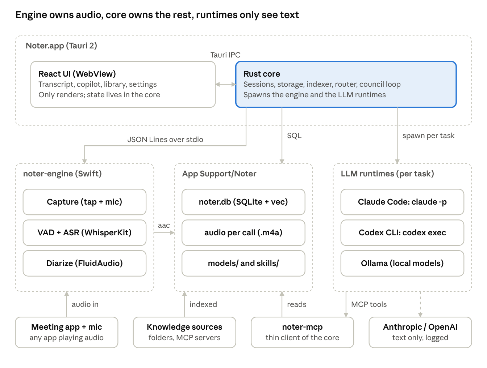
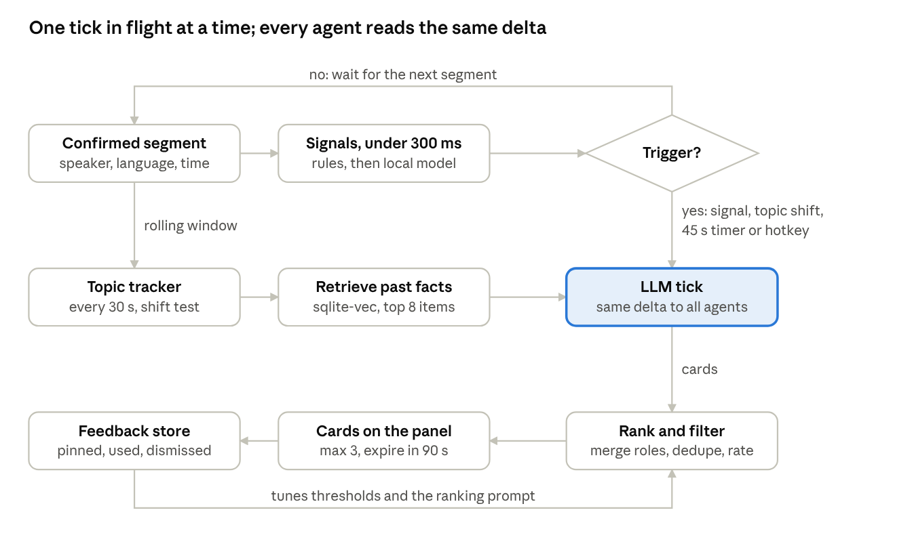
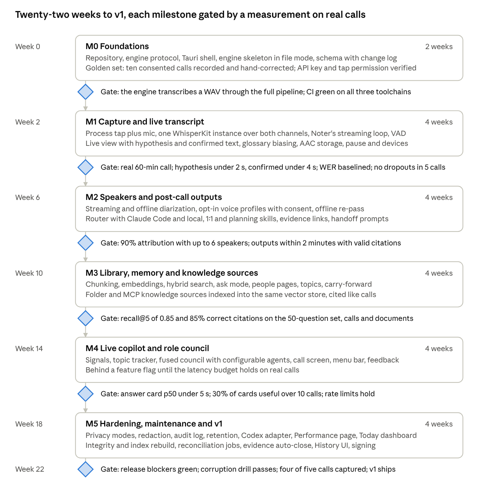

<!--
Source of truth for Noter development.
Living copy (edit, comment, review tab): https://claude.ai/code/artifact/8f34b45a-2903-468f-98d9-5de89e7163cc
This file is regenerated from the living copy whenever the PRD, the design or the UI prototype changes.
Last sync: 2026-10-17 (living copy rev 196; backend design docs/DESIGN-core.md and owner decisions of 17 Oct backported; DESIGN-core v0.4 review resolutions (docs/REVIEW-2026-10-17-design-core.md) backported). Review findings: docs/REVIEW-2026-10-16.md. UI design: docs/DESIGN.md (v1.1; v1.0 accepted 2026-10-17). Diagrams: docs/diagrams/. UI prototype of record: docs/prototype/clickable/ (raw boards of 16 Oct kept as history in docs/prototype/raw-2026-10-16/).
-->

# Noter — PRD & Technical Design

Oct 15, 2026 · @Mikhail

# Part A — Product Requirements

## Summary

Noter is a macOS app that listens to your online calls, transcribes them on-device with Whisper Large, attributes every line to a speaker, and turns each call into a summary, decisions and action items. During the call it proposes the questions worth asking and drafts answers to the ones being asked. Every call lands in a local SQLite database with a vector index, so any past conversation is searchable in seconds and feeds context into the next one.

**Who it is for.** The primary user first: a team lead with 15 direct reports across two products, whose calls run in English, Russian and German, often mixed within one meeting. Then that lead's frontend team, which is why the data model and exports are designed for sharing from day one even though v1 is single-user.

**Why now.** Apple Silicon runs Whisper Large v3 faster than real time on a laptop. Claude Code and Codex CLI turn agentic analysis into a shell command. Local models through MLX and Ollama are good enough to be a real fallback, not a toy. The pieces exist; nobody has assembled them into a local-first, speaker-aware, live assistant.

**What makes it different** from cloud notetakers (Otter, Fireflies), bot-based recorders and the assistants built into Zoom, Teams and Meet:

- Audio never leaves the Mac. Transcription, diarization and embeddings run on-device; only text leaves, only through the path you chose, and you can see exactly what left. Cloud note-takers and the assistants built into Zoom, Teams and Meet all send audio to a server.
- Every platform with one tool. A system-audio tap covers Zoom, Teams, Meet, Slack huddles, Discord or a browser tab, with no bot in the call, and the mic/system split gives a clean "you vs them" that server-side tools cannot.
- Three languages in one call. English, Russian and German switching within a meeting, with the language detected per utterance; most tools pick one language per meeting.
- A council, not one assistant. Role agents (six built in, more by a + button) read the same live context, each with a sceptical eye for what its discipline would catch; the nearest rivals, in-meeting answer assistants, have one voice.
- Agent-native and evidence-cited. Analysis runs through Claude Code or Codex CLI with tools over your own Jira, Confluence and documents, and every decision and action item links to the words it came from.
- Action items become work. An engineering action item comes with a handoff prompt and one button that opens it in Claude Code or Codex in the right repository; a Today dashboard puts the items that matter before your next calls, with checkboxes.
- Keeps itself honest. Background jobs re-apply what new calls teach, close action items on evidence from Jira, Bitbucket, GitHub or later calls, measure every stage and log every change with undo.
- Speaker-aware memory across calls. "What did Anna commit to in the last three 1:1s?" is a query, not an archaeology project.

## Problem, users and jobs to be done

A team lead with 15 reports spends most of the working day in calls and keeps a small fraction of what was said in them. Notes taken by hand are partial and skewed toward whoever spoke last; the assistant built into one meeting platform does not see the other three; nothing remembers per person across weeks; and nothing helps while the call is still running, which is the only moment a missed question can still be asked.

**Primary user (v1):** the product owner, a team lead responsible for the frontend of two infrastructure products. The calls they sit in, and what each must produce:

| Call type | Typical length | What must come out | Why it is hard today |
| --- | --- | --- | --- |
| 1:1s (weekly, 15 people) | 30 min | Commitments, blockers, follow-ups, how the person is doing | Memory per person across weeks; you are talking, not typing |
| Daily / standup | 60 min | Blockers, who is on what | Too short to take notes at all |
| Planning, grooming, retro | 60–90 min | Decisions, owners, estimates, open questions, Jira-ready items | Long, many voices, few decisions buried in talk |
| Cross-team syncs (backend, QA, product) | 30–60 min | Agreements, dependencies, who owes whom what | Mixed English / Russian / German, 5–10 speakers |
| External: vendors, interviews, customers | 30–60 min | Facts stated, questions to ask, promises made | You must listen, think and talk at once |
| Incident and debugging calls | Variable | Timeline, hypotheses tried, actions taken | Fast, technical, precision matters |

**Jobs to be done**

- During a call: keep me from missing what matters and hand me the right question at the right moment, so I can be present instead of typing.
- Right after a call: give me the summary, decisions and action items within minutes, with who said what, so I can post them to the team and move on.
- Before a call: remind me what this person or group and I agreed last time and what is still open.
- Any time: let me ask "what did we decide about the OpenStack upgrade?" across every call and get an answer with the quote and the date.
- Always: do all of this without shipping my colleagues' voices to a third-party cloud.

**Secondary users (v1.x and later):** members of the frontend team running Noter for their own calls, then a shared team knowledge base where summaries (not audio) are pooled. These shape the data model and exports now; they are not in v1 scope.

## Product principles

Six rules that settle design arguments before they start. When two features conflict, the one higher in this list wins.

1. **Audio stays on the machine.** Raw audio and the full transcript are never uploaded by default. Only derived text leaves, only through a path the user has switched on, and the app shows what left and when.
2. **Zero-effort capture.** Noter notices a call starting and offers to record with one click (from v1.x it can also start automatically for calendar events you marked). If the user has to remember to press Record, the product has already failed.
3. **Live beats post-hoc.** A suggestion that arrives after the topic has moved on is noise. Every in-call feature has a latency budget and degrades gracefully: a late suggestion is dropped, not shown.
4. **Speaker identity is a first-class fact.** Every utterance has a speaker. Speakers map to people, people persist across calls, and the user can correct a mislabel in one click and have the correction stick.
5. **Agents, not prompts.** Analysis runs through Claude Code or Codex CLI with tools and a small skill library, so it can look things up (previous calls, Jira, a document) instead of guessing. The app owns the contracts (input schema, output schema), not the prompts.
6. **Degrade, never block.** No network, no API key, no GPU budget: the call still gets captured and transcribed, and a local model produces a plain summary. Cloud models make it better, never possible.

## Scope

v1 is a single-user app that is already useful on its own for every call type in the table above; v1.x adds the integrations that make it part of the workflow; the team release comes only after the single-user data model has survived real use.

**v1 — single user, local-first**

- Call detection and one-click capture of system audio plus microphone from any app (Zoom, Teams, Meet, Slack, browser).
- One-click capture: informing the participants of a call is the user's own responsibility, outside the app; "never store audio" is an option from first run. There is no automatic recording in v1.
- Live transcript with speaker labels, handling English, Russian and German in the same call; hypothesis and confirmed text from Noter's own streaming loop on WhisperKit.
- Live copilot panel: suggested questions, draft answers to questions aimed at you, "catch me up" after a distraction.
- Copilot surfaces: one call-screen window that fills a dedicated display when one is connected and runs as a compact floating panel on a single display, plus menu bar quick actions (start, pause, mark moment, catch me up, mute copilot, open call screen), and Hide for Presenting, which hides every Noter window before a whole-display share.
- Role council: six built-in role agents plus any you add; each agent has its own skill, runtime, model, effort, tools and call types; fused mode during calls by default, parallel mode optional; each agent writes a short review after the call.
- Post-call outputs within two minutes of hanging up, from the live transcript: summary, decisions, action items with owners, open questions, per-participant breakdown; regenerated with a diff when the offline pass finishes.
- Handoff: engineering action items carry a ready-to-run prompt with one Open in Claude Code or Codex button (deep links, terminal fallback) and Copy, and remember that they were handed off.
- Speaker identity: you vs others from the two audio channels; per-call speaker labels with one-click rename; cross-call voice profiles only opt-in, created per person by the user.
- Local library: every call searchable by meaning and by keyword, per-person pages, per-topic threads across calls.
- Knowledge sources: folders of documents (Markdown, PDF, Word, text, code) and MCP tools (Confluence, Jira, Notion, wikis) connected as sources, indexed into the same local vector store, searchable and citable beside calls.
- Today dashboard: the open action items and questions that matter for the calls on your calendar today and this week, ranked, with checkboxes for manual completion.
- Performance: every stage measures itself; a Performance page shows targets against actuals and names the bottleneck; an improvement brief exports as a mini-PRD for handoff.
- Self-maintenance: the app and its models update themselves; the database is integrity-checked and indexes rebuilt on corruption; new calls re-teach older records (terms, abbreviations, references, speaker names) through proposals; action items close when Jira, Bitbucket, GitHub or a later call provide evidence.
- History: every change by a job, a model or you is logged with its reason and evidence, shown in a History view per call, item and person and in a global activity feed, and can be undone.
- LLM routing: Claude Code CLI with an API key by default, Codex CLI as an alternative, local model (Ollama or MLX) as fallback and for calls marked sensitive. The user's own Claude account and own ChatGPT account can each be signed in separately and used instead of an API key, chosen per agent.
- Export to Markdown and clipboard; manual paste into Slack, Jira, Confluence.
- Settings: model choice, privacy mode, retention, hotkeys, audio devices, agents, repositories.
- Interface: English in v1, built ready for translation; the macOS 27 design language (Liquid Glass) with Apple's system colours, meeting WCAG 2.2 AA contrast when macOS Increase Contrast is on.

**v1.x — part of the workflow**

- Calendar integration (Microsoft 365 directly) for attendee names, auto-start and the pre-call brief; v1 reads the macOS Calendar only.
- Screen context: pick windows on the first screen (IDE, Jira, Bitbucket, Zoom or Teams) and feed what they show into the conversation context, through on-device OCR and app connectors; later, watch a chosen window continuously.
- Push to Jira, Confluence and Slack through MCP servers the CLIs already speak.
- WhisperKit Pro SDK streaming (licensed) if Noter's own streaming loop on the open-source SDK cannot hold the latency bars measured in M1.
- Parallel council mode as the live default once per-agent latency allows; tool use for live agents.
- Speaker diarization quality pass: overlap handling, cross-device voice profiles.
- Interface translation into Russian and German (v1 ships the interface in English, ready for translation).

**Later — team**

- Shared knowledge base of summaries and decisions (never audio), synced through a git repository or a small self-hosted service.
- Per-team redaction policies and retention rules.
- Team-wide people and topic graph.

**Non-goals**

- No bot that joins the call as a participant, and no cloud recording service.
- No video capture, screen recording or slide OCR in v1.
- No Windows or Linux build in v1; the audio engine is macOS-specific by design.
- No general note-taking app: Noter owns calls and what came out of them, not your whole second brain.
- No live translation in v1 (the transcript stays in the spoken language; summaries are in the language you choose).
- No training of any model on your data, local or otherwise.

## Feature specification

Fourteen feature areas; the live copilot and its role council have their own section below because they are the hardest and the most distinctive.

**1. Capture**

- Noter notices a call starting when a meeting app or a browser begins playing audio while the microphone is in use (Core Audio process properties, observed with listeners), and shows a small non-activating "Record this call?" panel at the top of the main display for 15 seconds with one Record button and the hotkey hint; nothing steals focus from the call. A global hotkey starts or stops capture from anywhere. The prompt's Not Now pull-down holds Don't Ask for \<app>… for any app; it is confirmed inline, and the app is then listed in Settings › General › Apps Noter doesn't ask about, with Remove. A prompt that closed unanswered leaves Call Detected · Start Recording in the menu bar for as long as the call runs. Detection runs only while Settings › General › Offer to record when a call starts is on and the audio self-test has passed.
- Two channels are captured separately and kept separate end to end: system audio (the other participants) and the microphone (you). This gives a free, exact "me vs them" split before any diarization runs.
- Informing the participants of a call is the user's own responsibility, outside the app; capture starts with Record alone. Permissions are granted by default and no consent is asked for: if Noter is started, everything is agreed between the people on the call. Recording is never gated on setup: Record always starts capture, whatever the setup state, the audio permissions or the self-test say. If macOS has not asked yet, the first capture brings up its prompt; if access is off, capture still runs and a degraded state says which channel is silent. An unfinished self-test only keeps call detection off. A start is refused only while a recording is already running, with less than 500 MB of disk free, or before the live model is downloaded. "Never store audio" is offered at first run, in its own Audio storage step.
- A visible recording indicator in the menu bar and in the call screen; pause drops audio entirely rather than muting it.
- Call end: when the meeting app has released audio and the microphone for 20 seconds, Noter shows a 10-second notice with Keep Recording (the default) and Stop Now, then stops and opens the outputs; it never stops silently. The countdown waits while the pointer is on the notice and starts again from 10 seconds when it leaves. While Noter is hidden for presenting there is no countdown on screen: the menu bar reads "Call seems to have ended", and Noter stops after 10 minutes.
- Continue Recording is offered for 5 minutes after any stop, manual or automatic, in the call window and the menu bar; it appends to the same call with a gap row. Continuing cancels the outputs being written and writes them again after the next stop, keeping the user's edits; starting a new recording closes the offer.
- Resume Recording: when Noter quit or crashed during capture, the next launch offers Resume Recording, which continues the same call with a gap row; the offer stays until it is dismissed or another capture starts.
- Back-to-back meetings: when the next calendar event starts or the meeting app's meeting changes during capture, a notice offers Start as New Call (the default) or Keep in This Call, so each call keeps its own title, attendees and outputs. Unanswered, the notice takes the default after 60 seconds; the split falls at the moment the change was detected, and the saved call is offered Continue Recording for 5 minutes.
- Nothing heard for 5 minutes after the start: a notice shows both level meters and offers Keep Recording, which starts the 5 minutes again, or Discard Recording, which is confirmed inline.
- Audio is stored as 16 kHz mono per channel as AAC-LC (`.m4a`, which WhisperKit reads back), with a retention rule (default: delete audio after 30 days; the transcript and the per-call transcript files are kept). A nightly retention job deletes the audio past its date (logged, not undoable); a changed retention setting applies to existing calls from the next run, and the Settings row says how many calls' audio that run will delete.

**2. Live transcript**

- Two text streams, as the streaming engine produces them: confirmed text in full colour, the current hypothesis in grey. Nothing jumps backwards once confirmed.
- The transcript arrives over a Tauri Channel and is drawn every 100 ms in a virtualised list, so a three-hour call stays fast; it follows live speech, and Jump to Live returns to it after the user scrolls away.
- Every segment carries a speaker, a timestamp, a detected language and a confidence. A play control and Space replay a line's audio, and clicking text selects it. During capture, replay works only on headphones and only while Noter's own sounds are excluded from the recording; on speakers the play control is unavailable and says why, because the meeting app captures the microphone itself and would send the replay to the call. An output Noter cannot classify (an external DAC, say) can be marked as headphones per device in Settings; a detected speaker route is always refused, and replay stops when the output switches to speakers.
- Inline corrections: rename a speaker (applies to the whole call and, if you say so, to the person's voice profile), fix a term (added to the custom vocabulary used to bias future transcription).
- Term glossary: product names, people, acronyms (VHI, VHP, ACI, ostor, shaman) are biased in during decoding so they stop coming out as "V H I" or "a chi".
- Text is hyphenated by each segment's language, and every screen is tested with German strings about 30 % longer and with Cyrillic.

**3. Live copilot** — see the next section, including where it lives: the call screen on a dedicated display, the menu bar, and screen context.

**4. Post-call outputs**

Within two minutes of the call ending, one document per call, every item linked to the transcript span it came from so the evidence is one click away:

| Output | Content | Notes |
| --- | --- | --- |
| Summary | 5–10 sentences, in the language you chose, written for someone who was not there | Regenerable with a different model or template |
| Decisions | What was decided, by whom, with the quote | Each decision links to its transcript span |
| Action items | Owner, task, due date if mentioned, source quote; engineering items get a handoff prompt (see area 9) | Owner resolved to a known person where possible |
| Open questions | Asked but not answered, or explicitly parked | Carried forward to the next call with the same people |
| Per participant | What each person said, committed to, asked for, pushed back on | The feature that makes 1:1 and cross-team history useful |
| Role reviews | One short review per enabled council role: what the PM, Designer, Backend, Frontend, Teamlead and Architect each saw and would push back on | Six sceptical readings of the same call |
| Risks and disagreements | Where people disagreed and whether it was resolved | Optional per call type |
| Call-type extras | Standup: blockers per person. Planning: Jira-ready items. Interview: scorecard. Incident: timeline | Driven by the skill library |

All outputs are editable; edits are kept when you regenerate, and the diff is shown.

- Review: extracted decisions, action items and open questions arrive as suggested. The user accepts, edits or rejects each, or accepts all; a tick on a suggested item accepts it and marks it done. Items pinned during the call arrive accepted. Evidence jobs close accepted items only, and suggested items join the copilot context and the carry-forward marked "Not reviewed".
- Regenerate: a sheet chooses the runtime and model, the skill, and which sections to rewrite (summary; decisions, action items and open questions; role reviews); edits are kept and shown as a diff.
- Versions: each summary keeps every generated version, with its model and time, plus the user's edit, and any two can be compared.
- Writing: sections are written in order, the transcript is readable while they are written, and a failed section can be rewritten by the local model.

**5. Library and search**

- Call list with filters by person, date, call type, tag, language, and "has open items". Calls carry free-text tags, edited in the call's info and from the call list's context menu, with suggestions only from tags already in use; every tag change is a user change with Undo. The tag filter is a Tags pop-up in the filter bar and a Tag: token in the search field.
- Hybrid search (keyword plus meaning) over transcripts, summaries and decisions, with the matched span highlighted and the audio one click away; Russian and German queries work because the keyword index is built on normalised, stemmed text.
- Ask mode: a question over all calls ("what did we agree with backend about the websocket notifications?") answered with citations to the specific calls and spans. The scope is picked from readable presets that combine people, call type, date, topic and sources (for example all calls and all sources, all calls without documents, planning calls in the last 30 days, calls with one person, one topic). Asking from a topic opens a new thread scoped to that topic and asks "What was decided and what is still open about …?".
- Person pages: every call with that person, their open commitments, what they asked of you, the topics you two keep returning to. Talk-time share and "who was silent" exist but are off by default, because they are behaviour data about colleagues; once switched on they are computed from then on, and past calls are not back-computed. Deleting a person unnames their speakers in every call and deletes their voice profile; deleting only the voice profile keeps the names already given.
- Topic threads: decisions and open questions about the same subject grouped across calls, so a planning decision in March and the retro complaint in May sit together. Merging two topics keeps the target's name and keeps the merged topic's name as one of its names; Keep Separate stops that suggestion for good.

**6. Integrations**

- v1: export a call, a section or a selection as a folder of Markdown files, with the transcript as SRT and JSON and the audio while it is kept; the user chooses Summary and items, Transcript and Audio. Copy summary or action items to the clipboard formatted for Slack or Jira.
- v1.x: Microsoft 365 calendar for attendee names, call type guessing and auto-start; Jira, Confluence and Slack through MCP servers; a pre-call brief delivered as a notification five minutes before a meeting.

**7. Knowledge sources**

- Add a folder: Noter watches it (FSEvents), extracts text from Markdown, plain text, PDF, Word, HTML and source files, chunks by heading, embeds locally and keeps the index current on every change. Nothing is copied; the index points at the file and the heading.
- Add an MCP server: any server the CLIs can speak to (Confluence, Jira, Notion, GitHub, a company wiki) becomes a source in one of two modes. Live: the agent queries it after calls and in Ask through noter-mcp, which starts the server with its own transport and credentials, relays each call and logs it first; Noter holds no token, and live lookups run only when the privacy mode is Cloud allowed. Indexed: Noter completes the server's own OAuth flow, keeps the token in the Keychain (shown and revocable on the Sources page), and a sync job pulls documents (resources where the server lists them, search results otherwise) into the local index on a schedule, with change detection by content hash.
- Every source has a privacy class (normal or sensitive) and a scope (all calls, or only calls of certain types or with certain people). Sensitive sources are only ever read by the local runtime.
- Documents are first-class in search, ask mode, the copilot's context and post-call analysis: an answer cites "Release process (Confluence), section Hotfix" with the same one-click evidence as a transcript span.
- Sources page: status, document count, last sync, errors, re-index, remove, revoke token. Removing a source drops its chunks and vectors in one transaction.

**8. Role council**

During a call and after it, the same context goes to a council of role agents, each reading as a sceptical specialist. Six are built in: Product manager, Designer, Backend engineer, Frontend engineer, Teamlead, Architect. Each raises cards in its own voice with a role badge and writes a short review after the call. The mechanics are in the Live copilot section.

- Agent control: every agent has a name, a role skill (the SKILL.md, editable in place), a runtime, a model, an effort level (low, medium, high, max), the tools it may use, the call types it runs on, and a budget share. The runtime is one of five: Claude Code on the Anthropic API key, Claude Code on the user's own Claude account, Codex on the Codex API key, Codex on the user's own ChatGPT account, or the local model; when both accounts are signed in, each agent can use either. The model list follows the runtime. A change takes effect at the next tick, within a minute, and can be undone.
- Add and remove: a + button creates a new agent from a template (Security reviewer, QA, Customer, Finance, or blank) with its own skill; built-in agents can be disabled but not deleted, added agents can be removed. Agents are ordered, and order is the tie-break in ranking.
- Two council modes. Fused, the default during calls: one request carries all enabled agents' skills and returns cards tagged by agent; fastest and cheapest, but every agent shares the council's model and effort. Parallel: one session per agent, honouring each agent's own runtime, model, effort and tools; the default for post-call reviews, optional live when latency allows. The mode is set per call type.
- Any agent can be muted mid-call; an agent switches itself off for a call type when 80 % or more of its cards were dismissed over the last ten calls of that type. The switch is logged in History, can be undone, and is announced once on the Agents page.
- A runtime that is unavailable (no key, a signed-out account, a missing CLI) pauses the agent, which says why. When a signed-in account runs the same tool, a one-click switch to it is offered, with Undo. An agent whose account session ends stays paused until the user signs in again from Settings, or picks another runtime for it.

**9. Handoff to Claude Code and Codex**

An action item that is engineering work (the analysis marks it so) comes with a handoff prompt written to be used as is: the goal in one sentence, what was said about it in the call with speaker and timestamp, the decisions and constraints that apply, acceptance criteria as stated or as the council proposed, links (Jira key, document sections from your sources), the repository the item belongs to, and a closing instruction to ask before touching anything outside the stated scope.

- Each action item row has a Handoff button. It opens a drawer with the prompt (editable, regenerable, an "edited" badge with a diff toggle), a target switch (Claude Code or Codex), the repository resolved from the Repositories mapping in Settings (a missing mapping is added from the drawer through the Add Mapping sheet, with the project key filled in), Open in Claude Code or Open in Codex and Copy Prompt, with Open as the default for the user's own items and Copy Prompt for anyone else's, and a line saying which launch path will run and whether macOS will ask for Automation.
- Open in… uses the tools' own deep links: `claude-cli://open?cwd=…&q=…`, which Claude Code registers after its first interactive prompt and which opens your usual terminal with the prompt pre-filled but not sent (5,000-character limit); Claude Desktop's `claude://code/new`; the Codex app's `codex://new`. With no handler registered, a Terminal or iTerm window runs `claude` or `codex` in the directory with the prompt as its first message. The full prompt is always written to a file under Application Support and the link carries a short instruction to read it, which stays under the length cap and avoids shell quoting.
- Copy puts the prompt on the clipboard as Markdown. This is the path for items owned by someone else, which for a team lead is most of them.
- The item records the handoff: target, time, directory. Its status moves to "handed off", and the next call with the same people gets a carry-forward card asking whether it landed: Yes, Landed and Done Another Way mark it done, and Keep Open leaves it handed off and asks again at the next call with the same people. Evidence can also mark it done.
- Opening or copying the prompt of a suggested item accepts it. The drawer keeps the generated prompt versions and the user's edit, with a diff against the generated prompt.
- Prompts are generated on demand and cached, not for every item up front, so a planning call with thirty items does not cost thirty extra model calls.

**10. Self-maintenance**

Noter runs a small set of background jobs so that the app, its models and its data stay current without the user tending them. Maintenance jobs, the archive pass and regeneration wait while a call is live (the previous call's post-call analysis still runs, at low priority), never touch primary data (audio, transcripts as recorded, your edits) except through a logged change, and prefer proposing over acting when confidence is low.

- App and model updates: signed release manifests, download in the background, install on next launch with release notes; model bundles update the same way and the previous version is kept until the new one passes the golden-set smoke test.
- Database health: a quick integrity check at every start and a full check nightly; on corruption, restore the newest backup that passes and re-import anything newer from the per-call files on disk (`transcript.jsonl`, `items.json`, `summary.md`, written at call end and after every edit batch and kept regardless of audio retention), then rebuild full-text and vector indexes. Search falls back to keyword-only while a rebuild runs, with a progress bar.
- Re-teaching older records: when a new call or a correction adds a term, an abbreviation, a reference (a Jira key, a document section) or a speaker's name, the reconciliation job finds candidates in earlier transcripts and items using per-term variant lists (Latin, Cyrillic transliteration, spoken form) and proposes the changes; in v1 retroactive propagation is always propose-first, applied in one click per batch.
- Evidence-based closing of action items: for every open accepted item (a suggested item gets at most a proposal), the collector looks for closing evidence in Jira (the issue the user linked moved to a Done status category), Bitbucket and GitHub (a merged pull request carrying that key) and later calls (the owner saying it is done). A Jira transition or a merged pull request with the linked key, dated after the item, closes it automatically and shows why; commits, keyword matches and anything inferred from speech become proposals with Accept and Reject.
- Retention: a nightly job deletes audio past its retention date, live transcripts after 7 days and metrics after a year; audio deletion is logged and cannot be undone.
- A Maintenance page shows each job, its last run, counts and errors, a Run now button and Cancel for a running job; a nightly window and "not on battery" are the defaults.

**11. History and change log**

Everything that changes a record is written to one change log with who or what did it (you, a job, a model run), what changed (before and after), why (the rule or the prompt), the evidence it rested on, and whether it can be undone. The log is the audit trail for the self-maintenance jobs and the basis of a clean History UI:

- History tab on every call, action item and person: a timeline of changes with inline diffs for text, filters by actor (All, You, Jobs, Models) and by job, and Undo on each entry (undoing a propagation undoes the whole batch). An undone entry or batch keeps Redo for as long as its rows were not edited later.
- Activity page: rows grouped by job run with a count, expanded on Enter; proposals one row each with Accept, Reject and "Always for this term" (which opens the glossary rule inline); Undo shows a ten-second inline "Undone 37 changes · Redo" strip, never a modal. One action per row, keyboard driven.
- Versions: summaries, role reviews and handoff prompts keep every generated version beside your edited one, with the model and skill version that produced each.
- Export of the log for a whole call, or app-wide for today, the last 7 or 30 days or a custom period, as Markdown (one line per change) or JSON (every field), for the team rollout later.

**12. Performance and continuous improvement**

Every stage measures itself and the numbers are shown in the app, so the next iteration is decided from data rather than impressions. Nothing here leaves the machine.

- What is measured, per call and over time: capture reliability (gaps, device changes, restarts); transcription latency (hypothesis and confirmed) and the correction rate on confirmed text, which stands in for WER between golden-set runs; speaker-correction rate; copilot latency per stage (signals, retrieval, model first token, full card, merge) against its budget; card usefulness per agent and call type; model usage, tokens, cost and failures per runtime; search latency and citation acceptance; job durations and proposal acceptance; memory, CPU and thermal state, sampled every 10 seconds during capture.
- Performance page: one quiet dashboard with headline tiles from the success-metrics table (hypothesis lag, answer card, confirmed text lag, outputs ready in the cloud, and the two release blockers: calls without dropouts and cloud requests logged), each with p95 against target and a trend over the last 20 calls, for a chosen period (last call, 7 days, 30 days) and call type; a per-call drill-down with the copilot's stage timeline, and a Bottlenecks list that names the stage or component over budget most often, with example calls. A stage counts as near its budget above 90 % and over it above 105 % by default, configurable in Settings.
- Improvement brief: one click exports a Markdown brief for a chosen period, written as a mini-PRD for handoff: for each metric off target, the target, the actual, the trend, where the bottleneck sits (component and stage), evidence samples (transcript spans or log excerpts), and a proposed change. The brief opens in Claude Code or Codex through the same handoff launcher, so "bring the copilot's first-token latency under budget" becomes a prompt with the data attached.
- Metrics are kept per call in the database, aggregated nightly by a job, and retained for a year.

**13. Today dashboard**

The dashboard is the first screen after launch: what matters before the calls you have today and this week, with the action items you can tick off by hand.

- Calendar: read from the macOS Calendar (EventKit), which carries Microsoft 365 and other accounts once they are added to the system Calendar; the direct Microsoft 365 integration in v1.x adds auto-start and the pre-call brief. Calendar access is requested only when the user clicks Allow Calendar Access on Today or on the Settings › Privacy permission row; never automatically and never during capture.
- Layout: Today, then This week. The next call's card is expanded; later calls of the day show one line with their open-item count and expand on click. Under each upcoming call: the open action items and questions involving its attendees (items you own first, then items you are waiting on), the previous call's summary line, and anything handed off that is awaiting evidence. Below the calendar sections: items due this week without a call, and proposals from the maintenance jobs waiting for a decision.
- Checkboxes: ticking an item marks it done by hand, logged in the change log as a user change and undoable; a tick on an item with an open handoff asks whether the handoff landed. Suggested items that are not yet reviewed still show, marked, and a review line counts what waits; a tick on one accepts it and marks it done. Items shown under a call are also loaded into the copilot's context when that call starts.
- Ranking: items owed to people on a call today first, then due date, then age (the default); Settings › General › Today › Ranking offers "Due date, then owed to you" instead. One line per item, keyboard driven.
- Carry-forward: Today and the copilot's starting context use the same rule: open accepted items from the last two calls with the same people, plus suggested ones marked "Not reviewed".

**14. Settings**

| Setting | Options | Default |
| --- | --- | --- |
| Transcription backend | WhisperKit Large v3 Turbo with Noter's streaming loop (open source), WhisperKit Pro streaming (licensed), Parakeet TDT v3 (25 languages, fastest), full Large v3 for the offline pass | Turbo live, Large v3 offline |
| Authentication | API keys: Anthropic and Codex, in the Keychain. Your own accounts: Your Claude account (Claude Code, Pro or Max plan, personal use only) and Your ChatGPT account (Codex, Plus, Pro, Business or Enterprise plan), each signed in separately in the browser through the CLI, which keeps the sign-in; either, both or neither | API keys; no account signed in |
| LLM runtime per task | Any connected runtime: Claude Code or Codex on an API key or on your own account, or local (Ollama / MLX) — set separately for live copilot, post-call analysis and search answers | Claude Code; local for live if latency demands it |
| Agents | Per agent: skill, runtime, model, effort, tools, call types, budget share; + to add from a template, remove added agents; council mode per call type (fused / parallel) | Six built-in agents; fused live, parallel post-call |
| Call types | Built-in list (1:1, standup, planning, retro, cross-team sync, vendor, interview, incident) plus any call type the user adds as a skill folder under skills/; each type has its own SKILL.md, output schema and examples | Built-in list |
| Privacy mode | Cloud allowed, cloud with redaction, local only | Cloud with redaction |
| Sensitive call | Per-call toggle forcing local-only processing | Off |
| Audio retention | Keep 7 / 30 / 90 days / forever / never store audio; a change applies to existing calls from the next nightly run, and the row says how many calls' audio that run deletes | 30 days |
| Summary language | English, Russian, German, or "language of the call" | English |
| Storage location | Local folder (iCloud and Dropbox folders discouraged); offered only if the engine ships unsandboxed, because a sandboxed engine writes only inside the App Group container | Audio and models in the App Group container, the rest in \~/Library/Application Support/Noter |
| Hotkeys | Start/stop, pause, mark moment, catch me up, ask about this call, open call screen, mute copilot (⌃⌥⌘K), Hide for Presenting; undo the last card action (⌃⌥⌘Z, its own hotkey); card keys as one setting with one set of modifiers: modifiers + 1–3 pin and modifiers + ⇧ + 1–3 dismiss with Dismiss with keys; Restore Defaults | Configurable; card keys ⌃⌥⌘; Dismiss with keys off |
| Call screen | Which display opens the call screen (remembered by display identity), layout, open automatically on call start | The display without the call app, automatic |
| Menu bar | Menu bar title: none, elapsed time or the newest card (24 characters, card type first); which quick actions appear | None; all actions |
| Repositories | Jira project or component → local path, default tool (Claude Code / Codex) | Empty |
| Today | Calendar accounts shown, horizon (today / this week), ranking: owed to people on today's calls, then due date, then age; or due date, then owed to you | All accounts, this week, owed to people on today's calls first |
| Performance | Which stage timings are sampled, metric retention, near and over thresholds for each stage's budget | All, 1 year, near above 90 % and over above 105 % of the budgets from the metrics table |
| Screen context (v1.x) | Allowed apps and windows, read on demand or watch continuously, capture rate, keep extracted text with the call | Off until switched on; on demand; 1 frame per 5 s when watching |
| Knowledge sources | Folders and MCP servers, each with a mode (live / indexed), schedule, privacy class and scope | None |
| Updates | Channel (stable / beta); install on next launch automatically or ask | Stable, automatic |
| Maintenance | Nightly window, allow on battery, backups kept, which jobs are enabled | 02:00–05:00, no, 7, all |
| Evidence sources | Jira (`acli` or the CLI's MCP config), Bitbucket (`bkt`), GitHub (`gh`), later calls; close automatically only for linked keys, otherwise propose | All that are installed |
| Record prompt and notifications | Launch at login; Offer to record when a call starts, which needs a passed self-test; apps Noter doesn't ask about, each with Remove; when macOS notifications are off for Noter, a note with Open System Settings… | Launch at login on; Offer to record on; no apps listed |
| Audio output | Route detected automatically; output devices marked as headphones one by one, which helps only an output Noter cannot classify (a detected speaker is never treated as headphones); Exclude Noter's own sounds, which replay during capture needs; Run Audio Self-Test… | Detect automatically, no device marked |

## Live copilot

The copilot is a quiet surface, a full call screen on a dedicated display or a side panel on a single one, that shows at most three cards at a time, each one either a question worth asking, a draft answer, a piece of context from a past call, or a candidate commitment to pin, raised by one of six role agents that read the same context in parallel. It never speaks, never types into the call, and is excluded from window shares so it stays invisible when you present; before a whole-display share, Hide for Presenting hides it.

**Card types**

| Card | Fires when | Shows | Source it must cite |
| --- | --- | --- | --- |
| Ask | A topic has run for a while with no owner, deadline, acceptance criterion or decision; or a lull after a topic | One question, one line on why now | This call's transcript span |
| Answer | Someone asks a question aimed at you or at the room that your history can answer | A two-sentence draft answer plus the fact it rests on | A past call, a pinned decision, a Jira issue, or labelled "model guess" |
| Context | The conversation moves onto a subject you have discussed before | "On 12 Sep you and Anna agreed X; still open: Y" | The past call and span |
| Pin | Someone states a commitment, decision or date | "Pin: Anna delivers the drawer redesign by Friday?" with one-click accept | This call's transcript span |
| Catch-up | You press the hotkey after a distraction | 60-second summary of the last N minutes and what is being asked right now | This call |

**Detection, in order of cost**

1. Cheap signals run on every confirmed segment: question detection (text cues plus a small classifier), speaker change, mention of a known person, date or Jira key, commitment phrasing ("I will", "by Friday", "до пятницы", "bis Freitag").
2. Topic tracking runs every 20–30 seconds: embed the rolling window, compare with the previous window and with the library; a shift above threshold triggers retrieval of related past decisions.
3. The LLM is called only when a signal fires or on the periodic tick, with a compact context: last 3 minutes of transcript, the current topic's retrieved facts, the call type, the people present, and the cards already shown. It returns zero or more candidate cards in a fixed schema with a confidence and a reason.
4. Ranking: drop anything below confidence 0.6, drop duplicates of cards shown in the last 10 minutes, prefer cards with a cited source, and respect the rate limit.

**Latency budget** (measured from the end of the triggering utterance to the card appearing; provisional until M1 measures Noter's own streaming loop, whose confirmed-text lag is the largest term)

| Path | Target p50 | Target p95 | Degrade rule |
| --- | --- | --- | --- |
| Answer to a direct question | 5 s | 9 s | If not ready in 12 s, drop it silently |
| Context on topic shift | 6 s | 10 s | Show without LLM phrasing: raw past decision |
| Ask after a lull | 6 s | 10 s | Skip if the topic has already moved |
| Catch-up on demand | 5 s | 8 s | Show the last confirmed segments while waiting |

The 12-second rule applies to a card's first line: once the first line is shown, the card is completed. Cards the user asked for (Catch Me Up, Ask About This Call) are never dropped by it.

**Guardrails**

- At most one unsolicited card every 45 seconds; the user can mute the copilot per call or per call type.
- Every card names its provenance: this call, a past call with date, Jira, a document, or "model guess". A factual answer with no retrieved source is labelled unverified and ranked last.
- Sensitive calls run the copilot on the local model or not at all; the panel says which.
- No card ever contains text the user would have to read aloud verbatim for more than two sentences; the copilot assists thinking, it does not script the call.
- Cards expire after 90 seconds or when the topic changes, but a card that is hovered, focused or expanded is never removed, and new cards queue while the stack is held; new cards slide in at the top and the oldest fades at the bottom. A pin or dismiss can be undone for 30 seconds, and a pinned card can be unpinned.
- Until the first card the panel shows "Listening. Cards appear when there is something worth asking" and the active mode (cloud, redacted, local); it is never blank.
- One monochrome badge per card; merged agents are listed as text. ⌘1–3 pins and ⌘⇧1–3 dismisses while the panel has focus. Because the panel is non-activating, global card keys work while the call app has focus: ⌃⌥⌘1–3 pin and ⌃⌥⌘Z undoes the last card action, and ⌃⌥⌘⇧1–3 dismiss only when Dismiss with keys is on (off by default); they are registered only while capture runs with the copilot on and not muted and Noter is not hidden, while the other global hotkeys are registered at launch and stay registered. A card key with no card under it says so. New card titles are announced politely to assistive technology; the transcript is a log that is not announced; reduced motion is honoured.
- Accessibility: the UI meets WCAG 2.2 AA for keyboard, VoiceOver, focus, target size (24 points) and Reduce motion everywhere. The default look uses Apple's macOS system colours (the macOS 27 design language), so some secondary text falls below 4.5:1; with macOS Increase Contrast on, every colour switches to an AA-checked value, so contrast meets AA too.

**Learning loop**

Each card gets implicit and explicit feedback: thumbs up or down, "pinned", dismissed, expired unread, and "used" (your own mic transcript matches the card's question or answer within the next two minutes; the match threshold is tuned from the ratings). The signals are stored per card type and call type and used to tune thresholds and the ranking prompt; nothing is trained.

**Behaviour by call type** (from the skill library)

- 1:1: follow up on last time's commitments; surface anything the person flagged as a worry before; suggest a check-in question if the first ten minutes were all status.
- Planning and grooming: ask for owner, acceptance criterion and estimate when missing; flag a decision that contradicts an earlier one.
- Cross-team sync: surface the dependency list from the previous sync and who owed what.
- Interview: track rubric coverage and suggest the unasked question.
- Incident: propose the unchecked hypothesis from the runbook; keep a running timeline card.

**Role council**

Every tick fans out to the enabled roles in parallel; each role sees the same delta, the same retrieved facts and the same documents, and answers only as its discipline would. The stance is deliberately sceptical: assume something is missing, look for the unasked question, the contradiction with an earlier decision, the unowned task, the risk nobody named. A card is raised only when the role would actually interrupt a colleague for it.

| Role | Reads the conversation for | Typical card |
| --- | --- | --- |
| Product manager | Unclear user value, missing acceptance criteria, scope creep, no success metric, priorities decided by who talks loudest | "Which user problem does this solve, and how will we know?" |
| Designer | Flows discussed without their states (empty, error, loading), accessibility, inconsistency with existing patterns, copy nobody owns | "What does the user see while the cluster is still deploying?" |
| Backend engineer | API contracts, data migration, idempotency, failure modes, performance under load, trust in inputs | "What happens to in-flight requests during the upgrade?" |
| Frontend engineer | State handling, pagination, Russian and German strings, websocket reconnects, render cost, test coverage | "Is this table virtualised? 10k rows was the complaint last time." |
| Teamlead | Owners, dates, capacity, people overloaded or silent, decisions made without the people affected, follow-through on past commitments | "Anna has three items from last week still open. Add a fourth?" |
| Architect | Boundaries, coupling, versioning, backwards compatibility, operational cost, contradictions with the current architecture | "This bypasses the notification service we agreed on in March." |

The panel still shows at most three cards: agents compete in one ranking, near-duplicates across agents are merged (the first agent keeps the badge, the others are listed on the card), and each agent's hit rate is tracked separately. In fused mode the council is one request per tick that returns cards tagged by agent; in parallel mode each agent is its own session with its own model and effort, and a slow agent misses the tick rather than delaying it. After the call each enabled agent writes a five-sentence review from its angle; the reviews are a section of the post-call outputs.

**Surfaces**

The copilot lives on a second display when there is one, in the menu bar always, and, from v1.x, can look at the first screen when you point it at a window.

- Call screen on a dedicated display. When a call starts and a second display is connected, Noter opens the call screen there, full size: transcript on the left (speakers, languages, confirmed and hypothesis text), cards on the right with agent badges, a bottom strip with the call clock, recording state, pinned items and the catch-up button. It is a non-activating panel, so it never takes focus from the call app. It is hidden from screen sharing where the other side's capture honours that (Teams, Meet, and Zoom with window filtering); when you present, share a window rather than a whole display, or press Hide for Presenting first. Screen Share Test… on the Privacy page shows what each kind of share would see of each Noter surface, with an optional capture test of sample windows. Open Call Screen (⌃⌥⌘N) shows the window without making it key; a second ⌃⌥⌘N makes it key. The display is remembered by its identity, and the default is the display that does not hold the call app. On a single display the same window runs in a compact floating layout; nothing is lost when a display is unplugged mid-call.
- Menu bar. A status icon with four monochrome template glyphs (idle, recording, paused, copilot muted), each with an eye-slash form while Noter is hidden for presenting; macOS's own orange microphone indicator shows recording in colour. Its menu is the quick-action control: Start or Stop Recording, Pause, Keep Recording and Stop Now while the call-ended notice is open, Continue Recording for 5 minutes after a stop, Mark Moment, Catch Me Up, Ask About This Call…, one Mute Copilot submenu (For 10 Minutes, For This Call, For All Planning Calls, named after the current call type) with Unmute directly in the menu while muted, Open Call Screen, Use Floating Panel, Open Last Summary, Hide for Presenting, the next calendar call, Open Noter and Settings…, with the hotkey next to each. After a missed or declined record prompt it offers Call Detected · Start Recording, which starts capture without showing any window while Noter is hidden for presenting; a new meeting detected while hidden is a menu line too, with Start as New Call. Every action takes effect within a second and never opens a dialog after setup. v1 has no automatic recording, so the next-call line carries no auto-record state. An optional title shows the elapsed time or the newest card in the menu bar itself, capped at 24 characters with the card type first ("Ask: owner for drawer?").
- First run. A wizard in six steps: Welcome; Models, which downloads the models (size, progress, resumable); Permissions, which asks for Microphone and System Audio Recording and runs the self-test; Call display; Audio storage, with Never store audio and the audio retention; and Assistants. The self-test plays a short clip and also accepts any sound already playing in another app; it passes as soon as both streams arrive with non-zero audio and line up, within 10 seconds, showing two level meters and a live transcript line. With Exclude Noter's own sounds on, it also checks that Noter's own sounds stay out of the recording, which replay during capture relies on. Assistants offers an Anthropic API key and a Codex API key, separate sign-ins with Your Claude account (Claude Code, Pro or Max plan, personal use only) and Your ChatGPT account (Codex), a local runtime (Ollama, with a one-line install) and the privacy mode; any of them, or none, can be chosen, and without any Noter still records and transcribes while summaries wait. Permissions can be skipped and finished later from the Finish Setup… link on Today and in the menu bar. Recording never waits for setup: start controls always read Record, the first capture brings up any audio prompt macOS has not shown yet, and a channel without access is recorded as silent with a degraded state that names it. Only call detection waits: it stays off until the self-test passes.
- Hide for Presenting. One global hotkey (⌃⌥⌘0, a toggle) and a menu item hide every Noter surface that could appear on a share: the call window, the record prompt, the main and Settings windows and the menu bar title. It holds notifications and releases the card keys; the status icon shows the hidden state, and any explicit show action ends it. The floating panel says so the first time it opens: "Hidden from window shares only. Before sharing your whole screen, press ⌃⌥⌘0."
- Notifications. Notifications carry no buttons, so every decision happens inside Noter; clicking one opens its call. While a call is being recorded they wait and are delivered one per call when capture stops; while Noter is hidden for presenting they wait and are delivered, combined per call, when Noter is shown again; so a notification never lands over the next call or on its share. The one exception is NT-3 ("System audio silent", "Microphone off" or a capture failure), sent at once unless Noter is hidden for presenting (then only the menu bar icon shows it) or a call surface is visible. No notification is sent about the call the frontmost main window already shows. When macOS notifications are off for Noter, nothing else changes: the Call page loads without focus and the menu bar offers Open Last Summary.
- Screen context (v1.x). "Pick from screen" opens the system window picker for the first screen (the picker itself needs no permission; reading the picked windows asks for Screen Recording once); you choose the windows the copilot may read (an IDE, a Jira board, a Bitbucket pull request, the Zoom or Teams window). Noter reads them on-device: text by OCR, plus structured data where a connector exists (open files and their problems from a JetBrains IDE, the page URL and title from the browser, which Noter resolves to the Jira issue or pull request through its usual tools rather than OCR, and the participant list from Zoom or Teams, which feeds speaker naming). What was read appears as context chips in the call screen; you can pin, unpin or drop each one. Pinned and recent chips go into the council's packet, into ask mode and into the post-call analysis, cited as "from your screen: Jira VSTOR-1234 at 14:32". Later: "watch this window" keeps a chosen window in context continuously at a low rate.
- Privacy for screen context: only picked windows are ever read; frames are discarded after OCR and never stored; extracted text is kept per call like the transcript and follows the same privacy mode and retention.

## Success metrics and quality bars

v1 is a success if, in the four weeks after M3 ships, the owner runs Noter on four calls out of five and asks the library a question at least five times a week. The metrics below are the ones that have to hold for that to happen. Transcription targets are relative to a baseline measured in M1 on the golden set (ten hand-corrected calls), because published meeting benchmarks sit far from the read-speech numbers vendors quote: Whisper large-v3 reports about 16% WER on AMI meeting audio in English, and code-switching between scripts (Russian and English) is several times worse than monolingual speech.

| Area | Metric | Target | How it is measured |
| --- | --- | --- | --- |
| Capture | Calls recorded end to end without dropouts | 99% | A dropout is a gap longer than 2 s caused by a quit or crash, an engine restart, a device change or a stall; stored per call in the metrics table |
| Transcription | Live transcript (Turbo, Noter's loop) against the offline Large v3 pass | ≤ 1.15× the offline WER | Golden set |
| Transcription | WER ceilings on call audio, per language | EN ≤ 15%, RU ≤ 20%, DE ≤ 20% | Golden set, hand-corrected |
| Transcription | Glossary terms transcribed correctly | Term errors halved against the no-glossary baseline | Golden set term list |
| Transcription | Language switches between utterances (a Russian sentence after an English one) | ≤ 1.3× the monolingual WER | Golden set |
| Transcription | Switches inside an utterance (an English term in a Russian sentence) | Measured, no v1 target; a transliterated term the glossary maps back is not an error | Golden set |
| Speakers | Segments attributed to the right person, up to 6 speakers | ≥ 90% | Sampled review after each call, corrections counted |
| Live | Hypothesis text lag behind speech | ≤ 2 s (provisional) | Engine timestamps |
| Live | Confirmed text lag | ≤ 4 s (provisional) | Engine timestamps |
| Copilot | Cards rated useful or detected as used | ≥ 30% | Feedback store |
| Copilot | Cards rated unhelpful | ≤ 10% | Feedback store |
| Council | Cards per agent rated useful or used, planning and cross-team calls | ≥ 25% per agent | Feedback store, per agent, over the last 20 calls |
| Council | Cards merged as duplicates across agents | ≤ 15% | Merge log |
| Council | Model cost of a 60-minute call at the default budget | ≤ $1 | llm\_runs |
| Post-call | Outputs ready after a 60-minute call, from the live transcript | ≤ 2 min cloud, ≤ 10 min local | App telemetry (local) |
| Post-call | Action items accepted without edit | ≥ 80% | Edit diff on accept |
| Handoff | Handoff prompts used without editing | ≥ 60% | Each Open and Copy records the prompt version and whether it was edited |
| Search | Questions answered with the correct citation, Russian and German queries included | ≥ 85% | 50-question set over the golden calls |
| Knowledge | Document questions answered with the right document and section | ≥ 85% | 20 document questions added to the question set |
| Dashboard | Items ticked by hand that stay done (no reopen within a week) | ≥ 95% | Change log |
| Maintenance | Action items closed by evidence that were in fact done | ≥ 95% | Sampled review of closures; reopen rate |
| Maintenance | Automated corrections the user undoes | ≤ 5% | Change log |
| Maintenance | Recovery from a corrupted database to a working app | ≤ 10 min, no lost calls | Corruption drill on a copy of the database |
| Performance | Copilot ticks with a complete stage timeline recorded | 100% | Metrics table |
| Footprint | Extra memory during a call | ≤ 4 GB without a local LLM, ≤ 8 GB with the 8B loaded | Activity Monitor on the development MacBook Pro |
| Footprint | The Mac stays usable | No sustained thermal throttling in a 90-minute call | powermetrics |
| Privacy | Bytes of audio leaving the machine | 0 | Network monitor test in CI and before each release |
| Privacy | Cloud requests without a log entry | 0 | Network-monitor test: every request to a provider host matches a run's audit row by time window and run id; every other host is on the allow-list in `contracts/egress-hosts.json` |

Two of these are release blockers whatever else is true: capture reliability and the privacy metrics. A release that drops audio or leaks it does not ship.

## Risks, assumptions and open decisions

The three risks that can sink v1 are mixed-language transcription quality, speaker attribution on a single compressed call channel, and depending on two interactive CLIs as if they were APIs. Each has a mitigation that is already in the design.

| Risk | Likelihood | Impact | Mitigation |
| --- | --- | --- | --- |
| Anthropic throttles or blocks automated use on a subscription login (its policy reserves OAuth for ordinary individual use and tells products to use API keys) | High | High | API key is the default and documented path; the user's own Claude account is a separate sign-in for personal use, confirmed as such, held by Claude Code itself; an agent whose account stops working pauses and names the fix (sign in again, or pick the API key as its runtime), and auth failure drops the call to the local runtime without losing it |
| Noter's own streaming loop on open-source WhisperKit misses the latency bars (the sub-second figures belong to the licensed Pro SDK) | Medium | High | Measure in M1 on real calls; Pro SDK licence budgeted as the fallback; Parakeet TDT v3 as a second backend |
| Whisper degrades on Russian/English switching inside one sentence (distinct scripts) | High | High | Per-utterance language detection fixes switches between sentences; inside a sentence the glossary maps transliterated terms; the metric is split so this is measured, not promised |
| Diarization is weak when all remote voices arrive mixed on one channel | High | Medium | Mic channel gives "you" for free; opt-in voice profiles for recurring colleagues; honest "Speaker 2" labels with one-click rename |
| Live latency slips on battery or when the Mac is busy | Medium | High | Turbo model on the Neural Engine, cheap signals before any LLM call, degrade rules that drop late cards |
| Council cost and context growth (six agents, 80 ticks an hour, sessions that re-read history) | High | Medium | Fused mode by default, fast model class live, $1 per-call budget, session reset every 15 ticks with a carry-over summary, agents per call type, agents that switch themselves off for a call type when 80 % of their cards over ten calls were dismissed |
| Claude Code and Codex CLI change flags, auth or behaviour between releases | Medium | Medium | Thin adapter per runtime behind one interface, pinned versions, explicit lockdown flags on every run with a CI test that no user hook, plugin or MCP server starts, local model as the always-available path |
| Indexed documents end up in cloud prompts, or the index goes stale | Medium | Medium | Per-source privacy class and scope, excerpts rather than whole documents, hash-based re-sync, sync status on the Sources page |
| Screen context reads something it should not, or the council reasons from stale screen text | Medium | High | Only picked windows, frames never stored, chips visible and droppable, each chip timestamped and aged out after 10 minutes unless pinned |
| Background jobs rewrite history wrongly (a term propagated to the wrong word, an item closed that was not done) | Medium | High | Propose-first propagation in v1, auto-close only for linked keys with dated evidence, every change logged with evidence and undo, batch undo, reopen in one click |
| Russian keyword search is poor because FTS5 neither folds ё nor stems | High | Medium | Normalised, stemmed shadow column in the keyword index; Russian queries in the evaluation set |
| Evidence sources are unreachable or their CLIs change | Medium | Low | Jobs degrade to "no evidence found", never to a guess; adapters per source behind one interface |
| macOS audio APIs shift under us (process taps are 14.4+, ScreenCaptureKit keeps changing) | Medium | Medium | Capture behind an interface with two backends; the engine is the only module that touches Core Audio |
| Your own voice leaks into system audio when on speakers | Medium | Low | Headphones recommended (there is no speakers mode with echo cancellation since 17 Oct); crosstalk marking |
| "Super advanced" becomes "never ships": v1 is far more than one part-time person can build in 22 weeks | High | High | Full v1 kept (owner, 17 Oct); the UI is built in parallel against the contract and a fake core; milestones with measured gates; copilot and council behind a flag until the latency budget holds |

**Assumptions**

- Development and daily use on a MacBook Pro (M5) with enough unified memory to hold Whisper Large v3 Turbo, a diarization model, the embedding model and an 8B-class local LLM at once (24 GB is the working assumption; 16 GB would force the local LLM down to 3–4B and the council to two agents locally).
- Headphones in most calls, so the mic channel is mostly you.
- Claude Code and Codex CLI are installed; an Anthropic API key (and a Codex API key if Codex is used) is available for automated tasks, because Anthropic reserves subscription logins for ordinary individual use and may throttle automated use. The user's own Claude or ChatGPT account is an alternative for personal use; Claude Code and Codex keep those sign-ins in the Keychain, and Noter never stores them.
- The calendar accounts are added to the macOS Calendar, so the dashboard can read them without a direct integration; Teams, Zoom and Meet are all in use.
- Calls are in English, Russian and German; other languages work but are not tested.
- The macOS 27 look (colours, materials, corner radii, control heights) follows Apple's published macOS system colours and the published macOS 27 changes; it is checked against Apple's macOS 27 UI kit when the kit can be opened.

**Open decisions** (recommendation in brackets; tick when decided and move the answer to the decision log)

- [x] Scope cut: adopt the MVP recommended in the Review tab, or keep v1 as specified and accept a longer schedule? \[Decided 17 Oct by the owner: full v1 as specified; the roadmap stays as drawn\]
- [ ] Two-pass transcription: Turbo live, full Large v3 re-pass after the call for the archive copy? \[Yes: the live transcript is for the moment, the archive copy is what search uses; summaries are generated from the live transcript and regenerated after\]
- [ ] Streaming: Noter's own loop on the open-source WhisperKit, or a WhisperKit Pro licence for its streaming? \[Build the loop, measure in M1, license Pro only if the bars fail\]
- [ ] Council live mode: fused (one request, all agents) or parallel (one session per agent)? \[Fused live, parallel post-call; parallel live once measured\]
- [ ] Per-turn structured output in a long-lived Claude Code session: does `structured_output` arrive per turn? \[Prototype in M1; fall back to an `emit_card` tool on noter-mcp\]
- [ ] Vector store: sqlite-vec inside the main SQLite file, or LanceDB beside it? \[sqlite-vec, with the canonical embedding stored on the row so the vec tables are rebuildable\]
- [ ] Embedding model: bge-m3 in-process (CoreML in the engine) or through Ollama? \[In-process: search must not depend on a daemon\]
- [ ] Local LLM runtime: Ollama or MLX? \[Ollama for v1; MLX if latency on the copilot path demands it\]
- [ ] Engine sandbox: can a sandboxed engine spawned by the core get the System Audio Recording prompt attributed to Noter? \[Verify in week one; otherwise drop the sandbox claim and rely on the CI network test\]
- [ ] Capture in its own minimal process, apart from the models, so an ML crash never touches capture? \[Decided by the week-one test; until then the engine restarts capture first, before models load\]
- [ ] Claude plan detection: can Noter reliably read which plan the signed-in Claude account has? \[Spike in M3\]
- [ ] Voice profiles: opt-in per person in v1 (as written) or deferred to v1.x entirely? \[Opt-in in v1\]
- [ ] MCP source indexing: pull through resource listing, or crawl through the server's search tools? \[Resources where offered, a seed-query crawl otherwise\]
- [ ] Evidence closing: close automatically above a confidence, or always propose? \[Automatic only for a user-linked key with a Done transition or a merged PR carrying the key, dated after the item; propose everything else\]
- [ ] Bitbucket access: the `bkt` CLI or the Atlassian MCP server? \[`bkt pr list --state MERGED` filtered client-side for pull requests; `acli` for Jira\]
- [ ] Should the post-call pass also run on the local model when cloud is allowed, to compare and catch hallucinated action items? \[Later; measure first\]

# Part B — Technical Design

## Architecture overview

Noter is three kinds of process around one SQLite file: the Tauri app (Rust core plus a React WebView), a sandboxed Swift engine sidecar that owns everything audio and on-device ML, and LLM runtimes (Claude Code, Codex CLI, Ollama) spawned per task by the Rust core. The core is the only process that writes the database; the engine never talks to the network; the LLM runtimes never touch audio and reach the library only through noter-mcp, which is a thin client of the core, runs only on this Mac and never opens a network port.



The Rust core is the only hub: it drives the engine over stdio, reads and writes the database, indexes folders and MCP sources into it, and spawns an LLM runtime per task (one per council role during a call); the runtimes reach the library only through noter-mcp, and the engine never has a network path.

| Component | Responsibility | Technology | Process |
| --- | --- | --- | --- |
| UI | Call screen (one window, two layouts), live transcript, copilot cards with agent badges, context chips, Today dashboard, library, person pages, sources page, handoff drawer, History and Activity views, Performance page, Maintenance page, agent settings, own-account sign-in sheets; menu bar quick actions; Hide for Presenting; the macOS 27 look, with AA colours under Increase Contrast | React 19, TypeScript, Vite, Tailwind, Zustand; UI types generated from the core's types; English strings ready for translation; Tauri Channels for streaming, events for the rest; Tauri tray API; tauri-nspanel for the panel windows | WebView windows inside the app |
| Rust core | Session lifecycle, engine supervision, the only SQLite writer, agent registry, LLM router, copilot orchestrator with council modes, handoff launcher, knowledge indexer, calendar reader (EventKit), metrics, job scheduler, change log, screen-context connectors (v1.x), audit log | Rust, tauri 2, rusqlite with sqlite-vec and FTS5, tokio | App main process |
| Engine | Audio capture (two channels), VAD, streaming ASR with Noter's own loop, diarization, speaker embeddings, text embeddings (bge-m3 on CoreML), AAC writer, offline re-pass; screen context capture and OCR (v1.x) | Swift 6, App Sandbox, Core Audio process taps, AVAudioEngine, WhisperKit (MIT), FluidAudio (Apache-2.0, CoreML, Neural Engine), ScreenCaptureKit and Vision (v1.x) | Separately signed binary in the app bundle, spawned by the core, JSON Lines over stdio |
| LLM runtimes | Analysis, council agents, copilot reasoning, search answers, handoff prompts, improvement briefs, low-confidence reconciliation judgements | `claude -p` with an API key (Agent SDK) or on the user's own Claude account, `codex exec` with a Codex API key or on the user's own ChatGPT account, Ollama HTTP; MLX later | One request per tick in fused mode; one warm session per agent in parallel mode; short-lived processes for other tasks |
| noter-mcp | Tools the agents call: search\_calls, search\_documents, get\_transcript\_span, get\_person, get\_decisions, get\_open\_items, get\_screen\_context, pin\_item, propose\_correction, emit\_card; in Cloud allowed, live MCP sources relayed as live\_\<source\>\_\<tool\> | Rust binary speaking MCP over stdio to the CLI and a Unix socket to the core; it never opens the database itself or a network port | Child of the LLM runtime for one run, local only |
| noter-protocol | The contracts between all of the above: UI ↔ core commands, events, Channels and error codes with their window scopes; the engine protocol; the noter-mcp tools; the skill output schemas; typed fixtures. Generates the UI's TypeScript, the JSON Schemas and the fake core's data | Rust types (serde, specta, schemars); no Tauri dependency | Library and an export tool, run in development and CI |
| Knowledge sources | Folders watched for changes; MCP servers queried live by the agents, or synced into the index by the core with a token Noter holds | FSEvents, text extraction (PDF, Word, HTML, Markdown, code), an MCP client with OAuth in Rust | External; the sync job runs inside the core |
| Evidence sources | Jira, Bitbucket, GitHub and later calls, read by the evidence collector to close action items | `acli` (Jira), `bkt` (Bitbucket), `gh` (GitHub) as subprocesses under the user's logins; the local model for speech evidence | External |
| Storage | One database, audio and per-call transcript files, models, backups | The App Group container shared by app and engine: `audio/<call>/{mic,sys}.m4a` plus `transcript.jsonl`, `items.json`, `summary.md`, `models/`, `engine-io/`, the capture ring; `~/Library/Application Support/Noter/`: `noter.db`, `backups/`, `handoffs/` | Files |

**Data flow during a call.** The engine captures mic and system audio, runs VAD and streaming ASR, and emits segment events (hypothesis and confirmed) plus speaker-turn events. The core persists confirmed segments, forwards everything to the UI as Tauri events, and runs the copilot orchestrator: cheap signals on each segment, topic tracking on a timer, retrieval from the library, then one LLM tick per enabled council role through the router, run in parallel on the same packet, whose merged results become cards.

**Data flow after a call.** The core asks the engine for the offline pass (full diarization with clustering, optional re-transcription with the non-Turbo Large v3), then chunks and embeds the final transcript, and runs the analysis skill for the call type through the router. Outputs are stored with links to transcript spans and shown in the UI for editing.

**Why this split.** Core Audio, CoreML and the Neural Engine are reachable properly only from Swift, so audio and ASR live in a Swift binary. The Rust core keeps storage and orchestration testable without a UI and without audio hardware. React is where you and the team are fastest, and the UI never holds state the core does not have. A crash in the engine restarts it capture-first (the taps before the models load) and resumes from the capture ring, a memory-mapped file in the App Group container; the gap, expected at 2 s or less per restart, is counted as a dropout. A crash in an LLM runtime loses one task, not the call.

**Contracts and UI-first development.** The UI and the core are built in parallel, so every boundary is written first as Rust types in `crates/noter-protocol`, and everything else is generated from them: the TypeScript bindings the UI imports (`apps/desktop/src/core/bindings.ts`), a manifest of every command, event, Channel and error code (`contracts/ipc.manifest.json`), JSON Schemas for the engine protocol, the noter-mcp tools and the skill outputs, and typed fixtures that drive a fake core the UI runs against before the real core exists. The conventions: every command takes one `args` object and returns a view-ready record or a typed `CoreError` from a closed list of codes; setters send the wanted state, never a toggle; every editable record carries a `rev`, a stale one is refused with `conflict`, and every undoable change returns its `change_id`; streams are a snapshot, then a Channel with consecutive `seq` numbers; events carry whole state with a version number, and the UI keeps the highest; each command lists the windows allowed to call it. Each surface is frozen (it changes only additively, or with a major contract version both sides sign off) or draft (copilot, agents and Performance until their milestone gates). Replay audio is played by the engine at the core's request (no media in the WebView); the core shows the open and save panels and writes rich clipboard formats, while the UI may write plain text itself. Design and full lists: `docs/DESIGN-core.md`, ADR-0001, ADR-0002.

## Audio capture on macOS

Capture is a global system-audio tap plus the microphone, kept as two separate 16 kHz mono streams on one clock. Core Audio process taps are the primary backend, with macOS 14.4 as the minimum because that is where the usable API, its permission prompt and its usage key arrive; ScreenCaptureKit audio is the fallback. No virtual driver, no per-platform SDK, no bot.

| Backend | How | macOS | Permission prompt | Use |
| --- | --- | --- | --- | --- |
| Core Audio process tap | `CATapDescription(monoGlobalTapButExcludeProcesses:)` over all processes except Noter's engine (which plays replay) and app, attached to a private aggregate device hosted on the built-in output, read through an IOProc ([AudioHardwareCreateProcessTap](<https://developer.apple.com/documentation/coreaudio/audiohardwarecreateprocesstap(_:_:).md>), [CATapDescription](https://developer.apple.com/documentation/coreaudio/catapdescription.md)) | 14.4+ | System Audio Recording, its own TCC category; the prompt fires the first time the aggregate device starts, and a missing `NSAudioCaptureUsageDescription` yields silent zero buffers rather than an error, which onboarding checks for. The permission cannot be queried, so it is inferred: the self-test requires non-zero buffers, and capture watches for exact digital zeros | Primary |
| ScreenCaptureKit audio | `SCStream` with audio only, excluding Noter's own process | 13+ | Screen Recording, which users find alarming | Fallback when the tap fails |
| Microphone | `AVAudioEngine` input node with voice processing off (there is no setting for it): it colours the signal the ASR sees and has been reported to cut the input of other call apps. There is no speakers mode with echo cancellation (17 Oct); headphones are the supported setup | 14+ | Microphone | Always |

**Why a global tap and not a per-app tap.** A per-process tap needs the PID that actually plays audio, and browsers split a meeting across renderer, helper and GPU processes, which is exactly where Google Meet lives (see [Recall.ai on Core Audio taps](https://www.recall.ai/blog/core-audio-taps)). A global tap excluding Noter captures whatever app is in the call. Music or notification sounds that leak in are cheap to ignore: VAD drops them, and anything left is attributed to no speaker.

**Call detection.** Core Audio exposes the list of process objects with `kAudioProcessPropertyIsRunningInput` and `kAudioProcessPropertyIsRunningOutput`. The engine installs property listeners on the process list rather than polling: a process from the known list (Zoom, Teams, Slack, Discord, FaceTime, Webex) or any browser that is both playing audio and holding the microphone means a call is likely on. Detection is on only while Offer to record when a call starts is on and the self-test has passed. The core shows the non-activating "Record this call?" panel; with the Microsoft 365 calendar integration (v1.x) it auto-starts for events the user marked. A second audio source appearing during a call (a video in another tab, a Slack huddle) raises a banner with "exclude this app" and Keep rather than silently mixing in; Keep stops the banner for that app for the rest of the call.

**Clock and alignment.** Both streams carry host-time timestamps from their IOProcs. At session start the engine measures the offset between the two devices and corrects it; a drift check runs every minute. Every segment the ASR emits carries session-relative milliseconds, so transcript, audio playback and diarization line up to within one 20 ms frame.

**Buffers, storage and the event stream.** Each stream goes through a 60-second capture ring, a memory-mapped file in the App Group container so it survives an engine crash, that feeds VAD and ASR in 160 ms frames; a writer thread encodes to AAC-LC in `.m4a` through `AVAudioFile` (Opus would need libopus vendored, because AudioToolbox writes Opus only into CAF). A session is a directory `audio/<call_id>/` with `mic.m4a`, `sys.m4a`, `timeline.json` (device changes, pauses, offset corrections) and, from call end, `transcript.jsonl`, `items.json` and `summary.md`, which survive audio retention and are what recovery re-imports. Pause stops both the tap and the mic; nothing is captured while paused. Events leave the engine through one I/O thread with a bounded queue: `levels` and stale hypothesis frames are dropped when the core falls behind, nothing ever blocks the capture or ASR threads, logs go to stderr, bulky payloads (word arrays, offline results) go to files referenced by path, and every event carries a sequence number so the core can detect a gap.

**Device changes.** Plugging in AirPods or a dock changes the default devices mid-call. The engine observes default-device changes, rebuilds the aggregate device, resumes within a second, and emits a `device_changed` event that the transcript shows as a marker. Audio in the gap is lost and said so, never silently.

**Entitlements and signing.** The engine sidecar runs inside the App Sandbox with `com.apple.security.device.audio-input` and no network entitlement, so "the engine cannot reach the network" is enforced by the OS rather than by discipline (outside the sandbox, Hardened Runtime has no entitlement that denies networking); the app and the engine share the App Group container `<TEAMID>.ai.noter`, which holds `audio/`, `models/`, `engine-io/` and the capture ring, and every path the core sends the engine is relative to it. The microphone and system-audio usage strings live in the app's Info.plist, written by hand because Xcode's INFOPLIST\_KEY setting does not emit the audio-capture key, and macOS attributes the prompt to the responsible app. Whether that attribution holds for a sandboxed child spawned by the core is the first thing week one verifies; the fallback is an unsandboxed engine with the CI network-monitor test as the guarantee. Noter is distributed outside the Mac App Store.

## Transcription pipeline

Live transcription runs Whisper Large v3 Turbo through WhisperKit on the Neural Engine, once per channel, with language detected per utterance rather than per session. After the call an offline pass with the full Large v3 model replaces the live transcript as the archive copy.

**Engine choice.** WhisperKit is Argmax's open-source Swift/CoreML runtime (MIT). The open-source SDK ships the models (full Large v3, Large v3 Turbo and quantised variants), per-chunk language detection, prompt and prefix tokens, word timestamps and the usual no-speech, compression-ratio and log-probability thresholds, but its real-time path is a simple loop that re-transcribes the audio since the last confirmed segment. The block encoder and LocalAgreement decoder behind Argmax's published figures (0.46 s hypothesis, about 1.7 s confirmed, on an M3 Max, [WhisperKit paper](https://arxiv.org/html/2507.10860v1)) belong to the licensed Pro SDK, as do real-time diarization and custom vocabulary ([Argmax open source vs Pro](https://github.com/argmaxinc/argmax-oss-swift)). Noter therefore implements its own streaming policy on `WhisperKit.transcribe(audioArray:)`: each open VAD utterance is re-decoded about once a second to produce the hypothesis, words that agree across two consecutive decodes are confirmed early (LocalAgreement-2 on words), and the utterance is finalised when VAD closes it. The latency bars are provisional until M1 measures this loop on real calls; the Pro SDK is the budgeted fallback if they fail. Parakeet TDT v3 through FluidAudio (25 languages including Russian and German, automatic language detection, CC-BY-4.0, [model card](https://huggingface.co/nvidia/parakeet-tdt-0.6b-v3)) is the second backend, compared on the golden set in M1; whisper.cpp (Metal) remains possible behind the same protocol.

**Pipeline per channel**

1. 16 kHz mono frames of 160 ms from the ring buffer.
2. Silero VAD (via FluidAudio) gates speech; an utterance closes after 600 ms of silence or 25 s of speech, whichever first.
3. Language ID on the utterance: one encoder pass plus one decoder step, restricted to the allowed set {en, ru, de}, blended with the speaker's language prior (see diarization). Below 0.7 confidence the speaker's prior wins.
4. Streaming decode of the open utterance with the chosen language token and the glossary as prompt prefix (224-token cap): a hypothesis every second, early-confirmed words by agreement across decodes, the confirmed segment when VAD closes the utterance.
5. Hallucination filter: drop segments with no-speech probability above 0.6, compression ratio above 2.4, or a repeated n-gram run; these are Whisper's known failure modes on silence and music.
6. Term correction: tokens with word probability below 0.5 and five or more characters are matched against per-term variant lists (Latin, Cyrillic transliteration, spoken form such as "ви-эйч-ай" for VHI) with a tight edit-distance threshold; corrections are marked so the UI can show the original on hover. There is no phonetic matching for Russian or German, so short acronyms are never auto-corrected.

The mic channel and the system channel are decoded by one shared WhisperKit instance, utterance by utterance, and interleaved by time. Whether both channels stay real time on the development MacBook is the first measurement of the capture milestone; if they do not, the system channel takes priority and the mic channel is decoded one utterance behind.

**Mixed-language calls.** Whisper assigns one language per decoding window, so a switch between sentences is mangled when both fall into one window; per-utterance language ID fixes that case, because VAD utterances are shorter than the window and almost always monolingual. The hard case is a switch inside a sentence across scripts: on CS-FLEURS, Whisper large-v3's error on code-switched speech is more than twice the monolingual rate, and distinct-script pairs such as Russian and English run about three times worse than same-script pairs ([CS-FLEURS](https://arxiv.org/pdf/2509.14161)), because the decoder cannot emit two scripts in one utterance. Noter does not promise to fix this: an English term inside a Russian sentence is expected to arrive as a Cyrillic transliteration, the glossary maps the known ones back, and the offline pass re-decodes low-probability segments with the alternative language and keeps the better-scoring result. Segments carry their detected language, so summaries can quote in the original and the UI can filter by language.

**Offline pass.** Triggered when the call ends (or on demand), and held while another call is live: full Large v3, beam size 5, temperature fallback, per-utterance language, both channels, plus the offline diarization described next. It runs at low priority so the Mac stays responsive, and typically finishes a 60-minute call in a few minutes on the Neural Engine. The live transcript is kept for 7 days for comparison, then dropped.

**Segment schema** (what the engine emits and the core stores)

```json
{"id": "seg_01J...", "call_id": "call_01J...", "channel": "sys", "t0_ms": 184320, "t1_ms": 189870,
 "state": "confirmed", "lang": "ru", "lang_p": 0.93, "speaker_id": "spk_3",
 "text": "Я сделаю drawer redesign до пятницы",
 "words": [{"w": "Я", "t0": 184320, "t1": 184500, "p": 0.98}],
 "avg_logprob": -0.21, "no_speech_p": 0.02, "corrections": [{"from": "draw a", "to": "drawer"}]}
```

**Budget.** Turbo in CoreML is 0.6–1.6 GB depending on compression; two streams plus VAD stay under 2 GB. Live decode runs on the Neural Engine so the GPU and CPU remain free for the call app and the UI.

## Diarization and speaker identity

Speaker attribution is three layers: the channel split gives "you" for free, streaming diarization labels the other voices provisionally during the call, and an offline clustering pass after the call produces the final labels. Identity, as opposed to labels, comes from voice profiles that are built by your corrections, not by a separate enrollment ceremony.

| Layer | When | Method | Expected quality |
| --- | --- | --- | --- |
| Channel | Live | Mic channel = you; system channel = everyone else | Exact, as long as you wear headphones |
| Streaming diarization | Live, system channel | FluidAudio LS-EEND (up to 10 speakers, 100 ms updates) by default; Sortformer when at most four enrolled attendees are expected, because it maps pre-enrolled speakers best | Provisional labels; FluidAudio calls its older 5-second pyannote streaming path legacy, so that one is not used |
| Offline diarization | After the call | FluidAudio's pyannote-compatible pipeline with VBx clustering over the whole system channel | Reported 15% DER at 122x real time; the archive labels |

Figures are the vendor's own, measured on an M4 Pro against VoxConverse and AMI ([FluidAudio docs](https://docs.fluidinference.com/introduction.md)); the golden set will give Noter's real numbers on call audio, which is compressed and often worse than those corpora.

**From clusters to people.** Every cluster gets a 256-dimensional WeSpeaker embedding from FluidAudio (`extractEmbedding`; `enrollSpeaker` on the streaming diarizers). For people who have opted in, the core compares it with their voice profiles: cosine similarity above 0.75 and a margin over the runner-up assigns the person; otherwise the cluster is shown as "Speaker 2". Renaming "Speaker 2" to Anna applies to this call only. Creating Anna's profile is a separate, explicit step on her person page; from then on the match is automatic. With calendar integration the candidate set narrows to the meeting's attendees, which removes most confusions between similar voices.

**Profiles that survive real life.** A person holds several centroids, not one: AirPods, laptop mic and a conference room sound different. New centroids are added when a confirmed match is far from the existing ones; old ones decay after 90 days unused. Voice profiles and per-call cluster centroids are stored encrypted with a Keychain-held key; profiles exist only for people the user opted in, are deletable per person in one click, and are never exported or synced.

**Reconciling live and offline labels.** Live segments carry provisional speaker IDs. After the offline pass the core maps clusters to live labels by time overlap and rewrites segment speakers; corrections you made during the call are kept as must-link and cannot-link constraints for the clustering, so your work is never undone. The UI shows a short "Transcript upgraded" banner rather than silently relabelling.

**Overlap and edge cases.** Streaming diarization does not handle overlapping speech; the offline pass marks overlapping spans and the ASR confidence on them is low, so the UI renders them as "\[crosstalk\]" with both candidate speakers. A speaker who talks for under three seconds in the whole call stays unlabelled. A voice on the mic channel that is not you (someone in the room) is detected when the mic-channel embedding drifts from your profile; it is labelled "Guest (your side)".

**Language prior per speaker.** Each speaker accumulates a histogram of detected languages across calls. It feeds the per-utterance language ID in the transcription pipeline: when the detector is unsure, Anna's 80% Russian history decides.

## LLM orchestration

The Rust core owns one `LlmRuntime` interface with three adapters: Claude Code (`claude -p`), Codex CLI (`codex exec`) and a local runtime (Ollama now, MLX later). Every task is a skill plus an input packet plus a JSON schema for the output; the router picks the adapter from the task type, the privacy class of the call and what is reachable. The CLIs are treated as agent runtimes with tools, not as chat endpoints: they get an MCP server that lets them query the library themselves.

**Adapters**

| Adapter | Invocation | Structured output | Warm sessions | Tools | Auth |
| --- | --- | --- | --- | --- | --- |
| Claude Code | `claude -p --bare --output-format json --json-schema <schema> --append-system-prompt-file <skill> --strict-mcp-config --mcp-config run/mcp/<run_id>.json --tools <allow-list> --setting-sources "" --permission-mode dontAsk --max-turns 8 --max-budget-usd <cap>` with `CLAUDE_CODE_DISABLE_NONESSENTIAL_TRAFFIC=1` (on the user's own account the same without `--bare`); `--input-format stream-json --output-format stream-json` for the long-lived live session | `structured_output` on the final result; per-turn delivery inside a streaming session is prototyped in M1, with an `emit_card` tool as the fallback | A long-lived streaming-input process per live session; `--resume <session_id>` for post-call follow-ups | noter-mcp and an allow-list without WebFetch, WebSearch or Bash; the user's own MCP servers are never in the CLI's config; in Cloud allowed, post-call runs and Ask reach them through noter-mcp's relay, which logs each lookup | `ANTHROPIC_API_KEY` from the Keychain with `--bare`, the documented path for products; or the user's own Claude account (Pro or Max), signed in through Claude Code itself after the user confirms personal use; Claude Code keeps it in the Keychain, and Noter never reads or stores it |
| Codex CLI | `codex exec --json --output-schema <schema> --sandbox read-only --skip-git-repo-check -` with the prompt on stdin; `--ephemeral` only for one-shot tasks, because resumable sessions need their rollout files | Final message conforming to the schema; JSONL events on stdout | `codex exec resume <session_id>` | MCP servers from a Noter-owned config in an isolated `CODEX_HOME`, never the user's `config.toml`; the override syntax is confirmed against the config reference before M2 | `CODEX_API_KEY`, the documented automation credential; or the user's own ChatGPT account (Plus, Pro, Business or Enterprise), signed in through Codex itself, which keeps it; Noter never reads or stores it |
| Local | Ollama HTTP `/api/chat` with a JSON schema in `format`; Qwen3 8B by default (14B only with 32 GB or more), Gemma 3 12B as alternative; `keep_alive` pinned during a call | Schema-constrained decoding | Context kept by the core, resent each call | Tool calls executed by the core against the same library functions | None |

Claude Code details are from the headless reference ([Run Claude Code programmatically](https://code.claude.com/docs/en/headless)) and the legal page ([Legal and compliance](https://code.claude.com/docs/en/legal-and-compliance)), which reserves OAuth logins for ordinary individual use of Anthropic's own apps, tells developers building products, Agent SDK included, to use API keys, and forbids routing requests through Free, Pro or Max credentials on behalf of users; only an end user signing into the unmodified binary themselves is exempt, which is why the Claude account is a separate sign-in for personal use, labelled and confirmed as such, and the API key stays the default. Codex details are from [Codex non-interactive mode](https://learn.chatgpt.com/docs/non-interactive-mode). Both adapters pin a tested version range, check `--version` at startup and refuse unknown majors with a clear message. Every CLI run is locked down, own-account runs included, because `--bare` cannot use a subscription login: `claude -p` starts in an empty Noter-owned working directory with a strict per-run MCP config, a tool allow-list without WebFetch, WebSearch or Bash, no user setting sources and nonessential traffic off, so no hook, plugin, `CLAUDE.md` or `.mcp.json` from `~/.claude` enters a run; Codex runs with an isolated `CODEX_HOME`, `--sandbox read-only` and no user `config.toml`. A CI test proves that no user hook, plugin or MCP server starts. The team release requires an API key or a Bedrock or Vertex credential per user under Anthropic's Commercial Terms.

**Own accounts.** The user's own Claude account and own ChatGPT account are signed in separately, each through a sheet with four steps. Prepare checks that Claude Code or Codex is installed, offers to install it, and reuses a sign-in the tool already has on this Mac. Sign in opens the browser with a one-time code and times out after 5 minutes. Check confirms the account, the plan and a test request. Use offers to switch the agents that run on that tool to the account, with agents whose runtime is down preselected, and to offer the account first for new agents. The sheet handles a sign-in cancelled in the browser, a timeout, a plan that does not qualify (offering another account or an API key instead) and no connection. Noter asks the tool only which account and plan are signed in. Signing out in Noter moves the affected agents back to the matching API key, or pauses them when no key is set, and leaves the tool signed in unless the user also chooses to sign it out there.

**Routing policy**

| Task | Default | Fallback | When the call is marked sensitive or the Mac is offline |
| --- | --- | --- | --- |
| Live signal classification (is this a question, a commitment, a topic shift) | Local small model, always; rules alone when no local model is installed | Rules only | Same |
| Council, live (fused mode) | One no-tools request per tick carrying all enabled agents, fast model class, Claude Code | Codex, then local 8B with two agents (Teamlead, Architect) | Local 8B with two agents, or the council off |
| Council, parallel mode (opt-in live, default after the call) | One warm session per agent with its own runtime, model, effort and tools | Fused mode | Local, two agents |
| Post-call analysis and agent reviews | Claude Code | Codex, then local 8B | Local 8B, lower-detail template, reviews in the background |
| Handoff prompt and improvement brief | Whichever of Claude Code or Codex the work will be handed to | Local 8B | Local 8B |
| Search answers (ask mode) | Claude Code with noter-mcp | Local 8B | Local 8B |
| Embeddings, calls and documents | bge-m3 in-process on CoreML in the engine, always | None needed | Same |
| Knowledge source sync (indexed MCP sources) | The core calls the server directly; no model involved | — | Sync runs; sensitive sources never reach cloud models |
| Redaction before any cloud call | Local, always | Regex-only | Not needed |

**Skills, not prompts.** Each call type is a directory: `skills/<type>/SKILL.md` (the instructions), `output.schema.json`, `examples/`. The same files drive all three adapters: Claude Code gets them through `--append-system-prompt-file`, Codex through the prompt, the local model through the system message. The app owns the contracts; the skill text is editable by the user in Settings and versioned, so a tweak to how 1:1 summaries read never touches code. Call types are the built-in list plus any skill folder the user adds; adding a folder adds that call type wherever call types are chosen (owner decision, 17 Oct).

**Agent registry and role skills.** Agents are rows in the `agents` table, not code: name, role skill path, runtime (one of the five choices in Feature specification › 8), model, effort, tools, call types, budget share, order, built-in flag. `skills/roles/<role>/SKILL.md` holds each built-in agent's stance: what it reads for, what counts as worth interrupting for, and what it must not raise (a Designer does not comment on database locks). A shared `skills/roles/council.md` sets the sceptical posture, the card schema with the `agent` field and the merge rules. Adding an agent in Settings writes a new skill directory from a template; removing one deletes the row and archives the directory. The registry is what the router reads to build either one fused prompt (all enabled agents' skills under the council instructions, cards tagged by agent) or one session per agent. Effort maps to each runtime's own control: Claude Code's effort setting, Codex's reasoning-effort configuration, the local runtime's thinking mode.

**Context packet.** The input to any analysis is a packet, not raw text: call metadata, participants with known roles, the transcript as a list of segments with IDs, the retrieved context (related decisions and open items from past calls, each with its ID), and the glossary. Outputs must cite segment IDs as evidence for every decision, action item and quote; an output that cites nothing or cites unknown IDs fails validation and is retried once with the failure explained, then falls back to a simpler schema. This is what makes "click to see the source" reliable.

**Handoff prompts and improvement briefs.** `skills/handoff/SKILL.md` turns one action item into a prompt from the item, its evidence spans, the decisions and constraints linked to the same topic, matching document sections from the knowledge sources, and the repository mapped to the item's project; `skills/improve/SKILL.md` does the same for a Performance-page period, from the metrics off target, the stage timelines and sample calls. The output schema is fixed (`goal`, `context`, `constraints`, `acceptance`, `links`, `repo`, `guardrails`) and rendered to Markdown by the core. The launcher writes the full prompt to `handoffs/<item>.md`, then tries in order: `claude-cli://open?cwd=<repo>&q=<short instruction to read the file>`, which Claude Code registers after its first interactive prompt and which opens the user's usual terminal with the prompt pre-filled but not sent (5,000-character cap on `q`, [deep links](https://code.claude.com/docs/en/deep-links.md)); Claude Desktop's `claude://code/new`; then an AppleScript-launched Terminal or iTerm running `claude` with the instruction as its first argument. For Codex: `codex://new`, then a terminal running `codex -C <repo>`. Launch Services tells the launcher which handlers exist, and the drawer says which path will run. The Apple Events path needs `NSAppleEventsUsageDescription` and the apple-events entitlement, or the Automation prompt never appears.

**noter-mcp.** A small Rust binary speaking MCP over stdio to the CLI and a Unix socket to the core; it holds no database connection, so the core stays the single writer and the UI sees every change through the core's own hooks. Read tools: `search_calls`, `search_documents`, `get_transcript_span`, `get_person`, `get_decisions`, `get_open_items`, `get_screen_context`. Write tools only stage changes for the user: `pin_item`, `propose_correction`. `emit_card` delivers a validated card as a tool call, the fallback for per-turn structured output in a long-lived session. Because the CLIs start it themselves, an agent can decide to look up last month's planning call when reviewing today's, instead of the core guessing what to prefetch.

noter-mcp runs only on this Mac and is never exposed to the network: it is a stdio child of the CLI for one run, talks to the core only over the Unix socket and never opens a TCP port. The core accepts a connection on its socket (`run/core.sock`, 0600) only with the per-run token it put in that runtime's `NOTER_MCP_TOKEN`, and every request carries the run's privacy context, so a cloud run never receives sensitive sources or sensitive calls. The socket handler is part of the egress gate: for a run on a cloud runtime, every tool result is redacted with the run's map and pseudonyms and gets its own audit row before it is returned.

**Cost and observability.** Every run is logged in `llm_runs`: adapter, model, skill version, prompt hash, tokens, cost (Claude Code reports `total_cost_usd` in its JSON result), duration, schema validity, session ID. A per-call budget cap stops the copilot before a long meeting becomes expensive, and the Settings page shows spend per week per adapter, with the Claude Code, Codex and local shares. Runs on the user's own account count against that plan's usage limits rather than a per-request cost, so the per-call budget share does not apply to them. Nothing in the logs contains transcript text.

**Redaction.** Before a cloud call in "cloud with redaction" mode, the local model and a regex pass replace emails, phone numbers, credentials and ID-like strings with placeholders, and optionally replace people's names with stable pseudonyms (`Person_A`) that the core maps back on return so attribution survives. The audit log records which placeholders were used, never the originals.

**One way out.** Every request that carries user text off the Mac (model runs, noter-mcp tool results returned to a cloud run, evidence lookups through `acli`, `bkt` and `gh`, indexed MCP syncs) passes one egress gate in the core (crate `noter-llm`), which applies the privacy mode and the sensitive flag, redacts, writes the audit row and only then releases it. The audit unit is one row per run (the packet) plus one per tool result; a CLI's own HTTPS requests for a run go only to its runtime's provider host. Destinations that carry no user text and need no audit row are the update feed, model downloads, CLI install and sign-in pages, each with a fixed host list in `contracts/egress-hosts.json`. Each task type has a timeout (live tick 8 s per agent, Ask 60 s, post-call 10 minutes), and two consecutive runtime failures within a call switch that call to local.

## Live copilot loop

The copilot is a tokio task per call in the Rust core that turns confirmed segments into cards through four stages: cheap signals, topic tracking with retrieval, one LLM tick against a warm session, and merge-and-rank. In fused mode the tick is a single request that carries every enabled agent; in parallel mode the same packet goes to one session per agent at once. The budget works because the model only ever sees a delta, never uses tools live, and is started speculatively on the hypothesis text when a question is detected with high confidence.



Segments feed both the cheap signal path and the topic tracker; only a trigger starts an LLM tick, and only one tick runs at a time. Feedback from the cards closes the loop by tuning the thresholds the ranker uses.

**Stages**

1. **Signals** on every confirmed segment (and on hypothesis segments for question detection only): rules first (question marks, interrogative openers in the three languages, "by Friday" style commitment patterns, @-mentions, Jira keys, dates), then the local small model for the ambiguous cases. Output: a typed event with confidence, under 300 ms.
2. **Topic tracker** every 20–30 s: embed the last three minutes with bge-m3 (about 50 ms), compare with the previous window; below 0.75 cosine is a shift. On a shift, query the vector index for the top 8 related decisions, open items and document chunks, over-fetched and then filtered in SQL to the people present and the sources in scope, and keep them as the current topic's facts.
3. **LLM tick** when a signal fires, a shift happens, the periodic timer elapses (every 45 s at most) or the user presses the hotkey. The packet is a delta: new segments since the last tick, the current topic's facts, pinned context chips, the cards already shown, and the trigger. In fused mode it goes to one warm session as one request that returns cards tagged by agent; in parallel mode the same packet goes to every enabled agent's own session at once. Only one tick is in flight per call; triggers that arrive meanwhile are coalesced into the next tick, a result whose trigger segment is more than 12 s old is dropped before display unless the user asked for it or its first line was already shown, and live ticks never call tools because the core has already retrieved the facts.
4. **Merge, rank and show**: collect the cards as they arrive (in parallel mode an agent that misses the 8 s window is skipped for that tick), merge near-duplicates across agents by embedding similarity above 0.85 keeping the earliest agent's badge, schema-validate, drop low confidence, apply the rate limit, emit through the call window's Channel. Cards live 90 s or until the topic shifts; feedback events (shown, expanded, pinned, dismissed, used) go to the feedback store, per agent.

**Warm session.** For Claude Code the core keeps one long-lived `claude -p --bare --input-format stream-json --output-format stream-json --include-partial-messages` process, with the same lockdown flags, per live session (one in fused mode, one per agent in parallel mode) and writes each tick as a user message on its stdin, so there is no process start-up per tick. A session re-reads its history on every turn, so the core restarts it every 15 ticks with a three-minute carry-over summary rather than letting the context grow past the window. For Codex the core uses `codex exec resume <id>` per tick and accepts the spawn cost; for the local runtime the core manages the context itself. Sessions are closed at call end and their IDs logged with the call.

**Where the time goes** (answer card, p50, Claude Code warm session)

| Step | Time |
| --- | --- |
| Speech end to confirmed text (Noter's loop on open-source WhisperKit; provisional until measured) | 2.5 s |
| Signals (rules plus local classifier) | 0.3 s |
| Retrieval (vector index, filtered in SQL) | 0.1 s |
| LLM first card token, warm session, small delta, no tools | 1.5 s |
| Full cards streamed and validated | 1.0 s |
| Merge across agents (deterministic, embeddings) | 0.1 s |
| Total | about 5.5 s |

Two levers bring this toward the 5 s target: speculative start, where a question detected on the hypothesis stream (about a second before confirmation) starts the tick immediately and the result is kept if the confirmed text matches within a small edit distance; and partial display, where the card's first line is rendered as soon as it streams in and the evidence line fills in after. The first row of the table is the number M1 has to measure before anything else is tuned.

**Surfaces: call screen, floating panel, menu bar.** The call screen and the floating panel are one Tauri window (`call-screen`) converted to an `NSPanel` with tauri-nspanel (pinned to a git revision): non-activating so it never takes focus from the call app, able to become key only while the user types in it, and content-protected through Tauri's `set_content_protected(true)`, which sets `sharingType = .none`. Exclusion holds where the other side's capture honours it (Teams, Meet, Zoom with window filtering) and not for a raw display capture, hence the Screen Share Test on the Privacy page and Hide for Presenting, which hides the call window, the record prompt, the main and Settings windows and the menu bar title until it is turned off. Placement uses AppKit rather than Tauri's logical coordinates, which are known to be wrong on mixed-scale setups: the core enumerates `NSScreen.screens`, remembers the chosen display by its identity, sets the frame to that display's visible frame, and applies `canJoinAllSpaces`, `stationary` and `fullScreenAuxiliary` so the window stays put across Spaces and beside full-screen apps; native fullscreen is avoided because it creates a Space and hides the menu bar. One React tree and one store serve both layouts; a display appearing or disappearing switches the layout, not the window. The menu bar item uses Tauri's tray API with four template icons (macOS tints template images monochrome, so the recording state cannot be red; the system's own microphone indicator carries the colour) and a native menu whose items call the same core commands as the hotkeys registered in Rust through `tauri-plugin-global-shortcut`; the optional menu bar title (elapsed time or the newest card) is the tray title. No quick action opens a dialog after setup; the audio permission prompts belong to the first-run wizard, or to the first capture when that step was skipped, and Calendar and Notifications are asked only from buttons the user clicks outside calls.

**Screen context (v1.x).** A fourth capture path in the engine, off by default. "Pick from screen" shows the system window picker (`SCContentSharingPicker`, macOS 14+, which itself needs no permission) for the first screen; the picked windows are captured with ScreenCaptureKit at one frame per 5 s while watching, or once on demand, and each frame goes through on-device OCR (Vision `VNRecognizeTextRequest`, accurate mode, which has supported Russian since macOS 13 alongside English and German, with layout so lines stay in order) and is then discarded. The engine de-duplicates text against the previous frame and emits `screen_context` events: window, app, timestamp, text blocks. The core stores them as `context_items` for the call and shows them as chips on the call screen. Where a connector gives better data than OCR, the core uses it: a JetBrains IDE's built-in MCP server for the open files, their text and problems (it exposes no selection or caret, so the selection comes from OCR of the picked window); the browser's URL and title (AppleScript to Safari or Chrome) resolved to a Jira issue through `acli` or to a pull request through `bkt` or `gh`; the Zoom or Teams participant panel, read by OCR, becomes the attendee list that narrows speaker matching. Pinned chips and chips younger than 10 minutes join the council packet and ask mode as a `screen` section with provenance; post-call analysis sees the whole list. Permissions: Screen Recording the first time a picked window is read, Automation for the browser the first time a URL is read; nothing is requested before the user turns the feature on.

**Window behaviour that holds across all surfaces.** Global shortcuts come from `tauri-plugin-global-shortcut`; the app hotkeys are registered at launch and stay registered; positions and layouts are remembered per display; the floating panel can dock to the main window or float beside the call app. The global card keys (⌃⌥⌘1–3, ⌃⌥⌘Z, and ⌃⌥⌘⇧1–3 when Dismiss with keys is on) are registered only while capture runs with the copilot on and not muted and Noter is not hidden, and their registration is checked at capture start and in Settings. Notifications go through `UNUserNotificationCenter` from `noter-native` (not the Tauri notification plugin, which cannot ask for authorisation or report clicks): the core asks for authorisation, reads whether notifications are allowed, groups them in one thread per call, and opens the call when one is clicked. They are held while a call is being recorded or Noter is hidden for presenting and released as described under Surfaces; NT-3 (system audio silent, microphone off or a capture failure) is the exception.

**Degraded states.** Every failure has a visible state and a rule, and none of them stops capture; the one state without capture, an engine that cannot be restarted, is announced at once.

| State | What the user sees | What Noter does |
| --- | --- | --- |
| Setup unfinished (self-test not passed) | Finish Setup… link on Today and in the menu bar | Call detection stays off; Record works as usual |
| A second audio source joins (a video tab, a Slack huddle) | Banner with "exclude this app" and Keep | Keeps capturing; VAD drops music; the excluded process leaves the tap; Keep stops the banner for that app in this call |
| No speech for 5 minutes after start | "Nothing heard yet" with the level meters | Offers Keep Recording or Discard Recording; checks that the tap buffers are non-zero |
| 3-hour call, budget cap reached | "Copilot paused: budget" on the panel | Capture and transcript continue; the council resumes with a higher cap on request |
| API key rejected, rate limited or quota exhausted | "Switched to local" on the panel and in the menu bar | The local runtime takes over for the rest of the call; a retry card after 10 minutes |
| LLM process dies | Nothing, unless it dies twice | Restart with a fresh session and the last three minutes; a second death switches to local and says so |
| Engine emits no segments for 10 s while audio flows | "Transcription stalled" | Restarts the ASR loop; the ring buffer covers the gap |
| Engine crashed and cannot be restarted | "Not recording · engine stopped" with Try Again | Sends the capture-failed notification at once; keeps what was captured |
| System audio access off or lost (the tap delivers exact digital zeros) | "System audio silent" with the fix | Keeps recording the mic channel; marks the gap in the transcript |
| Microphone access off | "Microphone off" with the fix | Keeps recording system audio; marks the gap in the transcript |
| Offline pass fails | "Archive transcript pending" on the call | Keeps the live transcript; retries in the nightly window |
| Disk nearly full | Warning at 2 GB free, which never blocks a start; below 500 MB a start is refused and says how much space is needed | During a call, stops writing audio first and keeps the transcript |
| An agent's runtime is unavailable (no key, a signed-out account, a missing CLI) | The agent shows as paused, with the reason | Offers a one-click switch to a signed-in account that runs the same tool, with Undo; when the account itself has signed out, offers Open Settings to sign in again; the other agents carry on |

## Data model and storage

One SQLite file in WAL mode holds everything: relational tables, FTS5 full-text indexes and sqlite-vec vector tables, so a call, its transcript, its items and its embeddings commit in one transaction and back up as one file. The core is the only writer: noter-mcp proxies through it, jobs commit in batches of at most 200 rows with a busy timeout and yield between batches while a call is live, `auto_vacuum` is incremental (no full VACUUM ever), and a WAL checkpoint runs nightly because long UI reads starve the automatic ones. Audio and the per-call transcript files live beside the database; models in their own folder.

| Table | Holds | Key columns |
| --- | --- | --- |
| `calls` | One row per captured call | id, started\_at, ended\_at, title, call\_type, platform, calendar\_event\_id, privacy\_class (normal / sensitive), status, audio\_retention\_until, rev; tags in call\_tags |
| `people` | Everyone who has ever been on a call | id, display\_name, email, aliases (JSON), role, org, notes, voice\_profile\_optin, optin\_date |
| `call_participants` | Who was on which call | call\_id, person\_id, speaker\_label, channel, talk\_time\_ms (shown only when enabled) |
| `speakers` | Diarization clusters per call, before and after mapping to a person | id, call\_id, label, person\_id (nullable), centroid (BLOB, encrypted), pass (live / archive) |
| `voice_profiles` | Voice centroids for opted-in people, several per person | id, person\_id, embedding (BLOB, encrypted), device\_hint, sample\_count, last\_used\_at |
| `segments` | The transcript, one row per ASR segment | id, call\_id, speaker\_id, channel, t0\_ms, t1\_ms, text, text\_norm, lang, lang\_p, avg\_logprob, no\_speech\_p, pass, words\_path (file reference) |
| `chunks` | Retrieval units built from segments; the canonical embedding lives here | id, call\_id, t0\_ms, t1\_ms, text, text\_norm, token\_count, embedding (BLOB float32\[1024\]) |
| `chunk_vec` | sqlite-vec index over `chunks`, rebuildable, no partition key | call\_id and started\_at as metadata columns |
| `context_items` | Screen context read during a call (v1.x) | id, call\_id, t\_ms, kind (screen / ide / browser / participants), app, window\_title, text, resolved\_ref, pinned, expires\_at |
| `sources` | Knowledge sources | id, kind (folder / mcp), name, path\_or\_server, mode (live / indexed), schedule, privacy\_class, scope (JSON), token\_ref (Keychain), last\_sync\_at, status |
| `documents` | One row per file or page in an indexed source | id, source\_id, uri, title, mime, content\_hash, modified\_at, indexed\_at |
| `doc_chunks` | Retrieval units built from documents, by heading; canonical embedding here | id, document\_id, heading\_path, text, text\_norm, token\_count, embedding (BLOB) |
| `doc_vec` | sqlite-vec index over `doc_chunks`, rebuildable, partitioned by privacy\_class |  |
| `sync_runs` | Every index run | id, source\_id, started\_at, finished\_at, added, changed, removed, error |
| `items` | Decisions, action items, open questions, risks | id, call\_id, kind, text, owner\_person\_id, due\_date, status (open / done / carried / handed\_off / answered\_in\_call), created\_by (llm / user), review\_state (suggested / accepted / rejected), topic\_id, is\_engineering, linked\_issue\_key, handoff\_prompt\_path, handoff\_target, handoff\_cwd, handed\_off\_at, closed\_by\_evidence\_id, done\_by\_hand\_at |
| `item_spans` | Evidence for items as time spans, resolved to segments at read time | item\_id, call\_id, channel, t0\_ms, t1\_ms |
| `item_vec` | sqlite-vec index over items |  |
| `evidence` | Closing or supporting evidence for items | id, item\_id, source (jira / bitbucket / github / call), ref (issue key, PR URL, span), summary, confidence, collected\_at, dated\_at |
| `summaries` | Generated documents per call and kind, one review per agent; every version kept | id, call\_id, kind, agent\_id (nullable), version, lang, body\_md, skill\_version, llm\_run\_id, user\_edited, edited\_body\_md |
| `topics` | Threads across calls | id, name, centroid (BLOB), first\_seen, last\_seen |
| `cards` | Every copilot card and what happened to it | id, call\_id, agent\_id, kind, text, evidence\_spans (JSON), merged\_agents (JSON), shown\_at, expired\_at, feedback, used, llm\_run\_id |
| `agents` | The council registry | id, name, builtin, skill\_path, runtime (claude\_api\_key / claude\_account / codex\_api\_key / chatgpt\_account / local), model, effort, tools (JSON), call\_types (JSON), budget\_share, enabled, order |
| `repositories` | Where handoffs land | id, project\_key\_or\_component, local\_path, default\_tool |
| `jobs` | Maintenance jobs and their settings | id, name, trigger, schedule, enabled, allow\_on\_battery, last\_run\_at |
| `job_runs` | Every job run | id, job\_id, started\_at, finished\_at, status, counts (JSON), error |
| `changes` | The change log; one row per user change, one row per job batch with a delta blob for bulk edits | id, ts, actor (user / job:name / llm\_run:id), entity\_type, entity\_id, field, before, after, delta (BLOB, nullable), reason, evidence\_ids (JSON), confidence, status (applied / proposed / rejected / undone), batch\_id |
| `metrics` | Per-call, per-stage measurements for the Performance page | id, ts, call\_id, name, value, unit, stage, component, agent\_id (nullable), tick\_id, llm\_run\_id (nullable), dropout\_ms |
| `metric_rollups` | Nightly aggregates | day, name, stage, component, p50, p95, count |
| `llm_runs` | Every model call | id, adapter, model, skill, skill\_version, agent\_id (nullable), prompt\_hash, tokens\_in, tokens\_out, cost\_usd, duration\_ms, schema\_ok, session\_id |
| `audit_log` | Everything that left the machine; one row per run plus one per noter-mcp tool result | id, ts, kind (run / tool\_result / …), llm\_run\_id, event, adapter, bytes\_out, payload\_hash, redaction\_map\_id |
| `glossary` | Terms to bias and correct | term, variants\_latin (JSON), variants\_cyrillic (JSON), spoken\_forms (JSON), language, added\_by, added\_from |
| `settings` | Key-value | key, value (JSON); includes which own accounts are signed in, with the account and plan, never a token |

**Additions from the backend design (17 Oct).** Every editable table (`calls`, `people`, `items`, `summaries`, `topics`, `agents`, `sources`, `glossary`, `settings`) has a `rev` column for optimistic concurrency. JSON arrays become junction tables: `call_tags`, `person_aliases`, `topic_aliases`. New tables: `marks` and `gaps` (moments and audio gaps, mirrored from `timeline.json`), `summary_versions` (every generated version and the user's edit, out of `summaries`), `prompt_versions` (handoff prompts and briefs, replacing `items.handoff_prompt_path`), `suppressions` (Keep Separate, rejected suggestions), `ask_threads` and `ask_turns`, `council_modes` (live and post-call mode per call type), `speaker_constraints` (the user's must-link and cannot-link corrections). `items` gains `generated_text` (for the edit diff) and `carried_from_call_id`; `job_runs` records a typed error code; `llm_runs` and `audit_log` record the runtime choice, the call, the first-token time and the destination. Column-level detail: `docs/DESIGN-core.md` 3.7.

Full-text search uses FTS5 external-content tables over `segments`, `items` and `summaries` with the unicode61 tokenizer (diacritics removed, which handles German umlauts and Russian ё) plus a trigram index for partial matches on names and product terms.

**Chunking.** Chunks are 200–300 tokens along segment boundaries with 20% overlap, written as speaker-prefixed lines ("Anna: …") and preceded by a short header with the call date, type and participants. The header is embedded with the text so that "planning call with backend in September" retrieves the right chunk even when the words inside it are generic. A one-hour call gives about 100 chunks.

**Embeddings.** bge-m3 (1024 dimensions, multilingual, long context) runs in-process on CoreML inside the engine, so indexing and search never depend on a daemon; float32 vectors are stored as a BLOB on the chunk row, which is the canonical copy, and the sqlite-vec `vec0` tables are rebuildable indexes pinned to one sqlite-vec version (it is pre-1.0 and warns of breaking changes). `chunk_vec` has no partition key (sqlite-vec preallocates storage per partition, so one partition per call would waste gigabytes) and carries `call_id` and `started_at` as metadata columns; `doc_vec` is partitioned by `privacy_class`; vec0 filters compare scalars only, so "people present" is applied by over-fetching four times k and post-filtering in SQL. A chunk takes about 4.2 KB at 1024 dimensions, so two hours of calls a day come to about 350 MB of vectors a year; a brute-force scan over 100k × 1024 is in the order of 150–200 ms per table on current Apple Silicon, acceptable for v1 and measured on the development MacBook before any number is promised; binary quantization in sqlite-vec is the next step before another store is considered.

**Knowledge index.** Documents are chunked by heading into 200–400 token pieces with the heading path and the document title prepended, embedded with the same bge-m3 model into `doc_vec`, and indexed in FTS5 beside call chunks. A folder source is watched with FSEvents and re-indexed per changed file; an indexed MCP source is re-synced on its schedule and only documents whose content hash changed are re-embedded. Removing a source deletes its documents, chunks and vectors in one transaction. Document chunks carry the source's privacy class so retrieval can exclude sensitive sources before anything reaches a cloud model.

**Files and layout.** The App Group container `<TEAMID>.ai.noter`, shared by the app and the sandboxed engine, holds `audio/<call_id>/` with `mic.m4a`, `sys.m4a`, `timeline.json`, `transcript.jsonl`, `items.json` and `summary.md` (the export format, written at call end and after every edit batch, exempt from audio retention), `models/` (WhisperKit, FluidAudio and bge-m3 bundles, downloaded on first run with checksums), `engine-io/` and the capture ring. `~/Library/Application Support/Noter/` contains `noter.db` (plus `-wal` and `-shm`), `skills/` (user-editable copies of the skill library, including added agents), `handoffs/` (rendered prompts and improvement briefs), `backups/` (nightly snapshot through the SQLite backup API, verified with `quick_check`, seven kept), and `logs/`. File permissions are 0600; encryption at rest relies on FileVault in v1, with SQLCipher behind a feature flag for the team release, and voice-profile and centroid blobs are always encrypted with a key held in the Keychain.

**Migrations and versioning.** Schema migrations are numbered SQL files applied at startup (refinery); every generated artefact carries the skill version and model that produced it, so regenerating old calls with a newer skill is a query, not a guess.

**Export and portability.** A call exports as a folder: `call.json` (metadata, participants, items), `transcript.md`, `summary.md`, the transcript also as SRT and JSON, and, while it is kept, the audio; the Export sheet chooses Summary and items, Transcript and Audio. The same format is what the team sync will exchange later, minus audio and voice profiles.

## Search and cross-meeting memory

Search is hybrid: FTS5 keyword hits and sqlite-vec semantic hits fused with reciprocal rank fusion, filtered in SQL by people, dates, call type and language before ranking. The same retrieval function serves the search box, ask mode, the copilot's context lookup and the pre-call brief, so one evaluation set covers all four.

**Retrieval function.** `retrieve(query, filters, k)`: embed the query with bge-m3 (cross-lingual, so an English question finds the Russian answer), run FTS5 BM25 and the vector scan in parallel, each restricted to calls matching the filters, fuse the two lists (RRF, k = 60), return the top k chunks with their spans and call metadata. The keyword side indexes a normalised shadow column, not the raw text: NFKC, ё folded to е, ß to ss, lower-cased, Snowball-stemmed for Russian, German and English, because FTS5's unicode61 tokenizer removes diacritics only from Latin script and stems nothing; a trigram index stays for names and acronyms. Items (decisions, action items, questions) are retrieved the same way through `item_vec` and `items_fts` and are ranked ahead of raw chunks when they match, because a pinned decision is better evidence than a transcript fragment.

**Knowledge sources in retrieval.** Document chunks sit in the same fused ranking as call chunks, with a source filter and the scope rule applied first (a source limited to planning calls does not appear in a 1:1). A document citation shows title and section and opens the file or the page in the source system. Live MCP sources are not in the index: the agent calls their tools after calls and in Ask through noter-mcp's relay, only when the privacy mode is Cloud allowed, and the result is cited as a live lookup with the time it was made; each lookup is logged. Indexed MCP sources are synced by the core: list resources where the server offers them, otherwise crawl with a seed list of search queries, store the content hash, re-embed only what changed; the schedule and the last run are on the Sources page.

**Ask mode.** The question goes to the router as a search task with the top 30 fused hits; the agent (Claude Code with noter-mcp, or the local model) may call `search_calls` again to refine, then answers with citations to segment IDs. The UI renders each citation as the quote, the speaker, the call and the timestamp, with playback one click away. An answer with no citations is shown as "I could not find this in your calls" rather than a guess. The scope of a question is one of a set of readable presets that combine people, call type, date, topic and sources; a narrowed scope offers Widen Scope when the answer is weak.

**People.** A person page is a set of queries, not a stored document: calls with this person, items they own (open first), items you owe them, questions they asked that are still open, and the topics you two keep returning to (from the topic links of your shared calls). Talk-time share per call comes from `call_participants`.

**Topics.** Items join topics incrementally: a new item attaches to the nearest topic centroid above 0.8 cosine, otherwise starts a topic that the LLM names from the item text. Centroids update on attach. Merges are suggested, never automatic, when two centroids drift within 0.9. A merge keeps the target's name and records the merged topic's name as an alias; Keep Separate suppresses that suggestion permanently. The result is the thread view: every decision and open question about "websocket notifications" in one place, across months and call types.

**Carry-forward.** One shared query feeds Today and the copilot's initial context: open accepted questions and action items from the last two calls with the same people, plus suggested ones marked "Not reviewed". When a call starts they are loaded into the copilot's context, shown in the pre-call brief and marked carried until the call ends; a question answered in this call becomes "answered in call", with a link to the answering segment, a change log row and Reopen.

**Pre-call brief (v1.x).** Five minutes before a calendar event: attendees resolved to people, last summary with them, their open items and yours, topics active in the last 30 days, and anything they asked you for. Delivered as a notification and in the call view.

**Evaluation.** A 50-question set over the golden calls with known answers, scored on recall@5 for chunks, citation correctness for ask mode, and latency. It runs in CI against a fixture database so a change to chunking, the embedding model or the fusion weights shows its effect before it ships.

## Maintenance jobs, evidence collection and history

A small scheduler in the core keeps the app and its data current: it updates the app and models, checks and repairs the database, re-applies what new calls teach to older records, closes action items when Jira, Bitbucket, GitHub or a later call show the work is done, and writes every change to one log the user can read and undo. Primary data (audio, transcripts as recorded, user edits) is never modified by a job except through a logged, reversible change.

**Scheduler.** tokio tasks in the core. A job declares its trigger (startup, after a call, hourly, nightly, on source change, on demand), a priority, and whether it may run on battery. During a live call only capture, the live pipeline and, at low priority, the previous call's post-call analysis run; the archive pass, regeneration and maintenance jobs wait, and a job that is running when a call starts is paused and resumed after. A running job can be cancelled. Every run is a `job_runs` row with status, counts and errors, shown on the Maintenance page with a Run now button.

| Job | Trigger | What it does | Logged |
| --- | --- | --- | --- |
| App update | Startup, then daily | `tauri-plugin-updater` checks the signed release manifest, downloads and verifies, installs on next launch, shows release notes; stable or beta channel | Yes |
| Model update | Weekly | Compares the pinned model manifest, downloads with checksum, keeps the previous bundle until the new one passes the golden-set smoke test | Yes |
| Integrity check | Startup (quick), nightly (full) | `PRAGMA quick_check` / `integrity_check`; on failure restores the newest backup that passes and re-imports anything newer from the per-call files (`transcript.jsonl`, `items.json`, `summary.md`) | Yes |
| Index rebuild | On corruption, on embedding model change, on demand | Rebuilds FTS5 tables and the sqlite-vec indexes from the embeddings stored on the rows, or re-embeds when the model changed; search falls back to keyword-only with a progress bar while it runs | Yes |
| Re-derive | After schema migrations, on demand | Rebuilds chunks, topics and person statistics from segments and items | Yes |
| Reconcile terms and references | After each call, nightly | Finds earlier transcripts and items that match new glossary entries and corrections through per-term variant lists, relinks Jira keys, document sections and people, and proposes the changes; v1 never applies retroactive changes on its own | Yes |
| Reconcile people | After each call | Proposes propagating a rename or merge of speakers to past calls whose cluster matches an opted-in profile above threshold; attendee lists from the calendar fix "Speaker 2" retroactively | Yes |
| Evidence collection | Hourly while items are open, after each call | For every open accepted action item (suggested items get at most a proposal), looks for closing evidence in Jira, Bitbucket, GitHub and later calls (rules below); closes or proposes | Yes |
| Source sync | Per source schedule | Indexed MCP sources and folders, as described in the search section | Yes |
| Metrics roll-up | Nightly | Aggregates per-call metrics into daily p50 and p95 per stage, component and agent for the Performance page | No |
| Backup | Nightly | SQLite backup API snapshot, verified with `quick_check`, seven kept | No |
| Retention | Nightly | Deletes audio past `audio_retention_until` (a changed setting applies to existing calls from the next run), live transcripts after 7 days and metrics after 365 days | Yes, not undoable |

**Evidence rules.** Jira: the issue key the user linked to the item moves to a status whose category is Done, read with `acli jira workitem view KEY --json` or, where the user prefers, through `claude -p` with their own MCP configuration; status names vary per workflow, so only the category counts. Bitbucket and GitHub: a pull request merged into the default branch whose title, branch name or description carries the linked key (`bkt pr list --state MERGED --json` filtered client-side, `gh search prs --merged`); a commit mentioning the key is not completion. Later calls: an utterance by the owner within the same topic that says the work is done ("merged", "done", "сделал", "erledigt"), judged by the local model with the span as evidence. Only a Jira transition or a merged pull request carrying a key the user linked, dated after the item was created, closes the item automatically; keyword matches, commits and speech are proposals. Every piece of evidence is stored with its source, link and time; a closed item reads "Closed: PR #448 merged on 14 Oct" with Reopen one click away, and items a job closes appear in the next call's carry-forward so the owner can object.

**Change log.** Every modification by a job, a model run or the user writes a `changes` row: actor, entity, field, before, after, reason (rule or prompt), evidence links, confidence, status (applied, proposed, rejected, undone) and a batch ID for propagations. Undo restores `before`, marks the row undone, and for a batch undoes every row in it. Redo works at any time on an undone change or batch whose rows were not edited later, and writes new change rows; rows edited later are skipped and reported. The log is append-only; a change to a change is a new row.

**History UI.** A History tab on every call, item and person shows the timeline of its changes with inline diffs for text, filters by actor and job, and Undo per entry. The Activity page shows what Noter changed today, what it proposes, and what waits for the user; proposals are a queue with Accept, Reject and "Always for this term". The design rule is one quiet list, one action per row, keyboard first, no modal dialogs, so reviewing a night's worth of maintenance takes a minute.

**Credentials.** For evidence, Noter runs `acli`, `bkt` and `gh` as subprocesses under the user's existing logins and stores no tokens of its own; it detects which are installed and shows the rest as "not configured". For indexed remote MCP sources (Confluence through the Atlassian server, say) there is no such shortcut: Noter completes the server's OAuth flow itself and keeps the refresh token in the Keychain, visible and revocable on the Sources page. The security section lists both plainly.

## Security, privacy and permissions

Audio and voice profiles never leave the machine under any setting. Transcript text and derived outputs leave only through an LLM adapter, only in the privacy mode the user chose, and every departure is logged. The engine runs in the App Sandbox without a network entitlement, which makes the first rule a property of the build, and the CI network-monitor test checks it on every release in case the sandbox ever has to be dropped.

| Data | Stays local | May leave | Through | Control |
| --- | --- | --- | --- | --- |
| Audio files | Always | Never | — | Retention rule; delete per call |
| Voice profiles | Always | Never | — | Delete per person |
| Screen frames (v1.x) | Discarded after OCR, never written to disk | Never | — | Only picked windows; feature off by default |
| Screen context text (v1.x) | Yes, per call | Pinned and recent chips inside prompts | Claude Code, Codex (cloud models) | Same privacy mode as the transcript; drop a chip to exclude it |
| Transcript segments | Yes | Delta windows during a call; full transcript for post-call analysis | Claude Code, Codex (cloud models) | Privacy mode; sensitive flag; local-only |
| Summaries, items, role reviews | Yes | As context for later tasks | Same | Same |
| Indexed documents | Yes | Excerpts (chunks) as context inside prompts, never whole documents | Same | Per-source privacy class and scope; sensitive sources are local-only |
| Live MCP lookups | Results cached per call | The query the agent sends to the MCP server | The MCP server's own transport and credentials | Off unless the privacy mode is Cloud allowed; which servers are configured as live sources; every lookup in the audit log |
| noter-mcp tool results | Yes | Results returned to a run on a cloud runtime | The CLI of that run | Redacted with the run's map and pseudonyms; one audit row per result |
| Evidence lookups | Results stored as evidence rows | An issue key or a search for the item's keywords | Atlassian MCP, `bkt`, `gh` under the user's own logins | Which evidence sources are enabled; audit log |
| Handoff prompts | Yes | When you open or paste them into Claude Code or Codex | Your own action | Edit before sending; the prompt shows every quoted segment |
| Change log, job runs | Always | Never | — | Export on demand |
| Embeddings | Always | Never (computed locally) | — | — |
| Glossary, people names | Yes | Inside prompts unless pseudonymised | Same | Redaction mode |
| Usage telemetry | Always; there is no telemetry endpoint | Never | — | — |

**Privacy modes.** Local only: every task runs on the local runtime. Cloud with redaction (default): PII placeholders and optional name pseudonyms before any cloud call. Cloud allowed: text goes as is. A per-call sensitive flag forces local only for that call regardless of the global mode, and the copilot panel shows which mode is active.

**Audit log.** Every outbound request writes a row before it is sent: adapter, bytes, hash of the payload, redaction map ID, and the call it belonged to; a CLI run gets one row for its packet plus one per noter-mcp tool result. The Privacy page in Settings shows the log in plain words ("14:32 — 1.8 KB of transcript from the planning call went to Claude") and lets you export it. The network-monitor test, a release gate, runs on a macOS runner with the engine in file mode and the real CLIs on CI secrets behind a recording proxy, attributes every connection to its process, runs every task on a fake call, and fails when a request to a provider host matches no run row by time window and run id, when any other host is missing from `contracts/egress-hosts.json`, or when the engine makes any connection.

**macOS permissions requested, in order and only when needed**

1. Microphone, in the first-run Permissions step, or later from Finish Setup…; if that step was skipped, macOS asks at the first capture, and the recording never waits for the answer.
2. System Audio Recording, at the same moment as the microphone (separate TCC category since macOS 14.4; turning it on later in System Settings brings macOS's own prompt to quit and reopen Noter, with Later and Quit & Reopen; the fallback ScreenCaptureKit path would ask for Screen Recording instead, and the app explains why before asking).
3. Files and Folders, when a folder is added as a knowledge source: the user picks it in a standard open panel, which grants access to that folder only, and the app keeps a security-scoped bookmark for it.
4. Notifications, after the first recorded call ends, from Notify Me When Summaries Are Ready on that call's page; when they are off, Settings › General says so with Open System Settings…, and the outputs stay one click away in the menu bar.
5. Automation (Terminal or iTerm), the first time a handoff is opened through a terminal window rather than a URL scheme; Automation (Safari or Chrome), the first time screen context reads a browser URL (v1.x).
6. Screen Recording, in v1 only for the optional capture test of the Screen Share Test, asked once, outside calls; the test captures sample windows and stores nothing. In v1.x also when screen context is switched on; windows are then chosen one by one in the system picker, and nothing outside them is captured.
7. Calendar (full access to the macOS Calendar through EventKit, with `NSCalendarsFullAccessUsageDescription` in the app's Info.plist and the `com.apple.security.personal-information.calendars` entitlement), only when the user clicks Allow Calendar Access on Today or on the Settings › Privacy permission row; never automatically and never during capture.
8. Accessibility is never requested; the global hotkeys and the screen context path do not need it.

**Credentials.** The Anthropic and Codex API keys, the OAuth tokens for indexed remote MCP sources, and the voice-profile encryption key live in the Keychain; the Settings and Sources pages show which exist and revoke them in one click. Noter never stores a Claude or ChatGPT sign-in or token. The user can sign in separately with their own Claude account (Pro or Max, personal use, confirmed in the sign-in sheet) and their own ChatGPT account (Plus, Pro, Business or Enterprise) through the unmodified Claude Code or Codex in the browser; the tool keeps the sign-in in the Keychain, and Noter asks it only which account and plan are signed in. Anthropic's terms allow an end user to use their own subscription this way and do not allow a product to route traffic through it, so no account is signed in by default and API keys stay the default path. A plan that does not qualify is refused, with a fallback to an API key. Signing out in Noter can also sign the tool out on this Mac. Privacy modes apply unchanged to requests sent on an own account. The database and audio are 0600 files under the user's Application Support folder and the App Group container, protected at rest by FileVault.

**Deletion.** Deleting a call removes its segments, chunks, vectors, items, cards, summaries and audio in one transaction and vacuums on the next idle. Deleting a person removes their profiles and unlinks their participation; their words stay in transcripts under a "Speaker" label unless the user also deletes those calls.

**Supply chain.** Models are downloaded from pinned URLs with checksums and stored read-only; the CLIs are the user's own installs, version-checked at startup. The engine and noter-mcp are signed with the same Developer ID as the app and run with hardened runtime; the engine carries its own entitlements and Info.plist.

**For the team rollout.** Prerequisites for the team release are talk-time and "silent people" metrics off by default, and an API key or a Bedrock or Vertex credential per user under Anthropic's Commercial Terms.

## Repository layout, build, packaging and developer workflow

One repository (the empty `~/projects/noter` you already have) with three toolchains: pnpm for the React UI, cargo for the core and its crates, Swift Package Manager for the engine. The app bundle carries the Swift engine, signed in its own build, and the MCP server; models are downloaded on first run so the installer stays small.

```text
noter/
  apps/desktop/              Tauri 2 app
    src/                     React UI (Vite, TypeScript, Tailwind, Zustand); windows: main, call window (one window, two layouts: call screen and floating panel), record prompt, first-run wizard, Settings
      core/                  the core bridge: generated bindings.ts, tauri-transport.ts, fake/ (the fake core and its handlers), contract.smoke.ts
    src-tauri/               thin IPC host over noter-core: one command per contract entry, window scopes, capabilities/, tray menu, native panels
      binaries/              noter-engine (signed by the Swift build, copied in through bundle.macOS.files), noter-mcp
  crates/
    noter-protocol/          the contracts as Rust types: UI <-> core IPC (commands, events, Channels, error codes, window scopes, CoreApi), engine stdio protocol, noter-mcp tools, skill output schemas, typed fixtures; noter-contract-export generates everything below contracts/ and bindings.ts
    noter-core/              implements CoreApi: session manager, stream hub, transcript and speakers, items and outputs, people, settings, credentials, change log
    noter-engine-client/     engine supervision: spawn with tokio::process, JSON Lines codec, seq-gap detection, capture-first restart with resume from the ring
    noter-native/            objc2 bindings for AppKit panels, EventKit, Keychain, Launch Services, UNUserNotificationCenter, SMAppService (launch at login), accessibility announcements
    noter-db/                schema, migrations, queries (rusqlite, sqlite-vec, FTS5), single writer task, change-log transactions
    noter-llm/               LlmRuntime trait, Claude Code / Codex / Ollama adapters, egress gate, redaction, audit log
    noter-retrieval/         chunking, embeddings, hybrid search, Ask, topics
    noter-knowledge/         folder watcher, text extraction, MCP sync, document chunking
    noter-copilot/           signals, topic tracker, tick loop with council fan-out, merge and ranking
    noter-context/           screen-context chips, IDE MCP and browser URL connectors, Jira / PR resolution (v1.x)
    noter-handoff/           handoff prompt rendering, URL-scheme detection, terminal launch
    noter-jobs/              scheduler, updates, integrity and index rebuild, reconciliation, evidence collection
    noter-mcp/               MCP server binary; talks to the core over its Unix socket, never to the database or the network
  contracts/                 generated, committed: ipc.manifest.json, engine.schema.json, mcp-tools.schema.json, skills/*.schema.json, fixtures/world.json; also checked in: egress-hosts.json (hosts allowed without an audit row)
  engine/                    Swift package: noter-engine executable
    Sources/Capture          process tap, mic, aggregate device, ring buffers, AAC writer
    Sources/ASR              WhisperKit streaming, language ID, glossary, hallucination filter
    Sources/Diarization      FluidAudio streaming and offline, embeddings
    Sources/ScreenContext    window picker, ScreenCaptureKit frames, Vision OCR, de-duplication (v1.x)
    Sources/Protocol         JSON Lines over stdio, Codable types generated from contracts/engine.schema.json
    Tests/                   WAV fixtures, golden transcripts, OCR fixtures
  skills/                    one directory per built-in call type: SKILL.md, output.schema.json, examples/ (user-added call types are copies under Application Support)
    roles/                   council.md plus pm/, designer/, backend/, frontend/, teamlead/, architect/
    handoff/                 the handoff prompt skill and its schema
    reconcile/               judgement prompts for low-confidence term, reference and evidence decisions
  evals/                     golden calls, 50-question set, 20 document questions, corruption drill, scoring scripts
  scripts/                   model download, engine build and signing, app signing, release
  CLAUDE.md, AGENTS.md       instructions for the agents that build Noter
```

**Engine protocol.** JSON Lines over stdio, one message per line, defined once as Rust types in `noter-protocol` and exported as JSON Schema (`contracts/engine.schema.json`) for the Swift `Codable` types; the Rust types are the source of truth. Lines are `{id, cmd}` from the core and `{seq, at, event}` from the engine; `ready` reports the protocol version, and the core refuses a different major. Commands from core to engine: `ping`, `start_session`, `pause`, `resume`, `stop`, `set_glossary`, `set_languages`, `exclude_process`, `offline_pass`, `speaker_embedding`, `embed_texts`, `set_detection`, `self_test`, `play`, `stop_playback`, `shutdown`. Events from engine to core: `ready`, `ack`, `error`, `pong`, `call_detected`, `call_audio_released`, `audio_source_added`, `session_started`, `device_changed`, `system_audio_silent` (with a confidence), `segment`, `speaker_turn`, `levels`, `no_segments`, `silence`, `session_stopped`, `offline_progress`, `offline_done`, `offline_failed`, `speaker_embedding_done`, `embeddings`, `self_test_stream`, `self_test_line`, `self_test_result`, `playback_position`. The engine reports facts (a meeting app released audio, nothing heard since an offset); the core's session manager turns them into notices and decisions. The engine also plays replay audio when the core sends `play`, since it owns the files and its process is already excluded from the tap. The engine also runs in file mode (`noter-engine --mic mic.wav --sys sys.wav`), which is how the golden set is replayed in tests without a live call.

**Sidecars.** The engine is signed in the Swift build with its own entitlements and Info.plist and shipped through `bundle.macOS.files`, which copies it into the app bundle without re-signing (Tauri's `externalBin` would re-sign it with the app's entitlements, so a sandboxed engine inside an unsandboxed app could not come out of the build). `noter-engine-client` spawns it with `tokio::process`, reads its stdout line by line and writes commands to its stdin; no window gets a shell permission. CI checks `codesign -d --entitlements` on the app and the engine. Only Apple Silicon is built; an Intel build would need its own CoreML conversions and is out of scope.

**Signing and notarization.** Developer ID application certificate, hardened runtime for the app, App Sandbox with audio-input and the App Group only for the engine, notarized DMG. The engine and noter-mcp are signed with the same identity; the microphone, system-audio, Calendar (`NSCalendarsFullAccessUsageDescription`) and Apple Events usage strings live in the app's `Info.plist`, written by hand, because macOS attributes permission prompts to the responsible app, and the app carries the App Group, calendars and apple-events entitlements (the last for the terminal fallback of the handoff launcher). A CI check compares the built Info.plist and entitlements with every permission Noter asks for. The engine also embeds a minimal `Info.plist` (`-sectcreate __TEXT __info_plist`) so it can be run standalone during development. Updates ship through `tauri-plugin-updater` from GitHub releases with signed manifests and a `darwin-aarch64` entry.

**Models.** WhisperKit and FluidAudio model bundles are fetched on first run from pinned URLs with checksums into `models/`, with a progress screen and a size estimate (about 2 GB in total for Turbo, the full Large v3, VAD and diarization). Ollama is detected if installed and offered as a one-line install if not; the local models are pulled on demand.

**Testing.**

- Rust: unit tests per crate; `noter-db` tests run against a fixture database built from the golden set.
- Swift: engine tests replay WAV fixtures through the full pipeline and compare segments with golden transcripts within WER and timing tolerances; capture code is tested manually with a checklist (AirPods switch, dock, pause, long call).
- UI: Vitest for components; end to end, Playwright (WebKit) drives the UI against the real core through `noter-core-harness` over stdio from M0, and only these runs count toward the end-to-end bar (the fake core serves component tests, stories and screenshots); the real-app flows run on the Mac runner through the WebdriverIO embedded driver, because `tauri-driver` does not support WKWebView (ADR-0003); native surfaces (menu bar, panels, notifications, hotkeys) are checked by hand on the macOS checklist in `docs/HARNESS.md`; the five critical stories of `docs/DESIGN.md` 3.6 are among the real-core flows; a pseudo-localisation run (+40 %, Cyrillic) and a German string pass on every screen; a contrast check with Increase Contrast on.
- Skills: an eval harness runs each skill against the golden calls and scores schema validity, citation correctness and a rubric judged by a second model; it runs nightly and on every skill change.
- Privacy: the network-monitor test from the security section runs on every release build and gates the release; a CI test proves that no user hook, plugin or MCP server starts inside a CLI run.
- Gates: a change is done when `just gate` passes; `just gate-fast` stays green while an agent works, and CI runs the gate on every pull request as the single required check `gate` (ADR-0003, `docs/HARNESS.md`). The bars in `harness/harness.toml`: unit line coverage ≥ 80 % per side (Rust, UI) and on changed lines; end to end ≥ 60 % of the frozen commands and of the DESIGN stories the current milestone delivers, against the real core; screenshots ≥ 98 % per-pixel match in a pinned Linux container, native surfaces on the macOS checklist; performance ≤ 10 % instruction-count regression per scenario with ≥ 60 % scenario coverage, wall clock reported only until a dedicated Apple Silicon runner exists; trace coverage of the design IDs in code never goes down (`just trace`). Agents work in lanes and never edit generated files by hand: a contract change is made in `noter-protocol` and regenerated with `just contract-regen`.

**Developer loop.** `pnpm tauri dev` runs the UI and core with hot reload; `NOTER_ENGINE_PATH` points the core at a `swift build` output so the engine can be iterated without rebuilding the app. The repository carries `CLAUDE.md` and `AGENTS.md` so Claude Code and Codex, the same tools Noter uses at runtime, build it with the same conventions.

## Roadmap and milestones

Six milestones of two to four weeks each, about 22 weeks to v1 as specified (the owner kept full v1 on 17 Oct rather than the smaller MVP the Review tab recommended), in an order where every milestone leaves something usable: capture and a live transcript first, speakers and post-call outputs second, the library third, the live copilot and council in M4 once the transcript they depend on has held its latency and accuracy targets, and maintenance, performance and hardening in M5. Each gate is a measurement on real calls, not a feature checklist.



Each band is a milestone with its scope; the diamond under it is the gate, and the line beside the diamond is the measurement that has to pass before the next milestone starts.

The copilot sits late on purpose: it is the most distinctive feature and the one most likely to eat the schedule, and it is only as good as the confirmed-text latency and the retrieval quality the earlier milestones establish. Week one of M0 is a throwaway Swift CLI that creates the global tap and the mic stream from a sandboxed helper, confirms the permission prompt and non-zero buffers, runs one WhisperKit Turbo instance over both channels with per-utterance language ID on a real three-language call, and prints hypothesis and confirmed latency; that measurement decides the streaming policy, the sandbox question and whether Parakeet joins as a second backend. v1.x (calendar, screen context from the first screen, Jira and Slack through MCP, the pre-call brief, more skills) starts after M5 ships and after a week of daily use has produced the first list of what actually hurts.

**Parallel UI and core work.** The UI is built against the fake core from the start. At each milestone its screens switch to the real core for the groups that milestone delivers: M0 first run, settings and the app snapshot; M1 capture, the call window's transcript, the menu bar and the Library list; M2 the Call page, items, handoff, Today and undo; M3 search, Ask, people, knowledge sources and own accounts; M4 cards and agents; M5 Activity, Maintenance and Performance. `harness/milestones.toml` places every command and story by this split, and the end-to-end gate counts what has been delivered up to the current milestone. The conformance suite runs against both the fake and the real core; the end-to-end flows run against the real core. CI fails when the generated contract files are stale, when the contract tests break, or when the core's registered commands differ from the contract.

## UI prototype

The UI prototype of record is the clickable prototype in `docs/prototype/clickable/`: one HTML file that runs in any browser with no build step, also published as [Noter clickable prototype](https://claude.ai/artifact/ABxM3cwqjYcX5C1XUrJ9xJ). The owner made it the record on 17 Oct (PM-59 in `docs/DESIGN.md`). It covers all 16 design screens with their states, 33 dialogs and the main user paths, and every element carries `data-component`, `data-variant` and `data-state` attributes that name the design component to build. Where it differed from version 0.5 of `docs/DESIGN.md`, the design was changed to describe it, and this PRD states the same. The items its README lists under "Not built, or simplified" are prototype limitations, not product decisions.

**Look.** The macOS 27 design language (Liquid Glass), light and dark: Apple's macOS system colours by default; glass materials for the sidebar, toolbar groups, menus, popovers, panels and alerts; an edge-to-edge sidebar with coloured icons; a unified toolbar with grouped glass capsules; capsule push buttons at 20, 24 and 28 points; concentric corner radii (window 26, panel 20, sheet 22, card 14, row 9, control 8, tag 6); left-aligned alerts with side-by-side buttons. With macOS Increase Contrast on, every colour switches to a WCAG 2.2 AA value, with thicker focus rings and stronger separators.

**History.** The first prototype, raw Design boards in the standard macOS look ([Noter UI prototype](https://claude.ai/artifact/Kuh85UsA1zoFYNh4U7B2U9), 16 Oct 2026), is kept for history only, with a snapshot of its sources in `docs/prototype/raw-2026-10-16/`:

| Row | Boards | Size |
| --- | --- | --- |
| Core call flow | Today dashboard, Call screen, Floating panel, Post-call summary with handoff drawer | 1440×1000 · 1920×1080 · 420×760 · 1440×1000 |
| Agents and settings | Agents (list, editor, council modes), Settings (authentication, privacy, repositories, knowledge sources) | 1440×1000 |
| Library, Ask, People, Activity | Calls with search and topic thread, Ask with cited answer, Person page with history diff, Activity with proposals queue and undo | 1440×1000 |
| Performance and first run | Performance (targets, stage timeline, bottlenecks, improvement brief), First-run wizard, Menu bar extra | 1440×1000 · 760×560 · 420×460 |

UI decisions taken in the prototype (refinements of the features above, no architecture change) are recorded in `docs/DESIGN.md` › 4.1 and folded into the sections above. The main ones:

- Separate sign-ins with the user's own Claude and ChatGPT accounts, and a per-agent runtime choice between them (Feature specification › 8 and 14; LLM orchestration).
- Hide for Presenting, the Screen Share Test and the global card keys (Live copilot › Guardrails and Surfaces).
- Call end with Keep Recording and Continue Recording, and back-to-back meetings split into new calls (Feature specification › 1).
- A review step for extracted items, and free-text call tags (Feature specification › 4 and 5).
- A menu bar with one Mute Copilot submenu and no auto-record line; first run in six steps with a 10-second self-test (Live copilot › Surfaces).
- A Performance page with a period selector, headline tiles and near and over thresholds (Feature specification › 12).
- Activity offers "Always for this term" on reconciliation proposals and a 10-second redo strip after a batch undo; Redo stays in History afterwards while the rows were not edited later.

## Decision log

Choices made so far, newest first. Rows marked "Product owner" are the owner's answers and requests; rows marked "Review" come from the four role reviews of 16 Oct (see the Review tab); the rest are design proposals that stand until changed. Append a row whenever an open decision above gets ticked.

| Date | Decision | Decided by | Rationale |
| --- | --- | --- | --- |
| 2026-10-17 | Agents build Noter inside a quality-gate harness (ADR-0003, docs/HARNESS.md): a change is done when `just gate` passes, and the single required check `gate` protects main. Bars: unit line coverage ≥ 80 % per side and on changed lines; end to end ≥ 60 % of the frozen commands and DESIGN stories delivered by the current milestone, against the real core; screenshots ≥ 98 % per-pixel match, native surfaces on a manual checklist; performance ≤ 10 % instruction-count regression per scenario and ≥ 60 % scenario coverage, wall clock report-only until a dedicated Apple Silicon runner exists. Constructor Studio traceability is FULL, and a trace-coverage ratchet (`just trace`) never lets the share of design IDs with a code marker go down | Product owner | Realistic bars in place of the first request (90 % unit, 80 % end to end, 99 % screenshots, 5 % degradation); design first: design IDs added ahead of code do not fail the ratchet |
| 2026-10-17 | Permissions are granted by default and no consent is required: if Noter is started, everything is agreed between the people on the call. Noter never refuses or gates a start on setup state, audio permissions or the self-test, and no start control reads Finish Setup…; the first capture brings up any macOS prompt not yet shown, missing access is a degraded state that names the silent channel, and an unfinished self-test only keeps call detection off | Product owner | O1 of the DESIGN-core review (docs/REVIEW-2026-10-17-design-core.md); supersedes "a manual start works once both audio permissions are granted" |
| 2026-10-17 | noter-mcp runs only locally and is never exposed to the network: a stdio child of the CLI for one run that talks to the core only over the Unix socket with a per-run token and never opens a TCP port. Its socket handler is part of the egress gate, so for a cloud run every tool result is redacted and audited before it is returned; every CLI run is locked down, and the release blocker "0 cloud requests without a log entry" is measured by the network-monitor test | Product owner | O2 of the DESIGN-core review; the gate used to see only the first packet of a run |
| 2026-10-17 | Live MCP lookups (the user's own MCP sources) are off unless the privacy mode is Cloud allowed; when on, they run only after calls and in Ask, relayed by noter-mcp, which logs each one before forwarding it | Product owner | D1 of the DESIGN-core review |
| 2026-10-17 | The previous call's post-call analysis runs during a live call at low priority; only the archive pass, regeneration and maintenance jobs wait for the call to end | Product owner | D2 of the DESIGN-core review; with Start as New Call as the default, outputs would otherwise miss the two-minute target |
| 2026-10-17 | Today ranking default: owed to people on today's calls, then due date, then age; Settings › General › Today › Ranking offers "Due date, then owed to you" | Product owner | D3 of the DESIGN-core review; the PRD order is the job to be done, the UI order becomes the alternative |
| 2026-10-17 | An agent switches itself off for a call type when 80 % or more of its cards were dismissed over the last ten calls of that type; logged in History, undoable, announced once on the Agents page | Product owner | D4 of the DESIGN-core review |
| 2026-10-17 | Behaviour metrics (talk time, who was silent) are computed from the moment they are switched on; past calls are not back-computed | Product owner | D5 of the DESIGN-core review; cheaper and no surprise |
| 2026-10-17 | The engine plays replay audio at the core's request; the system-audio tap excludes both the engine and the app processes | Product owner | D6 of the DESIGN-core review; the engine owns the audio files and is already excluded from the tap |
| 2026-10-17 | Scope cut decided: v1 stays as specified (full v1); the Review tab's MVP is not adopted. Copilot, council and Performance stay in v1; their contract surfaces stay draft until the M4 and M5 gates | Product owner | Answer to the open decision; docs/DESIGN-core.md 4.1 |
| 2026-10-17 | Replay of a line during capture stays headphones-only, with Noter's own sounds excluded. Speakers are refused, and Noter has no echo cancellation: even with it, it would clean only Noter's own recording, while the meeting app captures the microphone itself and does not cancel Noter's playback, so the call would hear it | Product owner | Answer to DESIGN-core open question Q2, after review; confirms DESIGN D85 and PM-25 |
| 2026-10-17 | Call types are a built-in list (1:1, standup, planning, retro, cross-team sync, vendor, interview, incident) plus any skill folder the user adds under skills/; each call type is its skill directory | Product owner | Answer to DESIGN-core open question Q5 |
| 2026-10-17 | Backend design docs/DESIGN-core.md (proposed) with ADR-0001 and ADR-0002: UI-first development, the UI ↔ core contract written first as Rust types in crates/noter-protocol, TypeScript bindings and JSON Schemas generated from it, a fake core for the UI, frozen and draft stability per command | Product owner | Request: agree contracts first so backend and UI are built in parallel |
| 2026-10-17 | The UI design docs/DESIGN.md is accepted as version 1.0, together with this PRD and the clickable prototype as synced on this date | Product owner | Review of DESIGN v0.6; next step is the decomposition into work items |
| 2026-10-17 | The clickable prototype in docs/prototype/clickable/ is the UI prototype of record; where it differed from DESIGN v0.5, the design and this PRD follow it; the raw boards of 16 Oct are history | Product owner | Request; design, PRD and prototype must not contradict each other; recorded as PM-59 in docs/DESIGN.md |
| 2026-10-17 | The user's own Claude account and own ChatGPT account are signed in separately through Claude Code and Codex, which keep the sign-in; either can be chosen per agent when both are signed in; this replaces the single personal-use login switch, and API keys stay the default | Product owner | Request: complete sign-ins and smooth binding to agents; supersedes the switch in the 16 Oct authentication row; recorded as PM-58 |
| 2026-10-17 | The UI follows the macOS 27 design language (Liquid Glass) with Apple's system colours by default; WCAG 2.2 AA contrast is met with macOS Increase Contrast on, and keyboard, VoiceOver, focus, target size and Reduce motion meet AA in both modes | Product owner | Apple's design kit chosen over the darker AA palette; resolves the contrast clause of acceptance criterion AC5; recorded as PM-57 |
| 2026-10-17 | Nineteen UI proposals accepted as built in the clickable prototype (D76, D80, D81, D84, D85, D90, D91, D96, PM-02, PM-09, PM-16, PM-25, PM-28, PM-30, PM-35, PM-39, PM-50, PM-51, PM-55) and synced into this PRD: call end and Continue Recording, the back-to-back split, Hide for Presenting, replay on headphones, the review of extracted items, call tags, the Screen Share Test, an English interface ready for translation, generated UI types, and when Calendar and Notifications access is asked | Product owner | Review of the prototype against docs/DESIGN.md and this PRD; see DESIGN 4.1 and 4.2 |
| 2026-10-17 | Informing call participants is the owner's own responsibility, outside the app; capture starts with Record alone, with no participant flag, per-person status, reminder or blocking in the app | Product owner | Request; supersedes part of the 16 Oct privacy row; recorded as PM-56 in docs/DESIGN.md |
| 2026-10-16 | Performance page with per-stage metrics, a bottleneck list and an exportable improvement brief; Today dashboard of action items ordered by the calendar with manual checkboxes; agents configurable (skill, runtime, model, effort, tools) and addable or removable with a + button | Product owner | Request |
| 2026-10-16 | API key is the primary auth path for every automated task; a subscription login is for personal use only (since 17 Oct a separate sign-in per account, PM-58); team release needs API keys or Bedrock/Vertex per user | Review | Anthropic's legal page: products and Agent SDK users must use API keys; OAuth is for ordinary individual use |
| 2026-10-16 | Noter's own streaming loop on open-source WhisperKit, Pro SDK as the budgeted fallback, Parakeet TDT v3 as the second backend; latency bars provisional until M1 | Review | The open-source SDK has no LocalAgreement streaming; the published figures are Pro |
| 2026-10-16 | Council in two modes: fused (one request, all agents) live by default, parallel (one session per agent) post-call and opt-in live | Review | Six tool-using sessions cannot hold the live budget; per-agent model and effort need separate sessions |
| 2026-10-16 | Voice profiles opt-in per person; monitoring-style metrics off by default | Review | Review findings |
| 2026-10-16 | Core is the only SQLite writer and noter-mcp a thin client; embeddings in-process; evidence as time spans; AAC audio; per-call transcript files; sandboxed engine; normalised keyword index | Review | Architecture and backend findings |
| 2026-10-16 | Handoff launches through claude-cli://open, claude://code/new and codex://new with a terminal fallback; the prompt is passed by file | Review | Deep links are documented |
| 2026-10-16 | Copilot surfaces: full call screen on a dedicated display (same window as the floating panel), menu bar quick actions; screen context from picked windows on the first screen in v1.x | Product owner | Request; on-device OCR plus app connectors, only picked windows, frames never stored |
| 2026-10-16 | Self-maintenance jobs with one change log, undo and a History UI; evidence-based closing of action items from Jira, Bitbucket, GitHub and later calls | Product owner | Request; jobs never touch primary data except through a logged change; propose below confidence |
| 2026-10-15 | Engineering action items carry a handoff prompt with Open in Claude Code, Open in Codex and Copy | Product owner | Request; prompts generated on demand and cached |
| 2026-10-15 | Role council: PM, Designer, Backend, Frontend, Teamlead and Architect agents read the same live context, sceptically, during and after calls | Product owner | Request |
| 2026-10-15 | External knowledge bases connect as folders or MCP servers and are indexed into the same local vector store | Product owner | Request; live and indexed modes per source, per-source privacy class |
| 2026-10-15 | Global Core Audio process tap plus microphone, two channels kept separate; ScreenCaptureKit as fallback | Design proposal | Platform-agnostic, no virtual driver, free "me vs them" split; browsers defeat per-app taps |
| 2026-10-15 | Language detected per VAD utterance, restricted to {en, ru, de}, with per-speaker priors | Design proposal | Utterances are shorter than Whisper's window and almost always monolingual |
| 2026-10-15 | FluidAudio for VAD, streaming and offline diarization on CoreML | Design proposal | Swift-native, Neural Engine, pyannote-compatible offline pipeline, no Python runtime in the app |
| 2026-10-15 | SQLite with sqlite-vec and FTS5 as the only store; bge-m3 embeddings | Design proposal | One file, one transaction, offline, multilingual; LanceDB deferred until scale demands it |
| 2026-10-15 | CLIs run as agent runtimes with a Noter MCP server; app owns schemas and skills, not prompts | Design proposal | Evidence-cited outputs, agents can look things up, runtime swap without code changes |
| 2026-10-15 | Copilot ships in M4, behind a flag until the latency budget holds | Design proposal | Depends on everything else; highest schedule risk |
| 2026-10-15 | Calls are mixed English, Russian and German within one meeting | Product owner | Kickoff answer |
| 2026-10-15 | Cloud LLMs through Claude Code and Codex CLI, with a fully local fallback required | Product owner | Kickoff answer; local-only mode and sensitive-call flag follow from it |
| 2026-10-15 | Tauri 2 with a React UI and a Swift engine sidecar | Product owner | Kickoff answer; React is where the team is fastest, Swift is where the audio APIs are |
| 2026-10-15 | Audience: the product owner first, then the frontend team | Product owner | Kickoff answer; single-user v1, data model and exports designed for sharing |
